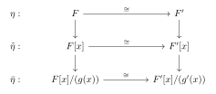
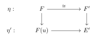
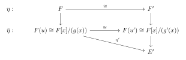
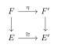
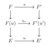
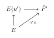
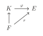
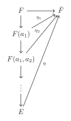

# 第二章：尺规作图与分裂域 { #top }

## 1. 尺规作图 { #s1 }

在本节中我们讨论尺规作图问题。

记 $L(x,y)$ 为过两点 $x$ 和 $y$ 的直线，$C(x,r)$ 为以点 $x$ 为圆心，长度 $r$ 为半径的圆。

开始尺规作图之前，我们在平面上有 $n$ 个点 $z_1,z_2,\dots ,z_n\in \mathbb{R}^2\cong \mathbb{C}$，其中 $z_1=(0,0),z_2=(0,1)$，即我们有了原点和单位长度。

令 $S_1=\left\{z_1,\dots,z_n\right\}$。我们在 $S_i$ 上通过如下规则作出 $S_{i+1}$：

- 添加两直线的交点 $L(x,y)\cap L(x^\prime,y^\prime)$；
- 添加两圆的交点 $C(x,\left|y-z\right|)\cap C(x^\prime,\left|y^\prime-z^\prime\right|)$；
- 添加直线与圆的交点 $L(x,y)\cap C(x^\prime,\left|y^\prime-z^\prime\right|)$。

于是有 $S_1\subset S_2 \subset \dots$ 并且 $S=\displaystyle\bigcup_{i=1}^{\infty} S_i$ 是所有能用尺规作图作出来的点构成的集合。

显然 $\frac{1}{2^n}\mathbb{Z}[i]\subset S$，即 $S$ 在 $\mathbb{C}$ 中是稠密的。

!!! theorem "定理"
    我们有如下命题：

    - $S\supset {z_1,\cdots,z_n}$ 是 $\mathbb{C}$ 的子域；
    - $\forall a\in S$，我们有 $\bar{a}\in S$ 与 $\sqrt{a}\in S$；
    - $S$ 是 $\mathbb{C}$ 的满足如上条件的最小子域。

??? proof "证明"
    我们已经熟知如何用尺规作图对线段长度进行加减乘除与开根，以及对角进行加减与平分，故前两者是显然的。对于最后一个命题，设 $F$ 是 $C$ 的满足条件的子域，可以通过归纳验证 $S_i\subset F$。

!!! definition "定义"
    称 $S$ 中的点是$z_1,\dots,z_n$ **尺规导出的(constructible)**

!!! definition "定义"
    对于 $\mathbb{C}$ 的子域 $F$，一个域扩张 $E/F$ 称为 $F$ 上的**平方根塔(square root tower)**，若 $E$ 形如 $F(u_1,\dots,u_n)$ 并且 $u_i^2\in F(u_1,\dots,u_{i-1})$。

进而我们可以看到 $[F(u_1,\dots,u_i):F(u_1,\dots,u_{i-1})]=1$ 或 $2$，所以 $[E:F]=2^k$ 对于某个正整数 $k$。

!!! theorem "定理"
    给定 $n$ 个点 $z_1,\dots,z_n\in \mathbb{C}$，$F=\mathbb{Q}(z_1,\dots,z_n,\bar{z_1},\dots,\bar{z_n})$。则 $z\in \mathbb{C}$ 是尺规导出的当且仅当 $z$ 被包含在 $F$ 上的一个平方根塔里。

??? proof "证明"
    设 $T$ 是平方根塔的集合。

    一方面，容易验证 $T$ 同 $S$ 一样满足上述条件，故 $S\subset T$。

    另一方面，通过归纳容易验证 $T$ 中的点都是尺规导出的，故 $T\subset S$。

    因此 $S=T$，得证。

!!! theorem "推论"
    若 $z$ 是尺规导出的，那么 $z$ 是代数数，且若 $g(x)$ 是 $z$ 在 $F$ 上的极小多项式，则 $\deg g(x)=2^k$，对于某个正整数 $k$。

!!! example "例（尺规作图三大问题）"
    **倍立方问题：**取 $F=Q,z=\sqrt[3]{2}$，$z$ 在 $F$ 上的极小多项式是 $g(x)=x^3-2$，$\deg g(x)=3\neq 2^k$，故不是尺规导出的。

    **三等分角问题：**取 $F=Q,z=e^{i\pi/9}$，$z$ 在 $F$ 上的极小多项式是 $g(x)=x^3-\dfrac{3}{4}x-\dfrac{1}{8}$，$\deg g(x)=3\neq 2^k$，故 $\dfrac{\pi}{3}$ 不能被三等分，更不用说一般的角了。

    **倍立方问题：**取 $F=Q,z=\pi$，$z$ 在 $F$ 上不是代数元，自然不是尺规导出的。

## 2. 分裂域 { #s2 }

!!! definition "定义"
    $f$ 是 $F$ 上的首一多项式，域扩张 $E/F$ 满足：存在 $r_1,\cdots,r_n \in E$，$f(x)=(x-r_1)\cdots(x-r_n)$ 且 $E=F(r_1,\cdots,r_n)$，则称 $E$ 是 $F$ 的**分裂域(splitting field)**。此时称 $E$ 是多项式 $f(x)$ 的分裂域。

!!! theorem "引理"
    我们有如下命题：

    - 若 $E$ 是 $f(x)\in F(x)$ 的分裂域，则 $[E:F]<\infty$；
    - 域扩张 $E/K/F$， $E/F$ 是 $f(x)\in F[x]\subset E[x]$ 的分裂域，则 $E/K$ 是 $f(x)$ 的分裂域。

!!! theorem "定理"
    $F[x]$ 中任一非零首一多项式均有分裂域。

??? proof "证明"
    对 $f$ 的度数归纳。假设 $f$ 在 $F$ 上不可分，则存在不可约多项式 $g(x)$，$g(x)\mid f(x)$，$\mathrm{deg} g\ge 2$。由 [Kronecker's theorem](chapter-01.md)，存在域扩张 $K/F$ 使得 $g(x)=(x-r_1)g'(x)\in K[x]$，则 $f(x)=(x-r_1)f'(x)\in K[x]$。由归纳假设知 $h(x)/K$ 有分裂域 $E$，则 $E$ 是 $f(x)/F$ 的分裂域。

接下来我们想要证明分裂域在同构意义下是唯一的。

!!! theorem "引理"
    $\eta:F\rightarrow F'$ 是域同构，则存在唯一的同构 $\tilde{\eta}:F[x]\cong F'[x]$。对不可约多项式 $g[x]\in F[x],g'(x)=\tilde{\eta}(g(x))\in F'[x]$，存在唯一的同构 $\bar{\eta}:F[x]/(g(x))\cong F'[x]/(g'(x))$ 且下图是交换的。

    { loading=lazy }

!!! theorem "引理"
    $\eta:F\rightarrow F'$ 是同构，$E/F,E'/F'$ 是域扩张，$E/F$ 的代数元 $u$ 的极小多项式为 $g(x)$，令 $g'(x)=\eta(g(x))$，则存在 $\eta':F(u)\rightarrow E'$ 使得下图交换：

    { loading=lazy }

    当且仅当 $g'(x)$ 在 $E'$ 中有根。这样的扩张的个数与 $g'(x)$ 在 $E'$ 中的根个数相同。

??? proof "证明"
    “$\Longrightarrow$”：$g(u)=0$，故 $g'(\eta'(u))=\eta(g(\eta'(u)))=0$，即 $\eta'(u)$ 是 $g'(x)$ 在 $E'$ 上的根。

    “$\Longleftarrow$”：设 $u'$ 是 $g'(x)$ 的任一根，由**引理 1.3**知我们知道下图交换：

    { loading=lazy }

    $\tilde{\eta}$ 与 $\eta'$ 有一一对应，故 $\eta'$ 存在且唯一。对于 $g'(x)$ 任一根对应的 $\eta'$ 均不同，故这样的扩张的个数与 $g'(x)$ 在 $E'$ 中的根个数相同。

!!! theorem "定理"
    $\eta:F\rightarrow F'$ 是同构，$f(x)\in F[x],f'(x)=\tilde{\eta}(f(x))\in F'[x]$，$E/F$ 和 $E'/F'$ 分别是 $f/F$ 与 $f'/F'$ 的分裂域，则有同构 $E\rightarrow E'$ 使得下图交换：

    { loading=lazy }

    进一步，这样的扩张个数不超过 $[E:F]$，取等当且仅当 $f'(x)$ 在 $E'$ 中没有重根。

??? proof "证明"
    对 $[E:F]$ 归纳。设 $u\in F$ 的极小多项式为 $f(x)$ 的一个不可约因式 $g(x)$，$\mathrm{deg}g\ge 2$。由引理

    $$
    \begin{aligned}
    \#\left\{\text{同构} \eta_u:F(u)\rightarrow F'(u')\right\}&=\#\left\{g'(x)=\tilde{\eta}(g(x)) \text{的根}\right\}\\
    &\le \mathrm{deg}g=[F(u):F]
    \end{aligned}
    $$

    考虑 $E$ 和 $E'$ 是 $f(x)/F(u)$ 和 $f'(x)/F'(u')$ 的分裂域。由归纳假设，对任意 $\eta_u$ 存在至多 $[E:F(u)]$ 个扩张，取等当且仅当 $f'(x)\in F'(u')[x]$ 在 $E'$ 上无重根。故扩张的总数至多 $[F(u):F][E:F(u)]=[E:F]$ 取等当且仅当 $f'$ 在 $E'$ 上无重根。

    { loading=lazy }

!!! theorem "推论"
    $E/F$ 是 $f(x)\in F[x]$ 的分裂域，则

    $$
    \left|\mathrm{Aut}_F(E)\right|\le[E:F]
    $$

    取等当且仅当 $f(x)$ 没有重根。

??? proof "定理 1.7 的证明"
    存在性：考虑

    $$
    R=F[\left\{x_f\right\}_{f\in F[x]}]=\bigcup_{\substack{n\in \mathbb{N}^+\\ \forall \left\{f_i\right\}_{i=1}^n\subset F[x]}} F[x_{f_1},\cdots,x_{f_n}]
    $$

    设 $I$ 是由 $\left\{ f(x_f)\Big| f(x)\in F[x]\right\}$ 生成的理想。我们断言 $I\neq R$，故可以取极大理想 $\mathfrak{m}\supseteq I$。事实上，若 $I=R$，则存在 $g_1,\cdots,g_n\in R,f_1,\cdots,f_n\in F[x]$ 使得

    $$
    1=g_1\cdot f_1(x_{f_1})+\cdots+g_n\cdot f_n(x_{f_n})
    $$

    由 [Kronecker's theorem](chapter-01.md)，存在域扩张 $K/F$ 使得 $f_i(x)$ 在 $K$ 中有根 $a_i,i=1,\cdots,n$，则我们取 $x_{f_i}=a_i$ 就有 $1=g_1\cdot f_1(a_1)+\cdots+g_n\cdot f_n(a_n)=0$，矛盾！

    令 $E_1=R/\mathfrak{m}$ 是一个域，对 $f(x)\in F[x],f(\overline{x_f})=0 \in E_1$。故 $E_1$ 是 $F$ 的代数扩张，则任意 $f\in F$ 均有一根在 $E_1$ 中。

    继续这个过程，我们得到了一列代数扩张：

    $$
    F\rightarrow E_1\rightarrow E_2\rightarrow \cdots
    $$

    令 $E=\bigcup_{n=1}^\infty E_i$，则 $E/F$ 是代数扩张。对任意 $f(x)\in E[x]$，设 $f(x)\in E_n[x]$，则 $f$ 在 $E_{n+1}\subset E$ 中有根，即 $E$ 是代数闭的，这表示 $E$ 是 $F$ 的一个代数闭包。

    唯一性：设 $\bar{F}/F,\bar{F}'/F$ 是 $F$ 两个代数闭包。定义

    $$
    S=\left\{(K,\varphi_K)\Big| \bar{F}/K/F,\varphi:K\rightarrow \bar{F}',\varphi|_F=id_F\right\}
    $$

    首先 $(F,id_F)\in S$ 故 $S\neq \emptyset$。我们定义序关系 $(K,\varphi_K)\le (K',\varphi_{K'})$ 当且仅当 $K\subset K'$ 且 $\varphi_K=\varphi_{K'}|_K$，这是一个偏序关系。对于升链 $(K_1,\varphi_{K_1})\le (K_2,\varphi_{K_2})\le \cdots$ 有上界 $(\cup K_i,\displaystyle\lim_{i\rightarrow \infty} \varphi_{K_i})$。由 Zorn 引理，我们知道 $S$ 中存在极大元 $(E,\varphi_E)$。

    若 $E\neq \bar{F}$，取 $u\in \bar{F}\setminus E$，我们有下图交换：

    { loading=lazy }

    矛盾！故 $E=\bar{F}$，我们有单射 $\varphi:\bar{F}\rightarrow \bar{F}'$，同样有单射 $\bar{F}'\rightarrow\bar{F}$，这表示 $\bar{F}\cong \bar{F}'$。

!!! theorem "推论"
    设 $\tau:F\rightarrow E$，$E$ 是代数封闭的，$K/F$ 是代数扩张，则存在 $\varphi:K\rightarrow E$ 使得下图交换：

    { loading=lazy }

!!! theorem "推论"
    $E=F(a_1,\cdots,a_n)$ 是代数扩张，则 $\left|\mathrm{Hom}_F(E,\bar{F})\right|\le [E:F]$取等当且仅当所有 $a_i$ 的极小多项式 $g_i(x)$ 都没有重根。

??? proof "证明"
    注意到

    $$
    \left|\mathrm{Hom}_F(F(a_1),\bar{F})\right|=\#\left\{g_1(x) \text{在} \bar{F} \text{中的根}\right\}\le [F(a_1):F]
    $$

    取等当且仅当 $g_1(x)$ 无重根。固定 $\eta_1\in \mathrm{Hom}_F(F(a_1),\bar{F})$，同样有

    $$
    \left|\mathrm{Hom}_{F(a_1)}(F(a_1,a_2),\bar{F})\right|\le [F(a_1,a_2):F(a_1)]
    $$

    故 $\left|\mathrm{Hom}_{F}(F(a_1,a_2),\bar{F})\right|\le [F(a_1,a_2):F]$。继续下去就完成了证明。

    { loading=lazy }

---

[返回目录](index.md){ .md-button } [下载 PDF 完整版](../../../assets/algebra-2h-notes.pdf){ .md-button download="algebra-2h-notes.pdf" }
