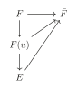
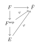
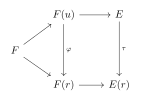
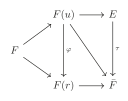

# 第三章：可分扩张与正规扩张 { #top }

## 1. 可分扩张 { #s1 }

!!! definition "定义"
    域 $F$，$f(x)\in F[x]$ 称为**可分多项式(separable polynomial)**若 $f(x)$ 的每个不可约因子在 $f(x)$ 的分裂域中均无重根。

!!! definition "定义"
    域扩张 $E/F$，代数元 $u\in E$ 的极小多项式是可分多项式，则称 $u$ 是 $F$ 上的**可分元**。

!!! definition "定义"
    若 $E/F$ 是代数扩张且 $E$ 中每个元都是 $F$ 上的可分元，则称 $E$ 是 $F$ 上的**可分扩张**。

!!! theorem "定理"
    若 $E/F$ 是代数扩张，则如下命题等价：

    - $E/F$ 是可分扩张；
    - $E=F(\left\{a_i\right\}_{i\in I})$，其中 $a_i$ 是 $F$ 上的可分元；
    - 若 $[E:F]<\infty$，我们有 $\left|\mathrm{Hom}_F(E,\bar{F})\right|=[E:F]$。

??? proof "证明"
    $(1)\Longrightarrow(2)$ 是显然的。$(2)\Longrightarrow(3)$ 由**推论 1.7**即得。

    $(3)\Longrightarrow(1)$：对于代数元 $u$ 的极小多项式 $g(x)$，我们有下图交换：

    { loading=lazy }

    则

    $$
    \left|\mathrm{Hom}_F(E,\bar{F})\right|\le [E:F(u)]\cdot \#\left\{ g(x) \text{在} \bar{F} \text{中的根}\right\}\le [E:F]
    $$

    故

    $$
    \#\left\{ g(x) \text{在} \bar{F} \text{中的根}\right\}=[F(u):F]
    $$

    即 $g(x)$ 无重根。

!!! theorem "推论"
    若 $E$ 是 $f(x)$ 的分裂域，则 $E/F$ 是可分的 $\Longleftrightarrow$ $f(x)$ 是可分的 $\Longleftrightarrow$ $\mathrm{Aut}_F(E)=[E:F]$。

!!! theorem "命题"
    域扩张 $E/K/F$，则 $E/F$ 是可分的当且仅当 $E/K,K/F$ 是可分的。

??? proof "证明"
    “$\Longrightarrow$”是显然的。

    “$\Longleftarrow$”：$\forall u \in E$，设 $u$ 在 $K$ 上的极小多项式为 $u^n+k_{n-1}u^{n-1}+\cdots+k_0=0$。则 $u$ 在 $F(k_0,\cdots,k_{n-1})$ 上可分。注意到

    $$
    \begin{aligned}
    \left|\mathrm{Hom}_F(F(k_0,\cdots,k_{n-1}),\bar{F})\right| &=[F(u,k_0,\cdots,k_{n-1}):F(k_0,\cdots,k_{n-1})][F(k_0,\cdots,k_{n-1}):F]\\
    &=[F(u,k_0,\cdots,k_{n-1}):F]
    \end{aligned}
    $$

    故 $F(u,k_0,\cdots,k_{n-1})$ 是可分的，这表示 $u$ 是可分的，即 $E/F$ 是可分的。

!!! definition "定义"
    域扩张 $E/K/F,E/K'/F$，记 $K$ 和 $K'$ 的**复合** $KK'$ 为包含 $K$ 和 $K'$ 的 $E$ 的最小子域。

代数(可分)扩张的复合还是代数(可分)扩张。

我们想知道哪些多项式是可分的。

!!! definition "定义"
    设 $f(x)=a_0+a_1x+\cdots+a_nx^n\in F[x]$，定义 $f$ 的导数

    $$
    f'(x)=a_1+2a_2x+\cdots+na_nx^{n-1}
    $$

当 $\mathrm{char}F=0$ 时，$f'(x)=0\Longleftrightarrow f(x)\in F$；

当 $\mathrm{char}F=p$ 时，$f'(x)=0\Longleftrightarrow f(x)=a_0+a_px^p+a_{2p}x^{2p}+\cdots=g(x^p)$。

!!! theorem "定理"
    $f(x)\in F[x]$ 是可分的当且仅当 $(f(x),f'(x))=1$。

!!! theorem "推论"
    $f\in F[x]$ 是首一不可约多项式，则若 $\mathrm{char}F=0$，$f(x)$ 总是可分的；若 $\mathrm{char}F=p$，$f$ 可分当且仅当 $f(x)\neq g(x^p)$，$g(x)\in F[x]$。

进而特征为零的域都是可分的，下面我们考虑特征为 $p$ 的域。我们在 $F$ 上定义 Frobenius 同态：$\varphi :a\mapsto a^p$，记 $F^p=\mathrm{Im}\varphi$。

!!! theorem "引理"
    $x^p-a$ 是可约的当且仅当 $a\in F^p$。

??? proof "证明"
    若 $a\in F^p$，设 $a=b^p$，则 $x^p-a=(x-b)^p$ 可约。

    若 $x^p-a$ 可约，设 $x^p-a=f(x)g(x)$，考虑 $x^p-a$ 的分裂域，则存在 $b\in E$，$b^p=a$，则 $x^p-a=(x-b)^p\in E[x]$，故 $f(x)=(x-b)^r\in E[x]$，其中 $0<r<p$。则 $b^r\in F$，由裴蜀定理我们可以得到 $b\in F$，即 $a\in F^p$。

!!! definition "定义"
    一个域 $F$ 上任一多项式都是可分多项式，则称 $F$ 是**完全域(complete)**。

由**推论 1.9**我们知道特征为零的域都是完全域。而对于特征为 $p$ 的域，我们有如下定理：

!!! theorem "定理"
    $\mathrm{char} F=p$，则 $F$ 是完全域当且仅当 $F=F^p$。

??? proof "证明"
    “$\Longrightarrow$”：若 $F$ 是完全域，$\forall a\in F$ 且 $a\notin F^p$，考虑 $f(x)=x^p-a$，由**引理 1.5**知 $f$ 不是可分的，矛盾！故 $F=F^p$。

    “$\Longleftarrow$”：若 $F=F^p$ 且 $F$ 不是完全域，取不可分的不可约多项式 $f$，由**推论 1.9**知 $f(x)=g(x^p)=\sum a_ix^{pi}$。由于 $F=F^p$，$a_i=b_i^p$，于是 $f(x)=(\sum b_ix^i)^p$，矛盾！

!!! theorem "推论"
    有限域都是完备的。

??? proof "证明"
    由于 $\varphi$ 是单射，我们有 $\left|F\right|\le \left|F^p\right|$，即 $F=F^p$。

!!! definition "定义"
    域扩张 $E/F$，可以证明 $E$ 中所有 $F$ 上的可分元构成了 $E$ 的一个子域，称为 $F$ 在 $E$ 中的**可分闭包(separable closure)**，记为 $F^\mathrm{sep}$。

设 $E/F$ 是代数扩张。若 $\mathrm{char}F=0$，显然 $F^\mathrm{sep}=E$。

若 $\mathrm{char}F=p$，取 $u\in E\setminus F^\mathrm{sep}$，设 $g(x)$ 是 $u$ 的极小多项式。由**推论 1.9**我们有 $g(x)=g_1(x^p)$，$g_1(x)$ 是 $u^p$ 的极小多项式。继续这个过程，若 $u^p\notin F^\mathrm{sep}$，我们可以继续构造 $g_2(x)$ 是 $u^{p^2}$ 的极小多项式。这个过程最终会停止，即 $u^{p^n}\in F^\mathrm{sep}$ 对某个 $n>0$。

!!! definition "定义"
    设 $E/F$ 是代数扩张，称 $u\in E$ 是**完全不可分的(purely inseparable)**，若 $u^{p^n}\in F$ 对某个 $n>0$。$E/F$ 称为完全不可分的若 $E$ 中每个元素都完全不可分。

由上面的讨论，$E/F^\mathrm{sep}$ 是完全不可分的。

设 $E/F$ 是完全不可分的，取 $u\in E\setminus F$，设 $u$ 在 $F$ 上的极小多项式为 $g(x)$，设 $n$ 是最小的正整数满足 $u^{p^n}\in F$，则 $u$ 是 $x^{p^n}-u^{p^n}\in F[x]$ 的根，故 $g(x)\mid x^{p^n}-u^{p^n}$。

注意到 $x^{p^n}-u^{p^n}=(x-u)^{p^n}$，故 $g(x)=(x-u)^m=x^m-u^m$ 对某个 $m$，这表示 $u^m\in F$，进而 $u^{(m,p^n)}\in F$，由 $n$ 的取法知 $m=p^n$。

这表示若 $E/F$ 是完全不可分的且 $E\neq F$，则 $E/F$ 是不可分的。

!!! example "例"
    $\mathbb{Z}_p(t^{1/p})/\mathbb{Z}_p(t)$ 是完全不可分的。

!!! definition "定义"
    $E/F$ 是代数扩张，$[F^\mathrm{sep}:F]$ 称作 $E/F$ 的**可分次数(separable degree)**，$[E:F^\mathrm{sep}]$ 称作 $E/F$ 的**不可分次数(inseparable degree)**。

!!! theorem "命题"
    设 $E/F$ 是有限扩张，则 $[E:F^\mathrm{sep}]=p^n$ 对某个 $n\ge 0$。特别的，若 $E/F$ 是完全不可分的，$F=F^\mathrm{sep}$，故 $[E:F]=p^n$。

!!! theorem "命题"
    若 $E/K,K/F$ 是完全不可分扩张，则 $E/F$ 是完全不可分扩张。

??? proof "证明"
    对任意 $u\in E$，存在 $m$ 使得 $u^{p^m}\in K$，则存在 $n$ 使得 $(u^{p^m})^{p^n}\in F$，即 $u^{p^{m+n}}\in F$，故 $u$ 是完全不可分的。

利用可分闭包我们可以推广**定理 1.12**：

!!! theorem "命题"
    $E/F$ 是有限扩张，则

    $$
    \left|\mathrm{Hom}_F(E,\bar{F})\right|=[F^\mathrm{sep}:F]
    $$

??? proof "证明"
    即证对给定的 $\psi:F^\mathrm{sep}\rightarrow \bar{F}$，保持 $F^\mathrm{sep}$ 不变的扩张 $\varphi:E\rightarrow \bar{F}$ 是唯一的。

    取 $u\in E\setminus F^\mathrm{sep}$，$u$ 是 $x^{p^i}-u^{p^i}$ 的根。故 $\varphi(u)$ 是 $x^{p^i}-\varphi(u^{p^i})=x^{p^i}-\psi(u^{p^i})$ 的根。

    由于 $\psi(u^{p^i})\in \bar{F}$，故存在 $v\in \bar{F},v^{p^i}=\psi(u^{p^i})$，则$x^{p^i}-\psi(u^{p^i})=(x-v)^{p^i}$，这表明 $\varphi(x)=v$。更进一步的，因为 $v_1^{p^i}-v_2^{p^i}=(v_1-v_2)^{p^i}$，故 $v$ 是唯一的。

    { loading=lazy }

!!! theorem "推论"
    若 $E/F$ 是完全不可分的，则 $\left|\mathrm{Hom}_F(E,\bar{F})\right|=1$。

## 2. 正规扩张 { #s2 }

!!! theorem "引理"
    $E/F$ 是 $f(x)\in F[x]$ 的分裂域，$u\in E$，$g(x)$ 是 $u$ 的极小多项式，则 $g(x)$ 在 $E$ 上可分。

??? proof "证明"
    设 $K$ 是 $g(x)$ 在 $E$ 上的分裂域，$r\in K$ 是 $g(x)$ 的一个根。我们有下图交换：

    { loading=lazy }

    这里 $\varphi:F(u)\rightarrow F(r),u\mapsto r$ 是同构，注意到 $E$ 是 $f(x)$ 在 $F(u)[x]$ 上的分裂域，$E(r)$ 是 $\varphi(f(x))\in F(r)[x]$ 的分裂域，故由**定理 1.11**存在同构 $\tau:E\rightarrow E(r)$。故 $E(r)\cong E$，即 $r\in E$。

我们将分裂域推广：

!!! definition "定义"
    $E/F$ 是代数扩张，$E/F$ 称作正规扩张，若 $F$ 上任意不可约多项式在 $E$ 中或者无根或者根都在 $E$ 中，则称 $E$ 是 $F$ 的正规扩张。

由**引理 1.6**我们知道所有的分裂域都是正规的。

!!! theorem "定理"
    $E/F$ 是代数扩张，则如下命题等价：

    - $E/F$ 是正规的；
    - 对任意 $\tau \in \mathrm{Hom}_F(E,\bar{F})$，$\tau(E)=E$；
    - 嵌入映射 $\mathrm{End}_F(E)\rightarrow \mathrm{Hom}_F(E,\bar{F})$ 是一一对应的。

??? proof "证明"
    $(2)\Longleftrightarrow(3)$ 是显然的。

    $(1)\Longrightarrow(2)$：设 $u\in E$ 的极小多项式为 $g(x)$，则 $\tau(g(u))=g(\tau(u))=0$，故 $\tau(u)$ 是 $g(x)$ 的根。由于 $E/F$ 是正规的，故 $\tau(u)\in E$，进而 $\tau(E)\subset E$，即 $\tau\in \mathrm{Hom}(E/F)$。由于 $E/F$ 是代数的，由**命题 1.3**知 $\tau\in \mathrm{Aut}(E/F)$，即 $\tau(E)=E$。

    $(2)\Longrightarrow(1)$：设 $u\in E$ 的极小多项式为 $g(x)$，设 $r$ 是 $g(x)$ 的另外一根。我们有下图交换：

    { loading=lazy }

    这里 $\varphi$ 是同**引理 1.6**定义的同构，由于 $E$ 是 $F(u)$ 的代数扩张且 $\bar{F}$ 是 $F(u)$ 的代数闭包故 $\tau$ 存在。于是 $\tau(u)=\varphi(u)=r\in E$，这表示 $g(x)$ 在 $E$ 上分裂，即 $E/F$ 是正规的。

!!! theorem "推论"
    - $E/K/F$ 是域扩张，若 $E/F$ 是正规扩张，则 $E/K$ 也是正规扩张。
    - $E/K/F,E/K'/F$ 是域扩张，$K/F,K'/F$ 是正规扩张，则 $KK'/F$ 也是正规扩张。

??? proof "证明"
    $(1)$：由于 $E/F$ 是正规的，由上定理对任意 $\tau\in \mathrm{Hom}_F(E,\bar{F}),\tau(E)=E$。因为 $\mathrm{Hom}_K(E,\bar{F})\subset \mathrm{Hom}_F(E,\bar{F})$，再次利用上定理，$E/K$ 是正规的。

    $(2)$：注意到任意 $\tau\in \mathrm{Hom}_F(KK',\bar{F}),\tau\subset \mathrm{Hom}_F(K,\bar{F})\cap\mathrm{Hom}_F(K',\bar{F})$，故 $\tau(K')=K'$，进而 $\tau(KK')=KK'$，这表示 $KK'$ 是正规的。

!!! theorem "定理"
    - 一个有限扩张 $E/F$ 是正规的当且仅当 $E$ 是一个分裂域。
    - 任一有限扩张被包含于一个正规扩张。

??? proof "证明"
    $(1)$：“$\Longleftarrow$”由**引理 1.6**直接得出。“$\Longrightarrow$”：设 $E=F(u_1,\cdots,u_n)$，$u_i$ 的极小多项式是 $g_i(x)$，则 $E$ 是 $g_1(x)\cdots g_n(x)$ 的分裂域。

    $(2)$：设 $E=F(u_1,\cdots,u_n)$，则 $E$ 被 $g_1(x)\cdots g_n(x)$ 的分裂域包含，它是正规的。

!!! definition "定义"
    $K/E/F$ 是代数扩张，称 $K$ 是 $E/F$ 的正规闭包，若：

    - $K/F$ 是正规的。
    - 若 $K/M/E$ 是域扩张且 $M/F$ 是正规的，则 $K=M$。

!!! theorem "命题"
    若 $E/F$ 是有限扩张，设 $E=F(u_1,\cdots,u_n)$，$u_i$ 的极小多项式是 $g_i(x)$，则 $E/F$ 的正规闭包为 $g_1(x)\cdots g_n(x)$ 的分裂域并且在 $F$-同构意义下是唯一的。

!!! example "例"
    $\mathbb{Q}(\sqrt2)/\mathbb{Q},\mathbb{Q}(\sqrt[4]2)/\mathbb{Q}(\sqrt2)$ 是正规的，但是 $\mathbb{Q}(\sqrt[4]2)/\mathbb{Q}$ 不是正规的，因为 $x^4-2$ 在 $\mathbb{Q}$ 中不可约，$x^4-2$ 在 $\mathbb{Q}(\sqrt[4]2)$ 中有根但是不可分。由**命题 1.8**知 $\mathbb{Q}(\sqrt[4]2)/\mathbb{Q}$ 的正规闭包是 $\mathbb{Q}(\sqrt[4]2,\sqrt{-1})$

!!! example "例"
    $\mathbb{Q}(\sqrt[3]2,\omega)/\mathbb{Q}$ 是 $x^3-2$ 的分裂域，它是正规扩张，但是 $\mathbb{Q}(\sqrt[3]2)/\mathbb{Q}$ 不是正规的，因为 $x^3-2$ 在其中有根但是不可分。

由上两例我们知道，域扩张 $E/K/F$，若 $E/F$ 是正规的，$K/F$ 不一定是正规的；若 $E/K,K/F$ 是正规的，$E/F$ 也不一定是正规的。这与正规子群的概念相似。我们将在后文中讲述这种相似的原因。

!!! definition "定义"
    $E/F$ 是有限正规域扩张，$E/K/F$ 是域扩张，则 $K/F$ 是正规的当且仅当 $\forall \sigma \in \mathrm{Aut}(E/F),\sigma(K)=K$。

??? proof "证明"
    证明同**定理 1.15**。

---

[返回目录](index.md){ .md-button } [下载 PDF 完整版](../../../assets/algebra-2h-notes.pdf){ .md-button download="algebra-2h-notes.pdf" }
