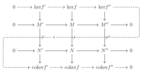
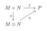
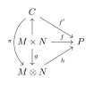
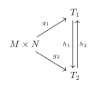
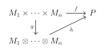
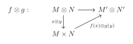
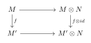
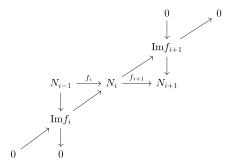

# 第七章：环与模 { #top }

## 1. 环和理想 { #s1 }

!!! definition "定义"
    $(R,+,\cdot)$ 称为**环(ring)**，若满足：

    - $(R,+)$ 是交换群(这样$R$有零元素，记为0)
    - $(xy)z=x(yz)$
    - $x(y+z)=xy+xz$
    - $(y+z)x=yz+zx$
    - $xy=yx$
    - $\exists1\in R$,$\forall x\in R,x1=1x=x$

!!! definition "定义"
    $R$ 的子集称为**子环(subring)**，若它对 $R$ 中的加法与乘法也构成环。

    $R$ 的子群 $I$ 称为**理想(ideal)**，若满足 $\forall a\in R,x\in I,ax\in R$。

考虑 $\left\{I_i\right\}_{i\in J}$ 是 $R$ 的所有理想，则 $\cap_{i\in J}I_i$ 也是 $R$ 的理想。

!!! definition "定义"
    定义 $\sum_{i\in J}I_i=\left\{ \sum_{i\in J'}a_i\Big| a_i\in I_i,J'\subset J\text{有限}\right\}$。

    $I_1\cdot I_2=\left\{a_ib_j\Big|  a_i\in I_1,b_j\in I_2\right\}$。

    $R,I$ 为理想，$R/I=\left\{\bar{a}=a+I\Big| a\in R\right\}$ 称为 **$R$ 模 $I$ 的商环**。

!!! definition "定义"
    对 $x\in R$：

    - 称为**零因子(zero divisor)**若存在 $y\neq 0 \in R$ 使 $xy=0$。
    - 称为**幂零的(nilotent)**若存在 $n$ 使得 $x^n=0$。
    - 称为**单位(unit)**若存在 $y\in R$ 使得 $xy=1$。

    环称为**整环(integral domain)**，若没有非零零因子。

!!! definition "定义"
    由单位生成的理想称为**单位理想(unit ideal)**。

    由一个元生成的理想称为**主理想(principal ideal)**。

    一个理想称为环 $R$ 的**极大理想**，若它不被包含于任一其他 $R$ 的理想。

    一个理想 $p$ 称为**素理想**，若 $xy\in \mathfrak{p}$ 能推出 $x\in \mathfrak{p}$ 或 $y\in \mathfrak{p}$。

!!! theorem "命题"
    $I$ 是素理想 $\Longleftrightarrow$ $R/I$ 是整环。

!!! example "例"
    $k[x]$ 的理想均形如 $(f(x))$。

!!! theorem "定理"
    任一非零理想、非单位理想、非单位元都包含于某一极大理想。

!!! definition "定义"
    所有幂零元构成的理想称作**幂零根(nilradical)**。

    所有极大理想的交称作**Jacobson 根(Jacobson radical)**。

!!! theorem "定理"
    幂零根等于所有素理想的交。

    $\mathrm{Jacb}(R)$ 是所有满足 $\forall r\in R,1-ar$ 可逆的 $a$ 构成的集合。

!!! definition "定义"
    $(I:J)=\left\{x\in R\Big| xJ\subset I\right\}$ 称为**商理想**。$(0:J)$ 称作 $J$ 的**零化理想(annihilator)**，记作 $\mathrm{Ann}(J)$。特别的，若 $J=(x)$，简记 $(I:J)=(I:x)$。

    $r(I)=\left\{x\in R\Big| x^n\in I,n>0\right\}$ 称作 $I$ 的**根(radical)**。

!!! example "例"
    $\displaystyle\bigcup_{0\neq x\in R} \mathrm{Ann}(x)=\left\{R \text{的零因子}\right\}$。$r(I)=\displaystyle\bigcap_{I\subset \mathfrak{p}\ prime}\mathfrak{p}$。

## 2. 模 { #s2 }

!!! definition "定义"
    设$R$是一个交换环，$M$是一个交换群，$\mu:R\times M\rightarrow M$，我们把$\mu(r,x)$写作$rx$，若：

    - $a(x+y)=ax+by$，
    - $(a+b)x=ax+bx$，
    - $(ab)x=a(bx)$，
    - $1x=x$。

    则称 $M$ 为**R-模(R-module)**。

    $M$ 的子群称作**子模(submodule)**若 $M$ 也是 $R$-模。

!!! definition "定义"
    两个 $R$-模 $M,N$ 之间的映射 $f:M\rightarrow N$ 称为**同态(homomorphism)**，若满足 $f(x+y)=f(x)+f(y),f(ax)=af(x),\forall a\in R$。

    称 $f$ 是**同构(isomorphism)**若存在同态 $g:N\rightarrow M$ 满足 $f\circ g=id_N,g\circ f=id_M$。

    $\mathrm{ker}f=f^{-1}(0)$ 是 $M$ 的子模。

    $\mathrm{coker}f=N/\mathrm{Im}f$ 是 $R$-模。

    $\mathrm{Hom}_R(M,N)$ 为所有同态 $f:M\rightarrow N$ 构成的集合，也是一个 $R$-模

!!! definition "定义"
    $\left\{M_i\right\}_{i\in S}$ 是 $M$ 的一列子模，定义

    $$
    \sum_{i\in S}M_i=\left\{\sum_{i\in S'} x_i\Big| x_i \in M_i,S'\subset S\text{有限}\right\}
    $$

    称 $M$ 是 $\left\{M_i\right\}_{i\in S}$ 的**直和**若每个元素表示方法唯一，记作 $M=\displaystyle\bigoplus_{i\in S}M_i$。

!!! definition "定义"
    $M$ 是**自由的**若 $M=\displaystyle\bigoplus_{i\in S}M_i$ 且 $M_i\cong R$

    称 $M$ 是**有限生成的**若 $M=\displaystyle\sum_{1\le i\le n} R\cdot x_i,x_i\in M$。

!!! definition "定义"
    若 $M$ 是有限生成自由模，则 $M\cong R^{\oplus n}$ 且 $n$ 唯一，$n$ 称为这个自由模的**维数(rank)**。

!!! theorem "命题"
    $M$ 有限生成 $\Longleftrightarrow$ 存在 $R^{\oplus n}\twoheadrightarrow M$ $\Longleftrightarrow$ $M$ 是 $R^{\oplus n}$ 的商模。

!!! definition "定义"
    $M$ 是 $R$-模，$I$ 是 $R$ 的理想，定义 $IM=\left\{\sum_{i=1}^{n}a_ix_i\Big| a_i\in I,x_i\in M\right\}$。

    $N,N'$ 是 $M$ 的子模，定义 $(N':N)=\left\{x\in R\Big| x\cdot N\subset N'\right\}$ 是 $R$ 的一个理想，$(0:N)$ 记作 $\mathrm{Ann}(N)$。

!!! definition "定义"
    称 $M$ 是**忠实的(faithful)** 若 $\mathrm{Ann}(M)=0$。

$M$ 在 $R/\mathrm{Ann}(M)$ 是忠实的。

!!! theorem "命题（Cayley-Hamilton）"
    $M$ 是有限生成 $R$-模，$\phi\in \mathrm{Hom}_R(M,M)$，$\phi(M)\subset I\cdot M$，则存在 $a_i\in I$ 使得

    $$
    \phi^n+a_1\phi^{n-1}+\cdots+a_n=0\in \mathrm{Hom}_R(M,M)
    $$

??? proof "证明"
    设 $M$ 生成元 $x_1,\cdots,x_n$，$M=\sum R\cdot x_i$，则 $\phi(x_i)=\sum_j a_{i,j}x_j,a_{i,j}\in I$，则

    $$
    \sum_j(a_{i,j}-\delta_{i,j}\phi)x_j=0
    $$

    进而 $(a_{i,j}-\delta_{i,j}\phi)_{n\times n}\left( \begin{array}{c} x_1\\ \vdots\\ x_n\\ \end{array} \right) =0$，故 $\mathrm{det}A(x_i)=0$。

若 $IM=M$，取 $\phi=id_M$，则存在 $a\in I,(1+a)M=0$。

!!! theorem "引理（Nakayama）"
    $M$ 是有限生成模，理想 $I\subset \mathrm{Jacb}(R)$。若 $IM=M$ 则 $M=0$。更一般的，对 $M$ 的子模 $N$，若 $M=N+IM$ 则 $M=N$。

??? proof "证明"
    存在 $a\in I$，$(1+a)M=0$，由于 $1+a$ 是单位，故 $M=0$。

    对第二个结论，我们有 $I(M/N)=(IM+N)/N=M/N$。

!!! theorem "推论"
    环 $R$，有限生成 $R$-模 $M$，$x_1,\cdots,x_n\in M$ 满足 $R/\mathfrak{m}\curvearrowright M/\mathfrak{m}M=\sum R\cdot \bar{x_i}$，则 $M=\sum Rx_i$。

??? proof "证明"
    $N=\sum_i Rx_i$，则 $M=N+\mathfrak{m}M$，由 Nakayama 引理知成立。

!!! definition "定义"
    环 $R$ 称为**局部的(local)**若它仅有一个极大理想 $\mathfrak{m}$，进而 $R\setminus \mathfrak{m}$ 中均是单位元，$R/\mathfrak{m}$ 称为 $R$ 的**剩余类域(residue field)**。

!!! theorem "推论"
    $R$是局部环，$M$ 是有限生成 $R-$模，则我们可以将 $M/\mathfrak{m}M$ 看成 $R/\mathfrak{m}-$模，这是一个向量空间。若这个向量空间的基是 $x_1,\cdots,x_n$，则 $\left\{x_i\right\}$ 生成 $M$。

??? proof "证明"
    设 $N$ 是由 $\left\{x_i\right\}$ 生成的子模，则 $N\rightarrow M/\mathfrak{m}M$ 是满射，这表示 $N+\mathfrak{m}M=M$，由 Nakayama 引理知 $N=M$。

!!! theorem "推论"
    $R$ 是局部环，$M=0$ 当且仅当 $M/\mathfrak{m}M=0$。$M\rightarrow N$ 是满射当且仅当 $M/\mathfrak{m}M\rightarrow N/\mathfrak{m}N$ 是满射。

### 2.1 正合性 { #s2-1 }

!!! definition "定义"
    一个 $R$-模和 $R$-同态的序列

    $$
    \dots \rightarrow M_{i-1} \stackrel{f_i}{\longrightarrow}M_i\stackrel{f_{i+1}}{\longrightarrow}M_{i+1} \rightarrow\cdots
    $$

    叫做在 $M_i$ 处**正合(exact)**，若 $\mathrm{Im}(f_i)=\mathrm{Ker}(f_{i+1})$。

    - $0 \rightarrow M' \rightarrow M\rightarrow M'' \rightarrow 0$ 称作短正合列；
    - $0 \rightarrow M' \rightarrow M\rightarrow M''$ 称作左正合列；
    - $M' \rightarrow M\rightarrow M'' \rightarrow 0$ 称作右正合列。

!!! example "例"
    - $0\rightarrow M'\stackrel{f}{\longrightarrow} M$ 是正合的当且仅当 $f$ 是单射；

    - $M\stackrel{g}{\longrightarrow} M''\rightarrow 0$ 是正合的当且仅当 $f$ 是满射；

    - $\dots \rightarrow M_{i-1} 	\stackrel{f_i}{\longrightarrow}M_i\stackrel{f_{i+1}}{\longrightarrow}M_{i+1} \rightarrow\cdots$

        是正合的当且仅当 $0 \rightarrow \mathrm{Im}f_i \rightarrow M_i\rightarrow \mathrm{Ker}f_{i+1} \rightarrow 0$ 是正合的。

!!! definition "定义"
    正合列 $0 \rightarrow M' \stackrel{f}{\rightarrow}M\stackrel{g}{\rightarrow}M'' \rightarrow 0$ 称为**分裂的(split)**，若存在 $h:M''\rightarrow M$ 使得 $g\circ h=id_M$。

注意到 $f,h$ 都是单射，故 $M',M''$ 可视作 $M$ 的子模且由 $g\circ f=0$ 有 $M'\cap M''=\left\{0\right\}$。对任意 $x\in M$，$x=h(g(x))+(x-h(g(x))\in M''+M'$，故 $M=M'\oplus M''$。

!!! theorem "命题"
    $(1)$ $M'\rightarrow M\rightarrow M''\rightarrow 0$ 是正合的当且仅当对任意 $R-$模 $N$，有

    $$
    0\rightarrow \mathrm{Hom}(M'',N)\rightarrow \mathrm{Hom}(M,N)\rightarrow \mathrm{Hom}(M',N)
    $$

    是正合的。

    $(2)$ $0\rightarrow N'\rightarrow N\rightarrow N''$ 是正合的当且仅当对任意 $R-$模 $N$ 有

    $$
    0\rightarrow \mathrm{Hom}(M,N'')\rightarrow \mathrm{Hom}(M,N)\rightarrow \mathrm{Hom}(M,N')
    $$

    是正合的。

??? proof "证明"
    我们只证明 $(1)$，$(2)$ 是类似的。

    设 $M'\rightarrow M\rightarrow M''\rightarrow 0$ 是正合的。若 $M\rightarrow M''\rightarrow N$ 是零的，由于 $M\rightarrow M'$ 是满射，故 $M''\rightarrow N$ 是零。于是 $\mathrm{Hom}(M'',N)\rightarrow \mathrm{Hom}(M,N)$ 是单射。

    若 $f:M\rightarrow N\in \mathrm{Im}(\mathrm{Hom}(M'',N)\rightarrow \mathrm{Hom}(M,N))$，则 $(M'\rightarrow M\rightarrow N)=(M'\rightarrow M\rightarrow M''\rightarrow N)=0$，故 $f\in \mathrm{Ker}(\mathrm{Hom}(M,N)\rightarrow \mathrm{Hom}(M',N))$。

    另一方面若 $(M'\rightarrow M\rightarrow N)=0$，由于 $M''\cong M/\mathrm{Im}(M'\rightarrow M)$，故存在自然映射 $M''\rightarrow N,(M\rightarrow N)=(M\rightarrow M''\rightarrow N)$，故 $M\rightarrow N\in \mathrm{Im}(\mathrm{Hom}(M'',N)\rightarrow \mathrm{Hom}(M,N))$。

    反过来是类似的，读者自证不难。

!!! theorem "命题（Snake lemma）"
    { loading=lazy }

    是交换图。则存在正合列

    $$
    0\rightarrow \mathrm{ker}f'\rightarrow \mathrm{ker}f\rightarrow \mathrm{ker}f''\stackrel{\delta}{\rightarrow}\mathrm{coker}f'\rightarrow \mathrm{coker}f\rightarrow \mathrm{coker}f''\rightarrow 0
    $$

    其中 $\delta$ 称为**边缘同态(boundary homomorphism)**。

??? proof "证明"
    我们这样给出 $\delta$：对任意 $x''\in M$，$f''(x'')=0$，我们取 $x\in M$，$(M\rightarrow M'')(x)=x''$，则 $f(x)\in \mathrm{ker}(N\rightarrow N'')$，故存在唯一的 $x'\in N',x'\rightarrow f(x)$。令 $\delta(x'')=\overline{x'}\in \mathrm{coker}f'$，容易验证良定义，且 $\mathrm{ker}f\rightarrow \mathrm{ker}f''\stackrel{\delta}{\rightarrow}\mathrm{coker}f'\rightarrow \mathrm{coker}f$ 正合

!!! definition "定义"
    设 $S$ 是一些 $R-$模构成的集合，$\lambda:S\rightarrow \mathbb{Z}$ 称为**可加的(additive)**若对任意正合列 $0\rightarrow M'\rightarrow M\rightarrow M''\rightarrow 0$ 有  $\lambda(M)=\lambda(M')+\lambda(M'')$。

!!! example "例"
    若 $R$ 是域，则 $\lambda(M)=\mathrm{dim}_R(M)$ 是可加的。

!!! theorem "引理"
    设 $0\rightarrow M_0\rightarrow M_1\rightarrow \cdots \rightarrow M_n\rightarrow 0$ 是正合的，$M_i\in S$，$\lambda$ 在 $S$ 上可加，则

    $$
    \sum_{i=0}^n(-1)^i\lambda(M_i)=0
    $$

??? proof "证明"
    $0\rightarrow \mathrm{Im}f_i\rightarrow M_i\rightarrow \mathrm{Im}f_{i+1}\rightarrow 0$ 是正合的，故 $\lambda(M_i)=\lambda(\mathrm{Im}f_i)+\lambda(\mathrm{Im}f_{i+1})$。

### 2.2 张量积 { #s2-2 }

!!! definition "定义"
    $M,N,P$ 是 $R-$模，$f:M\times N\rightarrow P$ 称为 **$R-$双线性的($R-$bilinear)**，若任意 $x\in M$，$N\rightarrow P,y\mapsto f(x,y)$ 是 $R-$线性的且任意 $y\in N$，$M\rightarrow P,x\mapsto f(x,y)$ 是 $R-$线性的。

若 $f$ 是 $R-$双线性的，则如下元素均为零：

$$
\left( x+x^\prime,y \right) -\left( x,y \right) -\left( x^\prime,y \right),\left( x,y+y^\prime \right) -\left( x,y \right) -\left( x,y^\prime \right),\left( ax,y \right) -a\left( x,y \right),\left( x,ay \right) -a\left( x,y \right)
$$

!!! definition "定义"
    $M,N$ 是 $R-$模，$C=\bigoplus_{(x,y)\in M\times N} R\cdot (x,y)$，$D\subset C$ 由 $(\ast)$ 生成。称 $C/D$ 为 $M$ 与 $N$ 的张量积，记作 $M\otimes N$。

!!! theorem "命题（Universal property）"
    存在双线性映射 $g:M\times N\rightarrow M\otimes N,(x,y)\mapsto x\otimes y$ 使得对任意双线性映射 $f:M\times N\rightarrow P$，存在唯一的 $R$-线性映射 $h$ 使下图交换：

    { loading=lazy }

??? proof "证明"
    对任意映射 $f:M\times N\rightarrow P$，我们有 $f':C\rightarrow P,\sum a_{xy}(x,y)\mapsto \sum a_{xy}f(x,y)$，则 $f$ 是双线性的当且仅当 $\mathrm{ker}f'\supset D$。故若 $f$ 是双线性的，则存在唯一的 $h$，$f'=h\circ \pi$，其中 $\pi$ 是投影映射 $C\rightarrow M\otimes N=C/D$，则 $f=h\circ g$。

    { loading=lazy }

由此命题我们可以有如下张量积的定义：

!!! definition "定义"
    $M,N$ 的张量积 $T$ 是由双线性映射 $g:M\times N\rightarrow T$ 定义的模，对任意 $f:M\times N\rightarrow P$ 存在唯一的线性映射 $f':T\rightarrow P,f=f'\circ g$。

??? proof "张量积的唯一性"
    若我们有两个不同的张量积 $T_1$ 和 $T_2$ 与对应的双线性映射 $g_1,g_2$，由上定义存在 $h_1:T_1\rightarrow T_2,g_2=h_1\circ g_1$ 与 $h_2:T_2\rightarrow T_1,g_1=h_2\circ g_2$。则 $g_2=h_1\circ g_1=h_1\circ h_2\circ g_2$。由于 $h_1\circ h_2:T_2\rightarrow T_2$ 是线性的，由唯一性 $h_1\circ h_2=id_{T_2}$。同理 $h_2\circ h_1=id_{T_1}$，故 $T_1\cong T_2$。

    { loading=lazy }

由 Universal property，我们可以定义 $M_1,\cdots,M_n$ 的张量积，由多线性映射 $g:M_1\times \cdots \times M_n\rightarrow M_1\otimes \cdots \otimes M_n,(x_1,\cdots,x_n)\mapsto x_1\otimes \cdots \otimes x_n$ 定义，对任意多线性映射 $f:M_1\times \cdots \times M_n\rightarrow P$，存在唯一的 $R$-线性映射 $h$ 使下图交换：

{ loading=lazy }

设 $M$ 由 $\left\{x_i\right\}_{i\in S}$ 生成，$N$ 由 $\left\{y_i\right\}_{i\in S'}$ 生成，则

$$
\sum a_{x,y}(x,y)=\sum a_{x,y}(\sum b_i x_i,\sum c_j y_j)=\sum a_{x,y}\sum b_ic_j x_i\otimes y_j
$$

即 $M\otimes$ 由 $\left\{x_i\otimes y_j\right\}$ 生成。于是有如下推论：

!!! theorem "推论"
    若 $M,N$ 有限生成，则 $M\otimes N$ 也有限生成。

!!! example "例"
    将 $\mathbb{Z}_m\otimes \mathbb{Z}_n$ 看成 $\mathbb{Z}-$模。我们来证 $\mathbb{Z}_m\otimes \mathbb{Z}_n\cong \mathbb{Z}_{(m,n)}$。

    令 $d=(m,n)$，$\mathbb{Z}_m\otimes \mathbb{Z}_n$ 由 $1\otimes 1$ 生成，$m(1\otimes 1)=m\otimes 1=0,n(1\otimes 1)=1\otimes n=0$，故 $d(1\otimes 1)=0$。令 $f:\mathbb{Z}_m\times \mathbb{Z}_n\rightarrow \mathbb{Z}_d,(a,b)\mapsto ab$，这是双线性的，故由 Universal property 存在满射 $h:\mathbb{Z}_m\otimes \mathbb{Z}_n\rightarrow \mathbb{Z}_d$。这同时也是单射因为 $d(1\otimes 1)=0$。

!!! example "例"
    设 $M,N$ 分别为 $m,n$ 维自由模且

    $$
    M=\displaystyle\bigoplus_{i=1}^n Rx_i,N=\displaystyle\bigoplus_{j=1}^m Ry_j
    $$

    令 $A=\bigoplus_{i=1}^n\bigoplus_{j=1}^m R x_i\otimes y_j$。

    考虑 $f:M\times N\rightarrow A,(\sum a_ix_i,\sum b_jy_j)\mapsto \sum a_ib_j(x_i\otimes y_j)$，这是双线性的，故我们可以构造 $f':M\otimes N\rightarrow A,f'=f\circ g$。

    另一方面我们自然有 $h:A\rightarrow M\otimes N,x_i\otimes y_j\mapsto x_i\otimes y_j$。可以验证 $f'\circ h=id_A,h\circ f'=id_{M\otimes N}$，故 $M\otimes N\cong A$ 是一个 $mn$ 维的自由模。

!!! example "例"
    $2\otimes \overline{1}\in \mathbb{Z}\otimes \mathbb{Z}_2$，$2\otimes \overline{1}=2\cdots 1\otimes \overline{1}=1\otimes 2\cdots \overline{1}=\overline{0}$，但在 $2\mathbb{Z}\otimes \mathbb{Z}_2$ 中 $2\otimes \overline{1}\neq 0$。

    故若 $M'\subset M,N'\subset N$，不一定有 $M'\otimes N'\subset M\otimes N$。

    另一方面，若 $\sum x\otimes y=0\in M'\otimes N'$，则 $\sum x\otimes y=0\in M\otimes N$。

!!! theorem "命题"
    $M,N,P$ 是 $R-$模，则有如下命题成立：

    - $M\otimes N\cong N\otimes M$
    - $(M\otimes N)\otimes P\cong M\otimes (N\otimes P)\cong M\otimes N\otimes P$
    - $(M\oplus N)\otimes P\cong (M\otimes P)\oplus (N\otimes P)$

??? proof "证明"
    这些同构分别由如下映射给出：

    - $x\otimes y\mapsto y\otimes x$；
    - $(x\otimes y)\otimes z\mapsto x\otimes (y\otimes z)\mapsto x\otimes y\otimes z$；
    - $(x,y)\otimes z\mapsto (x\otimes z,y\otimes z)$。

设 $M$ 是 $R-$模，$N$ 是 $R,R'-$双模(满足 $(ax)b=a(xb)$)，$P$ 是 $R'-$模，则

$$
(M\otimes_RN)\otimes_{R'}P\cong M\otimes_R N \otimes_{R'} P
$$

是 $R,R'-$双模

!!! theorem "命题"
    同态 $f:M\rightarrow M',g:N\rightarrow N'$ 则

    { loading=lazy }

设 $N$ 是 $R-$模，在范畴论中我们有函子

Cat of R-module$\longrightarrow$ Cat of R-module

{ loading=lazy }

设 $\varphi:R\rightarrow R'$ 是环同态，则在 $R'$ 上定义 $ra=\varphi(r)a$ 则是一个 $R-$模。对任意 $R'-$模 $M'$，定义 $ra=\varphi(r)a$ 则是一个 $R-$模，这称为**纯量限制(restriction of scalars)**。对任意 $R-$模 $M$，在 $M\otimes_RR'$ 上定义 $r(a\otimes x)=a\otimes rx$ 则是一个 $R'-$模，这称为**纯量扩张(extension of scalars)**。

!!! theorem "命题"
    - 若 $M'$ 在 $R'$ 上有限生成，$R'$ 在 $R$ 上有限生成，则 $M'$ 在 $R$ 上有限生成；
    - 若 $M$ 在 $R$ 上有限生成，则 $M\otimes_R R'$ 在 $R'$ 上有限生成。

### 2.3 张量积的正合性 { #s2-3 }

!!! theorem "命题"
    $M'\rightarrow M\rightarrow M''\rightarrow0$ 正合，对任一 $R-$模 $N$ 都有

    $$
    M'\otimes N\rightarrow M\otimes N\rightarrow M''\otimes N\rightarrow 0
    $$

    正合。

!!! theorem "推论"
    由于 $I\rightarrow R\rightarrow R/I \rightarrow 0$ 正合，故任意 $R-$模 $M$，$I\otimes M\rightarrow R\otimes M\rightarrow R/I\otimes M\rightarrow 0$ 正合。

    注意到 $R\otimes M\cong M$，$I\otimes M\cong IM$，故$(R/I)\otimes M\cong M/IM$。

    特别的令 $M=R/J$，则 $R/I\otimes R/J\cong R/I+J$。

!!! theorem "引理"
    $M,N,P$ 是 $R-$模，则 $\mathrm{Hom}_R(M\otimes N,P)\cong \mathrm{Hom}_R(M,\mathrm{Hom}_R(N,P))$

??? proof "证明"
    下述两个映射互为逆映射：

    $$
    \phi:\begin{aligned}
    f:M\otimes N\rightarrow P\mapsto& M\rightarrow \mathrm{Hom}_R(N,P)\\
    &\ \ x\mapsto y\mapsto f(x\otimes y)
    \end{aligned}
    ,
    \varphi:\begin{aligned}
    g:M\rightarrow \mathrm{Hom}_R(N,P)\mapsto M&\otimes N\rightarrow P\\
    x&\otimes y\mapsto g(x)(y)
    \end{aligned}
    $$

??? proof "命题2.10的证明"
    由**命题2.4**我们希望

    $$
    0\rightarrow \mathrm{Hom}(M''\otimes N,P)\rightarrow \mathrm{Hom}(M\otimes N,P)\rightarrow \mathrm{Hom}(M'\otimes N,P)
    $$

    对任意 $P$ 都正合，而由上述引理这等价于

    $$
    0\rightarrow \mathrm{Hom}(M'',\mathrm{Hom}(N,P))\rightarrow \mathrm{Hom}(M,\mathrm{Hom}(N,P))\rightarrow \mathrm{Hom}(M',\mathrm{Hom}(N,P))
    $$

    正合，再次利用**命题2.4**我们完成了证明。

!!! definition "定义"
    一个 $R-$模 $M$ 是**平坦的(flat)**，若对任意正合列

    $$
    \cdots\rightarrow M_{i-1}\rightarrow M_i\rightarrow M_{i+1}\rightarrow \cdots
    $$

    有

    $$
    \cdots\rightarrow M\otimes M_{i-1}\rightarrow M\otimes M_i\rightarrow M\otimes M_{i+1}\rightarrow \cdots
    $$

    也是正合的。

!!! example "例"
    自由模是平坦的，任意有限生成平坦 $\mathbb{Z}-$模都是自由的。

!!! theorem "命题"
    下述命题等价：

    - $M$ 是平坦的；
    - 任意正合列 $0\rightarrow N'\rightarrow N\rightarrow N''\rightarrow 0$，$0\rightarrow N'\otimes M\rightarrow N\otimes M\rightarrow N''\otimes M\rightarrow 0$ 正合。
    - 任意正合列 $0\rightarrow N'\rightarrow N$，$0\rightarrow N'\otimes M\rightarrow N\otimes M$ 正合。
    - 任意有限生成模 $N,N'$，若 $0\rightarrow N'\rightarrow N$ 正合，则 $0\rightarrow N'\otimes M\rightarrow N\otimes M$ 正合。

??? proof "证明"
    $(1)\Longrightarrow (2)$ 是显然的。

    $(2)\Longrightarrow (1)$：回忆若有正合列 $N_{i-1}\stackrel{f_i}{\longrightarrow}N_i\stackrel{f_{i+1}}{\longrightarrow} N_{i+1}$，则

    $$
    0\rightarrow \mathrm{Im}f_i\rightarrow N_i\rightarrow \mathrm{Im}f_{i+1}\rightarrow 0
    $$

    也是正合的，进而 $0\rightarrow \mathrm{Im}f_i\otimes M\rightarrow N_i\otimes M\rightarrow \mathrm{Im}f_{i+1}\otimes M\rightarrow 0$ 正合。我们有自然映射 $\mathrm{Im}f_{i+1}\rightarrow N_i$ 与 $N_i\rightarrow \mathrm{Im}f_i$，故s

    $$
    \mathrm{ker}(f_{i+1}\otimes id_M)=\mathrm{ker}(N_i\otimes M\rightarrow \mathrm{Im}f_{i+1}\otimes M)=\mathrm{Im}(\mathrm{Im}f_i\otimes M\rightarrow N_i\otimes M)=\mathrm{Im}(f_i\otimes id_M)
    $$

    { loading=lazy }

    $(2)\Longleftrightarrow (3)$ 由**命题2.10**是显然的。

    $(3)\Longrightarrow (4)$ 是显然的。

    $(4)\Longrightarrow (3)$：设 $M'\rightarrow M$ 是单射，我们来证明 $f\otimes 1:M'\otimes N\rightarrow M\otimes N$ 也是单射。取 $x\in \mathrm{ker}(f\otimes 1)$，$x=\sum_{i=1}^n x_i\otimes y_i$，则 $(f\otimes 1)(x)=\sum_{i=1}^n f(x_i)\otimes y_i=0$。取 $\tilde{M}'$ 由 $x_1,\cdots,x_n$ 生成，$\tilde{M}$ 由 $f(x_1),\cdots,f(x_n)$ 生成，则我们有单射 $f\Big|_{\tilde{M}'}:\tilde{M}'\rightarrow \tilde{M}$，且 $(\tilde{f}\otimes 1)(x)=0$，即 $x=0\in \tilde{M}'\otimes N$，即 $x=0\in M'\otimes N$，于是我们完成了证明。

!!! theorem "命题"
    若 $M$ 是 $R$ 上的平坦模，则 $M\otimes_R R'$ 是 $R'$ 上的平坦模。

??? proof "证明"
    由 $N_i\otimes_{R'} (R'\otimes_R M)\cong N_i\otimes_R M$ 即得。

!!! definition "定义"
    环 $R'$ 由同态 $f:R\rightarrow R'$ 给出的 $R-$模结构称为一个 $R$ 上的**代数**。

---

[返回目录](index.md){ .md-button } [下载 PDF 完整版](../../../assets/algebra-2h-notes.pdf){ .md-button download="algebra-2h-notes.pdf" }
