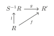
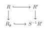
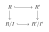
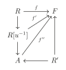

# 第八章：局部化与整相关性 { #top }

## 1. 局部化 { #s1 }

!!! definition "定义"
    给定环 $R$，乘性子集 $S\subset R$ 使得 $1\in S$ 且若 $a,b\in S$ 则 $ab\in S$。我们定义 $R\times S$ 上的等价关系：$(a,s)~(b,t)\leftrightarrow \exists u\in S,(at-bs)u=0$。由该等价关系导出的等价类记为 $S^{-1}R$ 称为 $R$ 对 $S$ 的**分式环(ring of fractions)**。

我们记 $(a,s)$ 为 $\frac{a}{s}$，分式环的结构由

$$
\frac{a}{s}+\frac{a'}{s'}=\frac{as'+a's}{ss'},\frac{a}{s}\cdot\frac{a'}{s'}=\frac{aa'}{ss'}
$$

给出，单位为 $\frac{1}{1}$，零元为 $\frac{0}{S}$。

!!! example "例"
    - 若 $R$ 是整环，取 $S=R\setminus{0}$，则 $S^{-1}R$ 称为 $R$ 的分式域。
    - 设 $\mathfrak{p}$ 是 $R$ 的素理想，取 $S=R\setminus \mathfrak{p}$ 是乘性子集，我们称 $R_\mathfrak{p}=S^{-1}R$ 是在 $\mathfrak{p}$ 的**局部化(localization)**，且 $I=\left\{\frac{x}{s}\Big| x\in \mathfrak{p},s\in S\right\}$ 是 $R_\mathfrak{p}$ 的唯一极大理想，且 $R_\mathfrak{p}/I\cong R/\mathfrak{p}$ 是域。
    - $f\in R,S=\left\{1,f,f^2,\cdots\right\}$，则 $S^{-1}R=\left\{\frac{a}{f^n}\Big| a\in R,n\ge 0\right\}$，记为 $R_f$。

我们有自然同态 $l:R\rightarrow S^{-1}R,x\mapsto \frac{x}{1}$。

!!! theorem "命题（Universal property）"
    设同态 $f:R\rightarrow R'$ 满足任意 $s\in S,f(s)$ 均为单位，则存在唯一的同态 $g:S^{-1}R\rightarrow R'$ 使得 $f=g\circ l$。

    { loading=lazy }

??? proof "证明"
    若 $g$ 存在，则必须有 $g(\frac{a}{s})g(s)=g(a)=f(a)$，故 $g(\frac{a}{s})=f(a)f^{-1}(s)$。

    现在我们检验 $g$ 是良定义的，即若 $u(as'-a's)=0$，则 $g(\frac{a}{s})=g(\frac{a'}{s'})$。这是因为 $0=f(u(as'-a's))=f(u)(f(a)f(s')-f(a')f(s))=0$ 且 $f(u)$ 是单位，故 $f(a)f(s')=f(a')f(s)$，即 $f(a)f^{-1}(s)=f(a')f^{-1}(s)$。同态是容易验证的。

!!! theorem "推论"
    设同态 $f:R\rightarrow R'$，若有：

    - $\forall s\in S$，$f(s)$ 是单位；
    - 若 $f(a)=0$，则存在 $s\in S,as=0$；
    - $R'$ 可以写成 $f(a)f^{-1}(s)$，其中 $a\in R,s\in S$。

    则 $R'\cong S^{-1}R$。

类似的，设 $M$ 是一个 $R-$模，$S$ 是 $R$ 的乘性子集，我们可以定义 $M\times S$ 上的等价关系：$(a,s)~(b,t)\longleftrightarrow \exists u\in S,(at-bs)u=0$，则 $S^{-1}M$ 是该等价关系导出的等价类，可以将 $S^{-1}M$ 看作一个 $S^{-1}R-$模。

!!! theorem "命题"
    设 $f:M\rightarrow N$ 是一个 $R-$模同态，则 $f$ 诱导了一个同态 $S^{-1}f:S^{-1}M\rightarrow S^{-1}N$。更进一步地，若 $g:P\rightarrow M$ 是同态，则 $S^{-1}f\circ S^{-1}g=S^{-1}(f\circ g)$。

??? proof "证明"
    定义 $S^{-1}f:\frac{a}{s}\rightarrow \frac{f(a)}{s}$。我们来检验 $S^{-1}f$ 是良定义的：若 $\frac{a}{s}=\frac{b}{t}$，则 $\exists u\in S,(at-bs)u=0$，故 $(f(a)t-f(b)s)u=0$，进而 $\frac{f(a)}{s}=\frac{f(b)}{t}\in S^{-1}N$。

**注：**$S^{-1}$ 是一个 $R-$模范畴映到自身的函子。

!!! theorem "命题"
    若 $M'\overset{f}{\rightarrow}M\overset{g}{\rightarrow}M''$ 是正合的，则$S^{-1}M'\overset{S^{-1}f}{\rightarrow}S^{-1}M\overset{S^{-1}g}{\rightarrow}S^{-1}M''$ 是正合的。特别的，若 $M'$ 是 $M$ 的子模，则 $S^{-1}M'$ 是 $S^{-1}M$ 的子模。

??? proof "证明"
    首先 $S^{-1}g\circ S^{-1}f=S^{-1}(f\circ g)=0$，故 $\mathrm{Im}S^{-1}f\subset \mathrm{ker}S^{-1}g$。

    另一方面，设 $\frac{a}{s}\in \mathrm{ker}S^{-1}g,\frac{g(a)}{s}=0\in S^{-1}M''$，则存在 $u\in S,g(a)u=0$，即 $g(ua)=0\in M''$。由正合性，$ua=f(b),b\in M'$，则 $\frac{a}{s}=\frac{au}{su}=\frac{f(b)}{su}=S^{-1}f(\frac{b}{su})\in \mathrm{Im}S^{-1}f$。

!!! theorem "推论"
    设 $N,P$ 是 $M$ 的子模，则：

    - $S^{-1}(N+P)=S^{-1}N+S^{-1}P$；
    - $S^{-1}(N\cap P)=S^{-1}N\cap S^{-1}P$；
    - $S^{-1}(M/N)\cong S^{-1}M/S^{-1}N$；
    - $S^{-1}(I\cdot J)=S^{-1}I\cdot S^{-1}J$，其中 $I,J$ 是 $R$ 的理想。

!!! theorem "命题"
    设 $R-$模 $M$，则作为 $S^{-1}R-$模，$S^{-1}M\cong M\otimes_R S^{-1}R$。特别的，$S^{-1}R$ 是平坦 $R-$模。

??? proof "证明"
    定义 $\varphi :M\times S^{-1}R\rightarrow S^{-1}M,(m,\frac{a}{s})\mapsto \frac{am}{s}$ 是 $R-$双线性的，故存在 $R-$同态 $f:M\otimes_R S^{-1}R\rightarrow S^{-1}M,m\otimes \frac{a}{s}\mapsto \frac{am}{s}$，这显然是满射。下证这是单射。

    取 $\sum a_i\otimes \frac{x_i}{s_i}\in M\otimes_R S^{-1}R$。令 $s=\prod s_i$，则

    $$
    \sum a_i\otimes \frac{x_i}{s_i}=\sum a_ix_i\otimes \frac{1}{s_i}=(\sum a_ix_i\frac{s}{s_i})\otimes \frac{1}{s}:=a\otimes a\otimes \frac{1}{s}
    $$

    $a\otimes \frac{1}{s}\in \mathrm{ker}f\Longleftrightarrow \frac{a}{s}=0\in S^{-1}M\Longleftrightarrow\exists u\in S,ua=0$，则 $a\otimes \frac{1}{s}=ua\otimes \frac{1}{us}=0$，故 $f$ 是单射。

!!! theorem "推论"
    $S^{-1}M\otimes_{S^{-1}R}S^{-1}N\cong  S^{-1}(M\otimes_R N)$

??? proof "证明"
    由上命题我们有

    $$
    S^{-1}M\otimes_{S^{-1}R}S^{-1}N\cong M\otimes_R S^{-1}R\otimes_{S^{-1}R}S^{-1}N\cong M\otimes_R S^{-1}N
    $$

    $$
    S^{-1}(M\otimes_R N)\cong M\otimes_R N \otimes_R S^{-1}R\cong M\otimes_R S^{-1}N
    $$

### 1.1 局部性质 { #s1-1 }

本节我们讨论模的局部性质：

!!! theorem "命题"
    $M$ 是一个 $R-$模，则如下命题等价：

    - $M=0$；
    - 对任意素理想 $\mathfrak{p}$，$M_\mathfrak{p}=0$；
    - 对任意极大理想 $\mathfrak{m}$，$M_\mathfrak{m}=0$。

??? proof "证明"
    只需证 $(3)\Longrightarrow (1)$。设 $M\neq 0$，取 $0\neq a\in M$，则 $\mathrm{Ann}(a)$ 是 $R$ 的真理想，故存在极大理想 $\mathfrak{m}\supset \mathrm{Ann}(a)$。由于 $\frac{a}{1}\neq 0$ 故 $M_\mathfrak{m}\neq 0$，矛盾！

!!! theorem "命题"
    设 $f:M\rightarrow N$ 是 $R-$模同态，则如下命题等价：

    - $f$ 是单(满)射；
    - 对任意素理想 $\mathfrak{p}$，$f_\mathfrak{p}:M_\mathfrak{p}\rightarrow N_\mathfrak{p}$ 是单(满)射；
    - 对任意极大理想 $\mathfrak{m}$，$f_\mathfrak{m}:M_\mathfrak{m}\rightarrow N_\mathfrak{m}$ 是单(满)射；

??? proof "证明"
    我们只证明单射的情形。

    注意到 $0\rightarrow \mathrm{ker}f\rightarrow M\rightarrow N$ 是正合的，故 $0\rightarrow (\mathrm{ker}f)_\mathfrak{p}\rightarrow M_\mathfrak{p}\rightarrow N_\mathfrak{p}$ 是正合的，即 $(\mathrm{ker}f)_\mathfrak{p}=\mathrm{ker} f_\mathfrak{p}$。由上命题知 $\mathrm{ker}f=0\Longleftrightarrow \forall \mathfrak{p},(\mathrm{ker}f)_\mathfrak{p}=0\Longleftrightarrow \forall \mathfrak{p},\mathrm{ker}f_\mathfrak{p}=0$。

!!! theorem "命题"
    设 $M$ 是一个 $R-$模，则如下条件等价：

    - $M$ 在 $R$ 上平坦；
    - 对任意素理想 $\mathfrak{p}$，$M_\mathfrak{p}$ 在 $R_\mathfrak{p}$ 上平坦；
    - 对任意极大理想 $\mathfrak{m}$，$M_\mathfrak{m}$ 在 $R_\mathfrak{m}$ 上平坦。

??? proof "证明"
    利用 $N\otimes _{R_\mathfrak{p}} M_\mathfrak{p}\cong N\otimes_{R_\mathfrak{p}} R_\mathfrak{p}\otimes_R M\cong N\otimes_R M$ 即得。

### 1.2 理想的局限和扩张 { #s1-2 }

我们来考虑分式环中的理想。

$f:R\rightarrow R'$ 是环同态。$I$ 是 $R$ 的理想，则 $f(I)$ 生成一个 $R'$ 的理想，称为 $I$ 的扩张，记为 $I^e$；$J$ 是 $R'$ 的理想，则 $f^{-1}(J)$ 是 $R$ 的一个理想，称为 $J$ 的局限，记为 $J^c$。容易验证如下性质：

!!! theorem "引理"
    $I^{ec}\supset I,I^{ece}=I^e;J^{ce}\subset J,J^{cec}=J^c$。

由此引理，我们有：

$$
C:=\left\{R \text{的局限理想}\right\}=\left\{I\Big| I=I^{ec}\right\}
$$

$$
E:=\left\{R' \text{的扩张理想}\right\}=\left\{J\Big| J=J^{ec}\right\}
$$

且两者有一一对应。

回忆：对于分式环，我们有自然同态 $l:R\rightarrow S^{-1}R,x\mapsto \frac{x}{1}$。

!!! theorem "命题"
    我们有如下命题：

    - $I$ 是 $R$ 的理想，则 $I^e=S^{-1}I\subset S^{-1}R$；
    - $S^{-1}R$ 任一理想 $J$ 均为扩张理想，即 $J^{ce}=J$；
    - $I$ 是 $R$ 的理想，则 $I^{ec}=\cup_{s\in S}(I:s)$；
    - $I^e=(1)\Longleftrightarrow I\cap S\neq \emptyset$‘
    - $I$ 是局限理想当且仅当 $S$ 中元素均非 $R/I$ 的零因子；
    - $S^{-1}R$ 的素理想和 $R$ 中与 $S$ 不交的素理想有一一对应。特别的，$R_\mathfrak{p}$ 的素理想与 $R$ 中包含 $\mathfrak{p}$ 的素理想有一一对应。
    - $S^{-1}$ 对理想的有限和、积、交、根交换。

??? proof "证明"
    $(1)$ $x\in I^e\Longleftrightarrow x=\sum \frac{a_i}{s_i},a_i\in I,s_i\in S\Longleftrightarrow x=\frac{a}{s},a\in I,s\in S$，即 $x\in S^{-1}I$

    $(2)$ $\frac{x}{s}\in J\Longrightarrow \frac{x}{1}\in J\Longrightarrow x\in J^c\rightarrow \frac{x}{s}\in J^{ce}$。又 $J^{ce}\supset J$，故 $J=J^{ce}$。

    $(3)$ $x\in I^{ec}\Longleftrightarrow \frac{x}{1}\in I^e=S^{-1}I\Longleftrightarrow \exists a\in I,s\in S,\frac{x}{1}=\frac{a}{s}$，即 $\exists u\in S,u(xs-a)=0$，故 $xus=au\in I$，即 $\exists us\in S,x\in (I:us)$

    $(4)$ $1\in I^{ec}\Longleftrightarrow \exists s\in S,1\in (I:s)$，即 $I\cap S\neq \emptyset$。

    $(5)$ $I$ 是局限$\Longleftrightarrow I=I^{ec}\Longleftrightarrow I\supset I^{ec}$，即(由$(3)$)$\forall xs\in I$，我们有 $x\in I$，即 $\forall \bar{x}\bar{s}=0\in R/I$，$\bar{x}=0\in R/I$，即 $s$ 不是 $R/I$ 中的零因子。

    $(6)$ 一方面，若 $\mathfrak{q}$ 是 $S^{-1}R$ 中的素理想，则 $\forall ab\in \mathfrak{q}^c$，$\frac{a}{1}\frac{b}{1}\in \mathfrak{q}$，故 $\frac{a}{1}\in \mathfrak{q}$ 或 $\frac{b}{1}\in \mathfrak{q}$，即 $a\in \mathfrak{q}^c$ 或 $b\in \mathfrak{q}^c$，这表明 $\mathfrak{q}^c$ 是素理想，且由 $(2)$ 和 $(4)$ 知 $\mathfrak{q}^c\cap S=\emptyset$。

    另一方面，若 $\mathfrak{p}\cap S=\emptyset$ 是 $S$ 中的素理想，则 $S^{-1}R/S^{-1}\mathfrak{p}\cong S^{-1}(R/\mathfrak{p})$ 是整环，由于若 $\frac{a}{s}\frac{b}{t}=0$，则存在 $u\in S,uab=0\in R/\mathfrak{p}$，且由于 $\mathfrak{p}\cap S=\emptyset$，故 $u\neq 0$，这表明 $ab=0$，进而 $a=0$ 或 $b=0$，故 $\mathfrak{p}^e=S^{-1}\mathfrak{p}$ 是素理想。

    $(7)$ **推论2.7**中已证明前三者。我们来证明 $S^{-1}(r(I))=r(S^{-1}(I))$。

    回忆，我们有 $r(I)=\cap_{I\subset \mathfrak{p}} \mathfrak{p}$，故 $S^{-1}(r(I))=\cap_{I\subset \mathfrak{p}} S^{-1}\mathfrak{p}$。又 $S^{-1}\mathfrak{p}$ 包含了所有 $S^{-1}R$ 的素理想，故 $S^{-1}(r(I))\subset r(S^{-1}I)$。

    另一方面，若 $\frac{x}{s}\notin S^{-1}(r(I))$，则存在素理想 $\mathfrak{q}\supset I,x\notin \mathfrak{q}$，即 $\frac{x}{s}\notin S^{-1}\mathfrak{q}$，则 $\mathfrak{q}\cap S=\emptyset$，且 $\frac{x}{a}\notin r(S^{-1}I)$。

!!! theorem "推论"
    设 $f:R\rightarrow R'$ 是环同态，$\mathfrak{p}$ 是 $R$ 的素理想，则 $\mathfrak{p}$ 是 $R'$ 中一个素理想的局限当且仅当 $\mathfrak{p}^{ec}=\mathfrak{p}$。

??? proof "证明"
    只需证“$\Longleftarrow$”。

    令 $S=R\setminus \mathfrak{p}$，$f(S)$ 是乘性子集，我们有同态 $l:R'\rightarrow f(S)^{-1}R'$。令 $\mathfrak{q}'$ 是 $\mathfrak{p}^e$ 在 $f(S)^{-1}R$ 的扩张。由于 $\mathfrak{p}^{ec}=\mathfrak{p}$，$\mathfrak{p}^e\cap S=\emptyset$，我们有 $\mathfrak{q}'\neq (1)\in f(S)^{-1}R'$。设 $\mathfrak{m}$ 是包含 $\mathfrak{q}'$ 的极大理想，令 $\mathfrak{q}=l^{-1}(\mathfrak{m})$，则 $\mathfrak{q}$ 是素理想，$\mathfrak{q}\supset \mathfrak{p}^e$，$\mathfrak{q}\cap f(S)=\emptyset$，故 $\mathfrak{q}^c \supset \mathfrak{p}$ 且 $\mathfrak{q}^c\cap S=\emptyset$ 即 $\mathfrak{q}^c=\mathfrak{p}$。

## 2. 整相关性 { #s2 }

!!! definition "定义"
    $R\subset R',x\in R'$ **在 $R$ 上整(integral over $R$)**，若 $x$ 是 $R$ 上某个首一多项式的根。

!!! example "例"
    $R$ 中的元素都是 $R$ 上的整元，$\mathbb{Q}$ 中在 $\mathbb{Z}$ 上的整元为 $\mathbb{Z}$。

!!! example "例"
    域 $F$ 上的代数元是整元。

!!! theorem "命题"
    设 $R\subset R'$，如下命题等价：

    - $x\in R'$ 在 $R$ 上整；
    - $R[x]$ 是有限生成 $R-$模；
    - $R[x]$ 被包含于 $R'$ 的子环，它是有限生成 $R-$模；
    - 存在忠实的 $R[x]-$模 $M$ 是有限生成 $R-$模。

??? proof "证明"
    $(1)\Longrightarrow (2)$：设 $x^n+a_{n-1}x^{n-1}+\cdots+a_1x+a_0=0$，则 $R[x]$ 由 $\left\{1,x,\cdots,x^{n-1}\right\}$ 生成。

    $(2)\Longrightarrow (3)\Longrightarrow (4)$ 是显然的。

    $(4)\Longrightarrow (1)$：由于 $xM\subset M$，由 Caylay-Hamilton 定理，存在 $a_0,\cdots,a_{n-1}\in R$，使得 $(x^n+a_{n-1}x^{n-1}+\cdots+a_0)M=0$。由于 $M$ 是忠实的，故 $x^n+a_{n-1}x^{n-1}+\cdots+a_0=0$。

!!! theorem "推论"
    $R'$ 中在 $R$ 上整的元素构成了 $R'$ 的一个子环。

??? proof "证明"
    首先我们先证明如下引理：

    !!! theorem "引理"
        $M$ 在 $B$ 上有限生成，$B$ 是有限生成 $R-$模，则 $M$ 在 $R$ 上有限生成。

    ??? proof "Lemma's proof"
        若 $M$ 在 $B$ 上由 $\left\{a_1,\cdots,a_n\right\}$ 有限生成，$B$ 由 $\left\{b_1,\cdots,b_m\right\}$ 有限生成，则 $M$ 在 $R$ 上由 $\left\{a_ib_j\right\}$ 有限生成。

    !!! theorem "推论"
        $a_1,\cdots,a_n$ 在 $R$ 上整，则 $R[a_1,\cdots,a_n]$ 是有限生成 $R-$模。

    由上结论，若 $x,y$ 是整的，则 $R[x+y],R[xy]$ 被包含于 $R[x,y]\subset R'$，故 $x+y,xy$ 也是整的。

!!! definition "定义"
    $R\subset R'$，$R'$ 中的整元构成的环 $A$ 称为 $R$ 在 $R'$ 中的**整闭包(integral closure)**。若 $A=R$ 则称 $R$ 在 $R'$ 中**整闭的(integrally closed)**，若 $A=R'$ 则称 $R'$ **在 $R$ 上整(integral over $R$)**

!!! definition "定义"
    $f:R\rightarrow R'$ 称为**整的(integral)**，若 $R'$ 在 $f(R)$ 上是整的，这时候我们称 $R'$ 是**整$R-$代数(integral $R$-algebra)**。

**注：**回忆：我们称 $R'$ 是**有限类的(finite type)**若存在 $x_1,\cdots,x_n\in f(R)$，$R'$ 中任一元素可以被写成 $x_1,\cdots,x_m$ 的多项式，称 $R'$ 是**有限的(finite)**若它是有限生成 $R-$模。若 $R'$ 是整的且是有限类的，设 $x_i$ 的极小多项式的次数为 $d_i$，则 $R'$ 由 $\left\{x_i^{k_i}\right\}_{k_i\le d_i-1}$ 生成，故 $R'$ 是有限的。反过来，若 $R'$ 是有限的，由上命题 $R'$ 是整的。因此：

finite type + integral = finite

!!! theorem "命题"
    设 $R\subset R'$，$R'$ 在 $R$ 上整，则如下命题成立：

    - 设 $J$ 是 $R'$ 中理想，$I=J^c=J\cap R$，则 $R'/J$ 在 $R/I$ 上整；
    - 设 $S$ 是 $R$ 中乘性子集，则 $S^{-1}R'$ 在 $S^{-1}R$ 上整。

!!! theorem "推论"
    设 $R\subset R'\subset R''$，$R'$ 在 $R$ 上整，$R''$ 在 $R'$ 上整，则 $R''$ 在 $R$ 上整。

??? proof "证明"
    设 $x\in R'',x^n+a_{n-1}x^{n-1}+\cdots+a_0=0$，$a_i\in R'$ 在 $R$ 上整。故 $R[a_0,\cdots,a_{n-1}]$ 是有限生成 $R-$模，故 $x$ 在 $R[a_0,\cdots,a_{n-1}]$ 上整，$R[x,a_0,\cdots,a_{n-1}]$ 在 $R[a_0,\cdots,a_{n-1}]$ 上有限生成，进而 $R[x,a_i]$ 在 $R[a_0,\cdots,a_{n-1}]$ 上有限生成，故 $x$ 在 $R$ 上整。

!!! theorem "推论"
    $R\subset R'$，$S$ 是 $R$ 的乘性子集。设 $A$ 是 $R$ 的整闭包，则 $S^{-1}A$ 是 $S^{-1}R$ 的整闭包。

??? proof "证明"
    首先我们有 $S^{-1}A$ 在 $S^{-1}R$ 上是整的。取 $\frac{x}{s}\in S^{-1}R'$ 是整的，则有

    $$
    (\frac{x}{s})^n+\frac{a_{n-1}}{s_{n-1}}(\frac{x}{s})^{n-1}+\cdots+\frac{a_0}{s_0}=0
    $$

    其中 $a_i\in R$。两边乘 $(s\cdot s_1\cdots s_n)^n$ 有：

    $$
    (x\cdot s_1\cdots s_n)^n+a_1\cdot s^{n-1}(x\cdot s_1\cdots s_n)^{n-1}+\cdots+\frac{a_n}{s}\cdot (s\cdot s_1\cdots s_n)^n=0
    $$

    这表明 $x\cdot s_1\cdots s_n$在 $R$ 上整故属于 $A$，进而 $\frac{x}{s}=\frac{x\cdot s_1\cdots s_n}{s\cdot s_1\cdots s_n}\in S^{-1}A$。

### 2.1 上升/下降定理 { #s2-1 }

!!! theorem "定理（上升定理）"
    $R\subset R'$，$R'$ 在 $R$ 上整。设 $I$ 是 $R$ 的理想，$\mathfrak{p}\subset R$ 是包含 $I$ 的素理想。$I'$ 是 $R'$ 的理想满足 $I'\cap R=I$。则存在 $\mathfrak{p}'$ 是 $R'$ 的素理想满足 $\mathfrak{p}'\cap R=\mathfrak{p}$。

为证明该定理，我们先证明若干结论。

!!! theorem "命题"
    $R\subset R'$ 是整环，$R'$ 在 $R$ 上整，则 $R$ 是域 $\Longleftrightarrow$ $R'$ 是域。

??? proof "证明"
    “$\Longrightarrow$”：设 $x\neq 0\in R'$，有 $x^n+a_{n-1}x^{n-1}+\cdots+a_0=0$，不妨 $a_0\neq 0$，则 $x\cdot(x^{n-1}+a_{n-1}x^{n-2}+\cdots+a_1)(-a_0)^{-1}=1$，故 $x^{-1}\in R'$，进而 $R'$ 是域。

    “$\Longleftarrow$”：设 $x\in R$，则 $x^{-1}\in R'$，有 $x^{-n}+a_{n-1}x^{-n+1}+\cdots+a_0=0$，故 $x^{-1}=-a_{n-1}-a_{n-2}x-\cdots-a_{0}x^{n-1}\in R$，进而 $R$ 是域。

!!! theorem "推论"
    $R\subset R'$，$R'$ 在 $R$ 上整，$\mathfrak{p}'$ 是 $R'$ 的素理想，$\mathfrak{p}=\mathfrak{p}'\cap R$ 是 $R$ 的素理想。则 $\mathfrak{p}'$ 是 $R'$ 的极大理想 $\Longleftrightarrow$ $\mathfrak{p}$ 是 $R$ 的极大理想。更进一步的，若 $R'$ 的素理想 $\mathfrak{q}'$ 包含 $\mathfrak{p}'$，$\mathfrak{p}'\cap R=\mathfrak{q'}\cap R=\mathfrak{p}$，则 $\mathfrak{p}'=\mathfrak{q}'$。

??? proof "证明"
    第一个部分由 **命题 2.22**和 **命题 2.23** 推出。

    对于第二个部分，设 $S=R\setminus \mathfrak{p},S^{-1}R=R_\mathfrak{p}$。设 $\mathfrak{n},\mathfrak{p''}$ 分别是 $\mathfrak{p},\mathfrak{p}'$ 的扩张。回忆 $\mathfrak{n}$ 是 $S^{-1}R$ 的极大理想，故 $\mathfrak{p}''$ 是极大的。类似的，设 $\mathfrak{q}''$ 是 $\mathfrak{q}'$ 的扩张，则 $\mathfrak{q''}$ 也是极大的且 $\mathfrak{q}''\supset \mathfrak{p}''$，故 $\mathfrak{p}''=\mathfrak{q}''$，由**命题 2.20**知 $\mathfrak{p}'=\mathfrak{q}'$。

    { loading=lazy }

!!! theorem "推论"
    $R\subset R'$，$R'$ 在 $R$ 上整，$\mathfrak{p}$ 是 $R$ 的素理想，则存在 $R'$ 的素理想 $\mathfrak{p}'$，$\mathfrak{p}'\cap R=\mathfrak{p}$。

??? proof "证明"
    同样考虑 $S=R\setminus \mathfrak{p}$，令 $\mathfrak{n}$ 是 $S^{-1}R'$ 的极大理想，由上推论我们有 $\mathfrak{m}=n\cap S^{-1}R$ 是极大的。注意到 $S^{-1}R$ 是局部环且其极大理想为 $S^{-1}\mathfrak{p}$，故 $\mathfrak{m}=S^{-1}\mathfrak{p}$。取 $\mathfrak{p}$ 为 $\mathfrak{n}$ 的局限即有素理想 $\mathfrak{p}'$ 满足 $\mathfrak{p}'\cap R=\mathfrak{p}$。

??? proof "proof of going-up"
    回忆 $R'/I'$ 在 $R/I$ 上整，$\bar{\mathfrak{p}}$ 是 $R/I$ 的素理想。由上推论存在 $R'/I'$ 中的素理想 $\overline{\mathfrak{p}'}$，$\overline{\mathfrak{p}'}\cap R/I=\overline{\mathfrak{p}}$。我们提升 $\overline{\mathfrak{p}'}$ 至 $\mathfrak{p}'\subset R'$，则 $\mathfrak{p}'$ 是素理想，$\mathfrak{p}'\supset I'$，$\mathfrak{p}'\cap R=\mathfrak{p}$。

    { loading=lazy }

!!! definition "定义"
    设 $R$ 是整环，$K$ 是 $R$ 的分式域，则 $R$ 称为整闭的若 $R$ 在 $K$ 中整闭。

!!! example "例"
    $UFD$ 是整闭的。

整闭是一种局部性质：

!!! theorem "命题"
    $R$ 是整环，则如下命题等价：

    - $R$ 是整闭的；
    - 对任意素理想 $\mathfrak{p}$，$R_p$ 是整闭的；
    - 对任意极大理想 $\mathfrak{m}$，$R_m$ 是整闭的。

??? proof "证明"
    设 $K$ 是 $R$ 的分式域，$A\subset K$ 是 $R$ 在 $K$ 中的整闭包。由**命题 2.22**，$A_\mathfrak{p}$ 是 $R_\mathfrak{p}$ 在 $K_\mathfrak{p}=K$ 中的整闭包。$R$ 是整闭的当且仅当 $f:A\rightarrow R$ 是满射；$R_\mathfrak{p}$ 是整闭的当且仅当 $f_\mathfrak{p}$ 是满射。结合**命题 2.18**即证。

!!! definition "定义"
    对理想 $I\subset R\subset R'$，$x\in R'$ 称为**在 $I$ 上整(integral over $I$)**，若存在 $a_i\in I$ 满足 $x^n+a_1x^{n-1}+\cdots+a_n=0$。这样的元素构成了 $I$ 的一个整闭包(这不一定构成环)。

!!! theorem "命题"
    $R\subset R'$，$A$ 是 $R$ 的整闭包。设 $I^e$ 是 $I$ 在 $A$ 中的扩张，则 $I$ 在 $R'$ 中的整闭包是 $r(I^e)$。特别的，$I$ 的整闭包在加法和乘法运算下封闭。

??? proof "证明"
    设 $x\in R'$ 是 $I$ 上的整元，则存在 $a_i\in I$，$x^n+a_1x^{n-1}+\cdots+a_n=0$，则 $x^i\in A$，故 $x^n=-a_1x^{n-1}-\cdots-a_n\in I^e$，即 $x\in r(I^e)$。

    反过来，若 $x\in r(I^e)$，则存在 $n$，$x^n\in I^e$。设 $x^n=a_1x_1+\cdots+a_nx_n$，其中 $a_i\in A$，$x_i\in I$。考虑 $M=R[a_1,\cdots,a_n]$ 是有限生成 $R-$模，$x^nM\subset IM$，则由 Cayley-Hamilton 定理，$x^n$ 是 $I$ 上的整元，故 $x$ 是 $I$ 上的整元。

!!! theorem "命题"
    $R\subset R'$ 是整环，$R$ 是整闭的，$K$ 是 $R$ 的分式域。令 $x\in R'$ 是 $I\subset R$ 上的整元，则 $x$ 在 $K$ 上的极小多项式形如 $x^n+a_1x^{n-1}+\cdots+a_n$，其中 $a_i\in r(I)\subset R$。

??? proof "证明"
    设 $L=K[x_1,\cdots,x_n]$ 是 $g(x)=x^n+a_1x^{n-1}+\cdots+a_n$ 的分裂域。注意到我们有 $h(x)=x^m+b_1x^{m-1}+\cdots+b_m=0,b_i\in I$，故 $g(x)\mid h(x)$。则 $h(x_i)=0$，即 $x_i$ 是 $I$ 上整元。由上引理我们有 $x_i\in r(I^e)=r(I)$，由韦达定理有 $a_i\in r(I)$。

!!! theorem "定理（下降定理）"
    $R\subset R'$ 是整环，$R$ 是整闭的，$R'$ 在 $R$ 上整。若有素理想 $\mathfrak{q}\subset \mathfrak{p}\subset R$，且素理想 $\mathfrak{p}'\subset R'$，$\mathfrak{p}'\cap R=\mathfrak{p}$，则存在 $R'$ 的素理想 $\mathfrak{q'}\subset \mathfrak{p}'$，$\mathfrak{q}'\cap R=\mathfrak{q}$。

??? proof "证明"
    考虑 $R\subset R'\subset R_{\mathfrak{p}'}'$，我们来证明 $\mathfrak{q}$ 是 $R_{\mathfrak{p}'}'$ 的一个局限理想。由**推论 2.9**知只需证明 $\mathfrak{q}R_{\mathfrak{p}'}'\cap R\supset \mathfrak{q}$。首先显然 $\mathfrak{q}R_{\mathfrak{p}'}'\cap R\supset \mathfrak{p}$。

    对任意 $\frac{x}{s}\in \mathfrak{q}R_\mathfrak{p}'\cap R,x\in \mathfrak{q}R',s\in R'\setminus \mathfrak{p}'$，则由于 $\mathfrak{q}R'\subset r(\mathfrak{q}^e)$，$x$ 在 $\mathfrak{q}$ 上整。令 $K$ 是 $R$ 的分式域，由**命题 2.26**知 $x$ 在 $K$ 上的极小多项式形如 $x^n+a_1x^{n-1}+\cdots+a_n$，其中 $a_i\in r(\mathfrak{q})=\mathfrak{q}$。

    由于 $s=\frac{s}{x}\cdot x$，故 $s$ 在 $K$ 上的极小多项式形如 $s^r+a_1(\frac{s}{x})s^{r-1}+\cdots+a_n(\frac{s}{x})^n$。因为 $s$ 在 $R$ 上整，由**命题 2.26**我们有 $a_i(\frac{s}{x})^i\in R$。注意到 $a_i(\frac{s}{x})^i\cdot (\frac{x}{s})^i=a_i\in \mathfrak{q}$，若 $\frac{x}{s}\notin \mathfrak{q}$，则 $a_i(\frac{s}{x})^i\in \mathfrak{q}\Longrightarrow s^r\in \mathfrak{q}R'\subset \mathfrak{p}R'=\mathfrak{p}'\Longrightarrow s\in \mathfrak{p}'$，矛盾！

    现在设 $\mathfrak{q}=\mathfrak{q}''\cap R$，则 $\mathfrak{q}'$ 是 $R'$ 的素理想，由**命题 2.20**知 $\mathfrak{q}'\subset \mathfrak{p}'$，且 $\mathfrak{q}'\cap R=\mathfrak{q}$。

### 2.2 赋值环 { #s2-2 }

!!! definition "定义"
    设 $R$ 是整环，$K$ 是 $R$ 的分式域。$R$ 称为 $K$ 的**赋值环(valuation ring)**，若对任意 $x\in K$，$x\in R$ 或 $x^{-1}\in R$。

**注：**令 $U$ 为 $R$ 的所有单位，考虑自然映射 $\nu:K^*\rightarrow K^*/U$。则我们可以定义其上序关系：$x\ge y$ 当且仅当 $x=yr$，其中 $r\in R$，即 $xy^{-1}\in R$。容易验证序关系是良定义的，且若 $R$ 是赋值环，则这个序是完备的。

!!! theorem "命题"
    $R$ 是赋值环，则如下命题成立：

    - $R$ 是局部环；
    - 若 $R\subset R' \subset K$，则 $R'$ 是赋值环；
    - $R$ 是整闭的。

??? proof "证明"
    $(1)(2)$ 是显然的。

    $(3)$：若 $x\in K$ 在 $R$ 上整，设 $x^n+a_1x^{n-1}+\cdots+a_n=0$，$a_i\in R$。若 $x\notin R$，则 $x^{-1}\in R$，故 $x=-a_1-a_2x^{-1}-\cdots-a_nx^{1-n}\in R$，矛盾。

!!! theorem "推论"
    若 $R$ 是赋值环，则对任意 $S$，$S^{-1}R$ 是赋值环。

??? proof "证明"
    由 $R\subset S^{-1}R\subset K$ 即得。

!!! theorem "定理"
    设 $R$ 是域 $K$ 的子环，$\bar{R}$ 是 $R$ 在 $K$ 中的整闭包，则

    $$
    \bar{R}=\bigcap_{\substack{A \text{赋值环}\\ R\subset A}} A
    $$

??? proof "证明"
    一方面若 $x\in \bar{R}$，则 $x$ 在 $R$ 上整，故 $x$ 在任意赋值环 $A\supset R$ 上整。由于 $A$ 是整闭的，故 $\bar{R}\subset \cap_A A$。

    另一方面，下次再写。

!!! theorem "命题"
    $R\subset R'$ 是整环，$R'$ 在 $R$ 上有限生成。取 $0\neq u'\in R'$，则存在 $0\neq u\in R$ 使得对任意同态 $f:R\rightarrow F$，其中 $F$ 是代数闭域，满足 $f(u)\neq 0$。则 $f$ 可被延拓至 $f':R'\rightarrow F$ 使得 $f'(u')\neq 0$。

??? proof "证明"
    由归纳我们可以假设 $R'$ 仅由 $x$ 生成。

    若 $x$ 在 $R$ 上超越。令 $u'=a_nx^n+\cdots+a_0$，取 $u=a_n$。对任意 $f(a_n)\neq 0$，我们可以取 $f(x)\in F$ 不是 $f(a_n)X^n+\cdots+f(a_0)=0$ 的根。我们这样扩张 $f$：

    $$
    f(b_mx^m+\cdots+b_0)=f(b_m)f(x)^m+\cdots+f(b_0)
    $$

    则由定义 $f(u')\neq 0$。

    若 $x$ 在 $R$ 上代数。则 $u'$ 在 $R$ 上代数。令 $K$ 是 $R$ 的分式域，则 $u'^{-1}$ 在 $K$ 上是代数的。故存在 $b_i,c_i\in R$，$b_nx^n+\cdots+b_0=0$，$c_mu'^{-m}+\cdots+c_0=0$。取 $u=b_nc_m\in R$，则对任意 $f:R\rightarrow F$，$f(u)=\neq 0$，我们可以将其扩张为 $f':R[u^{-1}]\rightarrow F,f'(u^{-1})=f(u)^{-1}$。在**定理 2.5**的证明中我们找到了 $R[u^{-1}]$ 的分式域 $K$ 上的赋值环 $A$，$A\supset R[u^{-1}]$，$f'$ 可以扩张为 $f'':A\rightarrow F$。$x$ 在 $R[u^{-1}]$ 上整，故由**定理 2.5**，$x\in A$，即 $R'\subset A$，特别的 $u'\in A$。由于 $u'^{-1}$ 在 $R[u^{-1}]$ 上整，同理 $u'^{-1}\in A$，故 $u'$ 是 $A$ 中的单位。即 $f''(u')\neq 0$。现在取 $f''$ 在 $R'$ 上的限制我们就完成了证明。

    { loading=lazy }

!!! theorem "推论（Hilbert's Nullstellensatz）"
    - 设 $k$ 是域，$R$ 是有限生成 $k-$代数。若 $R$ 是域，则 $R$ 是 $k$ 的有限扩张；
    - 若 $k=\bar{k}$，则 $k[x_1,\cdots,x_n]$ 的极大理想形如 $(x_1-a_1,\cdots,x_n-a_n),a_i\in k$。

??? proof "证明"
    $(1)$：取 $u'=1$，则任意 $k\rightarrow \bar{k}$ 可被扩张为 $R\rightarrow \bar{k}$。设 $R$ 由 $a_1,\cdots,a_n$，则 $a_i$ 是代数的，故 $R$ 是有限扩张。

    $(2)$：考虑 $k[x_1,\cdots,x_n]/\mathfrak{m}$，由 $(1)$ 这是一个 $k$ 的有限扩张，即 $k[x_1,\cdots,x_n]/\mathfrak{m}\cong k$。故对任意 $x_i$，存在 $a_i,\bar{x}_i=\bar{a}_i$，即 $x_i-a_i\in \mathfrak{m}$，故 $\mathfrak{m}\supset (x_1-a_1,\cdots,x_n-a_n)$。

    相反的，考虑 $f:k[x_1,\cdots,x_n]\rightarrow k,p(x_1,\cdots,p_n)\mapsto p(a_1,\cdots,a_n)$，显然有 $\ker f=(x_1-a_1,\cdots,x_n-a_n)$ 是极大理想。

---

[返回目录](index.md){ .md-button } [下载 PDF 完整版](../../../assets/algebra-2h-notes.pdf){ .md-button download="algebra-2h-notes.pdf" }
