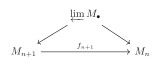
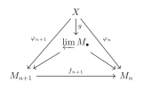
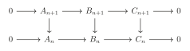
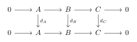
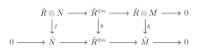
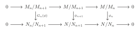
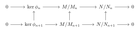
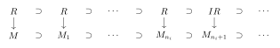
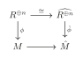

# 第十章：Dedekind 整环与完备性 { #top }

## 1. Dedekind 整环 { #s1 }

我们在前文讨论了维数为 $0$ 的 Noether 环。在本节中，我们来讨论维数为 $1$ 的 Noether 整环.即任意非零素理想都是极大的。

!!! theorem "命题"
    设 $R$ 是 Noether 整环，$\dim R=1$，则任意非零、非单位的理想 $I$ 可以唯一表示为 $I=\mathfrak{q}_1\cdots\mathfrak{q}_n$，其中 $\mathfrak{q}_i$ 是准素的且 $r(\mathfrak{q}_i)$ 是不相交的。

??? proof "证明"
    设 $I=\mathfrak{q}_1\cap \cdots\cap\mathfrak{q}_n$ 是极小分解，则 $r(\mathfrak{q}_i)\neq r(\mathfrak{q}_j)$ 是极大的。故 $r(\mathfrak{q}_i)+r(\mathfrak{q}_j)=(1)$，这表明 $\mathfrak{q}_i+\mathfrak{q}_j=(1)$。由**引理 2.8**知 $I=\prod \mathfrak{q}_i$。

    反过来，若 $I=\prod \mathfrak{q}_i$，类似的有 $I=\cap \mathfrak{q}_i$，由于 $\dim R=1$ 故每个 $r(\mathfrak{q}_i)$ 均为相伴的。利用**命题 2.40**知唯一确定。

!!! definition "定义"
    $K$ 是域，一个**离散赋值(discrete valuation)**是 $K^*$ 上的一个满射 $\nu:K^*\rightarrow \mathbb{Z}$ 使得 $\nu(xy)=\nu(x)+\nu(y)$ 且 $\nu(x+y)\ge \min (\nu(x), \nu(y))$。令 $\nu(0)=+\infty$ 我们可以扩张 $\nu$ 到 $K$ 上。可以验证 $R=\left\{x\Big| \nu(x)\ge 0\right\}$ 是 $K$ 的子环，称为 $K$ 的赋值环。一般的，整环 $R$ 称为**离散赋值环(discrete valuation ring)**，即 DVR，若它是它的分式域的 DVR。

!!! example "例"
    我们有 $\nu:\mathbb{Q}^*\rightarrow \mathbb{Z},p^n\cdot \frac{a}{b}\mapsto n$，其中 $(a,p)=(b,p)=1$，$p$ 是固定的素数。则 $\mathbb{Q}$ 的 DVR 是局部化 $\mathbb{Z}_{(p)}$。类似的，对不可约多项式 $f(x)\in k[x]$，我们可以定义 $\nu:k(x)^*\rightarrow \mathbb{Z},f^n(x)\cdot \frac{g(x)}{h(x)}\mapsto n$，则 $k(x)$ 的 DVR 是 $k[x]_{(f)}$。

我们有如下关于 DVR 的命题：

- 若 $\nu(x)=0$，则 $\nu(x^{-1})=0$，故 $x^{-1}\in R$；反过来若 $\nu(x)>0$ 则 $x^{-1}\notin R$。因此 $\nu(x)=0$ 当且仅当 $x$ 是 $R$ 中的单位。

- 若 $\nu(x)=\nu(y)\ge 0$，则 $\nu(x/y)=0$，故 $\frac{x}{y}\in R$，进而 $(x)\subset (y)$。类似的有 $(y)\subset (x)$，故 $(x)=(y)\subset R$。

- 对 $R$ 的理想 $I$，取 $x\in I$ 使得 $\nu(x)$ 取到最小值。对任意 $y\in I$，$\nu(y)\ge \nu(x)$，故 $\frac{y}{x}\in R$，$y\in (x)$，即 $I=(x)$。于是 $R$ 是 PID。

- 由上两个命题，我们有 $R$ 的所有理想与 $\mathbb{Z}_{\ge 0}$ 之间的一一映射。

- 取 $\pi\in R,\nu(\pi )=1$，则 $\nu(\pi^n)=n$。$R$ 中所有理想满足降链：

    $$
    (1)\supset (\pi )\supset (\pi^2)\supset \cdots
    $$

    故 $R$ 是 Noether 的。$R$ 是极大理想为 $(\pi)$ 的局部环且任意理想均为极大理想的幂，这表明 $\dim R=1$。我们称 DVR 的极大理想的生成元为**uniformizer**。回忆任意赋值环都是整闭的，故任意 DVR 都是整闭的。

!!! example "例"
    我们可以给出一个是赋值环但不是 DVR 的例子。

    考虑 $R'=\bigcap_{n\ge 0} k[x^{\frac{1}{2^n}}]\subset \overline{k(x)}$，$K$ 是 $R'$ 的分式域。考虑 $\nu:K^*\rightarrow \mathbb{Q},f\mapsto \mathrm{ord}_0f\in \mathbb{Q}$，可以验证这是一个赋值且它的赋值环是

    $$
    R=\bigcup_{n\ge 0} k[x^{\frac{1}{2^n}}]_{(x^{\frac{1}{2^n}})}
    $$

    然而 $R$ 不是 Noether 的因为我们可以找到 $x_n$，$\nu(x_n)=\frac{1}{2^n}$，则

    $$
    (x_1)\subset (x_2)\subset \cdots
    $$

    不是稳定的，故 $R$ 不是 DVR。

!!! definition "定义"
    极大理想为 $\mathfrak{m}$ 的 Noether 局部环 $R$ 称为**正规局部环(regular local ring)**，若作为向量空间 $\dim R=\dim _{R/\mathfrak{m}} \mathfrak{m}/\mathfrak{m}^2$。显然 DVR 是正规局部环。

!!! theorem "命题"
    $R$ 是 Noether 局部整环，维数为 $1$，$\mathfrak{m}$ 是极大理想，$k=R/\mathfrak{m}$。则如下条件等价：

    - $R$ 是 DVR；
    - $R$ 是整闭的；
    - $\mathfrak{m}$ 是主理想；
    - $R$ 是正规局部环；
    - 任意非零理想均为 $\mathfrak{m}$ 的幂；
    - 存在 $x$，任意非零理想均形如 $(x^k)$。

??? proof "证明"
    我们已经证明 $(1)\Longrightarrow (2)$。

    $(2)\Longrightarrow (3)$：令 $0\neq a\in \mathfrak{m}$，则 $r(a)$ 是非零素理想，由于 $\dim R=1$ 故是极大理想，因此 $(a)$ 是准素的。由**推论 2.20**知存在 $k$，$\mathfrak{m}^k\subset (a),\mathfrak{m}^{k-1}\nsubseteq (a)$。取 $b\in \mathfrak{m}^{k-1}\setminus(a)$，并取 $x=\frac{a}{b}$ 是 $R$ 的分式环中的元素。$x^{-1}\notin R$，否则 $b=x^{-1}a\in \mathfrak{m}^k$。由条件 $x^{-1}$ 不在 $R$ 上整，于是 $x^{-1}\mathfrak{m}$ 不包含于 $\mathfrak{m}$，否则由 Cayley-Hamilton 定理知存在多项式 $f$，$f(x^{-1})\mathfrak{m}=0$，即 $f(x^{-1})a=0$，故 $f(x^{-1})=0$，矛盾！注意到 $x^{-1}\mathfrak{m}=\frac{b\mathfrak{m}}{a}\subset \frac{\mathfrak{m}^k}{a}\in R$，故 $x^{-1}\mathfrak{m}=R$，即 $\mathfrak{m}=Rx=(x)$。

    $(3)\Longrightarrow (4)$ 显然。

    $(4)\Longrightarrow (5)$：设 $\mathfrak{m}/\mathfrak{m}^2$ 由 $x$ 生成，则 $\mathfrak{m}=(x)$。对任意理想 $I\neq 0,I\neq (1)$，则 $I\subset \mathfrak{m}$。同上存在 $n$，$\mathfrak{m}^n\subset I$，故可以找到 $k$，$I\subset \mathfrak{m}^k,I\nsubseteq \mathfrak{m}^{k+1}$。选取 $y\in I\setminus \mathfrak{m}^{k+1}$，则 $y=x^kz$，其中 $z\in R$ 且 $z\notin \mathfrak{m}$。于是 $z$ 是 $R$ 中的单位，且 $(y)=(x^k)=\mathfrak{m}^k$。

    $(5)\Longrightarrow (6)$：只需证明 $\mathfrak{m}=(x)$。利用 Nakayama 引理知 $\mathfrak{m}\neq \mathfrak{m}^2$。取 $x\in \mathfrak{m}\setminus \mathfrak{m}^2$，则由条件 $(x)=\mathfrak{m}^n$，于是 $(x)=\mathfrak{m}$。

    $(6)\Longrightarrow (1)$：容易验证 $\nu :a\mapsto n$ 若 $a=(x^n)$，这可以扩张成 $R$ 的分式环上的赋值，且 $R=\left\{x:\nu(x)\ge 0\right\}$。

!!! theorem "命题"
    $R$ 是 Noether 整环，维数为 $1$，则如下条件等价：

    - $R$ 是整闭的；
    - 任意准素理想是素理想的幂；
    - 任意局部化 $R_\mathfrak{p}$ 是 DVR。

若 $R$ 满足如上条件，我们称 $R$ 是 **Dedekind 整环(D.D.)**。

??? proof "证明"
    $(1)\Longleftrightarrow(3)$：由上一命题中的 $(1)\Longleftrightarrow(2)$，回忆我们有 $R$ 是整闭的当且仅当任意局部化 $R_\mathfrak{p}$ 是整闭的。

    $(2)\Longrightarrow (3)$：由于 $R_\mathfrak{p}$ 是 Noether 局部整环维数为 1 且极大理想为 $\mathfrak{p}^e$，对任意 $R_\mathfrak{p}$ 的理想 $I$，存在 $m$，$(\mathfrak{p}^e)^m\subset I$，则 $I^c\supset \mathfrak{p}^m$。由上一命题中的 $(1)\Longleftrightarrow (5)$ 我们有 $R_\mathfrak{p}$ 是 DVR。

    $(3)\Longleftarrow (2)$：设 $I\subset R$ 是准素的，$r(I)=\mathfrak{p}$。$I^e\subset R_\mathfrak{p}$，故由上一命题中的 $(1)\Longleftrightarrow (5)$ 知存在 $n$，$I^e=(\mathfrak{p}^e)^n$。对素理想 $\mathfrak{q}\neq \mathfrak{p}$，$I_\mathfrak{p}=(\mathfrak{p}^n)_\mathfrak{q}$ 且 $I_\mathfrak{p}=(\mathfrak{p}^n)_\mathfrak{p}$，因此由**命题 2.18**知 $I=\mathfrak{p}^n$。

!!! theorem "推论"
    $R$ 是 Dedekind 整环，则任意非零理想能被唯一分解成素理想的乘积。

??? proof "证明"
    利用**命题 2.48**。

!!! example "例"
    $k[x,y]$ 是 UFD 但不是 Dedekind 整环，因为 $\dim k[x,y]=2$。

!!! example "例"
    $\mathbb{Z}[\sqrt{13}]$ 是$\mathbb{Z}$ 在 $\mathbb{Q}(\sqrt{-13})$ 上的整闭包，故它是整闭的。由 Hilbert 基定理，这是 Noether 的，由上升定理我们得到 $\dim \mathbb{Z}[\sqrt{-13}]=\dim \mathbb{Z}=1$。因此 $\mathbb{Z}[\sqrt{-13}]$ 是 Dedekind 整环。然而它不是 UFD 的因为 $14=2\cdot 7=(1+\sqrt{-13})(1-\sqrt{-13})$ 是两种分解。

!!! example "例"
    一般的，代数数域上的整数环是 D.D.。

!!! example "例"
    PID 是 D.D.。首先显然是 Noether 的且维数为 $1$。对任意局部化 $R_\mathfrak{p}$，也是 PID，故是 DVR，因此 $R$ 是 D.D.。

!!! theorem "命题"
    D.D. 是 PID 当且仅当是 UFD。

??? proof "证明"
    若 D.D. 是 UFD，设 $I=P_1\cdots P_n\neq 0$。注意到对 $x\in P_i,x=a_1\cdots a_m$，故 $(x)=(a_1)\cdots (a_m)\subset P_i$。$(a_i)$ 是素的，故存在 $i$，$(a_i)=P_i$。因此 $I=(a_1\cdots a_m)$ 是主理想。反过来同理。

!!! theorem "命题"
    $R$ 是 D.D. 且仅有有限个素理想，则 $R$ 是 PID。

??? proof "证明"
    设这些素理想是 $\mathfrak{p}_1,\cdots,\mathfrak{p}_n$。对任意理想 $I\neq (0)$，我们有分解 $I=\mathfrak{p}_1^{a_1}\cdots \mathfrak{p}_n^{a_n}$。故 $\mathfrak{p}_i^{a_i}\neq 0$，由 Nakayama 引理知存在 $x_i\in \mathfrak{p}_i^{a_i}\setminus \mathfrak{p}_i^{a_i+1}$。由于 $r(\mathfrak{p}_i^{a_i+1}+\mathfrak{p}_j^{a_j+1})\supset \mathfrak{p}_i\bigcup \mathfrak{p}_j$，$\mathfrak{p}_i,\mathfrak{p}_j$ 是极大的，我们有 $\mathfrak{p}_i^{a_i+1}+\mathfrak{p}_j^{a_j+1}=(1)$。

    因此投影映射 $\pi:R\rightarrow \prod R/\mathfrak{p}_i^{a_i}$ 是满射，存在 $x\in I,\pi(x)=(\overline{x_1},\cdots,\overline{x_n})$，则 $(x)=\prod \mathfrak{p}_i^{a_i}=I$。

### 1.1 分式理想 { #s1-1 }

!!! definition "定义"
    $R$ 是整环，$K$ 是分式域。$K$ 的一个 $R-$子模 $I$ 称为**分式理想(fractional ideal)**，若对某个 $0\neq x\in R$，$xI\subset R$。$R$ 称为整理想若 $I\subset R$。

!!! example "例"
    对任意 $u\in K$，$uR$ 是分式理想，也称为主分式理想。

!!! example "例"
    取 $R=\mathbb{Z}$，$\bigcap_{n\ge 0}\mathbb{Z}/2^n=\left\{\frac{x}{2^n}\Big| x\in \mathbb{Z},n\in \mathbb{N}\right\}$ 不是分式理想。

!!! example "例"
    $K$ 的任意有限生成子模均是分式理想。若 $R$ 是 Noether 的，分式理想是有限生成的。

!!! definition "定义"
    子模 $I\subset K$ 称为**可逆的(invertible)**，若存在 $J\subset K,IJ=R$。

事实上 $J$ 是唯一的，因为若 $IJ=R$，则 $J\subset (R:I)$。但 $(R:I)=(R:I)IJ\subset RJ=J$，故 $J=(R:I)$ 是由 $I$ 唯一决定的。因此我们可以在可逆子模上定义群结构。

!!! example "例"
    考虑 $R=\mathbb{Z}+2\sqrt{-1}\mathbb{Z}$，则 $K=\mathbb{Q}(\sqrt{-1})$，我们可以验证 $I=2\mathbb{Z}[\sqrt{-1}]$ 不可逆但是分式理想：注意到 $(R:I)=\mathbb{Z}[\sqrt{-1}]$，但 $(R:I)I\neq R$。然而它是可逆的，因为 $R=\mathbb{Z}[\sqrt{-1}]$ 且 $I^{-1}=\frac{1}{2}\mathbb{Z}[\sqrt{-1}]$。

!!! theorem "命题"
    $I$ 是 $R$ 的分式理想，则如下条件等价：

    - $I$ 可逆；
    - $I$ 是有限生成的且对任意素理想 $\mathfrak{p}$，$I_\mathfrak{p}$ 在 $R_\mathfrak{p}$ 上可逆；
    - $I$ 是有限生成的且对任意极大理想 $\mathfrak{m}$，$I_\mathfrak{m}$ 在 $R_\mathfrak{m}$ 上可逆；

??? proof "证明"
    $(1)\Longrightarrow (2)$：$I_\mathfrak{p} \cdot (R:I)_\mathfrak{p}=R_\mathfrak{p}$，故 $I_\mathfrak{p}$ 是可逆的，且由上讨论知 $I$ 有限生成。

    $(2)\Longrightarrow (3)$ 是显然的。$(3)\Longrightarrow (1)$：我们希望证明 $I\cdot (R:I)=R$，由于 $I\cdot (R:I)$ 是整理想，这需要证明 $I_\mathfrak{m} \cdot (R:I_\mathfrak{m})=R_\mathfrak{m}$。事实上这等价于证明 $(R:I)_\mathfrak{m}=(R_\mathfrak{m}:I_\mathfrak{m})$。

    设 $I$ 由 $x_1,\cdots,x_n$ 生成，则 $(R:I)=\bigcap_{i=1}^n (R:x_i)$，故

    $$
    (R:I)_\mathfrak{m}=\bigcap_{i=1}^n (R:x_i)_\mathfrak{m} ,(R_\mathfrak{m} :I_\mathfrak{m} )=\bigcap_{i=1}^n (R_\mathfrak{m} :\frac{x_i}{1})
    $$

    故只需证明 $(R:x)_\mathfrak{m}=(R_\mathfrak{m},(x)_\mathfrak{m})$。注意到我们有正合列

    $$
    0\rightarrow (R:x)\rightarrow R\overset{f}{\rightarrow}((x)+R)/R\rightarrow 0
    $$

    其中 $f:y\mapsto xy+R$。故我们有正合列

    $$
    0\rightarrow (R:x)_\mathfrak{m}\rightarrow R_\mathfrak{m}\overset{f_\mathfrak{m}}{\rightarrow}(x)_\mathfrak{m}+R_\mathfrak{m}/R_\mathfrak{m}\rightarrow 0
    $$

    故 $(R:x)_\mathfrak{m}=\ker f_\mathfrak{m}=(R_\mathfrak{m},(x)_\mathfrak{m})$

!!! theorem "命题"
    设 $R$ 是局部整环，则 $R$ 是 DVR 当且仅当任意非零分式理想是可逆的。此时任意分式理想都是主理想。

??? proof "证明"
    “$\Longrightarrow$”：$xI\subset R$ 是 $R$ 中的理想，故 $xI=(u)$ 是主理想，进而 $I=x^{-1}(u)$，于是 $I^{-1}=x(u^{-1})$ 是可逆的。

    “$\Longleftarrow$”：由于 $R$ 的任意整理想都是可逆的，因此是有限生成的，故 $R$ 是 Noether 的。我们只需证明任意非零整理想都形如 $\mathfrak{m}^k$。

    若该假设不成立，设 $\Sigma$ 为所有不是 $\mathfrak{m}$ 幂的非零理想的集合，则由 Zorn 引理我们可以取出 $\Sigma$ 中的最大元 $I$。注意到 $I\subset \mathfrak{m}$，故 $I\subset \mathfrak{m}^{-1}I\subset \mathfrak{m}^{-1}\mathfrak{m}=R$。

    由于 $\mathfrak{m}^{-1}I$ 不是 $\mathfrak{m}$ 的幂，故 $I=\mathfrak{m}^{-1}I$，于是 $I=\mathfrak{m}I$，这由 Nakayama 引理知矛盾！

!!! theorem "推论"
    $R$ 是整环，则 $R$ 是 D.D. 当且仅当 $R$ 的任意非零分式理想是可逆的。

??? proof "证明"
    “$\Longrightarrow$”：设 $I$ 是分式理想，则由 $R$ 是 Noether 的知 $I$ 是有限生成的，且由上命题 $I_\mathfrak{m}$ 是可逆的。

    “$\Longleftarrow$”：首先任意 $R$ 的整理想是可逆的，因此是有限生成的，故 $R$ 是 Noether 的。对任意素理想 $\mathfrak{p}$，$R_\mathfrak{p}$ 的任意分式理想 $M$ 是可逆的，故 $A_\mathfrak{p}$ 是 DVR，则对任意素理想 $0\neq \mathfrak{p}\subset \mathfrak{p}$，我们有 $0\neq \mathfrak{q}_\mathfrak{p}\subset \mathfrak{p}_\mathfrak{p}$，故 $\mathfrak{q}_\mathfrak{p}=\mathfrak{p}_\mathfrak{p}$，这表明 $\mathfrak{q}=\mathfrak{p}$。因此 $\dim R=1$，由**命题 2.50**知是 D.D.。

设 $\mathcal{I}$ 是所有分式理想的集合，设 $R$ 是 D.D.，则我们可以定义 $\mathcal{I}$ 上的群结构。设 $I$ 是分式理想，$I_\mathfrak{p}$ 是 DVR $R_\mathfrak{p}$ 的分式理想，于是是主理想，故我们设 $I_\mathfrak{p}=(x)$，则我们可以定义 $\nu_\mathfrak{p}(I)=\nu_\mathfrak{p}(x)$，期中 $\nu_\mathfrak{p}$ 是 $R_\mathfrak{p}$ 上的赋值。于是我们得到了群同态 $\nu_\mathfrak{p}:\mathcal{I}\rightarrow \mathbb{Z}$，且若 $I\subset J$，则 $\nu_\mathfrak{p}(I)\ge \nu_\mathfrak{p}(J)$。

!!! theorem "引理"
    $\nu_\mathfrak{p}(I)=0$ 仅对有限多个素理想 $\mathfrak{p}$ 不成立。

??? proof "证明"
    由于存在 $x\in K$，$(x)I=J\subset R$，我们有 $\nu_\mathfrak{p}(x)+\nu_\mathfrak{p}(I)=\nu_\mathfrak{p}(J)$。由于在 D.D. 中非零理想可唯一分解成素理想的乘积，故 $\nu_\mathfrak{p}(x),\nu_\mathfrak{p}(J)=0$ 仅对有限多个 $\mathfrak{p}$ 不成立，于是我们完成了证明。

由上引理我们有一个良定义的同态：

$$
\phi:\mathcal{I}\rightarrow \bigoplus_{\mathfrak{p}\neq 0,\mathfrak{p} \text{ }prime} \mathbb{Z}
$$

事实上这是一个同构。对 $(a_\mathfrak{p})\in \oplus_\mathfrak{p} \mathbb{Z},\phi(\prod_\mathfrak{p} \mathfrak{p}^{a_\mathfrak{p}})=(a_\mathfrak{p})$，故 $\phi$ 是满射。若 $\phi(I)=0$，则 $I_\mathfrak{p}=R_\mathfrak{p}$ 对任意 $\mathfrak{p}$，故由局部性 $I=R=(1)$，于是 $\phi$ 是单射。

考虑 $\varphi:K^*\rightarrow \mathcal{I},x\mapsto (x)$，我们称 $\mathrm{coker} \varphi$ 为**理想类群(ideal class group)**，也称为**Picard 群**，对它的研究是代数数论的主题，我们这里浅尝辄止。

## 2. 完备性 { #s2 }

!!! definition "定义"
    一个 $R-$模的**反向系统(inverse system)**指的是 $R-$模序列 $\left\{M_n\right\}$ 与 $f_{n+1}:M_{n+1}\rightarrow M_n$。若每个 $f_n$ 都是满的则称这个反向系统是**满系统**。

    **反向极限**定义为 $\prod_n M_n$ 中所有满足 $f_{n+1}(a_{n+1})=a_n$ 的 $(a_n)$ 构成的集合，记为 $\varprojlim M_n$，这是一个 $R-$模。

由定义，我们有下图交换：

{ loading=lazy }

其中 $\varprojlim M_\bullet\rightarrow M_n$ 是自然投影。进一步我们有反向极限的万有性质，证明留作习题：

!!! theorem "命题"
    对任意模 $X$ 与同态 $\varphi_n:X\rightarrow M_n$ 使得 $f_{n+1}\circ \varphi_{n+1}=\varphi_n$，则存在唯一的同态 $g:X\rightarrow \varprojlim M_\bullet$ 使得下图交换：

    { loading=lazy }

    反过来，该性质唯一确定了反向极限。

!!! definition "定义"
    一个 $R$ 的**滤链(filtration)**是序列 $M=M_0\supset M_1\supset M_2\supset \cdots$。若 $IM_n\subset M_{n+1}$ 对任意 $n$ 成立，则称为**$I-$滤链**。若 $IM_n=M_{n+1}$ 对充分大的 $n$ 成立，则称为**稳定 $I-$滤链**。

!!! definition "定义"
    $M$ 对滤链 $M=M_0\supset M_1\supset \cdots$ 的**完备(completion)**是下反向系统的反向极限：

    $$
    M/M_0\leftarrow M/M_1\leftarrow M/M_2\leftarrow \cdots
    $$

    记为 $\hat{M}$。

    若 $M_{n+1}=IM_n$ 对任意 $n$ 成立则称 $\hat{M}$ 为 $I-adic$ 完备。$M$ 称为**完备的(complete)**若 $M\rightarrow \hat{M},x\mapsto (\bar{x})_n$ 是同构。

**注：**从拓扑的角度看，我们可以讲 $M_1,M_2,\cdots$ 看作一组 $M$ 的拓扑基，对序列 $(a_n)_n$，$a_m-a_n\in M_{\min{m,n}}$，故 $(a_n)_n$ 是 Cauchy 列，且两个等价的 Cauchy 列定义了同一个 $\hat{M}$ 中的元素。因此代数中的完备与拓扑中的完备概念相同。

!!! example "例"
    考虑 $M=k[x]\supset (x)\supset (x^2)\supset \cdots$，则我们有 $\hat{M}\cong k[[x]]$。

    类似的考虑 $\mathbb{Z}\supset p\mathbb{Z}\supset p^2\mathbb{Z}\supset \cdots$，我们称 $\hat{\mathbb{Z}}=\left\{\sum_{i=0}^{\infty} a_ip^i,0\le a_i\le p-1\right\}$ 为 $p-adic$环

!!! theorem "命题"
    $M$ 的 $I-adic$ 完备同构于对任意稳定 $I-$滤链的完备。

??? proof "证明"
    设我们有稳定 $I-$滤链 $0\leftarrow M/M_1\leftarrow M/M_2\leftarrow \cdots$。

    首先 $M_n\supset IM_{n-1}\supset \cdots \supset I^nM$，我们有自然映射 $M/I^nM\rightarrow M/M_n$，这诱导了映射 $f:\varprojlim M/I^nM\rightarrow \varprojlim M/M_n$，反过来存在 $c$，对任意 $n>c$，$M_n=IM_{n-1}=\cdots=I^{n-c}M_c\subset I^{n-c}M$，故有自然映射 $M/I^kM\rightarrow M/M_{k+c}$，这诱导了映射 $g:\varprojlim M/M^n\rightarrow \varprojlim M/I^nM$。进一步我们可以验证 $f\circ g=id,g\circ f=id$，故我们完成了证明。

!!! example "例"
    取 $R=\mathbb{Z}_2\otimes \mathbb{Z}_2$，$I=0\otimes \mathbb{Z}_2$，则 $I^n=I$，故 $\hat{R}=R/I=\mathbb{Z}_2\otimes 0$，且 $\ker(R\rightarrow \hat{R})=I$。

!!! example "例"
    考虑 $R=\bigcup_n k[x^{1/2^n}]$，$I=\bigcup_n x^{1/2^n}k[x^{1/2^n}]$，则

    $$
    I^{2^m}\supset \bigcup _n x^{1/2^{n-m}}k[x^{1/2^{n-m}}]=I
    $$

    故 $I^{2^n}=I$，这表明 $I=I^n$。同样有 $\ker (R\rightarrow \hat{R})=I$。

!!! definition "定义"
    一个反向系统的正合列是满足下图交换的反向系统 $\left\{A_n\right\},\left\{B_n\right\},\left\{C_n\right\}$：

    { loading=lazy }

!!! theorem "命题"
    设 $0\rightarrow \left\{A_n\right\}\rightarrow \left\{B_n\right\}\rightarrow \left\{C_n\right\}$ 正合，则

    $$
    0\rightarrow \varprojlim A_n\rightarrow \varprojlim B_n\rightarrow \varprojlim C_n
    $$

    正合。进一步，若 $\left\{A_n\right\}$ 是满的，则

    $$
    0\rightarrow \varprojlim A_n\rightarrow \varprojlim B_n\rightarrow \varprojlim C_n\rightarrow 0
    $$

    正合。

??? proof "证明"
    设 $A=\prod A_n,B=\prod B_n,C=\prod C_n$，考虑 $d_A:A\rightarrow A,(a_n)\mapsto (a_n-f_{n+1}(a_{n+1}))$，则 $\varprojlim A_n=\ker d_A$，我们有下图交换：

    { loading=lazy }

    由蛇引理，我们有正合列：

    $$
    0\rightarrow \ker d_A\rightarrow \ker d_B\rightarrow \ker d_C\rightarrow\mathrm{coker}d_A\rightarrow\mathrm{coker}d_B\rightarrow\mathrm{coker}d_C\rightarrow 0
    $$

    进一步若 $\left\{A_n\right\}$ 是满射，则 $d_A$ 是满射，故 $\mathrm{coker}d_A=0$。

!!! theorem "推论"
    设我们有正合列 $0\rightarrow M'\rightarrow M\rightarrow M''\rightarrow 0$，$M=M_o\supset M_1\supset \cdots$ 是 $M$ 的滤链，这诱导了 $M'$ 的滤链 $M'=M_0\cap M'\supset M_2\cap M'\supset \cdots$ 与 $M''$ 的滤链 $M''=\mathrm{Im}(M_0)\supset \mathrm{Im}(M_1)\supset\cdots$，于是我们有

    $$
    0\rightarrow \hat{M}'\rightarrow \hat{M}\rightarrow \hat{M}''\rightarrow 0
    $$

    是正合的。

??? proof "证明"
    在 $M'=M_n,M''=M/M_n$ 上使用上推论，我们有正合列

    $$
    0\rightarrow \hat{M}_n\rightarrow \hat{M}\rightarrow M/M_n\rightarrow 0
    $$

### 2.1 分次环 { #s2-1 }

!!! definition "定义"
    一个**分次环(graded ring)**是指一个环 $R$ 及 $R$ 的加法群的一组子群 $(R_n)_{n\ge 0}$ 使得 $R=\oplus_{n\ge 0} R_n$ 且 $R_m\cdot R_n\subset R_{m+n},\forall m,n\ge 0$。若 $x\in R_n$，我们称 $n$ 为 $x$ 的次数。由定义 $R_0$ 是 $R$ 的子环且 $R_n$ 均为 $R_0-$模。

!!! example "例"
    $R=k[x]=\oplus_{n\ge 0} kx^n$ 是分次环。

!!! definition "定义"
    $R$ 是分次环。**分次 $R-$模**是指一个 $R-$模 $M$ 及 $M$ 的一组子群 $(M_n)_{n\ge 0}$ 使得 $M=\oplus_{n\ge 0} M_n$ 使得 $R_n\cdot M_m\subset M_{n+m},\forall m,n\ge 0$。

    分次模 $M=\oplus M_n$ 与 $N=\oplus N_n$ 之间的同态是指 $R-$模同态 $f:M\rightarrow N$ 使得 $f(M_n)\subset N_n,\forall n$。

!!! example "例"
    $R_+=\oplus_{n\ge 1}R_n$ 是分次 $R-$模且是 $R$ 的一个理想。

!!! definition "定义"
    一个 $R$ 的理想 $I$ 称为**齐次的(homogeneous)**，若它是分次 $R-$模，即 $I=\oplus_{n\ge 0}(I\cap R_n)$ 是分次的。$x\in R$ 称为**齐次元**若 $x\in R_n$ 对某个 $n$。

    可以验证 $I$ 是齐次的当且仅当它由齐次元生成。

若 $I$ 是齐次的，则 $R/I=\oplus(R_n/I_n)$ 是分次环。

!!! theorem "命题"
    分次环 $R$ 是 Noether 的当且仅当 $R_0$ 是 Noether 的且 $R$ 是有限生成 $R_0-$代数。

??? proof "证明"
    “$\Longleftarrow$” 由 Hilbert 基定理即得。

    $\Longrightarrow$：首先由于 $R_0=R/R_+$ 故 $R_0$ 是 Noether 的。设 $R_+$ 由 $a_1,\cdot,a_n$ 有限生成，我们可以假设 $a_i$ 是齐次的。现在我们来证明 $R=R_0[a_1,\cdots,a_n]$，这只需证明 $R_i\subset R_0[a_1,\cdots,a_n]$。

    归纳证明之。对 $x\in R_{n+1}$，$x=\sum a_ix_i,x_i\in R,\deg x_i>0$。注意到 $\deg x_i=n+1-\deg a_i\le n$，由归纳假设知 $x_i\in R_0[a_1,\cdots,a_n]$，故 $x\in R_0[a_1,\cdots,a_n]$。

对任意环 $R$ 与理想 $I$，我们可以构造分次环 $R^*\oplus _{n\ge 0} I^n=R\oplus I\oplus I^2\oplus \cdots$。设 $M$ 是 $R-$模且 $(M_n)$

!!! theorem "引理"
    $R$ 是 Noether 环，$M$ 是有限生成 $R-$模，$(M_n)_n$ 是 $I-$滤链。设

    $$
    M^*=\oplus_{n\ge 0} M_n,
    $$

    且 $M^*$ 是 $R^*-$分次模。则 $M^*$ 是有限生成的当且仅当 $(M_n)_n$ 是稳定 $I-$滤链。

??? proof "证明"
    令 $M_n^*=M_0\oplus \cdots \oplus M_n \oplus IM_n \oplus I^2M_n \oplus\cdots$，则 $M_n^*$ 是 $R^*-$模，且我们有链 $M_0^*\subset M_1^*\subset \cdots$ 且 $\bigcup_{n=0}^\infty M_n^*=M^*$。

    一方面，若 $M^*$ 是有限生成的，由于 $R^*$ 是 Noether 的故 $M^*$ 也是 Noether $R^*-$模，故存在 $n$，$M_n^*=M_{n+1}^*$，这表明 $(M_n)$ 是稳定 $I-$滤链。

    另一方面，若 $(M_n)$ 是稳定 $I-$滤链，则存在 $M^*=M_n^*$。注意到 $M_i$ 是有限生成的，且 $M_n^*$ 作为 $R^*-$模由 $M_0,\cdots,M_n$ 生成，故 $M^*=M_n^*$ 是有限生成的，我们完成了证明。

!!! theorem "引理（Artin-Rees）"
    $I$ 是 Noether 环 $R$ 的理想，$N\subset M$ 均为有限生成模，则存在 $c>0$，使得 $I^nM\cap N=I^{n-c}(I^cM\cap N),n\ge c$。特别的，$N$ 的 $I-adic$ 完备同构于由 $(M_n)_n$ 诱导的 $N$ 的完备。

??? proof "证明"
    注意到 $M^*=M\oplus IM\oplus I^2M \oplus \cdots$ 在 $R^*$ 上有限生成，故是 Noether 的，因此 $N^*=N\oplus (IM\cap N)\oplus(I^2M\cap N)\oplus\cdots$ 在 $R^*$ 上有限生成，进而 $(I^nM\cap N)_n$ 稳定。

!!! theorem "推论"
    $I$ 是 Noether 环 $R$ 的理想，$0\rightarrow M'\rightarrow M\rightarrow M''\rightarrow 0$ 是有限生成 $R-$模的正合列，则 $0\rightarrow \hat{M'}\rightarrow \hat{M}\rightarrow\hat{ M''}\rightarrow 0$ 是 $I-adic$ 完备的正合列。

!!! theorem "命题"
    $M$ 是有限生成 $R-$模，则 $\hat{R}\otimes_R M\rightarrow \hat{M}$ 是满射。若 $R$ 是 Noether 的则是同构，特别的 $\hat{R}$ 是平坦 $R-$模。

??? proof "证明"
    设有

    { loading=lazy }

    则

    $$
    \ker f\rightarrow \ker g\rightarrow h \rightarrow \mathrm{coker}f\rightarrow \mathrm{coker}g\rightarrow \mathrm{coker}h\rightarrow 0
    $$

    若 $R$ 是 Noether 的，则 $N$ 是有限生成的，故 $\mathrm{coker}f=0$，因此 $\ker h=0$，于是 $\hat{R}\otimes M\cong \hat{M}$。

!!! theorem "推论"
    设 Noether 环 $R$ 的 $I-adic$ 完备是 $\hat{R}$。

    - $\hat{R}\otimes_R I\cong \hat{I}=\hat{R}\cdot I$；
    - $\widehat{I^n}=(I^n)^e=(I^e)^n=\hat{I}^n$；
    - $I^n/I^{n+1}\cong \widehat{I^n}/\widehat{I^{n+1}}\cong \widehat{I}^n/\widehat{I}^{n+1}$；
    - $\widehat{I}$ 被包含于 $\widehat{R}$ 的 Jacb 根中；
    - $\widehat{R}$ 是 $\widehat{I}-adic$ 完备的。

??? proof "证明"
    $(1)$ 由上命题即得，$(2)$ 由 $(1)$ 直接得到。

    $(3)$：我们有正合列 $0\rightarrow I^{n+1}\rightarrow I^n\rightarrow I^n/I^{n+1}\rightarrow 0$，这诱导了正合列 $0\rightarrow \widehat{I^{n+1}}\rightarrow \widehat{I^n}\rightarrow \widehat{I^n/I^{n+1}}\rightarrow 0$，故 $\widehat{I}^n/\widehat{I}^{n+1}\cong \widehat{I^n}/\widehat{I^{n+1}}\cong I^n/I^{n+1}$。

    $(4)$ 由定义是显然的。

    $(5)$： $\hat{I}=I\cdot \hat{R}$，故只需证明 $I\subset \mathrm{Jac}(\hat{R})$。对任意 $x\in I,a\in \hat{R}$，$(1-ax)^{-1}=(ax)+(ax)^2+\cdots\in \hat{R}$，这是因为 $(ax)^n\in \hat{I}^n$ 且 $\hat{R}$ 是 $\hat{I}-adic$ 完备的。于是 $x\in \mathrm{Jac}(\hat{R})$。

!!! theorem "推论"
    $R$ 是 Noether 局部环，极大理想为 $\mathfrak{m}$，则 $\hat{R}$ 是极大理想为 $\hat{\mathfrak{m}}$ 的局部环。

??? proof "证明"
    注意到 $\hat{R}/\hat{\mathfrak{m}}\cong R/\mathfrak{m}$ 是域，故 $\hat{\mathfrak{m}}$ 是极大理想。进一步 $\hat{\mathfrak{m}}\subset \mathrm{Jac}(\hat{R})$，故是唯一的极大理想。

!!! theorem "定理（Krull）"
    $I$ 是 Noether 环 $R$ 的理想，$M$ 是有限生成 $R-$模，则 $M\rightarrow \hat{M}$ 的 $\ker$ 是 $E=\bigcap_n I^nM=\left\{ x\in M\Big| \text{存在某个} a\in I,(1+a)x=0\right\}$。

??? proof "证明"
    一方面若 $(1-a)x=0$ 则 $x=ax=a^2x=\cdots$，故 $x\in E$。另一方面我们断言 $E=IE$。事实上，由 Artin-Rees：$E=I^{c+1}M\cap E=I\cdot(I^cM\cap E)=IE$。由 Hamilton-Cayley 定理知存在 $a\in I$，$(1+a)E=0$。

!!! theorem "推论"
    $R$ 是 Noether 整环，$I\neq R$，则 $\bigcap_{n=0}^\infty I^n=0$。

!!! theorem "推论"
    $R$ 是 Noether 环，$I\subset \mathrm{Jac}(R)$，$M$ 是有限生成 $R-$模，则 $\bigcap_{n=0}^\infty I^nM=0$，特别的若 $R$ 是局部的，$\mathfrak{m}$ 是极大的，则 $\bigcap_{n=0}^\infty \mathfrak{m}^nM=0$。

!!! theorem "推论"
    $R$ 是 Noether 的，$\mathfrak{p}$ 是素理想，则 $R\rightarrow R_\mathfrak{p}$ 的 $\ker$ 是所有 $\mathfrak{p}-$准素理想的交。

??? proof "证明"
    由上推论我们有 $\bigcap_{n=0}^\infty (\mathfrak{p}R_\mathfrak{p})^n=0$。回忆我们有 $S^{-1}R$ 的准素理想和 $R$ 中与 $S$ 不交的准素理想有一一对应，故

    $$
    \ker(R\rightarrow R_\mathfrak{p})=\bigcap_{\mathfrak{p}-\text{准素的}} \mathfrak{q}
    $$

!!! definition "定义"
    $I$ 是环 $R$ 的理想，定义 $G(R)=G_I(R):=\oplus _{n=0}^\infty I^n/I^{n+1}$，这是一个分次环。$M$ 是 $R-$模，$(M_n)_n$ 是 $I-$滤链，定义 $G(M)=\oplus _{n=0}^\infty M_n/M_{n+1}$，这是一个分次 $G(R)-$模。

!!! theorem "命题"
    $R$ 是 Noether 环，则

    - $G_I(R)$ 是 Noether 的；
    - $G_I(R)\cong G_{\hat{I}} (\hat{R})$；
    - 若 $M$ 是有限生成 $R-$模，$(M_n)_n$ 是稳定 $I-$滤链，则 $G(M)$ 是有限生成 $G(R)-$模。

??? proof "证明"
    $(1)$：设 $I$ 由 $x_1,\cdots,x_n$ 生成，则 $G_I(R)=(R/I)[x_1,\cdots,x_n]$，由 Hilbert 基定理知这是 Noether 的。

    $(2)$：回忆我们有 $\widehat{I^n}/\widehat{I^{n+1}}\cong \hat{I}^n/\hat{I}^{n+1}\cong I^n/I^{n+1}$。

    $(3)$：存在 $m$，对任意 $r\ge 0$，$I^rM_m=M_{m+r}$，则 $G(M)$ 由 $M/M_1,\cdot,M_{m-1}/M_m$ 生成，其中 $M_{n-1}/M_n$ 是有限生成 $R-$模且 $I\cdot (M_{n-1}/M_n)=0$，因此是有限生成 $R/I-$模，故是有限生成 $G(R)-$模，这表明 $G(M)$ 是有限生成 $G(R)-$模。

!!! theorem "引理"
    $\phi:M\rightarrow N$ 是群同态，且与滤链 $(M_n),(N_n)$ 相容，则我们有自然诱导映射 $G(\phi ):G(M)\rightarrow G(N),\hat{\phi}:\hat{M}\rightarrow \hat{N}$。进一步我们有 $G(\phi)$ 是单(满)射可推出 $\hat{\phi}$ 是单(满)射。

??? proof "证明"
    $G(\phi)$ 定义为 $G_n(\phi):M_n/M_{n+1}\rightarrow N_n/N_{n+1},x+M_{n+1}\mapsto \phi(x)+N_{n+1},G(\phi)=\oplus G_n(\phi)$。

    $\hat{\phi}$ 定义为 $\phi_n:M/M_n\rightarrow N/N_n,x+M_n\mapsto \phi(x)+N_n,\phi=\prod \phi_n$。

    容易验证这是良定义的。于是我们有如下交换图：

    { loading=lazy }

    由蛇引理我们有长正合列：

    $$
    0\rightarrow \ker G_n(\phi) \rightarrow \ker \phi_{n+1}\rightarrow \ker \phi_n\rightarrow \mathrm{coker}G_n(\phi)\rightarrow \mathrm{coker}\phi_{n+1}\rightarrow \mathrm{coker}\phi_n\rightarrow 0
    $$

    若 $G(\phi)$ 是单射，则 $G_n(\phi)$ 是单射，$\ker G_n(\phi)=0$，故 $\ker \phi_{n+1}\rightarrow \ker \phi_{n}$ 是单射。由于 $\ker \phi_0=0$，故由归纳易知 $\phi_n$ 是单射，进而 $\hat{\phi}$ 是单射。

    若 $G(\phi)$ 是满射，则 $G_n(\phi)$ 是满射，$\mathrm{coker} G_n(\phi)=0$，故 $\ker \phi_{n+1}\rightarrow \ker \phi_{n}$ 是满射。我们有如下交换图：

    { loading=lazy }

    由于 $\ker \phi_{n+1}\rightarrow \ker \phi_n$ 是满射，由**命题 2.57**知 $\hat{M}\rightarrow \hat{N}\rightarrow 0$ 是正合的，即 $\hat{\phi}$ 是满射。

!!! theorem "命题"
    $R$ 是 $I-adic$ 完备且我们有嵌入 $M\rightarrow \hat{M}$。

    - 若 $G(M)$ 是有限生成 $G(R)-$模，则 $M$ 是有限生成 $R-$模且 $M$ 是完备的；
    - 若 $G(M)$ 是 Noether 的，则 $M$ 是 Noether 的。

??? proof "证明"
    设 $\bar{x}_1,\cdots,\bar{x}_n$ 生成 $G(M)$，$\bar{x}_i\in M_{n_i}/M_{n_{i+1}}$，则映射 $\phi_i:1\mapsto x_i$ 给出：

    { loading=lazy }

    我们可将第一行视作 $I-$滤链，$\phi_i$ 与该滤链相容。取直和，我们有 $\phi:R^{\oplus n}\rightarrow M$ 且 $G(\phi):G(R^{\oplus n})\rightarrow G(M)$ 是满射，这是因为 $G(M)$ 由 $\bar{x}_1,\cdots,\bar{x}_n$ 生成。故由上命题知 $\hat{\phi}:\widehat{R^{\oplus n}}\rightarrow \hat{M}$ 是满射。由于 $R$ 是 $I-adic$ 完备的，$\widehat{R^n}\cong \hat{R}^n\cong R^n$。由于 $\hat{\phi}$ 是满射，$M\rightarrow \hat{M}$ 是满射，故我们有如下交换图：

    { loading=lazy }

    但由条件，这是单射，故 $M\cong \hat{M}$，即 $M$ 是完备的。于是 $\phi$ 必须是满射，故 $M$ 是有限生成 $R-$模。

    $(2)$：我们想要证明任意 $M$ 的子模 $M'$ 均是有限生成 $R-$模。事实上 $G(M')$ 可以看成 $G(M)$ 的子模，这是有限生成的，且 $M'\rightarrow \hat{M}'$ 是 $M\rightarrow \hat{M}$ 的限制，这是单射。由 $(1)$ 我们完成了证明。

!!! theorem "推论"
    $R$ 是 Noether 的，则 $\hat{R}_I$ 是 Noether 的且 $G_{\hat{I}}(\hat{R})$ 是 Noether 的。特别的 $R[[x]],R[[x_1,\cdots,x_n]]$ 是 Noether 的。

??? proof "证明"
    $R$ 是 Noether 的，由**命题 2.60**知 $G_I(R)$ 是 Noether 的，$G_I(R)\cong G_{\hat{I}}(\hat{R})$，且由上命题 $\hat{R}$ 是 Noether 的。特别的 $R[[x]]$ 对 $R[x]$ 是 $(x)-$完备的。利用归纳易得 $R[[x_1,\cdots,x_n]]$ 是 Noether 的。

!!! theorem "推论"
    若 $R$ 是 Noether 的，$M$ 是有限生成 $R-$模，则 $\hat{M}_I$ 是 $\hat{I}-adic$ 完备且是 $I-adic$ 完备。

??? proof "证明"
    首先注意到 ${\widehat{I}}^{n}\widehat{M} = {I}^{n} \cdot  \widehat{R} \cdot  \widehat{M} = {I}^{n}\widehat{M}$，故只需证明 $\hat{M}$ 是 $\hat{I}-adic$ 完备的。$\hat{M}$ 是有限生成 $\hat{R}-$模，于是由**命题 2.60**知 $G(\hat{M})$ 是有限生成 $G(\hat{R})-$模。现在只需验证 $\ker(\hat{M}\rightarrow \hat{\hat{M}})=0$。由 Krull 定理

    $$
    \ker(\hat{M})\rightarrow \hat{\hat{M}}=\left\{x\in \hat{M}\Big| \text{存在某个 }a\in \hat{I},(1+a)x=0\right\}
    $$

    设 $a=(\bar{a}_0,\bar{a}_1,\cdots),x=(\bar{x}_0,\bar{x}_1,\cdots)$，则 $(1+\bar{a}_n)\bar{x}_n=0,(1+a_n)x_n\in I^nM$。$a_nx_n\in IM$，故 $x_n\in IM$，继续下去得到 $x_n\in I^nM$，即 $\bar{x}_n=0$，故 $x=0$。

---

[返回目录](index.md){ .md-button } [下载 PDF 完整版](../../../assets/algebra-2h-notes.pdf){ .md-button download="algebra-2h-notes.pdf" }
