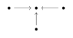
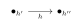

# 第一章：表示 { #top }

## 1. 代数 { #s1 }

我们回忆一些代数的基本知识。$k[x_1,\cdots,x_n]$ 是关于 $x_1,\cdots,x_n$ 的多项式构成的代数，$k\left<x_1,\cdots,x_n\right>$ 是**自由代数**，$k[G]$ 是由基 $\left\{a_g,g\in G\right\}$ 生成的**群代数**。一个代数称为**交换的**若 $ab=ba$ 对任意 $a,b\in A$。

!!! definition "定义"
    一个域 $k$ 上的**结合代数(associative algebra)**是 $k$ 上的向量空间 $A$ ，伴有双线性映射 $A\times A\rightarrow A,(a,b)\mapsto ab$，满足 $(ab)c=a(bc)$。一个**单位(unit)**是 $A$ 中一个元素 $1\in A$ 满足 $1a=a1=a$ 。

!!! theorem "命题"
    若单位存在，则唯一。

我们仅考虑含单位元 $1$ 的结合代数。下面是一些代数的例子：

!!! example "例"
    - $A=k$；
    - $A=k[x_1,\cdots,x_n]$：由 $x_1,\cdots,x_n$ 构成的多项式；
    - $A=\mathrm{End}V$；
    - **自由代数(free algebra)** $A=k\left<x_1,\cdots,x_n\right>$：由字符 $x_1,\cdots,x_n$ 组成的字符串。
    - **群代数(group algebra)** $A=k[G]$：由 $\left\{a_g\Big|g\in G\right\}$ 生成，运算由 $a_ga_h=a_{gh}$ 给出。

!!! definition "定义"
    一个代数 $A$ 是**交换的(commutative)**若 $ab=ba$，对任意 $a,b\in A$ 成立。

!!! definition "定义"
    一个代数的**同态(homomorphism)** $f:A\rightarrow B$ 是一个线性映射，满足 $f(xy)=f(x)f(y)$，对任意 $x,y\in A$ 都成立，且 $f(1)=1$。

## 2. 表示 { #s2 }

!!! definition "定义"
    一个结合代数 $A$ 的**表示(representation)**或**左 $A-$模(left $A-$module)** 是一个向量空间 $V$，其带有同态 $\rho:A\rightarrow \mathrm{End}V$。

类似的，一个**右 $A-$模(right $A-$module)** 为空间 $V$ 伴有反同态 $\rho:A\rightarrow \mathrm{End}V$，即 $\rho$ 满足 $\rho(ab)=\rho(b)\rho(a)$ 且 $\rho(1)=1$。我们举一些表示的例子

!!! example "例"
    - $V=0$；
    - $V=A,\rho:a\mapsto (b\mapsto ab)$ 为自然的左乘，这个表示称为 $A$ 的**正则表示(regular representation)**。
    - $A=k$，$A$ 的一个自然的表示为 $k$ 上的线性空间。
    - $A=k\left<x_1,\cdots,x_n\right>$，令 $V=k$，任取线性算子 $\rho(x_1),\cdots,\rho(x_n):V\rightarrow V$，这是一个表示，留给读者自行验证。

!!! definition "定义"
    一个表示 $V$ 的**子表示(subrepresentation)** 是一个 $V$ 的子空间 $W$，其在任意 $\rho(a)$ 作用下不变，其中 $a\in A$。

显然 $0$ 与 $V$ 都是 $V$ 的子表示。

显然若 $V_1,V_2$ 是两个 $A$ 的表示，则 $V_1\oplus V_2$ 也是 $A$ 的表示。

!!! definition "定义"
    一个 $A$ 的非零表示 $V$ 称为**不可约的(irreducible)**，若其子表示仅有 $0$ 与 $V$。

!!! definition "定义"
    设 $V_1,V_2$ 是代数 $A$ 的表示，一个表示的**同态(homomorphism)**(或**交织算子(intertwining operator)**) $\phi:V_1\rightarrow V_2$ 是线性算子，满足 $\phi(av)=a\phi(v)$，对任意 $v\in V_1,a\in A$ 成立。一个同态 $\phi$ 称为表示间的**同构(isomorphism)**，若 $\phi$ 是向量空间上的同构。

    所有 $V_1,V_2$ 间的同态记作 $\mathrm{Hom}_A(V_1,V_2)$。

!!! definition "定义"
    设 $V_1,V_2$ 是代数 $A$ 的表示，则由 $a(v_1\oplus v_2)=(av_1\oplus av_2)$ 给出的空间 $V_1\oplus V_2$ 显然也是 $A$ 的表示。称为 $V_1,V_2$ 的**直和(direct sum)**。

!!! definition "定义"
    一个 $A$ 的非零表示 $V$ 称为**不可分解的(indecomposable)**，若其不同构于两个非零表示的直和。

不可约表示显然是不可分解的，但是反过来不一定成立。

表示论的基本问题主要为以下三者：

- 对给定的代数 $A$ 计算不可约表示。
- 对给定的代数 $A$ 计算不可分解表示。
- 把前两个问题限制在有限维表示上。

!!! theorem "命题（Schur's lemma）"
    在域 $F$ 上(即不要求代数闭)，设 $V_1,V_2$ 是代数 $A$ 的表示，令 $\phi:V_1\rightarrow V_2$ 是非零的表示间的同态，则

    - 若 $V_1$ 不可约，则 $\phi$ 是单射。
    - 若 $V_2$ 不可约，则 $\phi$ 是满射。

    即若 $V_1,V_2$ 都是不可约的，则 $\phi$ 是同构。

??? proof "证明"
    这是容易的，证明留给读者。

!!! theorem "推论"
    在代数闭域 $k$ 上，$V$ 是代数 $A$ 的有限维不可约表示，同态 $\phi:V\rightarrow V$。则 $\phi=\lambda\cdot \mathrm{Id}$，其中 $\lambda\in k$ 作为标量。

??? proof "证明"
    设 $\lambda$ 是 $\phi$ 的特征根，存在性由 $k$ 是代数闭域保证。则 $\phi-\lambda \mathrm{Id}$ 是同态且不是同构。由 Schur 引理知其为零同态。

!!! theorem "推论"
    设 $A$ 是交换代数，则任意 $A$ 的有限维不可约表示 $V$ 都是一维的。

??? proof "证明"
    设 $V$ 是不可约表示，则我们有

    $$
    \rho(a)\rho(b)v=\rho(ab)v=\rho(ba)v=\rho(b)\rho(a)v
    $$

    于是由 Schur 引理，$\rho(a)$ 是标量，进而任意 $V$ 的子空间都是子表示，结合 $V$ 不可约即证。

!!! example "例"
    - $A=k$，由于 $A$ 的表示为向量空间，故 $V=A$ 是唯一的不可约表示且是唯一的不可分解表示。
    - $A=k[x]$，
    - $A=k[G]$，

!!! problem "习题"
    设 $V$ 是代数 $A$ 的非零有限维表示，则 $V$ 有一个不可约子表示。

    对无限维的情形构造反例。

!!! problem "习题"
    设 $A$ 是域 $k$ 上的代数。$A$ 的中心 $Z(A)$ 为所有 $z\in A$ 满足 $za=az,\forall a\in A$ 的元素构成的集合。例如若 $A$ 交换，$Z(A)=A$。

    - 证明若 $V$ 为 $A$ 的不可约有限维表示，则任意 $z\in Z(A)$ 在 $V$ 上的作用为某个标量 $\chi_V(z)$。证明 $\chi_V:Z(A)\rightarrow k$ 是同态，称作 $V$ 的**中心特征(central character)**。
    - 证明若 $V$ 为 $A$ 的不可分解有限维表示，则对任意 $z\in Z(A)$，$\rho(z)$ 仅有一个特征值 $\chi_V(z)$，与 $z$ 在某个不可约有限维表示 $V$ 上作用的标量一致。因此 $\chi_v:Z(A)\rightarrow k$ 是同态，一样称作 $V$ 的中心特征。
    - 前一问中 $\rho(z)$ 的作用一定是个标量吗？

## 3. 理想 { #s3 }

!!! definition "定义"
    代数 $A$ 的**左理想(left ideal)**是子空间 $I\subseteq A$ 满足 $aI\subseteq I$，对任意 $a\in A$ 成立。类似的，**右理想(right ideal)**是子空间 $I\subseteq A$ 满足 $Ia\subseteq I$，对任意 $a\in A$ 成立。**双边理想(two-sided ideal)**是子空间既是左理想又是右理想。

!!! example "例"
    - 对任意代数 $A$，$0$ 和 $A$ 是双边理想。代数 $A$ 称为**单的(simple)**若其双边理想仅有 $0$ 与 $A$。
    - 若 $\phi:A\rightarrow B$ 是代数间的同态，则 $\ker \phi$ 是 $A$ 的双边理想。
    - 若 $S$ 是任意 $A$ 的子集，由 $S$ **生成(generated)** 的双边理想记作 $\left<S\right>$，其由 $asb$ 构成，其中 $a,b\in A,s\in S$。类似的构造 $\left<S\right>_l=\mathrm{span} \left\{as\right\}$ 与 $\left<S\right>_r=\mathrm{span} \left\{sb\right\}$，分别称作由 $S$ 生成的左理想、右理想。

!!! problem "习题"
    证明任意含单位的环有极大左理想、右理想、双边理想。

## 4. 商 { #s4 }

设 $I$ 是代数 $A$ 的双边理想。则 $A/I$ 是 $I$ 的陪集。令 $\pi:A\rightarrow A/I$ 是商映射。我们可以定义乘法：$\pi(a)\cdot \pi(b)=\pi(ab)$。这是良定义的，留给读者验证。

同样的，对 $A$ 的表示 $V$ 与 $V$ 的子表示 $W$，则 $V/W$ 也是表示。具体地说，设 $\pi:V\rightarrow V/W$ 是商映射，令 $\rho_{V/W}(a)\pi(x)=\pi(\rho(a)x)$。

!!! problem "习题"
    设 $A=k[x_1,\cdots,x_n]$ 与其理想 $I\neq A$ 包含了所有次数 $\ge N$ 的齐次多项式。证明 $A/I$ 为 $A$ 的一个不可分解表示。

!!! problem "习题"
    设 $V\neq 0$ 是 $A$ 的表示。我们称 $v\in V$ 是**循环的(cyclic)** 若其生成了 $V$，即 $Av=V$。一个含有循环向量的表示称为**循环的(cyclic)**。

    - $V$ 是不可约的当且仅当 $V$ 中任意向量 $v$ 是循环的。
    - $V$ 是循环的当且仅当其同构于 $A/I$，其中 $I$ 是 $A$ 的左理想。
    - 举一个不可分解但不循环的例子。

## 5. 由生成元与关系定义的代数 { #s5 }

令 $f_1,\cdots,f_m$ 是自由代数 $k\left<x_1,\cdots,x_n\right>$ 的元素，我们称代数 $A=k\left<x_1,\cdots,x_n\right>/\left<\left\{f_1,\cdots,f_m\right\}\right>$ 是由 $x_1,\cdots,x_n$ 在关系 $f_1=0,\cdots,f_m=0$ 下生成的。

## 6. 一些代数的例子 { #s6 }

本节中我们来看看有意思的 Weyl 代数。

- **Weyl 代数** $k\left<x,y\right>/\left<yx-xy-1\right>$
- **$q-$ Weyl 代数**，由 $x,x^{-1},y,y^{-1}$ 生成，关系 $yx=qxy$ 与 $xx^{-1}=x^{-1}x=yy^{-1}=y^{-1}y=1$。

!!! theorem "命题"
    - Weyl 代数 $A$ 的基为 $\left\{x^iy^j\Big| i,j\ge 0\right\}$。
    - $q-$Weyl 代数 $A_q$ 的基为 $\left\{x^iy^j\Big| i,j\in \mathbb{Z}\right\}$

??? proof "证明"
    $(1)$：首先注意到利用 $yx=xy+1$ 我们可以将任意 $x,y$ 的字符串中的所有 $x$ 转移到左侧，$y$ 转移到右侧，这表明 $\left\{x^iy^j\Big|i,j\ge 0\right\}$ 生成了 $A$。

    下面我们用表示论来证明 $x^iy^j$ 线性独立。设 $a$ 是一个变量，令 $E=t^ak[a][t,t^{-1}]$，给定作用 $xf=tf$ 与 $yf=\frac{\mathrm{d} f}{\mathrm{d} t}$ 我们有 $E$ 是 $A$ 的表示。设 $\sum c_{ij}x^iy^j=0$，则其对应的作用

    $$
    L=\sum c_{ij}t^i\left(\frac{\mathrm{d} }{\mathrm{d} t}\right)^j
    $$

    在 $E$ 上为 $0$。记

    $$
    L=\sum_{j=0}^r Q_j(t)\left(\frac{\mathrm{d} }{\mathrm{d} t}\right)^j
    $$

    其中 $Q_r\neq 0$，则我们有

    $$
    Lt^a=\sum_{j=0}^r Q_j(t)a(a-1)\cdots(a-j+1)t^{a-j}
    $$

    这是零作用，于是 $\sum_{j=0}^r Q_j(t)a(a-1)\cdots(a-j+1)t^{-j}=0\in k[a][t,t^{-1}]$。考虑 $a$ 最高次项，得到 $Q_r(t)=0$，矛盾！

    $(2)$：任意 $A_q$ 中的字符串，可以通过乘以 $q$ 的幂次来将其排序。

**注：**$(1)$ 的证明告诉我们 Weyl 代数 $A$ 可视作对关于 $t$ 的多项式上的求导算子。同样 $(1)$ 的证明给出了如下忠实表示的定义。

!!! definition "定义"
    代数 $A$ 的表示 $\rho$ 是**忠实的(faithful)**，若 $\rho$ 是单射。

例如，当 $\mathrm{char}k=0$ 时，$k[t]$ 就是 Weyl 代数 $A$ 的忠实表示。当 $\mathrm{char}k=p\neq 0$ 时，$(\mathrm{d}/\mathrm{d} t)^pQ=0,\forall Q\in k[t]$。然而无论何种情况 $E=t^ak[a][t,t^{-1}]$ 总是忠实的。

## 7. 箭图 { #s7 }

!!! definition "定义"
    一个**箭图(quiver)** $Q$ 是一个有向图，允许带有自环、重边。

!!! example "例"
    { loading=lazy }

    我们记 $Q$ 的顶点为 $I$，边为 $E$。对边 $h\in E$，记 $h',h''$ 为 $h$ 的起点与终点，如图：

    { loading=lazy }

!!! definition "定义"
    一个箭图 $Q$ 的表示是对每个顶点 $i\in I$ 指定向量空间 $V_i$ 并对每条边 $h\in E$ 指定线性映射 $x_h:V_{h'}\rightarrow V_{h''}$。

!!! definition "定义"
    $Q$ 的**路代数(path algebra)** $P_Q$ 是一个基为所有 $Q$ 的路(包含平凡路 $p_i,i\in I$) 的向量空间，其乘法由道路的连接给出：$ab$ 为先沿着 $b$ 后沿着 $a$ 得到的道路；如果两者不能连接则其值为 $0$。

**注：**容易得到对有限箭图 $\sum_{i\in I} p_i=1$，故 $P_Q$ 是一个含幺代数。

!!! problem "习题"
    证明 $P_Q$ 由 $p_i,i\in I$ 与 $a_h,h\in E$ 和如下关系生成：

    - $p_i^2=p_i,p_ip_j=0,\forall i\neq j$；
    - $a_hp_{h'}=a_h,a_hp_j=0,\forall j\neq h'$；
    - $p_{h''}a_h=a_h,p_ia_h=0,\forall i\neq h''$。

!!! definition "定义"
    箭图 $Q$ 的表示 $(V_i,x_h)$ 的**子表示**为表示 $(W_i,x_h')$ 满足 $W_i\subseteq V_i,\forall i\in I$ ，$x_h(W_{h'})\subseteq W_{h''}$ 且 $x_h'=x_h\big|_{W_h'}:W_{h'}\rightarrow W_{h''},\forall h\in E$。

!!! definition "定义"
    两个表示 $(V_i,x_h)$，$(W_i,y_h)$ 的**直和**为表示 $(V_i\oplus W_i,x_h\oplus y_i)$。

!!! definition "定义"
    设 $(V_i,x_h)$，$(W_i,y_h)$ 为箭图 $Q$ 的表示，**箭图表示间的同态** $\varphi:(V_i)\rightarrow (W_i)$ 为一系列映射 $\varphi_i:V_i\rightarrow W_i$ 满足 $y_h\circ \varphi_{h'}=\varphi_{h''}\circ x_h,\forall h\in E$ 构成的集合。

## 8. 李代数 { #s8 }

设 $\mathfrak{g}$ 是域 $k$ 上的线性空间，$[\text{ },\text{ }]:\mathfrak{g}\times \mathfrak{g}\rightarrow \mathfrak{g}$ 是反对称双线性映射，即 $[a,b]=-[b,a]$。

!!! definition "定义"
    $(\mathfrak{g},[\text{ },\text{ }])$ 是**李代数(Lie algebra)** 若 $[\text{ },\text{ }]$ 满足 Jacobi 恒等式：

    $$
    \big[\left[a,b\right],c\big]+\big[\left[b,c\right],a\big]+\big[\left[c,a\right],b\big]=0
    $$

!!! example "例"
    下面是一些李代数的例子：

    - 任意 $\mathfrak{g}$ 取 $[\text{ },\text{ }]=0$。

    - 任意交换代数 $A$ 与 $[a,b]=ab-ba$，特别的，对自同态代数 $A=\mathrm{End}V$，其中 $V$ 是向量空间。这时 $A$ 可被看作李代数，通常记作 $\mathfrak{gl}(V)$(general linear Lie algebra)。

    - 任意交换代数 $A$ 的子空间 $U$ 满足 $[\text{ },\text{ }]\in U$，对任意 $a,b\in U$。

    - 代数 $A$ 的**导子(derivations)** $\mathrm{Der}A$，即线性映射 $D:A\rightarrow A$ 满足 Leibniz 法则：

        $$
        D(ab)=D(a)b+aD(b)
        $$

    - 任意李代数 $\mathfrak{g}$ 的子空间 $\mathfrak{a}$ 满足在 $[\text{ },\text{ }]$ 运算下闭。这样的子空间称作 $\mathfrak{g}$ 的**李子代数(Lie subalgebra)**。

**注：****Ado's theorem** 告诉我们任意有限维的李代数是 $\mathfrak{gl}(V)$ 的李子空间，其中 $V$ 是某个有限维线性空间。

!!! example "例"
    下面是一些李代数的例子：

    - $\mathbb{R}^3$ 与 $[u,v]=u\times v$，$u,v$ 的叉乘。

    - $\mathfrak{sl}(n)$，$n\times n$ 且迹为 $0$ 的矩阵。比如 $\mathfrak{sl}(2)$ 有基：

        $$
        e=\left( \begin{matrix}
        0&		1\\
        0&		0\\
        \end{matrix} \right) ,f=\left( \begin{matrix}
        0&		0\\
        1&		0\\
        \end{matrix} \right) ,h=\left( \begin{matrix}
        1&		0\\
        0&		-1\\
        \end{matrix} \right)
        $$

        与关系：

        $$
        [h,e]=2e,[h,f]=-2f,[e,f]=h
        $$

    - Heisenberg 李代数 $\mathcal{H}$ 是形如 $\left( \begin{matrix} 0&		*&		*\\ 0&		0&		*\\ 0&		0&		0\\ \end{matrix} \right)$ 的所有矩阵，有基：

        $$
        x=\left( \begin{matrix}
        0&		0&		0\\
        0&		0&		1\\
        0&		0&		0\\
        \end{matrix} \right) ,y\left( \begin{matrix}
        0&		1&		0\\
        0&		0&		0\\
        0&		0&		0\\
        \end{matrix} \right) ,c=\left( \begin{matrix}
        0&		0&		1\\
        0&		0&		0\\
        0&		0&		0\\
        \end{matrix} \right)
        $$

        与关系：

        $$
        [y,x]=c,[y,c]=[x,c]=0
        $$

    - 代数 $\mathrm{aff}(1)$ 是形如 $\left( \begin{matrix} *&		*\\ 0&		0\\ \end{matrix} \right)$的所有矩阵，有基：

        $$
        X=\left( \begin{matrix}
        1&		0\\
        0&		0\\
        \end{matrix} \right) ,Y=\left( \begin{matrix}
        0&		1\\
        0&		0\\
        \end{matrix} \right)
        $$

        与关系

        $$
        [X,Y]=Y
        $$

    - $\mathfrak{so}(n)$，所有反对称的 $n\times n$ 矩阵，$[a,b]=ab-ba$。

!!! definition "定义"
    设 $\mathfrak{g}_1,\mathfrak{g}_2$ 为李代数，李代数间的同态 $\varphi:\mathfrak{g}_1\rightarrow \mathfrak{g}_2$ 是一个线性映射满足

    $$
    \varphi([a,b])=[\varphi(a),\varphi(b)]
    $$

!!! definition "定义"
    李代数 $\mathfrak{g}$ 的**表示(representation)** 是一个向量空间 $V$，其带有李代数间的同态 $\rho:\mathfrak{g}\rightarrow \mathrm{End}V$。

!!! example "例"
    下面是一些李代数的表示的例子：

    - $V=0$。
    - 任意向量空间 $V$ 与 $\rho=0$，称作平凡表示。
    - 伴随表示 $V=\mathfrak{g}$ 与 $\rho(a)(b)=[a,b]$。

事实证明李代数 $\mathfrak{g}$ 的表示和一个确定的交换代数 $\mathcal{U}(\mathfrak{g})$ 的表示是同一回事(留给读者证明)。于是，通过箭图的手段，我们可以将李代数表示理论视作交换代数表示理论的一部分。

!!! definition "定义"
    设李代数 $\mathfrak{g}$ 的基是 $\left\{x_i\right\}$，$[x_i,x_j]=\sum_k c_{ij}^kx_k$。**泛包络代数** $\mathcal{U}(\mathfrak{g})$ 是由 $x_i$ 与关系 $x_ix_j-x_jx_i=\sum_k c_{ij}^kx_k$ 生成的交换代数。

## 9. 张量积 { #s9 }

本节中我们回忆一些张量积相关的定义与记号。

!!! definition "定义"
    向量空间 $V,W$ 在域 $k$ 上的**张量积(tensor product)** $V\otimes W$  是

    $$
    V \star W=\mathrm{span}\left\{v\otimes w\Big|v\in V,w\in W\right\}
    $$

    商掉由如下元素生成的子空间的商空间：

    $$
    \begin{aligned}
    &(v_1+v_2)\otimes w-v_1\otimes w-v_2\otimes w,
    \\
    &v\otimes (w_1+w_2)-v\otimes w_1-v\otimes w_2,
    \\
    &av\otimes w-a(v\otimes w),
    \\
    &v\otimes aw-a(v\otimes w)
    \end{aligned}
    $$

    其中 $v\in V,w\in W,a\in k$。

## 10. 张量代数 { #s10 }

!!! definition "定义"
    设 $V$ 为向量空间，定义 $V$ 在域 $k$ 上的**张量代数(tensor algebra)** $TV=\otimes_{n\ge 0}V^{\otimes n}$，其上乘法 $a\cdot b=a\otimes b,a\in V^{\otimes n},b\in V^{\otimes m}$。

若 $V$ 的基为 $x_1,\cdots,x_N$ 则 $TV$ 同构于 $k\left<x_1,\cdots,x_N\right>$。

!!! definition "定义"
    $V$ 的**对称代数(symmetric algebra)** $SV$ 是 $TV$ 商掉 $\mathrm{span}\left\{v\otimes w-w\otimes v\Big|v,w\in V\right\}$ 的商空间。

!!! definition "定义"
    $V$ 的**外代数(exterior algebra)** $\land V$ 是 $TV$ 商掉 $\mathrm{span}\left\{v\otimes v|v\in V\right\}$ 的商空间。

!!! definition "定义"
    设 $V$ 是李代数，$V$ 的**泛包络代数(universal enveloping algebra)** $\mathcal{U}(V)$ 是 $TV$ 商掉 $\mathrm{span}\left\{v\otimes w-w\otimes v-[v,w]\Big|v,w\in V\right\}$ 的商空间。

容易看到基 $x_1,\cdots,x_N$ 的选取就确定了以上三者的结构。进一步，容易看到我们有分解：

$$
SV=\bigoplus_{n\ge 0}S^nV,\land V=\bigoplus_{n\ge 0}\land^nV
$$

## 11. Hilber 第三问题 { #s11 }

!!! problem "习题"
    已知若 $A$ 和 $B$ 是两个面积相同的多边形，则可以通过有限次直线切割将 $A$ 分割成若干多边形碎片，并重新拼合成 $B$（建议尝试——很有趣！）。1900 年，大卫·希尔伯特提出：对于三维空间中的多面体，类似命题是否成立？具体而言，体积相同的立方体和正四面体是否可以通过有限次平面切割相互转换？

    答案是否定的。德恩(Dehn)于 1901 年证明了这一结论，其证明方法十分精妙。对于任意多面体 $A$，我们定义其“Dehn 不变量”（Dehn invariant）$D(A)$，取值于向量空间 $V = \mathbb{R} \otimes_{\mathbb{Q}} (\mathbb{R}/\mathbb{Q})$（即有理数域上的张量积），表达式为：

    $$
    D(A) = \sum_{a} l(a) \otimes \frac{\beta(a)}{\pi},
    $$

    其中求和遍历多面体 $A$ 的所有棱 $a$，$l(a)$ 为棱长，$\beta(a)$ 为棱 $a$ 对应的二面角。

    - 若通过平面切割将 $A$ 分割为两个多面体 $B$ 和 $C$，则 Dehn 不变量满足 $D(A) = D(B) + D(C)$。

    - 证明 $\alpha = \frac{1}{\pi} \arccos\left(\frac{1}{3}\right)$ 不是有理数。

        *提示：* 假设 $\alpha = \frac{2m}{n}$（其中 $m, n$ 为整数），推导方程 $x + x^{-1} = \frac{2}{3}$ 的根为 $n$ 次单位根。进一步证明 $x^k + x^{-k}$ 的分母为 $3^k$，由此得出矛盾。

    - 结合 $(1)$ 和 $(2)$，说明希尔伯特问题的答案是否定的。（具体计算正四面体和立方体的德恩不变量。）

## 12. 李代数表示的张量积与对偶 { #s12 }

!!! definition "定义"
    两个李代数 $\mathfrak{g}$ 的表示 $V,W$ 的**张量积(tensor product)** 是空间 $V\otimes W$ 与

    $$
    \rho_{V\otimes W}(x)=\rho_V(x)\otimes \mathrm{Id}+\mathrm{Id}\otimes \rho_W(x)
    $$

!!! definition "定义"
    李代数 $\mathfrak{g}$ 的表示 $V$ 的**对偶表示(dual representation)** $V^*$ 是 $V$ 的对偶空间 $V^*$ 与 $\rho_{V^*}(x)=-\rho_V(x)^T$

容易验证两者均为表示。

!!! problem "习题"
    设 $V,W,U$ 是李代数 $\mathfrak{g}$ 的表示，证明

    $$
    \mathrm{Hom}_\mathfrak{g}(V\otimes W,U)\cong \mathrm{Hom}_\mathfrak{g}(V,U\otimes W^*)
    $$

    这里 $\mathrm{Hom}_\mathfrak{g}:=\mathrm{Hom}_{\mathcal{U}(\mathfrak{g})}$

## 13. $\mathfrak{sl}(2)$ 的表示 { #s13 }

本节中我们将逐步计算 $\mathfrak{sl}(2)$ 的表示。

根据上述内容，$\mathfrak{sl}(2)$ 的一个表示即是一个向量空间 $V$ 连同三个算子 $E, F, H$，满足 $HE - EH = 2E$、$HF - FH = -2F$ 以及 $EF - FE = H$（对应的映射 $\rho$ 由 $\rho(e) = E$、$\rho(f) = F$、$\rho(h) = H$ 给出）。

设 $V$ 为 $\mathfrak{sl}(2)$ 的有限维表示（本问题的基域为 $\mathbb{C}$）。

!!! problem "习题"
    (a) 取 $H$ 的特征值，并选取其中实部最大的一个，记为 $\lambda$。令 $\bar{V}(\lambda)$ 为对应于 $\lambda$ 的广义特征空间。证明 $E|_{V(\lambda)} = 0$。

!!! problem "习题"
    (b) 设 $W$ 为 $\mathfrak{sl}(2)$ 的任一表示，$w \in W$ 为非零向量且满足 $Ew = 0$。对任意 $k > 0$，求一个次数为 $k$ 的多项式 $P_k(x)$，使得 $E^k F^k w = P_k(H) w$。（先计算 $EF^k w$，再对 $k$ 进行归纳。）

!!! problem "习题"
    (c) 设 $v \in \bar{V}(\lambda)$ 为 $H$ 的广义特征向量，对应的特征值为 $\lambda$。证明存在 $N > 0$ 使得 $F^N v = 0$。

!!! problem "习题"
    (d) 证明 $H$ 在 $\bar{V}(\lambda)$ 上可对角化。（取满足 $F^N = 0$ 作用于 $\bar{V}(\lambda)$ 的 $N$，并利用 (b) 计算 $E^N F^N v$（$v \in \bar{V}(\lambda)$）。注意 $P_k(x)$ 无重根。）

!!! problem "习题"
    (e) 设 $N_r$ 为满足 (c) 的最小 $N$。证明 $\lambda = N_r - 1$。

!!! problem "习题"
    (f) 证明对每个 $N > 0$，存在唯一（在同构意义下）的 $N$ 维不可约表示。选取适当的基，计算该表示中 $E, F, H$ 的矩阵。（对有限维不可约表示 $V$，取 (a) 中的 $\lambda$ 及 $H$ 的特征向量 $v \in V(\lambda)$。证明 $v, Fv, \ldots, F^N v$ 构成 $V$ 的基，并在此基下计算各算子的矩阵。）

将 (f) 中所述的 ($\lambda + 1$) 维不可约表示记为 $V_\lambda$。以下问题将证明任意有限维表示均为 $V_\lambda$ 的直和。

!!! problem "习题"
    (g) 证明算子 $C = EF + FE + H^2/2$（称为卡西米尔算子）与 $E, F, H$ 交换，且在 $V_\lambda$ 上等于 $\frac{\lambda(\lambda + 2)}{2} \operatorname{Id}$。

易证直和分解。假设相反情况，取 $V$ 为最小维数的可约表示且不能分解为更小表示的直和。

!!! problem "习题"
    (h) 证明 $C$ 在 $V$ 上仅有一个特征值，即对某个非负整数 $\lambda$，该特征值为 $\frac{\lambda(\lambda + 2)}{2}$（利用 $C$ 的广义特征空间分解必为表示的分解）。

!!! problem "习题"
    (i) 证明 $V$ 有子表示 $W = V_\lambda$ 使得 $V/W = nV_\lambda$（利用 (h) 及 $V$ 为最小不可分解可约表示）。

!!! problem "习题"
    (j) 由 (i) 推导 $H$ 的特征空间 $V(\lambda)$ 为 $n+1$ 维。若其基为 $\langle v_1, \ldots, v_{n+1} \rangle$，证明 $F^j v_i$（$1 \leq i \leq n+1$，$0 \leq j \leq \lambda$）线性无关，从而构成 $V$ 的基。（验证若 $Fx = 0$ 且 $Hx = \mu x$（$x \neq 0$），则 $Cx = \frac{\mu(\mu - 2)}{2}x$，故 $\mu = -\lambda$。）

!!! problem "习题"
    (k) 定义 $W_i = \operatorname{span}\{v_i, Fv_i, \ldots, F^\lambda v_i\}$。证明 $W_i$ 为 $V$ 的子表示，并由此导出矛盾。

!!! problem "习题"
    (l) （Jacobson-Morozov 引理）设 $V$ 为有限维复向量空间，$A: V \to V$ 为幂零算子。证明存在唯一的（在同构意义下）$\mathfrak{sl}(2)$ 表示，使得 $E = A$。（利用表示分类及若尔当标准形定理。）

!!! problem "习题"
    (m) （Clebsch-Gordan 分解）将表示 $V_\lambda \otimes V_{\lambda'}$ 分解为不可约分量。

    提示：对 $\mathfrak{sl}(2)$ 的有限维表示 $V$，可引入特征 $\chi_V(x) = \operatorname{Tr}_V(x^H)$（$x \in \mathbb{C}$）。证明 $\chi_{V \oplus W}(x) = \chi_V(x) + \chi_W(x)$ 且 $\chi_{V \otimes W}(x) = \chi_V(x)\chi_W(x)$。计算 $V_\lambda$ 及 $V_\lambda \otimes V_{\lambda'}$ 的特征，进而导出分解。此分解在量子力学中至关重要。

!!! problem "习题"
    (n) 设 $V = \mathbb{C}^M \otimes \mathbb{C}^N$，且 $A = J_{0,M} \otimes \operatorname{Id}_N + \operatorname{Id}_M \otimes J_{0,N}$，其中 $J_{0,n}$ 为特征值零的 $n$ 阶若尔当块（即 $J_{0,n}e_i = e_{i-1}$（$i=2,\ldots,n$），$J_{0,n}e_1 = 0$）。利用 (l) 和 (m) 求 $A$ 的若尔当标准形。

## 14. 有关李代数的一些问题 { #s14 }

!!! problem "习题（Lie 定理）"
    李代数 $\mathfrak{g}$ 的**换位子** $K(\mathfrak{g})$ 是由元素 $[x, y]$（$x, y \in \mathfrak{g}$）张成的线性空间。这是 $\mathfrak{g}$ 的一个理想（即其为伴随表示的子表示）。称域 $k$ 上的有限维李代数 $\mathfrak{g}$ 为**可解的**，若存在 $n$ 使得 $K^n(\mathfrak{g}) = 0$。证明李定理：若 $k = \mathbb{C}$ 且 $V$ 是可解李代数 $\mathfrak{g}$ 的有限维不可约表示，则 $V$ 是 1 维的。

    提示：通过对维数归纳证明。由归纳假设，$K(\mathfrak{g})$ 在 $V$ 中存在公共特征向量 $v$，即存在线性函数 $\chi: K(\mathfrak{g}) \to \mathbb{C}$ 使得对任意 $a \in K(\mathfrak{g})$ 有 $av = \chi(a)v$。证明 $\mathfrak{g}$ 保持 $K(\mathfrak{g})$ 的公共特征空间。（为此需证对 $x \in \mathfrak{g}$ 和 $a \in K(\mathfrak{g})$ 有 $\chi([x, a]) = 0$。考虑包含 $v$ 且在 $x$ 作用下不变的最小子空间 $U$。该子空间在 $K(\mathfrak{g})$ 作用下不变，且任意 $a \in K(\mathfrak{g})$ 在此子空间上的迹为 $\dim(U)\chi(a)$。特别地，$0 = \operatorname{Tr}([x, a]) = \dim(U)\chi([x, a])$。）

!!! problem "习题"
    分类具有基 $X, Y$ 且满足交换关系 $[X, Y] = Y$ 的二维李代数的有限维不可约表示。考虑特征为零和正特征的情况。李定理在正特征时是否成立？

!!! problem "习题（困难！）"
    对李代数 $\mathfrak{g}$ 的任意元素 $x$，令 $\operatorname{ad}(x)$ 表示算子 $\mathfrak{g} \to \mathfrak{g}$，$y \mapsto [x, y]$。考虑由两元素 $x, y$ 生成的李代数 $\mathfrak{g}_n$，其定义关系为 $\operatorname{ad}(x)^2(y) = \operatorname{ad}(y)^{n+1}(x) = 0$。

    (a) 证明李代数 $\mathfrak{g}_1, \mathfrak{g}_2, \mathfrak{g}_3$ 是有限维的，并求其维数。

    (b)（更困难！）证明李代数 $\mathfrak{g}_4$ 是无限维的。显式构造该代数的一组基。

!!! problem "习题"
    分类特征 $p > 2$ 的代数闭域 $k$ 上李代数 $\mathfrak{sl}(2)$ 的不可约表示。

!!! problem "习题"
    设 $k$ 为特征零的代数闭域，$q \in k^\times$ 且 $q \neq \pm 1$。量子包络代数 $\mathcal{U}_q(\mathfrak{sl}(2))$ 是由生成元 $e, f, K, K^{-1}$ 构成的代数，满足关系：

    $$
    KeK^{-1} = q^2e, \quad KfK^{-1} = q^{-2}f, \quad [e, f] = \frac{K - K^{-1}}{q - q^{-1}}
    $$

    （若形式地令 $K = q^h$，可看出此代数在某种意义下“退化”为 $\mathcal{U}(\mathfrak{sl}(2))$ 当 $q \to 1$）。分类 $\mathcal{U}_q(\mathfrak{sl}(2))$ 的不可约表示。分别考虑 $q$ 为根的单位根和 $q$ 非根的单位根的情况。

---

[返回目录](index.md){ .md-button } [下载 PDF 完整版](../../../assets/representation-theory.pdf){ .md-button download="representation-theory.pdf" }
