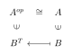
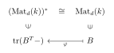

# 第二章：表示理论的一般结论 { #top }

## 1. 半单表示的子表示 { #s1 }

设 $A$ 是代数。

!!! definition "定义"
    一个 $A$ 的**半单(semisimple)**或**完全可约(completely reducible)**表示为一些不可约表示的直和。

!!! example "例"
    设 $V$ 是 $A$ 的不可约表示，且维数为 $n$。令 $Y=\mathrm{End}V$，考虑同构 $Y\rightarrow nV,x\mapsto (xv_1,\cdots,xv_n)$，其中 $v_1,\cdots,v_n$ 为 $V$ 的基，这表明 $Y$ 是 $A$ 的半单表示。

注意到，由 Schur 引理，任意 $A$ 的半单表示 $V$ 可以写成 $\bigoplus_X \mathrm{Hom}_A(X,V)\otimes X$，其中 $X$ 取遍所有 $A$ 的不可约表示。具体地说，我们有自然映射 $f:\bigoplus_X \mathrm{Hom}_A(X,V)\otimes X\rightarrow V,g\otimes x\mapsto g(x)$，其中 $x\in X,g\in \mathrm{Hom}(X,V)$，容易验证这是同构。

!!! theorem "命题"
    令 $V_i,1\le i\le m$ 是 $A$ 的两两不同构的有限维不可约表示，设 $V=\bigoplus_{i=1}^m n_iV_i$ 的一个子表示为 $W$，则 $W$ 同构于 $\bigoplus_{i=1}^m r_iV_i,r_i\le n_i$，且嵌入映射 $\phi:W\rightarrow V$ 可分解为一系列嵌入映射 $\phi_i:r_iV_i\rightarrow n_iV_i$ 的直和，每个 $\phi_i$ 通过 $r_i\times n_i$ 矩阵 $X_i$ 定义。具体地说，对 $V_i$ 中长度为 $r_i$ 的行向量 $(v_1,\cdots,v_{r_i})$，有

    $$
    \phi(v_1,\cdots,v_{r_i})=(v_1,\cdots,v_{r_i})X_i
    $$

??? proof "证明"
    对 $n := \sum_{i=1}^m n_i$ 归纳。$n = 1$显然成立。假设 $W$ 非零，并固定一个不可约子表示 $P \subset W$。这样的 $P$ 存在(**Problem 1.1**)。根据 Schur 引理，$P$ 同构于某个 $V_i$，且包含映射 $\phi |_P : P \rightarrow V$ 通过 $n_i V_i$ 分解，并在将 $P$ 与 $V_i$ 等同后由公式 $v \mapsto (vq_1, \ldots, vq_{n_i})$ 给出，其中 $q_l \in k$ 不全为零。

    注意到群 $G_i = GL_{n_i}(k)$($k$ 上可逆的 $n_i \times n_i$ 矩阵群)作用在 $n_i V_i$ 上，定义为 $(v_1, \ldots, v_{n_i}) \rightarrow (v_1, \ldots, v_{n_i}) g_i$(并对 $n_j V_j$($j \neq i$)恒等作用)。此作用保持所需性质：在 $g_i$ 作用下，矩阵 $X_i$ 变为 $X_i g_i$，而 $X_j$($j \neq i$)不变。取 $g_i \in G_i$ 使得 $(q_1, \ldots, q_{n_i}) g_i = (1, 0, \ldots, 0)$，则 $W g_i$ 包含 $n_i V_i$ 的第一个直和项 $V_i$(即 $P g_i$)。因此，$W g_i = V_i \oplus W'$，其中 $W' \subset n_1 V_1 \oplus \cdots \oplus (n_i - 1) V_i \oplus \cdots \oplus n_m V_m$ 是 $W g_i$ 沿其他直和项向第一个直和项 $V_i$ 投影的核。于是所需结论由归纳假设可得。

## 2. 稠密定理 { #s2 }

设 $A$ 是代数闭域 $k$ 上的代数。

!!! theorem "推论"
    令 $V$ 是 $A$ 的有限维不可约表示，取 $V$ 的任意一组线性无关向量 $v_1,\cdots,v_n$，则对任意 $w_1,\cdots,w_n\in V$，存在 $a\in A$ 使得 $av_i=w_i$。

??? proof "证明"
    反证法，若不然，映射 $A\rightarrow nV,a\mapsto (av_1,\cdots,av_n)$ 的像是真子表示，故由**命题 2.1** 其对应一个 $r\times n$ 矩阵 $X$，其中 $r<n$。于是取 $a=1$ 则存在 $u_1,\cdots,u_r\in V$ 使得 $(u_1,\cdots,u_r)X=(v_1,\cdots,v_n)$。令 $(q_1,\cdots,q_n)$ 为非零向量满足 $X(q_1,\cdots,q_n)^T=0$(存在性由 $r<n$ 给出)，则 $\sum q_iv_i=(u_1,\cdots,u_r)X(q_1,\cdots,q_n)^T=0$，即 $\sum q_iv_i=0$，这与 $v_i$ 线性无关矛盾！

!!! theorem "定理（The density theorem）"
    - 设 $V$ 是 $A$ 的有限维不可约表示，则 $\rho:A\rightarrow \mathrm{End}V$ 是满射。
    - 设 $V=V_1\oplus \cdots \oplus V_r$ 其中 $V_i$ 是 $A$ 的两两不同构的有限维不可约表示。则映射 $\bigoplus_{i=1}^r \rho_i:A\rightarrow \bigoplus_{i=1}^r\mathrm{End}(V_i)$ 是满射。

??? proof "证明"
    $(1)$：设 $c\in \mathrm{End}(V)$，$v_1,\cdots,v_n$ 为 $V$ 的基，令 $w_i=cv_i$，由 **推论 2.1**，存在 $a\in A$，$av_i=w_i$，故 $\rho(a)=c$，故 $c\in \mathrm{Im}\rho$，于是 $\mathrm{Im}\rho=\mathrm{End}(V)$。

    $(2)$：由于 $\bigoplus_{i=1}^r \mathrm{End}(V_i)\cong \bigoplus_{i=1}^r d_iV_i$，由 **命题 2.1**知 $\mathrm{Im}\rho=\bigoplus_{i=1}^r \mathrm{Im}\rho_i$，结合 $(1)$ 即证。

## 3. 矩阵代数直和的表示 { #s3 }

本节中我们考虑在域 $k$ 上的代数 $A=\bigoplus_i \mathrm{Mat}_{d_i}(k)$ 的表示。

!!! theorem "定理"
    设 $A=\bigoplus_{i=1}^r \mathrm{Mat}_{d_i}(k)$，则其不可约表示为 $V_1=k^{d_1},\cdots,V_r=k^{d_r}$，且任意有限维表示为 $V_1,\cdots,V_r$ 构成的直和。

!!! definition "定义"
    设 $V$ 是代数 $A$ 的表示，则 $V$ 的**对偶表示(dual representation)** $V^*$ 为反代数 $A^{op}$ (或右 $A-$模) 伴有作用

    $$
    (f\cdot a)(v)=f(av)
    $$

??? proof "证明"
    首先 $V_i$ 是不可约的。

    令 $X$ 是 $A$ 的 $n$ 维表示，则 $X^*$ 是 $A^{op}$ 的 $n$ 维表示，由 $(BC)^T=C^TB^T$ 与下图给出：

    { loading=lazy }

    取 $\left\{y_1,\cdots,y_n\right\}$ 为 $X^*$ 的基，定义

    $$
    \begin{aligned}
    \phi:A^{\oplus n}&\rightarrow X^*\\
    (a_1,\cdots,a_n)&\mapsto \sum_{i=1}^n a_iy_i\\
    \end{aligned}
    $$

    由 $k\subset A$ 知 $\psi$ 是满射，故 $\phi^*:X\rightarrow (A^{\oplus n})^*$ 是单射。考虑

    { loading=lazy }

    同构只需验证 $\varphi(C\cdot B)(D)=(C\cdot \varphi(B))(D)$

    这等价于 $\mathrm{tr}(B^TC^TD)=\varphi(B)(C^TD)=\mathrm{tr}(B^TC^TD)$ 成立。故 $X\cong \mathrm{Im}\phi^*\subset A^{\oplus n}=\bigoplus_{i=1}^r nd_iV_i$，由**命题 2.1** 知 $X\cong \bigoplus_{i=1}^r m_iV_i,0\le m_i\le nd_i$。

## 4. 滤链 { #s4 }

设 $A$ 是代数，$V$ 是 $A$ 的表示。

!!! definition "定义"
    $V$ 的(有限)**滤链(filtration)**是一列子表示 $0=V_0\subset V_1\subset \cdots \subset V_n=V$。

!!! theorem "引理"
    任意代数 $A$ 的有限维表示 $V$ 有一个有限滤链 $0=V_0\subset V_1\subset \cdots \subset V_n=V$ 满足 $V_i/V_{i-1}$ 不可约。

## 5. 有限维代数 { #s5 }

!!! definition "定义"
    有限维代数 $A$ 的**根(radical)** 为所有在 $A$ 的不可约表示上作用为 $0$ 的元素构成的集合。记作 $\mathrm{Rad}(A)$。

!!! theorem "命题"
    $\mathrm{Rad}(A)$ 是双边理想。

??? proof "证明"
    Easy.

!!! theorem "命题"
    设 $A$ 是有限维代数。

    - 设 $I$ 是双边幂零理想。即存在 $n$，$I^n=0$。则 $I\subset \mathrm{Rad}(A)$。
    - $\mathrm{Rad}(A)$ 是幂零理想。于是 $\mathrm{Rad}(A)$ 是 $A$ 中最大的双边幂零理想。

??? proof "证明"
    $(1)$：设 $V$ 是不可约表示。对 $v\in V$，$Iv\subset V$ 是子表示。若 $Iv\neq 0$，则 $Iv=V$，故存在 $x\in I$ 满足 $xv=v$，于是 $x^n\neq 0$ 矛盾。因此 $Iv=0$，即 $I$ 在 $V$ 上作用为 $0$，故 $I\subset \mathrm{Rad}(A)$。

    $(2)$：设 $0=A_0\subset A_1\subset\cdots\subset A_n=A$ 是一个正规表示的滤链满足 $A_{i+1}/A_i$ 是不可约的(存在性由**引理 2.1**) 给出。设 $x\in \mathrm{Rad}(A)$，则 $x$ 在 $A_{i+1}/A_i$ 上作用为 $0$，故 $x$ 将 $A_{i+1}$ 打到 $A_i$，这就表明 $\mathrm{Rad}(A)^n=0$，证毕！

!!! theorem "定理"
    有限维代数 $A$ 在同构意义下仅有有限个不可约表示 $V_i$。这些表示是有限维的，且

    $$
    A/\mathrm{Rad}(A)\cong \bigoplus_i\mathrm{End}V_i
    $$

??? proof "证明"
    首先，对任意不可约表示 $V$，任取 $0\neq v\in V$，$Av\subset V$ 且 $Av\neq 0$，由 $V$ 不可约知 $V=Av$，故 $V$ 有限维。

    其次，设我们有互不同构的不可约表示 $V_1,\cdots,V_r$，由**定理 2.1** 同态

    $$
    \bigoplus_i \rho_i:A\rightarrow \bigoplus_i \mathrm{End} V_i
    $$

    是满射。故 $r\le \sum_i \dim \mathrm{End} V_i\le \dim A$，因此 $A$ 仅有有限个互不同构的不可约表示。

    最后，设 $V_1,\cdots,V_r$ 为所有互不同构的不可约表示，由 **定理 2.1** 同态

    $$
    \bigoplus_i \rho_i:A\rightarrow \bigoplus \mathrm{End} V_i
    $$

    是满射。这个映射的核显然为 $\mathrm{Rad}(A)$，证毕！

!!! theorem "推论"
    $\sum_i (\dim V_i)^2\le \dim A$，其中 $V_i$ 是所有不可约表示。

??? proof "证明"
    由 **定理 2.2**，

    $$
    \dim A\ge\dim A-\dim \mathrm{Rad}(A)=\sum_i \dim \mathrm{End}V_i=(\dim V_i)^2
    $$

!!! example "例"
    - 设 $A=k[x]/(x^n)$。这个代数有唯一的不可约表示，那就是一维表示 $k$，在这上面 $x$ 作用为 $0$。故 $\mathrm{Rad}(A)$ 为理想 $(x)$。
    - 设 $A$ 为所有 $n\times n$ 的上三角矩阵。容易验证所有的不可约表示为 $V_i,i=1,\cdots,n$ 为一维表示，且在 $V_i$ 上 $x$ 的作用为乘上标量 $x_{ii}$。故 $\mathrm{Rad}(A)$ 为所有严格上三角矩阵。下三角矩阵的结论类似。

!!! definition "定义"
    一个有限维代数 $A$ 称为**半单的(semisimple)** 若 $\mathrm{Rad}(A)=0$。

!!! theorem "命题"
    对有限维代数 $A$，如下命题等价：

    - $A$ 是半单的。
    - $\sum_i(\dim V_i)^2=\dim A$，其中 $V_i$ 是 $A$ 的所有不可约表示。
    - 存在 $d_i$ 使 $A\cong \bigoplus_i \mathrm{Mat}_{d_i}(k)$。
    - $A$ 的任意有限维表示是完全可约的(即同构于不可约表示的直和)。
    - $A$ 是 $A$ 的完全可约表示。

??? proof "证明"
    $(1)\Longleftrightarrow(2)$：由 $\dim A-\dim \mathrm{Rad}(A)=\sum_i(\dim V_i)^2$ 即得。

    $(1)\Longrightarrow (3)$：由**定理 2.3**，若 $\mathrm{Rad}(A)=0$ 显然 $A\cong \bigoplus_i \mathrm{Mat}_{d_i}(k)$，其中 $d_i=\dim V_i$。

    $(3)\Longrightarrow (1)$：由**定理 2.2**，$\mathrm{Rad}(A)=0$，故半单。

    $(3)\Longrightarrow (4)$：由**定理 2.2** 即得。

    $(4)\Longrightarrow (5)$：显然。

    $(5)\Longrightarrow (3)$：设 $A=\bigoplus_i n_iV_i$，考虑 $\mathrm{End}_A(A)$。由于 $V_i$ 两两不同构，故由 Schur 引理，没有映射能把 $V_i$ 打到 $V_j$。再由 Schur 引理 $\mathrm{End}_A(V_i)=k$，于是 $\mathrm{End}_A(A)\cong \bigoplus_i \mathrm{Mat}_{n_i}(k)$。但由**问题 1.X**知 $\mathrm{End}_A(A)\cong A^{\mathrm{op}}$，故 $A^{\mathrm{op}}\cong\bigoplus_i \mathrm{Mat}_{n_i}(k)$，因此 $A\cong (\bigoplus_i \mathrm{Mat}_{n_i}(k))^{\mathrm{op}}=\bigoplus_i \mathrm{Mat}_{n_i}(k)$。

## 6. 表示的特征 { #s6 }

设 $V$ 是代数 $A$ 的有限维表示伴有同态 $\rho$。则 $V$ 的**特征(character)** 为线性映射 $\chi_V:A\rightarrow k$，

$$
\chi_V(a)=\mathrm{Tr}\big|_V(\rho(a))
$$

设 $[A,A]:=\mathrm{span}\left\{[x,y]:=xy-yx\Big| x,y\in A\right\}$，则 $[A,A]\subseteq \ker \chi_V$。因此我们可以将特征看作 $\chi_V:A/[A,A]\rightarrow k$。

!!! problem "习题"
    证明若 $W\subset V$ 均为有限维表示，则 $\chi_V=\chi_W+\chi_{V/W}$。

!!! theorem "定理"
    - $A$ 的有限维不可约表示的特征线性无关。
    - 若 $A$ 是有限维半单代数，则这些特征为 $(A/[A,A])^*$ 的基。

??? proof "证明"
    $(1)$：设 $V_1,\cdots,V_r$ 是互不同构的 $A$ 的有限维不可约表示，则由稠密定理知映射

    $$
    \rho_{V_1}\oplus \cdots \oplus \rho_{V_r}:A\rightarrow \mathrm{End}V_1\oplus \cdots \oplus \mathrm{End}V_r
    $$

    是满射。若 $\sum \lambda_i\chi_{V_i}(a)=0,\forall a\in A$，则 $\sum \lambda_i\mathrm{Tr}(M_i)=0,\forall M_i\in \mathrm{End}_kV_i$，但这些 $\mathrm{Tr}(M_i)$ 可取成线性独立，于是 $\lambda_1=\cdots=\lambda_n=0$。

    $(2)$：由线代知识我们有 $[\mathrm{Mat}_d(k),\mathrm{Mat}_d(k)]=\mathfrak{sl}_d(k)$ 为所有迹为 $0$ 的矩阵。由半单性，我们将 $A$ 写成 $\mathrm{Mat}_{d_1}(k)\oplus \cdots \oplus \mathrm{Mat}_{d_r}(k)$，则 $[A,A]=\mathfrak{sl}_{d_1}(k)\oplus \cdots \oplus \mathfrak{sl}_{d_r}(k)$，且 $A/[A,A]\cong k^r$。由**定理 2.2**知 $A$ 的全体不可约表示为 $k^{d_1},\cdots,k^{d_r}$，对应的 $r$ 个特征在 $r$ 维空间 $A/[A,A]$ 上线性独立，故为其基。

## 7. Jordan-Hölder 定理 { #s7 }

!!! theorem "定理（Jordan-Hölder theorem）"
    设 $V$ 是 $A$ 的有限维表示，令 $0=V_0\subset V_1\subset \cdots\subset V_n=V$ 与 $0\subset V'_0\subset \cdots \subset V'_m=V$ 为 $V$ 的两个滤链，满足 $W_i=V_i/V_{i-1}$ 与 $W'_i=V'_i/V'_{i+1}$ 为不可约表示。则 $n=m$，且存在 $1,\cdots,n$ 的置换 $\sigma$ 满足 $W_{\sigma(i)}\cong W'_i$。

??? proof "证明"
    首先证明 $\mathrm{char}k=0$ 的情形。$V$ 的特征显然等于 $W_i$ 的特征的和，同样也为 $W_i'$ 的特征的和。但由**定理 2.4**知这些特征是线性无关的，于是每个不可约表示 $W$ 在 $W_i$ 与 $W_i'$ 的重数相同，得证。

    然后我们来看一般情形。我们对维数 $\dim V$ 归纳。$n=1$ 时显然。

Jordan-Hölder 定理表明在模V的一个具有不可约逐次商因子的滤链中，其项数 $n$ 不依赖于滤链的选取，而仅由 $V$ 本身决定，这称作 $V$ 的**长度(length)**。容易看到这也是滤链长度的最大值。

这些不可约表示 $W_1,\cdots,W_n$ 按照其在某个滤链中作为逐次商因子出现的顺序排列而成的序列，称为 $V$ 的一个 **Jordan-Hölder 合成列**。

## 8. Krull-Schmidt 定理 { #s8 }

!!! theorem "定理（Krull-Schmidt theorem）"
    代数 $A$ 的任意有限维表示可以同构意义下唯一地分解为不可分解表示的直和。

??? proof "证明"
    存在性显然。下证唯一性。

    若 $V=V_1\oplus \cdots \oplus V_m=V'_1\oplus \cdots \oplus V'_n$，令 $i_s:V_s\rightarrow V,i'_s:V'_s\rightarrow V,p_s:V\rightarrow V_s,p'_s:V\rightarrow V'_s$ 为自然嵌入与投影。令 $\theta_s=p_1i'_sp'_si_1:V_1\rightarrow V_1$，我们有 $\sum_{s=1}^n \theta_s=1$。

    先证明一个引理：

    !!! theorem "引理"
        设 $W$ 是 $A$ 的有限维不可分解表示，则：

        - 任意同态 $\theta:W\rightarrow W$ 为同构或者幂零。
        - 若 $\theta_s:W\rightarrow W,s=1,\cdots,n$ 为幂零同态，则 $\theta=\theta_1+\cdots+\theta_n$ 也幂零。

    ??? proof "Lemma's proof"
        $(1)$：注意到 $\theta$ 的特征向量空间的直和就是 $W$，于是 $\theta$ 仅有一个特征值 $\lambda$。若 $\lambda=0$ 则 $\theta$ 幂零，否则 $\theta$ 为同构。

        $(2)$：对 $n$ 归纳。$n=1$ 时显然。考虑 $n-1$ 时成立，假设 $\theta$ 不是幂零的。由 $(1)$ 知 $\theta$ 为同构，故 $\sum \theta^{-1}\theta_i=1$。$\theta^{-1}\theta_i$ 不是同构，故幂零，于是 $1-\theta^{-1}\theta_n=\theta^{-1}\theta_1+\cdots+\theta^{-1}\theta_{n-1}$ 是同构，这与归纳假设矛盾。

    由引理，存在 $s$，$\theta_s$ 为同构，不妨 $s=1$。于是 $V'_1=\mathrm{Im}(p'_1i_1)\oplus \mathrm{Ker}(p_1i'_1)$ ，由于 $V'_1$ 为不可分解的，我们有 $f:=p'_1i_1:V_1\rightarrow V'_1$ 与 $g:=p_1i'_1:V'_1\rightarrow V_1$ 为同构。

    令 $B=\bigoplus_{j>1}V_j,B'=\bigoplus_{j>1} V'_j$，则我们有 $V=V_1\oplus B,V'=V'_1\oplus B'$。考虑 $h:B\rightarrow B'$ 为 $B\rightarrow V\rightarrow B'$ 自然映射的复合，我们来证 $h$ 为同构。只需证 $\ker h =0$。设 $v\in \ker h\subset B$，则 $v\in V'_1$。另一方面，$v$ 到 $V_1$ 的投影映射为 $0$，故 $gv=0$。由于 $g$ 是同态，得 $v=0$。

    由归纳得 $m=n$ 且 $V_j\cong V'_{\sigma(j)}$ 对某个 $2,\cdots,n$ 的置换 $\sigma$，证毕。

!!! problem "习题"
    **引理 2.2** 中用到了 $k$ 是代数闭域，证明没有这个条件的情形。

## 9. Problems { #s9 }

!!! problem "习题（表示的扩张）"
    设 $V,W$ 是 $A$ 的表示。我们希望确定 $A$ 的表示 $U$ 满足 $V$ 是 $U$ 的子表示且 $U/V=W$。我们当然知道 $V\oplus W$ 是满足的，但是有没有其他的 $U$ 呢？

    设 $U$ 是满足条件的表示，作为向量空间，$U=V\oplus W$，故对任意 $a\in A$，对应的作用 $\rho(a)$ 满足：

    $$
    \rho _U\left( a \right) =\left( \begin{matrix}
    \rho _V\left( a \right)&		f\left( a \right)\\
    0&		\rho _W\left( a \right)\\
    \end{matrix} \right)
    $$

    其中 $f:A\rightarrow \mathrm{Hom}_k(W,V)$ 为线性映射。

    - $f(a)$ 需要满足什么条件才能让 $\rho_U(a)$ 为表示？这样的 $f$ 称作 **1-cocycle**，构成的向量空间记作 $Z'(W,V)$。

    - 令 $X:W\rightarrow V$ 为线性映射，$X$ 的**上边缘(coboundary)** $dX$ 定义为

        $$
        \begin{aligned}
        dX:A&\rightarrow \mathrm{Hom}_k(W,V)
        \\
        a&\mapsto \rho_V(a)X-X\rho_W(a)
        \end{aligned}
        $$

        证明 $dX$ 是 cocycle ，为零映射当且仅当 $X$ 为表示间的同态。于是上边缘为一个子空间 $B^1(W.V)\subset Z^1(W,V)$，同构于 $\mathrm{Hom}_k(W,V)/\mathrm{Hom}_A(W,V)$。$Z^1(W,V)/B^1(W,V)$ 记作 $\mathrm{Ext}^1(W,V)$。

    - 证明若 $f,f'\in Z^1(W,V)$ 且 $f-f'\in B^1(W,V)$，则其对应的表示 $U,U'$ 同构。反过来若 $\phi:U\rightarrow U'$ 为同构满足

        $$
        \phi(a)=\left( \begin{matrix}
        1 _V&		*\\
        0&		1_W\\
        \end{matrix} \right)
        $$

        则 $f-f'\in B^1(V,W)$。于是 $\mathrm{Ext}^1(W,V)$ 确定了 $W$ 对 $V$ 的扩张。

    - 设 $W,V$ 是 $A$ 的有限维不可约表示，对任意 $f\in \mathrm{Ext}^1(W,V)$，令 $U_f$ 为对应的扩张。证明 $U_f$ 作为表示同构于 $U_{f'}$ 当且仅当 $f,f'$ 成比例。于是 $W$ 对 $V$ 的扩张对于同构的等价类同构于射影空间 $\mathbb{P}\mathrm{Ext}^1(W,V)$。特别的，所有扩张都是平凡的当且仅当 $\mathrm{Ext}^1(W,V)=0$。

!!! problem "习题"
    - 设 $A = \mathbb{C}[x_1,\ldots,x_n]$，且 $V_a$, $V_b$ 为一维表示，其中元素 $x_i$ 分别通过复数 $a_i$ 和 $b_i$ 作用。求 $\operatorname{Ext}^1(V_a, V_b)$，并对 $A$ 的二维表示进行分类。
    - 设 $B$ 是由 $x_1,\ldots,x_n$ 生成的复代数，满足关系 $x_ix_j = 0$（对任意 $i,j$）。证明当 $n>1$ 时，$B$ 有无限多个非同构的不可分解表示。

!!! problem "习题"
    设 $Q$ 为无无向圈的箭图，$P_Q$ 为其路径代数。求 $P_Q$ 的不可约表示，计算它们之间的 $\operatorname{Ext}^1$，并对 $P_Q$ 的二维表示进行分类。

!!! problem "习题"
    设 $A$ 为代数，$V$ 是 $A$ 的表示，对应同态 $\rho: A \to \operatorname{End}(V)$。定义形式形变为形式级数

    $$
    \tilde{\rho} = \rho_0 + t\rho_1 + \cdots + t^n\rho_n + \cdots
    $$

    其中 $\rho_i: A \to \operatorname{End}(V)$ 为线性映射，$\rho_0 = \rho$，且满足 $\tilde{\rho}(ab) = \tilde{\rho}(a)\tilde{\rho}(b)$。若存在 $b(t) = 1 + b_1t + \cdots$（$b_i \in \operatorname{End}(V)$）使得 $b\tilde{\rho}b^{-1}$ 仍为 $\rho$ 的形变，则称其与 $\tilde{\rho}$ 同构。

    - 证明若 $\operatorname{Ext}^1(V, V) = 0$，则 $\rho$ 的任意形变均为平凡的（即与 $\rho$ 同构）。
    - $(1)$ 的逆命题是否成立？考虑对偶数代数 $A = k[x]/x^2$。

!!! problem "习题"
    设 $V$ 为带对称双线性形式 $(\cdot, \cdot)$ 的有限维复向量空间。Clifford 代数 $\operatorname{Cl}(V)$ 是张量代数 $TV$ 模去由 $v \otimes v - (v, v)1$（$v \in V$）生成的理想的商。若取基 $\{x_i\}$ 满足 $(x_i, x_j) = a_{ij}$，则 $\operatorname{Cl}(V)$ 由关系

    $$
    x_ix_j + x_jx_i = 2a_{ij}, \quad x_i^2 = a_{ii}
    $$

    定义。特别地，若 $(\cdot, \cdot) = 0$，则 $\operatorname{Cl}(V) = \wedge V$。

    - 证明若 $(\cdot, \cdot)$ 非退化：

        - 当 $\dim V = 2n$ 时，$\operatorname{Cl}(V)$ 半单且存在唯一 $2^n$ 维不可约表示；
        - 当 $\dim V = 2n+1$ 时，存在两个这样的表示（此时 $\operatorname{Cl}(V)$ 为两个矩阵代数的直和）。

        *提示：* 对偶数维情形，选取基 $\{a_i, b_j\}$ 使得 $(a_i, b_j) = \delta_{ij}/2$，并在 $S = \wedge(a_1, \ldots, a_n)$ 上构造表示，其中 $b_i$ 作为对 $a_i$ 的“微分”作用。对奇数维情形，添加基向量 $c$ 满足 $(c, a_i) = (c, b_j) = 0$ 且 $c^2 = 1$，并讨论其在 $S$ 上的两种作用。

    - 证明 $\operatorname{Cl}(V)$ 半单当且仅当 $(\cdot, \cdot)$ 非退化。若 $(\cdot, \cdot)$ 退化，求 $\operatorname{Cl}(V)/\operatorname{Rad}(\operatorname{Cl}(V))$ 的结构。

## 10. 张量积的表示 { #s10 }

!!! problem "习题"
    证明 $\mathrm{Mat}_m(k)\otimes \mathrm{Mat}_n(k)\cong \mathrm{Mat}_{mn}(k)$

!!! theorem "定理"
    - $V,W$ 分别是 $A,B$ 的不可约表示，则 $V\otimes W$ 是 $A\otimes B$ 的不可约表示。
    - 任意 $A\otimes B$ 的不可约表示 $M$ 均形如 $(1)$ 中的形式且唯一。

??? proof "证明"
    $(1)$：由密度定理，$A\rightarrow \mathrm{End} V$ 和 $B\rightarrow \mathrm{End} W$ 是满射，故 $A\otimes B\rightarrow \mathrm{End}(V\otimes W)$ 是满射，于是 $V\otimes W$ 是 $A\otimes B$ 的不可约表示。

    $(2)$：我们先证明 $V,W$ 的存在性。令 $A',B'$ 分别为 $A,B$ 在 $\mathrm{End} M$ 中的像，则 $M$ 是 $A'\otimes B'$ 的表示，不妨假设 $A,B$ 是有限维的。我们断言

    $$
    \mathrm{Rad} (A\otimes B)=\mathrm{Rad} (A)\otimes B+A\otimes  \mathrm{Rad} (B)
    $$

    事实上，设后者为 $J$，由于 $\mathrm{Rad}(A),\mathrm{Rad}(B)$ 是幂零的，$J$ 在 $A\otimes B$ 中是幂零的。另一方面 $(A\otimes B)/J=(A/\mathrm{Rad} (A))\otimes (B/\mathrm{Rad} (B))$ 为半单代数的乘积，故也是半单的，于是 $J\supset \mathrm{Rad}(A\otimes B)$。综上，结合**命题 2.3**知 $J=\mathrm{Rad}(A\otimes B)$。

    于是我们有

    $$
    (A\otimes B)/\mathrm{Rad}(A\otimes B)=(A/\mathrm{Rad} (A))\otimes (B/\mathrm{Rad} (B))
    $$

    由于 $M$ 是 $(A\otimes B)/\mathrm{Rad}(A\otimes B)$ 的不可约表示，显然 $M$ 形如 $V\otimes W$，其中 $V$ 是 $A/\mathrm{Rad} (A)$ 的不可约表示，$W$ 是 $B/\mathrm{Rad} (B)$ 的不可约表示。显然这样的 $V,W$ 是唯一的。

---

[返回目录](index.md){ .md-button } [下载 PDF 完整版](../../../assets/representation-theory.pdf){ .md-button download="representation-theory.pdf" }
