# 第七章：箭图表示 { #top }

## 1. Gabriel 定理 { #s1 }

设 $\Gamma$ 是以 $I=\left\{1,2,\cdots,N\right\}$ 为顶点，$E$ 为边的图。本节中约定 $\Gamma$ 是联通的，且不含自环。

!!! definition "定义"
    定义其**伴随矩阵(adjacency matrix)** $R_\Gamma:=(r_{ij})$，其中 $r_{ij}$ 为 $i$ 与 $j$ 的连边数。

!!! definition "定义"
    $\Gamma$ 称为**Dynkin 图**，若 $A_\Gamma:=2\mathrm{Id}-R_\Gamma$ 是正定的。

!!! theorem "定理"
    $\Gamma$ 是 Dynkin 图当且仅当形如下述图之一：

    - $A_N$：

        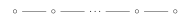{ loading=lazy }

    - $D_N(N\ge 4)$：

        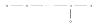{ loading=lazy }

    - $E_6$：

        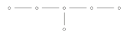{ loading=lazy }

    - $E_7$：

        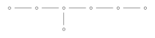{ loading=lazy }

    - $E_8$：

        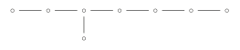{ loading=lazy }

**注：**一个**单边仿射(simply laced affine)** Dynkin 图是一个连通且无自环的图，若$A_\Gamma$是半正定的。它们形如：

- $\widehat{A_N}$：

    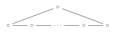{ loading=lazy }

- $\widehat{D_N}$：

    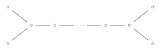{ loading=lazy }

- $\widehat{E_6}$：

    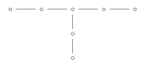{ loading=lazy }

- $\widehat{E_7}$：

    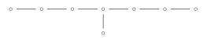{ loading=lazy }

- $\widehat{E_8}$：

    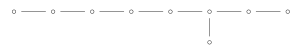{ loading=lazy }

回忆箭图 $Q$ 的表示为 $V=((V_i)_{i\in I},(x_h)_{h\in E})$，其中 $h:h'\rightarrow h''$ 为 $Q$ 的边，$x_h:V_{h'}\rightarrow V_{h''}$ 为线性映射。

!!! definition "定义"
    对任意 $i\in I$，如下定义表示 $S(i)$：取 $x_h=0$，

    $$
    S(i)_j=\begin{cases}
    \mathbb{C} & j=i\\
    0 & j\neq i \\
    \end{cases}
    $$

    容易验证 $S(i)$ 是一个表示，且 $i\neq j$ 时 $S_i\ncong S_j$。

!!! theorem "定理"
    设 $Q$ 无有向圈，则 $\left\{S(i)\Big| i\in I\right\}$ 为所有 $Q$ 的不可约表示。

??? proof "证明"
    令 $V$ 为 $Q$ 的表示，设 $I':=\left\{i\in I\Big| V_i\neq 0\right\}$，则存在 $i\in I'$ 使得 $\forall j\in I'$ 不存在边 $i\rightarrow j$，于是 $\dim V_i\cdot S(i)\subset V$。

!!! definition "定义"
    对任意 $Q$ 的表示 $V$，定义其**维数向量(dimension vector)** 为

    $$
    \dim V:=(\dim V_1,\dim V_2,\cdots,V_N)\in \mathbb{Z}^I
    $$

!!! definition "定义"
    对任意 $v\in \mathbb{Z}_{\ge 0}^I$，令

    $$
    \mathrm{Rep} (Q,v):=\bigoplus_{h\in E} \mathrm{Hom}_{\mathbb{C}}(\mathbb{C}^{v_{h'}},\mathbb{C}^{v_{h''}})
    $$

    为由 $v$ 生成的 $Q$ 的表示空间。定义

    $$
    \mathrm{GL}(v):=\prod_i \mathrm{GL}(v_i)
    $$

    自然作用于 $\mathrm{Rep} (Q,v)$ 上。

则我们有 $\dim v$ 的同构类一一对应于 $\mathrm{Rep} (Q,v)$ 的 $\mathrm{GL}(v)-$轨道。

!!! definition "定义"
    一个箭图 $Q$ 称为**有限型(finite type)**，当且仅当其不可分解表示的同构类数目是有限的。

**反例：**Jordan 箭图

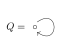{ loading=lazy }

，不可约表示为 $(\mathbb{C}^d,J_\lambda)$，其中 $J_\lambda=\left( \begin{matrix} \lambda&		1&		&		\\ &		\lambda&		\ddots&		\\ &		&		\ddots&		1\\ &		&		&		\lambda\\ \end{matrix} \right) ,\lambda\in \mathbb{C}$

!!! theorem "定理（Gabriel）"
    连通箭图 $Q$ 是有限型当且仅当其对应的无向图 $\Gamma$ 是 Dynkin 图。进一步我们有不可分解表示与和 $\Gamma$ 对应的的正根一一对应。

??? proof "idea"
    设 $Q$ 的任一表示 $V$ 均为不可分解表示的直和。根据 $\mathrm{GL}(V)-$作用，$\dim v$ 的同构类一一对应于 $\mathrm{Rep} (Q,v)$ 的 $\mathrm{GL}(v)-$轨道。

    因此，若$Q$是有限型，则$\mathrm{Rep}(Q,v)$上仅有有限个 $GL(v)-$轨道。进一步利用存在轨道 $O_V$ 满足：

    $$
    \dim O_V = \dim \mathrm{Rep}(Q,v).
    $$

    另一方面，$O_V = {\mathrm{GL}(V)}/{\mathrm{Stab}(V)}$，且 $\mathbb{C}^k \subseteq\mathrm{Stab}(v)$ 可得：

    $$
    \dim O_V = \dim \mathrm{Rep}(Q,v) \leq \dim \mathrm{GL}(V) - 1
    $$

    即

    $$
    \sum_{i \in I} v_i^2 - \sum_{h \in E} v_{h'}v_{h''} \geq 1
    \Longleftrightarrow
    v^T{A_p}v\ge 2,  \forall v \in \mathbb{Z}_{\ge 0}^I
    $$

    这表明 $A_p$ 是正定矩阵。

另一个方向的证明我们将通过反射函子得到。

## 2. 一些例子 { #s2 }

我们给出如下记号：

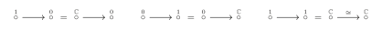{ loading=lazy }

令 $\mathrm{Ind}(Q)=\left\{Q \text{ 的不可分解的同构类}\right\}$

!!! example "例"
    { loading=lazy }

    ，$\mathrm{Ind}(Q)=\left\{\mathbb{C}\right\}$。

!!! example "例"
    { loading=lazy }

    ，注意到 $V\stackrel{A}{\longrightarrow}W =(\ker A\longrightarrow 0)\oplus (V'\xrightarrow{\sim} \mathrm{Im} A)\oplus (0\stackrel{0}{\longrightarrow}W')$，其中 $V'$ 为 $\ker A$ 在 $V$ 的补空间，$W'$ 为 $\mathrm{Im} A$ 在 $W$ 的补空间，故 $\mathrm{Ind}(Q)=\left\{1\rightarrow 0,0\rightarrow 1,1\rightarrow 1\right\}$

!!! example "例"
    $A_3$ 有两种情况需要讨论

    -

        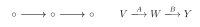{ loading=lazy }

        我们有 $\ker A\rightarrow 0\rightarrow 0$，$0\rightarrow 0\rightarrow Y'$，这里 $Y'$ 是 $\mathrm{Im}B$ 在 $Y$ 的补空间。于是我们有

        $$
        V\stackrel{A}{\hookrightarrow} W \stackrel{B}{\twoheadrightarrow }Y
        $$

        设 $X:=\ker(B\circ A),V=X\oplus X',W=A(X)\oplus W'$ 使得 $A(X')\subset W'$。则

        $$
        V\stackrel{A}{\hookrightarrow} W \stackrel{B}{\twoheadrightarrow }Y=(X\stackrel{A}{\hookrightarrow} A(x) \rightarrow 0)\oplus (X'\stackrel{A}{\hookrightarrow} W' \stackrel{B}{\twoheadrightarrow }Y)
        $$

        前者$=\dim X(1\to 1 \to 0)$，于是我们化归到了 $V\stackrel{A}{\hookrightarrow} W \stackrel{B}{\twoheadrightarrow }Y,\ker(B\circ A)=0$ 的情形。

        令 $X=B\circ A(V),Y=X\oplus X'$，令 $W'$ 为 $X'$ 的原像$\subset W$。则 $W=A(V)\oplus W'$ 且

        $$
        V\stackrel{A}{\hookrightarrow} W \stackrel{B}{\twoheadrightarrow }Y=
        \left( V\xrightarrow{\sim }A\left( V \right) \xrightarrow{\sim}X \right) \oplus \left( 0\rightarrow W'\stackrel{B}{\twoheadrightarrow } X' \right)
        $$

        后者由 $0\to 1\to 1$ 与 $0\to 1 \to 0$ 构成。故

        $$
        \mathrm{Ind}(Q)=\left\{\begin{aligned}
        1\to 0\to 0,0\to 0\to 1,1\to 1\to 0\\
        1\to 1\to 1,0\to 1\to 1,0\to 1\to 0\\
        \end{aligned}\right\}
        $$

    -

        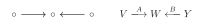{ loading=lazy }

        同上，我们可以拿掉 $\ker A\to 0\leftarrow 0$ 与 $0\to 0 \leftarrow \ker B$，得到

        $$
        V\stackrel{A}{\hookrightarrow} W \stackrel{B}{\hookleftarrow }Y
        $$

        设 $W'=V\cap Y,V'=W'\cap V,Y'=W'\cap Y$。则我们可以分离出

        $$
        V'\xrightarrow{\sim }W'\xleftarrow{\sim}Y'
        $$

        于是我们归化到了 $V\stackrel{A}{\hookrightarrow} W \stackrel{B}{\hookleftarrow }Y,V\cap Y=0$ 的情形。令 $W=V\oplus Y\oplus W'$，则

        $$
        V\stackrel{A}{\hookrightarrow} W \stackrel{B}{\hookleftarrow }Y=(V\stackrel{\sim}{\rightarrow} V \leftarrow 0)\oplus (0\to W'\leftarrow 0)\oplus (0\to Y\stackrel{\sim}{\leftarrow}Y)
        $$

        故

        $$
        \mathrm{Ind}(Q)=\left\{\begin{aligned}
        1\to 0\leftarrow 0,0\to 0\leftarrow 1,1\to 1\leftarrow 1\\
        1\to 1\leftarrow 0,0\to 1\leftarrow 0,0\to 1\leftarrow 1\\
        \end{aligned}\right\}
        $$

## 3. 根 { #s3 }

从现在开始 $\Gamma$ 形如 $A_n,D_n,E_6,E_7,E_8$ 中一者。$R_\Gamma=(r_{ij})_{1\le i,j\le n}$ 为伴随矩阵。

在格点 $\mathbb{Z}^n$ 或 $\mathbb{R}^n$ 上定义内积

$$
B(x,y)=x^TA_\Gamma y
$$

其中 $A_\Gamma:=2\mathrm{Id} -R_\Gamma$ 为 $\Gamma$ 的 **Cartan 矩阵**。

!!! theorem "引理"
    - $B$ 是正定的。
    - $\forall x\in \mathbb{Z}^n,B(x,x)\in 2\mathbb{Z}$。

??? proof "证明"
    $(1)$：由于 $\Gamma$ 是 Dynkin 图，故 $B$ 正定。

    $(2)$：由定义

    $$
    B(x,x)=x^T A_\Gamma x=\sum_{i,j} x_ia_{ij}x_j=2\sum _i x_i^2+\sum _{i,j,i\neq j} x_ia_{ij}x_j=2\sum_i x_i^2 +2\cdot \sum_{i<j} a_{ij}x_ix_j\in 2\mathbb{Z}
    $$

!!! definition "定义"
    关于某个正定内积的**根(root)**是 $\mathbb{Z}^n$ 中相对于该内积长度最短的非零向量。

故对内积 $B$，我们有 roots $=\left\{x\in \mathbb{Z}^n\Big| B(x,x)=2\right\}$，特别的 $\#$roots$<+\infty$。

!!! definition "定义"
    称 $\alpha_i=(0,\cdots,0,1,0,\cdots,0)$ 为**单根(simple root)**。

!!! theorem "引理"
    设 $\alpha$ 为根，$\alpha=\sum_i k_i\alpha_i$，则所有的 $k_i$ 均非正或均非负。

??? proof "证明"
    假设结论不成立，即存在某 $k_i > 0$ 和某 $k_j < 0$ 。不妨进一步假设在 $i$ 与 $j$ 之间的所有下标 $s$ 满足 $k_s = 0$。将顶点 $i,j$ 与图 $\Gamma$ 的顶点对应：

    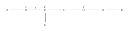{ loading=lazy }

    令 $\epsilon$ 为连接 $i$ 与其向 $j$ 方向相邻顶点的边，$i'$ 为 $\epsilon$ 的另一端点。通过移除边 $\epsilon$ 将图 $\Gamma$ 分割为子图 $\Gamma_1$ 和 $\Gamma_2$。由于 $\Gamma$ 是Dynkin图（无环且无圈），$\Gamma_1$ 与 $\Gamma_2$ 均为连通子图且彼此不连通：

    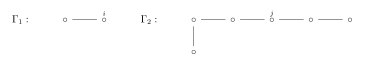{ loading=lazy }

    此时 $i \in \Gamma_1$，$j \in \Gamma_2$。定义：

    $$
    \beta = \sum_{m \in \Gamma_1} k_m \alpha_m, \quad \gamma = \sum_{m \in \Gamma_2} k_m \alpha_m,
    $$

    则有 $\alpha = \beta + \gamma$。由于 $k_i > 0$ 且 $k_j < 0$，可知 $\beta \neq 0$，$\gamma \neq 0$，因此：

    $$
    B(\beta, \beta) \geq 2, \quad B(\gamma, \gamma) \geq 2.
    $$

    进一步，由于$\Gamma_1$与$\Gamma_2$仅在边$\epsilon$处相连，其双线性形式满足：

    $$
    B(\beta, \gamma) = -k_i k_{i'}.
    $$

    由于$k_i > 0$且$k_{i'} \leq 0$（由$\gamma$的构造），可得$B(\beta, \gamma) \geq 0$。于是：

    $$
    B(\alpha, \alpha) = B(\beta + \gamma, \beta + \gamma) = \underbrace{B(\beta, \beta)}_{\geq 2} + 2 \underbrace{B(\beta, \gamma)}_{\geq 0} + \underbrace{B(\gamma, \gamma)}_{\geq 2} \geq 4.
    $$

    但这与$\alpha$是根矛盾。

!!! definition "定义"
    对根 $\alpha=\sum k_i\alpha_i$，称 $\alpha$ 是**正(负)根**，若 $k_i$ 均非负(均非正)。

于是所有根要么是正根要么是负根。令 $R^+$ 为所有正根构成的集合。

!!! example "例"
    - 设$\Gamma=A_{N-1}$。格$L = \mathbb{Z}^{N-1}$可视为格$\mathbb{Z}^N$的子群，其定义为所有满足

        $$
        \sum_{i=1}^N x_i = 0
        $$

        的向量$(x_1, \ldots, x_N)$构成的子群，即$L \subseteq \mathbb{Z}^N$。向量组

        $$
        \begin{aligned}
        \alpha_1 &= (1, -1, 0, \ldots, 0), \\
        \alpha_2 &= (0, 1, -1, 0, \ldots, 0), \\
        &\vdots \\
        \alpha_{N-1} &= (0, \ldots, 0, 1, -1)
        \end{aligned}
        $$

        自然构成$L$的一组基。进一步，$\mathbb{Z}^N$上的标准内积$(x, y) = \sum x_i y_i$限制在$L$上时，与由$\Gamma$定义的内积$B$一致，因为它们在基向量上的取值相同：

        $$
        (\alpha_i, \alpha_j) =
        \begin{cases}
        2, & i = j, \\
        -1, & i, j \text{ 相邻}, \\
        0, & \text{otherwise}.
        \end{cases}
        $$

        由此可知，形如

        $$
        (0, \ldots, 0, 1, 0, \ldots, 0, -1, 0, \ldots, 0) = \alpha_i + \alpha_{i+1} + \cdots + \alpha_{j-1}
        $$

        及

        $$
        (0, \ldots, 0, -1, 0, \ldots, 0, 1, 0, \ldots, 0) = -(\alpha_i + \alpha_{i+1} + \cdots + \alpha_{j-1})
        $$

        的向量均为$L$的根。因此，$L$中正根的数量为  $\frac{N(N-1)}{2}$

    - 作为补充，我们列出其他 Dynkin 图的正根数量：

        $$
        D_N:N(N-1)\qquad
        E_6:36\qquad
        E_7:63\qquad
        E_8:120
        $$

!!! definition "定义"
    设 $\alpha\in \mathbb{Z}^n$ 是根，**反射(reflection)** $s_\alpha$ 定义为

    $$
    s_\alpha(v):=v-B(v,\alpha)\alpha
    $$

**注：**

- 设 $H_\alpha\subset \mathbb{R}^n$ 为与 $\alpha$ 垂直的超平面，则 $H_\alpha$ 在 $s_\alpha$ 作用下不变，且 $Ss_\alpha(\alpha)=-\alpha$。于是 $s_\alpha$ 是对 $H_\alpha$ 的反射，且 $B(x,x)=B(s_\alpha(x),s_\alpha(x))$。
- 对每个 $i$，定义 $s_i:=s_{\alpha_i}$ 称为**简单反射(simple reflection)**，Weyl 群 $W$ 定义为由 $s_i$ 生成的 $O(\mathbb{R}^n)$ 的子群。
- 对任意 $w\in W$，$w(\alpha_i)$ 是根。更进一步我们有任意根均形如 $w(\alpha_i)$。
- 由 $\#$roots$<+\infty$ 知 $W$ 是有限群。

## 4. Gabriel 定理 { #s4 }

回忆箭图表示 $V$ 的维数向量为

$$
\dim V=(\dim V_1,\cdots,\dim V_n)
$$

!!! theorem "定理"
    $Q$ 形如 $A_n,D_n,E_6,E_7,E_8$ 中一者，则 $Q$ 有有限多个不可分解表示。且

    $$
    \begin{aligned}
    \mathrm{Ind}(Q)&\rightarrow R^+(Q)\\
    V&\mapsto \sum_i \dim V_i\cdot \alpha_i\\
    \end{aligned}
    $$

    是双射，其中 $R^+(Q)$ 是 $Q$ 对应的正根。

## 5. 反射函子 { #s5 }

!!! definition "定义"
    设 $Q$ 为箭图，称一个点 $i\in I$ 为**汇点(sink)/源点(source)**，如果所有包含 $i$ 的边均指向/指出 $i$。

    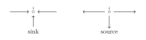{ loading=lazy }

!!! definition "定义"
    设 $Q$ 为任意箭图，且 $i \in Q$ 为汇点或源点。则定义 $\overline{Q_i}$ 为 $Q$ 通过反转所有包含 $i$ 的有向边得到的箭图。

!!! definition "定义（反射函子）"
    - 设 $Q$ 为箭图，且 $i \in Q$ 为汇点。设 $V$ 是 $Q$ 的一个表示。定义

        $$
        F_i^+ : \text{Rep}\, Q \to \text{Rep}\, \overline{Q_i}
        $$

        其中：

        $$
        F_i^+(V)_k =\begin{cases}
        V_k &, k \neq i\\
        \ker \left( \varphi : \bigoplus_{j \to i} V_j \to V_i \right) &, k=i\\
        \end{cases}
        $$

        对任意的边 $j\xrightarrow{h} k$，若 $k\neq i$，$x_h:V_j\rightarrow V_k$ 保持不变。若 $k=i$，将 $x_h$ 变为

        $$
        F_i^+(V)_i=\ker \varphi \hookrightarrow \bigoplus_{j \to i} V_j \to V_i
        $$

    - 设 $Q$ 为箭图，且 $i \in Q$ 为源点。设 $V$ 是 $Q$ 的一个表示。定义

        $$
        F_i^- : \text{Rep}\, Q \to \text{Rep}\, \overline{Q_i}
        $$

        其中：

        $$
        F_i^-(V)_k =\begin{cases}
        V_k &, k \neq i\\
        \mathrm{coker} \left( \psi : \bigoplus_{j \to i} V_j \to V_i \right) &, k=i\\
        \end{cases}
        $$

        对任意的边 $j\xrightarrow{h} k$，若 $k\neq i$，$x_h:V_j\rightarrow V_k$ 保持不变。若 $k=i$，将 $x_h$ 变为

        $$
        F_i^-(V)_i=\bigoplus_{j \to i} V_j\to \bigoplus_{j \to i} V_j/\mathrm{Im}(\psi)
        $$

!!! example "例"
    考虑

    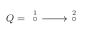{ loading=lazy }

    ，则

    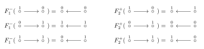{ loading=lazy }

!!! example "例"
    - 若 $i$ 是汇点，则 $F_i^+(S(i))=0$。
    - 若 $i$ 是源点，则 $F_i^-(S(i))=0$。

!!! theorem "命题"
    设 $V\in \mathrm{Ind}(Q)$。

    - 设 $i$ 是汇点，则要么 $V=S(i)$，要么 $\varphi:\bigoplus_{j\to i} V_j\rightarrow V_i$ 是满射。
    - 设 $i$ 是源点，则要么 $V=S(i)$，要么 $\psi:V_i \rightarrow \bigoplus_{i\to j} V_j$ 是单射。

??? proof "证明"
    $(1)$：我们有分解 $V_i=\mathrm{Im}\varphi\otimes W$，则

    $$
    V=\dim W\cdot S(i)\oplus V'
    $$

    其中 $V'$ 是通过将 $V$ 中的 $V_i$ 替换为 $\operatorname{Im} \varphi$ 而得到的空间。若 $V\in \mathrm{Ind}(Q)$，则要么 $V\cong S(i)$，要么 $\varphi$ 是满射。

    $(2)$ 同理。

!!! theorem "命题"
    设 $V\in \mathrm{Rep}(Q)$。

    - 设 $i$ 是汇点，$\varphi:\bigoplus_{j\to i} V_j\rightarrow V_i$ 是满射，则

        $$
        F_i^-F_i^+(V)\cong V\qquad \dim (F_i^+V)=S_i(\dim V)
        $$

    - 设 $i$ 是源点，$\psi:V_i \rightarrow \bigoplus_{i\to j} V_j$ 是单射，则

        $$
        F_i^+F_i^-(V)\cong V\qquad \dim (F_i^-V)=S_i(\dim V)
        $$

??? proof "证明"
    设 $K=\ker (\varphi:\bigoplus_{j\to i} V_j\rightarrow V_i)=(F_i^+(V))_i$，于是

    $$
    (F_i^-F_i^+(V))_i=\mathrm{coker}(\psi:K \rightarrow \bigoplus_{j\to i} V_j )=\bigoplus_{j\to i}V_j/\mathrm{Im}\psi=\bigoplus_{j\to i}V_j/K\cong V_i
    $$

    由定义

    $$
    \dim(F_i^+(V))_i-\dim V_i=\dim K-\dim V_i=\sum_{j\to i} \dim V_j-2\dim V_i=-B(\dim V,\alpha_i)
    $$

    故 $\dim F_i^+(V)=\dim V-B(\dim V,\alpha_i)\alpha_i=S_i(\dim V)$。

!!! definition "定义"
    对 $v\in \mathbb{Z}^n$，我们称 $v\ge 0$ 当且仅当 $v_i\ge 0,\forall 1\le i\le n$。

!!! theorem "推论"
    对 $V\in \mathrm{Ind}(Q)$，若 $i$ 是汇点/源点，则 $F_i^+(V)/F_i^-(V)$ 要么是 0 要么是不可分解的。且前者等价于 $V\cong S(i)$，后者等价于 $S_i(\dim V)\ge 0$。

    在后者情形中，$\dim F_i^{\pm}(V)=S_i(\dim V)$ 且 $V\cong F_i^-F_i^+(V)/V\cong F_i^+F_i^-(V)$。

## 6. Coxeter 元 { #s6 }

!!! definition "定义"
    给 $Q$ 引入一个固定标记 $1, \ldots, n$，则 $c:=S_1S_2\cdots S_n\in W$ 称为 **Coxeter 元**。

!!! theorem "引理"
    令 $\beta=\sum_i k_i\alpha_i\neq 0$，其中 $k_i\ge 0,\forall i$，则 $\exists N\in \mathbb{N}$ 使得 $c^N\beta$ 存在至少一个负常数。

??? proof "证明"
    Coxeter 元 $c$ 属于有限群 $W$，故存在 $M \in \mathbb{N}$ 使得$c^M = 1$。我们断言：作为 $\mathbb{R}^n$ 上的算子，有

    $$
    1 + c + c^2 + \cdots + c^{M-1} = 0
    $$

    此式蕴含所需结论——因为 $\beta$ 至少有一个严格正系数，故以下元素中必存在至少一个含严格负系数：

    $$
    c\beta,\ c^2\beta,\ \ldots,\ c^{M-1}\beta
    $$

    进一步，只需证明 $1$ 不是 $c$ 的特征值。原因如下：若存在向量满足

    $$
    (1 + c + c^2 + \cdots + c^{M-1})v = w \neq 0
    $$

    则有

    $$
    cw = c\left(1 + c + c^2 + \cdots + c^{M-1}\right)v = (c + c^2 + \cdots + c^{M-1} + 1)v = w
    $$

    假设结论不成立，即 $1$ 是 $c$ 的特征值。设 $v$ 为对应特征向量：

    $$
    cv = v \implies s_1 \cdots s_n v = v
    $$

    $$
    \iff s_2 \cdots s_n v = s_1 v
    $$

    由于 $s_i$ 仅改变 $v$ 的第 $i$ 个坐标，可得

    $$
    s_1 v = v \quad \text{且} \quad s_2 \cdots s_n v = v
    $$

    重复此过程，对所有 $i$ 得到

    $$
    s_i v = v.
    $$

    这意味着对所有 $i$ 有

    $$
    B(v, \alpha_i) = 0.
    $$

    因 $B$ 是非退化的，故 $v = 0$。但 $v$ 是特征向量，矛盾。

## 7. Gabriel 定理的证明 { #s7 }

设 $V$ 是箭图 $Q$ 的一个不可分解表示。我们给 $Q$ 引入一个固定标记 $1, \ldots, n$，使得若从 $i$ 可达 $j$ 则满足 $i < j$。这种标记是可行的——我们可以将最高标签赋给任意汇点，从箭图中移除此汇点，再将次高标签赋给剩余箭图的汇点，依此类推。如此便构造出所需的标记。

现考虑序列

$$
V^{(0)} = V,\quad V^{(1)} = F_n^+V,\quad V^{(2)} = F_{n-1}^+F_n^+V,\quad \ldots
$$

该序列良定义性源于所选标记：$n$ 必是 $Q$ 的汇点，$n-1$ 必是 $Q_n$ 的汇点（其中 $Q_n$ 是通过反转 $Q$ 在顶点 $r$ 的所有箭头所得），以此类推。进一步注意到 $V^{(n)}$ 重新成为 $Q$ 的表示，因为每条箭头均被反转两次（因我们对每个顶点都应用了反射函子）。这意味着可定义

$$
V^{(n+1)} = F_n^+V^{(n)},\quad \ldots
$$

并将序列无限延伸。

!!! theorem "命题"
    存在 $m\in \mathbb{N}$ 使得

    $$
    \dim (V^{(m)})=\alpha_p
    $$

    对某个单根成立。

下面我们来证明 Gabriel 定理： $Q$ 形如 $A,D,E$，则下映射为双射

$$
\begin{aligned}
\mathrm{Ind}(Q)&\rightarrow R^+(Q)\\
V&\mapsto \dim V=\sum_i \dim V_i\cdot \alpha_i\\
\end{aligned}
$$

我们分三步证明。

!!! theorem "推论"
    $$
    \dim V\in R^+(Q)
    $$

!!! theorem "推论"
    $V,V'\in \mathrm{Ind}(Q),\dim V=\dim V'$，则 $V\cong V'$。

!!! theorem "推论"
    $\forall \alpha\in R^+(Q)$，存在 $V\in \mathrm{Ind}(Q)$，使得 $\dim V=\alpha$。

!!! example "例"
    考虑 $Q=D_4$。

---

[返回目录](index.md){ .md-button } [下载 PDF 完整版](../../../assets/representation-theory.pdf){ .md-button download="representation-theory.pdf" }
