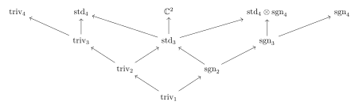
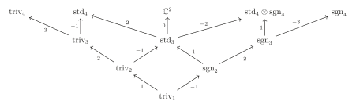
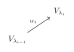

# 第八章：Okounkov–Vershik 对 S_n 表示的新方法 { #top }

## 1. Okounkov-Vershik 对 $S_n$ 表示的新方法 { #s1 }

动机：$\left\{1\right\}=S_1\subseteq S_2 \subseteq S_3\subseteq \cdots \subseteq S_{n-1}\subseteq S_n\subseteq \cdots$，其中 $S_k$ 可以视作 $S_{k+1}$ 的子群（固定 $k+1$）。

### 1.1 中心化子 $Z_B(A)$ 和表示的限制 { #s1-1 }

设 $A,B$ 是半单代数，$\tau:B\rightarrow A$ 是同态，即对任意 $A$ 的表示 $V$ 均可表示为某个 $B$ 的表示在 $\tau$ 下的像。首先我们有

$$
A\stackrel{\sim }{\rightarrow} \bigoplus_{V\in \mathrm{Irr}(A)}\mathrm{End}(V)\qquad B\stackrel{\sim }{\rightarrow} \bigoplus_{U\in \mathrm{Irr}(B)}\mathrm{End}(U)
$$

对任意 $V\in \mathrm{Irr}(A),U\in \mathrm{Irr}(B)$，令 $M_{V,U}:=\mathrm{Hom}_B(U,V)$，则

$$
V\stackrel{\sim }{\rightarrow} \bigoplus_{U\in \mathrm{Irr}(B)} U\otimes M_{V,U}
$$

是 $B$ 的表示。

现在我们的问题是如何计算 $M_{V,U}$。为此我们需要如下定义：

!!! definition "定义"
    定义**中心化子(centralizer)** $Z_B(A)=$

    $$
    \left\{a\in A\Big| a\tau(b)=\tau(b)a,\forall b\in B\right\}
    $$

- 当 $B=A$，$\tau=\mathrm{id}$ 时，$Z_B(A)$ 即为 $A$ 的中心。
- $Z_B(A)\subseteq A$ 是子代数。
- $Z_B(A)$ 在 $M_{V,U}$ 上有自然的作用。具体而言，对 $z\in Z_B(A),\varphi\in M_{V,U}$，$(z\cdot \varphi)(u)=z(\varphi(u))$。

!!! theorem "引理"
    $$
    Z_B(A)\stackrel{\sim }{\rightarrow} \bigoplus_{\substack{U\in \mathrm{Irr}(B),V\in \mathrm{Irr}(A)\\ M_{V,U}\neq 0}} \mathrm{End}(M_{V,U})
    $$

!!! theorem "推论"
    以下两个命题等价：

    - $\forall U\in \mathrm{Irr}(B),V\in \mathrm{Irr}(A)$，有 $\dim \mathrm{Hom}_B(U,V)\le 1$。
    - $Z_B(A)$ 交换。

??? proof "证明"
    $Z_B(A)=\bigoplus \mathrm{End}(M_{V,U})$ 交换 $\Longleftrightarrow \dim M_{V,U}\le 1$

**注：**于是作为 $B$ 的表示 $V=\bigoplus_{U,M_{V,U}\neq 0} U$，所以 $U$ 由 $V$ 的子空间唯一确定。

### 1.2 $Z_m(n)$ 代数 { #s1-2 }

在本节中，我们考虑代数

$$
Z_m(n):=Z_{\mathbb{C}S_m}(\mathbb{C}S_n)
$$

其中 $0\le m<n$。首先我们有：

!!! theorem "引理"
    设 $H\subseteq G$ 是有限群，则

    $$
    Z_{\mathbb{C}H}(\mathbb{C}G)=\left\{\sum_{g\in G} a_g g\Big| a_g\in \mathbb{C},a_{hgh^{-1}}=a_g,\forall h\in H \right\}
    $$

    特别的，$Z_{\mathbb{C}H}(\mathbb{C}G)$ 有基

    $$
    \left\{b_c:=\sum_{g\in c} g\Big| c\in G \text{ 的 } H-\text{共轭类}\right\}
    $$

??? proof "证明"
    $$
    \begin{aligned}
    \sum_{g\in G} a_g g\in Z_{\mathbb{C}H}(\mathbb{C}G)&\Longleftrightarrow \forall h\in H,\sum_{g\in G} a_g h g =\sum_{g\in G} a_g g h\\
    &\Longleftrightarrow \forall h\in H, a_g=a_{hgh^{-1}}
    \end{aligned}
    $$

考虑 $S_m\subseteq S_n$，$S_m$ 在 $S_n$ 上的共轭作用为元素 $1,2,\cdots,m$ 的置换，故 $S_n$ 中的 $S_m-$共轭类为 $m+1,\cdots,n$ 中元素的轮换。

!!! example "例"
    考虑 $m=n-1$，共轭类为 $(*, n)$，包含了 $\left\{(1,n),(2,n),\cdots,(n-1,n)\right\}$，此时

    $$
    b_{(*,n)}=\sum_{i=1}^{n-1} (i,n)=:J_n\in Z_{\mathbb{C}S_{n-1}}(\mathbb{C}S_n)
    $$

    其中 $J_n$ 称为 Jucys-Murphy 元。

注意到 $Z_m(n)$ 含有：

- $\mathbb S_n$ 的中心 $Z_m(m)$ 且 $Z_m(m)\subseteq Z_m(n)$ 的中心。
- $S_{[m+1,n]}=\left\{g\in S_n\Big| g(i)=i,\forall 1\le i\le m\right\}$。
- 考虑 Jucys-Murphy 元 $J_k:=\sum_{i=1}^{k-1} (i,k)$ 与 $\mathbb{C}S_{k-1}$ 交换。故 $J_{m+1},\cdots,J_n\in Z_m(n)$。更进一步的，对 $m+1\le k<l\le n$ 我们有 $J_kJ_l=J_lJ_k$，这是因为 $J_l\in Z_{l-1}(l)$ 且 $J_k\in \mathbb{C} S_{l-1}$。

!!! theorem "定理"
    代数 $Z_m(n)$ 由 $Z_m(m),\mathbb{C}S_{[m+1,n]},J_{m+1},\cdots,J_n$ 生成。

??? proof "证明"
    之后补。

!!! theorem "推论"
    我们有：

    - $Z_{n-1}(n)$ 交换。

    - $\forall U\in \mathrm{Irr}(\mathbb{C}S_{n-1}),V\in \mathrm{Irr}(\mathbb{C}S_n)$,

        $$
        \dim \mathrm{Hom}_{\mathbb{C}S_{n-1}} (U,V)\le 1
        $$

    - 设 $V \in \operatorname{Irr}(\mathbb{C}S_n)$，则 Jucys-Murphy 元素 $J_n$ 在 $V$ 的每个不可约 $\mathbb{C}S_{n-1}$-子模上的作用均为标量乘法。

??? proof "证明"
    $(1)$：$Z_{n-1}(n)$ 由  $Z_{n-1}(n-1)$ 与 $J_n$ 生成，且前者在 $Z_{n-1}(n)$ 的中心里。

    $(2)$：由 $(1)$ 即得，且

    $$
    Z_{n-1}(n)\cong \bigoplus_{U\in \mathrm{Irr}(\mathbb{C}S_{n-1}),V\in \mathrm{Irr}(\mathbb{C}S_n)} \mathrm{End}(\mathrm{Hom}_{\mathbb{C}S_{n-1}}(U,V))
    $$

    $(3)$：设 $V=\bigoplus_i U_i$ 作为 $S_{n-1}-$表示，$U_i$ 不可约。由于 $J_n$ 与 $\mathbb{C}S_{n-1}$ 交换，故

    $$
    J_n\in \mathrm{Hom}_{S_{n-1}}(V,V)\cong \bigoplus_i \mathrm{Hom}_{S_{n-1}}(U_i,V_i)\cong \bigoplus_i \mathbb{C}
    $$

    故 $J_n$ 在每个 $U_i$ 上作用均为标量。

### 1.3 分支图 { #s1-3 }

对任意 $V^n\in \mathrm{Irr}(S_n),U\in \mathrm{Irr}(S_{n-1})$，由于 $\dim \mathrm{Hom}_{S_{n-1}}(U,V^n)\le 1$，我们可以将 $V^n$ 唯一分解为两两不同构的 $S_{n-1}-$表示的直和。

!!! definition "定义"
    **分支图(branching graph)**是一个有向图，其顶点由所有的 $S_n$ 表示的同构类组成，$n\ge 1$，有边 $U\to V$ 当且仅当存在 $n$ 使得 $V\in \mathrm{Irr}(S_n),U\in \mathrm{Irr}(S_{n-1})$ 且 $\mathrm{Hom}_{S_{n-1}}(U,V)\neq 0$。

**注：**由于 $U\subset V$ 当且仅当 $U\otimes \mathrm{sgn}_{n-1}\subset V\otimes \mathrm{sgn}_n$，于是张量积上一个 $\mathrm{sgn}$ 表示给出了分支图的一个对称。

!!! example "例"
    { loading=lazy }

!!! definition "定义"
    对 $V^m\in \mathrm{Irr}(S_m),V^n\in \mathrm{Irr}(S_n),m<n$，在分支图中定义

    $$
    \mathrm{Path}(V^m,V^n):=\left\{V^m \text{到} V^n \text{的所有道路}\right\}
    $$

    $$
    \mathrm{Path}(V^n):=\mathrm{Path}(V^1,V^n)\qquad\mathrm{Path}_n:=\bigsqcup_{V^n\in \mathrm{Irr}(S_n)}{\mathrm{Path}(V^n)}
    $$

!!! definition "定义"
    对 $\overline{P}=(V^m\to V^{m+1}\to \cdots \to V^n)\in \mathrm{Path}(V^m,V^n)$，记 $V^m(\overline{P})$ 为 $V^m$ 通过 $V^m \to V^{m+1} \to \cdots \to V^n$ 的方式嵌入到 $V^n$ 内部所对应的副本。故有

    $$
    V^n=\bigoplus_{V^m\in \mathrm{Irr}{S_m}} \bigoplus_{\overline{P}\in \mathrm{Path}(V^m,V^n)} V^m(\overline{P})
    $$

    记 $\varphi_{\overline{P}}:V^m\hookrightarrow V^n$ 为对应的嵌入，该嵌入在缩放意义下是唯一的。且 $\varphi_{\overline{p}}$ 的像为 $V^m(\overline{P})$。

    对于 $m+1 \leq k \leq n$，定义 $w_k \in \mathbb{C}$ 满足

    $$
    J_k |_{V^{k-1} \subseteq V^k} = w_k\cdot  \mathrm{Id}_ {V^{k-1}}
    $$

    并称$w_{\overline{P}} := (w_{m+1}, \cdots, w_n)$为 $\overline{p}$ 的**权(weight)**。

另一方面，$\operatorname{Hom}_{S_m}(V^m, V^n)$ 是 $Z_{m}(n)$ 的不可约表示。回顾：对 $z \in Z_{m}(m)$ 和 $\varphi \in \operatorname{Hom}_{S_m}(V^m, V^n)$ 有$(z \cdot \varphi)(u) = z(\varphi(u)), \quad \text{其中}  u \in V^m$。易验证 $z \cdot \varphi \in \operatorname{Hom}_{S_m}(V^m, V^n)$。因此，$J_{m+1}, \cdots, J_n \in Z_{m}(n)$ 作用于 $\operatorname{Hom}_{\mathbb{C}S_n}(V^m, V^n)$ 上。

!!! theorem "引理"
    - $\left\{\varphi_{\overline{P}}\Big| \overline{P}\in \mathrm{Path}(V^m,V^n)\right\}$ 是 $\mathrm{Hom}_{S_m}(V^m,V^n)$ 的一组基。

    - $\forall m+1\le k\le n,\overline{P}\in \mathrm{Path}(V^m,V^n)$ 与 $w_{\overline{P}} =(w_{m+1},\cdots,w_n)$，则

        $$
        J_k \cdot \varphi_{\overline{P}} =w_k \varphi_{\overline{P}}
        $$

对 $m=1$，$\mathrm{Hom}_{S_1}(V^1,V^n)=\mathrm{Hom}_\mathbb{C}(\mathbb{C},V^n)\cong V^n$。$\forall P\in \mathrm{Path}(V^n)$，记 $v_P=\varphi_P\in V^n$。

!!! theorem "推论"
    - $\left\{v_P\Big| P\in \mathrm{Path}(V^n)\right\}$ 是 $V^n$ 的一组基。
    - $\forall 1\le k \le n$，$J_kv_P=w_k\cdot v_P$。

    这里 $w_1=0$，$w_P=(0,w_2,\cdots,w_n)\in \mathbb{C}^n$。

!!! example "例"
    { loading=lazy }

!!! theorem "推论"
    令 $m<n$，$V^m\in \mathrm{Irr}(S_m),V^n\in \mathrm{Irr}(S_n)$，$\underline{P}\in \mathrm{Path}(V^m)$，$\overline{P} \in \mathrm{Path}(V^m,V^n)$。设 $P\in \mathrm{Path}(V^n)$ 为其串联 $\underline{P}\overline{P}$，则 $v_P$ 与 $\varphi_{\overline{P}} (v_{\underline{P}})$ 成比例。

### 1.4 权的唯一性 { #s1-4 }

!!! theorem "定理"
    令 $P,P'\in \mathrm{Path}_n$，若 $w_P=w_{P'}$，则 $P=P'$。

!!! definition "定义"
    令 $wt_n:=\left\{w_P\Big| P\in \mathrm{Path}_n\right\}$，称 $w_P$ 与 $w_{P'}$ 是**表示等价**的，若其均为两个不可约表示之间的道路的权。

### 1.5 改变道路 { #s1-5 }

!!! definition "定义"
    设 $P=(V^1\to V^2\to \cdots V^n)\in \mathrm{Path}(V^n)$，对 $1\le i \le n$ 定义

    $$
    \mathrm{Path}(P,i)=\left\{V'^1\to V'^2\to \cdots \to V'^n\Big| V'^j=V^j ,\forall j\neq i\right\}
    $$

!!! theorem "定理"
    令 $w_P=(w_1,\cdots,w_n)$，则

    - $w_i\neq w_{i+1}$

    - 若 $w_{i+1}=w_i\pm 1$，则 $\mathrm{Path}(P,i)=\left\{P\right\}$

    - 若 $w_{i+1}\neq w_i\pm 1$，则 $\mathrm{Path}(P,i)=\left\{P,P'\right\}$，且

        $$
        w_{P'}=(w_1,\cdots,w_{i-1},w_{i+1},w_i,w_{i+2},\cdots,w_n)
        $$

    - 若 $i<n-1$，且 $w_i=w_{i+1}+1$，则 $w_{i+2}\neq w_i$。

考虑 $Z_{i-1}(i+1)\subset \mathbb{C}S_n$，令

$$
V_{P,i}:=\mathrm{span}_{\mathbb{C}} \left\{v_{P'}\Big| P'\in \mathrm{Path}(P,i)\right\}
$$

注意到 $\left\{v_{P'}\Big| P'\in \mathrm{Path}(P,i)\right\}$ 是 $V_{P,i}$ 的基。

!!! theorem "命题"
    $V_{P,i}\subset V^n$ 是 $Z_{i-1}(i+1)-$子模，且是不可约 $Z_{i-1}(i+1)-$模。

### 1.6 退化仿射 Hecke 代数 $H(2)$ { #s1-6 }

!!! definition "定义"
    **退化仿射 Hecke 代数(degenerate affine Hecke algebra )**$H(2)$ 由 $X_1,X_2,T$ 生成，满足如下条件：

    $$
    X_1X_2=X_2X_1,T^2=1,TX_1=X_2T-1
    $$

回忆 $Z_{i-1}(i+1)$ 由 $Z_{i-1}(i+1)$ 的中心、$J_i$、$J_{i+1}$ 与 $(i,i+1)$ 生成。

!!! theorem "引理"
    $$
    J_iJ_{i+1}=J_{i+1}J_i,(i,i+1)^2=1,(i,i+1)J_i=J_{i+1}(i,i+1)-1
    $$

故存在代数同态 $H(2)\to Z_{i-1}(i+1)$，进而任意 $Z_{i-1}(i+1)-$模都是 $H(2)-$模。

!!! theorem "推论"
    令 $M$ 是不可约 $Z_{i-1}(i+1)-$模，则 $M$ 也是不可约 $H(2)-$模。

可以证明 $\left\{X_1^{d_1}X_2^{d_2}\sigma\Big| d_1,d_2\in \mathbb{Z}_{\ge 0},\sigma\in \left\{1,T\right\}\right\}$ 为 $H(2)$ 的基，留做习题。

### 1.7 $H(2)$ 的有限维不可约表示 { #s1-7 }

令 $M$ 为有限维不可约 $H(2)-$模。由 $X_1X_2=X_2X_1$ 知其有相同的特征向量 $m\in M$，满足 $X_1m=am,X_2m=bm,a,b\in \mathbb{C}$。考虑 $Tm$，若 $Tm,m$ 线性独立，则有 $M=\mathrm{span}\left\{M,TM\right\}$ 且

$$
T\rightarrow \left( \begin{matrix}
0&		1\\
1&		0\\
\end{matrix} \right) ,X_1\rightarrow \left( \begin{matrix}
a&		-1\\
0&		b\\
\end{matrix} \right) ,X_2\rightarrow \left( \begin{matrix}
b&		1\\
0&		a\\
\end{matrix} \right)
$$

另一方面，对于任意 $a,b\in \mathbb{C}$ 上式满足 $H(2)$ 的定义。于是这给出了一个 $\mathbb{C}^2$ 上的 $H(2)-$模结构，记为 $M(a,b)$。

!!! theorem "引理"
    $M(a,b)$ 不可约当且仅当 $a\neq b\pm 1$。更进一步的，若 $a\neq b\pm 1$，$M(a,b)\cong M(a',b')$ 当且仅当 $(a,b)=(a',b')$ 或 $(a,b)=(b',a')$。

综合一下得到：

!!! theorem "命题"
    $H(2)$ 的有限维不可约表示由一对复数确定，$(a,b)\mapsto L(a,b)$，其中 $L(a,b)\cong L(b,a)$ 若 $b\neq a,b\neq a\pm 1$。在 $L(a,b)$ 中 $(a,b)$ 对应 $X_1,X_2$ 的特征向量。我们还有：

    - 若 $b=a+1$，则 $L(a,b)\cong \mathbb{C}$，

        $$
        T\mapsto 1,X_1\mapsto a,X_2,\mapsto b
        $$

    - 若 $b=a-1$，则 $L(a,b)\cong \mathbb{C}$，

        $$
        T\mapsto -1,X_1\mapsto a,X_2,\mapsto b
        $$

    - 若 $b\neq a\pm 1$，则 $L(a,b)\cong \mathbb{C}^2$，

        $$
        T\rightarrow \left( \begin{matrix}
        0&		1\\
        1&		0\\
        \end{matrix} \right) ,X_1\rightarrow \left( \begin{matrix}
        a&		-1\\
        0&		b\\
        \end{matrix} \right) ,X_2\rightarrow \left( \begin{matrix}
        b&		1\\
        0&		a\\
        \end{matrix} \right)
        $$

    - $X_1,X_2$ 在 $L(a,b)$ 上作用是可对角化的当且仅当 $a\neq b$。

下面我们可以证明 $\mathrm{Path}(P,i)$ 的分类定理

??? proof "证明"
    下次补。

### 1.8 完成分类 { #s1-8 }

现在我们利用 $\mathrm{Path}(P,i)$ 的分类定理与 $\# \mathrm{Irr}(S_n)=\# \text{共轭类}$ 来结束 $\mathrm{Irr}(S_n)$ 的分类。

!!! definition "定义"
    一个 $\mathbb{C}^n$ 上的**可容对换(admissible transposition)** 为

    $$
    (w_1,\cdots,w_n)\mapsto (w_1,\cdots,w_{i-1},w_{i+1},w_{i},w_{i+2},\cdots,w_n)
    $$

    若 $w_{i+1}\neq w_i\pm 1$。

!!! definition "定义"
    我们称 $\mathbb{C}^n$ 中的两个元素是**组合等价的(combinatorial equivalent)**，若其中一个可通过一系列可容对换得到另一个。此等价关系记为 $\sim_c$。

!!! definition "定义"
    一个**组合权(combinatorial weight)**为 $\mathbb{C}^n$ 的一个元素，使得任意与其组合等价的元素 $(w_1,\cdots,w_n)$ 均满足：

    - $w_1=0$
    - $w_i\neq w_{i+1},\forall 1\le i\le n-1$
    - $\forall 1\le i\le n-2,w_{i+1}=w_i\pm 1$

    记 $cwt_n$ 为所有组合权。

!!! theorem "推论"
    - $wt_n\subset cwt_n$，且 $wt_n$ 是一个组合等价类。
    - 组合等价是表示等价。

于是我们有

$$
\left| P(n)\right|=\left|wt_n/\sim_r \right|\le\left|wt_n/\sim_c \right|\le \left|cwt_n/\sim_c \right|
$$

!!! theorem "引理"
    任意组合等价类均含有一个元素

    $$
    (0,1,\cdots,n_1-1,-1,0,\cdots,n_2-2,-2,-1,\cdots,n_3-3,\cdots,1-k,\cdots,n_k-k)
    $$

    这里 $n_1\ge \cdots\ge n_k\ge 1$ 满足 $\sum n_i=n$。

这表明

$$
\left|cwt_n/\sim_c\right|\le\left|P(n)\right|
$$

结合上一不等式我们有

!!! theorem "命题"
    - $cwt_n=wt_n$。
    - $\sim_c=\sim_r$。
    - 引理中的 $(n_1,\cdots,n_k)$ 由等价类唯一确定。

综上，对任意 $V\in \mathrm{Irr}(S_n)$，我们有元素 $wt_n/\sim_r$ 与之对应，即某个 $n$ 的分划 $\lambda=(n_1,\cdots,n_k)$，这表明 $\mathrm{Irr}(S_n)$ 与 $P_n$ 一一对应。

!!! example "例"
    { loading=lazy }

    - $\mathrm{triv}_4$，仅有唯一的权 $(0,1,2,3)$，得 $\lambda=(4)$。
    - $\mathrm{std}_4$，有权 $\color{red}{(0,1,2,-1)}$ $,(0,1,-1,2),(0,-1,1,2)$，得 $\lambda=(3,1)$。
    - $\mathbb{C}^2$，有权 $\color{red}{(0,1,-1,0)}$ $,(0,-1,1,0)$，得 $\lambda =(2,2)$。
    - $\mathrm{std}_4\otimes \mathrm{sgn}_4$，有权 $\color{red}{(0,1,-1,-2)}$ $,(0,-1,1,-2),(0,-1,-2,1)$，得 $\lambda=(2,1,1)$。
    - $\mathrm{sgn}_4$，仅有唯一的权 $(0,-1,-2,-3)$，得 $\lambda=(1,1,1,1)$。

### 1.9 Young 图 { #s1-9 }

回忆，一个标准 Young 表 $SYT(n)$ 为一种将 $1,2,\cdots,n$ 填入 Young 表 $Y_\lambda$ 中满足从上到下从左到右均严格递增。一个标准 Young 表 $T$ 所对应的 Young 表被称为 $T$ 的形状。

!!! definition "定义"
    对 $SYT(n)$ $T$，定义其 content

    $$
    c(T):=(x_1-y_1,\cdots,x_n-y_n)
    $$

    其中 $(x_i,y_i)$ 为 $i$ 对应的坐标。

可以证明 $T\mapsto c(T)$ 是单射，留做习题。

!!! theorem "命题"
    映射 $T\mapsto c(T)$ 是 $SYT(n)$ 与 $cwt(n)$ 的双射。更进一步的，$T$ 的形状等同于由 $c(T)$ 所确定的划分。

!!! theorem "推论"
    令 $\lambda\in P(n)$，$V_\lambda$ 为其对应 $S_n$ 的不可约表示。存在 $V_\lambda$ 的基 $\left\{v_T\Big| T\in SYT(n),T \text{ 形状为 } Y_\lambda\right\}$，且 $J_i\cdot v_T=(x_i-y_i)v_T$，其中 $(x_i,y_i)$ 为 $i$ 在 $T$ 中的坐标。

!!! theorem "推论"
    $\lambda\in P(n)$，则作为 $S_{n-1}-$表示

    $$
    V_\lambda=\bigoplus_{\mu} V_\mu
    $$

    其中 $\mu$ 遍历所有比 $\lambda$ 少一个格子的 Young 表。更进一步的，$J_n$ 作用在 $V_\mu$ 为标量，其值为少的格子的 content。

!!! definition "定义"
    定义 Young 图为一个有向图，其顶点为 Young 表，$\mu \to \lambda$ 当且仅当 $\mu$ 比 $\lambda$ 少一个格子。

!!! theorem "推论"
    在 $\bigsqcup_{n \geq 1} \operatorname{Irr}(S_n)$ 与 Young 表的一一对应关系下，分支图等于 Young 图。

**注：**利用 Young 图，很容易得到对 $P\in \mathrm{Path}(V_\lambda)$ 的权 $w_P=(w_1,\cdots,w_n)$，因为我们直接有 $w_i=$ $\lambda_i\setminus \lambda_{i-1}$ 的 content。

{ loading=lazy }

## 参考文献 { #references }

1. Pavel Etingof, Oleg Golberg, Sebastian Hensel, Tiankai Liu, Alex Schwendner, Dmitry Vaintrob, Elena Yudovina. Introduction to Representation Theory.
2. Jean-Pierre Serre. Linear Representations of Finite Groups.
3. William Fulton, Joe Harris. Representation Theory.
4. Andrei Okounkovy, Anatoly Vershikz. A New Approach to Representation Theory of Symmetric Groups.
5. Ivan Losev. Modern introduction to Representation theory.

---

[返回目录](index.md){ .md-button } [下载 PDF 完整版](../../../assets/representation-theory.pdf){ .md-button download="representation-theory.pdf" }
