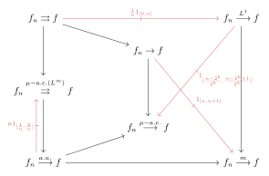

# 第五章：收敛模式 { #top }

!!! definition "定义"
    - 称序列 $f_n$ **逐点收敛(pointwise)**到 $f$，若对每个 $x \in X$，有 $f_n(x)$ 收敛到 $f(x)$。换言之，对任意 $\varepsilon > 0$ 和 $x \in X$，存在 $N$，使得当 $n \geq N$ 时，

        $$
        |f_n(x) - f(x)| \leq \varepsilon.
        $$

    - 称序列 $f_n$ **一致收敛(uniformly)**到 $f$，若对任意 $\varepsilon > 0$，存在 $N$，使得当 $n \geq N$ 时，对所有 $x \in X$，

        $$
        |f_n(x) - f(x)| \leq \varepsilon.
        $$

    两者的区别在于后者要求 $N$ 的选择必须与 $x$ 无关，而是对全体 $x \in X$ 一致成立。

!!! definition "定义"
    令 $(X,\mathbb{B},\mu)$ 是测度空间，$f_n$ 是可测函数且极限 $f$ 可测。

    - 我们称 $f_n$ **几乎处处逐点收敛(a.e pointwise)**到 $f$，如果对于 $\mu$-几乎处处的 $x \in X$，$f_n(x)$ 收敛到 $f(x)$。

    - 我们称 $f_n$ **几乎处处一致收敛(a.e uniform)**或在 $L^{\infty}$ 范数下收敛到 $f$，如果对于每个 $\varepsilon > 0$，存在 $N$ 使得对任意 $n \geq N$，在 $\mu$-几乎处处的 $x \in X$ 有 $|f_n(x) - f(x)| \leq \varepsilon$。

    - 我们称 $f_n$ **几乎一致收敛(a.u.)**到 $f$，如果对于每个 $\varepsilon > 0$，存在可测集 $E \in \mathcal{B}$ 满足 $\mu(E) \leq \varepsilon$，使得 $f_n$ 在 $E^c$ 上一致收敛于 $f$。

    - 我们称 $f_n$ 在 $L^1$ 范数下收敛到 $f$，如果

        $$
        \|f_n - f\|_{L^1(\mu)} = \int_X |f_n(x) - f(x)| \, d\mu
        $$

        当 $n \to \infty$ 时收敛到 $0$。

    - 我们称 $f_n$ **依测度收敛(measure)**到 $f$，如果对于每个 $\varepsilon > 0$，测度

        $$
        \mu\big(\{ x \in X : |f_n(x) - f(x)| \geq \varepsilon \}\big)
        $$

        当 $n \to \infty$ 时收敛到 $0$。

!!! theorem "命题"
    我们有如下关系：

    { loading=lazy }

## 1. 唯一性 { #s1 }

!!! theorem "命题"
    设 $f_n:X\rightarrow \mathbb{C}$ 为一列可测函数，设 $f,g$ 为另外两个可测函数。设 $f_n$ 依上述七种模式之一收敛于 $f$，依另一种收敛于 $g$，则 $f=g$ 几乎处处成立。

## 2. 阶梯函数的情形 { #s2 }

!!! theorem "命题"
    考虑 $f_n=A_n 1_{E_n}$。令 $E^*_N=\bigcup_{n>N} E_n$。

    -

        $$
        f_n\rightrightarrows 0 \Longleftrightarrow \lim_{n\rightarrow 0} A_n=0
        $$

    -

        $$
        f_n\stackrel{L^\infty}{\longrightarrow} 0 \Longleftrightarrow \lim_{n\rightarrow 0} A_n=0
        $$

    -

        $$
        f_n\stackrel{a.u.}{\longrightarrow} 0 \Longleftrightarrow \lim_{n\rightarrow 0} A_n=0\text{ 或 } \lim_{N\rightarrow \infty} \mu(E^*_N)=0
        $$

    -

        $$
        f_n\rightarrow 0\Longleftrightarrow \lim_{n\rightarrow 0} A_n=0\text{ 或 } \bigcap_{N=1}^\infty E^*_N=\emptyset
        $$

    -

        $$
        f_n\stackrel{a.e.}{\longrightarrow} 0\Longleftrightarrow \lim_{n\rightarrow 0} A_n=0\text{ 或 } \mu(\bigcap_{N=1}^\infty E^*_N)=0
        $$

    -

        $$
        f_n\stackrel{m}{\longrightarrow} 0\Longleftrightarrow \lim_{n\rightarrow 0} A_n=0\text{ 或 } \lim_{n\rightarrow \infty}\mu(E_n)=0
        $$

    -

        $$
        f_n\stackrel{L^1}{\longrightarrow} 0\Longleftrightarrow \lim_{n\rightarrow \infty}A_n\mu(E_n))=0
        $$

## 3. 有限测度空间 { #s3 }

!!! theorem "定理（Egorov 定理）"
    令 $X$ 有有限测度，$f_n:X\rightarrow \mathbb{C}$，$f:X\rightarrow \mathbb{C}$ 为可测函数，则 $f_n\stackrel{a.e.}{\longrightarrow} f$ 当且仅当 $f_n\rightrightarrows f$。

## 4. 快速收敛 { #s4 }

!!! theorem "命题（快速 $L^1$ 收敛）"
    设 $f_n,f:X\rightarrow \mathbb{C}$ 为可测函数，若 $\sum_{n=1}^\infty \left\| f_n-f\right\|<\infty$，则

    - $f_n\stackrel{a.e.}{\longrightarrow} f$
    - $f_n\stackrel{a.u.}{\longrightarrow} f$

!!! theorem "推论"
    设 $f_n,f:X\rightarrow \mathbb{C}$ 为可测函数，$f_n\stackrel{L^1}{\longrightarrow} f$，则存在子列 $f_{n_j}\stackrel{a.u.}{\longrightarrow} f$。

!!! theorem "命题"
    设 $f_n,f:X\rightarrow \mathbb{C}$ 为可测函数，$f_n\stackrel{m}{\longrightarrow} f$，则存在子列 $f_{n_j}\stackrel{a.u.}{\longrightarrow} f$。

## 5. 一致可积 { #s5 }

!!! definition "定义"
    一列绝对可积函数 $f_n:X\rightarrow \mathbb{C}$ 称为**一致可积(uniformly integrable)**，若满足：

    -

        $$
        \sup_n \left\| f_n\right\|_{L^1(\mu)}=\sup_n \int_X \left|f_n\right| \mathrm{d}\mu <+\infty
        $$

    -

        $$
        \lim_{M\rightarrow \infty} \sup_n \int_{\left|f_n\right|\ge M} \left|f_n\right| \mathrm{d}\mu=0
        $$

    -

        $$
        \lim_{\delta\rightarrow 0} \sup_n \int_{\left|f_n\right|\le \delta} \left|f_n\right| \mathrm{d}\mu=0
        $$

!!! theorem "命题"
    $X$ 有限测度，$1<p<\infty$，设 $f_n:X\rightarrow \mathbb{C}$ 为一列可测函数满足 $\sup_n \int_X \left|f_n\right|^p\mathrm{d} \mu<\infty$。则 $f_n$ 是一致可积的。

!!! theorem "命题"
    设 $f_n:X\rightarrow \mathbb{C}$ 为一列可测函数满足 $\sup_n \int_X \left|f_n\right|^p\mathrm{d} \mu<\infty$，设对任意 $\varepsilon>0$，存在 $\delta>0$ 使得对任意 $n\ge 1$ 与可测集 $E$ 满足 $\mu(E)\le \delta$，有

    $$
    \int_E\left|f_n\right|\mathrm{d} \mu <\varepsilon
    $$

    则 $f_n$ 一致可积。

!!! theorem "定理"
    设 $f_n:X\rightarrow \mathbb{C}$ 为一致可积函数，$f:X\rightarrow \mathbb{C}$ 为另一函数。则 $f_n\stackrel{L^1}{\longrightarrow} f$ 当且仅当 $f_n\stackrel{m}{\longrightarrow} f$。

!!! theorem "命题（单调收敛定理）"
    设 $f_n:X\rightarrow \mathbb{C}$ 为一列单调不减可测函数，满足 $\sup_n \int_X \left|f_n\right|<\infty$。则 $f_n\stackrel{L^1}{\longrightarrow} \sup_n f_n$。

!!! theorem "命题"
    设 $f_n:X\rightarrow \mathbb{C}$ 为被控制的一列可测函数，$f:X\rightarrow \mathbb{C}$ 为另一个可测函数，则 $f_n\stackrel{a.e}{\longrightarrow} f$ 当且仅当 $f_n\stackrel{a.u.}{\longrightarrow} f$。

---

[返回目录](index.md){ .md-button } [下载 PDF 完整版](../../../assets/real-analysis.pdf){ .md-button download="real-analysis.pdf" }
