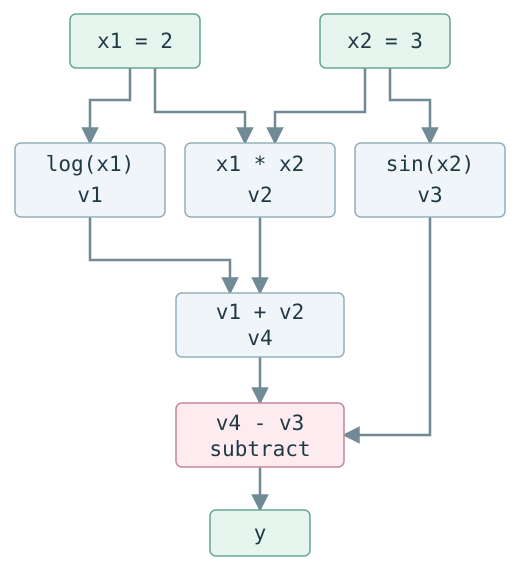

# Autograd 源码学习（一）：自动微分与计算图

会用链式法则，并不意味着已经知道一段 Python 程序如何得到梯度。计算图把这个过程拆成了可以逐步检查的局部操作：先算出值，再沿依赖反向传回贡献。

我们从 `log(x1) + x1*x2 - sin(x2)` 开始，把手算、程序中的中间值和 Autograd 的入口放在一起。读完这一篇，再去看 Box 和 VJPNode，就能分清它们服务的是哪一步数学运算。

[系列总览](00-overview.md) | [下一篇 :octicons-arrow-right-24:](02-jvp-vjp.md)

源码基线：HIPS/autograd 1.9.1，commit `f53a21734fdfae636f448744d9097d8d35a643a0`。

## 本文目标

1. 数值微分、符号微分和自动微分的本质区别是什么？
2. computational graph 如何把一个复合函数拆成局部操作？
3. forward evaluation 与 reverse evaluation 分别在做什么？
4. 为什么 reverse mode 只需反复计算“upstream gradient × local derivative”？
5. 当前 HIPS/autograd 源码中的最小对应关系是什么？

## Mental Model

自动微分不是用很小的步长猜导数，也不是先生成一条庞大的符号导数公式。它让原函数按正常程序执行，同时把每个已知 primitive 的局部导数按链式法则组合起来。

可以把一次求导分成三个层次：

| 层次 | 本文中的对象 | 不要混淆成 |
| --- | --- | --- |
| Level 1：数学 | `dy/dx1`, `dy/dx2` | Python 对象 |
| Level 2：AD 抽象算法 | operation、edge、adjoint、局部传播、路径汇合 | 完整符号公式 |
| Level 3：HIPS/autograd 实现 | `grad`, `trace`, `Box`, `VJPNode`, primitive VJP rule | 数学导数本身 |

本文最重要的一句话：**reverse mode 不会神奇地推导完整公式；它从输出的 adjoint 1 出发，把上游梯度乘以每个 operation 的局部导数，并在同一变量的多条路径汇合时相加。**

## 必要的数学

下面的公式概括本篇使用的数学关系，具体数值与传播步骤接着展开。

$$
\begin{aligned}
y&=\log x_1+x_1x_2-\sin x_2,\\
\nabla y&=\begin{bmatrix}1/x_1+x_2\\x_1-\cos x_2\end{bmatrix}.
\end{aligned}
$$

研究函数：

```text
y = log(x1) + x1 * x2 - sin(x2)
```

### A. Numerical differentiation

固定另一个输入，用 central difference 近似偏导：

```text
dy/dx1 ≈ [f(x1 + h, x2) - f(x1 - h, x2)] / (2h)
dy/dx2 ≈ [f(x1, x2 + h) - f(x1, x2 - h)] / (2h)
```

它只通过函数值估计斜率。优点是可作为独立的 gradient check；局限是每个输入方向都要额外求值，而且 `h` 过大有截断误差、过小有浮点消减误差。

### B. Symbolic differentiation

符号规则直接变换表达式，得到：

```text
dy/dx1 = 1/x1 + x2
dy/dx2 = x1 - cos(x2)
```

结果是新的数学表达式。这对小函数很直观，但它与“运行原 Python 程序并在运行时记录局部操作”不是同一机制。

### C. Automatic differentiation

AD 把复合函数分解为 primitives，对每一步使用精确的局部导数，再由链式法则组合。这里的“精确”是相对于 finite difference 而言：最终仍使用浮点运算，但没有用有限差分近似导数。

## 一个最小例子

令 `x1 = 2`, `x2 = 3`，把表达式写成中间变量：

```text
v1 = log(x1)
v2 = x1 * x2
v3 = sin(x2)
v4 = v1 + v2
y  = v4 - v3
```

### Computational graph

{ .zdd-computation-graph }

`subtract` 的第二条边带有局部导数 `-1`。图中 `x1` 和 `x2` 都通过多条路径影响 `y`，因此反向时会出现 contribution accumulation。

### Forward evaluation trace

| 步骤 | 计算 | 数值 |
| --- | --- | ---: |
| `v1` | `log(2)` | `0.693147180560` |
| `v2` | `2 * 3` | `6.000000000000` |
| `v3` | `sin(3)` | `0.141120008060` |
| `v4` | `v1 + v2` | `6.693147180560` |
| `y` | `v4 - v3` | `6.552027172500` |

### Reverse evaluation trace

记 `bar(v) = dy/dv`，它也叫 adjoint、cotangent 或当前变量收到的 upstream gradient。

| 从哪个 operation 反传 | upstream | local derivative | contribution |
| --- | ---: | ---: | ---: |
| `y = v4 - v3` 到 `v4` | `1` | `1` | `bar(v4)=1` |
| `y = v4 - v3` 到 `v3` | `1` | `-1` | `bar(v3)=-1` |
| `v4 = v1 + v2` 到 `v1` | `1` | `1` | `bar(v1)=1` |
| `v4 = v1 + v2` 到 `v2` | `1` | `1` | `bar(v2)=1` |
| `v1 = log(x1)` 到 `x1` | `1` | `1/x1=0.5` | `0.5` |
| `v2 = x1*x2` 到 `x1` | `1` | `x2=3` | `3` |
| `v2 = x1*x2` 到 `x2` | `1` | `x1=2` | `2` |
| `v3 = sin(x2)` 到 `x2` | `-1` | `cos(3)≈-0.9899925` | `≈0.9899925` |

汇合后：

```text
dy/dx1 = 0.5 + 3 = 3.5
dy/dx2 = 2 + 0.989992496600 = 2.989992496600
```

这就是 multiple pathway case：每条路径产生 partial adjoint，同一变量收到的 partial adjoints 必须求和。

## 对应的 Autograd 源码

以下位置均对应本系列固定的源码 commit：

| File | Symbol | Responsibility |
| --- | --- | --- |
| `autograd/__init__.py` | `grad` re-export | 用户可以写 `from autograd import grad`。 |
| `autograd/differential_operators.py` | `grad`（约 24 行） | 为 scalar-output 函数建立 VJP，并用 output cotangent `ones()` 启动反向传播。 |
| `autograd/wrap_util.py` | `unary_to_nary` | 让 `grad(f, 0)` / `grad(f, 1)` 能选择多参数函数中的一个输入。 |
| `autograd/tracer.py` | `trace`（约 14 行） | 给被求导输入创建 Box 后，真实执行用户函数。 |
| `autograd/tracer.py` | `primitive`（约 44 行） | Box 参与运算时执行底层值计算，并为该 operation 建 node。 |
| `autograd/tracer.py` | `Box`（约 157 行） | 关联 `_value`、`_trace`、`_node`。私有字段细节留到 tracing 课程。 |
| `autograd/numpy/numpy_wrapper.py` | `wrap_namespace` | 把 NumPy namespace 中合适的 callables 包装为 Autograd primitives。 |
| `autograd/numpy/numpy_boxes.py` | `ArrayBox` | 把 `+`, `-`, `*` 等转发到 `anp.add/subtract/multiply`。 |
| `autograd/numpy/numpy_vjps.py` | `defvjp(anp.multiply/log/sin, ...)` | 注册本例所需的局部 reverse rules。 |
| `autograd/core.py` | `VJPNode`, `backward_pass` | 保存局部 VJP/parents，并按图反向传播；逐行机制属于后续文章。 |

## 调用时序

当前源码的 happy path 可以先压缩成：

```text
from autograd import grad
  -> differential_operators.py :: grad（由 unary_to_nary 包装）
  -> core.py :: make_vjp
  -> tracer.py :: trace
  -> Box 穿过 np.log / multiply / np.sin / add / subtract primitives
  -> core.py :: VJPNode 为 traced operations 保存 parents 与局部 VJP
  -> core.py :: backward_pass
  -> 对选定输入返回 gradient
```

这是调用链路标，不是本文要背的实现细节。后续 `grad()` 调用链课会逐对象验证 value、Box、node、parents 和 `g`。

## 源码 walkthrough

先把数学中的“输出 adjoint 设为 1”接到真实入口。下面完整保留 scalar 检查，避免把摘掉判断后的两行误认为原函数。

[REAL SOURCE]  
File: [`autograd/differential_operators.py`](https://github.com/HIPS/autograd/blob/f53a21734fdfae636f448744d9097d8d35a643a0/autograd/differential_operators.py)  
Symbol: [`grad`](https://github.com/HIPS/autograd/blob/f53a21734fdfae636f448744d9097d8d35a643a0/autograd/differential_operators.py#L23-L36)  
Commit: [f53a21734fdfae636f448744d9097d8d35a643a0](https://github.com/HIPS/autograd/commit/f53a21734fdfae636f448744d9097d8d35a643a0)

```python
@unary_to_nary
def grad(fun, x):
    """
    Returns a function which computes the gradient of `fun` with respect to
    positional argument number `argnum`. The returned function takes the same
    arguments as `fun`, but returns the gradient instead. The function `fun`
    should be scalar-valued. The gradient has the same type as the argument."""
    vjp, ans = _make_vjp(fun, x)
    if not vspace(ans).size == 1:
        raise TypeError(
            "Grad only applies to real scalar-output functions. "
            "Try jacobian, elementwise_grad or holomorphic_grad."
        )
    return vjp(vspace(ans).ones())
```

进入函数体时，`fun` 已被适配为只改变选定参数的一元函数，`x` 是该参数的本次数值。`_make_vjp` 执行它，产生普通输出 `ans` 与可调用的 `vjp`；`vspace(ans)` 描述输出允许使用的 cotangent 形状和数值类型。最后一行把输出空间里的全 1 值交给 `vjp`，下一步才进入 reverse traversal。这里不是把每个中间节点的梯度都设为 1。

在本文主表达式上，`ans=6.552027172500`；对 `grad(f, 0)`，返回的是 `3.5`，对 `grad(f, 1)`，返回的是 `2.989992496600`。两次调用分别选定一个输入，并各做一次 trace。`make_vjp` 为什么返回 closure，下一篇就会完整展开。

现在把手算中的两个局部导数接到注册规则。

[REAL SOURCE]  
File: [`autograd/numpy/numpy_vjps.py`](https://github.com/HIPS/autograd/blob/f53a21734fdfae636f448744d9097d8d35a643a0/autograd/numpy/numpy_vjps.py)  
Symbol: [`defvjp(anp.log, ...)`](https://github.com/HIPS/autograd/blob/f53a21734fdfae636f448744d9097d8d35a643a0/autograd/numpy/numpy_vjps.py#L166-L166)  
Commit: [f53a21734fdfae636f448744d9097d8d35a643a0](https://github.com/HIPS/autograd/commit/f53a21734fdfae636f448744d9097d8d35a643a0)

```python
defvjp(anp.log, lambda ans, x: lambda g: g / x)
```

模块导入时，`defvjp` 收到 primitive 和一个 maker，并把规则登记起来。forward 真正执行 `log(x)` 后，maker 才收到本次 `ans,x`，产生捕获 `x` 的内层函数。backward 交来 `g=dy/dv1=1` 时，内层算 `1/2=0.5`，交给通用 reverse engine 累加到输入。它对应手算表的 log 路径。

[REAL SOURCE]  
File: [`autograd/numpy/numpy_vjps.py`](https://github.com/HIPS/autograd/blob/f53a21734fdfae636f448744d9097d8d35a643a0/autograd/numpy/numpy_vjps.py)  
Symbol: [`defvjp(anp.sin, ...)`](https://github.com/HIPS/autograd/blob/f53a21734fdfae636f448744d9097d8d35a643a0/autograd/numpy/numpy_vjps.py#L170-L170)  
Commit: [f53a21734fdfae636f448744d9097d8d35a643a0](https://github.com/HIPS/autograd/commit/f53a21734fdfae636f448744d9097d8d35a643a0)

```python
defvjp(anp.sin, lambda ans, x: lambda g: g * anp.cos(x))
```

本次 sin 的输入是 `x2=3`，它的输出在最后被减去，所以传进内层的 `g=-1`。内层调用可微 `anp.cos`，返回 `-cos(3)`，而不是直接返回 `cos(3)`。reverse engine 将它与 multiply 路径的 `2` 相加。规则没有生成完整 `dy/dx2`，只完成一个局部 pullback。同一文件中的 multiply 规则还包了 `unbroadcast_f` 处理数组 shape，[第六篇](06-numpy-vjps.md)和[第七篇](07-broadcasting.md)再展开。

## 实验验证

[完整实验：lesson01_ad_and_graph.py](../../../assets/autograd/experiments/lesson01_ad_and_graph.py)。运行环境、资源目录及路径配置见[系列总览](00-overview.md#experiments)。下方命令以解压后的资源目录为工作目录。

[EXPERIMENT]  
File: [`experiments/lesson01_ad_and_graph.py`](../../../assets/autograd/experiments/lesson01_ad_and_graph.py)  
Purpose: 用同一个主表达式比较解析偏导、Autograd 与中心差分。

```python
def f(x1, x2):
    return np.log(x1) + x1 * x2 - np.sin(x2)
```

这就是实验真实执行的函数；进入时 `x1,x2` 可以是普通数，也可以由 `grad` 把选定参数替换成 Box。它产生 scalar loss，之后实验分别调用两个 `grad` 包装器。下面的手算和数值检查都围绕这一个函数。

它在 `x1=2, x2=3` 时同时计算：

- 手工 forward intermediates；
- 符号公式得到的两个偏导；
- Autograd 的 `grad(f, 0)` 和 `grad(f, 1)`；
- central difference 数值近似；
- 三者的一致性断言。

运行命令：

```powershell
python experiments/lesson01_ad_and_graph.py
```

原实验数值记录如下；导入路径已用 `<checkout>` 代替机器相关的前缀：

```text
autograd imported from: <checkout>/autograd/__init__.py
forward: v1=0.693147180560, v2=6.000000000000, v3=0.141120008060, v4=6.693147180560
y=6.552027172500
symbolic=(3.500000000000, 2.989992496600)
autograd=(3.500000000000, 2.989992496600)
numerical=(3.500000000045, 2.989992496705)
all checks passed
```

这同时验证了实验导入的是本地 editable 源码。

## 理论与源码的对应关系

| 理论 / AD 抽象 | 当前实现中的对应物 |
| --- | --- |
| 原函数 forward evaluation | `tracer.py :: trace` 内真实调用 `fun(start_box)` |
| primitive operation | `tracer.py :: primitive` 包装的 callable |
| 运行值 | `Box._value`（实现细节，非用户 API） |
| computational graph edge | node 的 `parents` 引用关系 |
| local reverse rule | `numpy_vjps.py` 通过 `defvjp` 注册的 closure |
| adjoint / upstream gradient | 局部 VJP closure 接收的 `g` |
| output adjoint = 1 | `grad` 调用 `vjp(vspace(ans).ones())` |
| reverse topological traversal | `core.py :: backward_pass` 使用 `util.py :: toposort` |
| multiple-path accumulation | `core.py :: backward_pass` 配合 `add_outgrads`；后续课实际观察两个 contribution |

## 几个自测问题


1. 数值微分和自动微分都运行原函数；两者获得导数信息的方式有什么根本区别？
2. 对 `y = log(x1) + x1*x2 - sin(x2)`，`x2` 到 `y` 有哪两条路径？两条 contribution 各是多少？
3. 为什么 reverse mode 可以只保存/调用局部 VJP，而不必先构造完整的符号导数公式？
4. 源码里的 `g` 对应 Level 1 数学中的什么量？为什么 `sin` 的局部规则写成 `g * cos(x)`？
5. “`VJPNode` 就是导数”这句话哪里不准确？请按数学、AD 抽象、Python 实现三个层次重新表达。

## 小结

自动微分复用已知 primitive 的局部导数，通过链式法则组合它们。计算图记录依赖，反向传播在共享输入处累加 contribution；数值微分则提供独立的近似核对。

## 下一篇

接下来读[第二篇：JVP、VJP 与两种自动微分模式](02-jvp-vjp.md)。

## 参考资料

- [autograd/differential_operators.py](https://github.com/HIPS/autograd/blob/f53a21734fdfae636f448744d9097d8d35a643a0/autograd/differential_operators.py)，固定 commit 原文件。
- [autograd/numpy/numpy_vjps.py](https://github.com/HIPS/autograd/blob/f53a21734fdfae636f448744d9097d8d35a643a0/autograd/numpy/numpy_vjps.py)，固定 commit 原文件。
- [Automatic Differentiation lecture](https://mlsyscourse.org/slides/04-automatic-differentiation.pdf)。

---

[系列总览](00-overview.md) | [下一篇 :octicons-arrow-right-24:](02-jvp-vjp.md)
