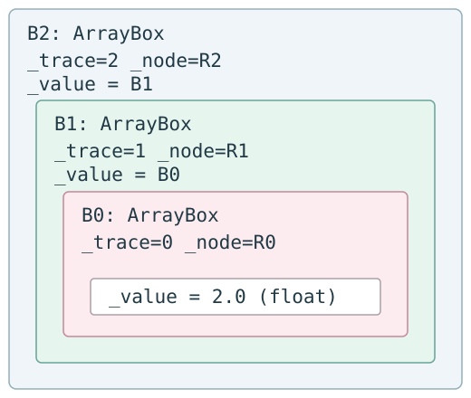

# Autograd 源码学习（十）：高阶自动微分与 Nested Tracing

求完一阶导数后，Autograd 执行过的是一段由 VJP operations 组成的程序。若这段程序本身还能被追踪，就可以继续对它求导。

我们沿已有的三阶实验观察 `grad(grad(grad(f)))`：调用栈依次建立 trace 0、1、2，原函数却从最外壳看到 2、1、0。理解这两种顺序，就能说明为什么 primitive 只能先解开最高 trace。

[:octicons-arrow-left-24: 上一篇](09-why-reverse-mode.md) | [系列总览](00-overview.md) | [下一篇 :octicons-arrow-right-24:](11-operator-composition.md)

源码基线：HIPS/autograd 1.9.1，commit `f53a21734fdfae636f448744d9097d8d35a643a0`。

## 本文目标

1. `grad(grad(f))` 为什么仍可被 trace？
2. nested Box 与 `TraceStack` 如何协作？
3. custom VJP 为什么必须使用可微操作才能支持高阶导数？

## Mental Model

第一次求导产生的不是静态数字公式，而是一段执行 VJP operations 的 Python 程序。当外层 `grad` 对这段程序再求导时，内层 forward input 与 backward 中的计算仍可能是 Box，于是同一 tracing machinery 再记录一层。

## 必要的数学

```text
f(x)=x^3
f'(x)=3x^2
f''(x)=6x
f'''(x)=6
x=2 -> 12,12,6
```

Level 1 只是这些导数；Level 2 是“对 derivative program 再应用 AD”；Level 3 才是 nested ArrayBox 与多个 integer trace ids。

## 一个最小例子

[EXPERIMENT]  
File: [`experiments/higher_order.py`](../../../assets/autograd/experiments/higher_order.py)  
Purpose: 在同一个 x=2 点验证一到三阶导数，并记录原函数入口的 Box 层数。

```python
    first = grad(f)(2.0)
    second = grad(grad(f))(2.0)
    third = grad(grad(grad(f)))(2.0)
```

这三行是独立求值，结果分别为12、12、6。实验的原函数在执行 `return x**3` 前调用 `describe_box_layers(x)`，所以记录的是到达原 f 时的输入状态，而不是退出全部求导之后的返回值。

第三阶求导调用原 `f` 时，最外层可观察到一个 trace 2 Box，其 `_value` 是 trace 1 Box，再包着 trace 0 Box，最后才是普通 `2.0`。

## 对应的 Autograd 源码

| File / symbol | 谁调用 | 它调用谁 | 输入 -> 输出 | AD 角色 |
| --- | --- | --- | --- | --- |
| `tracer.py :: TraceStack` | every `trace` | new trace context | nested calls -> increasing ids | 区分嵌套层 |
| `tracer.py :: find_top_boxed_args` | primitive wrapper | 检查 each arg type/trace | possibly nested boxes -> highest trace boxes | 决定当前 operation 属于哪层 |
| `tracer.py :: getval` | notrace/helpers | recursively unwrap | nested Box -> base value | 需要时完全取值 |
| `core.py :: make_vjp/backward_pass` | every grad layer | traced VJP operations | Box 或数值 -> Box 或 gradient | derivative program |
| `numpy_vjps.py` rules | `VJPNode` closures | `autograd.numpy` operations | upstream Box/value -> ingrad | 让 backward 本身可微 |

## 调用时序

大版对象图见 [nested traces](../../../assets/autograd/diagrams/nested-traces.txt)；本文下文仍完整嵌入关键图和状态表，无需跳转才能理解主线。

```text
outer grad, trace 0
  -> calls middle grad, trace 1
     -> calls inner grad, trace 2
        -> f receives Box(trace2, value=Box(trace1, value=Box(trace0,...)))
        -> highest trace owns each immediate node
     -> VJP calculations still see lower-layer Boxes
  -> outer backward differentiates those calculations
```

## 源码 walkthrough

### 先区分求导包装顺序与实际执行顺序

`grad(grad(grad(f)))` 的最外层包装器首先接到用户的 `2.0`，因此它先开 trace 0；它要对中间的 gradient 程序求导，于是执行中层 grad，开 trace 1；中层再执行最内层 grad，开 trace 2，最后才到 f。trace id 大不表示最终输出的是更高阶结果，而表示当前调用栈中更深的一次 tracing。

[REAL SOURCE]  
File: [`autograd/tracer.py`](https://github.com/HIPS/autograd/blob/f53a21734fdfae636f448744d9097d8d35a643a0/autograd/tracer.py)  
Symbol: [`TraceStack`](https://github.com/HIPS/autograd/blob/f53a21734fdfae636f448744d9097d8d35a643a0/autograd/tracer.py#L143-L151)  
Commit: [f53a21734fdfae636f448744d9097d8d35a643a0](https://github.com/HIPS/autograd/commit/f53a21734fdfae636f448744d9097d8d35a643a0)

```python
class TraceStack:
    def __init__(self):
        self.top = -1

    @contextmanager
    def new_trace(self):
        self.top += 1
        yield self.top
        self.top -= 1
```

进入第一层前 top=-1；三次 context 进入后依次为0、1、2。正常结束 trace 2 的 forward 时恢复为1，而不是立即结束所有外层 tracing；因此内层 VJP 执行期间仍有较低 trace 活跃。这里讨论正常路径，没有把原文改写为带 finally 的另一版实现。

### Box._value 可以是另一个 Box

[REAL SOURCE]  
File: [`autograd/tracer.py`](https://github.com/HIPS/autograd/blob/f53a21734fdfae636f448744d9097d8d35a643a0/autograd/tracer.py)  
Symbol: [`Box.__init__`](https://github.com/HIPS/autograd/blob/f53a21734fdfae636f448744d9097d8d35a643a0/autograd/tracer.py#L163-L166)  
Commit: [f53a21734fdfae636f448744d9097d8d35a643a0](https://github.com/HIPS/autograd/commit/f53a21734fdfae636f448744d9097d8d35a643a0)

```python
    def __init__(self, value, trace, node):
        self._value = value
        self._node = node
        self._trace = trace
```

输入 `value` 没有被强制转换为 float，也没有被递归 getval。trace 1 装箱时传入的 value 就是 trace 0 的 Box；trace 2 同理。构造器产生一个新的外壳并保留前一层 value 引用，下一步仍由原函数的 primitive 接管操作。`Box.register` 同时登记 `Box.type_mappings[cls]=cls`，所以 `new_box` 遇到 ArrayBox 也能再创建 ArrayBox。

### STATE SNAPSHOT：第三阶调用到达原 f 的瞬间

R0/R1/R2 是三次 `VJPNode.new_root()` 创建的不同对象。B0/B1/B2 是教学标签，实验只记录类型和 trace id。

{ .zdd-computation-graph }

| Object | Type | `_value` | `_trace` | `_node` | parents / 角色 |
| --- | --- | --- | ---: | --- | --- |
| B2 | ArrayBox | B1 | 2 | R2 | R2.parents=[]；原 f 的输入 |
| B1 | ArrayBox | B0 | 1 | R1 | R1.parents=[]；中层被求导的输入 |
| B0 | ArrayBox | 2.0 | 0 | R0 | R0.parents=[]；最外层被求导的输入 |
| 普通值 | float | 不适用 | 无 | 无 | 数值2，尚未丢失任何外层身份 |

三个 Box 外壳各自声明“这个值在我的 trace 中从哪个输入 root 来”。同一个数值对应三种独立的微分问题，所以它们并不是重复标签；把它们合并会丢失谁在对谁求导的信息。

### 为什么只处理最高 trace

[REAL SOURCE]  
File: [`autograd/tracer.py`](https://github.com/HIPS/autograd/blob/f53a21734fdfae636f448744d9097d8d35a643a0/autograd/tracer.py)  
Symbol: [`find_top_boxed_args, highest trace selection excerpt`](https://github.com/HIPS/autograd/blob/f53a21734fdfae636f448744d9097d8d35a643a0/autograd/tracer.py#L130-L136)  
Commit: [f53a21734fdfae636f448744d9097d8d35a643a0](https://github.com/HIPS/autograd/commit/f53a21734fdfae636f448744d9097d8d35a643a0)

```python
            trace = arg._trace
            if trace > top_trace:
                top_boxes = [(argnum, arg)]
                top_trace = trace
                top_node_type = type(arg._node)
            elif trace == top_trace:
                top_boxes.append((argnum, arg))
```

primitive `power(B2,3)` 进入选择器时，只有输入位置0是 Box，最高 trace 是2，node 类型来自 R2。若同次调用还含较低 trace 的 Box，它不成为 trace2 的 parent：对内层微分问题它相当于当前未激活的输入；但它必须保留 Box 身份，才能继续被外层微分观察。选择器不递归读取 `_value`，它只处理当前实参表露出的最外层。

[REAL SOURCE]  
File: [`autograd/tracer.py`](https://github.com/HIPS/autograd/blob/f53a21734fdfae636f448744d9097d8d35a643a0/autograd/tracer.py)  
Symbol: [`primitive.f_wrapped, single-layer unboxing excerpt`](https://github.com/HIPS/autograd/blob/f53a21734fdfae636f448744d9097d8d35a643a0/autograd/tracer.py#L77-L81)  
Commit: [f53a21734fdfae636f448744d9097d8d35a643a0](https://github.com/HIPS/autograd/commit/f53a21734fdfae636f448744d9097d8d35a643a0)

```python
            argvals = subvals(args, [(argnum, box._value) for argnum, box in boxed_args])
            if f_wrapped in notrace_primitives[node_constructor]:
                return f_wrapped(
                    *argvals, called_by_autograd_dispatcher=called_by_autograd_dispatcher, **kwargs
                )
```

本例 power 不是 notrace，第一行仅把 B2 换成 B1，因此 `argvals=(B1,3)`。它没有把 B1/B0 递归解掉。这里已经给下一次递归 wrapper 留下了外层 trace 信息，后面的 operation 计算仍能被观察。

[REAL SOURCE]  
File: [`autograd/tracer.py`](https://github.com/HIPS/autograd/blob/f53a21734fdfae636f448744d9097d8d35a643a0/autograd/tracer.py)  
Symbol: [`primitive.f_wrapped, recursive evaluation and node creation excerpt`](https://github.com/HIPS/autograd/blob/f53a21734fdfae636f448744d9097d8d35a643a0/autograd/tracer.py#L82-L88)  
Commit: [f53a21734fdfae636f448744d9097d8d35a643a0](https://github.com/HIPS/autograd/commit/f53a21734fdfae636f448744d9097d8d35a643a0)

```python
            parents = tuple(box._node for _, box in boxed_args)
            argnums = tuple(argnum for argnum, _ in boxed_args)
            ans = f_wrapped(*argvals, called_by_autograd_dispatcher=called_by_autograd_dispatcher, **kwargs)
            node = node_constructor(ans, f_wrapped, argvals, kwargs, argnums, parents)
            try:
                box = new_box(ans, trace, node)
                return box
```

当前层先保留 `parents=(R2,)`、`argnums=(0,)`，然后递归调用 wrapper。下一次见到 B1，处理 trace1；再下一次见到 B0，处理 trace0；只有最后所有 Box 都被各自层处理后，raw NumPy 才收到 `2.0,3`。返回过程中先建 trace0 的 P0，再建 P1，再建 P2，分别重装箱。

因此“只解最高层”不是说原计算永远不执行，而是每层各自处理自己的依赖，再把底层答案沿调用栈装回。不能把较低 Box 原样传给不认识它的 raw 数值函数后就算完成，也不能跳过较低层的 wrapper。

### STATE SNAPSHOT：power 的递归进入与返回

| wrapper 所处层 | 进入 args | 本层 parents / argnums | 单层解箱后的 args | 递归返回 ans | 返回 Box |
| --- | --- | --- | --- | --- | --- |
| trace2 | (B2,3) | (R2,) / (0,) | (B1,3) | trace1 的结果 Box | trace2 Box，value=trace1 Box |
| trace1 | (B1,3) | (R1,) / (0,) | (B0,3) | trace0 的结果 Box | trace1 Box，value=trace0 Box |
| trace0 | (B0,3) | (R0,) / (0,) | (2.0,3) | 普通8.0 | trace0 Box，value=8.0 |
| 无 Box | (2.0,3) | 无 | 无需解箱 | raw power=8.0 | 不装箱，直接返回 |

表格从上到下是进入顺序，从下到上是返回顺序。P0/P1/P2 与 R0/R1/R2 分属各自 trace 的图；VJP maker 在不同层收到的 x 可能是 B1、B0 或普通2，这正是 backward 中还能继续微分的基础。

[TEACHING SIMPLIFICATION]  
以下不是 HIPS/autograd verbatim source。这是一个故意错误的反例，仅说明为什么不能把递归 getval 放到 primitive 的通用解箱路径；不是可用实现。

```python
def incorrect_unbox_all(args):
    return tuple(getval(arg) for arg in args)
```

输入 `(B2,3)` 会立即变成 `(2.0,3)`，B1/B0 不再进入递归 wrapper。若再把这些普通参数交给本层 VJP maker，closure 只捕获普通2，外层看不到它随输入变化的关系。第一阶局部公式可能还能算出12，但对这段“12的计算过程”再求导所需的依赖已经丢失。

真实 `tracer.getval` 确实能递归解箱，它用于明确不需要追踪的取值/metadata 等场景；这不意味着可在每个可微 primitive 中用它取代 `box._value`。

### 为什么 VJP closure 自己也必须可微

[REAL SOURCE]  
File: [`autograd/numpy/numpy_vjps.py`](https://github.com/HIPS/autograd/blob/f53a21734fdfae636f448744d9097d8d35a643a0/autograd/numpy/numpy_vjps.py)  
Symbol: [`defvjp(anp.power, ...)`](https://github.com/HIPS/autograd/blob/f53a21734fdfae636f448744d9097d8d35a643a0/autograd/numpy/numpy_vjps.py#L139-L143)  
Commit: [f53a21734fdfae636f448744d9097d8d35a643a0](https://github.com/HIPS/autograd/commit/f53a21734fdfae636f448744d9097d8d35a643a0)

```python
defvjp(
    anp.power,
    lambda ans, x, y: unbroadcast_f(x, lambda g: g * y * x ** anp.where(y, y - 1, 1.0)),
    lambda ans, x, y: unbroadcast_f(y, lambda g: g * anp.log(replace_zero(x, 1.0)) * ans),
)
```

本例 exponent y=3 是常数，只有输入0被 trace，因而只建立第一条 pullback。数学上它计算 `g*3*x^2`；真实原文保留 `anp.where` 与 shape 处理，不改写成较短公式冒充源码。trace2 的 maker 收到的 x 是 B1，所以其 closure 在执行 `x**2`、乘3、乘g时，仍触发 trace1/0 的可微 primitives。

内层 `trace` 结束不等于整个求导结束。它先把输出 Box2 解为 Box1 并恢复 stack top=1；内层 `grad` 接着执行 VJP，此时 middle trace 的 `fun(start_box)` 调用还没有返回，因此 derivative program 正在被中层 tracer 观察。中层随后对这段程序反传，输出再交给最外层。

```text
outer trace0: input Box0
  middle trace1: input Box1(value=Box0)
    inner trace2: f(Box2(value=Box1)) -> primal 8, nested boxes
    trace2 forward ends, top becomes 1
    inner VJP computes 3*x^2 using Box1 -> first derivative 12 in Box1
  trace1 forward ends, top becomes 0
  middle VJP differentiates that program -> second derivative 12 in Box0
trace0 forward ends, top becomes -1
outer VJP differentiates again -> ordinary third derivative 6
```

这张图区分了每层“被求导函数的 forward”与“原 f 的 forward”。对中层来说，执行内层 grad 连同它的 backward 就是中层所观察的整个函数执行过程。不能仅保留原 f 的 primal nodes 而不跟踪 VJP operations，期待自动得到高阶导数。

当前 `examples/define_gradient.py :: logsumexp_vjp` 也要求自定义 VJP 内部代码能被 Autograd 求导。若把 closure 中的 Box 强制转为不可追踪的外部数值，第一阶规则可能仍返回正确数值，但高阶依赖会断开。

## 实验验证

[完整实验：higher_order.py](../../../assets/autograd/experiments/higher_order.py)。运行环境、资源目录及路径配置见[系列总览](00-overview.md#experiments)。下方命令以解压后的资源目录为工作目录。

[EXPERIMENT]  
File: [`experiments/higher_order.py`](../../../assets/autograd/experiments/higher_order.py)  
Purpose: 只读地沿 _value 观察 nested Box，并断言三次求导的实际层次。

```python
def describe_box_layers(value):
    layers = []
    current = value
    while isbox(current):
        layers.append((type(current).__name__, current._trace))
        current = current._value
    return layers
```

这里递归读 `_value` 只发生在独立观察函数的局部变量 current 上；它没有替换 f 继续计算所用的 x，也没有把解箱值返回给 power。函数产生普通标签列表，后续实验分别断言一、二、三层结构。记录层次与破坏可微参数是两件不同的事。

运行 `python -B experiments/higher_order.py`，实测：

```text
f'(2)=12
f''(2)=12
f'''(2)=6
order 1 layers=[(ArrayBox,0)]
order 2 layers=[(ArrayBox,1),(ArrayBox,0)]
order 3 layers=[(ArrayBox,2),(ArrayBox,1),(ArrayBox,0)]
all checks passed
```

访问 `_value/_trace` 只为教学观察，不是稳定用户 API。

## 理论与源码的对应关系

| 理论 | 实现 |
| --- | --- |
| derivative remains differentiable function | `grad` returns ordinary callable |
| nested differentiation | nested calls to `trace` |
| layer priority | integer `_trace` and highest selection |
| differentiable pullback | VJP closure built from wrapped primitives |
| higher derivative graph | VJP execution during an outer active trace |

## 几个自测问题

1. nested Box 为什么不是“同一个值被无意义包装多次”？
2. 若 VJP closure 使用 `math.sin` 处理 Box，会破坏哪一层能力？
3. 解开最高 trace Box 后为什么不能递归解开所有 layers 再计算？

## 小结

高阶求导同时依赖两件事：单层解箱保留较低 trace 的身份，VJP closure 中的可微操作让 derivative program 继续被外层观察。nested Box 的层次与 Python 求导包装器的执行顺序需要分开理解。

## 下一篇

接下来读[第十一篇：Jacobian、Hessian 与算子组合](11-operator-composition.md)。

## 参考资料

- [autograd/numpy/numpy_vjps.py](https://github.com/HIPS/autograd/blob/f53a21734fdfae636f448744d9097d8d35a643a0/autograd/numpy/numpy_vjps.py)，固定 commit 原文件。
- [autograd/tracer.py](https://github.com/HIPS/autograd/blob/f53a21734fdfae636f448744d9097d8d35a643a0/autograd/tracer.py)，固定 commit 原文件。
- [Automatic Differentiation lecture](https://mlsyscourse.org/slides/04-automatic-differentiation.pdf)。

---

[:octicons-arrow-left-24: 上一篇](09-why-reverse-mode.md) | [系列总览](00-overview.md) | [下一篇 :octicons-arrow-right-24:](11-operator-composition.md)
