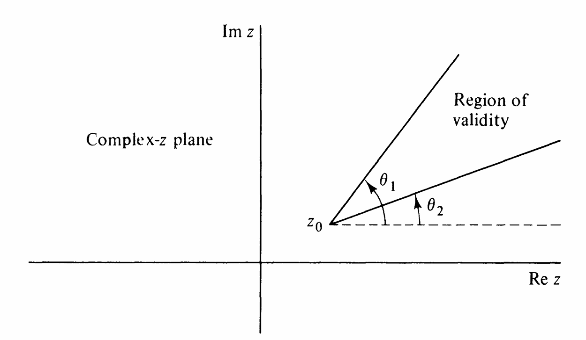

# 第四章：线性微分方程的局部分析：非正则奇点与渐近关系 { #top }

## 1. 渐近分析简介 { #s1 }

引入两个新符号以描述函数相对行为：

!!! definition "定义"
    记号 $f(x) \ll g(x) ,x \to x_0$ 定义为：

    $$
    \lim_{x \to x_0} \frac{f(x)}{g(x)} = 0.
    $$

    记号 $f(x) \sim g(x) ,x \to x_0$ 定义为：

    $$
    f(x) - g(x) \ll g(x), \quad x \to x_0,
    $$

    或等价于

    $$
    \lim_{x \to x_0} \frac{f(x)}{g(x)} = 1.
    $$

    注意到若 $f(x) \sim g(x)$ ($x \to x_0$)，则 $g(x) \sim f(x)$ ($x \to x_0$)。

## 2. 非正则奇点附近的行为 { #s2 }

当前首要任务是求解本节开头两个无法用 Frobenius 级数求解的方程。先观察已知结果：([3.4.1](chapter-03.md)) 的两解：

$$
\begin{align*}
&y(x) \sim c_1 x^{3/4} e^{2x^{-1/2}}, \quad x \to 0^+; \tag{1}\\
&y(x) \sim c_2 x^{3/4} e^{-2x^{-1/2}}, \quad x \to 0^+. \tag{2}
\end{align*}
$$

([3.4.2](chapter-03.md)) 的缺失解：

$$
y(x) \sim c_3 x^{-1} e^{x^{-1}}, \quad x \to 0^+. \tag{3.4.5}
$$

这些渐进行为均在 $x=0$ 有本性奇点。

!!! definition "定义"
    上述渐近行为实为解局部行为无穷级数表示的首项，称为**主导行为(leading behavior)**。主导行为在 $x \to x_0$ 时变化最快的部分称为**控制因子(controlling factor)**。例如上三例的控制因子分别为 $e^{2x^{-1/2}}$,$e^{-2x^{-1/2}}$ ,$e^{x^{-1}}$。级数 ([3.4.3](chapter-03.md)) 的主导行为为 $a_0$，Frobenius 级数 $\sum a_n x^{\alpha+n}$ 的主导行为为 $a_0 x^\alpha$。

## 3. 指数代换法 { #s3 }

要得知非正则奇点附近解的主导行为，首先要识别控制因子。因控制因子常呈指数形式，故采用代换：

$$
y(x) = e^{S(x)}. \tag{3.4.6}
$$

此技巧将 $n$ 阶线性微分方程化为 $S(x)$ 的近似一阶方程，以二阶方程为例：

$$
y'' + p(x)y' + q(x)y = 0 \tag{3.4.7}
$$

有非正则奇点 $x_0$ 。代入 $y = e^S$ 得：

$$
S'' + (S')^2 + p(x)S' + q(x) = 0. \tag{3.4.8}
$$

若 $x_0$ 为非正则奇点，通常有：

$$
S'' \ll (S')^2, \quad x \to x_0. \tag{3.4.9}
$$

略去 $S''$ 得渐近微分方程：

$$
(S')^2 \sim -p(x)S' - q(x), \quad x \to x_0. \tag{3.4.10}
$$

此方程易解，且可验证近似 (3.4.9) 的有效性。

!!! example "例（非正则奇点 $0$ 附近的控制因子）"
    回顾微分方程 ([3.4.1](chapter-03.md)) $x^3 y'' = y$ 在非正则奇点 $0$ 附近。渐近微分方程 (3.4.10) 给出：$(S')^2 \sim x^{-3}, \quad x \to 0^+.$解得 $S'(x) \sim \pm x^{-3/2}$ ($x \to 0^+$)，积分得：

    $$
    S(x) \sim \pm 2x^{-1/2}, \quad x \to 0^+. \tag{3.4.11}
    $$

    此即 (1),(2) 中的控制因子。

!!! example "例（非正则奇点 $0$ 附近的主导行为）"
    继续考虑解 $S \sim 2x^{-1/2}$ ($x \to 0^+$)。设：

    $$
    S(x) = 2x^{-1/2} + C(x), \quad C(x) \ll 2x^{-1/2}, \quad x \to 0^+. \tag{3.4.12}
    $$

    代入 (3.4.8)得：$\frac{3}{2}x^{-5/2} + C'' - 2x^{-3/2}C' + (C')^2 = 0.$由 $C' \ll x^{-3/2}$ 得渐近方程：

    $$
    \frac{3}{2}x^{-5/2} \sim 2x^{-3/2}C', \quad x \to 0^+, \tag{3.4.13}
    $$

    解得 $C \sim \frac{3}{4} \ln x$，且满足 $C'' \sim -\frac{3}{4}x^{-2} \ll x^{-5/2}$ 成立。设：

    $$
    S(x) = 2x^{-1/2} + \frac{3}{4} \ln x + D(x) \tag{3.4.14}
    $$

    其中

    $$
    D(x) \ll \ln x, \quad x \to 0^+. \tag{3.4.15}
    $$

    代入 (3.4.8)得：$-\frac{3}{16}x^{-2} + D'' + (D')^2 - 2x^{-3/2}D' + \frac{3}{2}x^{-1}D' = 0.$由

    $$
    \frac{3}{2}x^{-1}D' \ll 2x^{-3/2}D',
    (D')^2 \ll x^{-1}D' ,
    D'' \ll x^{-2},
    \quad x \to 0^+.
    $$

    得渐近方程：

    $$
    -2x^{-3/2}D' \sim \frac{3}{16}x^{-2}, \quad x \to 0^+.
    $$

    解得：

    $$
    D' \sim -\frac{3}{32}x^{-1/2}\Longrightarrow D(x) - d \sim \frac{3}{16}x^{1/2}
    $$

    其中 $d$ 为常数，换句话说存在 $\delta(x)\sim -3x^{1/2}/16$,$x\to 0^+$：

    $$
    D(x)=d+\delta(x).\tag{3.4.16}
    $$

!!! example "例（数值验证）"
    我们先检验已有结果。设 $e^{\delta(x)} = 1 + \varepsilon(x)$，其中 $\varepsilon(x) \to 0$ 当 $x \to 0+$。为验证 $\varepsilon(x)$ 在 $x \to 0+$ 时趋近于零，取初值 $y(1) = 1, \, y'(1) = 0$ 数值求解([3.4.1](chapter-03.md))。通过拟合数值解可检验主导行为预测：

    $$
    y(x) = c_1 x^{3/4} e^{2x^{-1/2}} [1 + \varepsilon(x)]. \tag{3.4.17}
    $$

    $y(x)/(x^{3/4} e^{2x^{-1/2}})$ 在 $x \to 0+$ 时趋近极限 $c_1 \approx 0.1432 \neq 0$。

## 4. 主导平衡法 { #s4 }

**主导平衡法(Method of dominant balance)**用于识别在渐近极限下可能被忽略的方程中的那些项，这包含三个步骤：

1.  丢弃所有小项，并用渐近关系取代精确方程。

2.  渐近关系替换为一个方程，把 $\sim$ 号换成等号，并精确求解所得方程。

3.  检查所得到的解是否与步骤(1)中所做的近似一致，并证明：通过从精确解本身中分解出主导平衡解而得到的关于剩余函数的方程，其解的变动比主导平衡解更缓慢。

!!! example "例（修正原点附近的主导行为）"
    我们对([3.4.1](chapter-03.md))式解的行为的分析仍不完整。我们的策略是计算(3.4.17)式中 $\varepsilon(x)$ 的逐次近似，首先找到 $1 + \varepsilon(x)$ 满足的微分方程，然后将以形式幂级数求解该方程，

    $$
    1 + \varepsilon(x) = 1 + a_1 x^\alpha + a_2 (x^\alpha)^2 + a_3 (x^\alpha)^3 + \cdots,\tag{3.4.18}
    $$

    其中 $\alpha$ 是一个正数。我们将(3.4.17)代入([3.4.1](chapter-03.md))来计算系数 $a_n$ 与 $\alpha$，得到 $w(x) = 1 + \varepsilon(x)$ 满足的方程：

    $$
    w'' + \left( \frac{3}{2x} - \frac{2}{x^{3/2}} \right) w' - \frac{3}{16x^2} w = 0.
    \tag{3.4.19}
    $$

    我们将 $w(x) = 1 + \varepsilon(x)$ 代入(3.4.19)，得到

    $$
    \varepsilon'' + (3/2x - 2/x^{3/2})\varepsilon' - 3/16x^2 - 3\varepsilon/16x^2 = 0.
    $$

    注意到当 $x \to 0+$ 时 $\varepsilon \ll 1$，从而

    $$
    3\varepsilon / 16x^2 \ll 3/16x^2, \quad x \to 0+,
    $$

    并且

    $$
    3x^{-1}/2 \ll 2x^{-3/2}, \quad x \to 0+,
    $$

    这给出了渐近微分方程

    $$
    \varepsilon'' - \frac{2}{x^{3/2}} \varepsilon' \sim \frac{3}{16x^2}, \quad x \to 0+,\tag{3.4.20}
    $$

    - (a) 当 $x \to 0+$ 时 $\varepsilon'' \sim 3x^{-2}/16$ 且$2x^{-3/2}\varepsilon' \ll 3x^{-2}/16$。对前一个渐近关系积分两次得 $\varepsilon(x) \sim -3 \ln x/16 (x \to 0+)$，这与 $\varepsilon \to 0 ,x \to 0+$矛盾。
    - (b) 当 $x \to 0+$ 时 $\varepsilon''/\varepsilon' \sim 2x^{-3/2}$ 且$3x^{-2}/16 \ll 2x^{-3/2}\varepsilon'$。对前一个渐近关系积分得 $\ln \varepsilon' \sim -4x^{-1/2}(x \to 0+)$，这与后者矛盾。
    - (c) 当 $x \to 0+$ 时，(3.4.20)中没有一项相对于其他两项是可忽略的，留给读者证明矛盾。
    - (d) 当 $x \to 0+$ 时$-2x^{-3/2}\varepsilon' \sim 3x^{-2}/16$ 且 $\varepsilon'' \ll 2x^{-3/2}\varepsilon'$。对前一个渐近关系积分得 $\varepsilon(x) \sim -3x^{1/2}/16 (x \to 0+)$，满足后者条件。

    因此存在$\varepsilon_1 \ll 3x^{1/2}/16( x \to 0+)$满足：

    $$
    w(x) = 1 - 3x^{1/2}/16 + \varepsilon_1(x),
    $$

!!! example "例（续）"
    我们现在可以通过类似刚才的论证来确定 $\varepsilon_1(x)$ 的主导行为：

    $$
    \varepsilon_1(x) = -15x/512 + \varepsilon_2(x), \quad \varepsilon_2 \ll 15x/512, \quad x \to 0+.
    $$

    显然，我们可以永远继续这个过程，并生成 $w(x)$ 的一个级数表示。索性将完整的形式级数表示(3.4.18)（其中 $\alpha = \frac{1}{2}, w(x) = \sum_{n=0}^{\infty} a_n x^{n/2} \, (a_0 = 1)$）直接代入(3.4.19)。我们得到

    $$
    \sum_{n=1}^{\infty} \frac{n}{2} \left( \frac{n}{2} - 1 \right) a_n x^{n/2-2} + \frac{3}{2} \sum_{n=1}^{\infty} \frac{n}{2} a_n x^{n/2-2} - 2 \sum_{n=1}^{\infty} \frac{n}{2} a_n x^{n/2-5/2} - \frac{3}{16} \sum_{n=0}^{\infty} a_n x^{n/2-2} = 0.
    $$

    由此得递推关系：

    $$
    a_{n+1} = \frac{(2n-1)(2n+3)}{16(n+1)} a_n, \quad n=0, 1, 2, \ldots. \tag{3.4.21}
    $$

    故有通项公式为：

    $$
    a_n = -[\Gamma (n-\frac{1}{2})\Gamma (n+\frac{3}{2})] / \pi 4^n n! , \quad n=0, 1, 2, \ldots.
    $$

    由此完成(1)主导行为的解之局部分析：

    $$
    \begin{aligned}
    y(x) \sim -c_1 x^{3/4} e^{2x^{-1/2}} \sum_{n=0}^{\infty} \frac{\Gamma (n-\frac{1}{2})\Gamma (n+\frac{3}{2})}{\pi^4 n!} x^{n/2}, \quad x \to 0 +.
    \end{aligned}\tag{20}
    $$

    级数对所有 $x$ 发散，但作为渐近级数在 $x \to 0+$ 给出精确近似。类似分析(2)得：

    $$
    y(x) \sim -c_2 x^{3/4} e^{-2x^{-1/2}} \sum_{n=0}^{\infty} (-1)^n \frac{\Gamma(n-\frac{1}{2})\Gamma(n+\frac{3}{2})}{\pi 4^n n!} x^{n/2}, \quad x \to 0 + . \tag{3.4.22b}
    $$

!!! example "例（不规则奇点附近的局部行为）"
    在 ([3.4.2](chapter-03.md)) 作指数替换 $y = e^S$ 得：

    $$
    x^2 S'' + x^2 (S')^2 + (1 + 3x)S' + 1 = 0. \tag{3.4.23}
    $$

    忽略 $x^2 S''$ 和 $3xS'$，解 $S' + 1 \sim -x^2 (S')^2$ 得两根：

    $$
    \begin{align*}
    &S' \sim -1 \quad (x \to 0+), \tag{22} \\
    &S' \sim -x^{-2} \quad (x \to 0+). \tag{23}
    \end{align*}
    $$

    积分(22)得 $y(x) \sim c_1$，积分(23)得 $S \sim x^{-1}$，代入 $S(x) = x^{-1} + C(x)$ ($C \ll x^{-1}$) 得：

    $$
    x^2 C'' + x^2 (C')^2 - (1 - 3x)C' - x^{-1} + 1 = 0. \tag{3.4.25}
    $$

    渐近近似给出

    $$
    C'(x) \sim -x^{-1}
    \tag{3.4.26}
    $$

    积分得 $C(x) \sim -\ln x$。

!!! example "例（$n$ 阶薛定谔方程在奇点附近的局部行为）"
    对方程

    $$
    \frac{d^n y}{dx^n} = Q(x)y \tag{3.4.27}
    $$

    在奇点 $x_0$ 附近，指数替换 $y = e^S$ 及渐近近似 $d^k S / dx^k \ll (S')^k$ ($k \geq 2$) 得：

    $$
    (S')^n \sim Q(x) \quad (x \to x_0).
    $$

    故 $S(x) \sim \omega \int^x [Q(t)]^{1/n} dt$，其中 $\omega^n = 1$。主导行为为：

    $$
    y(x) \sim c[Q(x)]^{(1-n)/2n} \exp \left( \omega \int^x [Q(t)]^{1/n} dt \right), \quad x \to x_0. \tag{3.4.28}
    $$

    当 $x_0 \neq \infty$ 时要求 $|(x - x_0)^n Q(x)| \to \infty$；当 $x_0 = \infty$ 时要求 $|x^n Q(x)| \to \infty$。

    此公式是WKB理论基石，示例：

    - (a) $y'' = y/x^5$：$y(x) \sim cx^{5/4} e^{\pm 2x^{-3/2}/3} \quad (x \to 0 + )$
    - (b) $y''' = xy$：$y(x) \sim cx^{-1/3} e^{3\omega x^{4/3}/4} \quad (x \to +\infty) \quad (\omega^3 = 1)$
    - (c) $d^4 y/dy^4 = (x^4 + \sin x)y$：$y(x) \sim cx^{-3/2} e^{\omega x^{2}/2} \quad (x \to +\infty) \quad (\omega = \pm 1, \pm i)$

## 5. 无穷处的非正则奇点 { #s5 }

许多著名微分方程在 $\infty$ 处存在不规则奇点。应用中，掌握这些方程解在大 $|x|$ 时的局部行为至关重要。前几节方法建议通过反演变换 $x = 1/t$ 将奇点映射至原点，再用3.4节方法分析新方程在原点处的行为。但更高效的方式是直接推导原方程在 $\infty$ 处有效的渐近级数表示。

## 6. 渐近幂级数 { #s6 }

!!! definition "定义"
    若对任意 $N$ 满足 $y(x) - \sum_{n=0}^{N} a_n (x - x_0)^n \ll (x - x_0)^N \ (x \to x_0)$，则称幂级数 $\sum_{n=0}^{\infty} a_n (x - x_0)^n$ 在 $x \to x_0$ 时渐近于函数 $y(x)$，记为 $y(x) \sim \sum_{n=0}^{\infty} a_n (x - x_0)^n \ (x \to x_0)$。

我们有等价定义，若 $a_M$ 是 $a_N$ 后首个非零系数，则 $y(x) - \sum_{n=0}^{N} a_n (x - x_0)^n \sim a_M (x - x_0)^M \ (x \to x_0)$。当非零系数无限时，渐近幂级数等价于无限渐近关系序列。

将其推广到分数幂：级数 $\sum_{n=0}^{\infty} a_n (x - x_0)^{m_n} \ (m_n > 0)$ 渐近于 $y(x)$ 的条件是：对任意 $N$ 有 $y(x) - \sum_{n=0}^{N} a_n (x - x_0)^{m_n} \ll (x - x_0)^{M_N} \ (x \to x_0)$。

当 $x_0 = \infty$ 时：$y(x) \sim \sum_{n=0}^{\infty} a_n x^{-m_n} \ (x \to \infty)$ 需满足 $y(x) - \sum_{n=0}^{N} a_n x^{-m_n} \ll x^{-M_N} \ (x \to \infty)$。

注意非所有函数可展为渐近幂级数，且若存在则唯一。所有极限存在是函数具有渐近幂级数展开的条件。

!!! example "例（泰勒级数在大 $x$ 时的行为）"
    考虑 Taylor 定义的函数：

    $$
    y(x) = \sum_{n=0}^{\infty} \frac{x^n}{(n!)^2}. \tag{3.5.1}
    $$

    该级数对所有 $x$ 收敛，但小 $x$ 时收敛快，大 $x$ 时收敛慢。为求大 $x$ 行为，先构造 $y(x)$ 满足的二阶微分方程。由 $y' = \sum_{n=1}^{\infty} x^{n-1} / [n! (n - 1)!]$ 和 $(xy')' = \sum_{n=1}^{\infty} x^{n-1} / [(n - 1)!]^2 = y$ 得：

    $$
    xy'' + y' = y. \tag{3.5.2}
    $$

    此方程在 $\infty$ 处有不规则奇点。代入 $y = e^S$ 求主导行为：

    $$
    xS'' + x(S')^2 + S' = 1. \tag{3.5.3}
    $$

    假设 $xS'' \ll x(S')^2$ ($x \to +\infty$)，得渐近方程 $x(S')^2 \sim 1 - S'$。解出：

    $$
    S'(x) \sim [-1 \pm (1 + 4x)^{1/2}] / 2x, \quad x \to +\infty.
    $$

    大 $x$ 时近似为：

    $$
    S'(x) \sim \pm x^{-1/2}, \quad x \to +\infty.
    $$

    积分得：

    $$
    S(x) = \pm 2x^{1/2} + C(x), \tag{3.5.4}
    $$

    其中 $C(x) \ll 2x^{1/2}$ ($x \to +\infty$)。因(3.5.1)系数全正，$y(x)$ 单调增，故取正号：$S(x) = 2x^{1/2} + C(x)$。代入(3.5.3)得 $C(x)$ 方程：

    $$
    xC'' + x(C')^2 + (2x^{1/2} + 1)C' + \frac{1}{2}x^{-1/2} = 0.
    $$

    由大 $x$ 条件 $1 \ll 2x^{1/2}$, $C' \ll x^{-1/2}$, $C'' \ll x^{-3/2}$ 得渐近方程：

    $$
    C' \sim -\frac{1}{4}x^{-1}, \quad x \to +\infty,
    $$

    解为：

    $$
    C(x) \sim -\frac{1}{4} \ln x, \quad x \to +\infty.
    $$

    故 $y(x)$ 主导行为：

    $$
    y(x) \sim cx^{-1/4}e^{2x^{1/2}}, \quad x \to +\infty. \tag{3.5.5}
    $$

    可计算出 $c = \frac{1}{2}\pi^{-1/2}$ ，比值：

    $$
    \begin{aligned}
    \frac{1}{2}\pi^{-1/2}x^{-1/4}e^{2x^{1/2}} /y(x)
    \end{aligned}\tag{33}
    $$

    在 $x \to +\infty$ 时趋近1，且在小 $x$ 时也接近1，表明主导行为在大区间有效。部分和比值：

    $$
    \left[ \sum_{n=0}^{10} \frac{x^n}{(n!)^2} \right]/y(x). \tag{3.5.6b}
    $$

    是良好多项式近似。

!!! example "例（修正Bessel函数在大 $x$ 时的行为）"
    修正Bessel方程

    $$
    x^2 y'' + xy' - (x^2 + v^2)y = 0
    $$

    在 $\infty$ 处有不规则奇点，解的主导行为：

    $$
    \begin{align*}
    &y(x) \sim c_1 x^{-1/2} e^x, \quad x \to +\infty, \tag{34}\\
    &y(x) \sim c_2 x^{-1/2} e^{-x}, \quad x \to +\infty. \tag{35}
    \end{align*}
    $$

    上主导行为虽与 $v$ 无关，但完整渐近展开的系数含 $v$ ，代入剥离形式：

    $$
    \begin{aligned}
    y(x)=c_{1}x^{-1/2}e^{x}w(x)
    \end{aligned}\tag{36}
    $$

    得 $w(x)$ 的方程：

    $$
    x^{2}w^{\prime\prime}+2x^{2}w^{\prime}+(\frac{1}{4}-v^{2})w=0.
    $$

    设 $w(x)=1+\varepsilon(x)$，由方程：

    $$
    x^{2}\varepsilon^{\prime\prime}+2x^{2}\varepsilon^{\prime}+(\frac{1}{4}-v^{2})\varepsilon +\frac{1}{4}-v^{2}=0,
    $$

    利用近似：

    $$
    (\frac{1}{4}-v^{2})\varepsilon\ll\frac{1}{4}-v^{2},\quad x^{2}\varepsilon^{\prime \prime}\ll x^{2}\varepsilon^{\prime} ,\quad x\rightarrow+\infty
    $$

    得渐近方程：

    $$
    2x^{2}\varepsilon^{\prime}(x)\sim v^{2}-\frac{1}{4},\quad x\rightarrow+\infty.
    $$

    因 $\varepsilon(x)\ll 1$，积分常数 $c=0$，解得：

    $$
    \varepsilon(x)\sim(\frac{1}{8}-\frac{1}{2}v^{2})x^{-1},\quad x\rightarrow+\infty.
    $$

    此分析可迭代得 $w(x)$ 的完整渐近展开。代入$w(x)\sim\sum_{n=0}^{\infty}a_{n}x^{-n}$ ($a_{0}=1$)方程得：

    $$
    0\sim\sum_{n=0}^{\infty}n(n+1)a_{n}x^{-n}-2\sum_{n=0}^{\infty}na_{n}x^{1-n}+( \frac{1}{4}-v^{2})\sum_{n=0}^{\infty}a_{n}x^{-n} ,\quad x\rightarrow+\infty.
    $$

    于是有：

    $$
    \left[(n+\frac{1}{2})^{2}-v^{2}\right]a_{n}-2(n+ 1)a_{n+1}=0 ,\quad n=0,1,2,\ldots.
    $$

    由 $a_{0}=1$ 解递推得：

    $$
    \begin{aligned}
    w(x)\sim 1-\frac{(4v^{2}-1^{2})}{1!\,\mathrm{8}x}+\frac{(4v^{2}-1^{2})(4v^{2}-3^{2})}{2!\,(\mathrm{8}x)^{2}}-\cdots ,\quad x\rightarrow+\infty.
    \end{aligned}\tag{37}
    $$

    收敛半径为 $0$。同理得 (35) 的解为

    $$
    \begin{align*}
    &y(x)=c_2x^{-1/2}e^{-x}w(x)   \tag{3.5.8b}\\
    &w(x)\sim 1+\frac{(4v^{2}-1^{2})}{1!\,\mathrm{8}x}+\frac{(4v^{2}-1^{2})(4v^{2}-3^{2})}{2!\,(\mathrm{8}x)^{2}}+\cdots ,\quad x\rightarrow+\infty.
    \end{align*}\tag{3.5.9b}
    $$

!!! example "例（渐近级数数值计算 $I_v(x)$）"
    上例得到 $I_v(x)$ 在 $x \to +\infty$ 时的渐近展开。取 $c_1 = (2\pi)^{-1/2}$ 和 $v = 5$ 代入(3.5.8a)和(3.5.9a)，得 $I_s(x)$ 展开式：

    $$
    I_s(x) \sim (2\pi)^{-1/2} e^{x} x^{-1/2} \left[ 1 - \frac{(100-1)}{1! 8x} + \frac{(100-1)(100-9)}{2! (8x)^2} - \cdots \right], \quad x \to +\infty. \tag{3.5.10}
    $$

    此级数为渐近级数（未证明但成立）。由本节定义，若在 $x^{-N}$ 项截断，余项（函数值与部分和之差）渐近于级数第 $N+2$ 项。当 $x$ 固定时，首项被略项仅为误差估计。

    数值计算规则：观察级数项——通常项先递减，但因级数发散最终递增。对每个 $x$ 定位最小项，将其前所有项相加（不包括最小项）。此有限和给出最优估计，因下一项（误差估计）是级数最小项，称为最优渐近近似。

    与收敛幂级数 $\sum_{n=0}^{\infty} a_n (x-x_0)^n$ 对比：收敛级数可通过增加项提高精度；发散渐近级数对固定 $x$ 存在精度上限，偏离最优项数会降低精度。若不满足精度，则需增大 $x$。

!!! example "例（抛物柱函数在大 $x$ 时的行为）"
    考察抛物柱方程

    $$
    y'' + (v + \frac{1}{2} - \frac{1}{4}x^2)y = 0 \tag{3.5.11}
    $$

    的解 $y(x)$ 在 $x \to +\infty$ 时的行为，其中$v$ 为参数。因方程在 $\infty$ 处有不规则奇点，作指数替换 $y = e^S$ 得：

    $$
    S'' + (S')^2 + v + \frac{1}{2} - \frac{1}{4}x^2 = 0.
    $$

    由近似 $S'' \ll (S')^2$, $v + \frac{1}{2} \ll \frac{1}{4}x^2$ ($x \to +\infty$) 得渐近方程 $(S')^2 \sim \frac{1}{4}x^2$，解为：

    $$
    S(x) \sim \pm \frac{1}{4}x^2, \quad x \to +\infty.
    $$

    故 $y(x)$ 的控制因子可能为 $e^{\pm x^2/4}$，可计算出可能的主导行为为：

    $$
    \begin{align*}
    &y(x) \sim c_1 x^{-\nu-1} e^{x^2/4}, \quad x \to +\infty, \tag{42}\\
    &y(x) \sim c_2 x^\nu e^{-x^2/4}, \quad x \to +\infty. \tag{43}
    \end{align*}
    $$

    抛物柱函数(parabolic cylinder) $D_v(x)$ 定义为满足(3.5.11)且渐近行为为(43)取 $c_2=1$的解。该条件唯一确定 $D_v(x)$（因 $c_1$ 必为0）。对其进一步应用需知 $D_v(x)$ 在 $x \to +\infty$ 的完整渐近展开。代入：

    $$
    D_v(x) = x^v e^{-x^2/4} w(x) \tag{3.5.13}
    $$

    可解得：

    $$
    w(x) \sim 1 - \frac{v(v-1)}{2^1 \cdot 1! \cdot x^2} + \frac{v(v-1)(v-2)(v-3)}{2^2 \cdot 2! \cdot x^4} - \cdots, \quad x \to +\infty. \tag{3.5.14}
    $$

    若 $v \notin \{0,1,2,3,\ldots\}$，由比值审敛法得级数收敛半径 $R=0$。但当 $v = N$时级数有限且等于Hermite多项式乘衰减指数：

    $$
    D_N(x) = e^{-x^2/4} He_N(x).
    $$

!!! example "例（Airy函数在大 $x$ 时的行为）"
    Airy方程

    $$
    y'' = xy \tag{3.5.15}
    $$

    在 $\infty$ 处有不规则奇点。由(3.4.28)式取$n=2$, $Q(x)=x$得大 $x$ 时解的主导行为：

    $$
    \begin{align*}
    &y(x) \sim c_1 x^{-1/4} e^{-2x^{3/2}/3}, \quad x \to +\infty, \tag{47}\\
    &y(x) \sim c_2 x^{-1/4} e^{2x^{3/2}/3}, \quad x \to +\infty. \tag{48}
    \end{align*}
    $$

    定义 Airy函数 $\text{Ai}(x)$ 与 $\text{Bi}(x)$ 分别是唯一满足上两式的解（取 $c_1 = \frac{1}{2}\pi^{-1/2}$ ，$c_2=\pi^{-1/2}$）：

    $$
    \begin{align*}
    &\text{Ai}(x) \sim \frac{1}{2}\pi^{-1/2}x^{-1/4}e^{-2x^{3/2}/3}, \quad x \to +\infty. \tag{49}\\
    &\text{Bi}(x) \sim \pi^{-1/2}x^{-1/4}e^{2x^{3/2}/3}, \quad x \to +\infty. \tag{50}
    \end{align*}
    $$

    前者条件唯一，后者条件不唯一。完整渐近展开需剥离主导行为。对 $\text{Ai}(x)$ 代入：

    $$
    y(x) = x^{-1/4}e^{-2x^{3/2}/3}w(x). \tag{3.5.18}
    $$

    则 $w(x)$ 满足方程：

    $$
    x^2w'' - (2x^{5/2} + \frac{1}{2}x)w' + \frac{5}{16}w = 0 \tag{3.5.19}
    $$

    且 $w(x) \to 1$ ($x \to +\infty$)。我们这里不采用常规方法，而直接假设渐近展开

    $$
    w(x) \sim \sum_{n=0}^{\infty} a_n x^{\alpha n} \quad (\alpha<0, \ a_0=1).
    $$

    代入(3.5.19)得：

    $$
    \frac{5}{16} a_0 - 2 \alpha a_1 x^{\alpha+3/2} + (\alpha^2 - \frac{3}{2} \alpha + \frac{5}{16}) a_1 x^\alpha - \cdots \sim 0. \tag{3.5.20}
    $$

    由 $a_0=1$ 和 $\alpha<0$ 得 $\alpha=-\frac{3}{2}$, $a_1=-\frac{5}{48}$。一般地，令 $(x^{-3/2})^n$ 系数为零得递推关系：

    $$
    a_{n+1} = -\frac{3}{4} \frac{(n + \frac{5}{6})(n + \frac{1}{6})}{n + 1} a_n, \quad n \geq 0.
    $$

    解为：

    $$
    a_n = \frac{1}{2\pi} \left(-\frac{3}{4}\right)^n \frac{\Gamma(n + \frac{5}{6})\Gamma(n + \frac{1}{6})}{n!}.
    $$

## 7. 非齐次线性方程的局部分析 { #s7 }

对于非齐次微分方程解的局部行为的方法，我们只需找到一个特解的局部行为即可，因为通解的局部行为可通过叠加关联齐次方程解的行为得到。我们倾向于直接对微分方程应用主导平衡法。需要考虑几种情形。

若 $x_0$是关联齐次微分方程的常点，且是非齐次项的解析点。在这种情况下，通解具有泰勒级数表示。

!!! example "例"
    考虑在 $x=0$ 附近的微分方程

    $$
    y'+xy=x^3
    $$

若$x_0$是微分方程的常点，但不是非齐次项的解析点，则尽管齐次方程的所有解均可展开为泰勒级数，非齐次方程的特解却不具有泰勒级数展开。在这种情况下，我们使用主导平衡法确定特解的行为。

!!! example "例"
    考虑在 $x=0$ 附近的微分方程

    $$
    y'+xy=1/x^4
    $$

主导平衡法同样适用于关联齐次方程的奇点处。

!!! example "例"
    考虑在 $x=\infty$ 附近的微分方程

    $$
    y''=xy-1
    $$

使用主导平衡法时可能会遇到一个略显有趣的细微之处：所有两项平衡都可能是矛盾的。当这种情况发生时，我们必须考虑三项或更多项之间的可能主项平衡。

!!! example "例"
    考虑在 $x=0$ 附近的微分方程

    $$
    y' - y/x = (\cos x)/x^2
    $$

## 8. 渐近关系 { #s8 }

本节详细研究渐近关系。

## 9. 振荡函数的渐近关系 { #s9 }

为说明渐近关系的一个微妙之处，我们考察 Airy方程$y'' = xy$在大$|x|$时解的主导行为。我们可以计算得到 Airy 函数$\text{Ai}(x)$和$\text{Bi}(x)$的主导行为为

$$
\text{Ai}(x) \sim \frac{1}{2}\pi^{-1/2}x^{-1/4}e^{-2x^{3/2}/3}, \quad x \to +\infty
\tag{3.7.1}
$$

$$
\text{Bi}(x) \sim \pi^{-1/2}x^{-1/4}e^{2x^{3/2}/3}, \quad x \to +\infty
\tag{3.7.2}
$$

使用代换$y = e^S$，得到$S'' + (S')^2 = x$。忽略$S''$，得到渐近微分方程$(S')^2 \sim x$，由此推出$S \sim \pm \frac{2}{3}i(-x)^{3/2}$。这给出了$y$在$x \to -\infty$时主导行为的控制因子$\exp\left[\pm \frac{2}{3}i(-x)^{3/2}\right]$，进而我们可以得到主导行为

$$
y \sim c(-x)^{-1/4}\exp\left[\pm \frac{2}{3}i(-x)^{3/2}\right], \quad x \to -\infty.
\tag{3.7.3}
$$

由于Airy函数在$x$为实数时是实值的，我们必须将(3.7.3)中两个主导行为拆分成实线性组合：

$$
y(x) \sim c_1(-x)^{-1/4}\sin\left[\frac{2}{3}(-x)^{3/2}\right] + c_2(-x)^{-1/4}\cos\left[\frac{2}{3}(-x)^{3/2}\right], \quad x \to -\infty.
$$

事实上，$\text{Ai}(x)$在大负$x$时的图像非常接近

$$
\pi^{-1/2}(-x)^{-1/4}\sin\left[\frac{2}{3}(-x)^{3/2} + \frac{1}{4}\pi\right]
$$

的图像，而$\text{Bi}(x)$的图像非常接近

$$
\pi^{-1/2}(-x)^{-1/4}\cos\left[\frac{2}{3}(-x)^{3/2} + \frac{1}{4}\pi\right]
$$

的图像。然而写成

$$
\text{Ai}(x) \sim \pi^{-1/2}(-x)^{-1/4}\sin\left[\frac{2}{3}(-x)^{3/2}+\frac{1}{4}\pi\right], \quad x \to -\infty
\tag{3.7.4}
$$

和

$$
\text{Bi}(x) \sim \pi^{-1/2}(-x)^{-1/4}\cos\left[\frac{2}{3}(-x)^{3/2}+\frac{1}{4}\pi\right], \quad x \to -\infty
\tag{3.7.5}
$$

是错误的，因为对于大的负$x$，左右两边的零点并不完全重合。接下来的两个例子将说明如何解决零点不重合的问题。

!!! example "例"
    考虑函数$\sin x$和$\sin(x+x^{-1})$，我们倾向于说这两个函数当$x \to \infty$时是渐近的。然而，根据渐近关系的定义，这些函数并非渐近的。

    问题在于如何描述$\sin x$和$\sin(x+x^{-1})$行为的高度相似性，同时避免除以零。一种方法是指出，当$x \to \infty$时，正弦函数的自变量是渐近的：$x+x^{-1} \sim x$，这避开了零点不重合的问题。

!!! example "例"
    考虑函数 $\sin x$和 $(1+x^{-1})\sin (x+x^{-1})$，将其写成

    $$
    (1+x^{-1})\sin (x+x^{-1})=w_1(x)\sin x + w_2(x)\cos x,
    $$

    其中 $w_1(x)=(1+x^{-1})\cos x^{-1}$，$w_2(x)=(1+x^{-1})\sin x^{-1}$。当 $x \to \infty$ 时，$w_1(x) \sim 1$，$w_2(x) \ll 0$。

总的来说，两个不含相同零点的函数并非渐近的。上例提示我们将 Airy 函数写成

$$
y(x)=w_1(x)(-x)^{-1/4}\sin\left[\frac{2}{3}(-x)^{3/2}+\frac{1}{4}\pi\right] + w_2(x)(-x)^{-1/4}\cos\left[\frac{2}{3}(-x)^{3/2}+\frac{1}{4}\pi\right]
\tag{3.7.6}
$$

然后去考虑$w_1(x)$ 与 $w_2(x)$ 的行为，我们希望Airy函数 Ai$(x)$ 可以由$x \to -\infty$ 时，$w_1(x) \sim \pi^{-1/2}$，$w_2(x) \ll w_1(x)$来表示，Bi$(x)$ 可以由$x \to -\infty$ 时，$w_2(x) \sim \pi^{-1/2}$，$w_1(x) \ll w_2(x)$来表示。当然，这些行为中的常数 $\pi^{-1/2}$ 无法仅通过Airy方程的局部分析来确定。

将(3.7.6)代入Airy方程$y'' = xy$，经化简后得到：

$$
\begin{aligned}
&\left[w_1'' - \frac{1}{2}x^{-1}w_1' + 2(-x)^{1/2}w_2' + \frac{5}{16}x^{-2}w_1\right](-x)^{-1/4} \sin\left[\frac{2}{3}(-x)^{3/2} + \frac{1}{4}\pi\right] \\
&+ \left[w_2'' - \frac{1}{2}x^{-1}w_2' - 2(-x)^{1/2}w_1' + \frac{5}{16}x^{-2}w_2\right](-x)^{-1/4} \cos\left[\frac{2}{3}(-x)^{3/2} + \frac{1}{4}\pi\right] = 0.
\end{aligned}
\tag{3.7.7}
$$

(3.7.6)中$w_1(x)$和$w_2(x)$的定义仅给出了一个约束条件，我们选择第二个约束条件为

$$
w_1'' - \frac{1}{2}x^{-1}w_1' + 2(-x)^{1/2}w_2' + \frac{5}{16}x^{-2}w_1 = 0.
\tag{3.7.8}
$$

则式(3.7.7)意味着

$$
w_2'' - \frac{1}{2}x^{-1}w_2' - 2(-x)^{1/2}w_1' + \frac{5}{16}x^{-2}w_2 = 0.
\tag{3.7.9}
$$

由此，我们得到了不含(3.7.6)中的振荡项的关于$w_1$和$w_2$的一对微分方程，分析可知，存在当$x \to -\infty$时趋近于常数的解，而 $w_1(x)$和$w_2(x)$的完整渐近展开式如下：

$$
w_1(x) \sim \sum_{n=0}^\infty a_n(-x)^{-3n/2}, \quad x \to -\infty,
\tag{3.7.10}
$$

$$
w_2(x) \sim \sum_{n=0}^\infty b_n(-x)^{-3n/2}, \quad x \to -\infty.
\tag{3.7.11}
$$

将这些级数代入(3.7.8)和(3.7.9)，解得

$$
a_{2n} = a_0(-1)^n c_{2n}, \quad n = 0, 1, \ldots,
$$

$$
a_{2n+1} = b_0(-1)^n c_{2n+1}, \quad n = 0, 1, \ldots,
$$

$$
b_{2n} = b_0(-1)^n c_{2n}, \quad n = 0, 1, \ldots,
$$

$$
b_{2n+1} = a_0(-1)^{n+1} c_{2n+1}, \quad n = 0, 1, \ldots,
$$

其中

$$
c_n = \frac{(2n + 1)(2n + 3) \cdots (6n - 1)}{144^n n!} = \frac{1}{2\pi}\left(\frac{3}{4}\right)^n \frac{\Gamma\left(n + \frac{5}{6}\right)\Gamma\left(n + \frac{1}{6}\right)}{n!}.
$$

Airy函数$\text{Ai}(x)$当$x \to -\infty$时的渐近行为可由$a_0 = \pi^{-1/2}$，$b_0 = 0$表示，其中

$$
\begin{aligned}
&w_1(x) \sim \pi^{-1/2} \sum_{n=0}^\infty c_{2n}x^{-3n}, \quad x \to -\infty,  \\
&w_2(x) \sim -\pi^{-1/2}(-x)^{-3/2} \sum_{n=0}^\infty c_{2n+1}x^{-3n}, \quad x \to -\infty.
\end{aligned}
$$

另一方面，$\text{Bi}(x)$当$x \to -\infty$时的渐近行为可由$a_0 = 0$，$b_0 = \pi^{-1/2}$表示，其中

$$
\begin{aligned}
&w_1(x) \sim -\pi^{-1/2}(-x)^{-3/2} \sum_{n=0}^\infty c_{2n+1}x^{-3n}, \quad x \to -\infty,\\
&w_2(x) \sim \pi^{-1/2} \sum_{n=0}^\infty c_{2n}x^{-3n}, \quad x \to -\infty.
\end{aligned}
$$

在许多其他情况下，必须使用此类分析来寻找渐近表示。

## 10. 复平面上的渐近关系 { #s10 }

到目前为止，我们仅在实轴上讨论了渐近关系，但要充分理解渐近关系的结构，必须在复平面中对其进行分析。将渐近关系的定义推广到复函数并非易事，若简单地定义$f(z) \sim g(z)$($z \to z_0$)为$\lim_{z \to z_0} f(z)/g(z) = 1$，其中极限$z \to z_0$沿复平面中趋近于$z_0$的任意路径取值，则会遇到严重困难。一个令人满意的复渐近关系定义必须是路径无关且唯一的，这需要小心排除那些在趋近$z_0$过程中绕$z_0$旋转的复路径。此类路径可能破坏渐近关系的单侧性，并导致非唯一极限。

消除这类路径的最简单方法是要求路径完全位于复平面的一个扇形区域内。若扇形的边界在$z_0$邻域内为光滑曲线，则在局部可由它们在$z_0$处的切线近似。这些切线之间的夹角$\theta_2 - \theta_1$称为扇形的张角。当$z \to z_0$时两个函数在复平面内渐近的表述，必须满足$z$沿位于扇形区域内的路径趋近于$z_0$，其中张角的大小取决于渐近的函数。

{ loading=lazy }

以下是复渐近关系的一些例子。

!!! example "例"
    $$
    \begin{aligned}
    &\sinh(z^{-1}) \sim \frac{1}{2}e^{z^{-1}}, \quad z \to 0; \quad|\arg z| < \frac{1}{2}\pi,\\
    &\sinh(z^{-1}) \sim -\frac{1}{2}e^{-z^{-1}}, \quad z \to 0; \quad \frac{1}{2}\pi < \arg z < \frac{3}{2}\pi.
    \end{aligned}
    $$

!!! example "例"
    $\text{Bi}(z)$是Airy方程$y''(z)=zy(z)$的一个解，当$z\to+\infty$（$\text{Im}\,z=0$）时指数增长，其在复平面中的主导行为为

    $$
    \text{Bi}(z)\sim\pi^{-1/2}z^{-1/4}e^{2z^{3/2}/3},\quad z\to\infty;|\arg z|<\frac{\pi}{3}.
    \tag{3.7.16}
    $$

!!! example "例"
    渐近关系$\sin z\sim z$（$z\to0$）在复平面中沿任意路径$z\to0$时均有效。

!!! example "例"
    微分方程$x^3y''=y$的解在$x\to0^+$时的主导行为$y(z)\sim c_1z^{1/4}e^{2z^{-1/2}}$(1)在$|\arg z|<\pi$内有效。当$|\arg z|=\pi$时，该渐近关系失效。

## 11. 斯托克斯现象与次支配性 { #s11 }

如果两个函数 $f(z)$ 和 $g(z)$ 在 $z \to z_0$ 时是渐近的，那么差值 $f(z) - g(z)$ 与 $g(z)$ 相比是很小的，即 $\lim_{z \to z_0} [f(z) - g(z)]/g(z) = 0$。这个差值 $f(z) - g(z)$ 正是我们在构建一个渐近关系时所忽略的；如果我们考虑等式：$f(z) = g(z) + [f(z) - g(z)]$，当 $z$ 位于扇形区域内部时，$f(z) - g(z)$ 被称为**次主导的**或**隐性的**，而 $f(z)$ 或 $g(z)$ 被称为**主导的**。

当 $z$ 接近渐近线时，次主导项 $f-g$ 与主导项 $g$ 相比会增长。扇形区域的边缘称为**斯托克斯线**，在其上不再能有效地区分主导项和次主导项，因为 $f$ 和 $f-g$ 具有相同的数量级。当 $z$ 穿过斯托克斯线时，主导项和次主导项交换了它们的身份，这称为**斯托克斯现象**。

!!! example "例"
    函数 $\sinh(z^{-1})$ 及其渐近行为 $\frac{1}{2} e^{z^{-1}}$ 在右半平面 $\text{Re } z > 0$ 中呈指数级增长，两者差值是 $-\frac{1}{2} e^{-z^{-1}}$，它在右半平面 $\text{Re } z > 0$ 中是指数级小的。如果我们将 $z$ 旋转到左半平面，$\sinh(z^{-1}) - \frac{1}{2} e^{z^{-1}} (\to 0)$ 的渐近关系就不再有效，因为次主导的误差项 $-\frac{1}{2} e^{-z^{-1}}$ 不再小。

    通常，任何渐近关系有效的扇形的张角是左右两侧相对误差最小的最大角度。

注意，当 $z \to 0$ 时，$\sinh(z^{-1})$ 有两个可能的主导渐近行为，它们在斯托克斯线上时的量级上是最不相等的，而在纯实数时的量级上是最相等的。主导行为最不相等的线被称为**反斯托克斯线**。

斯托克斯现象是指数函数的一个性质。如果次主导项比主导项小一个幂次 $z-z_0$，那么当 $z \to z_0$ 在复平面的所有方向上，就不会有斯托克斯现象。

如果一个二阶微分方程的解的主导行为是 $e^{S_1(z)}$ 和 $e^{S_2(z)}$ 当 $z \to z_0$ 时，那么斯托克斯线是曲线的渐近线

$$
\text{Re}\left[S_1(z) - S_2(z)\right] = 0
$$

反斯托克斯线是曲线的渐近线

$$
\text{Im}\left[S_1(z) - S_2(z)\right] = 0
$$

注意，我们将斯托克斯线和反斯托克斯线定义为渐近线，因为这些渐近线决定了扇形区域的张角。斯托克斯和反斯托克斯线是函数行为的局部属性，它们仅在 $z_0$ 的邻域中有意义。

!!! example "例（Airy方程的斯托克斯线）"
    Airy方程 $y'' - zy = 0$ 的解在大 $z$ 时的控制因子由 $e^{\pm 2 z^{3/2}/3}$ 给出。因此，斯托克斯线出现在 $\text{Re } z^{3/2} = 0$，即 $\arg z = \pm \frac{\pi}{3}$，$\pi$ ($|z| \to \infty$)；反斯托克斯线出现在 $\text{Im } z^{3/2} = 0$，即 $\arg z = 0, \pm \frac{2\pi}{3}$ ($|z| \to \infty$)。

    Bi($z$) 的主导渐近行为在斯托克斯线$\arg z = \pm \frac{\pi}{3}$之间 (3.7.16) 是有效的。另一方面，Ai($z$) 的主导渐近行为在一个更大的楔形区域内有效。

    $$
    \text{Ai}(z) \sim \frac{1}{2} \pi^{-1/2} z^{-1/4} e^{-\frac{2}{3} z^{3/2}}, \quad z \to \infty; \quad |\arg z| < \pi. \tag{3.7.17}
    $$

!!! example "例（抛物柱函数方程的斯托克斯线）"
    抛物柱函数方程 $y'' + (v + \frac{1}{2} - \frac{1}{4}z^2)y = 0$ 解的行为的控制因子是 $e^{\pm  z^2/4}$ ( $z \to \infty$)。因此，斯托克斯线出现在 $\arg z = \pm \frac{\pi}{4}, \pm \frac{3\pi}{4}$ ($|z| \to \infty$)，反斯托克斯线出现在 $\arg z = 0, \pm \frac{\pi}{2}, \pi$ ($|z| \to \infty$)。

    抛物柱函数 $D_v(z)$ 的主导渐近行为是

    $$
    D_v(z) \sim z^v e^{-z^2/4}, \quad z \to \infty; \quad |\arg z| < \frac{3\pi}{4}. \tag{3.7.18}
    $$

    上式沿正实轴指数衰减，在斯托克斯线 $\arg z = \pm \frac{3\pi}{4}$ 处失效。

一般来说，当 $z$ 沿着最靠近正实轴的斯托克斯线旋转时，衰减最快的解（例如 Ai($z$) 或 $D_v(z)$）会增长，对于这类解，将其主导渐近行为解析延拓到最靠近正实轴的斯托克斯线之外是不正确的；继续解析延拓那些在正实轴附近增长的解（例如 Bi($z$)）的主导渐近行为，越过最靠近实轴的斯托克斯线也是不正确的。下一节中，我们会展示如何将一个完整的渐近级数延拓越过斯托克斯线，解释了为什么一些渐近关系在斯托克斯线之外仍然有效，并讨论了在 $x \to x_0+$ 和 $x \to x_0-$ 时具有不同行为的解之间的联系。

正如我们反复说过的，使用渐近近似的原因是用更简单的表达式来取代复杂的超越函数，为这种便利付出的代价之一是必须处理这些超越函数的复杂性。斯托克斯现象不是 Ai($z$) 的内在属性，而是用于在渐近近似中逼近 Ai($z$) 的函数的属性，其反映了指数函数在渐近近似中存在。关系 Ai($z$) $\sim$ Ai($z$) 在 $z \to \infty$ 时在所有方向上都有效，它不表现出斯托克斯现象，但这个关系不包含任何有用的信息。相比之下，关系

$$
\text{Ai}(z) \sim \frac{1}{2\sqrt{\pi}} z^{-1/4} e^{-2 z^{3/2}/3}, \quad z \to \infty; \quad |\arg z| < \pi,
$$

取得了进展，但同时它在 $|\arg z| = \pi$ 时表现出斯托克斯现象。

---

[返回目录](index.md){ .md-button } [下载 PDF 完整版](../../../assets/computational-applied-math.pdf){ .md-button download="computational-applied-math.pdf" }
