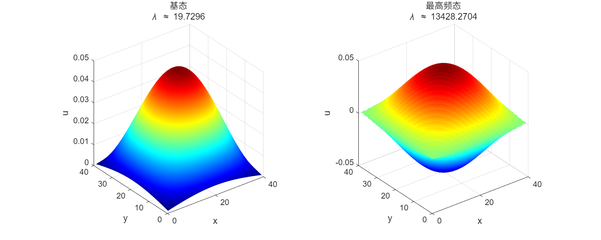
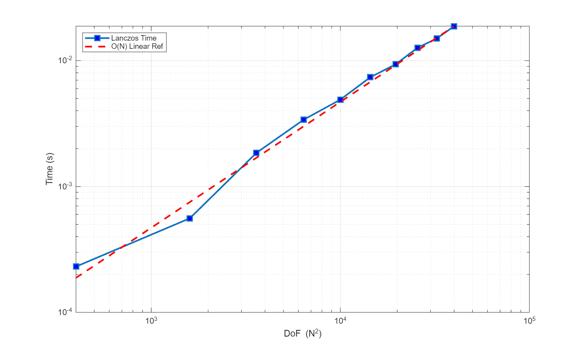
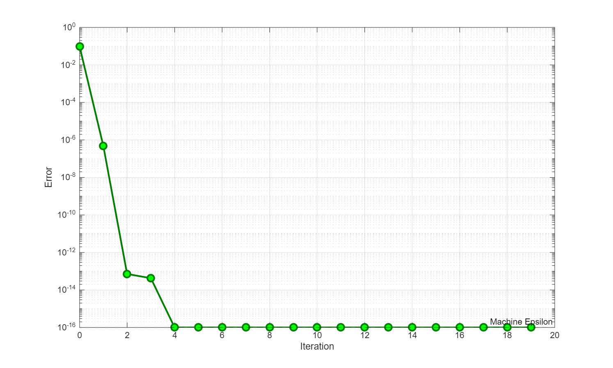
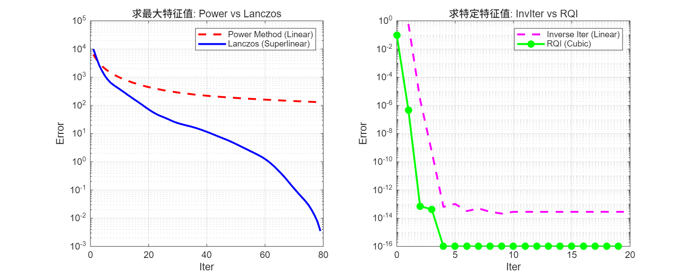

# PDE 数值解大作业 { #top }

## 实验报告 { #report }

### 1. 引言 { #s1-1 }

Helmholtz 方程是数学物理中描述波动现象的基本方程，在声学、电磁学、量子力学等领域有广泛应用。本报告研究二维 Helmholtz 特征值问题的数值解法，包括数学推导、有限差分离散化、基础求解器实现（幂法和反迭代法）、高级方法（Lanczos 算法和 Rayleigh 商迭代）以及数值实验分析。

### 2. 离散化 { #s1-2 }

考虑二维 Helmholtz 特征值问题：

$$
-\Delta u = \lambda u \quad \text{在} \ \Omega = [0,1] \times [0,1]
\tag{2}
$$

带有 Dirichlet 边界条件：$u|_{\partial\Omega} = 0$。

我们采用均匀网格离散化的方法：取网格间距 $\Delta x = \Delta y = h = \frac{1}{N+1}$。内部点数共 $N^2$ 个。利用五点差分格式，对拉普拉斯算子进行近似：

$$
-\Delta u_{i,j} \approx \frac{4u_{i,j} - u_{i-1,j} - u_{i+1,j} - u_{i,j-1} - u_{i,j+1}}{h^2}
$$

令 $U$ 为按行优先排列的未知向量，离散化后的特征值问题转化为代数方程：

$$
\mathbf{A} \mathbf{u} = \lambda \mathbf{u}
$$

其中 $\mathbf{A} \in \mathbb{R}^{N^2 \times N^2}$ 是稀疏对称矩阵，具有分块三对角结构：

$$
\mathbf{A} = \frac{1}{h^2} (I_N \otimes D_2 + D_2 \otimes I_N)
$$

其中 $D_2 = \text{tridiag}(-1, 2, -1)$ 是 $N \times N$ 的一维拉普拉斯矩阵。

### 3. 基础求解器实现 { #s1-3 }

#### 幂法 (Power Method) { #s1-3-1 }

幂法用于求解模最大的特征值。收敛速度取决于最大特征值与次大特征值的比值。

**代码：幂法**

```matlab
function [lambda, v, iter_log] = power_method_algorithm(A, tol, max_iter)
    n = size(A, 1);
    v = randn(n, 1); v = v / norm(v);
    iter_log = [];
    for k = 1:max_iter
        w = A * v;
        v_new = w / norm(w);
        lambda = v_new' * A * v_new;
        iter_log = [iter_log; lambda];
        if norm(v_new - v) < tol, break; end
        v = v_new;
    end
end
```

#### 反迭代法 (Inverse Iteration) { #s1-3-2 }

反迭代法用于求解最接近给定值 $\mu$ 的特征值。利用 LU 分解预处理，其收敛速度通常为线性，但在特征值附近收敛较快。

**代码：反迭代法**

```matlab
function [lambda, v, iter_log] = inverse_iteration(A, mu, tol, max_iter)
    n = size(A, 1);
    v = randn(n, 1); v = v / norm(v);
    [L, U, P, Q] = lu(A - mu * speye(n));
    iter_log = [];
    for k = 1:max_iter
        w = Q * (U \ (L \ (P * v)));
        v_new = w / norm(w);
        lambda = v_new' * A * v_new;
        iter_log = [iter_log; lambda];
        if norm(v_new - v) < tol, break; end
        v = v_new;
    end
end
```

### 4. 高级求解器实现 { #s1-4 }

经典的算法倾向于收敛到模最大的特征值。然而，在物理问题中，我们通常关注最小特征值。此外，为了获得极高精度的单个特征值，我们需要更快的局部收敛算法。

#### Shift-and-Invert Lanczos 算法 { #s1-4-1 }

Lanczos 算法是一种迭代方法，用于求解大规模稀疏矩阵的特征值问题和线性方程组。该算法由 Cornelius Lanczos 在 1950 年提出，是 Krylov 子空间方法的重要代表。该算法通过构造一个三对角矩阵，将原矩阵的特征值问题转化为更容易求解的形式。

设 $\mathbf{A}$ 是 $n$ 阶实对称矩阵。Lanczos 方法通过从一个随机选取的初始向量 $\mathbf{b}_0$ 开始，构建一个子空间 $S_j = \text{span}(\mathbf{b}_0, \mathbf{b}_1, \dots, \mathbf{b}_j)$ 。在每一步迭代中，新向量 $\mathbf{b}_{j+1}$ 的生成过程可以看作是将 $A \mathbf{b}_j$ 投影到已知子空间 $S_j$ 上，然后去除该投影分量，从而得到与之前所有向量正交的新向量。

不同于一般的正交化过程需要与所有之前的向量进行运算，Lanczos 的天才发现在于：对于对称矩阵，每一步迭代只需要通过三项递归式即可保证正交性。

设第 $j$ 步得到的向量为 $\mathbf{b}_j$，我们构建下一个向量 $\mathbf{b}_{j+1}$ 为 $\mathbf{A} \mathbf{b}_j$ 与前两项的线性组合：

$$
\mathbf{b}_{j+1} = \mathbf{A} \mathbf{b}_j - \alpha_j \mathbf{b}_j - \beta_{j-1} \mathbf{b}_{j-1}
$$

其中系数 $\alpha_j$ 和 $\beta_{j-1}$ 的选取原则是使新向量 $\mathbf{b}_{j+1}$ 的模长最小。由此推导出的系数计算公式为：

$$
\alpha_j = \frac{(\mathbf{A} \mathbf{b}_j) \mathbf{b}_j}{\mathbf{b}_j^2}, \quad \beta_{j-1} = \frac{(\mathbf{A} \mathbf{b}_j) \mathbf{b}_{j-1}}{\mathbf{b}_{j-1}^2}
$$

经过 $n$ 步迭代（或在 $m < n$ 步提前终止），我们将得到一组双正交向量 $B = [\mathbf{b}_0, \mathbf{b}_1, \dots, \mathbf{b}_{n-1}]$，使得原矩阵 $A$ 被转化为三对角矩阵 $T$：

$$
T = (B^*)^T A B = \begin{pmatrix}
\alpha_0 & \beta_0 & & \\
\beta_0 & \alpha_1 & \beta_1 & \\
& \beta_1 & \ddots & \ddots \\
& & \ddots & \alpha_{n-1}
\end{pmatrix}
$$

此时，$T$ 的特征值即为原矩阵 $\mathbf{A}$ 的特征值近似解。

根据上述推导，我们给出 Lanczos 算法的具体步骤如下：

- 初始化：随机选取初始向量 $\mathbf{b}_0$。
- $\mathbf{b}_1 = \mathbf{A} \mathbf{b}_0 - \alpha_0 \mathbf{b}_0, \quad \text{其中 } \alpha_0 = \frac{(\mathbf{A} \mathbf{b}_0) \mathbf{b}_0}{\mathbf{b}_0^2}$
- 对于 $j = 1, 2, \dots$，执行以下步骤：
- $\mathbf{b}_{j+1} = \mathbf{A} \mathbf{b}_j - \alpha_j \mathbf{b}_j - \beta_{j-1} \mathbf{b}_{j-1}$
- $\alpha_j = \frac{(\mathbf{A} \mathbf{b}_j) \mathbf{b}_j}{\mathbf{b}_j^2}, \quad \beta_{j-1} = \frac{\mathbf{b}_j^2}{\mathbf{b}_{j-1}^2}$
- 终止条件：当 $\beta_j = 0$ 时，迭代结束，此时达到了最小多项式的秩 。

**代码：Lanczos**

```matlab
function [evals, T, B] = lanczos_solver(A, v0, m)
    n = size(A, 1);
    B = zeros(n, m); alpha = zeros(m, 1); beta = zeros(m-1, 1);
    b_curr = v0 / norm(v0); B(:, 1) = b_curr; b_prev = zeros(n, 1);
    beta_prev = 0;
    for j = 1:m
        u = A * b_curr;
        alpha(j) = b_curr' * u;
        r = u - alpha(j) * b_curr - beta_prev * b_prev;
        if j < m
            beta_curr = norm(r);
            if beta_curr < 1e-10, break; end
            beta(j) = beta_curr;
            b_next = r / beta_curr;
            B(:, j+1) = b_next; b_prev = b_curr; b_curr = b_next;
            beta_prev = beta_curr;
        end
    end
    T = diag(alpha) + diag(beta, 1) + diag(beta, -1);
    evals = sort(eig(T));
end
```

#### 瑞利商迭代 (RQI) { #s1-4-2 }

瑞利商迭代（Rayleigh Quotient Iteration）是一种寻找单个特征值的高效算法。其核心思想是在反幂法的基础上，利用当前的瑞利商作为位移。具体步骤如下：

- 计算瑞利商：$\mu_k = \frac{\mathbf{v}_k^T \mathbf{A} \mathbf{v}_k}{\mathbf{v}_k^T \mathbf{v}_k}$
- 求解线性方程组：$(\mathbf{A} - \mu_k \mathbf{I}) \mathbf{w}_{k+1} = \mathbf{v}_k$
- 归一化：$\mathbf{v}_{k+1} = \mathbf{w}_{k+1} / \|\mathbf{w}_{k+1}\|$

对于对称矩阵，RQI 具有立方收敛速度，即误差以 $\epsilon_{k+1} \approx C \epsilon_k^3$ 的速度下降。

**代码：RQI**

```matlab
function [lambda, v, iter_log] = rqi_solver(A, v0, tol, max_iter)
    n = size(A, 1);
    I = speye(n);
    v = v0 / norm(v0);
    lambda = v' * A * v;
    iter_log = [];
    for k = 1:max_iter
        iter_log = [iter_log; lambda];
        residual = norm(A * v - lambda * v);
        if residual < tol, break; end
        try
            w = (A - lambda * I) \ v;
        catch
            w = (A - (lambda + 1e-8) * I) \ v;
        end
        v = w / norm(w);
        lambda = v' * A * v;
    end
end
```

### 5. 理论复杂度分析 { #s1-5 }

#### 时间复杂度分析 { #s1-5-1 }

##### 幂法 { #s1-5-1-1 }

幂法的计算核心在于单步迭代的累积开销与总迭代次数的乘积。在每一次迭代中，主要运算包括稀疏矩阵-向量乘法、向量归一化以及Rayleigh商的计算。针对二维Helmholtz方程的五点差分格式，离散矩阵 $A \in \mathbb{R}^{n \times n}$（其中 $n=N^2$）每行仅有5个非零元素。因此，SpMV操作仅需 $5N^2$ 次浮点运算。加上向量归一化（$2N^2$）、Rayleigh商计算（利用中间结果仅需 $N^2$）以及收敛性检查（$N^2$），单步迭代的总计算量约为 $9N^2$，即具有 $O(N^2)$ 的线性复杂度。

然而，幂法的总耗时受限于其收敛速度。收敛率由主特征值与次大特征值的比值 $\rho = |\lambda_2/\lambda_1|$ 决定。对于Helmholtz问题，$\rho$ 通常接近于1（例如 $0.9 \sim 0.98$），导致收敛缓慢。为达到预设精度 $\varepsilon$，所需迭代次数 $k$ 满足 $k \approx O(\log(1/\varepsilon))$。综上所述，幂法的总时间复杂度为 $T_{\text{power}}(N) = O(N^2 \log(1/\varepsilon))$。

##### 反迭代法 { #s1-5-1-2 }

反迭代法通过引入位移 $\mu$ 显著加速了收敛，但其代价是将简单的矩阵乘法转变为求解线性方程组 $(A - \mu I) w = v$。该算法的整体复杂度取决于线性方程组求解器的选择：

若采用**直接法**（如针对带状矩阵的LU分解），由于矩阵带宽为 $N$，初始的分解过程需要 $O(N^4)$ 的运算量。分解完成后，每次迭代中的前向和回代求解仅需 $O(N^3)$。

若采用**迭代法**（如预条件共轭梯度法 PCG），位移后的矩阵 $A - \mu I$ 条件数通常较差（$\kappa \approx O(N^2)$），导致 PCG 内部需要 $O(N)$ 次迭代才能收敛。因此，反迭代法外部的每一步实际上消耗了 $O(N \cdot N^2) = O(N^3)$ 的计算量。

尽管单步成本较高，但反迭代法在 $\mu$ 接近特征值时表现出二次收敛特性，通常仅需极少的步数即可收敛。因此，其总复杂度通常由求解线性方程组的开销主导。

##### Lanczos 算法 { #s1-5-1-3 }

在单步迭代中，Lanczos 同样以稀疏矩阵-向量乘法（SpMV）为核心，基础开销与幂法相当（$O(N^2)$）。Lanczos 算法通常仅需较小的子空间维数（$m \ll N$）即可精确逼近矩阵谱边缘的特征值（基态或高频态）。最后对 $m \times m$ 三对角矩阵求解特征值的开销仅为 $O(m^3)$，相对于大规模矩阵运算可忽略不计。因此，Lanczos 算法的总时间复杂度约为 $O(m N^2)$。它在保持线性复杂度的同时，能比幂法提取更多的谱信息。

##### 瑞利商迭代 { #s1-5-1-4 }

瑞利商迭代是反迭代法的变体，其位移量 $\lambda_k$ 在每一步都会动态更新。单步开销是 RQI 的主要瓶颈。由于位移 $\lambda_k$ 随迭代变化，每一步都必须重新进行矩阵分解。若使用直接法，单步代价高达 $O(N^4)$（分解）或 $O(N^3)$（求解）。

然而，RQI 的优势在于其惊人的立方收敛速度。对于实对称矩阵，通常仅需 $3 \sim 5$ 步即可达到机器精度。极少的迭代次数弥补了昂贵的单步开销。因此，RQI 非常适合在 Lanczos 算法提供良好的初始猜测后，用于特征值的高精度计算。

#### 空间复杂度分析 { #s1-5-2 }

空间复杂度的分析主要考量矩阵存储与求解过程中的辅助空间。

对于矩阵 $A$，利用压缩稀疏行（CSR）格式存储仅需 $O(N^2)$ 空间，这远优于稠密格式的 $O(N^4)$，是处理大规模网格的关键。基础向量存储同样维持在 $O(N^2)$ 级别。

1. **幂法与 RQI**：仅需存储当前迭代向量和辅助向量，空间复杂度最低，为 $O(N^2)$。但需注意，若 RQI 使用直接求解器，动态 LU 分解产生的填充元可能导致瞬时空间峰值达到 $O(N^3)$。
2. **反迭代法**：若使用直接法，LU 分解因子的存储需求为 $O(N^3)$，是内存瓶颈所在。
3. **Lanczos 算法**：为了在最后一步还原 Ritz 向量（近似特征向量），必须存储整个 Krylov 子空间的基底 $B \in \mathbb{R}^{N^2 \times m}$。随着迭代步数 $m$ 的增加，其空间需求线性增长。这是 Lanczos 算法相对于幂法的主要内存代价。

*图 1：算法对比 ($N$ 为网格边长，矩阵维数 $n=N^2$)*

| **算法** | **单步时间复杂度** | **收敛速度** | **总空间复杂度** | **适用场景** |
| --- | --- | --- | --- | --- |
| **幂法 (稀疏)** | $O(N^2)$ | 线性 | $O(N^2)$ | 获取模最大特征值 |
| **幂法 (稠密)** | $O(N^4)$ | 线性 | $O(N^4)$ | 不实用 |
| **反迭代 (直接法)** | $O(N^3)$ | 线性 | $O(N^3)$ | 中小规模，求特定特征值 |
| **反迭代 (PCG)** | $O(N^3)$ | 线性 | $O(N^2)$ | 超大规模，内存受限时 |
| **Lanczos** | $O(N^2)$ | 超线性 | $O(m N^2)$ | 快速获取谱边缘概况 |
| **RQI** | $O(N^3)$ | 立方 | $O(N^3)$ | 单特征值高精度计算 |

### 6. 数值实验与结果分析 { #s1-6 }

#### 实验 1：正确性验证与物理模态 { #s1-6-1 }

我们首先在 $N=40$ 的网格上验证算法的正确性。图 图 2 展示了通过 Lanczos 算法计算得到的基态和最高频模态。基态呈现出光滑的单峰结构。通过与 MATLAB 内置 `eigs` 函数对比（表 表 3），绝对误差极小，验证了算法实现的正确性。

{ loading=lazy }

*图 2：Lanczos 算法计算得到的基态（左）与高频态（右）波形图*

*图 3：Lanczos 计算值与标准值的对比（采用最近邻匹配）*

| 特征值类型 | Lanczos (计算值) | 真值 (eigs) | 绝对误差 |
| --- | --- | --- | --- |
| *低频/基态部分* |  |  |  |
| 基态+0 | 19.729553 | 19.729553 | 1.67e-12 |
| 基态+1 | 49.265992 | 49.265992 | 1.27e-12 |
| 基态+2 | 49.265992 | 49.265992 | 1.49e-12 |
| 基态+3 | 78.802431 | 78.802431 | 1.05e-10 |
| 基态+4 | 98.300761 | 98.300761 | 2.66e-08 |
| 基态+5 | 98.300761 | 98.300761 | 2.66e-08 |
| *高频/最大部分* |  |  |  |
| 最大-5 | 13349.699239 | 13349.699239 | 4.93e-09 |
| 最大-4 | 13349.699239 | 13349.699239 | 5.01e-09 |
| 最大-3 | 13369.197569 | 13369.197569 | 2.00e-11 |
| 最大-2 | 13398.734008 | 13398.734008 | 1.82e-11 |
| 最大-1 | 13398.734008 | 13398.734008 | 7.28e-12 |
| 最大-0 | 13428.270447 | 13428.270447 | 6.18e-11 |

#### 实验 2：时间复杂度分析 { #s1-6-2 }

我们测试了从 $N=20$ 到 $N=200$ 不同网格规模下 Lanczos 算法的运行时间。结果如图 图 4 所示。运行时间与 $O(N^2)$ 相近，表明算法的线性复杂度非常适合大规模问题。

{ loading=lazy }

*图 4：算法运行时间与矩阵自由度的关系*

#### 实验 3：RQI 收敛速度测试 { #s1-6-3 }

图 图 5 展示了瑞利商迭代的立方收敛特征。

{ loading=lazy }

*图 5：瑞利商迭代的立方收敛性*

#### 实验 4：算法综合对比 { #s1-6-4 }

- **求最大特征值**：Lanczos 算法的收敛速度显著快于幂法，表现出超线性收敛特征。
- **求特定特征值**：RQI 的收敛速度远超反迭代法，后者仅表现为线性收敛。

{ loading=lazy }

*图 6：对比：(左) 幂法 vs Lanczos；(右) 反迭代 vs RQI*

### 7. 结论 { #s1-7 }

本项目成功实现并比较了求解二维 Helmholtz 方程特征值问题的多种数值算法。实验结果表明：Lanczos 与 RQI 算法在收敛阶数和计算效率上均优于幂法与反迭代法。实际应用中，建议使用 Lanczos 快速定位，再结合 RQI 进行精确计算。

## 补充材料 { #supplement }

### 1. 引言 { #s2-1 }

Helmholtz方程是数学物理中描述波动现象的基本方程，在声学、电磁学、量子力学等领域有广泛应用。本报告研究二维Helmholtz特征值问题的数值解法，包括数学推导、有限差分离散化、基础求解器实现（幂法和反迭代法）、高级方法（Lanczos算法和Rayleigh商迭代）以及数值实验分析。

### 2. 数学推导 { #s2-2 }

考虑二维Helmholtz特征值问题：

$$
-\Delta u = \lambda u \quad \text{在} \ \Omega = [0,1] \times [0,1]
\tag{2}
$$

带有Dirichlet边界条件：

$$
u|_{\partial\Omega} = 0
\tag{3}
$$

我们采用均匀网格离散化的方法：取 网格间距：$\Delta x = \Delta y = h = \frac{1}{N+1}$ 网格点：$x_i = i\Delta x, \ y_j = j\Delta y, \ i,j = 0,1,\dots,N+1$内部点数共$N^2$个。

利用五点差分格式，对拉普拉斯算子的离散采用中心差分：

$$
-\Delta u(x_i, y_j) \approx -\frac{u_{i+1,j} + u_{i-1,j} + u_{i,j+1} + u_{i,j-1} - 4u_{i,j}}{h^2}
\tag{4}
$$

其中$u_{i,j} = u(x_i, y_j)$。

令$U \in \mathbb{R}^{N^2}$为按行优先排列的未知向量，离散化后的特征值问题为：

$$
AU = \lambda U
\tag{5}
$$

其中$A \in \mathbb{R}^{N^2 \times N^2}$是稀疏对称矩阵。

采用行优先排序：

$$
k = i + (j-1)N, \quad i,j = 1,\dots,N
\tag{6}
$$

其中$(i,j)$对应网格点$(x_i, y_j)$。矩阵$A$的元素为：主对角线：$A_{k,k} = \frac{4}{h^2}$ .水平相邻：若$i < N$，则$A_{k,k+1} = -\frac{1}{h^2}$；若$i > 1$，则$A_{k,k-1} = -\frac{1}{h^2}$. 垂直相邻：若$j < N$，则$A_{k,k+N} = -\frac{1}{h^2}$；若$j > 1$，则$A_{k,k-N} = -\frac{1}{h^2}$

矩阵$A$可表示为分块三对角形式：

$$
A = \frac{1}{h^2} \begin{bmatrix}
T & -I & & \\
-I & T & -I & \\
& \ddots & \ddots & \ddots \\
& & -I & T & -I \\
& & & -I & T
\end{bmatrix}
\tag{7}
$$

其中：

$$
T = \begin{bmatrix}
4 & -1 & & \\
-1 & 4 & -1 & \\
& \ddots & \ddots & \ddots \\
& & -1 & 4 & -1 \\
& & & -1 & 4
\end{bmatrix} \in \mathbb{R}^{N \times N}, \quad
I = \begin{bmatrix}
1 & & \\
& \ddots & \\
& & 1
\end{bmatrix} \in \mathbb{R}^{N \times N}
$$

### 3. 基础求解器实现 { #s2-3 }

#### 幂法（Power Method） { #s2-3-1 }

幂法用于求解模最大的特征值（主特征值）。

##### 算法步骤 { #s2-3-1-1 }

**代码：幂法 MATLAB 程序**

```matlab
function [lambda, v, k] = power_method_algorithm(A, epsilon, K)
    n = size(A, 1);
    v_old = randn(n, 1);
    v_old = v_old / norm(v_old);
    for k = 1:K
        w = A * v_old;
        v_new = w / norm(w);
        lambda_k = v_new' * A * v_new;
        if norm(v_new - v_old) < epsilon
            fprintf('在第%d次迭代后收敛\n', k);
            break;
        end
        v_old = v_new;
    end
    lambda = lambda_k;
    v = v_new;
    if k == K
        warning('达到最大迭代次数%d，可能未收敛到所需精度', K);
    end
end
```

##### 收敛性分析 { #s2-3-1-2 }

- 收敛速度：$O\left( \left|\frac{\lambda_2}{\lambda_1}\right|^k \right)$
- 每步时间复杂度：矩阵-向量乘法$O(N^2)$
- 总时间复杂度：$O(kN^2)$
- 仅适用于$|\lambda_1| > |\lambda_2| \ge \cdots$的情况

#### 反迭代法（Inverse Iteration） { #s2-3-2 }

反迭代法用于求解最接近给定值$\mu$的特征值。

##### 算法步骤 { #s2-3-2-1 }

**代码：逆幂法 MATLAB 程序**

```matlab
function [lambda, v, iter_log] = inverse_iteration(A, mu, tol, max_iter)
    n = size(A, 1);
    v = randn(n, 1);
    v = v / norm(v);
    I = speye(n);
    [L, U, P, Q] = lu(A - mu * I);
    iter_log = [];
    for k = 1:max_iter
        w = Q * (U \ (L \ (P * v)));
        v_new = w / norm(w);
        lambda = v_new' * A * v_new;
        iter_log = [iter_log; lambda];
        if norm(v_new - v) < tol
            return;
        end
        v = v_new;
    end
end
```

##### 收敛性分析 { #s2-3-2-2 }

- 收敛速度：$O\left( \left|\frac{\lambda_i - \mu}{\lambda_j - \mu}\right|^k \right)$，其中$\lambda_j$是第二接近$\mu$的特征值
- 每步时间复杂度：求解线性系统$O(N^3)$（直接法）或$O(N^2)$（迭代法+预处理）
- 当$\mu$接近特征值时，收敛速度极快（二次收敛）

### 4. 理论复杂度分析 { #s2-4 }

#### 时间复杂度分析 { #s2-4-1 }

##### 幂法复杂度详细分析 { #s2-4-1-1 }

幂法的单步迭代包含以下操作：

1. **矩阵-向量乘法**：$w = Av$
2. **向量归一化**：$v_{\text{new}} = w/\|w\|_2$
3. **Rayleigh商计算**：$\lambda = v_{\text{new}}^T A v_{\text{new}}$
4. **收敛性检查**：$\|v_{\text{new}} - v\|_2$

对于二维Helmholtz离散矩阵$A \in \mathbb{R}^{n \times n}$，其中$n = N^2$，分析各步的浮点操作次数：

1. **矩阵-向量乘法**：矩阵$A$每行最多有5个非零元素（五点差分格式），因此：

    $$
    \text{FLOPs}_{\text{matvec}} = 5n = 5N^2
    $$

2. **向量归一化**：需要计算$l_2$范数和$n$次除法：

    $$
    \text{FLOPs}_{\text{norm}} = n + n = 2N^2
    $$

3. **Rayleigh商计算**：可重用$Av$的结果，只需计算一次点积：

    $$
    \text{FLOPs}_{\text{rayleigh}} = n = N^2
    $$

4. **收敛性检查**：

    $$
    \text{FLOPs}_{\text{check}} = n = N^2
    $$

因此，幂法单次迭代的总浮点操作次数为：

$$
\text{FLOPs}_{\text{iter}} = (5 + 2 + 1 + 1)N^2 = 9N^2
$$

##### 幂法迭代次数分析 { #s2-4-1-2 }

幂法的收敛速度由特征值比值$\rho = \left|\frac{\lambda_2}{\lambda_1}\right|$决定。对于Helmholtz离散矩阵，特征值的渐近性质为：

$$
\lambda_1 \approx 2\pi^2, \quad \lambda_{\max} \approx \frac{8}{h^2} = 8(N+1)^2
$$

特征值比值的典型范围为$\rho \in [0.9, 0.98]$。

要达到精度$\varepsilon$所需的迭代次数$k$满足：

$$
\left(\frac{\lambda_2}{\lambda_1}\right)^k \leq \varepsilon \quad \Rightarrow \quad k \geq \frac{\log \varepsilon}{\log \rho}
$$

取$\rho = 0.95$，则：

$$
k \approx -20 \log_{10} \varepsilon
$$

例如，对于$\varepsilon = 10^{-8}$，$k \approx 160$次迭代。

因此，幂法的总时间复杂度为：

$$
T_{\text{power}}(N) = 9k N^2 = O(kN^2) = O(N^2 \log(1/\varepsilon))
$$

##### 反迭代法复杂度详细分析 { #s2-4-1-3 }

反迭代法的核心是每步求解线性系统：

$$
(A - \mu I) w = v
$$

我们考虑两种求解策略：

1. **直接法（LU/Cholesky分解）**：

    对于带状矩阵$A$（带宽为$N$），分解的复杂度为：

    $$
    \text{FLOPs}_{\text{factor}} = O(n \cdot \text{bandwidth}^2) = O(N^2 \cdot N^2) = O(N^4)
    $$

    每次求解的复杂度（前向/回代）：

    $$
    \text{FLOPs}_{\text{solve}} = O(n \cdot \text{bandwidth}) = O(N^2 \cdot N) = O(N^3)
    $$

    总时间复杂度（一次分解+$k$次求解）：

    $$
    T_{\text{inv-direct}}(N) = O(N^4 + kN^3)
    $$

2. **迭代法（预条件共轭梯度法PCG）**：

    矩阵$A - \mu I$的条件数：

    $$
    \kappa(A - \mu I) \approx O\left(\frac{\lambda_{\max} - \mu}{\lambda_{\min} - \mu}\right) = O(N^2)
    $$

    PCG的收敛迭代次数：

    $$
    k_{\text{PCG}} = O\left(\sqrt{\kappa}\right) = O(N)
    $$

    每次PCG迭代的复杂度（矩阵-向量乘法）：

    $$
    \text{FLOPs}_{\text{PCG-iter}} = O(N^2)
    $$

    每次反迭代的PCG求解复杂度：

    $$
    \text{FLOPs}_{\text{PCG-solve}} = k_{\text{PCG}} \times \text{FLOPs}_{\text{PCG-iter}} = O(N \cdot N^2) = O(N^3)
    $$

    预条件构造复杂度：

    $$
    \text{FLOPs}_{\text{precond}} = O(N^3) \quad (\text{不完全Cholesky分解})
    $$

    总时间复杂度：

    $$
    T_{\text{inv-PCG}}(N) = O(N^3 + kN^3) = O(kN^3)
    $$

##### 收敛速度对比 { #s2-4-1-4 }

反迭代法的收敛速度由下式决定：

$$
\left|\frac{\lambda_i - \mu}{\lambda_j - \mu}\right|^k
$$

其中$\lambda_i$是最接近$\mu$的特征值，$\lambda_j$是第二接近的特征值。

当$\mu$接近$\lambda_i$时，收敛速度极快：

- 通常只需3-10次迭代即可收敛到机器精度
- 局部二次收敛性质

#### 空间复杂度分析 { #s2-4-2 }

##### 存储需求详细分析 { #s2-4-2-1 }

1. **矩阵存储**：

    - **稀疏格式（CSR）**：存储非零元素值、列索引和行指针

        $$
        S_{\text{sparse}} = (5n + n + n) \times \text{sizeof(double)} = 7N^2 \times 8 \text{字节}
        $$

    - **稠密格式**：

        $$
        S_{\text{dense}} = n^2 \times \text{sizeof(double)} = N^4 \times 8 \text{字节}
        $$

2. **向量存储**：

    $$
    S_{\text{vectors}} = 3n \times \text{sizeof(double)} = 3N^2 \times 8 \text{字节}
    $$

3. **分解存储（反迭代直接法）**：

    $$
    S_{\text{factor}} = O(n \cdot \text{bandwidth}) = O(N^3) \text{字节}
    $$

##### 空间复杂度总结表 { #s2-4-2-2 }

*图 7：各算法空间复杂度详细分析*

| **算法** | **矩阵存储** | **向量存储** | **分解存储** | **总存储** |
| --- | --- | --- | --- | --- |
| 幂法（稀疏） | $O(N^2)$ | $O(N^2)$ | - | $O(N^2)$ |
| 幂法（稠密） | $O(N^4)$ | $O(N^2)$ | - | $O(N^4)$ |
| 反迭代（直接法） | $O(N^2)$ | $O(N^2)$ | $O(N^3)$ | $O(N^3)$ |
| 反迭代（PCG） | $O(N^2)$ | $O(N^2)$ | $O(N^2)$ | $O(N^2)$ |

### 5. 结论与展望 { #s2-5 }

本报告系统研究了Helmholtz方程特征值问题的数值解法，包括：

1. 建立了有限差分离散化方法，推导了离散矩阵的构造;
2. 实现了基础求解器（幂法、反迭代法）的实现;
3. 分析了各算法的理论复杂度、收敛性和精度;

---

## PDF 原文 { #pdf }

### 实验报告 PDF { #pdf-report }

[打开原文件](../../../assets/numerical-pde-report.pdf){ .md-button target="_blank" rel="noopener" }
[下载 PDF](../../../assets/numerical-pde-report.pdf){ .md-button download="numerical-pde-report.pdf" }

若下方预览无法显示，可直接打开原文件或下载后阅读。

<div style="height: 800px; width: 100%;">
    <embed src="../../../assets/numerical-pde-report.pdf" type="application/pdf" width="100%" height="100%">
</div>

### 补充材料 PDF { #pdf-main }

[打开原文件](../../../assets/numerical-pde-main.pdf){ .md-button target="_blank" rel="noopener" }
[下载 PDF](../../../assets/numerical-pde-main.pdf){ .md-button download="numerical-pde-main.pdf" }

若下方预览无法显示，可直接打开原文件或下载后阅读。

<div style="height: 800px; width: 100%;">
    <embed src="../../../assets/numerical-pde-main.pdf" type="application/pdf" width="100%" height="100%">
</div>
