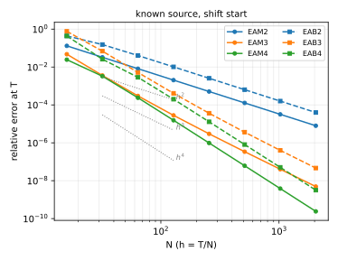
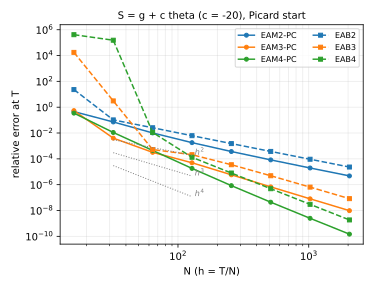
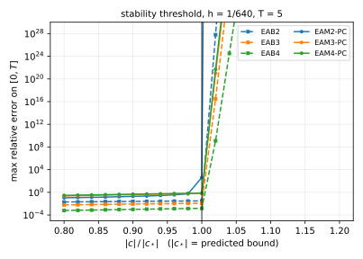
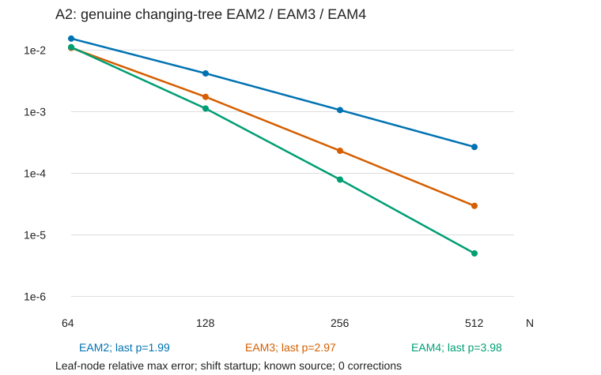

# 受迫热方程

## 1. 问题

这是 Rayleigh–Bénard 笔记里温度通道单独拿出来的模型问题：

$$
\theta_t=\Delta\theta+S,\qquad (x,z)\in\Omega=[0,1)\times[0,1],
$$

$$
\theta(x+1,z,t)=\theta(x,z,t),\qquad \theta(x,0,t)=\theta(x,1,t)=0,\qquad \theta(x,z,0)=\theta_0(x,z).
$$

源 $S$ 有两种情形：

- **已知外源** $S=f(x,z,t)$：任意时刻都能直接取样。
- **依赖解的源** $S=g(x,z,t)+F(\theta)$：例如 RB 中的对流项，取样必须先知道该时刻的 $\theta$。

本文只做一件事：像 ODE 线性多步法那样，只用历史源值构造全局三阶、四阶格式，不在步内增加新节点；给出推导、收敛证明和数值验证。

### 1.1 记号

全文只用两个算子，都带零 Dirichlet 壁条件和 $x$ 周期：

$$
K=\Delta^{-1},\qquad H=e^{h\Delta}.
$$

| 算子 | 含义 | 实现 |
| --- | --- | --- |
| $Kf$ | 解 $\Delta u=f$，$u$ 两壁为零 | `adapfmm8` |
| $Hf$ | 以 $f$ 为初值让 $y_t=\Delta y$ 扩散时间 $h$ | `boxfgt` |

两者都是 $\Delta$ 的函数，所以 $KH=HK$，$\Delta K=K\Delta=I$。按特征函数 $e^{2\pi ikx}\sin(l\pi z)$ 展开，特征值为

$$
\Delta\to-\lambda_{kl},\qquad \lambda_{kl}=4\pi^2k^2+\pi^2l^2\ge\pi^2,\qquad
K\to-\frac1{\lambda_{kl}},\qquad H\to e^{-\lambda_{kl}h}.
$$

$K$ 是负算子。程序里的 `op_K` 解的是 $-\Delta u=f$，即 `op_K` $=-K$。本文使用 $\Delta^{-1}$ 来避免公式里出现交替符号了。

## 2. 一步公式：源势

### 2.1 积分因子

在一步 $[t_n,t_n+h]$ 内记 $\tau=t-t_n$。方程两边左乘 $e^{-\tau\Delta}$：

$$
\frac{d}{d\tau}\left[e^{-\tau\Delta}\theta\right]=e^{-\tau\Delta}\left(\theta_\tau-\Delta\theta\right)=e^{-\tau\Delta}S .
$$

从 $0$ 积分到 $h$，再左乘 $e^{h\Delta}$：

$$
\theta_{n+1}=H\theta_n+\int_0^h e^{(h-\tau)\Delta}S(t_n+\tau)\,d\tau .
\tag{2.1}
$$

这是精确的 Duhamel 公式。所有格式的区别只在于怎样近似这个积分。

### 2.2 多项式源的精确积分

**为什么不直接做数值积分。** (2.1) 的积分核是 $e^{(h-\tau)\Delta}$，用求积公式算，每个求积点都要做一次 FGT，而 FGT 正是一步里最贵的算子。我们希望一步只用一次 $H$，其余都交给 $K$。

**思路：找一个特解把源消掉。** 设一步内源被一个 $m$ 次多项式 $p(\tau)$ 代替（系数是空间函数），$p^{(m+1)}=0$。方程 $\theta'=\Delta\theta+p$ 是线性的，如果能找到一个特解 $-P(\tau)$，即

$$
P'=\Delta P-p ,
\tag{2.2a}
$$

那么 $w=\theta+P$ 满足齐次方程 $w'=\Delta w$，一步只需一次 $H$。这和常微分方程 $y'=-\lambda y+c_0+c_1t$ 的做法一样：右端是多项式，就用待定系数法猜一个多项式特解。

**解 (2.2a)。** 两边作用 $K=\Delta^{-1}$，移项得

$$
P=Kp+KP' .
$$

右端还含 $P$ 本身，把这个式子对 $\tau$ 求导再代回去：$P'=Kp'+KP''$，所以

$$
P=Kp+K^2p'+K^2P''=Kp+K^2p'+K^3p''+K^3P'''=\cdots
$$

每代一次，$p$ 的导数阶升一，$K$ 的幂升一。因为 $p^{(m+1)}=0$，猜 $P$ 也是 $\tau$ 的 $m$ 次多项式，则 $P^{(m+1)}=0$，代 $m$ 次后余项消失，得到有限和。这样定义**源势**

$$
P(\tau)=Kp+K^2p'+K^3p''+\dots+K^{m+1}p^{(m)}=\sum_{j=0}^{m}K^{j+1}p^{(j)}(\tau).
$$

换一种写法看得更清楚。记 $D=d/d\tau$，(2.2a) 就是 $(\Delta-D)P=p$，形式上

$$
P=(\Delta-D)^{-1}p=K\,(I-KD)^{-1}p=K\big(I+KD+K^2D^2+\cdots\big)p .
$$

$D$ 作用在 $m$ 次多项式上 $m+1$ 次就是零，Neumann 级数自动截断，正好得到上面的有限和。这里 $K$ 与 $D$ 可交换，所以展开合法。

下面直接验证这个 $P$ 满足 (2.2a)。

**第一步：算 $\Delta P$ 和 $P'$。** 用 $\Delta K^{j+1}=K^j$：

$$
\Delta P=p+Kp'+K^2p''+\dots+K^mp^{(m)},
$$

$$
P'=Kp'+K^2p''+\dots+K^mp^{(m)}+K^{m+1}\underbrace{p^{(m+1)}}_{=0}.
$$

两式相减，除了第一项全部抵消：

$$
P'=\Delta P-p .
$$

**第二步：消去源。** 令 $w=\theta+P$，代入方程：

$$
w'=\theta'+P'=(\Delta\theta+p)+(\Delta P-p)=\Delta(\theta+P)=\Delta w .
$$

$w$ 满足齐次热方程。$P$ 是 $K$ 的值域里的元素，两壁为零，所以 $w$ 也两壁为零，可以交给 $H$：$w(h)=Hw(0)$，即

$$
\boxed{\theta_{n+1}=H\big(\theta_n+P(0)\big)-P(h).}
\tag{2.2}
$$

只要 $p$ 是多项式，(2.2) 就是 $S$ 换成 $p$ 后的 (2.1) 的**精确**值。

### 2.3 退回现有二阶格式

**$m=0$（常源）：** $P=KS_n$，

$$
\theta_{n+1}=H(\theta_n+KS_n)-KS_n .
$$

**$m=1$（端点线性插值）：** $p(\tau)=S_n+\frac{\tau}{h}(S_{n+1}-S_n)$，$p'=(S_{n+1}-S_n)/h$。

$$
P(0)=KS_n+q,\qquad P(h)=KS_{n+1}+q,\qquad q=K^2\frac{S_{n+1}-S_n}{h},
$$

$$
\theta_{n+1}=H(\theta_n+KS_n+q)-KS_{n+1}-q .
$$

现有算法就是 $m=1$ 的情形，每步 2 次 Poisson、1 次 FGT。

### 2.4 怎样算 $P$：两种实现

**Horner 链。** 把 $P$ 写成嵌套形式：

$$
P(s)=K\Big(p+K\big(p'+K(p''+Kp''')\big)\Big).
$$

$P(0)$ 和 $P(h)$ 各要一条链，但最内层 $p^{(m)}$ 是常数，两条链共用 $Kp^{(m)}$。每步 Poisson 次数为 $2m+1$。

**apply（缓存）。** 对每个新源值 $S_{n+1}$ 算并存下 $KS_{n+1},K^2S_{n+1},\dots,K^{m+1}S_{n+1}$，旧节点的链直接复用。$P$ 是这些缓存的线性组合。每步 Poisson 次数为 $m+1$。

| 格式 | Horner / wide | apply | FGT |
| --- | --- | --- | --- |
| 二阶 $m=1$ | 3 | 2 | 1 |
| 三阶 $m=2$ | 5 | 3 | 1 |
| 四阶 $m=3$ | 7 | 4 | 1 |

apply 调用少，但要存 $(m+1)^2$ 个缓存场，而且树一重建，缓存就要转移或重算（第 5.2 节）。在精确算术和固定线性算子下两者相等；差别在舍入和变树转移，见第 4.6、5.3 节。

## 3. 用历史源值构造三阶、四阶

### 3.1 插值多项式的导数

取归一化时间 $s=\tau/h$，节点 $s_q$ 对应时刻 $t_n+s_qh$ 的源值 $S_q$，Lagrange 基为 $\ell_q(s)$：

$$
p(\tau)=\sum_q\ell_q(s)S_q,\qquad p^{(j)}(\tau)=h^{-j}\sum_q\ell_q^{(j)}(s)S_q .
$$

代入 (2.2) 只需要两端 $s=0,1$ 的各阶导数。节点有两种取法，对应 ODE 的 Adams–Moulton 和 Adams–Bashforth：

| 格式 | 节点 $s_q$ | 用到的源值 |
| --- | --- | --- |
| EAM$(m+1)$ | $1,0,-1,\dots,1-m$ | $S_{n+1},S_n,\dots,S_{n+1-m}$ |
| EAB$(m+1)$ | $0,-1,\dots,-m$ | $S_n,S_{n-1},\dots,S_{n-m}$ |

### 3.2 EAM3、EAM4 的显式公式

用以 $t_{n+1}$ 为基点的后向差分 $\nabla S_{n+1}=S_{n+1}-S_n$、$\nabla^2S_{n+1}=S_{n+1}-2S_n+S_{n-1}$、$\nabla^3S_{n+1}=S_{n+1}-3S_n+3S_{n-1}-S_{n-2}$，令 $u=s-1$，Newton 后向插值为

$$
p=S_{n+1}+u\nabla+\frac{u(u+1)}2\nabla^2+\frac{u(u+1)(u+2)}6\nabla^3 .
$$

逐次对 $u$ 求导（$\tfrac{d}{d\tau}=h^{-1}\tfrac{d}{du}$）：

$$
hp'=\nabla+\frac{2u+1}{2}\nabla^2+\frac{3u^2+6u+2}{6}\nabla^3,\qquad
h^2p''=\nabla^2+(u+1)\nabla^3,\qquad
h^3p'''=\nabla^3 .
$$

$\tau=h$ 对应 $u=0$，$\tau=0$ 对应 $u=-1$。代入后展开成节点值：

| 量 | $u=-1$（$\tau=0$） | $u=0$（$\tau=h$） |
| --- | --- | --- |
| $p$ | $S_n$ | $S_{n+1}$ |
| $hp'$ | $\nabla-\tfrac12\nabla^2-\tfrac16\nabla^3=\tfrac16(2S_{n+1}+3S_n-6S_{n-1}+S_{n-2})$ | $\nabla+\tfrac12\nabla^2+\tfrac13\nabla^3=\tfrac16(11S_{n+1}-18S_n+9S_{n-1}-2S_{n-2})$ |
| $h^2p''$ | $\nabla^2$ | $\nabla^2+\nabla^3=2S_{n+1}-5S_n+4S_{n-1}-S_{n-2}$ |
| $h^3p'''$ | $\nabla^3$ | $\nabla^3$ |

于是 **EAM4**：

$$
\begin{aligned}
P(0)&=KS_n+\frac{K^2}{6h}\left(2S_{n+1}+3S_n-6S_{n-1}+S_{n-2}\right)+\frac{K^3}{h^2}\nabla^2S_{n+1}+\frac{K^4}{h^3}\nabla^3S_{n+1},\\
P(h)&=KS_{n+1}+\frac{K^2}{6h}\left(11S_{n+1}-18S_n+9S_{n-1}-2S_{n-2}\right)+\frac{K^3}{h^2}\left(2S_{n+1}-5S_n+4S_{n-1}-S_{n-2}\right)+\frac{K^4}{h^3}\nabla^3S_{n+1}.
\end{aligned}
$$

**EAM3** 去掉 $\nabla^3$ 项，用 $S_{n+1},S_n,S_{n-1}$：

$$
\begin{aligned}
P(0)&=KS_n+\frac{K^2}{2h}\left(S_{n+1}-S_{n-1}\right)+\frac{K^3}{h^2}\nabla^2S_{n+1},\\
P(h)&=KS_{n+1}+\frac{K^2}{2h}\left(3S_{n+1}-4S_n+S_{n-1}\right)+\frac{K^3}{h^2}\nabla^2S_{n+1}.
\end{aligned}
$$

### 3.3 EAB3、EAB4 的显式公式

节点 $S_n,S_{n-1},S_{n-2}$，以 $t_n$ 为基点：$\nabla S_n=S_n-S_{n-1}$，$\nabla^2S_n=S_n-2S_{n-1}+S_{n-2}$，$u=s$，

$$
p=S_n+u\nabla+\frac{u(u+1)}2\nabla^2,\qquad hp'=\nabla+\frac{2u+1}{2}\nabla^2,\qquad h^2p''=\nabla^2 .
$$

在 $u=0$ 和 $u=1$ 取值：

$$
\begin{aligned}
P(0)&=KS_n+\frac{K^2}{2h}\left(3S_n-4S_{n-1}+S_{n-2}\right)+\frac{K^3}{h^2}\nabla^2S_n,\\
P(h)&=K\left(3S_n-3S_{n-1}+S_{n-2}\right)+\frac{K^2}{2h}\left(5S_n-8S_{n-1}+3S_{n-2}\right)+\frac{K^3}{h^2}\nabla^2S_n .
\end{aligned}
$$

**EAB4** 再加节点 $S_{n-3}$，$\nabla^3S_n=S_n-3S_{n-1}+3S_{n-2}-S_{n-3}$，
$p=S_n+u\nabla+\frac{u(u+1)}2\nabla^2+\frac{u(u+1)(u+2)}6\nabla^3$，导数与 EAM4 的式子相同，只是改在 $u=0$（$\tau=0$）和 $u=1$（$\tau=h$）取值：

| 量 | $u=0$（$\tau=0$） | $u=1$（$\tau=h$） |
| --- | --- | --- |
| $p$ | $S_n$ | $\nabla^0+\nabla+\nabla^2+\nabla^3=4S_n-6S_{n-1}+4S_{n-2}-S_{n-3}$ |
| $hp'$ | $\nabla+\tfrac12\nabla^2+\tfrac13\nabla^3=\tfrac16(11S_n-18S_{n-1}+9S_{n-2}-2S_{n-3})$ | $\nabla+\tfrac32\nabla^2+\tfrac{11}6\nabla^3=\tfrac16(26S_n-57S_{n-1}+42S_{n-2}-11S_{n-3})$ |
| $h^2p''$ | $\nabla^2+\nabla^3=2S_n-5S_{n-1}+4S_{n-2}-S_{n-3}$ | $\nabla^2+2\nabla^3=3S_n-8S_{n-1}+7S_{n-2}-2S_{n-3}$ |
| $h^3p'''$ | $\nabla^3$ | $\nabla^3$ |

$$
\begin{aligned}
P(0)&=KS_n+\frac{K^2}{6h}\left(11S_n-18S_{n-1}+9S_{n-2}-2S_{n-3}\right)+\frac{K^3}{h^2}\left(2S_n-5S_{n-1}+4S_{n-2}-S_{n-3}\right)+\frac{K^4}{h^3}\nabla^3S_n,\\
P(h)&=K\left(4S_n-6S_{n-1}+4S_{n-2}-S_{n-3}\right)+\frac{K^2}{6h}\left(26S_n-57S_{n-1}+42S_{n-2}-11S_{n-3}\right)+\frac{K^3}{h^2}\left(3S_n-8S_{n-1}+7S_{n-2}-2S_{n-3}\right)+\frac{K^4}{h^3}\nabla^3S_n .
\end{aligned}
$$

### 3.4 依赖解的源：预测–校正

EAM 要用 $S_{n+1}=g(t_{n+1})+F(\theta_{n+1})$，而 $\theta_{n+1}$ 正是要求的量，所以 EAM 是隐式的。程序用固定次数的预测–校正：

1. **预测**：用同阶 EAB（只用旧源值）算出候选 $\theta_{n+1}^{(0)}$。
2. **校正**：$S_{n+1}^{(0)}=g_{n+1}+F(\theta_{n+1}^{(0)})$，代入 EAM 得 $\theta_{n+1}^{(1)}$。可以重复 $k$ 次。
3. 用最终 $\theta_{n+1}$ 重新算 $S_{n+1}$ 存入历史。

每次校正多 1 次 FGT 和一整条 Poisson 链。已知外源不需要这一步：$S_{n+1}$ 直接取样，EAM 是显式的。

### 3.5 EAM 与 EAB

| | EAM$(m+1)$ | EAB$(m+1)$ |
| --- | --- | --- |
| 步内源近似 | 插值（含 $t_{n+1}$） | 外推 |
| 局部误差常数（三阶/四阶） | $1/24$，$19/720$ | $3/8$，$251/720$ |
| 依赖解的源每步代价 | 预测 + $k$ 次校正：$(1+k)$ 倍 | 1 倍，完全显式 |
| $t_n$ 之前需要的历史值 | $m-1$ 个 | $m$ 个 |
| 线性反应 $c<0$ 的步长条件 $h\lvert c\rvert<$（二/三/四阶，§4.5） | 2.00，1.73，1.28（一次校正） | 0.980，0.518，0.277 |

误差常数之比：三阶 $\tfrac{3/8}{1/24}=9$，四阶 $\tfrac{251/720}{19/720}\approx13.2$。

- **已知外源**：两者每步代价相同，EAM 误差小一个数量级，**用 EAM**。
- **依赖解的源**：EAM 一次校正每步代价是 EAB 的 2 倍。要达到 EAM 的误差，EAB 步长需缩小 $9^{1/3}\approx2.1$（三阶）或 $13.2^{1/4}\approx1.9$（四阶）倍，两者总代价基本相同，实测也是如此（§7.5、§7.7）。

### 3.6 启动

$m+1$ 阶格式开头缺少 $t<0$ 的历史源值。

**shift 启动（已知外源）。** 遇到负下标时改用节点 $t_0,\dots,t_m$，即前几步都用同一个前向插值多项式（它在 $[t_0,t_m]$ 上用的正是未来源值，已知外源可以直接取样）。每个启动步的局部误差仍是 $O(h^{m+2})$。EAM4 前三个区间的常数为 $19/720$、$11/720$、$19/720$，不比正常步大。

**Picard 块启动（一般情形）。** 在 $[0,mh]$ 上取阶段 $U_j\approx\theta(jh)$，$j=0,\dots,m$，初猜 $U_j^{(0)}=\theta_0$，迭代

$$
U_j^{(r+1)}=e^{jh\Delta}\theta_0+\int_0^{jh}e^{(jh-\tau)\Delta}\sum_{l=0}^{m}\ell_l(\tau/h)\left[g(lh)+F(U_l^{(r)})\right]d\tau ,
$$

积分同样用源势 (2.2) 精确计算（传播时间改为 $jh$）。迭代 $m+1$ 轮后统一刷新历史，从 $t_m$ 开始正常推进。只用给定初值，不用解析解。

## 4. 收敛证明

有如下假设：

1. 在 $L^\infty$ 中，$\lVert e^{t\Delta}\rVert\le1$；在 $L^2$ 中，$\lVert e^{t\Delta}\rVert\le e^{-\pi^2t}$ 
   
2. $K$、$H$ 精确，没有空间离散和舍入

3. $S\in C^{m+1}([0,T];X)$，$M=\sup_t\lVert S^{(m+1)}(t)\rVert$

4. 依赖解的源：$\lVert F(u)-F(v)\rVert\le L\lVert u-v\rVert$

**$L^2$ 中。** 把 $y(0)$ 按特征函数展开：$y(0)=\sum_{k,l}c_{kl}\phi_{kl}$，$\phi_{kl}=e^{2\pi ikx}\sin(l\pi z)$，它们在 $L^2$ 中正交。热方程逐模态解为 $c_{kl}(t)=e^{-\lambda_{kl}t}c_{kl}$，由 Parseval 等式，

$$
\lVert e^{t\Delta}y(0)\rVert_{L^2}^2=\sum_{k,l}e^{-2\lambda_{kl}t}\lvert c_{kl}\rvert^2\lVert\phi_{kl}\rVert^2\le e^{-2\pi^2t}\sum_{k,l}\lvert c_{kl}\rvert^2\lVert\phi_{kl}\rVert^2=e^{-2\pi^2t}\lVert y(0)\rVert_{L^2}^2 .
$$

这里用了 $\lambda_{kl}\ge\lambda_{01}=\pi^2$。

**$L^\infty$ 中。** 由最大值原理：在 $\Omega\times(0,t]$ 上，$y_t=\Delta y$ 的解的最大值和最小值只能在 $t=0$ 或壁面上取得；$x$ 方向周期没有边界，壁上 $y=0$。所以 $\lvert y(\cdot,t)\rvert\le\max\lvert y(\cdot,0)\rvert$。

### 4.1 局部误差

把格式看成一个映射：输入 $\theta_n$ 和历史源值 $\{S_q\}$，输出 $\theta_{n+1}$。由第 2.2 节，格式算出的正是

$$
\theta_{n+1}=H\theta_n+\int_0^he^{(h-\tau)\Delta}p(\tau)\,d\tau ,
$$

其中 $p$ 是 $\{S_q\}$ 的插值多项式。现在把**精确值** $\theta(t_n)$ 和**精确源值** $S(t_q)$ 作为输入，与精确解的 Duhamel 公式 (2.1) 相减，$H\theta(t_n)$ 抵消：

$$
d_n:=\theta(t_{n+1})-\Big[H\theta(t_n)+\int_0^he^{(h-\tau)\Delta}p(\tau)\,d\tau\Big]
=\int_0^he^{(h-\tau)\Delta}\big(S(t_n+\tau)-p(\tau)\big)\,d\tau .
$$

设 $f(\sigma)$ 是 $C^{m+1}$ 的实函数，$\pi(\sigma)$ 是它在 $m+1$ 个不同节点 $s_0,\dots,s_m$ 上的插值多项式，$\omega(\sigma)=\prod_q(\sigma-s_q)$。固定一个非节点的 $s$，取常数 $c$ 使辅助函数

$$
g(\sigma)=f(\sigma)-\pi(\sigma)-c\,\omega(\sigma)
$$

在 $\sigma=s$ 处为零。$g$ 在 $m+1$ 个节点上也为零（$f=\pi$、$\omega=0$），共 $m+2$ 个零点。由 Rolle 定理，$g'$ 至少有 $m+1$ 个零点，……，$g^{(m+1)}$ 至少有一个零点 $\xi$。$\pi$ 是 $m$ 次多项式，$\pi^{(m+1)}=0$；$\omega$ 首项为 $\sigma^{m+1}$，$\omega^{(m+1)}=(m+1)!$。所以

$$
0=g^{(m+1)}(\xi)=f^{(m+1)}(\xi)-c\,(m+1)!\quad\Longrightarrow\quad
f(s)-\pi(s)=c\,\omega(s)=\frac{f^{(m+1)}(\xi)}{(m+1)!}\,\omega(s).
$$

对任一有界线性泛函 $\varphi$（$\lVert\varphi\rVert\le1$），令 $f(\sigma)=\varphi\big(S(t_n+h\sigma)\big)$，它是实函数。

- 链式法则：$f^{(m+1)}(\sigma)=h^{m+1}\varphi\big(S^{(m+1)}(t_n+h\sigma)\big)$，所以 $\lvert f^{(m+1)}\rvert\le h^{m+1}M$。
- 插值是线性的：$f$ 的插值多项式就是 $\varphi(p)$。

代入，

$$
\big\lvert\varphi\big(S(t_n+hs)-p(hs)\big)\big\rvert\le\frac{h^{m+1}M}{(m+1)!}\,\lvert\omega(s)\rvert .
$$

由 Hahn–Banach 定理，$\lVert v\rVert=\sup_{\lVert\varphi\rVert\le1}\lvert\varphi(v)\rvert$，对 $\varphi$ 取上确界：

$$
\lVert S(t_n+hs)-p(hs)\rVert\le\frac{h^{m+1}M}{(m+1)!}\,\lvert\omega(s)\rvert .
\tag{4.1}
$$

换元 $\tau=hs$、$d\tau=h\,ds$，代入 (4.1)：

$$
\lVert d_n\rVert\le\int_0^h\lVert S(t_n+\tau)-p(\tau)\rVert\,d\tau
=h\int_0^1\lVert S(t_n+hs)-p(hs)\rVert\,ds
\le\frac{h^{m+2}M}{(m+1)!}\int_0^1\lvert\omega(s)\rvert\,ds .
$$

记

$$
\boxed{\lVert d_n\rVert\le C\,M\,h^{m+2},\qquad C=\frac{1}{(m+1)!}\int_0^1\lvert\omega(s)\rvert\,ds .}
$$

| 格式 |$C$ |
| --- | --- |
| EAM2 |$\tfrac1{12}$ |
| EAM3 |$\tfrac1{24}$ |
| EAM4 |$\tfrac{19}{720}$ |
| EAB2 |$\tfrac5{12}$ |
| EAB3 |$\tfrac38$ |
| EAB4 |$\tfrac{251}{720}$ |

### 4.2 全局误差：已知外源

已知外源时，$p$ 用的是精确源值 $S(t_q)$，与 $\theta_n$ 无关。记 $I_n=\int_0^he^{(h-\tau)\Delta}p(\tau)\,d\tau$，数值解和精确解分别满足

$$
\theta_{n+1}=H\theta_n+I_n,\qquad
\theta(t_{n+1})=H\theta(t_n)+I_n+d_n .
$$

相减，记 $e_n=\theta(t_n)-\theta_n$，得 $e_{n+1}=He_n+d_n$。逐步展开：

$$
e_N=H^Ne_0+\sum_{n=0}^{N-1}H^{N-1-n}d_n .
$$

由假设 1，$\lVert H^k\rVert\le1$；再用 $\lVert d_n\rVert\le CMh^{m+2}$ 和 $Nh=T$：

$$
\lVert e_N\rVert\le\lVert e_0\rVert+N\,CMh^{m+2}=\lVert e_0\rVert+C\,M\,T\,h^{m+1}.
$$

在 $L^2$ 中还可以用 $\lVert H^k\rVert\le e^{-\pi^2kh}$，求和是几何级数，$\sum_{k\ge0}e^{-\pi^2kh}=1/(1-e^{-\pi^2h})$。由 $e^x\ge1+x$ 得 $1-e^{-x}\ge\frac{x}{1+x}$，于是

$$
\lVert e_N\rVert_{L^2}\le e^{-\pi^2T}\lVert e_0\rVert+\frac{CM}{\pi^2}\,h^{m+1}(1+\pi^2h).
$$

右端与 $T$ 无关，误差不随积分时间累积，这是耗散性带来的。

shift 启动时 $e_0=0$。前 $m-1$ 步的插值节点换成 $0,1,\dots,m$，第 $m$ 步的正常 EAM 节点恰好也是 $0,\dots,m$，所以前 $m$ 个区间用同一个多项式，仍满足 $e_{n+1}=He_n+d_n$，只是第 $n$ 个区间的常数换成

$$
C_n=\frac1{(m+1)!}\int_n^{n+1}\Big\lvert\prod_{q=0}^{m}(\sigma-q)\Big\rvert\,d\sigma .
$$

二阶 $\tfrac1{12}$；三阶 $\tfrac1{24},\tfrac1{24}$；四阶 $\tfrac{19}{720},\tfrac{11}{720},\tfrac{19}{720}$。这些常数都不超过正常步的常数，上面的界直接成立。

$$
\boxed{\lVert\theta(T)-\theta_N\rVert\le C\,M\,T\,h^{m+1}.}
$$

### 4.3 依赖解的源

现在 $S_j=g(t_j)+F(\theta_j)$ 用的是数值解，误差会通过源反馈回来。

(2.2) 对 $p$ 是线性的，$p=\sum_q\ell_q(\tau/h)S_q$，所以

$$
\int_0^he^{(h-\tau)\Delta}p(\tau)\,d\tau=\sum_qW_qS_q,\qquad W_q=\int_0^he^{(h-\tau)\Delta}\ell_q(\tau/h)\,d\tau .
$$

由假设 1，

$$
\lVert W_q\rVert\le h\beta_q,\qquad\beta_q=\int_0^1\lvert\ell_q(s)\rvert\,ds .
$$

$\ell_q$ 在 $[0,1]$ 上不变号，$\beta_q$ 就是经典 Adams 系数的绝对值：

| 格式 | $\beta_q$ | $B=\sum_q\beta_q$ |
| --- | --- | --- |
| EAB2 | $\tfrac32,\tfrac12$ | $2$ |
| EAB3 | $\tfrac{23}{12},\tfrac{16}{12},\tfrac5{12}$ | $\tfrac{11}3$ |
| EAB4 | $\tfrac{55}{24},\tfrac{59}{24},\tfrac{37}{24},\tfrac9{24}$ | $\tfrac{20}3$ |
| EAM2 | $\tfrac12,\tfrac12$ | $1$ |
| EAM3 | $\tfrac5{12},\tfrac8{12},\tfrac1{12}$ | $\tfrac76$ |
| EAM4 | $\tfrac9{24},\tfrac{19}{24},\tfrac5{24},\tfrac1{24}$ | $\tfrac{17}{12}$ |

EAM 各行第一个数是新节点 $S_{n+1}$ 的权，记为 $\beta_{\rm top}$。

**EAB。** 数值解与精确解相减，$g$ 项抵消：

$$
e_{n+1}=He_n+\sum_{q=0}^{m}W_q\big[F(\theta(t_{n-q}))-F(\theta_{n-q})\big]+d_n .
$$

由假设 1、4，

$$
\lVert e_{n+1}\rVert\le\lVert e_n\rVert+hL\sum_{q=0}^{m}\beta_q\lVert e_{n-q}\rVert+\lVert d_n\rVert .
$$

令 $E_n=\max_{j\le n}\lVert e_j\rVert$，$\delta=\max_n\lVert d_n\rVert\le CMh^{m+2}$。右端每个 $\lVert e_{n-q}\rVert\le E_n$，所以

$$
E_{n+1}\le(1+hLB)E_n+\delta .
$$

从启动结束的 $n_0$ 起归纳，并用 $(1+hLB)^k\le e^{LBkh}$：

$$
E_n\le(1+hLB)^{n-n_0}\big(E_{n_0}+(n-n_0)\delta\big)
\quad\Longrightarrow\quad
\boxed{E_N\le e^{LBT}\big(E_{n_0}+CMT\,h^{m+1}\big).}
$$

只要启动误差 $E_{n_0}=O(h^{m+1})$，全局就是 $m+1$ 阶。界中没有 $\Delta$ 的特征值，对 $h$ 也没有上限要求；代价是常数 $e^{LBT}$ 随 $LT$ 指数增长，并且 $M$ 要求精确解在时间上足够光滑。

**EAM 预测–校正。** 一次校正：

$$
\theta^{(0)}_{n+1}=H\theta_n+\sum_qW^{\rm P}_qS_{n-q},\qquad
\theta_{n+1}=H\theta_n+W_{\rm top}\big[g_{n+1}+F(\theta^{(0)}_{n+1})\big]+\sum_{q\ne\rm top}W_qS_{n+1-q}.
$$

$W^{\rm P}_q$ 是预测器的权，常数 $B_{\rm P}$；$B_-=B-\beta_{\rm top}$。预测值误差与 EAB 相同：

$$
\lVert e^{(0)}_{n+1}\rVert\le(1+hLB_{\rm P})E_n+\lVert d^{\rm P}_n\rVert .
$$

校正后新节点的源误差来自 $e^{(0)}_{n+1}$，代入上式：

$$
\lVert e_{n+1}\rVert\le E_n+hL\beta_{\rm top}\lVert e^{(0)}_{n+1}\rVert+hLB_-E_n+\lVert d_n\rVert
\le\big(1+hLB'\big)E_n+\lVert d_n\rVert+hL\beta_{\rm top}\lVert d^{\rm P}_n\rVert ,
$$

其中 $B'=B_-+\beta_{\rm top}(1+hLB_{\rm P})$，$hL\le1$ 时与 $h$ 无关，Gronwall 照搬。预测器为 $p'+1$ 阶时 $\lVert d^{\rm P}_n\rVert=O(h^{p'+2})$，最后一项是 $O(h^{p'+3})$。保持 $m+1$ 阶需要 $p'\ge m-1$，即**预测器低一阶就够**，多出的 $h$ 来自 $\lVert W_{\rm top}\rVert\le h\beta_{\rm top}$。校正 $k$ 次时，每多一次，预测误差的贡献再乘一个 $hL\beta_{\rm top}$。

### 4.4 Picard 启动的误差

精确解满足

$$
\theta(jh)=e^{jh\Delta}\theta_0+\int_0^{jh}e^{(jh-\tau)\Delta}S(\tau)\,d\tau,\qquad S=g+F(\theta).
$$

Picard 迭代（第 3.6 节）把 $S$ 换成用 $U^{(r)}_l$ 算出的源值在节点 $0,\dots,m$ 上的插值。记 $\hat p$ 为精确源值 $S(lh)$ 的插值，加一项减一项：

$$
U^{(r+1)}_j-\theta(jh)=\underbrace{\int_0^{jh}e^{(jh-\tau)\Delta}\sum_{l}\ell_l(\tau/h)\big[F(U^{(r)}_l)-F(\theta(lh))\big]d\tau}_{\text{迭代误差}}
-\underbrace{\int_0^{jh}e^{(jh-\tau)\Delta}\big(S-\hat p\big)d\tau}_{\text{插值误差}} .
$$

由假设 1、4，迭代误差不超过 $aE_r$，

$$
a=hL\max_{1\le j\le m}\int_0^j\sum_l\lvert\ell_l(\sigma)\rvert\,d\sigma ,
$$

$a/(hL)$ 在二、三、四阶分别为 $1,\tfrac73,4$。插值误差同第 4.1 节，积分区间换成 $[0,j]$，不超过 $C_{\rm P}h^{m+2}$。记 $E_r=\max_j\lVert U^{(r)}_j-\theta(jh)\rVert$，

$$
E_{r+1}\le aE_r+C_{\rm P}h^{m+2}
\quad\Longrightarrow\quad
E_r\le a^rE_0+\frac{C_{\rm P}h^{m+2}}{1-a}\qquad(a<1).
$$

初猜 $U^{(0)}_j=\theta_0$，$E_0\le mh\sup\lVert\theta_t\rVert=O(h)$（非零初值需要 $\theta_t$ 在 $t=0$ 附近有界）。$a=O(h)$，迭代 $m+1$ 轮后 $a^{m+1}E_0=O(h^{m+2})$，满足第 4.3 节对启动误差的要求。已知外源时 $a=0$，一轮即可，与 shift 启动一致。

### 4.5 稳定性

第 4.3 节的界 $E_N\le e^{LBT}(\dots)$ 对任何 $h$ 都成立，但常数随 $LT$ 指数增长。反应很强时它没有用：例如 $F=c\theta$，$c=-700$，EAM4-PC，$T=0.5$，$e^{LB'T}\ge e^{700\cdot\frac{17}{12}\cdot0.5}=e^{496}$。实际误差并不这样增长。这一节回答更精细的问题：**固定 $h$，$n\to\infty$ 时误差是否保持有界**。答案取决于 $h\lvert c\rvert$，与扩散的最大特征值无关。

#### 4.5.1 已知外源：没有步长限制

误差递推是 $e_{n+1}=He_n+d_n$（第 4.2 节）。齐次部分 $e_{n+1}=He_n$ 的解是 $e_n=H^ne_0$，由假设 1，对任何 $n$、任何 $h$ 都有 $\lVert H^n\rVert\le1$。

对比经典 AB2 解 $y'=-\lambda y$：$y_{n+1}=y_n-\lambda h(\tfrac32y_n-\tfrac12y_{n-1})$，要求 $\lambda h\le1$。空间离散后最大特征值按 $(\pi/\Delta x)^2$ 增长，$\Delta x\approx1/256$ 时约 $6\times10^5$，这个条件会逼出 $h\lesssim10^{-6}$。指数 Adams 格式里扩散由 $H$ 精确处理，历史源值是精确取样，只进入 $d_n$，不进入误差的齐次部分，所以没有这个限制。

#### 4.5.2 线性反应：化成单模态的标量递推

设 $S=g+c\,\theta$，$c<0$ 为常数。数值解与精确解相减，$g$ 抵消，EAB 的误差满足

$$
e_{n+1}=He_n+c\sum_{q=0}^{m}W_q\,e_{n-q}+d_n ,\qquad W_q=\int_0^he^{(h-\tau)\Delta}\ell_q(\tau/h)\,d\tau .
$$

按特征函数展开 $e_n=\sum\varepsilon^{kl}_n\phi_{kl}$ 后各模态互不耦合。对特征值 $\lambda=\lambda_{kl}$，$H\to e^{-\lambda h}$；$W_q$ 中令 $\tau=hs$，$W_q\to h\,w_q(a)$。记

$$
a=\lambda h,\qquad E=e^{-a},\qquad z=ch<0,\qquad
w_q(a)=\int_0^1e^{-a(1-s)}\ell_q(s)\,ds,\qquad
v_q(a)=\int_0^1e^{-a(1-s)}\ell^{\rm M}_q(s)\,ds ,
$$

其中 $\ell_q$ 是节点 $s=0,-1,\dots,-m$ 上的 Lagrange 基（EAB），$\ell^{\rm M}_q$ 是节点 $s=1,0,\dots,1-m$ 上的 Lagrange 基（EAM，$q=0$ 对应新节点 $s=1$）。

**EAB。** 每个模态满足（略去局部误差）

$$
\varepsilon_{n+1}=E\,\varepsilon_n+z\sum_{q=0}^{m}w_q\,\varepsilon_{n-q},
\qquad
\rho(\zeta)=\zeta^m(\zeta-E)-z\sum_{q=0}^{m}w_q\,\zeta^{m-q}.
\tag{4.5a}
$$

**EAM 一次校正（PECE）。** 先用同阶 EAB 预测 $\varepsilon^*=E\varepsilon_n+z\sum_jw_j\varepsilon_{n-j}$，再用 EAM 校正 $\varepsilon_{n+1}=E\varepsilon_n+z\big(v_0\varepsilon^*+\sum_{q\ge1}v_q\varepsilon_{n+1-q}\big)$。代入并按 $\varepsilon_{n-j}$ 合并（第二个和中令 $j=q-1$）：

$$
\begin{aligned}
\varepsilon_{n+1}
&=E\varepsilon_n+zv_0\Big(E\varepsilon_n+z\sum_{j=0}^mw_j\varepsilon_{n-j}\Big)+z\sum_{j=0}^{m-1}v_{j+1}\varepsilon_{n-j}\\
&=\underbrace{\big[E+z(v_0E+v_1)+z^2v_0w_0\big]}_{\alpha_0}\varepsilon_n+\sum_{j=1}^{m-1}\underbrace{\big[zv_{j+1}+z^2v_0w_j\big]}_{\alpha_j}\varepsilon_{n-j}+\underbrace{z^2v_0w_m}_{\alpha_m}\varepsilon_{n-m},
\end{aligned}
$$

$$
p(\zeta)=\zeta^{m+1}-\alpha_0\zeta^m-\alpha_1\zeta^{m-1}-\dots-\alpha_m .
\tag{4.5b}
$$

两者都是常系数线性递推，齐次解为 $\zeta^n$。**称格式在模态 $a$ 上稳定，若特征多项式的根全部满足 $\lvert\zeta\rvert<1$**，此时误差的齐次部分几何衰减。所有模态的 $a=\lambda_{kl}h$ 取遍 $[\pi^2h,\infty)$ 中的一列值，所以要对一切 $a\ge0$ 求出稳定的 $z$。

**权的显式式。** $w_q$、$v_q$ 都是

$$
I_k(a)=\int_0^1s^ke^{-a(1-s)}\,ds,\qquad I_0=\frac{1-E}a,\qquad I_k=\frac{1-kI_{k-1}}a\ (k\ge1)
$$

的组合（递推由分部积分得到；$a=0$ 时 $I_k=\frac1{k+1}$）。把 Lagrange 基按 $s$ 的幂展开再积分：

| 格式 | $\ell_q(s)$ | $w_q(a)$ |
| --- | --- | --- |
| EAB2 | $1+s,\ -s$ | $I_0+I_1,\ -I_1$ |
| EAB3 | $\tfrac12(s+1)(s+2),\ -s(s+2),\ \tfrac12s(s+1)$ | $\tfrac12(2I_0+3I_1+I_2),\ -(2I_1+I_2),\ \tfrac12(I_1+I_2)$ |
| EAB4 | $\tfrac16(s+1)(s+2)(s+3),\ -\tfrac12s(s+2)(s+3),$ $\tfrac12s(s+1)(s+3),\ -\tfrac16s(s+1)(s+2)$ | $\tfrac16(6I_0+11I_1+6I_2+I_3),\ -\tfrac12(6I_1+5I_2+I_3),$ $\tfrac12(3I_1+4I_2+I_3),\ -\tfrac16(2I_1+3I_2+I_3)$ |

| 格式 | $v_0$ | $v_1$ | $v_2$ | $v_3$ |
| --- | --- | --- | --- | --- |
| EAM2 | $I_1$ | $I_0-I_1$ | | |
| EAM3 | $\tfrac12(I_1+I_2)$ | $I_0-I_2$ | $\tfrac12(I_2-I_1)$ | |
| EAM4 | $\tfrac16(2I_1+3I_2+I_3)$ | $I_0+\tfrac12I_1-I_2-\tfrac12I_3$ | $\tfrac12(-2I_1+I_2+I_3)$ | $\tfrac16(I_1-I_3)$ |

$a=0$ 时就是经典系数，例如 EAB4 $\tfrac1{24}(55,-59,37,-9)$，EAM4 $\tfrac1{24}(9,19,-5,1)$。

**权的两条性质**：

- $\sum_q\ell_q\equiv\sum_q\ell^{\rm M}_q\equiv1$，所以 $\sum_qw_q=\sum_qv_q=I_0$。
- $\ell_q(s)=\prod_{j\ne q}\dfrac{s+j}{j-q}$。$0<s\le1$ 时分子各因子 $s+j>0$，分母中恰有 $q$ 个负因子，所以 $(-1)^q\ell_q(s)>0$，积分后 $(-1)^q\,w_q(a)>0$：EAB 的权正负交替。

#### 4.5.3 结论

对任意 $a\ge0$，记 $E=e^{-a}$，$I_k=\int_0^1s^ke^{-a(1-s)}\,ds$。格式在模态 $a$ 上稳定当且仅当

$$
\boxed{
\begin{array}{ll}
\text{EAB2：} & -\dfrac{1+E}{I_0+2I_1}<z<0\\[10pt]
\text{EAB3：} & -\dfrac{1+E}{I_0+4I_1+2I_2}<z<0\\[10pt]
\text{EAB4：} & -\dfrac{1+E}{I_0+\frac{20}3I_1+6I_2+\frac43I_3}<z<0\\[12pt]
\text{EAM2-PC：} & -\dfrac1{I_1}<z<0\\[10pt]
\text{EAM3-PC：} & z_3<z<0,\quad z_3\ \text{是}\ Q_3\ \text{的唯一负根}\\[4pt]
& Q_3(z)=1-I_1z+\tfrac14(I_1+I_2)^2\big[(E-2)z^2+(I_0+I_1)z^3\big]\\[10pt]
\text{EAM4-PC：} & z_4<z<0,\quad z_4\ \text{是}\ Q_4\ \text{的唯一负根}\\[4pt]
& Q_4(z)=(1-v_0z)^2\big[1+v_2z-\tfrac13v_0(8I_1+6I_2+I_3)z^2\big]\\[2pt]
& \phantom{Q_4(z)=}-\big[-v_3z+(E-4)v_0^2z^2+w_0v_0^2z^3\big]\big[(I_0+\tfrac13I_1-I_2-\tfrac13I_3)z+E\big]\\[4pt]
& v_0=\tfrac16(2I_1+3I_2+I_3),\ v_2=\tfrac12(-2I_1+I_2+I_3),\ v_3=\tfrac16(I_1-I_3),\ w_0=\tfrac16(6I_0+11I_1+6I_2+I_3)
\end{array}}
$$

区间左端随 $a$ 的变化：

| $a$ | EAB2 | EAB3 | EAB4 | EAM2-PC | EAM3-PC | EAM4-PC |
| --- | --- | --- | --- | --- | --- | --- |
| 0 | −1 | −0.54545 | −0.30000 | −2 | −1.72878 | −1.28482 |
| 0.1 | −0.99256 | −0.53856 | −0.29513 | −2.06722 | −1.76700 | −1.30202 |
| 0.5 | −0.98008 | −0.52119 | −0.28168 | −2.34674 | −1.93554 | −1.38573 |
| 1 | −1 | −0.51969 | −0.27654 | −2.71828 | −2.17559 | −1.51797 |
| 10 | −3.57164 | −1.60264 | −0.77371 | −11.1111 | −8.12743 | −5.26489 |

对线性反应 $S=g+c\theta$（$c<0$）：

$$
\boxed{h\lvert c\rvert<\gamma:\qquad
\gamma_{\rm EAB}=0.980,\ 0.518,\ 0.2765;\qquad
\gamma_{\rm EAM\text{-}PC}=2,\ 1.729,\ 1.285\quad(\text{二/三/四阶}).}
$$

#### 4.5.4 EAB 的证明

$$
\boxed{
\begin{array}{l}
\textbf{问题：}\text{给定 } m\in\{1,2,3\} \text{ 和 } a\ge0\text{，求所有实数 } z<0\text{，使多项式}\\[8pt]
\qquad\rho(\zeta)=\underbrace{\zeta^{m}\big(\zeta-E\big)}_{N(\zeta)}-\,z\underbrace{\sum_{q=0}^{m}w_q(a)\,\zeta^{m-q}}_{\sigma(\zeta)}\qquad(\zeta\in\mathbb C)\\[8pt]
\text{的 } m+1 \text{ 个根全部满足 } \lvert\zeta\rvert<1\text{。}\\[8pt]
\text{其中}\quad a=\lambda h,\qquad E=e^{-a},\qquad z=ch\ \ (c<0),\\[4pt]
\phantom{\text{其中}}\quad \ell_q(s)\text{：节点 } s=0,-1,\dots,-m \text{ 上的 Lagrange 基},\\[4pt]
\phantom{\text{其中}}\quad w_q(a)=\displaystyle\int_0^1e^{-a(1-s)}\ell_q(s)\,ds .
\end{array}}
$$

**思路。** $\rho$ 首一，根随 $z$ 连续变化。$z$ 从 0 沿负实轴往下走时，圆内的根数只能在某个根恰好落在 $\lvert\zeta\rvert=1$ 上时改变。所以只需：

1. 确认起点处根在圆内；

2. 找出所有使某个根落在圆上的 $z<0$。

**起点。** $a>0$ 时 $z=0$ 的根是 $E$ 和 $m$ 个 0，都在圆内，充分小的负 $z$ 仍如此。$a=0$ 时有一个根 $\zeta=1$ 在圆上；在 $(\zeta,z)=(1,0)$ 处 $\partial_\zeta\rho=1$，$\partial_z\rho=-\sum_qw_q(0)=-1$，所以 $d\zeta/dz=1$，$z<0$ 时这个根是 $1+z+O(z^2)$，进入圆内。

**根在圆上。** 分三种情形：$\zeta=1$、$\zeta=-1$、$\zeta=e^{i\varphi}$（$0<\varphi<\pi$；共轭根成对出现，只看上半圆）。

*$\zeta=1$。* $\rho(1)=1-E-z\sum_qw_q=1-E-zI_0$。$z<0$ 时 $1-E\ge0$、$-zI_0>0$，$\rho(1)>0$，所以 1 不是根。

*$\zeta=-1$。* $(-1)^{m-q}=(-1)^m(-1)^q$，所以

$$
\rho(-1)=(-1)^{m+1}\Big[1+E+z\sum_q(-1)^qw_q\Big]=0
\iff
z=z_{\rm B}(a):=-\frac{1+E}{\sum_q(-1)^qw_q} .
$$

由权的符号，分母为正，$z_{\rm B}<0$，负实轴上 $-1$ 只在 $z=z_{\rm B}$ 是根。分母可以合成一个积分：$\sum_q(-1)^qw_q=\int_0^1e^{-a(1-s)}r(s)\,ds$，$r=\sum_q(-1)^q\ell_q$ 是在节点 $s=0,-1,\dots,-m$ 上取值 $1,-1,1,\dots$ 的插值多项式：

| 格式 | $r(s)$ | $\sum_q(-1)^qw_q(a)$ | $a=0$ 时 |
| --- | --- | --- | --- |
| EAB2 | $1+2s$ | $I_0+2I_1$ | $2$ |
| EAB3 | $1+4s+2s^2$ | $I_0+4I_1+2I_2$ | $\tfrac{11}3$ |
| EAB4 | $1+\tfrac{20}3s+6s^2+\tfrac43s^3$ | $I_0+\tfrac{20}3I_1+6I_2+\tfrac43I_3$ | $\tfrac{20}3$ |

$a=0$ 一列正是第 4.3 节表中 EAB 的 $B=\sum_q\beta_q$（$(-1)^qw_q(0)=\beta_q$），于是 $z_{\rm B}(0)=-2/B=-1,\ -\tfrac6{11},\ -\tfrac3{10}$，就是经典 AB2、AB3、AB4 的实轴稳定区间。

*$\zeta=e^{i\varphi}$，$0<\varphi<\pi$。* 假设这样的根存在，代回 $\rho=0$ 推出 $z>0$。$\rho(\zeta)=0$ 两边除以 $\zeta^m$：

$$
e^{i\varphi}-E=z\sum_{q=0}^{m}w_q\,e^{-iq\varphi}.
$$

$E$、$z$、$w_q$ 都是实数，取虚部（右端 $q=0$ 项是实数）：

$$
\sin\varphi=-z\sum_{q=1}^{m}w_q\sin(q\varphi).
$$

用 $\sin q\varphi=\sin\varphi\,U_{q-1}(\cos\varphi)$（第二类 Chebyshev 多项式 $U_0=1$，$U_1=2x$，$U_2=4x^2-1$），约去 $\sin\varphi>0$，记 $x=\cos\varphi$：

$$
1=-z\,H_m(x),\qquad H_m(x):=\sum_{q=1}^{m}w_q\,U_{q-1}(x)=\int_0^1e^{-a(1-s)}\,h_m(s,x)\,ds,\qquad h_m:=\sum_{q=1}^{m}\ell_q(s)\,U_{q-1}(x).
\tag{4.5c}
$$

只要证明 $h_m(s,x)<0$（$0<s\le1$，$-1\le x\le1$），就有 $H_m<0$，$z=-1/H_m>0$。把 $h_m$ 按 $1-x\ge0$ 的幂整理：

- EAB2（$\ell_1=-s$）：$h_1=-s$。
- EAB3（$\ell_1=-s(s+2)$，$\ell_2=\tfrac12s(s+1)$）：
$$
h_2=-s(s+2)+x\,s(s+1)=-s-s(s+1)(1-x).
$$
- EAB4（$\ell_1=-\tfrac12s(s+2)(s+3)$，$\ell_2=\tfrac12s(s+1)(s+3)$，$\ell_3=-\tfrac16s(s+1)(s+2)$）：
$$
h_3=\ell_1+2x\,\ell_2+(4x^2-1)\,\ell_3=-s-\frac{s(s+1)(1-s)}3\,(1-x)-\frac{2s(s+1)(s+2)}3\,(1-x)^2 .
$$

除 $-s$ 外各项都是非负因子之积再取负号，所以 $h_m\le-s$，$H_m\le-I_1<0$。**复根落在单位圆上时必有 $z=-1/H_m>0$**，$z<0$ 一侧不会发生。（$z>0$ 时确实可以发生，例如 EAB4、$a=10$ 在 $z\approx2.47$ 处，与本问题无关。）

**$(z_{\rm B},0)$ 内稳定。** 三种情形合起来：负实轴上只有 $z=z_{\rm B}$ 处有根落在圆上。由起点和连续性，整段 $(z_{\rm B},0)$ 上所有根 $\lvert\zeta\rvert<1$。

**$z\le z_{\rm B}$ 时不稳定。** $z=z_{\rm B}$ 时 $-1$ 是根。$z<z_{\rm B}$ 时，在实轴 $\xi\le-1$ 上看 $F(\xi)=\rho(\xi)/\xi^m=\xi-E-z\sum_qw_q\xi^{-q}$：

$$
F(-1)=-(1+E)-z\sum_q(-1)^qw_q>-(1+E)-z_{\rm B}\sum_q(-1)^qw_q=0,
$$

而 $\xi\to-\infty$ 时 $F\to-\infty$，由介值定理存在实根 $\xi_*<-1$。

所以 EAB$(m+1)$ 稳定 $\iff z_{\rm B}(a)<z<0$，即 4.5.3 框中前三行。（端点处 $-1$ 是单根：$\partial_\xi F(-1)=1-z_{\rm B}\sum_{q\ge1}q(-1)^qw_q>1$，误差有界但不衰减。）

#### 4.5.5 EAM-PC 的证明

$$
\boxed{
\begin{array}{l}
\textbf{问题：}\text{给定 } m\in\{1,2,3\} \text{ 和 } a\ge0\text{，求所有实数 } z<0\text{，使多项式}\\[8pt]
\qquad p(\zeta)=\zeta^{m+1}-\alpha_0\,\zeta^{m}-\alpha_1\,\zeta^{m-1}-\dots-\alpha_m\qquad(\zeta\in\mathbb C)\\[8pt]
\text{的 } m+1 \text{ 个根全部满足 } \lvert\zeta\rvert<1\text{。系数是 } z \text{ 的二次式：}\\[8pt]
\qquad\alpha_0=E+z\,(v_0E+v_1)+z^2\,v_0w_0,\\[4pt]
\qquad\alpha_j=z\,v_{j+1}+z^2\,v_0w_j\qquad(1\le j\le m-1),\\[4pt]
\qquad\alpha_m=z^2\,v_0w_m .\\[8pt]
\text{其中}\quad a=\lambda h,\qquad E=e^{-a},\qquad z=ch\ \ (c<0),\\[4pt]
\phantom{\text{其中}}\quad w_q(a)=\displaystyle\int_0^1e^{-a(1-s)}\ell_q(s)\,ds\ \text{（EAB 权）},\qquad v_q(a)=\displaystyle\int_0^1e^{-a(1-s)}\ell^{\rm M}_q(s)\,ds\ \text{（EAM 权）}.
\end{array}}
$$

$p$ 对 $z$ 是二次的，写不成 $N-z\sigma$，4.5.4"解出 $z$ 看符号"的办法不再适用。改用 Schur–Cohn 判据，把"根全在圆内"化成有限条关于系数的不等式。后面记 $c_k=-\alpha_{k-1}$，即 $p=\zeta^{m+1}+c_1\zeta^m+\dots+c_{m+1}$。

**一个必要条件。** 由 $\sum_jw_j=\sum_qv_q=I_0$ 和 $1-E=aI_0$：

$$
\begin{aligned}
p(1)=1-\sum_j\alpha_j
&=(1-E)-z\Big(v_0E+\sum_{q\ge1}v_q\Big)-z^2v_0\sum_jw_j\\
&=aI_0-z\big(I_0-v_0(1-E)\big)-z^2v_0I_0\\
&=I_0\big[a-z+av_0z-v_0z^2\big]=I_0\,(a-z)(1+v_0z).
\end{aligned}
\tag{4.5d}
$$

首一实系数多项式的根全在圆内时 $p(1)=\prod_i(1-\zeta_i)>0$（实根给正因子，共轭复根给 $\lvert1-\zeta_i\rvert^2$）。$z<0$ 时 $a-z>0$，所以

$$
\text{稳定}\ \Longrightarrow\ -\frac1{v_0}<z<0 .
\tag{4.5e}
$$

同理，根全在圆内时 $(-1)^{m+1}p(-1)=\prod_i(1+\zeta_i)>0$。

**Schur–Cohn 判据。** 设 $p(\zeta)=c_0\zeta^n+c_1\zeta^{n-1}+\dots+c_n$，$c_0>0$，$p^*(\zeta)=\zeta^np(1/\zeta)=c_n\zeta^n+\dots+c_0$。则

$$
p\ \text{的根全在 } \lvert\zeta\rvert<1
\iff
\lvert c_n\rvert<c_0\ \ \text{且}\ \ Tp(\zeta):=\frac{c_0\,p(\zeta)-c_n\,p^*(\zeta)}{\zeta}\ \text{的根全在 } \lvert\zeta\rvert<1 .
$$

（$\lvert c_n\rvert<c_0$ 时圆上 $\lvert c_np^*\rvert=\lvert c_n\rvert\lvert p\rvert<c_0\lvert p\rvert$，由 Rouché 定理 $c_0p$ 与 $\zeta\,Tp$ 在圆内根数相同。）二次式 $c_0\zeta^2+c_1\zeta+c_2$（$c_0>0$）的条件是 $c_0^2-c_2^2>0$、$c_0+c_2\pm c_1>0$。

$T$ 在 $\pm1$ 处的值退回到 $p$：$p^*(1)=p(1)$，$p^*(-1)=(-1)^np(-1)$，所以

$$
Tp(1)=(c_0-c_n)\,p(1),\qquad Tp(-1)=-\big(c_0-(-1)^nc_n\big)\,p(-1).
$$

$\lvert c_n\rvert<c_0$ 时括号为正：**$Tp$ 在 $\pm1$ 处的符号条件等价于 $p$ 在 $\pm1$ 处的符号条件。**

*三次（EAM3）。* $Tp=d_0\zeta^2+d_1\zeta+d_2$，$d_0=1-c_3^2$，$d_1=c_1-c_3c_2$，$d_2=c_2-c_3c_1$。$d_0+d_2+d_1=(1-c_3)p(1)$，$d_0+d_2-d_1=-(1+c_3)p(-1)$；两者都正时 $d_0+d_2>0$，于是 $d_0^2-d_2^2>0\iff d_0-d_2>0$：

$$
\text{EAM3-PC 稳定}\iff
\lvert c_3\rvert<1,\quad p(1)>0,\quad -p(-1)>0,\quad 1-c_3^2-c_2+c_3c_1>0 .
\tag{4.5f}
$$

*四次（EAM4）。* $Tp=d_0\zeta^3+d_1\zeta^2+d_2\zeta+d_3$，$d_0=1-c_4^2$，$d_1=c_1-c_4c_3$，$d_2=(1-c_4)c_2$，$d_3=c_3-c_4c_1$；$T^2p=e_0\zeta^2+e_1\zeta+e_2$，$e_0=d_0^2-d_3^2$，$e_1=d_0d_1-d_3d_2$，$e_2=d_0d_2-d_3d_1$。$e_0=(d_0-d_3)(d_0+d_3)$；对 $Tp$ 再用一次 $\pm1$ 关系，$e_0+e_2+e_1=(d_0-d_3)(1-c_4)p(1)$，$e_0+e_2-e_1=(d_0+d_3)(1-c_4)p(-1)$；两者都正时 $e_0^2-e_2^2>0\iff e_0-e_2>0$：

$$
\text{EAM4-PC 稳定}\iff
\lvert c_4\rvert<1,\quad \lvert d_3\rvert<d_0,\quad p(1)>0,\quad p(-1)>0,\quad e_0-e_2>0 .
\tag{4.5g}
$$

**EAM2-PC。** $p=\zeta^2-A\zeta+B$，$A=\alpha_0=E+z(I_0-I_1+I_1E)+z^2I_1(I_0+I_1)$，$B=-\alpha_1=z^2I_1^2$。二次判据三条：

1. $1-B^2>0\iff\lvert z\rvert I_1<1$。
2. 由 (4.5d)，$p(1)=I_0(a-z)(1+I_1z)>0\iff\lvert z\rvert I_1<1$。
3. 用 $1-E=aI_0$、$1-aI_1=I_0$，$p(-1)=1+A+B=(1+E)+I_0^2\,z+I_1(I_0+2I_1)\,z^2$。$s$ 与 $e^{-a(1-s)}$ 同为递增，由 Chebyshev 积分不等式 $I_1\ge\int_0^1s\,ds\int_0^1e^{-a(1-s)}ds=\tfrac12I_0$，所以 $4(1+E)I_1(I_0+2I_1)\ge4I_0^2$，判别式 $\le I_0^2(I_0^2-4)<0$，$p(-1)>0$ 恒成立。

所以 EAM2-PC 稳定 $\iff-1/I_1<z<0$。（$z=-1/I_1$ 时 $p(1)=0$、$B=1$，是二重根 $\zeta=1$，误差线性增长。）$I_1'(a)=-\int_0^1s(1-s)e^{-a(1-s)}ds<0$，区间随 $a$ 严格变宽。

**归一化** 对 EAM3、EAM4，令

$$
r:=-v_0\,z>0 ,
$$

(4.5e) 变成 $0<r<1$。所有权除以 $v_0$ 后化成几个有界的比值，界来自下面的引理。

*引理。* 设 $g>0$、$f$ 在 $(0,1)$ 上递减，则 $R(a)=\dfrac{\int_0^1e^{-a(1-s)}g f\,ds}{\int_0^1e^{-a(1-s)}g\,ds}$ 随 $a$ 不增，所以 $f(1)\le R(a)\le R(0)$（下界是 $a\to\infty$ 时测度集中到 $s=1$ 的极限）。证明：记 $\mu_a$ 为归一化测度，$\partial_a\log e^{-a(1-s)}=s-1$，

$$
R'(a)=\operatorname{Cov}_{\mu_a}(f,s)=\tfrac12\iint\big(f(s)-f(u)\big)(s-u)\,d\mu_a(s)\,d\mu_a(u)\le0 .
$$

**EAM3-PC。** $v_0=\tfrac12(I_1+I_2)=\int_0^1e^{-a(1-s)}g\,ds$，$g=\tfrac12s(s+1)$。令

$$
J=\frac{I_0}{v_0},\qquad H=\frac{I_1}{v_0},
$$

分别是 $f=\tfrac2{s(s+1)}$、$\tfrac2{s+1}$ 的平均，由引理

$$
1\le J\le\tfrac{12}5,\qquad 1\le H\le\tfrac65 .
\tag{4.5h}
$$

权除以 $v_0$（用 $I_2=2v_0-I_1$）：$\frac{w_0}{v_0}=J+H+1$，$\frac{w_1}{v_0}=-(H+2)$，$\frac{w_2}{v_0}=1$；$\frac{v_1}{v_0}=J+H-2$，$\frac{v_2}{v_0}=1-H$。代入 $\alpha_j$，$z=-r/v_0$：

$$
c_1=-E+(E+J+H-2)\,r-(J+H+1)\,r^2,\qquad
c_2=-(H-1)\,r+(H+2)\,r^2,\qquad
c_3=-r^2 .
$$

逐条检查 (4.5f)：

1. $\lvert c_3\rvert<1$、$p(1)>0$ 都 $\iff0<r<1$。
2. $-p(-1)=(1+E)-A\,r+B\,r^2$，$A=E+J+2H-3\in[0,\tfrac{14}5]$，$B=J+2H+4\ge7$，判别式 $\le\tfrac{196}{25}-28<0$，恒正。
3. 因式分解
$$
1-c_3^2-c_2+c_3c_1=(1-r)\,P_3(r),\qquad P_3(r)=1+H\,r+(E-2)\,r^2-(J+H)\,r^3 .
$$
$0<r<1$ 上条件化为 $P_3(r)>0$。$P_3''=2(E-2)-6(J+H)r<0$（$r\ge0$），$P_3(0)=1$，$P_3'(0)=H>0$，$P_3\to-\infty$，所以 $P_3$ 在正半轴先增后减，恰有一个正零点 $r_3$；$P_3(1)=E-1-J<0$，故 $r_3<1$。

稳定 $\iff0<r<r_3$。换回 $z$：$Hr=-I_1z$，$r^2=v_0^2z^2$，$(J+H)r^3=-(I_0+I_1)v_0^2z^3$，所以

$$
P_3(-v_0z)=1-I_1z+v_0^2\big[(E-2)z^2+(I_0+I_1)z^3\big]=Q_3(z),
$$

$Q_3$ 的唯一负根 $z_3=-r_3/v_0$，即 4.5.3 框中 EAM3-PC 一行。

**EAM4-PC。** $v_0=\tfrac16(2I_1+3I_2+I_3)=\int_0^1e^{-a(1-s)}g\,ds$，$g=\tfrac16s(s+1)(s+2)$。令

$$
J=\frac{I_0}{v_0},\qquad H=\frac{I_1}{v_0},\qquad C=\frac{2I_1+I_2}{v_0},\qquad D=\frac{I_1+I_2}{2v_0},\qquad C-2D=H ,
$$

分别是 $\tfrac1g$、$\tfrac6{(s+1)(s+2)}$、$\tfrac6{s+1}$、$\tfrac3{s+2}$ 的平均，都递减，由引理

$$
1\le J\le\tfrac83,\qquad 1\le H\le\tfrac43,\qquad 3\le C\le\tfrac{32}9,\qquad 1\le D\le\tfrac{10}9 .
\tag{4.5i}
$$

权除以 $v_0$：$\frac{w_0}{v_0}=1+J+C-D$，$\frac{w_1}{v_0}=-(3+C)$，$\frac{w_2}{v_0}=3+D$，$\frac{w_3}{v_0}=-1$；$\frac{v_1}{v_0}=J+C-D-3$，$\frac{v_2}{v_0}=3-C$，$\frac{v_3}{v_0}=D-1$。代入：

$$
\begin{aligned}
c_1&=-E+(E+J+C-D-3)\,r-(1+J+C-D)\,r^2, & c_2&=(3-C)\,r+(3+C)\,r^2,\\
c_3&=(D-1)\,r-(3+D)\,r^2, & c_4&=r^2 .
\end{aligned}
$$

逐条检查 (4.5g)：

1. $\lvert c_4\rvert<1$、$p(1)>0$ 都 $\iff0<r<1$。
2. $p(-1)=(1+E)-(E+J+2C-7)\,r+(8+J+2C)\,r^2$，一次项系数在 $[0,\tfrac{34}9]$，二次项系数 $\ge15$，判别式 $\le(\tfrac{34}9)^2-60<0$，恒正。
3. $\lvert d_3\rvert<d_0$：
$$
d_0-d_3=(1-r)\big[1+(2-D)r+(5-E)r^2+(2+J+C-D)r^3\big],\qquad
d_0+d_3=(1-r)\,R(r),\quad R(r)=1+D\,r+(E-3)\,r^2-(J+C-D)\,r^3 .
$$
方括号各系数为正，条件化为 $R(r)>0$。$R''<0$，$R(0)=1$，$R'(0)=D>0$，$R(1)=E-2-J-H<0$（用 $C-2D=H$），所以 $R$ 恰有一个正零点 $r_R\in(0,1)$，$R>0\iff0<r<r_R$。
1. $e_0-e_2>0$：记 $S=J+H-2\in[0,2]$，因式分解为
  
$$
e_0-e_2=(1-r)^2(1+r^2)\,P_4(r),
$$

$$
P_4(r)=(1+r)^2\big[1+(C-3)r-(C+2)r^2\big]+\big[(D-1)r+(E-4)r^2-(1+J+C-D)r^3\big]\big(Sr-E\big).
$$

展开 $P_4=1+f_1r+f_2r^2+f_3r^3+f_4r^4$：

$$
\begin{aligned}
f_1&=C-1-E(D-1), & f_2&=C-7+(D-1)S+E(4-E),\\
f_3&=-C-7+(E-4)S+E(1+J+C-D), & f_4&=-C-2-(1+J+C-D)S .
\end{aligned}
$$

用 (4.5i) 和 $0<E\le1$ 定号：$f_1\ge C-D\ge3-\tfrac{10}9>0$；$E(4-E)\le3$，$f_2\le\tfrac{32}9-7+\tfrac29+3=-\tfrac29<0$；$f_3\le-C-7-4S+(S+1+J+C-D)=J-D-6-3S\le\tfrac83-7<0$；$f_4<0$。所以 $P_4''<0$（$r\ge0$），$P_4(0)=1$，$P_4'(0)=f_1>0$，$P_4\to-\infty$：$P_4$ 恰有一个正零点 $r_4$，$P_4>0\iff0<r<r_4$。

*比较 $r_4$ 与 $r_R$。* 在 $r=r_R$ 处 $d_3=-d_0$，$d_0=1-r_R^4>0$；由 $\pm1$ 关系，$d_0+d_1+d_2+d_3=Tp(1)=(1-c_4)p(1)>0$，即 $d_1+d_2>0$。于是

$$
e_0-e_2=(d_0^2-d_3^2)-(d_0d_2-d_3d_1)=-d_0(d_1+d_2)<0,
$$

即 $P_4(r_R)<0$，$r_4<r_R$。四条合起来只剩 $0<r<r_4$：最后一条总比 $\lvert d_3\rvert<d_0$ 先失效，没有主导条件切换。

换回 $z$：用 $C-3=-\frac{v_2}{v_0}$，$C+2=-\frac{v_0+w_1}{v_0}$，$D-1=\frac{v_3}{v_0}$，$1+J+C-D=\frac{w_0}{v_0}$，$S=\frac{v_1-v_3}{v_0}$，以及 $v_0+w_1=-\tfrac13(8I_1+6I_2+I_3)$，$v_1-v_3=I_0+\tfrac13I_1-I_2-\tfrac13I_3$：

$$
P_4(-v_0z)=(1-v_0z)^2\big[1+v_2z-\tfrac13v_0(8I_1+6I_2+I_3)z^2\big]-\big[-v_3z+(E-4)v_0^2z^2+w_0v_0^2z^3\big]\big[(v_1-v_3)z+E\big]=Q_4(z),
$$

$Q_4$ 的唯一负根 $z_4=-r_4/v_0$，即 4.5.3 框中 EAM4-PC 一行。

### 4.6 算子误差

去掉假设 2，每步多一个误差 $\eta_n$（FMM、FGT、树转移、舍入），$e_{n+1}=He_n+d_n+\eta_n$。按第 4.2 节的几何级数，最坏情形下额外误差为

$$
\max_n\lVert\eta_n\rVert\cdot\frac{1+\pi^2h}{\pi^2h},
$$

会随 $1/h$ 增长。但如果误差来自固定的线性 FMM，设源势算成 $P+\eta_n(\tau)$，则

$$
\tilde e_{n+1}=H\tilde e_n-(I-H)\eta_n(0)-\big[\eta_n(h)-\eta_n(0)\big].
$$

对第一项做 Abel 求和：

$$
\sum_{n=0}^{N-1}H^{N-1-n}(I-H)\eta_n(0)
=\eta_{N-1}(0)-H^N\eta_0(0)+\sum_{j=1}^{N-1}H^j\big[\eta_{N-1-j}(0)-\eta_{N-j}(0)\big].
$$

若 $\lVert\eta_n\rVert\le\varepsilon$，且 $\eta_n$ 在 $n$ 和 $\tau$ 上的变化都是 $c\,h\varepsilon$，则 $\lVert\tilde e_N\rVert\le(2+2cT)\varepsilon$，与 $h$ 无关。这解释了实测中误差降到容差附近后出现的平坦平台。

## 5. 在自适应树上实现

### 5.1 叶盒与自适应树

所有场存在物理四叉树叶盒的 $8\times8$ Chebyshev 节点上（与 FMM `getxyclassical8`、boxfgt `ipoly=1` 的节点一致）。一个盒的 Chebyshev 系数中，总次数 $\ge6$ 的尾部系数绝对值之和（除以源或 $\theta$ 的最大值）超过 `tol` 时细分；建树后做 2:1 平衡（$x$ 方向周期）。

真实变树时每步重建：新树按当前 $\theta$ 和需要的源时刻建立，再把 $\theta$ 和全部历史源 $S_q$（apply 时还有缓存 $K^jS_q$）放到新树上。

$K$、$H$ 的壁条件用镜像法实现：把场在 $z$ 方向奇延拓成周期函数，周期 FMM/FGT 的结果自动在两壁为零。

### 5.2 历史源的转移

多步格式比单步格式多一个问题：树变化时，历史源 $S_q$ 要在新树上表示。

- **已知外源**：直接在新树节点上对 $S(t_q)$ 重新取样，并重算缓存 $K^jS_q$。这样每个 $S_q$ 都是真实 $S$ 在同一棵树上的同一个线性映射。
- **依赖解的源**：过去的 $S_q$ 依赖过去的 $\theta_q$，不能用当前 $\theta$ 重算，只能插值转移。程序在这种情况下禁用重采样。

只转移不重算时，缓存势与新树算子不一致：$K^1$ 缓存在新树上的缺陷可达 $5.8\times10^{-9}$。$P$ 里有 $h^{-j}$ 系数，小步长下这种缺陷会被放大，所以已知外源的主线一律重采样。

### 5.3 小步长下的舍入：为什么需要 wide

四阶格式的 $K^4h^{-3}\nabla^3S$ 项是四个相近源值的带符号组合再乘 $h^{-3}$。双精度下先乘 $h^{-3}$ 再逐项累加，舍入误差 $\sim u\,h^{-3}$，$h$ 越小越大。用标量问题 $a'=-\lambda a+\sin(20t)$（$\lambda=5\pi^2$，精确的 $K$、$H$）验证：

| N | 原双精度组合 | 组合提升精度 | 70 位参考 |
| --- | --- | --- | --- |
| 512 | 4.73e-10 | 6.15e-12 | 6.15e-12 |
| 1024 | 3.75e-9 | 3.85e-13 | 3.84e-13 |
| 4096 | 2.43e-7 | 1.84e-15 | 1.50e-15 |

即使 $K$、$H$ 精确，原写法也出现反升；只把源值的组合提升到 `real128`，误差就回到四阶曲线上。树上的 `impl=wide` 照此实现：Lagrange 导数系数、$h^{-j}$ 缩放和每个节点的加权累加都用 `real128`，送入 FMM 前转回双精度；FMM、FGT 和状态仍是双精度，算子调用次数与 Horner 相同。完整步代价增加约 8%（A1，lev3，N64：84.95 ms → 91.72 ms）。

## 6. 模态验证：精确算子

### 6.1 算例与做法

第 4 章的证明都在假设 2（$K$、$H$ 精确）下进行。为了只检验时间格式本身，这里不用空间离散，直接在特征函数上计算：取 8 个模态

$$
(k,l)=(0,1),\ (1,1),\ (2,4),\ (3,4),\ (4,1),\ (8,8),\ (16,16),\ (32,32),
$$

$\lambda_{kl}$ 从 $\pi^2\approx9.87$ 到 $5.05\times10^4$。在每个模态上 $K\to-1/\lambda$，$H\to e^{-\lambda h}$，一步公式 (2.2) 恰好化为

$$
\theta_{n+1}=e^{-a}\,\theta_n+h\sum_qw_q(a)\,S_q,\qquad a=\lambda h,\qquad w_q(a)=\int_0^1e^{-a(1-s)}\ell_q(s)\,ds ,
$$

$w_q$ 用 4.5.2 的 $I_k$ 公式计算。这与 (2.2) 中 $P(0)$、$P(h)$ 的 Horner 链在精确算术下相同，只是避开了 $h^{-j}$ 系数带来的舍入放大（第 5.3 节）。

**构造解。** 每个模态取

$$
\theta^*_{kl}(t)=\frac{\pi^2}{\lambda_{kl}}\sin(20t+\phi_{kl}),\qquad \phi_{kl}\ \text{取}\ [0.3,2.1]\ \text{中等距的 8 个值},
$$

初值非零。源 $S=g+c\,\theta$，$g=\theta^{*\prime}+\lambda\theta^*-c\,\theta^*$，所以精确解就是 $\theta^*$。$c=0$ 为已知外源，$c<0$ 为依赖解的源。误差取 $t=T$ 时全部模态系数的相对 2 范数（由 Parseval，就是 $L^2$ 相对误差）。

| 实验 | 源 | 格式 | 启动 | 检验的结论 |
| --- | --- | --- | --- | --- |
| 6.2 | 已知外源 $c=0$ | EAM2–4，EAB2–4 | shift | 4.1、4.2 节：$m+1$ 阶，EAM 常数更小 |
| 6.3 | $c=-20$ | EAM2–4-PC（一次校正），EAB2–4 | Picard | 4.3、4.4 节：PC 保持阶数，Picard 启动不降阶 |
| 6.4 | $c$ 扫过阈值 | 同上 | Picard | 4.5 节：稳定阈值 |

脚本 `scripts/modal_verify.py`，全部实验单核约 15 秒。第 7 章在导师的自适应树程序上重复这些检验，那里还包含空间离散、FMM/FGT 容差、变树转移和舍入。

### 6.2 已知外源

$T=1$，shift 启动：

| $N$ | EAM2 | EAM3 | EAM4 | EAB2 | EAB3 | EAB4 |
| --- | --- | --- | --- | --- | --- | --- |
| 64 | 8.140e-3 | 2.975e-4 | 2.376e-4 | 4.050e-2 | 5.168e-3 | 2.861e-3 |
| 128 | 2.035e-3（2.00） | 2.813e-5（3.40） | 1.544e-5（3.94） | 1.020e-2（1.99） | 4.096e-4（3.66） | 2.000e-4（3.84） |
| 256 | 5.086e-4（2.00） | 2.973e-6（3.24） | 9.764e-7（3.98） | 2.550e-3（2.00） | 3.642e-5（3.49） | 1.285e-5（3.96） |
| 512 | 1.272e-4（2.00） | 3.386e-7（3.13） | 6.127e-8（3.99） | 6.369e-4（2.00） | 3.642e-6（3.32） | 8.089e-7（3.99） |
| 1024 | 3.179e-5（2.00） | 4.028e-8（3.07） | 3.835e-9（4.00） | 1.591e-4（2.00） | 3.993e-7（3.19） | 5.067e-8（4.00） |
| 2048 | 7.947e-6（2.00） | 4.909e-9（3.04） | 2.399e-10（4.00） | 3.976e-5（2.00） | 4.646e-8（3.10） | 3.169e-9（4.00） |

括号内为相邻两行的观测阶。

- 阶数分别趋于 2、3、4。三阶从上方趋近 3：粗步长时高一阶的误差项还没有被压下去。
- 同阶 EAM 比 EAB 误差小：$N=2048$ 时三阶相差 9.5 倍，四阶相差 13.2 倍，与局部误差常数之比 $9$、$\tfrac{251}{19}\approx13.2$（3.5 节）一致。
- 误差的大小由源的时间导数 $M$ 决定，最大的模态 $\lambda=5\times10^4$ 并不带来步长限制（4.5.1 节）：$N=64$ 时 $a_{\max}=\lambda_{\max}h=790$。

### 6.3 依赖解的源

$S=g+c\theta$，$c=-20$，$T=1$。EAM 用一次校正（预测器为同阶 EAB），开头用 Picard 块启动（$m+1$ 轮）：

| $N$ | EAM2-PC | EAM3-PC | EAM4-PC | EAB2 | EAB3 | EAB4 |
| --- | --- | --- | --- | --- | --- | --- |
| 16 | 4.548e-1 | 5.417e-1 | 3.465e-1 | 2.309e+1 | 1.753e+4 | 4.113e+5 |
| 32 | 7.176e-2 | 3.996e-3 | 1.099e-2 | 1.037e-1 | 3.066e+0 | 1.535e+5 |
| 64 | 1.013e-2 | 3.186e-4 | 4.463e-4 | 2.561e-2 | 5.235e-4 | 1.109e-2 |
| 128 | 1.795e-3（2.50） | 4.957e-5（2.68） | 1.815e-5（4.62） | 6.219e-3（2.04） | 2.093e-4（1.32） | 1.324e-4（6.39） |
| 256 | 3.688e-4（2.28） | 5.807e-6（3.09） | 8.416e-7（4.43） | 1.521e-3（2.02） | 3.507e-5（2.58） | 7.975e-6（4.05） |
| 512 | 8.289e-5（2.15） | 6.733e-7（3.11） | 4.396e-8（4.26） | 3.754e-4（2.01） | 4.916e-6（2.83） | 4.863e-7（4.04） |
| 1024 | 1.960e-5（2.08） | 8.006e-8（3.07） | 2.487e-9（4.14） | 9.319e-5（2.01） | 6.469e-7（2.93） | 2.997e-8（4.02） |
| 2048 | 4.762e-6（2.04） | 9.726e-9（3.04） | 1.475e-10（4.08） | 2.321e-5（2.01） | 8.287e-8（2.96） | 1.860e-9（4.01） |

- 所有格式的阶数都趋于 2、3、4：一次校正保持阶数（4.3 节），Picard 启动没有降阶（4.4 节）。
- 粗步长时 EAB 的大误差来自 4.5 节的稳定阈值：$h\lvert c\rvert=20/N$，$N=16$ 时为 $1.25$，超过 EAB2/3/4 的 $\gamma=0.98,\ 0.52,\ 0.28$；$N=32$（$0.625$）仍超过 EAB3、EAB4 的阈值；$N=64$（$0.31$）只略超 EAB4 的阈值，64 步内放大有限，误差 $10^{-2}$。EAM-PC 的阈值大得多，$N=16$ 时 $1.25$ 仍在 $\gamma=2,\ 1.729,\ 1.285$ 之内。
- 稳定之后，同阶 EAM-PC 的误差仍比 EAB 小一个数量级。

### 6.4 稳定阈值

$h=1/640$，$T=5$（3200 步）。对每个格式先由 4.5.3 的公式算出这组模态的预测阈值

$$
\lvert c_*\rvert=\frac1h\min_{kl}\lvert z_*(\lambda_{kl}h)\rvert ,
$$

再取 $\lvert c\rvert/\lvert c_*\rvert=0.80,0.82,\dots,1.20$ 运行，记录 $[0,T]$ 上的最大相对误差：

| 格式 | $h\lvert c_*\rvert$ | $\lvert c_*\rvert$ | $0.98\lvert c_*\rvert$ | $1.00\lvert c_*\rvert$ | $1.02\lvert c_*\rvert$ |
| --- | --- | --- | --- | --- | --- |
| EAB2 | 0.9801 | 627.3 | 3.0e-2 | 3.1e-2 | 6.3e+27 |
| EAB3 | 0.5178 | 331.4 | 1.1e-2 | 1.2e-2 | 3.1e+16 |
| EAB4 | 0.2765 | 177.0 | 1.4e-3 | 1.5e-3 | 1.2e+9 |
| EAM2-PC | 2.0103 | 1286.6 | 5.5e-1 | 4.2e+2 | 溢出 |
| EAM3-PC | 1.7346 | 1110.1 | 6.1e-1 | 6.7e-1 | 1.0e+21 |
| EAM4-PC | 1.2874 | 823.9 | 6.6e-1 | 7.1e-1 | 4.9e+21 |

- 六个格式都在预测阈值处突变：阈值内误差有界，超出 2% 后 3200 步内放大到 $10^9$ 以上。
- $h\lvert c_*\rvert$ 与 4.5.3 的 $\gamma$ 一致。EAB2/3/4 的最紧模态分别是 $(2,4)$、$(3,4)$、$(4,1)$，$a=0.49,\ 0.80,\ 1.00$，正是 $\lvert z_{\rm B}(a)\rvert$ 取最小值的位置；EAM-PC 的最紧模态是最低模态 $a=\pi^2h=0.015$，与"$a=0$ 最严"一致，所以 $h\lvert c_*\rvert$ 比 $a=0$ 的 $2,\ 1.729,\ 1.285$ 略大。
- 恰好在阈值上：EAB 的出圆根是单根 $-1$，误差有界不衰减；EAM2-PC 是二重根 $\zeta=1$，误差线性增长，表中 $4.2\times10^2$ 就是这一现象（4.5.5 第三步）。
- EAM-PC 阈值附近的误差约 0.5：这时 $h\lvert c\rvert>1$，格式稳定但已经不精确。稳定阈值是步长的硬上限，精度要求的步长通常更小。

## 7. 自适应树上的实验

### 7.1 算例

| 名称 | 源 | 精确解/参考 | 用途 |
| --- | --- | --- | --- |
| A1 | $\sin(20t)\sin(2\pi x)\sin(\pi z)$ | 解析 | 固定树、小步长 |
| A2 | 两个移动高斯 $e^{-r^2/0.0025}$（$z$ 奇镜像、$x$ 周期），中心以半径 0.25、角频率 $20\pi$ 和 $40\pi$ 转动 | 正弦–Fourier 谱参考 | 真实变树主算例 |
| A3 | $g+20\theta$ | A1 的解 | 线性反应 |
| A3N | $g+\theta^2$ | A1 的解 | 非线性反应 |
| A1NZ | A1 的源，$\theta_0=0.1\sin(2\pi x)\sin(\pi z)$ | 解析 | 非零初值 |
| A2L | A2 的源 $+20\theta$ | 谱参考（衰减率 $\lambda-20$） | 依赖解的源、真实变树 |

除特别说明，$T=0.1$，误差为叶节点上的相对最大误差，FMM `iprec=4`（$10^{-12}$）、FGT `eps=1e-12`。全部运行单线程、单逻辑核，`-O3` 构建。

**误差分离。** A2 没有解析解，另写了一个**相同时间离散**的谱解：同样的节点、同样的 shift 启动，逐个 Fourier–正弦模态用稳定的 $\varphi$ 权重精确推进，不经过树、FMM 或 FGT。于是

- 树解 − 离散谱解 = 空间、算子、转移和舍入误差；
- 离散谱解 − 连续谱参考 = 纯时间误差。

两者都在 $32\times33$ 公共网格上比较，按解的最大值归一。

### 7.2 已知外源：真实变树收敛

A2，tol=1e-4，maxlev=5，每步重建，历史源重采样，shift 启动，EAM。

| N | EAM2 | EAM3 | EAM4 |
| --- | --- | --- | --- |
| 64 | 1.541e-2 | 1.088e-2 | 1.116e-2 |
| 128 | 4.186e-3（1.88） | 1.740e-3（2.64） | 1.126e-3（3.31） |
| 256 | 1.063e-3（1.98） | 2.318e-4（2.91） | 7.900e-5（3.83） |
| 512 | 2.674e-4（1.99） | 2.958e-5（2.97） | 5.000e-6（3.98） |

粗端源的移动还没被步长分辨，细端达到理论阶。树随 $h$ 变化（N512 平均 221 叶），N512 的误差分解：

| | 时间误差 | 空间/算子/转移/舍入 |
| --- | --- | --- |
| EAM2 | 2.31e-4 | 3.58e-8 |
| EAM3 | 2.47e-5 | 3.81e-8 |
| EAM4 | 3.60e-6 | 8.46e-8 |

空间部分比时间部分小 42 倍（四阶）到 6400 倍（二阶），细端阶数确实来自时间离散。同一组参数在固定 lev5（1024 叶）上，EAM4 N512 的误差为 4.9975e-6，与自适应的 4.9999e-6 一致。

### 7.3 已知外源：固定树小步长

A1，lev3，EAM4。

| N | 128 | 256 | 512 | 1024 |
| --- | --- | --- | --- | --- |
| 原 Horner | 1.57e-9 | 1.51e-10 | 6.29e-10 | 4.82e-9 |
| wide | 1.56e-9 | 9.24e-11 | 7.59e-12 | 7.54e-12 |

Horner 在 N256 之后反升（第 5.3 节的舍入）；wide 降到约 7.5e-12 的平台，N2048 时为 1.44e-11。apply 的情形见 §7.6。

### 7.4 依赖解的源与非零初值

固定 lev3，Picard 启动，一次校正。

| N | 16 | 32 | 64 | 128 | 256 |
| --- | --- | --- | --- | --- | --- |
| A3N，EAM2 | 1.30e-3 | 3.26e-4 | 8.14e-5 | | |
| A3N，EAM3 | 6.34e-7 | 3.05e-7 | 5.17e-8 | 7.28e-9 | 9.51e-10 |
| A3N，EAM4 | 6.53e-6 | 4.06e-7 | 2.53e-8 | | |
| A3，EAM4 | 3.37e-6 | 4.09e-7 | 3.19e-8 | 2.18e-9 | |

EAM2 阶约 2.00，EAM4 阶约 4.01；EAM3 粗端只有 1.05、2.56，细端 2.83、2.94，趋近三阶。

**非零初值（A1NZ，lev3，EAM4）。** N16/32/64 误差 6.29e-6、3.91e-7、2.43e-8，阶 4.01。N32 改用 Picard 启动，误差 3.91e-7，与 shift 相同。

### 7.5 EAM 与 EAB 的实测比较

**已知外源（A2，主线配置：每步重建树、重采样、wide、shift 启动）：**

| | N256 | N512 | 阶 | N512 整步时间 / s |
| --- | --- | --- | --- | --- |
| EAB3 | 2.487e-3 | 2.909e-4 | 3.10 | 199.3 |
| EAM3 | 2.318e-4 | 2.958e-5 | 2.97 | 196.5 |
| EAB4 | 1.290e-3 | 7.437e-5 | 4.12 | 256.2 |
| EAM4 | 7.900e-5 | 5.000e-6 | 3.98 | 259.1 |

N512 的误差比 EAB/EAM：三阶 9.8，四阶 14.9，理论常数比为 9 和 13.2。每步调用相同（三阶 5K+1H，四阶 7K+1H），实测时间相差不到 2%，EAM 直接胜出。

**依赖解的源（A3，线性反应，固定 lev3，旧批次 Horner、exact 启动）：** 让 EAB 用两倍步数，与 EAM 一次校正比较。

| | N | 误差 | K / H 调用 |
| --- | --- | --- | --- |
| EAM3-PC | 128 | 2.82e-8 | 1260 / 252 |
| EAB3 | 256 | 3.53e-8 | 1270 / 254 |
| EAM4-PC | 128 | 2.19e-9 | 1750 / 250 |
| EAB4 | 256 | 2.44e-9 | 1771 / 253 |

调用次数和误差都几乎相同，与第 3.5 节的估计一致。

### 7.6 apply 与 wide：容差与小步长

A1，固定 lev3，EAM4，shift 启动。apply 每步 4K+1H，wide 每步 7K+1H。

| N | 64 | 128 | 256 | 512 | 1024 | 2048 |
| --- | --- | --- | --- | --- | --- | --- |
| apply，12 位 | 2.53e-8 | 1.78e-9 | 2.38e-9 | 1.83e-8 | 1.54e-7 | 1.65e-6 |
| apply，9 位 | 2.53e-8 | 1.87e-9 | 2.42e-9 | 2.24e-8 | 1.50e-7 | 1.21e-6 |
| apply，6 位 | 5.46e-7 | 5.45e-7 | 5.43e-7 | 5.46e-7 | 5.57e-7 | 1.11e-6 |
| wide，12 位 | 2.53e-8 | 1.57e-9 | 9.24e-11 | 7.59e-12 | 7.55e-12 | 1.44e-11 |
| wide，9 位 | 2.53e-8 | 1.57e-9 | 9.31e-10 | 9.30e-10 | 9.30e-10 | 9.30e-10 |
| wide，6 位 | 5.46e-7 | 5.45e-7 | 5.45e-7 | 5.44e-7 | 5.44e-7 | 5.44e-7 |

逐条对应 §4.6：

1. **容差不被放大。** wide 的 6 位、9 位平台 5.44e-7、9.30e-10 从 N256 到 N2048 一点不动，$h$ 缩小 8 倍，$h^{-3}$ 放大 512 倍，平台不变。
2. **apply 的增长是舍入，不是容差。** apply 在 9 位和 12 位下几乎重合，N256 起每减半误差乘 8–11 倍，即 $h^{-3}$。按 §4.6 的估计 $8u_{\rm F}/(\lambda h)^3$（$\lambda=5\pi^2$），N512、1024、2048 反推出 $u_{\rm F}=2.0,2.2,2.9\times10^{-15}$，即 FMM 内部舍入约 10–15 个 ulp，三个点给出同一个常数。6 位时舍入项在 N2048 才追上 5.4e-7 的平台。
3. **代价。** N1024、12 位：apply 44.7 s，wide 81.3 s。apply 在 $8u_{\rm F}/(\lambda_1h)^3$ 远小于目标误差时（这里 N≤128，$\lambda h\ge0.04$；N256 时估计值 2.4e-9 已与实测 2.38e-9 吻合并超过 wide 的 9.2e-11）快 1.8 倍；更小的步长必须用 wide。

### 7.7 依赖解的源在真实变树上

A2L：$S=f_{\rm A2}+20\,\theta$，$f_{\rm A2}$ 是 A2 的移动高斯源，参考解用同一谱方法（每个模态衰减率改为 $\lambda-20$）。树每步按源和当前 $\theta$ 重建；历史 $S_q$ 依赖过去的 $\theta_q$，不能重采样，只能插值转移。Picard 启动，wide，EAM 一次校正（同阶 EAB 预测），EAB 完全显式。

| N | EAM2-PC | EAM3-PC | EAM4-PC | EAB4 |
| --- | --- | --- | --- | --- |
| 64 | 1.095e-2 | 7.785e-3 | 8.267e-3 | |
| 128 | 2.982e-3（1.88） | 1.246e-3（2.64） | 8.031e-4（3.36） | 1.516e-2 |
| 256 | 7.664e-4（1.96） | 1.686e-4（2.89） | 5.669e-5（3.82） | 9.542e-4（3.99） |
| 512 | 1.946e-4（1.98） | 2.178e-5（2.95） | 3.627e-6（3.97） | 5.503e-5（4.12） |
| 1024 | | | | 3.288e-6（4.06） |

阶数与已知外源的 A2（§7.2）一样随 $N$ 趋近 2、3、4：PC 一次校正保持阶数（§4.3），历史源只转移不重采样也没有在 N512 之前造成可见的放大（§4.6 第 3 点）。

代价：EAM4-PC N512 用 447 s 得 3.63e-6，EAB4 N1024 用 425 s 得 3.29e-6。和固定树 A3 的结论相同（§7.5），依赖解的源下两者达到同一误差的总代价基本相同。

### 7.8 稳定性阈值

A3（$S=g+c\theta$，精确解同 A1），固定 lev3，$T=0.5$，$N=320$（$h=1/640$），apply，exact 启动。每个格式在 §4.5 预测的阈值两侧各取一个 $c$：

| 格式 | 预测阈值 $\lvert c\rvert$ | 阈值内 $c$ | 误差 | 阈值外 $c$ | 误差 |
| --- | --- | --- | --- | --- | --- |
| EAB2 | 627 | −560 | 9.5e-5 | −768 | 2.4e+27 |
| EAM2-PC | 1280 | −1150 | 4.3e-4 | −1536 | 1.1e+100 |
| EAB3 | 331 | −300 | 8.3e-6 | −400 | 2.7e+12 |
| EAM3-PC | 1107 | −990 | 5.4e-6 | −1350 | 1.0e+12 |
| EAB4 | 177 | −160 | 1.9e-7 | −240 | 6.3e+13 |
| EAM4-PC | 822 | −700 | 4.9e-8 | −960 | 5.8e+6 |

预测阈值取 $640\gamma$（4.5.3 节）。十二个点全部落在预测的一侧，与第 6.4 节的精确算子扫描一致：FMM/FGT 和树没有改变稳定阈值。四阶 PC 的稳定反应强度是 EAB4 的 4 倍多，每步代价只有 2 倍。