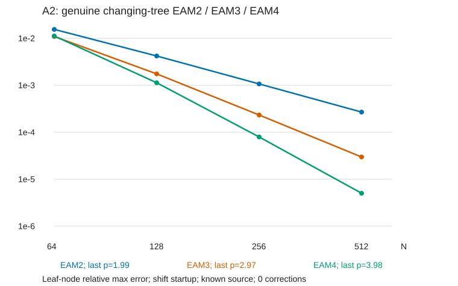

# 受迫热方程

## 1. 问题

这是 Rayleigh–Bénard 笔记里温度通道单独拿出来的模型问题：

$$
\theta_t=\Delta\theta+S,\qquad (x,z)\in\Omega=[0,1)\times[0,1],
$$

$$
\theta(x+1,z,t)=\theta(x,z,t),\qquad \theta(x,0,t)=\theta(x,1,t)=0,\qquad \theta(x,z,0)=\theta_0(x,z).
$$

源 $S$ 有两种情形：

- **已知外源** $S=f(x,z,t)$：任意时刻都能直接取样。
- **依赖解的源** $S=g(x,z,t)+F(\theta)$：例如 RB 中的对流项，取样必须先知道该时刻的 $\theta$。

本文只做一件事：像 ODE 线性多步法那样，只用历史源值构造全局三阶、四阶格式，不在步内增加新节点；给出推导、收敛证明和数值验证。现有二阶算法的完整算例（收敛、耗时、容差平台）和镜像法相对双周期的代价另写。

### 1.1 记号

全文只用两个算子，都带零 Dirichlet 壁条件和 $x$ 周期：

$$
K=\Delta^{-1},\qquad H=e^{h\Delta}.
$$

| 算子 | 含义 | 实现 |
| --- | --- | --- |
| $Kf$ | 解 $\Delta u=f$，$u$ 两壁为零 | `adapfmm8` |
| $Hf$ | 以 $f$ 为初值让 $y_t=\Delta y$ 扩散时间 $h$ | `boxfgt` |

两者都是 $\Delta$ 的函数，所以 $KH=HK$，$\Delta K=K\Delta=I$。按特征函数 $e^{2\pi ikx}\sin(l\pi z)$ 展开，特征值为

$$
\Delta\to-\lambda_{kl},\qquad \lambda_{kl}=4\pi^2k^2+\pi^2l^2\ge\pi^2,\qquad
K\to-\frac1{\lambda_{kl}},\qquad H\to e^{-\lambda_{kl}h}.
$$

$K$ 是负算子。程序里的 `op_K` 解的是 $-\Delta u=f$，即 `op_K` $=-K$。本文使用 $\Delta^{-1}$ 来避免公式里出现交替符号了。

## 2. 一步公式：源势

### 2.1 积分因子

在一步 $[t_n,t_n+h]$ 内记 $\tau=t-t_n$。方程两边左乘 $e^{-\tau\Delta}$：

$$
\frac{d}{d\tau}\left[e^{-\tau\Delta}\theta\right]=e^{-\tau\Delta}\left(\theta_\tau-\Delta\theta\right)=e^{-\tau\Delta}S .
$$

从 $0$ 积分到 $h$，再左乘 $e^{h\Delta}$：

$$
\theta_{n+1}=H\theta_n+\int_0^h e^{(h-\tau)\Delta}S(t_n+\tau)\,d\tau .
\tag{2.1}
$$

这是精确的 Duhamel 公式。所有格式的区别只在于怎样近似这个积分。

### 2.2 多项式源的精确积分

**为什么不直接做数值积分。** (2.1) 的积分核是 $e^{(h-\tau)\Delta}$，用求积公式算，每个求积点都要做一次 FGT，而 FGT 正是一步里最贵的算子。我们希望一步只用一次 $H$，其余都交给 $K$。

**思路：找一个特解把源消掉。** 设一步内源被一个 $m$ 次多项式 $p(\tau)$ 代替（系数是空间函数），$p^{(m+1)}=0$。方程 $\theta'=\Delta\theta+p$ 是线性的，如果能找到一个特解 $-P(\tau)$，即

$$
P'=\Delta P-p ,
\tag{2.2a}
$$

那么 $w=\theta+P$ 满足齐次方程 $w'=\Delta w$，一步只需一次 $H$。这和常微分方程 $y'=-\lambda y+c_0+c_1t$ 的做法一样：右端是多项式，就用待定系数法猜一个多项式特解。

**解 (2.2a)。** 两边作用 $K=\Delta^{-1}$，移项得

$$
P=Kp+KP' .
$$

右端还含 $P$ 本身，把这个式子对 $\tau$ 求导再代回去：$P'=Kp'+KP''$，所以

$$
P=Kp+K^2p'+K^2P''=Kp+K^2p'+K^3p''+K^3P'''=\cdots
$$

每代一次，$p$ 的导数阶升一，$K$ 的幂升一。因为 $p^{(m+1)}=0$，猜 $P$ 也是 $\tau$ 的 $m$ 次多项式，则 $P^{(m+1)}=0$，代 $m$ 次后余项消失，得到有限和。这样定义**源势**

$$
P(\tau)=Kp+K^2p'+K^3p''+\dots+K^{m+1}p^{(m)}=\sum_{j=0}^{m}K^{j+1}p^{(j)}(\tau).
$$

换一种写法看得更清楚。记 $D=d/d\tau$，(2.2a) 就是 $(\Delta-D)P=p$，形式上

$$
P=(\Delta-D)^{-1}p=K\,(I-KD)^{-1}p=K\big(I+KD+K^2D^2+\cdots\big)p .
$$

$D$ 作用在 $m$ 次多项式上 $m+1$ 次就是零，Neumann 级数自动截断，正好得到上面的有限和。这里 $K$ 与 $D$ 可交换，所以展开合法。

下面直接验证这个 $P$ 满足 (2.2a)。

**第一步：算 $\Delta P$ 和 $P'$。** 用 $\Delta K^{j+1}=K^j$：

$$
\Delta P=p+Kp'+K^2p''+\dots+K^mp^{(m)},
$$

$$
P'=Kp'+K^2p''+\dots+K^mp^{(m)}+K^{m+1}\underbrace{p^{(m+1)}}_{=0}.
$$

两式相减，除了第一项全部抵消：

$$
P'=\Delta P-p .
$$

**第二步：消去源。** 令 $w=\theta+P$，代入方程：

$$
w'=\theta'+P'=(\Delta\theta+p)+(\Delta P-p)=\Delta(\theta+P)=\Delta w .
$$

$w$ 满足齐次热方程。$P$ 是 $K$ 的值域里的元素，两壁为零，所以 $w$ 也两壁为零，可以交给 $H$：$w(h)=Hw(0)$，即

$$
\boxed{\theta_{n+1}=H\big(\theta_n+P(0)\big)-P(h).}
\tag{2.2}
$$

只要 $p$ 是多项式，(2.2) 就是 $S$ 换成 $p$ 后的 (2.1) 的**精确**值。

### 2.3 退回现有二阶格式

**$m=0$（常源）：** $P=KS_n$，

$$
\theta_{n+1}=H(\theta_n+KS_n)-KS_n .
$$

**$m=1$（端点线性插值）：** $p(\tau)=S_n+\frac{\tau}{h}(S_{n+1}-S_n)$，$p'=(S_{n+1}-S_n)/h$。

$$
P(0)=KS_n+q,\qquad P(h)=KS_{n+1}+q,\qquad q=K^2\frac{S_{n+1}-S_n}{h},
$$

$$
\theta_{n+1}=H(\theta_n+KS_n+q)-KS_{n+1}-q .
$$

现有算法就是 $m=1$ 的情形，每步 2 次 Poisson、1 次 FGT。

### 2.4 怎样算 $P$：两种实现

**Horner 链。** 把 $P$ 写成嵌套形式：

$$
P(s)=K\Big(p+K\big(p'+K(p''+Kp''')\big)\Big).
$$

$P(0)$ 和 $P(h)$ 各要一条链，但最内层 $p^{(m)}$ 是常数，两条链共用 $Kp^{(m)}$。每步 Poisson 次数为 $2m+1$。

**apply（缓存）。** 对每个新源值 $S_{n+1}$ 算并存下 $KS_{n+1},K^2S_{n+1},\dots,K^{m+1}S_{n+1}$，旧节点的链直接复用。$P$ 是这些缓存的线性组合。每步 Poisson 次数为 $m+1$。

| 格式 | Horner / wide | apply | FGT |
| --- | --- | --- | --- |
| 二阶 $m=1$ | 3 | 2 | 1 |
| 三阶 $m=2$ | 5 | 3 | 1 |
| 四阶 $m=3$ | 7 | 4 | 1 |

apply 调用少，但要存 $(m+1)^2$ 个缓存场，而且树一重建，缓存就要转移或重算（第 5.2 节）。在精确算术和固定线性算子下两者相等；差别在舍入，第 5.3 节详细讨论。

## 3. 用历史源值构造三阶、四阶

### 3.1 插值多项式的导数

取归一化时间 $s=\tau/h$，节点 $s_q$ 对应时刻 $t_n+s_qh$ 的源值 $S_q$，Lagrange 基为 $\ell_q(s)$：

$$
p(\tau)=\sum_q\ell_q(s)S_q,\qquad p^{(j)}(\tau)=h^{-j}\sum_q\ell_q^{(j)}(s)S_q .
$$

代入 (2.2) 只需要两端 $s=0,1$ 的各阶导数。节点有两种取法，对应 ODE 的 Adams–Moulton 和 Adams–Bashforth：

| 格式 | 节点 $s_q$ | 用到的源值 |
| --- | --- | --- |
| EAM$(m+1)$ | $1,0,-1,\dots,1-m$ | $S_{n+1},S_n,\dots,S_{n+1-m}$ |
| EAB$(m+1)$ | $0,-1,\dots,-m$ | $S_n,S_{n-1},\dots,S_{n-m}$ |

### 3.2 EAM3、EAM4 的显式公式

用以 $t_{n+1}$ 为基点的后向差分 $\nabla S_{n+1}=S_{n+1}-S_n$、$\nabla^2S_{n+1}=S_{n+1}-2S_n+S_{n-1}$、$\nabla^3S_{n+1}=S_{n+1}-3S_n+3S_{n-1}-S_{n-2}$，令 $u=s-1$，Newton 后向插值为

$$
p=S_{n+1}+u\nabla+\frac{u(u+1)}2\nabla^2+\frac{u(u+1)(u+2)}6\nabla^3 .
$$

逐次对 $u$ 求导（$\tfrac{d}{d\tau}=h^{-1}\tfrac{d}{du}$）：

$$
hp'=\nabla+\frac{2u+1}{2}\nabla^2+\frac{3u^2+6u+2}{6}\nabla^3,\qquad
h^2p''=\nabla^2+(u+1)\nabla^3,\qquad
h^3p'''=\nabla^3 .
$$

$\tau=h$ 对应 $u=0$，$\tau=0$ 对应 $u=-1$。代入后展开成节点值：

| 量 | $u=-1$（$\tau=0$） | $u=0$（$\tau=h$） |
| --- | --- | --- |
| $p$ | $S_n$ | $S_{n+1}$ |
| $hp'$ | $\nabla-\tfrac12\nabla^2-\tfrac16\nabla^3=\tfrac16(2S_{n+1}+3S_n-6S_{n-1}+S_{n-2})$ | $\nabla+\tfrac12\nabla^2+\tfrac13\nabla^3=\tfrac16(11S_{n+1}-18S_n+9S_{n-1}-2S_{n-2})$ |
| $h^2p''$ | $\nabla^2$ | $\nabla^2+\nabla^3=2S_{n+1}-5S_n+4S_{n-1}-S_{n-2}$ |
| $h^3p'''$ | $\nabla^3$ | $\nabla^3$ |

于是 **EAM4**：

$$
\begin{aligned}
P(0)&=KS_n+\frac{K^2}{6h}\left(2S_{n+1}+3S_n-6S_{n-1}+S_{n-2}\right)+\frac{K^3}{h^2}\nabla^2S_{n+1}+\frac{K^4}{h^3}\nabla^3S_{n+1},\\
P(h)&=KS_{n+1}+\frac{K^2}{6h}\left(11S_{n+1}-18S_n+9S_{n-1}-2S_{n-2}\right)+\frac{K^3}{h^2}\left(2S_{n+1}-5S_n+4S_{n-1}-S_{n-2}\right)+\frac{K^4}{h^3}\nabla^3S_{n+1}.
\end{aligned}
$$

**EAM3** 去掉 $\nabla^3$ 项，用 $S_{n+1},S_n,S_{n-1}$：

$$
\begin{aligned}
P(0)&=KS_n+\frac{K^2}{2h}\left(S_{n+1}-S_{n-1}\right)+\frac{K^3}{h^2}\nabla^2S_{n+1},\\
P(h)&=KS_{n+1}+\frac{K^2}{2h}\left(3S_{n+1}-4S_n+S_{n-1}\right)+\frac{K^3}{h^2}\nabla^2S_{n+1}.
\end{aligned}
$$

### 3.3 EAB3 的显式公式

节点 $S_n,S_{n-1},S_{n-2}$，以 $t_n$ 为基点：$\nabla S_n=S_n-S_{n-1}$，$\nabla^2S_n=S_n-2S_{n-1}+S_{n-2}$，$u=s$，

$$
p=S_n+u\nabla+\frac{u(u+1)}2\nabla^2,\qquad hp'=\nabla+\frac{2u+1}{2}\nabla^2,\qquad h^2p''=\nabla^2 .
$$

在 $u=0$ 和 $u=1$ 取值：

$$
\begin{aligned}
P(0)&=KS_n+\frac{K^2}{2h}\left(3S_n-4S_{n-1}+S_{n-2}\right)+\frac{K^3}{h^2}\nabla^2S_n,\\
P(h)&=K\left(3S_n-3S_{n-1}+S_{n-2}\right)+\frac{K^2}{2h}\left(5S_n-8S_{n-1}+3S_{n-2}\right)+\frac{K^3}{h^2}\nabla^2S_n .
\end{aligned}
$$

### 3.4 依赖解的源：预测–校正

EAM 要用 $S_{n+1}=g(t_{n+1})+F(\theta_{n+1})$，而 $\theta_{n+1}$ 正是要求的量，所以 EAM 是隐式的。程序用固定次数的预测–校正：

1. **预测**：用同阶 EAB（只用旧源值）算出候选 $\theta_{n+1}^{(0)}$。
2. **校正**：$S_{n+1}^{(0)}=g_{n+1}+F(\theta_{n+1}^{(0)})$，代入 EAM 得 $\theta_{n+1}^{(1)}$。可以重复 $k$ 次。
3. 用最终 $\theta_{n+1}$ 重新算 $S_{n+1}$ 存入历史。

每次校正多 1 次 FGT 和一整条 Poisson 链。已知外源不需要这一步：$S_{n+1}$ 直接取样，EAM 是显式的。

### 3.5 EAM 与 EAB

| | EAM$(m+1)$ | EAB$(m+1)$ |
| --- | --- | --- |
| 步内源近似 | 插值（含 $t_{n+1}$） | 外推 |
| 局部误差常数（三阶/四阶） | $1/24$，$19/720$ | $3/8$，$251/720$ |
| 依赖解的源每步代价 | 预测 + $k$ 次校正：$(1+k)$ 倍 | 1 倍，完全显式 |
| $t_n$ 之前需要的历史值 | $m-1$ 个 | $m$ 个 |
| 强反应项的稳定性 | 隐式求解时区域比 EAB 大，但不是无条件稳定 | 区域较小 |

误差常数之比：三阶 $\tfrac{3/8}{1/24}=9$，四阶 $\tfrac{251/720}{19/720}\approx13.2$。

- **已知外源**：两者每步代价相同，EAM 误差小一个数量级，**用 EAM**。
- **依赖解的源**：EAM 一次校正每步代价是 EAB 的 2 倍。要达到 EAM 的误差，EAB 步长需缩小 $9^{1/3}\approx2.1$（三阶）或 $13.2^{1/4}\approx1.9$（四阶）倍，两者总代价基本相同，实测也是如此。

### 3.6 启动

$m+1$ 阶格式开头缺少 $t<0$ 的历史源值。

**shift 启动（已知外源）。** 遇到负下标时改用节点 $t_0,\dots,t_m$，即前几步都用同一个前向插值多项式（它在 $[t_0,t_m]$ 上用的正是未来源值，已知外源可以直接取样）。每个启动步的局部误差仍是 $O(h^{m+2})$。EAM4 前三个区间的常数为 $19/720$、$11/720$、$19/720$，不比正常步大。

**Picard 块启动（一般情形）。** 在 $[0,mh]$ 上取阶段 $U_j\approx\theta(jh)$，$j=0,\dots,m$，初猜 $U_j^{(0)}=\theta_0$，迭代

$$
U_j^{(r+1)}=e^{jh\Delta}\theta_0+\int_0^{jh}e^{(jh-\tau)\Delta}\sum_{l=0}^{m}\ell_l(\tau/h)\left[g(lh)+F(U_l^{(r)})\right]d\tau ,
$$

积分同样用源势 (2.2) 精确计算（传播时间改为 $jh$）。迭代 $m+1$ 轮后统一刷新历史，从 $t_m$ 开始正常推进。只用给定初值，不用解析解。

## 4. 收敛证明

有如下假设：

1. 在 $L^\infty$ 中，$\lVert e^{t\Delta}\rVert\le1$；在 $L^2$ 中，$\lVert e^{t\Delta}\rVert\le e^{-\pi^2t}$ 
   
2. $K$、$H$ 精确，没有空间离散和舍入

3. $S\in C^{m+1}([0,T];X)$，$M=\sup_t\lVert S^{(m+1)}(t)\rVert$

4. 依赖解的源：$\lVert F(u)-F(v)\rVert\le L\lVert u-v\rVert$

**$L^2$ 中。** 把 $y(0)$ 按特征函数展开：$y(0)=\sum_{k,l}c_{kl}\phi_{kl}$，$\phi_{kl}=e^{2\pi ikx}\sin(l\pi z)$，它们在 $L^2$ 中正交。热方程逐模态解为 $c_{kl}(t)=e^{-\lambda_{kl}t}c_{kl}$，由 Parseval 等式，

$$
\lVert e^{t\Delta}y(0)\rVert_{L^2}^2=\sum_{k,l}e^{-2\lambda_{kl}t}\lvert c_{kl}\rvert^2\lVert\phi_{kl}\rVert^2\le e^{-2\pi^2t}\sum_{k,l}\lvert c_{kl}\rvert^2\lVert\phi_{kl}\rVert^2=e^{-2\pi^2t}\lVert y(0)\rVert_{L^2}^2 .
$$

这里用了 $\lambda_{kl}\ge\lambda_{01}=\pi^2$。

**$L^\infty$ 中。** 由最大值原理：在 $\Omega\times(0,t]$ 上，$y_t=\Delta y$ 的解的最大值和最小值只能在 $t=0$ 或壁面上取得；$x$ 方向周期没有边界，壁上 $y=0$。所以 $\lvert y(\cdot,t)\rvert\le\max\lvert y(\cdot,0)\rvert$。

### 4.1 局部误差

把格式看成一个映射：输入 $\theta_n$ 和历史源值 $\{S_q\}$，输出 $\theta_{n+1}$。由第 2.2 节，格式算出的正是

$$
\theta_{n+1}=H\theta_n+\int_0^he^{(h-\tau)\Delta}p(\tau)\,d\tau ,
$$

其中 $p$ 是 $\{S_q\}$ 的插值多项式。现在把**精确值** $\theta(t_n)$ 和**精确源值** $S(t_q)$ 作为输入，与精确解的 Duhamel 公式 (2.1) 相减，$H\theta(t_n)$ 抵消：

$$
d_n:=\theta(t_{n+1})-\Big[H\theta(t_n)+\int_0^he^{(h-\tau)\Delta}p(\tau)\,d\tau\Big]
=\int_0^he^{(h-\tau)\Delta}\big(S(t_n+\tau)-p(\tau)\big)\,d\tau .
$$

设 $f(\sigma)$ 是 $C^{m+1}$ 的实函数，$\pi(\sigma)$ 是它在 $m+1$ 个不同节点 $s_0,\dots,s_m$ 上的插值多项式，$\omega(\sigma)=\prod_q(\sigma-s_q)$。固定一个非节点的 $s$，取常数 $c$ 使辅助函数

$$
g(\sigma)=f(\sigma)-\pi(\sigma)-c\,\omega(\sigma)
$$

在 $\sigma=s$ 处为零。$g$ 在 $m+1$ 个节点上也为零（$f=\pi$、$\omega=0$），共 $m+2$ 个零点。由 Rolle 定理，$g'$ 至少有 $m+1$ 个零点，……，$g^{(m+1)}$ 至少有一个零点 $\xi$。$\pi$ 是 $m$ 次多项式，$\pi^{(m+1)}=0$；$\omega$ 首项为 $\sigma^{m+1}$，$\omega^{(m+1)}=(m+1)!$。所以

$$
0=g^{(m+1)}(\xi)=f^{(m+1)}(\xi)-c\,(m+1)!\quad\Longrightarrow\quad
f(s)-\pi(s)=c\,\omega(s)=\frac{f^{(m+1)}(\xi)}{(m+1)!}\,\omega(s).
$$

对任一有界线性泛函 $\varphi$（$\lVert\varphi\rVert\le1$），令 $f(\sigma)=\varphi\big(S(t_n+h\sigma)\big)$，它是实函数。

- 链式法则：$f^{(m+1)}(\sigma)=h^{m+1}\varphi\big(S^{(m+1)}(t_n+h\sigma)\big)$，所以 $\lvert f^{(m+1)}\rvert\le h^{m+1}M$。
- 插值是线性的：$f$ 的插值多项式就是 $\varphi(p)$。

代入，

$$
\big\lvert\varphi\big(S(t_n+hs)-p(hs)\big)\big\rvert\le\frac{h^{m+1}M}{(m+1)!}\,\lvert\omega(s)\rvert .
$$

由 Hahn–Banach 定理，$\lVert v\rVert=\sup_{\lVert\varphi\rVert\le1}\lvert\varphi(v)\rvert$，对 $\varphi$ 取上确界：

$$
\lVert S(t_n+hs)-p(hs)\rVert\le\frac{h^{m+1}M}{(m+1)!}\,\lvert\omega(s)\rvert .
\tag{4.1}
$$

换元 $\tau=hs$、$d\tau=h\,ds$，代入 (4.1)：

$$
\lVert d_n\rVert\le\int_0^h\lVert S(t_n+\tau)-p(\tau)\rVert\,d\tau
=h\int_0^1\lVert S(t_n+hs)-p(hs)\rVert\,ds
\le\frac{h^{m+2}M}{(m+1)!}\int_0^1\lvert\omega(s)\rvert\,ds .
$$

记

$$
\boxed{\lVert d_n\rVert\le C\,M\,h^{m+2},\qquad C=\frac{1}{(m+1)!}\int_0^1\lvert\omega(s)\rvert\,ds .}
$$

| 格式 |$C$ |
| --- | --- |
| EAM2 |$\tfrac1{12}$ |
| EAM3 |$\tfrac1{24}$ |
| EAM4 |$\tfrac{19}{720}$ |
| EAB2 |$\tfrac5{12}$ |
| EAB3 |$\tfrac38$ |
| EAB4 |$\tfrac{251}{720}$ |

### 4.2 全局误差：已知外源

已知外源时，$p$ 用的是精确源值 $S(t_q)$，与 $\theta_n$ 无关。记 $I_n=\int_0^he^{(h-\tau)\Delta}p(\tau)\,d\tau$，数值解和精确解分别满足

$$
\theta_{n+1}=H\theta_n+I_n,\qquad
\theta(t_{n+1})=H\theta(t_n)+I_n+d_n .
$$

相减，记 $e_n=\theta(t_n)-\theta_n$，得 $e_{n+1}=He_n+d_n$。逐步展开：

$$
e_N=H^Ne_0+\sum_{n=0}^{N-1}H^{N-1-n}d_n .
$$

由假设 1，$\lVert H^k\rVert\le1$；再用 $\lVert d_n\rVert\le CMh^{m+2}$ 和 $Nh=T$：

$$
\lVert e_N\rVert\le\lVert e_0\rVert+N\,CMh^{m+2}=\lVert e_0\rVert+C\,M\,T\,h^{m+1}.
$$

在 $L^2$ 中还可以用 $\lVert H^k\rVert\le e^{-\pi^2kh}$，求和是几何级数，$\sum_{k\ge0}e^{-\pi^2kh}=1/(1-e^{-\pi^2h})$。由 $e^x\ge1+x$ 得 $1-e^{-x}\ge\frac{x}{1+x}$，于是

$$
\lVert e_N\rVert_{L^2}\le e^{-\pi^2T}\lVert e_0\rVert+\frac{CM}{\pi^2}\,h^{m+1}(1+\pi^2h).
$$

右端与 $T$ 无关，误差不随积分时间累积，这是耗散性带来的。

shift 启动时 $e_0=0$。前 $m-1$ 步的插值节点换成 $0,1,\dots,m$，第 $m$ 步的正常 EAM 节点恰好也是 $0,\dots,m$，所以前 $m$ 个区间用同一个多项式，仍满足 $e_{n+1}=He_n+d_n$，只是第 $n$ 个区间的常数换成

$$
C_n=\frac1{(m+1)!}\int_n^{n+1}\Big\lvert\prod_{q=0}^{m}(\sigma-q)\Big\rvert\,d\sigma .
$$

二阶 $\tfrac1{12}$；三阶 $\tfrac1{24},\tfrac1{24}$；四阶 $\tfrac{19}{720},\tfrac{11}{720},\tfrac{19}{720}$。以四阶中间区间为例，令 $u=\sigma-\tfrac32$，

$$
\prod_{q=0}^3(\sigma-q)=\left(u^2-\tfrac94\right)\left(u^2-\tfrac14\right),
\qquad
\int_{-1/2}^{1/2}\Big(u^4-\tfrac52u^2+\tfrac9{16}\Big)du=\tfrac{11}{30},
$$

除以 $4!$ 得 $\tfrac{11}{720}$。这些常数都不超过正常步的常数，上面的界直接成立。

$$
\boxed{\lVert\theta(T)-\theta_N\rVert\le C\,M\,T\,h^{m+1}.}
$$

### 4.3 依赖解的源

现在 $S_j=g(t_j)+F(\theta_j)$ 用的是数值解，误差会通过源反馈回来。

(2.2) 对 $p$ 是线性的，$p=\sum_q\ell_q(\tau/h)S_q$，所以

$$
\int_0^he^{(h-\tau)\Delta}p(\tau)\,d\tau=\sum_qW_qS_q,\qquad W_q=\int_0^he^{(h-\tau)\Delta}\ell_q(\tau/h)\,d\tau .
$$

由假设 1，

$$
\lVert W_q\rVert\le h\beta_q,\qquad\beta_q=\int_0^1\lvert\ell_q(s)\rvert\,ds .
$$

$\ell_q$ 在 $[0,1]$ 上不变号，$\beta_q$ 就是经典 Adams 系数的绝对值：

| 格式 | $\beta_q$ | $B=\sum_q\beta_q$ |
| --- | --- | --- |
| EAB2 | $\tfrac32,\tfrac12$ | $2$ |
| EAB3 | $\tfrac{23}{12},\tfrac{16}{12},\tfrac5{12}$ | $\tfrac{11}3$ |
| EAB4 | $\tfrac{55}{24},\tfrac{59}{24},\tfrac{37}{24},\tfrac9{24}$ | $\tfrac{20}3$ |
| EAM2 | $\tfrac12,\tfrac12$ | $1$ |
| EAM3 | $\tfrac5{12},\tfrac8{12},\tfrac1{12}$ | $\tfrac76$ |
| EAM4 | $\tfrac9{24},\tfrac{19}{24},\tfrac5{24},\tfrac1{24}$ | $\tfrac{17}{12}$ |

EAM 各行第一个数是新节点 $S_{n+1}$ 的权，记为 $\beta_{\rm top}$。

**EAB。** 数值解与精确解相减，$g$ 项抵消：

$$
e_{n+1}=He_n+\sum_{q=0}^{m}W_q\big[F(\theta(t_{n-q}))-F(\theta_{n-q})\big]+d_n .
$$

由假设 1、4，

$$
\lVert e_{n+1}\rVert\le\lVert e_n\rVert+hL\sum_{q=0}^{m}\beta_q\lVert e_{n-q}\rVert+\lVert d_n\rVert .
$$

令 $E_n=\max_{j\le n}\lVert e_j\rVert$，$\delta=\max_n\lVert d_n\rVert\le CMh^{m+2}$。右端每个 $\lVert e_{n-q}\rVert\le E_n$，所以

$$
E_{n+1}\le(1+hLB)E_n+\delta .
$$

从启动结束的 $n_0$ 起归纳，并用 $(1+hLB)^k\le e^{LBkh}$：

$$
E_n\le(1+hLB)^{n-n_0}\big(E_{n_0}+(n-n_0)\delta\big)
\quad\Longrightarrow\quad
\boxed{E_N\le e^{LBT}\big(E_{n_0}+CMT\,h^{m+1}\big).}
$$

只要启动误差 $E_{n_0}=O(h^{m+1})$，全局就是 $m+1$ 阶。界中没有 $\Delta$ 的特征值，对 $h$ 也没有上限要求；代价是常数 $e^{LBT}$ 随 $LT$ 指数增长，并且 $M$ 要求精确解在时间上足够光滑。

**EAM 预测–校正。** 一次校正：

$$
\theta^{(0)}_{n+1}=H\theta_n+\sum_qW^{\rm P}_qS_{n-q},\qquad
\theta_{n+1}=H\theta_n+W_{\rm top}\big[g_{n+1}+F(\theta^{(0)}_{n+1})\big]+\sum_{q\ne\rm top}W_qS_{n+1-q}.
$$

$W^{\rm P}_q$ 是预测器的权，常数 $B_{\rm P}$；$B_-=B-\beta_{\rm top}$。预测值误差与 EAB 相同：

$$
\lVert e^{(0)}_{n+1}\rVert\le(1+hLB_{\rm P})E_n+\lVert d^{\rm P}_n\rVert .
$$

校正后新节点的源误差来自 $e^{(0)}_{n+1}$，代入上式：

$$
\lVert e_{n+1}\rVert\le E_n+hL\beta_{\rm top}\lVert e^{(0)}_{n+1}\rVert+hLB_-E_n+\lVert d_n\rVert
\le\big(1+hLB'\big)E_n+\lVert d_n\rVert+hL\beta_{\rm top}\lVert d^{\rm P}_n\rVert ,
$$

其中 $B'=B_-+\beta_{\rm top}(1+hLB_{\rm P})$，$hL\le1$ 时与 $h$ 无关，Gronwall 照搬。预测器为 $p'+1$ 阶时 $\lVert d^{\rm P}_n\rVert=O(h^{p'+2})$，最后一项是 $O(h^{p'+3})$。保持 $m+1$ 阶需要 $p'\ge m-1$，即**预测器低一阶就够**，多出的 $h$ 来自 $\lVert W_{\rm top}\rVert\le h\beta_{\rm top}$。校正 $k$ 次时，每多一次，预测误差的贡献再乘一个 $hL\beta_{\rm top}$。

### 4.4 Picard 启动的误差

精确解满足

$$
\theta(jh)=e^{jh\Delta}\theta_0+\int_0^{jh}e^{(jh-\tau)\Delta}S(\tau)\,d\tau,\qquad S=g+F(\theta).
$$

Picard 迭代（第 3.6 节）把 $S$ 换成用 $U^{(r)}_l$ 算出的源值在节点 $0,\dots,m$ 上的插值。记 $\hat p$ 为精确源值 $S(lh)$ 的插值，加一项减一项：

$$
U^{(r+1)}_j-\theta(jh)=\underbrace{\int_0^{jh}e^{(jh-\tau)\Delta}\sum_{l}\ell_l(\tau/h)\big[F(U^{(r)}_l)-F(\theta(lh))\big]d\tau}_{\text{迭代误差}}
-\underbrace{\int_0^{jh}e^{(jh-\tau)\Delta}\big(S-\hat p\big)d\tau}_{\text{插值误差}} .
$$

由假设 1、4，迭代误差不超过 $aE_r$，

$$
a=hL\max_{1\le j\le m}\int_0^j\sum_l\lvert\ell_l(\sigma)\rvert\,d\sigma ,
$$

$a/(hL)$ 在二、三、四阶分别为 $1,\tfrac73,4$。插值误差同第 4.1 节，积分区间换成 $[0,j]$，不超过 $C_{\rm P}h^{m+2}$。记 $E_r=\max_j\lVert U^{(r)}_j-\theta(jh)\rVert$，

$$
E_{r+1}\le aE_r+C_{\rm P}h^{m+2}
\quad\Longrightarrow\quad
E_r\le a^rE_0+\frac{C_{\rm P}h^{m+2}}{1-a}\qquad(a<1).
$$

初猜 $U^{(0)}_j=\theta_0$，$E_0\le mh\sup\lVert\theta_t\rVert=O(h)$（非零初值需要 $\theta_t$ 在 $t=0$ 附近有界）。$a=O(h)$，迭代 $m+1$ 轮后 $a^{m+1}E_0=O(h^{m+2})$，满足第 4.3 节对启动误差的要求。已知外源时 $a=0$，一轮即可，与 shift 启动一致。

### 4.5 证明没有覆盖的部分

**算子误差。** 去掉假设 2，每步多一个误差 $\eta_n$（FMM、FGT、树转移、舍入），$e_{n+1}=He_n+d_n+\eta_n$。按第 4.2 节的几何级数，最坏情形下额外误差为

$$
\max_n\lVert\eta_n\rVert\cdot\frac{1+\pi^2h}{\pi^2h},
$$

会随 $1/h$ 增长。但如果误差来自固定的线性 FMM，设源势算成 $P+\eta_n(\tau)$，则

$$
\tilde e_{n+1}=H\tilde e_n-(I-H)\eta_n(0)-\big[\eta_n(h)-\eta_n(0)\big].
$$

对第一项做 Abel 求和：

$$
\sum_{n=0}^{N-1}H^{N-1-n}(I-H)\eta_n(0)
=\eta_{N-1}(0)-H^N\eta_0(0)+\sum_{j=1}^{N-1}H^j\big[\eta_{N-1-j}(0)-\eta_{N-j}(0)\big].
$$

若 $\lVert\eta_n\rVert\le\varepsilon$，且 $\eta_n$ 在 $n$ 和 $\tau$ 上的变化都是 $c\,h\varepsilon$，则 $\lVert\tilde e_N\rVert\le(2+2cT)\varepsilon$，与 $h$ 无关。这解释了实测中误差降到容差附近后出现的平坦平台。

**刚性反应项。** 取 $F(\theta)=c\theta$，$c<0$ 很大。$\lambda h\to0$ 时 EAM 退化为 Adams–Moulton。记 $z=hc$，AM3 和 AM4 的特征多项式为

$$
P_3(r)=\Big(1-\frac{5z}{12}\Big)r^2-\Big(1+\frac{8z}{12}\Big)r+\frac z{12},
\qquad
P_4(r)=\Big(1-\frac{9z}{24}\Big)r^3-\Big(1+\frac{19z}{24}\Big)r^2+\frac{5z}{24}r-\frac z{24}.
$$

$z=-100$ 时分别有实根 $r\approx-1.66$ 和 $r\approx-2.29$，模大于 1。所以高阶 EAM 对强负反应项不是无条件稳定的；第 4.3 节的界在 $hL$ 有界时成立，$hL$ 很大时 $e^{LBT}$ 没有实际意义。

**初始层。** 若 $\theta_0$ 与源在壁上不相容，近壁出现宽度约 $\sqrt t$ 的边界层，$\lVert\partial_t^2\theta\rVert_\infty\sim t^{-1}$，假设 3 的 $M$ 不存在，可能阶降。本笔记的算例在 $t=0$ 都相容。

## 5. 在自适应树上实现

### 5.1 叶盒与自适应树

所有场存在物理四叉树叶盒的 $8\times8$ Chebyshev 节点上（与 FMM `getxyclassical8`、boxfgt `ipoly=1` 的节点一致）。一个盒的 Chebyshev 系数中，总次数 $\ge6$ 的尾部系数绝对值之和（除以源或 $\theta$ 的最大值）超过 `tol` 时细分；建树后做 2:1 平衡（$x$ 方向周期）。

真实变树时每步重建：新树按当前 $\theta$ 和需要的源时刻建立，再把 $\theta$ 和全部历史源 $S_q$（apply 时还有缓存 $K^jS_q$）放到新树上。

$K$、$H$ 的壁条件用镜像法实现：把场在 $z$ 方向奇延拓成周期函数，周期 FMM/FGT 的结果自动在两壁为零。缩放和代价见另一篇笔记，这里只用到 $K$、$H$ 本身。

### 5.2 历史源的转移

多步格式比单步格式多一个问题：树变化时，历史源 $S_q$ 要在新树上表示。

- **已知外源**：直接在新树节点上对 $S(t_q)$ 重新取样，并重算缓存 $K^jS_q$。这样每个 $S_q$ 都是真实 $S$ 在同一棵树上的同一个线性映射。
- **依赖解的源**：过去的 $S_q$ 依赖过去的 $\theta_q$，不能用当前 $\theta$ 重算，只能插值转移。程序在这种情况下禁用重采样。

只转移不重算时，缓存势与新树算子不一致：$K^1$ 缓存在新树上的缺陷可达 $5.8\times10^{-9}$。$P$ 里有 $h^{-j}$ 系数，小步长下这种缺陷会被放大，所以已知外源的主线一律重采样。

### 5.3 小步长下的舍入：为什么需要 wide

四阶格式的 $K^4h^{-3}\nabla^3S$ 项是四个相近源值的带符号组合再乘 $h^{-3}$。双精度下先乘 $h^{-3}$ 再逐项累加，舍入误差 $\sim u\,h^{-3}$，$h$ 越小越大。用标量问题 $a'=-\lambda a+\sin(20t)$（$\lambda=5\pi^2$，精确的 $K$、$H$）验证：

| N | 原双精度组合 | 组合提升精度 | 70 位参考 |
| --- | --- | --- | --- |
| 512 | 4.73e-10 | 6.15e-12 | 6.15e-12 |
| 1024 | 3.75e-9 | 3.85e-13 | 3.84e-13 |
| 4096 | 2.43e-7 | 1.84e-15 | 1.50e-15 |

即使 $K$、$H$ 精确，原写法也出现反升；只把源值的组合提升到 `real128`，误差就回到四阶曲线上。树上的 `impl=wide` 照此实现：Lagrange 导数系数、$h^{-j}$ 缩放和每个节点的加权累加都用 `real128`，送入 FMM 前转回双精度；FMM、FGT 和状态仍是双精度，算子调用次数与 Horner 相同。完整步代价增加约 8%（A1，lev3，N64：84.95 ms → 91.72 ms）。

## 6. 数值验证

### 6.1 算例

| 名称 | 源 | 精确解/参考 | 用途 |
| --- | --- | --- | --- |
| A1 | $\sin(20t)\sin(2\pi x)\sin(\pi z)$ | 解析 | 固定树、小步长 |
| A2 | 两个移动高斯 $e^{-r^2/0.0025}$（$z$ 奇镜像、$x$ 周期），中心以半径 0.25、角频率 $20\pi$ 和 $40\pi$ 转动 | 正弦–Fourier 谱参考 | 真实变树主算例 |
| A3 | $g+20\theta$ | A1 的解 | 线性反应 |
| A3N | $g+\theta^2$ | A1 的解 | 非线性反应 |
| A1NZ | A1 的源，$\theta_0=0.1\sin(2\pi x)\sin(\pi z)$ | 解析 | 非零初值 |

除特别说明，$T=0.1$，误差为叶节点上的相对最大误差，FMM `iprec=4`（$10^{-12}$）、FGT `eps=1e-12`。全部运行单线程、单逻辑核。

**误差分离。** A2 没有解析解，另写了一个**相同时间离散**的谱解：同样的节点、同样的 shift 启动，逐个 Fourier–正弦模态用稳定的 $\varphi$ 权重精确推进，不经过树、FMM 或 FGT。于是

- 树解 − 离散谱解 = 空间、算子、转移和舍入误差；
- 离散谱解 − 连续谱参考 = 纯时间误差。

两者都在 $32\times33$ 公共网格上比较，按解的最大值归一。

### 6.2 已知外源：真实变树收敛

A2，tol=1e-4，maxlev=5，每步重建，历史源重采样，shift 启动，EAM。

| N | EAM2 | EAM3 | EAM4 |
| --- | --- | --- | --- |
| 64 | 1.541e-2 | 1.088e-2 | 1.116e-2 |
| 128 | 4.186e-3（1.88） | 1.740e-3（2.64） | 1.126e-3（3.31） |
| 256 | 1.063e-3（1.98） | 2.318e-4（2.91） | 7.900e-5（3.83） |
| 512 | 2.674e-4（1.99） | 2.958e-5（2.97） | 5.000e-6（3.98） |

粗端源的移动还没被步长分辨，细端达到理论阶。树随 $h$ 变化（N512 平均 221 叶），不是固定空间离散下的纯时间实验。N512 的误差分解：

| | 时间误差 | 空间/算子/转移/舍入 |
| --- | --- | --- |
| EAM2 | 2.31e-4 | 3.58e-8 |
| EAM3 | 2.47e-5 | 3.81e-8 |
| EAM4 | 3.60e-6 | 8.46e-8 |

空间部分比时间部分小 42 倍（四阶）到 6400 倍（二阶），细端阶数确实来自时间离散。同一组参数在固定 lev5（1024 叶）上，EAM4 N512 的误差为 4.9975e-6，与自适应的 4.9999e-6 一致。

### 6.3 已知外源：固定树小步长

A1，lev3，EAM4。

| N | 128 | 256 | 512 | 1024 |
| --- | --- | --- | --- | --- |
| 原 Horner | 1.57e-9 | 1.51e-10 | 6.29e-10 | 4.82e-9 |
| wide | 1.56e-9 | 9.24e-11 | 7.59e-12 | 7.54e-12 |

Horner 在 N256 之后反升（第 5.3 节的舍入）；wide 一直降到约 7.5e-12 的平台。这个平台是 FMM、FGT 和空间表示的综合残差，没有进一步拆分。

### 6.4 依赖解的源与非零初值

固定 lev3，Picard 启动，一次校正。

| N | 16 | 32 | 64 | 128 | 256 |
| --- | --- | --- | --- | --- | --- |
| A3N，EAM2 | 1.30e-3 | 3.26e-4 | 8.14e-5 | | |
| A3N，EAM3 | 6.34e-7 | 3.05e-7 | 5.17e-8 | 7.28e-9 | 9.51e-10 |
| A3N，EAM4 | 6.53e-6 | 4.06e-7 | 2.53e-8 | | |
| A3，EAM4 | 3.37e-6 | 4.09e-7 | 3.19e-8 | 2.18e-9 | |

EAM2 阶约 2.00，EAM4 阶约 4.01；EAM3 粗端只有 1.05、2.56，细端 2.83、2.94，趋近三阶。

**非零初值（A1NZ，lev3，EAM4）。** N16/32/64 误差 6.29e-6、3.91e-7、2.43e-8，阶 4.01。N32 改用 Picard 启动，误差 3.91e-7，与 shift 相同。

### 6.5 EAM 与 EAB 的实测比较

以下取自同一批旧运行（Horner，exact 启动；精度有效，计时无效），Poisson/FGT 次数是程序计数。

**已知外源（A2，固定 lev5，N512）：**

| | 误差 | EAB/EAM | 理论比 |
| --- | --- | --- | --- |
| EAM3 / EAB3 | 2.96e-5 / 2.91e-4 | 9.8 | 9 |
| EAM4 / EAB4 | 5.00e-6 / 7.43e-5 | 14.9 | 13.2 |

每步代价相同（三阶都是 5K+1H，四阶都是 7K+1H），EAM 直接胜出。

**依赖解的源（A3，线性反应，固定 lev3）：** 让 EAB 用两倍步数，与 EAM 一次校正比较。

| | N | 误差 | K / H 调用 |
| --- | --- | --- | --- |
| EAM3-PC | 128 | 2.82e-8 | 1260 / 252 |
| EAB3 | 256 | 3.53e-8 | 1270 / 254 |
| EAM4-PC | 128 | 2.19e-9 | 1750 / 250 |
| EAB4 | 256 | 2.44e-9 | 1771 / 253 |

调用次数和误差都几乎相同，与第 3.5 节的估计一致。