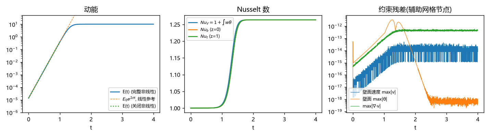
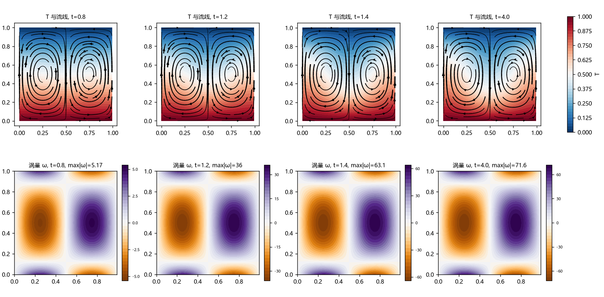
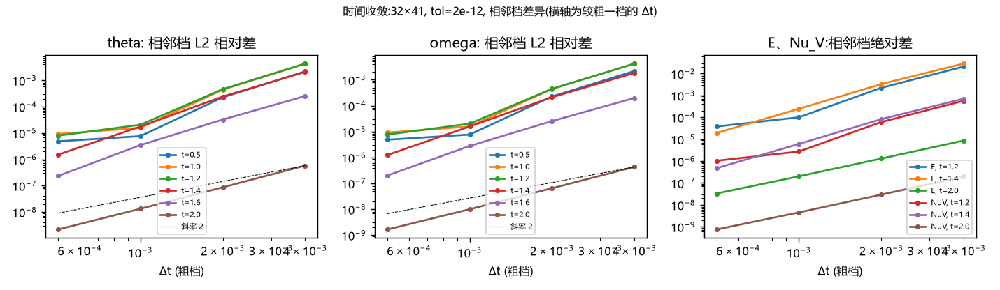
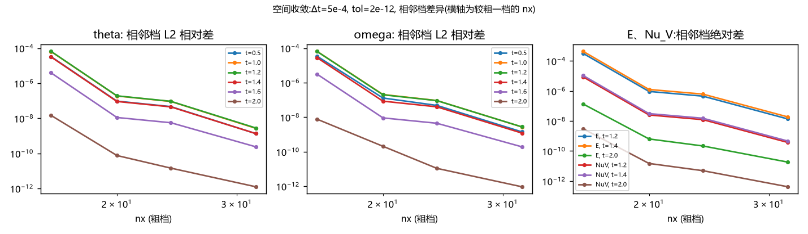
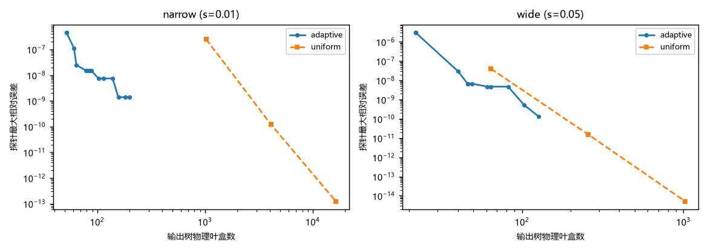
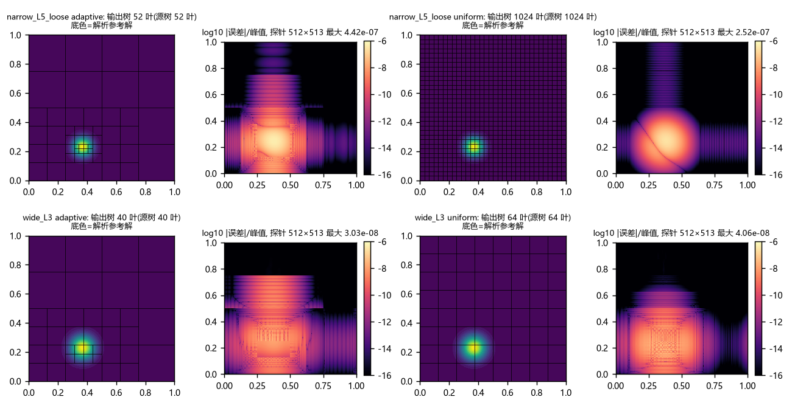
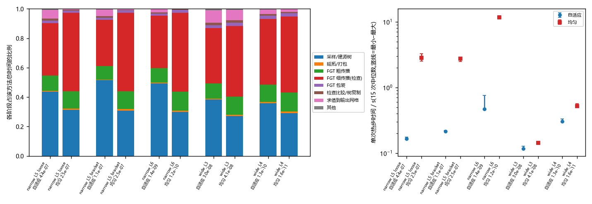
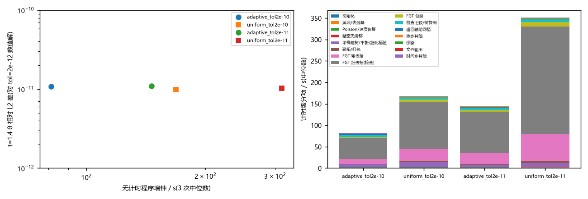
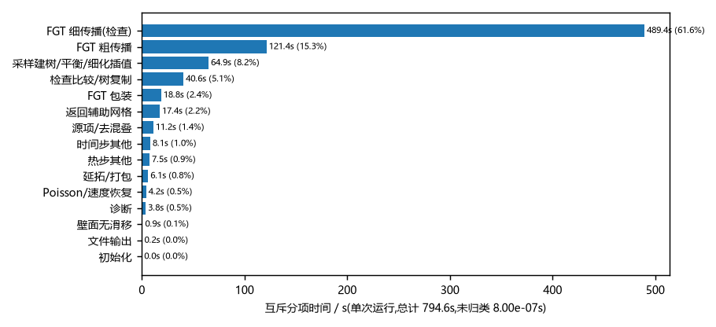

# Rayleigh–Bénard 学习笔记

<!--
本篇批注仍由 code_notes: inline 启用。
代码中的 ! @note-start / ! @note-end 与正文 HTML 批注标识配对。
批注讲解在网页上移入浮动卡片，故整体流程与关键推导应留在普通正文。
完整源码来自最终交付目录；标记仅用于网页，不改变求解算法。
-->

## 1. 问题

上下两块水平板之间充满流体，下板热、上板冷。计算区域为

$$
\Omega=\{(x,z):0\le x<1,\ 0\le z\le1\},
$$

$x$ 是水平坐标（周期方向），$z$ 是竖直坐标（向上为正，$z=0$ 为下板，$z=1$ 为上板）。速度记为 $\boldsymbol v=(u,w)$，$u$ 是水平分量，$w$ 是竖直分量。温度写成

$$
T(x,z,t)=1-z+\theta(x,z,t).
$$

$1-z$ 是静止导热态，$\theta$ 是温度扰动。程序最终求解的无量纲 Boussinesq 扰动方程为

$$
\begin{aligned}
\boldsymbol v_t+\boldsymbol v\cdot\nabla\boldsymbol v
&=-\nabla p+\Pr\Delta\boldsymbol v+\mathrm{Ra}\Pr\,\theta\,\boldsymbol e_z,\\
\nabla\cdot\boldsymbol v&=0,\\
\theta_t+u\theta_x+w\theta_z&=\Delta\theta+w,
\end{aligned}
$$

边界条件是

$$
u=w=\theta=0\quad(z=0,1),\qquad
f(x+1,z,t)=f(x,z,t)\quad(f=u,w,\theta,p).
$$

这里 $\boldsymbol e_z=(0,1)$ 是竖直单位向量，$\Delta=\partial_{xx}+\partial_{zz}$，$\Pr$ 是 Prandtl 数（动量扩散与热扩散之比），$\mathrm{Ra}$ 是 Rayleigh 数（浮力驱动与两种扩散阻尼之比）。主程序固定 $\Pr=1$，但第 2–7 节的推导对一般 $\Pr>0$ 都成立，代码中凡是出现 $\Pr$ 的地方也都保留了这个参数。

我们关心小扰动是否增长、怎样形成对流卷，以及对流使热流增加多少。因此求解时要同时检查速度、温度、壁面约束、增长率和热量/能量平衡。下面三小节说明上面这组方程的每一项从哪里来。

### 1.1 有量纲 Boussinesq 模型推导

带星号的量都是有量纲量。记板间距离为 $H_*$，底、顶板温度为 $T_b^*>T_t^*$，温差 $\Delta T_*=T_b^*-T_t^*$；流体的参考密度为 $\rho_0$（在温度 $T_t^*$ 时的密度），运动黏度为 $\nu$，热扩散率为 $\kappa$，热膨胀系数为 $\alpha$，重力加速度大小为 $g_*$，重力方向为 $-\boldsymbol e_z$。

**第一步：密度只在浮力中随温度变化。** 对小温差把状态方程在 $T_t^*$ 处线性化：

$$
\rho=\rho_0\left[1-\alpha(T^*-T_t^*)\right].
$$

Boussinesq 近似的含义是：惯性项 $\rho\,D\boldsymbol v^*/Dt^*$ 和连续方程中都把 $\rho$ 换成常数 $\rho_0$，只在重力项 $-\rho g_*\boldsymbol e_z$ 中保留密度变化。于是动量方程为

$$
\rho_0\left(\partial_{t^*}\boldsymbol v^*+(\boldsymbol v^*\cdot\nabla^*)\boldsymbol v^*\right)
=-\nabla^*p_{\rm full}^*+\rho_0\nu\Delta^*\boldsymbol v^*-\rho g_*\boldsymbol e_z .
$$

**第二步：扣去静水压力。** 设 $p_h^*$ 满足 $\nabla^*p_h^*=-\rho_0g_*\boldsymbol e_z$，即 $p_h^*=p_0-\rho_0g_*z^*$（$p_0$ 为常数）。令 $p^*=p_{\rm full}^*-p_h^*$，则

$$
-\nabla^*p_{\rm full}^*-\rho g_*\boldsymbol e_z
=-\nabla^*p^*-\nabla^*p_h^*-\rho_0g_*\boldsymbol e_z+\rho_0\alpha(T^*-T_t^*)g_*\boldsymbol e_z
=-\nabla^*p^*+\rho_0g_*\alpha(T^*-T_t^*)\boldsymbol e_z .
$$

中间一步用了 $-\rho g_*=-\rho_0g_*+\rho_0\alpha(T^*-T_t^*)g_*$，再用 $-\nabla^*p_h^*-\rho_0g_*\boldsymbol e_z=0$。两边除以 $\rho_0$ 得到

$$
\partial_{t^*}\boldsymbol v^*+(\boldsymbol v^*\cdot\nabla^*)\boldsymbol v^*
=-\rho_0^{-1}\nabla^*p^*+\nu\Delta^*\boldsymbol v^*
+g_*\alpha(T^*-T_t^*)\boldsymbol e_z .
$$

**第三步：连续方程与能量方程。** 密度在连续方程中取常数 $\rho_0$，$\partial_{t^*}\rho_0+\nabla^*\cdot(\rho_0\boldsymbol v^*)=0$ 化为 $\nabla^*\cdot\boldsymbol v^*=0$。温度满足对流扩散方程

$$
\partial_{t^*}T^*+\boldsymbol v^*\cdot\nabla^*T^*=\kappa\Delta^*T^* .
$$

边界条件：$z^*=0$ 处 $T^*=T_b^*$，$z^*=H_*$ 处 $T^*=T_t^*$，两板上 $\boldsymbol v^*=0$（无滑移、不穿透）；水平方向取周期 $L_*$。

### 1.2 无量纲化：逐项算出每个系数

取长度尺度 $H_*$、热扩散时间 $H_*^2/\kappa$ 作时间尺度，速度尺度为二者之比 $\kappa/H_*$，温度用 $T_t^*$ 作零点、$\Delta T_*$ 作单位，压力尺度选成能与惯性项匹配的 $\rho_0\kappa^2/H_*^2$：

$$
x^*=H_*x,\quad z^*=H_*z,\quad t^*=\frac{H_*^2}{\kappa}t,
\quad\boldsymbol v^*=\frac{\kappa}{H_*}\boldsymbol v,
\quad T^*=T_t^*+\Delta T_*\,T,
\quad p^*=\frac{\rho_0\kappa^2}{H_*^2}\widetilde p .
$$

无星号的量都是无量纲量；$\widetilde p$ 是还未扣除导热态浮力的无量纲压力。链式法则给出

$$
\partial_{t^*}=\frac{\partial t}{\partial t^*}\partial_t=\frac{\kappa}{H_*^2}\partial_t,\qquad
\nabla^*=\frac1{H_*}\nabla,\qquad
\Delta^*=\frac1{H_*^2}\Delta .
$$

**动量方程逐项代入：**

| 有量纲项 | 代入尺度 | 结果 |
| --- | --- | --- |
| $\partial_{t^*}\boldsymbol v^*$ | $\dfrac{\kappa}{H_*^2}\cdot\dfrac{\kappa}{H_*}\boldsymbol v_t$ | $\dfrac{\kappa^2}{H_*^3}\boldsymbol v_t$ |
| $(\boldsymbol v^*\cdot\nabla^*)\boldsymbol v^*$ | $\dfrac{\kappa}{H_*}\cdot\dfrac1{H_*}\cdot\dfrac{\kappa}{H_*}(\boldsymbol v\cdot\nabla)\boldsymbol v$ | $\dfrac{\kappa^2}{H_*^3}\boldsymbol v\cdot\nabla\boldsymbol v$ |
| $-\rho_0^{-1}\nabla^*p^*$ | $-\dfrac1{\rho_0}\cdot\dfrac1{H_*}\cdot\dfrac{\rho_0\kappa^2}{H_*^2}\nabla\widetilde p$ | $-\dfrac{\kappa^2}{H_*^3}\nabla\widetilde p$ |
| $\nu\Delta^*\boldsymbol v^*$ | $\nu\cdot\dfrac1{H_*^2}\cdot\dfrac{\kappa}{H_*}\Delta\boldsymbol v$ | $\dfrac{\nu\kappa}{H_*^3}\Delta\boldsymbol v$ |
| $g_*\alpha(T^*-T_t^*)\boldsymbol e_z$ | $g_*\alpha\,\Delta T_*\,T\,\boldsymbol e_z$ | $g_*\alpha\Delta T_*\,T\boldsymbol e_z$ |

全式除以共同的惯性系数 $\kappa^2/H_*^3$：

$$
\boldsymbol v_t+\boldsymbol v\cdot\nabla\boldsymbol v
=-\nabla\widetilde p+\frac{\nu}{\kappa}\Delta\boldsymbol v
+\frac{g_*\alpha\Delta T_*H_*^3}{\kappa^2}T\boldsymbol e_z .
$$

定义

$$
\Pr=\frac{\nu}{\kappa},\qquad
\mathrm{Ra}=\frac{g_*\alpha\Delta T_*H_*^3}{\nu\kappa},
$$

则浮力系数可以拆成 $\dfrac{g_*\alpha\Delta T_*H_*^3}{\kappa^2}=\dfrac{g_*\alpha\Delta T_*H_*^3}{\nu\kappa}\cdot\dfrac{\nu}{\kappa}=\mathrm{Ra}\Pr$。于是

$$
\boldsymbol v_t+\boldsymbol v\cdot\nabla\boldsymbol v=-\nabla\widetilde p+\Pr\Delta\boldsymbol v+\mathrm{Ra}\Pr\,T\boldsymbol e_z .
$$

**连续方程：** $\nabla^*\cdot\boldsymbol v^*=H_*^{-1}(\kappa/H_*)\nabla\cdot\boldsymbol v=0$，系数非零，故 $\nabla\cdot\boldsymbol v=0$。

**温度方程逐项代入：** $T^*$ 中的常数 $T_t^*$ 求导后消失，

$$
\partial_{t^*}T^*=\frac{\kappa\Delta T_*}{H_*^2}T_t,\quad
\boldsymbol v^*\cdot\nabla^*T^*=\frac{\kappa}{H_*}\cdot\frac{\Delta T_*}{H_*}\boldsymbol v\cdot\nabla T,\quad
\kappa\Delta^*T^*=\kappa\frac{\Delta T_*}{H_*^2}\Delta T .
$$

三项共同系数都是 $\kappa\Delta T_*/H_*^2$，约去后得到 $T_t+\boldsymbol v\cdot\nabla T=\Delta T$，即 $T_t+uT_x+wT_z=\Delta T$。这说明“时间以热扩散时间计”时温度方程没有任何参数，全部参数集中在动量方程里。

**边界与区域：** $z^*=0\Rightarrow z=0$，此处 $T=(T_b^*-T_t^*)/\Delta T_*=1$；$z^*=H_*\Rightarrow z=1$，此处 $T=0$；两壁 $\boldsymbol v=0$。取水平周期 $L_*=H_*$，所以无量纲周期为 $1$。若改变周期，允许的水平波数 $2\pi m/(L_*/H_*)$ 会变，临界 Rayleigh 数也随之改变。

### 1.3 扣掉导热态时每个符号如何变化

**导热态。** 令 $\boldsymbol v=0$、$T=T_c(z)$ 不随时间变化。温度方程化为 $T_c''=0$，两次积分得 $T_c=az+b$；底壁 $T_c(0)=b=1$，顶壁 $T_c(1)=a+b=0$，故 $a=-1$，$T_c=1-z$。动量方程化为 $0=-\nabla\widetilde p_c+\mathrm{Ra}\Pr(1-z)\boldsymbol e_z$，只需 $\partial_x\widetilde p_c=0$、$\partial_z\widetilde p_c=\mathrm{Ra}\Pr(1-z)$，积分得 $\widetilde p_c=\mathrm{Ra}\Pr(z-z^2/2)+\text{常数}$。所以导热态确实是完整方程的精确静止解。

**温度扰动方程。** 令 $T=1-z+\theta$，逐项求导：

$$
T_t=\theta_t,\quad T_x=\theta_x,\quad T_z=-1+\theta_z,
\quad \Delta T=\Delta(1-z)+\Delta\theta=0+\Delta\theta .
$$

代入 $T_t+uT_x+wT_z=\Delta T$ 并展开乘积：

$$
\theta_t+u\theta_x+w(-1+\theta_z)=\Delta\theta
\ \Longrightarrow\
\theta_t+u\theta_x-w+w\theta_z=\Delta\theta
\ \Longrightarrow\
\theta_t+u\theta_x+w\theta_z=\Delta\theta+w .
$$

右端的 $+w$ 有清楚的物理意义：向上运动（$w>0$）的流体把下面较热的导热态温度带上来，使局部扰动温度升高。

**动量扰动方程。** 浮力 $\mathrm{Ra}\Pr\,T\boldsymbol e_z=\mathrm{Ra}\Pr(1-z)\boldsymbol e_z+\mathrm{Ra}\Pr\,\theta\boldsymbol e_z$。第一部分是一个梯度：设

$$
\Phi(z)=\mathrm{Ra}\Pr\left(z-\frac{z^2}{2}\right),\qquad
\nabla\Phi=\big(0,\ \Phi'(z)\big)=\mathrm{Ra}\Pr(1-z)\boldsymbol e_z .
$$

令 $p=\widetilde p-\Phi$，则 $-\nabla\widetilde p+\mathrm{Ra}\Pr(1-z)\boldsymbol e_z=-\nabla\widetilde p+\nabla\Phi=-\nabla(\widetilde p-\Phi)=-\nabla p$，得到第 1 节开头的扰动动量方程。$\Phi$ 只依赖 $z$，所以 $p$ 与 $\widetilde p$ 一样在 $x$ 方向周期。

**扰动边界条件。** 底壁 $\theta=T-(1-0)=1-1=0$，顶壁 $\theta=T-(1-1)=0-0=0$；速度边界不变。

**目前进展。** 原问题是关于有量纲量 $(\boldsymbol v^*,T^*,p^*_{\rm full})$ 的方程组：温度壁值非齐次（底 $T_b^*$、顶 $T_t^*$），含 $H_*,\Delta T_*,\nu,\kappa,\alpha,g_*,\rho_0$ 七个物理参数。现在它已转化为关于无量纲扰动量 $(u,w,\theta,p)$ 的问题：所有壁面条件都是**齐次零值**，水平周期为 1，参数只剩 $\mathrm{Ra}$ 与 $\Pr$。

剩下的困难是压力 $p$：它没有自己的演化方程，只由不可压约束 $\nabla\cdot\boldsymbol v=0$ 隐式决定。下一节先把它从推进中消掉。

## 2. 程序设计

### 2.1 用涡量与平均流消去压力

我们用主状态 `flow_state` 保存 `omega(nx,nz)`、`mean_u(nz)`、`theta(nx,nz)` 和 `time`。`omega` 只保留非零水平模态，水平平均速度单独保存在 `mean_u`。计算非线性项或诊断时，程序需要从这两份数据恢复完整的速度 $u,w$。

恢复过程是：**非平均涡量 → Poisson 求流函数 → 对流函数求导 → 加回平均水平流**。下面一步步说明为什么这样表示既完整又不丢信息。

**第一步：水平平均竖直速度为零。** 对不可压条件 $u_x+w_z=0$ 在 $x\in[0,1]$ 上积分。由周期性，

$$
\int_0^1u_x\,dx=u(1,z)-u(0,z)=0,
$$

所以 $\partial_z\overline w=\overline{w_z}=-\overline{u_x}=0$（竖直求导与水平积分可交换）。$\overline w$ 不随 $z$ 变化，而底壁 $\overline w(0)=0$，故 $\overline w\equiv0$。因此只有水平速度有非零的水平平均 $\overline u(z)$。

**第二步：构造非平均部分的流函数。** 令非平均水平速度 $u^\perp=u-\overline u$，它满足 $\overline{u^\perp}=0$。定义

$$
\psi(x,z)=\int_0^z u^\perp(x,s)\,ds .
$$

由微积分基本定理，$\psi_z=u^\perp$，且 $\psi(x,0)=0$。再对 $x$ 求导并使用不可压性 $u_x=u^\perp_x=-w_z$（$\overline u$ 不依赖 $x$）：

$$
\psi_x=\int_0^z u_x(x,s)\,ds=-\int_0^z w_s(x,s)\,ds=-w(x,z)+w(x,0)=-w(x,z).
$$

最后一步用了底壁 $w(x,0)=0$。于是

$$
u=\psi_z+\overline u(z),\qquad w=-\psi_x .
$$

反过来，任何这样形式的速度都自动不可压：$u_x+w_z=\psi_{zx}+0-\psi_{xz}=0$。

**第三步：两壁的流函数都为零。** 底壁 $\psi(x,0)=0$ 由定义直接得到。顶壁 $\psi_x(x,1)=-w(x,1)=0$，所以 $\psi(x,1)$ 是与 $x$ 无关的常数 $c$。又因为

$$
\overline\psi(z)=\int_0^1\!\!\int_0^z u^\perp(x,s)\,ds\,dx=\int_0^z\overline{u^\perp}(s)\,ds=0,
$$

取 $z=1$ 得 $c=\overline\psi(1)=0$。因此 $\psi(x,0)=\psi(x,1)=0$，且 $\psi$ 的水平平均处处为零。如果不先拆出 $\overline u$，$\psi(x,1)-\psi(x,0)=\int_0^1u\,dz$ 一般等于非零的净水平通量，两壁不能同时取零——这就是单独保存 `mean_u` 的原因。

**第四步：涡量与流函数的关系。** 本文采用的总涡量符号为

$$
\zeta=w_x-u_z .
$$

代入 $u=\psi_z+\overline u$、$w=-\psi_x$：

$$
\zeta=(-\psi_x)_x-(\psi_z+\overline u)_z=-\psi_{xx}-\psi_{zz}-\overline u'(z)=-\Delta\psi-\overline u'(z).
$$

取水平平均：$\overline{\psi_{xx}}=\psi_x(1,z)-\psi_x(0,z)=0$（周期性），$\overline{\psi_{zz}}=\overline\psi''=0$（因为 $\overline\psi\equiv0$），$\overline{\overline u'}=\overline u'$，于是

$$
\overline\zeta=-\overline u'(z).
$$

保存的 `omega` 是去掉平均分量后的涡量：

$$
\omega=\zeta-\overline\zeta=\left(-\Delta\psi-\overline u'\right)-\left(-\overline u'\right)=-\Delta\psi .
$$

所以恢复流函数就是解

$$
\boxed{-\Delta\psi=\omega,\qquad \psi(x,0)=\psi(x,1)=0.}
$$

总涡量 $\zeta$ 被分成两部分：非平均部分 $\omega$ 存在 `omega` 里，平均部分 $-\overline u'$ 由 `mean_u` 隐含。两份数据合起来与 $(u,w)$ 一一对应，没有丢失信息。

**第五步：初始化接口。** `set_velocity` 按同样的拆分保存状态：先求 $u$ 在每个高度上的离散水平平均 $\frac1{N_x}\sum_iu_{ij}$，存入 `mean_u`；再用第 2.3 节的微分算子计算 $w_x-u_z$，减掉它的离散水平平均，存入 `omega`。由于离散 Fourier 变换的零模态系数正好是 $\frac1{N_x}\sum_if_{ij}$（第 2.3 节），这一步就是把涡量的零模态置零。

**第六步：逐模态的 Poisson 问题。** `get_velocity` 调用 `wall_stokes.velocity_from_vorticity`。它先对涡量做水平 Fourier 变换，写成

$$
\omega(x,z)=\sum_m\widehat\omega_m(z)e^{\mathrm i a_mx},\qquad
\psi(x,z)=\sum_m\widehat\psi_m(z)e^{\mathrm i a_mx},\qquad a_m=2\pi\kappa_m ,
$$

$\kappa_m$ 是整数频率（定义见第 2.3 节）。对单个模态，$\partial_x e^{\mathrm i a_mx}=\mathrm i a_me^{\mathrm i a_mx}$，所以 $\partial_{xx}\mapsto(\mathrm i a_m)^2=-a_m^2$，于是

$$
-\Delta\psi=\sum_m\left(a_m^2\widehat\psi_m-\widehat\psi_m''\right)e^{\mathrm i a_mx}.
$$

与 $\omega$ 的展开逐项比较（不同 $e^{\mathrm i a_mx}$ 线性无关），每个水平模态分别满足

$$
\boxed{\left(-\partial_{zz}+a_m^2\right)\widehat\psi_m
=\widehat\omega_m,\qquad
\widehat\psi_m(0)=\widehat\psi_m(1)=0.}
$$

不同水平模态之间没有耦合。零模态 $a_1=0$ 时方程是 $-\widehat\psi_1''=\widehat\omega_1=0$ 加零壁值，唯一解为 $\widehat\psi_1=0$，与第三步 $\overline\psi=0$ 一致。

竖直方向用 Chebyshev 二阶微分矩阵 $\mathsf D^2$ 离散（第 2.3 节），壁面值固定为零，只需求内部节点。记内部节点集合为 $I=\{2,\ldots,N_z-1\}$，线性系统为

$$
\left(a_m^2\mathsf I-\mathsf D^2_{II}\right)\widehat\psi_{m,I}
=\widehat\omega_{m,I},
$$

其中 $\mathsf I$ 是单位矩阵，$\mathsf D^2_{II}$ 是 $\mathsf D^2$ 去掉首末行列的子块（推导见第 2.3 节末）。`make_grid` 在初始化时预计算各模态矩阵的逆，存为 `g%inverse(:,:,m)`；`poisson_dirichlet` 每次将它乘到当前右端的内部节点值上，两壁输出保持零。注意它解的是 **$-\Delta p=\rho$**（带负号），这一约定在第 3 节除以扩散系数时还会用到。

此时代码数组 `psi(m,j)` 的第一个指标是 **Fourier 模态编号**，第二个指标才是竖直节点编号。代码中的 `psi(1,:)=0` 清除水平零模态，不是把底壁设为零；两壁对应的是 `psi(:,1)` 和 `psi(:,g%nz)`，它们已经由 Poisson 求解器保持为零。

**第七步：由流函数恢复速度。** 得到 $\widehat\psi_m$ 后，按 $u=\psi_z+\overline u$、$w=-\psi_x$ 逐模态求导：

| 操作 | 数学含义 | 对应代码 |
| --- | --- | --- |
| 对竖直节点求导 | $\widehat{(\psi_z)}_m=\mathsf D\widehat\psi_m$ | `matmul(psi,transpose(g%d))` |
| 水平合成并加回平均流 | $u=\psi_z+\overline u$ | `physical(...)` 加 `spread(mean_u,1,g%nx)` |
| 对水平模态求导并取负 | $\widehat w_m=-\mathrm ia_m\widehat\psi_m$ | `-cmplx(0.0_rk,g%frequency(m),rk)*psi(m,:)` |
| 水平合成 | 得到节点值 $w$ | `physical(g,c)` |

**第八步：哪些壁面条件已自动满足。** 流函数在两壁恒为零，沿壁面的水平导数也为零，因此

$$
w|_{\rm wall}=-\psi_x|_{\rm wall}=0,
$$

不穿透条件自动成立。但 $\psi=0$ 不意味着 $\psi_z=0$，所以还不能单凭它保证切向无滑移：

$$
u|_{\rm wall}=\psi_z|_{\rm wall}+\overline u|_{\rm wall}=0
$$

需要另外两件事：平均流 $\overline u$ 以零壁条件推进（第 3 节），非平均部分 $\psi_z|_{\rm wall}=0$ 由 `impose_noslip` 调整壁面涡量来保证（第 6 节）。`velocity_from_vorticity` 使用这份已经受约束的状态求速度，没有在恢复后强行覆盖壁面速度。

**目前进展。** 四个未知量 $(u,w,\theta,p)$ 已换成三个存储量 $(\omega,\overline u,\theta)$：压力不再需要推进，速度 $(u,w)$ 也不再是独立未知量，而是随时可以从 $(\omega,\overline u)$ 算出来——逐模态解 $(-\partial_{zz}+a_m^2)\widehat\psi_m=\widehat\omega_m$，再求导。不穿透条件 $w=0$ 已自动满足。

代价是留下一个尚未满足的条件：壁面 $\psi_z=0$（切向无滑移）。它要靠选择合适的壁面涡量来实现，留到第 6 节。

### 2.2 全局辅助网格与局部自适应网格

程序里有两套网格，分工不同：

- **辅助网格**（`slab_grid.make_grid`）：$x$ 方向 $N_x$ 个周期等距节点，$z$ 方向 $N_z$ 个包含两壁的 Chebyshev–Lobatto 节点。主状态、源项、Poisson 求解、壁面系统、诊断都在这里完成。水平导数在 Fourier 空间中乘 $\mathrm ia_m$；竖直导数用微分矩阵。当前 Fourier 变换用显式矩阵乘法实现（不是 FFT）。
- **自适应四叉树**（第 5 节）：只在热传播 $H$ 内部临时建立，每个叶盒上有 $k\times k$ 个 Chebyshev 根节点。它从辅助网格的连续展开取样，传播后再求值回辅助网格。

两者之间的桥梁是第 2.4 节的“辅助展开”：辅助网格节点值唯一确定一个 Fourier–Chebyshev 多项式，可以在任意点求值。

### 2.3 从插值多项式推到实际微分矩阵

以下公式对应 [slab_grid.f90](<C:/myproject/rb_project/learning/rb_plan_2D/slab_grid.f90>) 与 [numerical_tools.f90](<C:/myproject/rb_project/learning/rb_plan_2D/numerical_tools.f90>)。记 $N_x=\texttt{nx}$（要求为偶数）、$N_z=\texttt{nz}$。

#### 节点与频率

$$
x_i=\frac{i-1}{N_x}\quad(1\le i\le N_x),\qquad
z_j=\frac{1-\cos(\pi(j-1)/(N_z-1))}{2}\quad(1\le j\le N_z).
$$

$j=1$ 时 $\cos0=1$，$z_1=0$；$j=N_z$ 时 $\cos\pi=-1$，$z_{N_z}=1$；中间 $\cos$ 单调递减，所以节点从底壁向顶壁递增，并在两壁附近加密。存储编号 $m=1,\ldots,N_x$ 对应整数频率

$$
\kappa_m=\begin{cases}m-1,&m-1<N_x/2,\\m-1-N_x,&m-1\ge N_x/2,\end{cases}
\qquad a_m=2\pi\kappa_m .
$$

例如 $N_x=8$ 时 $\kappa=0,1,2,3,-4,-3,-2,-1$。第 $m=N_x/2+1$ 个是 **Nyquist 模态** $\kappa=-N_x/2$，它没有对应的 $+N_x/2$，后面会单独处理。

#### 离散 Fourier 变换为什么互逆

对每个固定的 $z_j$，变换与合成为

$$
\widehat f_{mj}=\frac1{N_x}\sum_{i=1}^{N_x}f_{ij}e^{-\mathrm i a_mx_i},\qquad
f_{ij}=\operatorname{Re}\sum_{m=1}^{N_x}\widehat f_{mj}e^{\mathrm i a_mx_i}.
$$

代码中矩阵 `transform(m,i)`$=e^{-\mathrm ia_mx_i}/N_x$，`synthesis(i,m)`$=e^{\mathrm ia_mx_i}$。验证二者互逆：

$$
(\texttt{transform}\cdot\texttt{synthesis})_{ml}
=\frac1{N_x}\sum_{i=1}^{N_x}e^{\mathrm i(a_l-a_m)x_i}
=\frac1{N_x}\sum_{n=0}^{N_x-1}\varrho^{\,n},\qquad
\varrho=e^{2\pi\mathrm i(\kappa_l-\kappa_m)/N_x}.
$$

这里用了 $x_i=(i-1)/N_x$，令 $n=i-1$。若 $l=m$，$\varrho=1$，和为 $N_x$，结果为 1。若 $l\ne m$，整数 $r=\kappa_l-\kappa_m$ 满足 $0<|r|<N_x$，不是 $N_x$ 的倍数，所以 $\varrho\ne1$，等比数列求和

$$
\sum_{n=0}^{N_x-1}\varrho^{\,n}=\frac{1-\varrho^{N_x}}{1-\varrho}=\frac{1-e^{2\pi\mathrm ir}}{1-\varrho}=\frac{1-1}{1-\varrho}=0 .
$$

所以两矩阵乘积是单位阵；方阵的左逆也是右逆，合成后精确回到原节点值。对实数 $f$，$\widehat f_{-\kappa}=\overline{\widehat f_\kappa}$（共轭），Nyquist 系数 $\widehat f_{N}=\frac1{N_x}\sum_if_{ij}(-1)^{i-1}$ 是实数（因为 $e^{\mathrm i\pi N_xx_i}=e^{\mathrm i\pi(i-1)}=(-1)^{i-1}$），所以合成之和在节点上本来就是实数，`Re` 只去掉舍入虚部。

**`Re` 在非节点处的作用。** 在任意 $x$ 求值时，Nyquist 项 $\widehat f_Ne^{-\mathrm i\pi N_xx}$ 不再是实数，取实部得到 $\widehat f_N\cos(\pi N_xx)$。因此程序约定的连续三角插值是

$$
f(x)=\sum_{|\kappa|<N_x/2}\widehat f_\kappa e^{2\pi\mathrm i\kappa x}+\widehat f_N\cos(\pi N_xx),
$$

Nyquist 项是一个余弦。这个约定在第 2.4 节的去混叠与内积中会用到。

**水平导数。** 逐项求导 $\partial_xe^{\mathrm ia_mx}=\mathrm ia_me^{\mathrm ia_mx}$，再求一次得 $(\mathrm ia_m)^2=-a_m^2$。这就是 `dx` 中乘 `cmplx(0,frequency(m))` 和 `laplacian` 中乘 `-frequency(m)**2` 的来源。对 Nyquist 模态，$\mathrm ia_N\widehat f_N(-1)^{i-1}$ 在节点上是纯虚数，取实部为零——与 $\partial_x\cos(\pi N_xx)=-\pi N_x\sin(\pi N_xx)$ 在节点 $x_i$ 处为零一致。

#### 竖直微分矩阵：从 Lagrange 基到重心公式

设 $\ell_l(z)$ 是第 $l$ 个 Lagrange 基函数：

$$
\ell_l(z)=\prod_{r\ne l}\frac{z-z_r}{z_l-z_r},\qquad
p(z)=\sum_{l=1}^{N_z}f_l\ell_l(z),\qquad
p'(z_j)=\sum_l\ell_l'(z_j)f_l .
$$

$p$ 是过 $N_z$ 个点 $(z_l,f_l)$ 的唯一次数 $\le N_z-1$ 多项式。所以微分矩阵就是 $\mathsf D_{jl}=\ell_l'(z_j)$。

定义重心权重 $\beta_l=1/\prod_{r\ne l}(z_l-z_r)$，则 $\ell_l(z)=\beta_l\prod_{r\ne l}(z-z_r)$。

**非对角元 $j\ne l$。** 把乘积中的因子 $(z-z_j)$ 单独提出：

$$
\ell_l(z)=\beta_l\,(z-z_j)\,Q(z),\qquad Q(z)=\prod_{r\ne l,j}(z-z_r).
$$

乘积求导 $\ell_l'(z)=\beta_l[Q(z)+(z-z_j)Q'(z)]$，在 $z=z_j$ 处第二项为零，所以 $\ell_l'(z_j)=\beta_lQ(z_j)$。再用 $\beta_j$ 的定义把 $Q(z_j)$ 换掉：

$$
\frac1{\beta_j}=\prod_{r\ne j}(z_j-z_r)=(z_j-z_l)\prod_{r\ne j,l}(z_j-z_r)=(z_j-z_l)\,Q(z_j),
\qquad Q(z_j)=\frac1{\beta_j(z_j-z_l)} .
$$

合起来

$$
\mathsf D_{jl}=\ell_l'(z_j)=\frac{\beta_l}{\beta_j(z_j-z_l)}\qquad(j\ne l).
$$

**对角元。** 常数 1 是次数 0 的多项式，被精确插值：$\sum_l\ell_l(z)\equiv1$。求导得 $\sum_l\ell_l'(z)\equiv0$，在 $z_j$ 取值即 $\sum_l\mathsf D_{jl}=0$，故

$$
\mathsf D_{jj}=-\sum_{l\ne j}\mathsf D_{jl}.
$$

这正是 `differentiation_matrix` 的两行：先填非对角元 `weights(j)/(weights(i)*(nodes(i)-nodes(j)))`，再令 `d(i,i)=-sum(d(i,:))`（此时对角元尚为 0，求和只含非对角元）。公式只用到权重的比值 $\beta_l/\beta_j$，所以所有权重可以同乘任意非零常数。

#### Chebyshev–Lobatto 节点的权重为什么是 $(-1)^{j-1}$，两端再除以 2

先在参考区间 $\xi\in[-1,1]$ 上讨论。记 $N=N_z-1$，Lobatto 节点为 $\xi_n=\cos(n\pi/N)$，$n=0,\ldots,N$。它们是 $T_N(\xi)=\cos(N\arccos\xi)$ 的全部极值点：内部节点是 $T_N'$ 的零点，两端是 $\pm1$。所以节点多项式可写成

$$
\varpi(\xi)=\prod_{n=0}^N(\xi-\xi_n)=c\,(\xi^2-1)\,T_N'(\xi),
$$

$c$ 是使首项系数为 1 的常数（右边次数为 $2+(N-1)=N+1$，与左边一致）。权重是 $\beta_n=1/\prod_{r\ne n}(\xi_n-\xi_r)=1/\varpi'(\xi_n)$（在根处对乘积求导，只剩不含 $(\xi-\xi_n)$ 的那一项）。

求导：$\varpi'=c[2\xi T_N'+(\xi^2-1)T_N'']$。Chebyshev 多项式满足微分方程 $(1-\xi^2)T_N''-\xi T_N'+N^2T_N=0$，即 $(\xi^2-1)T_N''=N^2T_N-\xi T_N'$。代入：

$$
\varpi'(\xi)=c\left[2\xi T_N'+N^2T_N-\xi T_N'\right]=c\left[\xi T_N'(\xi)+N^2T_N(\xi)\right].
$$

- **内部节点** $0<n<N$：$T_N'(\xi_n)=0$，$T_N(\xi_n)=\cos(n\pi)=(-1)^n$，所以 $\varpi'(\xi_n)=cN^2(-1)^n$。
- **端点** $\xi=1$：由 $T_N'(\cos\vartheta)=N\sin(N\vartheta)/\sin\vartheta$ 令 $\vartheta\to0$ 得 $T_N'(1)=N\cdot N=N^2$，$T_N(1)=1$，所以 $\varpi'(1)=c(N^2+N^2)=2cN^2$。
- **端点** $\xi=-1$：令 $\vartheta=\pi-\epsilon$，$\sin(N\pi-N\epsilon)=-(-1)^N\sin(N\epsilon)$，$\sin\vartheta=\sin\epsilon$，极限 $T_N'(-1)=(-1)^{N-1}N^2$；又 $T_N(-1)=(-1)^N$。所以 $\varpi'(-1)=c[(-1)\cdot(-1)^{N-1}N^2+N^2(-1)^N]=2cN^2(-1)^N$。

取倒数并去掉公共因子 $1/(cN^2)$：

$$
\beta_n\propto(-1)^n\delta_n,\qquad \delta_0=\delta_N=\tfrac12,\ \ \delta_n=1\ (0<n<N).
$$

（$1/(-1)^n=(-1)^n$。）

**换到代码的节点顺序与物理区间。** 代码节点 $\xi=2z_j-1=-\cos(\pi(j-1)/N)=\cos(\pi-\pi(j-1)/N)=\xi_{N-j+1}$，即编号反过来，$n=N-j+1$。于是 $(-1)^n=(-1)^N(-1)^{-(j-1)}=(-1)^N(-1)^{j-1}$，公共符号 $(-1)^N$ 可去掉，得到代码的 `weights=(-1)**(i-1)`、首末除以 2。映射 $z=(1+\xi)/2$ 使每个差 $z_j-z_r=(\xi_j-\xi_r)/2$，乘积 $\prod_{r\ne j}$ 共 $N$ 个因子，整体多出公共因子 $2^{-N}$，同样可以去掉。

**导数因子不能重复乘。** $\mathsf D_{jl}$ 的分母直接使用物理节点差 $z_j-z_l$，算出的就是 $d/dz$；映射 $z=(1+\xi)/2$ 带来的 $d/dz=2\,d/d\xi$ 已经包含在分母中，不能再乘一次 2。

**二阶矩阵。** 若 $p$ 是次数 $\le N$ 的多项式，则 $p'$ 次数 $\le N-1$，仍被同一组节点精确插值；所以 $\mathsf D(\mathsf Dp)$ 的节点值就是 $p''$ 的节点值，即 $\mathsf D^2=\mathsf D\mathsf D$（代码 `g%d2 = matmul(g%d,g%d)`）。

**数组方向。** 场数组形状为 $(N_x,N_z)$，第二个指标是竖直节点。$(f\mathsf D^T)_{ij}=\sum_lf_{il}(\mathsf D^T)_{lj}=\sum_lf_{il}\mathsf D_{jl}$，正是固定水平节点 $i$ 后沿竖直列求导，所以代码写 `matmul(v,transpose(g%d))`。

#### Poisson 内部方程是怎样得到的

对第 $m$ 个模态在内部节点 $j\in I$ 处离散 $a_m^2\widehat\psi-\widehat\psi''=\widehat\omega$，把 $\widehat\psi''(z_j)$ 换成 $\sum_l(\mathsf D^2)_{jl}\psi_{ml}$，并按 $l$ 是否为壁面节点拆开求和：

$$
a_m^2\psi_{mj}-\sum_{l\in I}(\mathsf D^2)_{jl}\psi_{ml}
-(\mathsf D^2)_{j1}\psi_{m1}-(\mathsf D^2)_{jN_z}\psi_{mN_z}=\widehat\omega_{mj},
\qquad j\in I .
$$

两壁的 $\psi$ 为零，最后两项消失，剩下 $N_z-2$ 个未知数、$N_z-2$ 个方程：矩阵就是 $a_m^2\mathsf I-\mathsf D^2_{II}$（代码 `matrix=-g%d2(2:nz-1,2:nz-1)` 再在对角加 `a*a`）。右端只用到内部节点的 $\widehat\omega$；壁面上的涡量值不进入 Poisson 方程，它由第 6 节的影响系统另行确定。

### 2.4 辅助展开、乘积去混叠与积分

#### 辅助展开：节点值 ↔ Fourier–Chebyshev 系数

定义 Chebyshev 多项式 $T_n(\xi)=\cos(n\arccos\xi)$，$n=0,\ldots,N_z-1$，以及求值矩阵 $V_{j,n+1}=T_n(2z_j-1)$。$N_z$ 个互异节点上次数 $\le N_z-1$ 的插值唯一，所以 $V$ 可逆。若第 $m$ 个模态的竖直列向量 $\widehat f_m=(\widehat f_{m1},\ldots,\widehat f_{mN_z})^T$ 写成 $\widehat f_{mj}=\sum_nc_{mn}V_{j,n+1}$，则 $\widehat f_m=Vc_m$，$c_m=V^{-1}\widehat f_m$。代码把所有模态排成行：系数矩阵第 $m$ 行是 $c_m^T=\widehat f_m^TV^{-T}$，所以写成 `fourier(f)*transpose(iv)`（`iv`$=V^{-1}$）。任意位置的辅助场是

$$
f_{\rm aux}(x,z)=\operatorname{Re}\sum_m\sum_{n=0}^{N_z-1}c_{mn}e^{\mathrm i a_mx}T_n(2z-1).
$$

`evaluate_grid` 用矩阵 $E_{rm}=e^{\mathrm ia_mx_r}$、$W_{sn}=T_n(2z_s-1)$ 计算 $\operatorname{Re}(E\,c\,W^T)$；为避免舍入使 $2z-1$ 略超出 $[-1,1]$ 导致 `acos` 失败，代码先截断到 $[-1,1]$。这不是自适应树新产生的解，而是固定辅助网格已有场的连续插值表示。

#### 为什么乘积会混叠

两个 Fourier 模态相乘满足 $e^{\mathrm iax}e^{\mathrm ibx}=e^{\mathrm i(a+b)x}$，频率相加。两个 Chebyshev 模态相乘：令 $\xi=\cos\vartheta$，$T_n=\cos n\vartheta$、$T_l=\cos l\vartheta$，用积化和差 $2\cos A\cos B=\cos(A+B)+\cos(A-B)$，

$$
T_n(\xi)T_l(\xi)=\frac{\cos((n+l)\vartheta)+\cos((n-l)\vartheta)}2=\frac{T_{n+l}(\xi)+T_{|n-l|}(\xi)}2 ,
$$

最后一步用了 $\cos$ 是偶函数。因此两个辅助场的乘积，水平频率最高到 $|\kappa|\le N_x$，竖直次数最高到 $2(N_z-1)$，超出了原网格能表示的范围。若直接在原节点上相乘再变换，超出范围的频率会被“折”到低频上冒充低频分量，这就是混叠。

#### 水平方向：为什么 $3N_x/2$ 个点足够

代码在 $M=N_x^f=3N_x/2$ 个等距点上求值、相乘，再用 $M$ 点的变换 `fine_transform` 只取回原来 $N_x$ 个频率。在 $M$ 个等距点 $x_i=(i-1)/M$ 上，$e^{2\pi\mathrm i\kappa x_i}=e^{2\pi\mathrm i(\kappa+sM)x_i}$ 对任意整数 $s$ 成立，所以算出的频率 $\kappa$ 系数实际上等于真实乘积中所有频率 $\kappa'\equiv\kappa\pmod M$ 的系数之和。真实乘积的频率满足 $|\kappa'|\le N_x$。

- **非 Nyquist 行** $|\kappa|\le N_x/2-1$：别的候选 $\kappa'=\kappa\pm M,\kappa\pm2M,\ldots$ 满足 $|\kappa'|\ge M-|\kappa|\ge\frac{3N_x}2-\frac{N_x}2+1=N_x+1>N_x$，不可能出现。所以这些行没有混叠，等于真实乘积的系数。
- **Nyquist 行** $\kappa=-N_x/2$：$\kappa+M=N_x$ 恰好可以出现（例如两个 Nyquist 余弦相乘，$\cos^2(\pi N_xx)=\tfrac12+\tfrac12\cos(2\pi N_xx)$ 含频率 $\pm N_x$），所以这一行被污染。代码 `c(g%nx/2+1,:)=0` 把它清零。

所以水平方向的结果是：真实乘积投影到 $|\kappa|\le N_x/2-1$ 的频率，Nyquist 分量丢弃。这是截断，而不是保留了乘积的全部高频。

#### 竖直方向：为什么 $2N_z-1$ 个点足够

`fine_values` 用系数在细 Lobatto 网格上求值，两个因子都是次数 $\le N_z-1$ 的多项式，乘积次数 $\le2N_z-2$。细网格有 $N_z^f=2N_z-1$ 个节点，恰好能唯一插值次数 $\le2N_z-2$ 的多项式，所以 `ivf` 给出的就是乘积的**精确** Chebyshev 系数，没有竖直混叠。随后只保留前 $N_z$ 个系数（$n\le N_z-1$），再用 $V$ 回到原节点：这是把乘积截断到原次数，而不是在原节点上重新插值。两者的差别正是被丢弃的高次项。

非线性项中的导数（如 $u_x$、$u_z$）先在原网格上求，再用 `fine_values` 送到细网格，与 $u,w$ 相乘。

#### 连续积分 $\int_0^1T_n(2z-1)\,dz$

令 $\mu_n=\int_0^1T_n(2z-1)\,dz$。作代换 $\xi=2z-1$，$dz=d\xi/2$，$z:0\to1$ 对应 $\xi:-1\to1$；再令 $\xi=\cos\vartheta$，$d\xi=-\sin\vartheta\,d\vartheta$，$\xi:-1\to1$ 对应 $\vartheta:\pi\to0$：

$$
\mu_n=\frac12\int_{-1}^1T_n(\xi)\,d\xi
=\frac12\int_\pi^0\cos(n\vartheta)(-\sin\vartheta)\,d\vartheta
=\frac12\int_0^\pi\cos(n\vartheta)\sin\vartheta\,d\vartheta .
$$

用积化和差 $\sin\vartheta\cos(n\vartheta)=\tfrac12[\sin((1+n)\vartheta)+\sin((1-n)\vartheta)]$，以及对整数 $r\ne0$

$$
\int_0^\pi\sin(r\vartheta)\,d\vartheta=\left[-\frac{\cos(r\vartheta)}r\right]_0^\pi=\frac{1-(-1)^r}{r}
=\begin{cases}2/r,&r\text{ 奇},\\0,&r\text{ 偶}.\end{cases}
$$

（$r=0$ 时被积函数 $\sin0=0$，积分也是 0。）

- $n$ 偶：$r=1\pm n$ 都是奇数，$\mu_n=\frac12\cdot\frac12\left(\frac2{1+n}+\frac2{1-n}\right)=\frac12\cdot\frac{(1-n)+(1+n)}{(1+n)(1-n)}=\frac1{1-n^2}$。
- $n$ 奇：$r=1\pm n$ 都是偶数，$\mu_n=0$。这也可以从 $T_n$ 是奇函数直接看出。

$n=0$ 时 $\mu_0=1$，正是区间长度。这就是 `moment(n)` 的实现。

**区域积分。** 水平方向 $\int_0^1e^{2\pi\mathrm i\kappa x}dx=0$（$\kappa\ne0$），Nyquist 余弦 $\int_0^1\cos(\pi N_xx)dx=\sin(\pi N_x)/(\pi N_x)=0$，只有零模态留下。零模态系数在每个节点上就是 $\frac1{N_x}\sum_if_{ij}$（DFT 的 $m=1$ 行），所以

$$
\int_\Omega f=\sum_{n=0}^{N_z-1}c_{1n}\mu_n,\qquad c_1=V^{-1}\Big(\tfrac1{N_x}\textstyle\sum_if_{ij}\Big)_j ,
$$

对应 `dot_product(matmul(g%iv,sum(v,dim=1)/g%nx),g%moments)`。这是对辅助插值多项式的精确积分，不是节点值的简单平均。

#### 内积与 Gram 矩阵

竖直方向需要 $G_{nl}=\int_0^1T_n(2z-1)T_l(2z-1)\,dz$。用上面的乘积公式逐项积分：

$$
G_{nl}=\int_0^1\frac{T_{n+l}+T_{|n-l|}}2\,dz=\frac{\mu_{n+l}+\mu_{|n-l|}}2 .
$$

代码 `gram(i,j)=(moment(i+j-2)+moment(abs(i-j)))/2`，其中 $i-1=n$、$j-1=l$。

水平方向：把两个实场写成 $f=\sum_{|\kappa|<N_x/2}F_\kappa(z)e^{2\pi\mathrm i\kappa x}+F_N(z)\cos(\pi N_xx)$，$g$ 同理用 $G_\kappa$、$G_N$（$F_{-\kappa}=\overline{F_\kappa}$，$F_N$ 实）。逐对积分：

- $\int_0^1e^{2\pi\mathrm i\kappa x}e^{2\pi\mathrm i\kappa'x}dx=1$ 当且仅当 $\kappa'=-\kappa$，否则为 0；
- $\int_0^1e^{2\pi\mathrm i\kappa x}\cos(\pi N_xx)dx=\frac12\int_0^1\left(e^{2\pi\mathrm i(\kappa+N_x/2)x}+e^{2\pi\mathrm i(\kappa-N_x/2)x}\right)dx=0$（$|\kappa|<N_x/2$ 时两个频率都非零）；
- $\int_0^1\cos^2(\pi N_xx)dx=\int_0^1\frac{1+\cos(2\pi N_xx)}2dx=\frac12$。

所以

$$
\int_0^1fg\,dx=\sum_{|\kappa|<N_x/2}F_\kappa G_{-\kappa}+\frac12F_NG_N
=\sum_{|\kappa|<N_x/2}\overline{F_\kappa}\,G_\kappa+\frac12F_NG_N ,
$$

第二个等号把求和指标 $\kappa\to-\kappa$ 并用 $F_{-\kappa}=\overline{F_\kappa}$。这个和是实数（$\kappa$ 与 $-\kappa$ 两项互为共轭）。再对 $z$ 积分，$\int_0^1\overline{F_\kappa}G_\kappa dz=\sum_{n,l}\overline{c_{\kappa n}}d_{\kappa l}G_{nl}=c_\kappa^*Gd_\kappa$（$*$ 为共轭转置，$c,d$ 分别是 $f,g$ 的系数）。于是

$$
\langle f,g\rangle=\operatorname{Re}\sum_{m\ne\text{Nyq}}c_m^*G\,d_m+\frac12\,c_{\rm Nyq}^TG\,d_{\rm Nyq}.
$$

代码复数 `dot_product(a,b)` 正好对第一参数取共轭；Nyquist 行（`m == g%nx/2+1`）额外除以 2。这个 1/2 的来源就是 Nyquist 项在实数合成中只是一个余弦，而不是一对共轭指数。

**目前进展。** 连续场 $(\omega,\overline u,\theta)$ 已换成辅助网格上的数组 `omega(nx,nz)`、`mean_u(nz)`、`theta(nx,nz)`，所有**空间**运算都有了确定的矩阵实现：$\partial_x$（乘 $\mathrm ia_m$）、$\partial_z$ 与 $\partial_{zz}$（$\mathsf D,\mathsf D^2$）、逐模态 Poisson 逆、去混叠乘积、精确积分与内积。也就是说，给定某一时刻的状态，任何空间导数、速度、乘积和积分都能算出来。

剩下的问题全部在**时间**方向：怎样把状态从 $t_0$ 推进到 $t_0+h$。

## 3. 拆分成三个扩散

这一节把 RB 方程改写成三个形式完全相同的“有源扩散方程”，每个通道只差一个扩散系数：

$$
\partial_t(\text{通道}) = D\,\Delta(\text{通道}) + (\text{源}),\qquad
D=\Pr\ (\omega),\quad D=\Pr\ (\overline u),\quad D=1\ (\theta).
$$

这样，所有通道都能用同一个“齐次热传播 + 源势修正”的公式推进，热传播部分交给第 4、5 节的 FGT。

### 3.0 把非扩散项收集为力 $\boldsymbol F$

把扰动动量方程和温度方程中除压力、扩散以外的所有项移到右端，定义

$$
\begin{aligned}
F_x&=-(u u_x+w u_z),\\
F_z&=\mathrm{Ra}\Pr\theta-(u w_x+w w_z),\\
F_\theta&=w-(u\theta_x+w\theta_z),
\end{aligned}
$$

于是方程变成

$$
u_t=-p_x+\Pr\Delta u+F_x,\qquad
w_t=-p_z+\Pr\Delta w+F_z,\qquad
\theta_t=\Delta\theta+F_\theta .
$$

逐项核对：动量方程 $u_t+uu_x+wu_z=-p_x+\Pr\Delta u$ 移项即得第一式；竖直分量多出浮力 $\mathrm{Ra}\Pr\theta$；温度方程 $\theta_t+u\theta_x+w\theta_z=\Delta\theta+w$ 移项即得第三式。`physical_forcing` 正是这样计算的：先 `fz = ra*pr*theta`、`ft = w`，开启非线性时再减去去混叠后的对流乘积（第 2.4 节）。`linear` 模式关闭对流乘积，只保留浮力 $\mathrm{Ra}\Pr\theta$ 与温度反馈 $w$。

### 3.1 涡量方程、平均流方程与温度方程

**涡量方程。** 对竖直分量取 $\partial_x$，减去水平分量的 $\partial_z$：

$$
\begin{aligned}
\partial_x w_t-\partial_z u_t
&=\left(-p_{zx}+\Pr\partial_x\Delta w+\partial_xF_z\right)-\left(-p_{xz}+\Pr\partial_z\Delta u+\partial_zF_x\right)\\
&=(-p_{zx}+p_{xz})+\Pr\left(\partial_x\Delta w-\partial_z\Delta u\right)+\partial_xF_z-\partial_zF_x .
\end{aligned}
$$

逐项化简：光滑函数的混合偏导可交换，$p_{zx}=p_{xz}$，压力项为零——**这就是用涡量消去压力的原因**。常系数算子 $\Delta$ 与 $\partial_x$、$\partial_z$ 可交换，$\partial_x\Delta w-\partial_z\Delta u=\Delta(w_x-u_z)=\Delta\zeta$。左边 $\partial_xw_t-\partial_zu_t=(w_x-u_z)_t=\zeta_t$。所以

$$
\zeta_t=\Pr\Delta\zeta+\partial_xF_z-\partial_zF_x .
$$

**平均涡量方程。** 对周期函数 $f$，$\overline{f_x}=f(1,z)-f(0,z)=0$，同理 $\overline{f_{xx}}=0$；竖直求导与水平积分可交换。对上式取水平平均：

$$
\overline\zeta_t=\Pr\left(\overline{\zeta_{xx}}+\overline\zeta_{zz}\right)+\overline{\partial_xF_z}-\partial_z\overline{F_x}
=\Pr\,\overline\zeta_{zz}-\partial_z\overline{F_x}.
$$

**非平均涡量方程。** 总方程减去平均方程，以 $\omega=\zeta-\overline\zeta$ 代换。因为 $\overline\zeta$ 不依赖 $x$，$\Delta\overline\zeta=\overline\zeta_{zz}$，所以

$$
\omega_t=\Pr\Delta\omega+\underbrace{\left(\partial_xF_z-\partial_zF_x\right)-\overline{\left(\partial_xF_z-\partial_zF_x\right)}}_{S_\omega}.
$$

$\overline{\partial_xF_z}=0$，所以减去的平均实际只剩 $-\partial_z\overline{F_x}$；代码直接把旋度减去它的离散水平平均，两者等价。

**平均流方程。** 对水平动量方程取水平平均。$\overline{u_t}=\overline u_t$；压力是周期函数，$\overline{p_x}=0$（本项目没有外加平均压力梯度）；$\overline{\Delta u}=\overline{u_{xx}}+\overline u_{zz}=\overline u_{zz}$。所以

$$
\overline u_t=\Pr\,\overline u_{zz}+\overline{F_x},\qquad \overline u(0)=\overline u(1)=0 .
$$

**两个平均方程是相容的。** 第 2.1 节得到 $\overline\zeta=-\overline u'$。把平均流方程对 $z$ 求导并取负：$-\overline u'_t=-\Pr\overline u'''-\partial_z\overline{F_x}$，即 $\overline\zeta_t=\Pr\overline\zeta_{zz}-\partial_z\overline{F_x}$，与平均涡量方程完全相同。所以平均涡量的信息由 $\overline u$ 承载，不必单独推进；推进 $\overline u$ 时壁面条件是简单的零值，比推进 $\overline\zeta$ 更方便。

**温度方程**无需改写：$\theta_t=\Delta\theta+F_\theta$，$\theta$ 两壁为零。

`flow_forcing` 把三份源放在 `source(:,:,1:3)`：

$$
S_\omega=\partial_xF_z-\partial_zF_x-\overline{\partial_xF_z-\partial_zF_x},\qquad
S_{\overline u}=\overline{F_x},\qquad S_\theta=F_\theta .
$$

$S_{\overline u}$ 被复制成与 $x$ 无关的二维数组（`spread`），这样三个通道可以用同一个二维热传播接口；对 $x$ 常数的场 $\partial_{xx}=0$，二维热方程退化为一维扩散。

#### 源 $S$ 里哪些是给定的、哪些是算出来的、哪些是未知的

“源”这个词容易让人以为 $S$ 是事先给定的已知函数。在 RB 问题里并非如此：这里的 $S$ 只是“扩散以外的所有项”的统称，它**依赖于未知解本身**。把三份源里出现的每个量分类如下：

| 类别 | 量 | 说明 |
| --- | --- | --- |
| 给定参数 | $\mathrm{Ra}$、$\Pr$ | 运行前输入，整个计算中不变 |
| 给定函数（可选） | 外力 $f_{x,\rm ext},f_{z,\rm ext},f_{\theta,\rm ext}$ | `external` 接口，显式依赖 $(x,z,t)$；主程序不使用，默认为零 |
| 未知量（要求解的状态） | $\omega$、$\overline u$、$\theta$ | 程序真正推进的三个场 |
| 由未知量算出的中间量 | $u,w$ | 第 2.1 节：由 $\omega,\overline u$ 解 Poisson 再求导，不是独立未知量 |
| 由未知量算出的中间量 | $u_x,u_z,w_x,w_z,\theta_x,\theta_z$ | 第 2.3 节的微分矩阵作用在上面这些场上 |
| 由未知量算出的中间量 | $uu_x+wu_z$ 等对流乘积 | 第 2.4 节的去混叠乘积 |

导热背景 $1-z$ 的贡献已在第 1.3 节吸收进 $+w$ 与压力，不再单独出现在 $S$ 中。因此三份源都是**未知状态的已知函数**：

$$
\begin{aligned}
S_\omega&=S_\omega(\omega,\overline u,\theta)=\underbrace{\mathrm{Ra}\Pr\,\theta_x}_{\text{线性：}\theta\to\omega}-\underbrace{\big(u\zeta_x+w\zeta_z-\overline{u\zeta_x+w\zeta_z}\big)}_{\text{二次：对流}},\\
S_{\overline u}&=S_{\overline u}(\omega,\overline u)=-\overline{uu_x+wu_z},\\
S_\theta&=S_\theta(\omega,\overline u,\theta)=\underbrace{w}_{\text{线性：}\omega\to\theta}-\underbrace{(u\theta_x+w\theta_z)}_{\text{二次：对流}} .
\end{aligned}
$$

（第一式用到了下面对流旋度核对的结果，$\zeta=\omega-\overline u'$。）“已知函数”指公式已知：只要给出某一时刻的 $(\omega,\overline u,\theta)$，就能用第 2 节的算子把 $S$ 算出来；但在新时刻状态未知之前，这一时刻的 $S$ 也未知。

由此得到三个直接后果：

1. **三个通道只通过 $S$ 耦合。** 扩散部分 $D\Delta$ 对每个通道是独立的，浮力反馈 $\mathrm{Ra}\Pr\theta_x$、温度反馈 $w$ 和全部对流都藏在 $S$ 里。
2. **方程是非线性的。** 即使在 `linear` 模式下删掉二次对流项，$S$ 仍是未知量的线性函数（$\theta_x$ 与 $w$），仍不是给定函数。
3. **在一个时间步 $[t_0,t_0+h]$ 内，$S$ 的三种身份不同：**
    - $S_0=S(U_0)$：旧状态 $U_0$ 已知，所以 $S_0$ **可以直接算出**（只有空间离散误差）；
    - $S_1=S(U_1)$：新状态 $U_1$ 正是要求的东西，所以 $S_1$ **未知**，只能通过第 3.3 节的预测–校正逐步逼近；
    - 中间时刻的 $S(t_0+\tau)$：程序**从不计算**，而是假设它在 $S_0$ 与 $S_1$ 之间线性变化——这是一个建模近似，误差在第 3.2 节第五步估计。

所以第 3.2 节推导积分公式时，暂时把 $S(t)$ 当作已知的时间函数；这只是为了先得到“如果知道两端源，一步该怎么走”的公式，真正的未知性在第 3.3 节处理。

#### 对流旋度的符号核对

也可以直接验证非线性源的形式。令 $C_u=uu_x+wu_z$、$C_w=uw_x+ww_z$，则 $F_x=-C_u$、$F_z=\mathrm{Ra}\Pr\theta-C_w$。展开乘积求导：

$$
\begin{aligned}
\partial_xC_w&=u_xw_x+uw_{xx}+w_xw_z+ww_{zx},\\
\partial_zC_u&=u_zu_x+uu_{xz}+w_zu_z+wu_{zz}.
\end{aligned}
$$

相减并按 $u$、$w$、其余三类项分组：

$$
\begin{aligned}
\partial_xC_w-\partial_zC_u
&=u(w_{xx}-u_{xz})+w(w_{zx}-u_{zz})
+\left(u_xw_x+w_xw_z-u_zu_x-w_zu_z\right)\\
&=u\,\partial_x(w_x-u_z)+w\,\partial_z(w_x-u_z)+(u_x+w_z)(w_x-u_z)\\
&=u\zeta_x+w\zeta_z .
\end{aligned}
$$

第二行把剩余四项因式分解：$u_xw_x-u_xu_z+w_zw_x-w_zu_z=u_x(w_x-u_z)+w_z(w_x-u_z)$；最后一行使用 $u_x+w_z=0$。所以总涡量源为

$$
\partial_xF_z-\partial_zF_x=\mathrm{Ra}\Pr\theta_x-(u\zeta_x+w\zeta_z).
$$

注意被平流的是总涡量 $\zeta=\omega-\overline u'$，不能擅自用 $\omega$ 替换，否则遗漏平均剪切 $\overline u'$ 的贡献。代码从速度力的旋度出发，自动包含了这一项。

**目前进展。** 关于 $(\omega,\overline u,\theta)$ 的耦合非线性方程组，已写成三个形式完全相同的有源扩散方程 $v_t=D\Delta v+S_v$：$\omega$ 与 $\overline u$ 的 $D=\Pr$，$\theta$ 的 $D=1$，壁面条件除 $\omega$ 外都是零值。三个方程的扩散部分彼此独立；耦合与非线性全部集中在源 $S_v(\omega,\overline u,\theta)$ 中，而 $S_v$ 的每一项都可以从当前状态算出。

下一步：先假设一步内的源已知，推导一步推进的精确公式（3.2）；再处理“新端点的源其实依赖未知新状态”这件事（3.3）。

### 3.2 为什么源项还要解 Poisson 方程：源势与积分因子

FGT 能计算齐次热方程的传播，但有源项时，一步之内不断加入的贡献应该怎样计算？暂时只看一个通道，记未知场为 $v$（$\omega$、$\overline u$ 或 $\theta$ 之一；本小节 $v$ 不是速度向量），先假设它两壁为零（$\omega$ 的非零壁值在第 6 节处理）：

$$
v_t=D\Delta v+S(t)=-Av+S(t),\qquad v|_{z=0,1}=0 .
$$

这里 $S(t)$ 依赖空间，只是省略了空间坐标。按上一小节的说明，$S$ 实际上是未知状态的函数；本小节**暂时把它当作已知的时间函数**，推导完公式后再在第 3.3 节回到未知的问题。定义三个算子

$$
A=-D\Delta_D,\qquad K=A^{-1},\qquad H=e^{-hA}.
$$

下标 $D$（正体）表示采用齐次 Dirichlet 壁面条件，不是扩散系数。

| 算子 | 对输入场做什么 | 在程序中的实现 |
| --- | --- | --- |
| $A$ | 计算 $-D\Delta$ | 表示扩散方程的空间算子，不显式出现 |
| $K$ | 解 $-D\Delta r=f$，且 $r$ 两壁为零 | `poisson_dirichlet` 解 $-\Delta r=f$，再除以 $D$ |
| $H$ | 从输入场出发，解 $y_t=D\Delta y$ 并传播时间 $h$ | `heat_on_grid`，内部使用自适应 FGT |

$Hf$ 表示“让初始场 $f$ 自由扩散一个时间步”，$Kf$ 表示“以 $f$ 为右端求一个 Poisson 解”。$K$ 的“除以 $D$”来自 $-D\Delta r=f\iff-\Delta r=f/D$。$A$、$K$、$H$ 都是 $A$ 的函数，所以两两可交换：$KH=HK$、$KA=AK=I$。

#### 第一步：积分因子给出一步解

把 $v_t+Av=S(t)$ 左乘 $E(t)=e^{(t-t_0)A}$。因为 $E'(t)=AE(t)=E(t)A$，

$$
\frac d{dt}\left[E(t)v(t)\right]=E(t)Av(t)+E(t)v_t(t)=E(t)\left[Av+v_t\right]=E(t)S(t).
$$

从 $t_0$ 积分到 $t_0+h$：左边是 $E(t_0+h)v_1-E(t_0)v_0=e^{hA}v_1-v_0$，于是

$$
e^{hA}v_1=v_0+\int_{t_0}^{t_0+h}e^{(t-t_0)A}S(t)\,dt .
$$

左乘 $e^{-hA}=H$，令 $\tau=t-t_0$：

$$
v_1=Hv_0+\int_0^h e^{-(h-\tau)A}S(t_0+\tau)\,d\tau .
$$

$e^{hA}$ 只是推导中的记号。按 $A$ 的特征函数 $\phi_n$（$A\phi_n=\lambda_n\phi_n$，$\lambda_n>0$）展开，每个系数满足标量方程 $v_n'=-\lambda_nv_n+S_n$，解为 $v_n(h)=e^{-\lambda_nh}v_n(0)+\int_0^he^{-\lambda_n(h-\tau)}S_n(\tau)d\tau$，全程只出现衰减因子。实现也不计算 $e^{hA}$。

#### 第二步：常源时只需一次 Poisson

若一步内 $S$ 不随时间变化，令

$$
r=KS,\qquad\text{即}\qquad -D\Delta r=S,\quad r|_{z=0,1}=0 .
$$

$r$ 是这份固定源对应的稳态：$D\Delta r+S=0$。令 $y=v-r$，由于 $r$ 不随时间变化，

$$
y_t=v_t=-Av+S=-Av+Ar=-A(v-r)=-Ay .
$$

非齐次问题变成 $y$ 的齐次热方程，且 $y$ 两壁为零。所以先传播 $v_0-r$，再加回 $r$：

$$
v_1=y_1+r=H(v_0-r)+r .
$$

#### 第三步：仿射源时需要第二次 Poisson

真实 RB 源依赖速度和温度，不会保持常数。程序在一个时间步内，用连接两端点的仿射函数近似它：

$$
S(t_0+\tau)=S_0+\frac{\tau}{h}(S_1-S_0),\qquad 0\le\tau\le h .
$$

这里的等号指本步采用的近似源模型。$K$ 是线性算子，源势也是仿射的：

$$
r(t_0+\tau)=KS(t_0+\tau)
=r_0+\frac{\tau}{h}(r_1-r_0),\qquad
r_0=KS_0,\quad r_1=KS_1 .
$$

此时 $Ar=S$ 仍成立，但 $r$ 随时间移动。若仍只令 $y=v-r$，求导多出一项：

$$
(v-r)_t=v_t-r_t=-Av+S-r_t=-Av+Ar-r_t=-A(v-r)-r_t,\qquad
r_t=\frac{r_1-r_0}{h}.
$$

要消去这份额外的常量 $-r_t$，再求一个场 $q$ 使

$$
Aq=r_t,\qquad
\boxed{q=Kr_t=K\frac{r_1-r_0}{h}.}
$$

这就是第二次 Poisson 求解。$r_t$ 在本步是常量，$q$ 也不随时间变化。现在取 $y=v-r+q$，逐项代入：

$$
\begin{aligned}
y_t
&=v_t-r_t+q_t=v_t-r_t && (q_t=0)\\
&=-Av+S-r_t && (\text{原方程})\\
&=-Av+Ar-Aq && (S=Ar,\ r_t=Aq)\\
&=-A(v-r+q)=-Ay .
\end{aligned}
$$

$v,r,q$ 都具有零壁值，所以 $y$ 也能交给零壁热传播器。它在两个端点的值为 $y_0=v_0-r_0+q$、$y_1=v_1-r_1+q$。由 $y_1=Hy_0$ 解回 $v_1$：

$$
\boxed{v_1=H(v_0-r_0+q)+r_1-q.}
$$

当 $S_1=S_0$ 时 $r_1=r_0$、$q=0$，它退回常源公式。代码变量 `slope` 保存的就是 $q=Kr_t=K^2(S_1-S_0)/h$——不是简单的 $(S_1-S_0)/h$，而是多经过两次逆扩散算子。

#### 第四步：用 Duhamel 积分独立验证

上面的构造是“猜一个变换再验证”。也可以从第一步的积分公式直接算出同一结果。设 $\delta S=S_1-S_0$，作代换 $s=h-\tau$（$d\tau=-ds$，$\tau:0\to h$ 对应 $s:h\to0$，翻转上下限吸收负号）：

$$
I_S:=\int_0^h e^{-(h-\tau)A}S(t_0+\tau)\,d\tau=\int_0^h e^{-sA}S(t_0+h-s)\,ds
=\int_0^h e^{-sA}\left(S_0+\frac{h-s}{h}\delta S\right)ds .
$$

把 $\frac{h-s}h=1-\frac sh$ 拆开，

$$
I_S=I_0S_0+\left(I_0-\frac{I_1}h\right)\delta S,\qquad
I_0:=\int_0^h e^{-sA}ds,\quad I_1:=\int_0^h s\,e^{-sA}ds .
$$

**算 $I_0$。** 因为 $\frac d{ds}\left(-Ke^{-sA}\right)=-K(-A)e^{-sA}=KAe^{-sA}=e^{-sA}$，

$$
I_0=\left[-Ke^{-sA}\right]_0^h=-KH+K=K(I-H).
$$

**算 $I_1$。** 分部积分，取 $\mathcal U=s$、$d\mathcal V=e^{-sA}ds$、$\mathcal V=-Ke^{-sA}$：

$$
I_1=\left[-sKe^{-sA}\right]_0^h+\int_0^hKe^{-sA}ds=-hKH+K\cdot K(I-H)=-hKH+K^2(I-H).
$$

**组合。**

$$
I_0-\frac{I_1}h=K(I-H)+KH-\frac{K^2(I-H)}h=K-\frac{K^2(I-H)}h .
$$

所以

$$
I_S=K(I-H)S_0+K\,\delta S-\frac{K^2(I-H)}h\,\delta S .
$$

**把每一项换成 $r_0,r_1,q$。** 利用可交换性：

$$
\begin{aligned}
K(I-H)S_0&=(I-H)KS_0=(I-H)r_0=r_0-Hr_0,\\
K\,\delta S&=KS_1-KS_0=r_1-r_0,\\
\frac{K^2(I-H)}h\delta S&=(I-H)\,K\!\left(\frac{K\delta S}h\right)=(I-H)\,K\frac{r_1-r_0}h=(I-H)q=q-Hq .
\end{aligned}
$$

代回：

$$
I_S=(r_0-Hr_0)+(r_1-r_0)-(q-Hq)=r_1-Hr_0-q+Hq .
$$

加上 $Hv_0$：$v_1=Hv_0-Hr_0+Hq+r_1-q=H(v_0-r_0+q)+r_1-q$，与第三步完全一致。

#### 第五步：“精确”的范围与局部误差

公式对**本步仿射源模型**是精确的。真实源 $S(t)$ 不是仿射的，误差来自线性插值余项。设 $e(\tau)=S(t_0+\tau)-S_{\rm lin}(t_0+\tau)$，则 $e(0)=e(h)=0$。对固定的 $\tau\in(0,h)$ 构造辅助函数

$$
\phi(\sigma)=e(\sigma)-e(\tau)\frac{\sigma(\sigma-h)}{\tau(\tau-h)} ,
$$

它在 $\sigma=0,\tau,h$ 三处为零。由 Rolle 定理，$\phi'$ 至少有两个零点，$\phi''$ 至少有一个零点 $\xi_\tau$。而 $e''=S''$（线性部分二阶导为零），$\frac{d^2}{d\sigma^2}\sigma(\sigma-h)=2$，所以 $0=\phi''(\xi_\tau)=S''(\xi_\tau)-\frac{2e(\tau)}{\tau(\tau-h)}$，即

$$
e(\tau)=\tfrac12\tau(\tau-h)S''(\xi_\tau).
$$

（对向量场逐分量或用积分形式余项可得同样的范数界。）假设热半群在所选范数下不增大范数，$\|S''\|\le M$，则这一步因源近似造成的误差为

$$
\left\|\int_0^he^{-(h-\tau)A}e(\tau)\,d\tau\right\|
\le\int_0^h\|e(\tau)\|\,d\tau
\le\frac M2\int_0^h\tau(h-\tau)\,d\tau
=\frac M2\left[\frac{h\tau^2}2-\frac{\tau^3}3\right]_0^h
=\frac M2\cdot\frac{h^3}6=\frac{Mh^3}{12}.
$$

每步 $O(h^3)$，固定终止时间共 $T/h$ 步，在稳定性、光滑性和端点求解误差受控时累计为 $O(h^2)$——这是通常的二阶全局时间行为，而不是“做两次校正就自动四阶”。实际还有壁数据插值、有限次非线性校正、空间截断和 FGT 误差；第 10 节某几档实验出现更高观测阶，不能替代这里的阶数分析。

### 3.3 预测与校正：新端点源从哪里来

现在回到 $S$ 的真实身份。旧状态 $U_0$ 已知，所以 $S_0=S(U_0)$ 和 $r_0=KS_0$ 可直接计算，并且整步保持不变。但 $S_1=S(U_1)$ 取决于尚未知的新状态 $U_1$，而 $U_1$ 又要用 $r_1=KS_1$ 才能算出——这是一个隐式耦合。把全状态记作 $U=(\omega,\overline u,\theta)$，上面的公式定义了一个映射 $U_1=\mathcal M_h(U_0,r_1)$。`advance_flow` 用固定次数的不动点迭代处理它：

1. **预测**（`iteration=0`）：令 $r_1^{(0)}=r_0=KS(U_0)$，即暂时把源当作常源，此时 $q=0$，得到 $U_1^{(0)}=\mathcal M_h(U_0,r_1^{(0)})$。
2. **第一次校正**（`iteration=1`）：用候选新状态重新计算 $r_1^{(1)}=KS(U_1^{(0)})$，重新计算 $q$，得到 $U_1^{(1)}=\mathcal M_h(U_0,r_1^{(1)})$。
3. **第二次校正**（`iteration=2`）：同样得到 $U_1^{(2)}$，作为本步结果。

默认 `ncorrect=2`，共一次预测、两次校正。每轮都从同一个旧状态 $U_0$ 出发，到达同一个时刻 $t_0+h$（而不是 $t_0+h,t_0+2h,t_0+3h$）。校正次数固定，没有残差停止判据。

**三个通道的具体输入与输出**（对应 `advance_flow`；$D$ 为通道扩散系数，$r,q$ 都用本通道的 $D$ 计算——动量两通道的 Poisson 结果除以 $\Pr$，温度通道不除）：

| 通道 | 交给 $H$ 的输入 | 传播后加回 | 再做什么 |
| --- | --- | --- | --- |
| $\theta$（$D=1$） | $\theta_0-(r_0-q)$ | $+(r_1-q)$ | 无 |
| $\overline u$（$D=\Pr$） | $\overline u_0-(r_0-q)$，沿 $x$ 复制 | $+(r_1-q)$ | 取水平平均得到 `mean_u` |
| $\omega$（$D=\Pr$） | $\omega_0-Lg_0-r_0+q$ | $+r_1-q+Jg_0/h$ | 解 $2\times2$ 壁面系统（第 6 节） |

$\overline u$ 通道的输入沿 $x$ 为常数，精确传播后仍为常数；取水平平均只是去掉 FGT 数值误差带来的微小 $x$ 变化。下一步看如何计算 $Hf$：把构造好的传播输入 $f$ 交给自适应 FGT，计算一次齐次热传播。

**目前进展。** “把 $(\omega,\overline u,\theta)$ 从 $t_0$ 推进到 $t_0+h$”已归结为三类子问题，它们的状态各不相同：

| 子问题 | 输入是否已知 | 状态 |
| --- | --- | --- |
| 算源 $S_0=S(U_0)$、$S_1^{(k)}=S(U_1^{(k)})$ | 旧状态已知；候选新状态由上一轮给出 | 已解决（第 2 节算子） |
| Poisson 求解 $r_0,r_1,q$ | 右端由上一行给出 | 已解决（第 2.1、2.3 节） |
| 齐次零壁热传播 $Hf$，每轮 3 次 | 输入 $f$ 由上两行组装 | **未解决**，交给第 4、5 节 |
| 涡量新壁值 $g_1$ | 依赖未知的 $\omega_1$ | **未解决**，交给第 6 节 |

真正的未知量 $S_1$ 已经用固定次数的预测–校正替代；时间方向剩下的近似只有“源在一步内是仿射的”这一条（以及校正次数有限）。

## 4. 热传播

第 3 节把每一步归结为若干次齐次热传播 $Hf$：给定两壁为零、水平周期的输入 $f$（例如 $f=v_0-r_0+q$），求 $y_t=D\Delta y$、$y(0)=f$ 在 $t=h$ 的解。本节从热核出发，推出程序实际调用的积分公式。

### 4.1 自由空间热核：逐项验证与归一化

自由空间二维热核为

$$
G_D(\boldsymbol r,h)=\frac{1}{4\pi Dh}
\exp\!\left(-\frac{|\boldsymbol r|^2}{4Dh}\right),\qquad \boldsymbol r=\boldsymbol x-\boldsymbol y,\quad r^2=r_x^2+r_z^2 .
$$

**它满足热方程。** 记 $G=Ch^{-1}e^{-r^2/(4Dh)}$，取对数 $\ln G=\ln C-\ln h-\dfrac{r^2}{4Dh}$。逐个求导：

$$
\frac{G_h}{G}=\partial_h\ln G=-\frac1h+\frac{r^2}{4Dh^2},\qquad
\frac{G_{r_x}}{G}=\partial_{r_x}\ln G=-\frac{2r_x}{4Dh}=-\frac{r_x}{2Dh}.
$$

再对 $r_x$ 求一次导（乘积法则）：

$$
G_{r_xr_x}=\partial_{r_x}\!\left(-\frac{r_x}{2Dh}G\right)=-\frac1{2Dh}G-\frac{r_x}{2Dh}G_{r_x}
=\left(-\frac1{2Dh}+\frac{r_x^2}{4D^2h^2}\right)G .
$$

$z$ 分量同理。两式相加再乘 $D$：

$$
D\Delta G=D\left(-\frac2{2Dh}+\frac{r_x^2+r_z^2}{4D^2h^2}\right)G=\left(-\frac1h+\frac{r^2}{4Dh^2}\right)G=G_h .
$$

二维时两个 $-\frac1{2Dh}$ 相加正好抵消 $h^{-1}$ 前因子的导数 $-1/h$；在 $d$ 维中前因子是 $h^{-d/2}$。因此卷积 $u(\boldsymbol x,h)=\int G_D(\boldsymbol x-\boldsymbol y,h)f(\boldsymbol y)d\boldsymbol y$ 满足 $u_h=D\Delta_{\boldsymbol x}u$（导数可移入积分）。

**归一化常数。** 要求总质量为 1。极坐标面积元为 $r\,dr\,d\varphi$，令 $s=r^2/(4Dh)$，$ds=2r\,dr/(4Dh)$，即 $r\,dr=2Dh\,ds$：

$$
\int_{\mathbb R^2}e^{-r^2/(4Dh)}d\boldsymbol r
=\int_0^{2\pi}\!\!d\varphi\int_0^\infty e^{-r^2/(4Dh)}r\,dr
=2\pi\cdot2Dh\int_0^\infty e^{-s}ds=4\pi Dh .
$$

所以 $C=1/(4\pi D)$，$G=(4\pi Dh)^{-1}e^{-r^2/(4Dh)}$。质量为 1、宽度随 $h\downarrow0$ 收缩，卷积在连续点趋于输入 $f$，因此同时满足热方程和初值。

**代码的参数 $\delta$。** 程序令 $\delta=4Dh$，于是 $G=\dfrac1{\pi\delta}e^{-r^2/\delta}$。FGT 计算的是不含前因子的高斯和

$$
P(\boldsymbol x)=\int e^{-|\boldsymbol x-\boldsymbol y|^2/\delta}\widetilde f(\boldsymbol y)\,d\boldsymbol y ,
$$

热传播封装最后除以 $\pi\delta$（`all_potential/(pi*delta)`）。

### 4.2 镜像延拓：怎样用周期高斯和实现零壁条件

热核卷积解的是全平面问题，而我们需要水平周期、两壁为零的问题。办法是把输入延拓到全平面，使延拓函数的对称性自动保证边界条件。

**第一步：定义延拓。** 对 $(x,z)$ 定义 $\widetilde f$：

$$
\widetilde f(x,z)=\begin{cases}f(x\bmod1,\ z),&0\le z\le1,\\-f(x\bmod1,\ 2-z),&1<z<2,\end{cases}
\qquad \widetilde f(x,z+2)=\widetilde f(x,z).
$$

即：水平以 1 为周期重复；竖直先关于 $z=1$ 反号反射到 $[1,2)$，再以 2 为周期重复。

**第二步：验证两个奇对称。**

- 关于 $z=0$：对 $0<z<1$，$\widetilde f(x,-z)=\widetilde f(x,2-z)$（周期 2），而 $2-z\in(1,2)$，按定义 $=-f(x,2-(2-z))=-f(x,z)=-\widetilde f(x,z)$。
- 关于 $z=1$：对 $0<s<1$，$\widetilde f(x,1+s)=-f(x,2-(1+s))=-f(x,1-s)=-\widetilde f(x,1-s)$。

**第三步：卷积的输出在两壁为零。** 令 $u=G*\widetilde f$。热核对每个坐标差是偶函数。在 $z=0$，作变量代换 $y_z\to-y_z$：

$$
u(x,0)=\int G(x-y_x,-y_z)\widetilde f(y_x,y_z)\,d\boldsymbol y
=\int G(x-y_x,y_z)\widetilde f(y_x,-y_z)\,d\boldsymbol y
=-\int G(x-y_x,-y_z)\widetilde f(y_x,y_z)\,d\boldsymbol y=-u(x,0),
$$

第二个等号是代换（积分区域 $\mathbb R$ 不变），第三个等号用了 $G$ 的偶性和 $\widetilde f$ 的奇对称。所以 $u(x,0)=0$。在 $z=1$ 用 $y_z\to2-y_z$ 配对，同理 $u(x,1)=0$。水平方向把 $y_x$ 平移 1，积分和延拓密度都不变，故 $u(x+1,z)=u(x,z)$。

**第四步：它就是所求的 Dirichlet 热传播。** $u$ 在 $0<z<1$ 内满足热方程，在两壁为零，水平周期，初值在 $[0,1)\times[0,1]$ 上等于 $f$。这样的初边值问题解唯一，所以 $u|_{[0,1)\times[0,1]}=Hf$。

**第五步：全平面积分改写成单元积分加周期核。** 把 $\mathbb R^2$ 切成平移单元 $[0,2)^2+(2p,2q)$，$p,q\in\mathbb Z$，在每个单元上令 $\boldsymbol y=\boldsymbol y'+(2p,2q)$：

$$
\int_{\mathbb R^2}G(\boldsymbol x-\boldsymbol y)\widetilde f(\boldsymbol y)d\boldsymbol y
=\sum_{p,q}\int_{[0,2)^2}G\big(\boldsymbol x-\boldsymbol y'-(2p,2q)\big)\widetilde f\big(\boldsymbol y'+(2p,2q)\big)d\boldsymbol y'
=\int_{[0,2)^2}\Big[\sum_{p,q}G\big(\boldsymbol x-\boldsymbol y'-(2p,2q)\big)\Big]\widetilde f(\boldsymbol y')d\boldsymbol y' .
$$

第二个等号用了 $\widetilde f$ 在两个方向都以 2 为周期（水平周期 1 蕴含周期 2），以及高斯和绝对收敛允许交换求和与积分。代入 $G=(\pi\delta)^{-1}e^{-r^2/\delta}$，得到代码实际调用的形式：

$$
(Hf)(x,z)=\frac1{\pi\delta}\int_0^2\!\!\int_0^2
\sum_{p,q\in\mathbb Z}
\exp\left[-\frac{(x-y_x-2p)^2+(z-y_z-2q)^2}{\delta}\right]
\widetilde f(y_x,y_z)\,dy_x\,dy_z .
$$

$p,q$ 是镜像整数，不是压力和源势。面积为 4 的延拓单元**不需要**再除以 4：上式是精确改写，周期核对一个完整周期单元本来就归一化；重复的密度承担了对应的镜像贡献。

**第六步：在树上实现奇反射。** 这对应 [heat_adaptive_mixed.f90](<C:/myproject/rb_project/learning/rb_plan_2D/heat_adaptive_mixed.f90>) 的 `extend_mixed`：新根盒中心 $(1,1)$、边长 2；四份物理树 $q=1,2,3,4$ 挂在根下，$q=2,4$ 水平平移 $+1$，$q=3,4$ 竖直反射。竖直反射必须同时做三件事：

1. 盒中心 $z_c\mapsto2-z_c$；
2. 局部竖直节点指标 $j\mapsto k+1-j$；
3. 密度值乘 $-1$。

第 2 条的原因：盒内 Chebyshev 根节点（第 5.3 节）满足 $\xi_{k+1-j}=\cos\big(\pi(k+\tfrac12-j)/k\big)=\cos\big(\pi-\pi(j-\tfrac12)/k\big)=-\xi_j$。反射盒第 $j$ 个节点的位置是 $z=(2-z_c)+b\xi_j/2$，它的镜像点 $2-z=z_c-b\xi_j/2=z_c+b\xi_{k+1-j}/2$ 正是原盒第 $k+1-j$ 个节点，所以反射盒的值是 $-f_{\cdot,k+1-j}$（代码 `-field%values(:,k:1:-1,b)`）。

子盒编号约定为 $1$ 左下、$2$ 右下、$3$ 左上、$4$ 右上（`refine_leaves` 中偏移 $\big(2\,\mathrm{mod}(c-1,2)-1,\ 2\lfloor(c-1)/2\rfloor-1\big)$）。竖直反射交换上下，所以新的第 $c$ 个子盒对应原来的第 `reflected_child(c)` 个，$[1,2,3,4]\mapsto[3,4,1,2]$。只改密度负号而不反转位置，就不是奇反射。所有盒层级加 1，因为它们挂在边长 2 的新根下。传播后只取 $q=1$ 那份（编号 $2,\ldots,N_{\rm box}+1$）作为物理结果。

### 4.3 盒积分与 FGT 的数学接口

**单个叶盒的贡献。** 叶盒 $B$ 的中心为 $(c_x,c_z)$、边长为 $b$。参考坐标 $\xi=2(y_x-c_x)/b$、$\eta=2(y_z-c_z)/b$，即 $y_x=c_x+b\xi/2$、$y_z=c_z+b\eta/2$，Jacobian 为 $\frac{\partial(y_x,y_z)}{\partial(\xi,\eta)}=\frac b2\cdot\frac b2$，面积元 $dy_xdy_z=(b^2/4)d\xi d\eta$。盒内插值多项式写成 $p_B=\sum_{i,j}f_{ij}\ell_i(\xi)\ell_j(\eta)$。代入高斯积分：

$$
\begin{aligned}
P_B(x,z)&=\int_B e^{-[(x-y_x)^2+(z-y_z)^2]/\delta}p_B(y_x,y_z)\,dy_xdy_z\\
&=\frac{b^2}4\sum_{i,j}f_{ij}
\left[\int_{-1}^1e^{-(x-c_x-b\xi/2)^2/\delta}\ell_i(\xi)d\xi\right]
\left[\int_{-1}^1e^{-(z-c_z-b\eta/2)^2/\delta}\ell_j(\eta)d\eta\right].
\end{aligned}
$$

这里先用 $e^{-(\alpha+\beta)}=e^{-\alpha}e^{-\beta}$ 把两个坐标分离，再把有限求和移出积分，最后用 Fubini 把二重积分拆成两个一维积分之积。$f_{ij}$ 是体密度的节点值，带面积权重 $b^2/4$，不是没有面积的点源。所有叶盒贡献相加并对周期像求和，才得到 $P$。FGT 库加速的是这种体密度积分，热传播封装最后再除以 $\pi\delta$。

**为什么高斯可以压缩。** 取一维情况，以某个盒中心 $c$ 为原点，令 $X=x-c$、$Y=y-c$。展开平方 $(X-Y)^2=X^2-2XY+Y^2$：

$$
e^{-(X-Y)^2/\delta}=e^{-X^2/\delta}\,e^{2XY/\delta}\,e^{-Y^2/\delta}
=e^{-X^2/\delta}e^{-Y^2/\delta}\sum_{n=0}^{\infty}\frac{1}{n!}\left(\frac{2XY}\delta\right)^n .
$$

于是一个源盒对目标点的作用

$$
\int e^{-(X-Y)^2/\delta}f(Y)dY=\sum_{n=0}^\infty\underbrace{\frac{(2X/\delta)^n}{n!}e^{-X^2/\delta}}_{\text{只依赖目标}}\ \underbrace{\int Y^ne^{-Y^2/\delta}f(Y)\,dY}_{\text{只依赖源：矩 }m_n}.
$$

源端的矩 $m_n$ 可以对整个盒预先算好，所有目标点复用。二维时两方向各有一个指标 $n,l$，矩为 $\int Y_x^nY_z^le^{-|Y|^2/\delta}f\,dY$。对有界盒和固定 $\delta>0$，指数级数一致收敛，允许逐项积分；截断到有限项后才引入近似误差。这个展开只解释“为什么可分离和复用”，**不声称外部 BoxFGT 就按这个 Taylor 式执行**；库内部的展开选择、近远场调度和容差策略与教学封装是不同层次。第 9 节的 14 份源码展示调用契约，不包含整个外部库的逐行算法证明。

### 4.4 FGT 在程序中的调用路径

FGT 利用高斯核可压缩的展开与树层级组织，复用盒间作用，减少逐对积分的工作。程序中：

- `fgt_tree_layout.pack_tree` 按层重排盒编号，建立父子索引与库要求的指针数组，并反转两个局部节点方向（库与本程序的节点顺序相反）；
- `fgt_adaptive.gaussian_tree` 调用外部 `boxfgt`，再把编号和节点方向还原；
- `heat_adaptive_mixed.heat_step_adaptive` 先 `extend_mixed`，再以 $\delta=4Dh$、周期选项调用 `gaussian_tree`，最后除以 $\pi\delta$。

FGT 的作用是快速算核积分；自适应树的作用是用合适的局部多项式表示输入与输出。二者的精度分别由库容差 $10^{-12}$ 与第 5 节的两个树容差控制。

**目前进展。** 零壁、水平周期的热传播 $Hf$ 已转化为：把 $f$ 奇反射、周期延拓到 $[0,2)^2$ 后，与周期高斯核做一次体积分，再除以 $\pi\delta$（$\delta=4Dh$）。零壁条件由奇对称自动满足，不需要额外施加；积分本身由外部 FGT 快速计算。

FGT 要求输入是一棵四叉树上的分片 Chebyshev 多项式，而我们手上只有辅助网格数组。下一节要解决：怎样把辅助网格上的场放到树上，并保证输入和输出都表示得足够准。

## 5. 自适应网格

外层桥梁是 `slab_heat.heat_on_grid`：输入辅助网格值，输出同一辅助网格上的热传播值。中间经历两种精度检查：先保证**输入**在树上表示得足够好（5.1），再保证**输出**在同一棵树上表示得足够好（5.2）。

### 5.1 源采样：输入表示得是否足够好

`sample_grid_field` 先把辅助值转成固定的 Fourier–Chebyshev 系数（第 2.4 节）。从单位根盒开始，每一轮对每个叶盒：

1. 在 $k\times k=12\times12$ 个盒内 Chebyshev 根节点上求辅助展开 $f_{\rm aux}$，作为盒内插值多项式 $p_B$ 的节点值；
2. 在额外的 $(2k+1)\times(2k+1)=25\times25$ 个探针点上比较

$$
\eta_{\rm source}(B)=\max_{\text{探针 }(x,z)\in B}
|p_B(x,z)-f_{\rm aux}(x,z)| ;
$$

3. 若 $\eta_{\rm source}>$ `tol` 或层级低于最小层级，就标记细分；
4. `mark_unbalanced` 补充标记，使邻接叶盒的层级差至多为 1（含水平周期邻接）；
5. 细分标记的叶，进入下一轮；下一轮在新叶盒上**重新求值同一个全局辅助展开**。

没有任何标记时返回。默认源容差 $2\times10^{-10}$，最小层级 1，最多 4096 个盒、层级 7，最多 9 轮；超出这些限制时程序报错停止。

### 5.2 输出检查：传播结果能否在同一棵树上表示

输入容易表示，并不自动意味着传播输出也能在相同树上充分表示。`checked_heat_step` 的检查过程为：

1. 在当前输入树 `work` 上真正传播，得到 `coarse`。
2. 复制输入树为 `probe`，将每个叶盒暂时细分一层：把父盒的**输入多项式**限制到子盒（用父多项式在子盒节点求值），再真正传播，得到 `fine`。
3. 在这些子盒节点上，比较粗输出的插值值与细树独立传播值，得到每个父叶盒的 $\eta_{\rm output}$。
4. 全部 $\le$ `8*tol` 则接受当前树上的 `coarse`；否则细化超限盒，恢复 2:1 平衡，并对同一份数值输入重新传播。最多 5 轮。

### 5.3 从重心插值到两个误差指示量

#### 盒内节点与重心权重

局部节点与辅助网格节点不同：[cheb_box.f90](<C:/myproject/rb_project/learning/rb_plan_2D/cheb_box.f90>) 使用不包含端点的 Chebyshev 根节点

$$
\xi_j=\cos\vartheta_j,\qquad \vartheta_j=\frac{\pi(j-1/2)}k,\quad j=1,\ldots,k .
$$

**它们是 $T_k$ 的零点**：$T_k(\xi_j)=\cos(k\vartheta_j)=\cos\big((j-\tfrac12)\pi\big)=0$。$k$ 个互异零点用完了 $k$ 次多项式的全部根，且 $T_k$ 的首项系数为 $2^{k-1}$，所以

$$
T_k(\xi)=2^{k-1}\prod_{r=1}^k(\xi-\xi_r).
$$

**权重。** 对这个乘积在根 $\xi_j$ 处求导，只剩不含 $(\xi-\xi_j)$ 的那一项：$T_k'(\xi_j)=2^{k-1}\prod_{r\ne j}(\xi_j-\xi_r)$。所以

$$
\beta_j=\frac1{\prod_{r\ne j}(\xi_j-\xi_r)}=\frac{2^{k-1}}{T_k'(\xi_j)} .
$$

**求 $T_k'(\xi_j)$。** 对恒等式 $T_k(\cos\vartheta)=\cos(k\vartheta)$ 两边关于 $\vartheta$ 求导：$T_k'(\cos\vartheta)\cdot(-\sin\vartheta)=-k\sin(k\vartheta)$，所以

$$
T_k'(\cos\vartheta)=\frac{k\sin(k\vartheta)}{\sin\vartheta}.
$$

在节点处 $k\vartheta_j=\pi j-\pi/2$，$\sin(\pi j-\pi/2)=-\cos(\pi j)=-(-1)^j=(-1)^{j-1}$，因此 $T_k'(\xi_j)=k(-1)^{j-1}/\sin\vartheta_j$。代回：

$$
\beta_j=\frac{2^{k-1}\sin\vartheta_j}{k(-1)^{j-1}}=\frac{2^{k-1}}k(-1)^{j-1}\sin\vartheta_j .
$$

去掉所有权重共有的 $2^{k-1}/k$，得到代码中的 `weights(j)=(-1)**(j-1)*sin(angle)`。

#### 重心形式

$\ell_j(\xi)=\beta_j\varpi(\xi)/(\xi-\xi_j)$，其中 $\varpi(\xi)=\prod_r(\xi-\xi_r)$。常数 1 被精确插值：

$$
1=\sum_j\ell_j(\xi)=\varpi(\xi)\sum_r\frac{\beta_r}{\xi-\xi_r}
\quad\Longrightarrow\quad
\varpi(\xi)=\frac1{\sum_r\beta_r/(\xi-\xi_r)} .
$$

代回 $\ell_j$，消去共同乘积 $\varpi$：

$$
\ell_j(\xi)=\frac{\beta_j/(\xi-\xi_j)}{\sum_r\beta_r/(\xi-\xi_r)},\qquad
p(\xi)=\sum_jf_j\ell_j(\xi)=\frac{\sum_j\beta_j f_j/(\xi-\xi_j)}{\sum_j\beta_j/(\xi-\xi_j)} .
$$

`cheb_matrix` 每行先算 `weights/(target-nodes)`，再除以该行之和，正是 $\ell_j$。若目标等于某节点，上式是可去奇点，直接取对应节点值；代码在距离不超过 $8\epsilon_{\rm machine}$ 时使用单位行。

#### 二维张量插值

$$
p_B(x,z)=\sum_{i=1}^k\sum_{j=1}^k f_{ij}\,
\ell_i\!\left(\frac{2(x-c_x)}b\right)
\ell_j\!\left(\frac{2(z-c_z)}b\right).
$$

若 $B_x,B_z$ 是两个方向目标点的基函数矩阵，$(B_x)_{ri}=\ell_i(\xi^{(x)}_r)$、$(B_z)_{sj}=\ell_j(\xi^{(z)}_s)$，则

$$
(B_xfB_z^T)_{rs}=\sum_i\sum_j(B_x)_{ri}f_{ij}(B_z^T)_{js}=\sum_{i,j}(B_x)_{ri}f_{ij}(B_z)_{sj},
$$

这正是二维插值在 $(x_r,z_s)$ 的值，解释了 `matmul(bx, matmul(values, transpose(bz)))` 中第二个矩阵为何必须转置。

#### 细分的几何与“同一输入”

每次细分，子盒边长为 $b/2$，中心为 $(c_x,c_z)+(b/4)(s_x,s_z)$，$s_x,s_z\in\{-1,1\}$：子盒中心到父盒中心的距离是子盒半边长 $b/4$。

- **源采样阶段**在子盒节点重新计算 $f_{\rm aux}$，所以可以改善源表示。
- **输出检查阶段**求父盒的 $p_B$ 在子盒节点的值。$p_B$ 每个方向次数 $\le k-1$，限制到子区间不会升高次数，而子盒的 $k$ 个节点能唯一插值次数 $\le k-1$ 的多项式，所以子盒多项式与父多项式在子盒上**完全相同**（忽略舍入）。这一阶段没有“换一份更精确的源”，只是用更细的输出表示检查同一个数值输入。

#### 两个指示量的精确定义

明确区分三个对象：$f_{\rm aux}$ 是辅助插值函数，$f_{\mathcal T}$ 是树 $\mathcal T$ 的分片多项式输入，$p_B^{\rm out}$ 是粗树上的输出插值多项式。源指示量为探针集合 $\mathcal P_B$ 上的

$$
\eta_{\rm source}(B)=\max_{\boldsymbol y\in\mathcal P_B}|p_B(\boldsymbol y)-f_{\rm aux}(\boldsymbol y)| .
$$

输出指示量是四个子盒节点集合 $\mathcal Q_C$ 上的

$$
\eta_{\rm output}(B)=\max_{C\text{ 为 }B\text{ 的子盒}}\max_{\boldsymbol y\in\mathcal Q_C}
|p_B^{\rm out}(\boldsymbol y)-(Hf_{\mathcal T})_{\rm fine}(\boldsymbol y)| .
$$

右边的 fine 值来自第二次实际 FGT 调用，不是对 coarse 做插值。通过检查时返回 coarse；失败时细化原输入的多项式表示后重新传播，而不是把输出反复插值到满意为止。详细流程对应 [heat_output_control.f90](<C:/myproject/rb_project/learning/rb_plan_2D/heat_output_control.f90>)。

#### 误差的分解

这两者都是**有限探针上的后验指示量**，不能无条件宣称它们是整个连续盒上的严格最大误差界。若以 $f$ 表示欲传播的连续场，$\widetilde H$ 表示 FGT 加树表示的数值传播，通过加减中间量 $Hf_{\rm aux}$、$Hf_{\mathcal T}$ 并用三角不等式：

$$
\|Hf-\widetilde Hf_{\mathcal T}\|
=\|H(f-f_{\rm aux})+H(f_{\rm aux}-f_{\mathcal T})+(Hf_{\mathcal T}-\widetilde Hf_{\mathcal T})\|
\le\|H(f-f_{\rm aux})\|+\|H(f_{\rm aux}-f_{\mathcal T})\|
+\|Hf_{\mathcal T}-\widetilde Hf_{\mathcal T}\| .
$$

第一项是辅助空间误差，单纯细化热树不能消除；第二项由源指示量监测；第三项包含 FGT 截断与输出表示误差，由输出指示量与库容差监测。源容差、输出容差与库容差必须分别解释，不能把 `tol` 当作全程 RB 解误差的保证。

### 5.4 探针位置、2:1 平衡与返回辅助网格

**探针。** 源探针是每方向 $2k+1$ 个等距参考点 $r_i=-1+(i-1)/k$，$i=1,\ldots,2k+1$：$r_1=-1$，$r_{2k+1}=-1+2k/k=1$，间距 $1/k$。$k=12$ 时正好 25 点，包含参考端点；映射到盒上用 $x=c_x+br_i/2$、$z=c_z+br_j/2$。这些点与 $k$ 个 Chebyshev 根节点不同，所以指示量不会仅因插值在原节点精确就恒为零；包含端点也检查了根节点不覆盖的盒边缘。

**邻接判定。** 对两叶盒 $A,B$，中心差为 $d_x=|c_{x,A}-c_{x,B}|$、$d_z=|c_{z,A}-c_{z,B}|$。水平周期 1 意味着可以从左右跨边界接近，实际比较 $d_x^{\rm per}=\min(d_x,1-d_x)$。设 $\rho=(b_A+b_B)/2$ 为两半边长之和。一维中两个区间 $[c_A-b_A/2,c_A+b_A/2]$、$[c_B-b_B/2,c_B+b_B/2]$ 相交（含端点接触）当且仅当 $|c_A-c_B|\le b_A/2+b_B/2=\rho$。所以若某个方向的中心距大于 $\rho$，两盒在该方向投影不相交，不邻接；若两个方向都不大于 $\rho$（加浮点几何容差 $32\epsilon$），两盒至少边或角接触。

**2:1 平衡。** 对层级差大于 1 的邻接叶，细化层级较小（边长较大）的那个盒，重复直到所有邻接叶都满足层级差不超过 1。第 $\ell$ 层边长为 $2^{-\ell}$，相差一层对应边长比 2，这就是“2:1”的含义。

**返回辅助节点。** 从根盒沿四叉树查找：子编号初值为 1，若 $x\ge c_x$ 加 1，若 $z\ge c_z$ 加 2。四种情况给出 $1$（左下）、$2$（右下）、$3$（左上）、$4$（右上），与细分编号一致。到叶盒后用张量插值求值。恰在分界处按右/上子盒归属，避免重复归属；相邻叶的数值多项式可能有微小接缝误差，不能因为来自同一棵树就宣称全局严格连续。

**资源与特殊分支。** 桥接器使用源阈值 `tol`、输出阈值 `8*tol`、库参数 $10^{-12}$，并限制源细化轮数、盒数和最大层级。到达这些资源上限仍未通过时程序报错，而不是无条件接受未分辨结果。另有最大输入值小于 $10^{-27}$ 的直接置零分支；这也是一个明确的数值近似，不应描述成所有输入都必然经过 FGT。

**绝对容差与相对容差。** 默认 `tol` 是绝对量：无论传播输入的量级是多少，源指示量都要 $\le2\times10^{-10}$。这有两个后果。其一，三个通道量级不同（$\omega$ 随 $\mathrm{Ra}$ 增大，$\theta=O(1)$ 或更小），同一个绝对阈值对它们的相对要求差别很大；高 $\mathrm{Ra}$ 时 $\omega$ 通道可能触及 4096 盒或 7 层的上限。其二，线性模式振幅 $10^{-5}$ 时，$2\times10^{-10}$ 只相当于约 $2\times10^{-5}$ 的相对精度。为此 `flow_solver` 增加开关 `relative_tolerance`（命令行第 8 个参数 `relative`，默认关闭）：开启后每一步的两个树阈值改为

$$
\texttt{tol}\cdot s,\qquad 8\,\texttt{tol}\cdot s,\qquad
s=\max\left(\max|\omega_0|,\ \max|\overline u_0|,\ \max|\theta_0|\right),
$$

$s$ 取自旧状态，整步的 9 次热传播共用。为什么不按每次输入各自的 $\max|f|$ 缩放：线性模式下 $\overline u$ 通道的输入只是约 $10^{-22}$ 的舍入噪声，按自身缩放会把阈值压到 $10^{-31}$，树为了“分辨”噪声而细化到盒数上限（实测如此）。用全状态共同尺度，噪声通道的阈值仍与有意义的通道同量级。实测线性和非线性运行中，相对模式与绝对模式的增长率、热平衡、能量平衡一致。

**目前进展。** $H$ 已经是一个完整的“辅助网格数组 → 辅助网格数组”映射（`heat_on_grid`）：辅助展开 → 源树（源指示量控制输入误差）→ 带输出检查的 FGT（输出指示量控制输出误差）→ 求值回辅助节点。

结合第 3 节，**温度 $\theta$ 与平均流 $\overline u$ 两个通道已经能完整推进一步**：它们的壁值本来就是零，不需要再做什么。唯一还缺的是涡量通道的壁值。

## 6. 处理无滑移壁面

第 3 节把三个通道都写成了零壁有源扩散方程。温度 $\theta$ 和平均流 $\overline u$ 的壁值确实为零——物理条件本身就是 $\theta=0$、$\overline u=0$——所以第 3–5 节的工具可以直接推进它们。涡量通道不同：物理条件只规定了壁上的**速度**，没有规定**涡量**。本章回答一个问题：

> 每一步结束时，涡量在两壁应该取什么值，才能让由它恢复出的速度满足无滑移？

本章的路线如下。前三节只讲连续问题本身，后几节才进入一步时间推进。

| 节 | 问题 | 结论 |
| --- | --- | --- |
| 6.1 | 速度条件为什么落不到涡量上 | 四个速度条件全是关于 $\psi$ 的；Poisson 用掉两个，剩下两个 $\psi_z=0$ 必须转成对 $\omega$ 的约束 |
| 6.2 | 为什么逐个水平模态处理 | 所有相关线性算子都不混合模态；每个模态只有两个未知壁值 |
| 6.3 | 剩下两个条件到底约束了什么 | $\psi'(0)=\int\ell_b\omega$、$\psi'(1)=-\int\ell_t\omega$；无滑移等价于 $\omega$ 与两个固定函数正交 |
| 6.4 | 一步之内，新涡量怎样依赖新壁值 | $\omega_1=R+Bg_1$，$B$ 是贴在壁面上的薄边界层 |
| 6.5 | 怎样解出新壁值 | 每个模态一个 $2\times2$ 线性系统 $Mg_1=-d$ |
| 6.6 | $B$ 中的固定矩阵 $J$ 怎样预计算 | $J=K(L-HL)$，$HL$ 用正弦级数精确计算 |
| 6.7 | 一步中涡量通道的完整流程 | 与 `advance_flow`、`impose_noslip` 逐行对应 |
| 6.8 | 压力怎样恢复（不参与推进） | Neumann 型壁面条件 |

### 6.1 速度条件为什么落不到涡量上

**原始变量下条件够用。** 物理边界条件是两壁 $u=w=0$：每壁两个，共四个。在原始变量 $(u,w,p)$ 中，$u$ 和 $w$ 的动量方程关于 $z$ 都是二阶（含 $\Pr u_{zz}$、$\Pr w_{zz}$），各需要两个边界条件，四个速度条件恰好分给它们；压力没有自己的物理边界条件。

**换成涡量–流函数后条件“错位”。** 第 2.1 节把未知量换成 $\omega,\overline u,\theta$，速度由流函数恢复。对非平均部分：

- $\psi$ 由 $-\Delta\psi=\omega$ 决定，关于 $z$ 是二阶方程，**只能**接受两个边界条件；
- $\omega$ 满足 $\omega_t=\Pr\Delta\omega+S_\omega$（第 3.1 节），关于 $z$ 也是二阶，**需要**两个边界条件。

总数仍是四个，但四个速度条件翻译过来后**全部是关于 $\psi$ 的**：

$$
w=-\psi_x=0\ \Longrightarrow\ \psi=0,\qquad
u-\overline u=\psi_z=0\ \Longrightarrow\ \psi_z=0\qquad(\text{两壁}).
$$

第一个推出关系就是第 2.1 节第三步（$\psi_x=0$ 说明壁上 $\psi$ 与 $x$ 无关，再由水平平均为零得 $\psi=0$）；第二个用到了 $\overline u$ 在壁上已经为零。于是 $\psi$ 身上压着四个条件（两壁 $\psi=0$、$\psi_z=0$），$\omega$ 身上一个也没有。

**两个条件多余，两个条件缺失。** Poisson 求解用掉了 $\psi=0$ 这两个；$\psi_z=0$ 这两个还没用。另一边，$\omega$ 的扩散方程缺两个壁面条件。自然的做法是：**用多出来的两个条件去确定 $\omega$ 的两个壁值**。困难在于，$\psi_z$ 在壁上的值不只取决于 $\omega$ 的壁值，而是通过 Poisson 方程依赖于整个竖直剖面上的 $\omega$，所以它不能直接改写成“$\omega(0)=$ 某个已知数”。第 6.3 节会把这种依赖关系写成一个精确的积分式。

（另一种办法是不用涡量，直接对 $\psi$ 解四阶方程，此时四个条件都落在 $\psi$ 上，不存在错位。本程序的设计是让三个通道保持相同的“二阶扩散 + 源”形式，以便共用 FGT 热传播，所以选择在涡量形式下补上这两个条件。）

### 6.2 为什么逐个水平模态处理，以及本章的记号

**水平 Fourier 展开回顾。** 第 2.3 节把每个场按水平频率展开：

$$
f(x,z)=\sum_m\widehat f_m(z)\,e^{\mathrm ia_mx},\qquad a_m=2\pi\kappa_m ,
$$

$\kappa_m$ 是整数频率。把场拆成这些“模态”，是因为本章的计算在每个模态上**彼此独立**。下面说明原因。

**第一，指数函数是 $\partial_x$ 的特征函数。** $\partial_xe^{\mathrm iax}=\mathrm ia\,e^{\mathrm iax}$，所以 $\partial_{xx}e^{\mathrm iax}=-a^2e^{\mathrm iax}$。对单个模态，

$$
\Delta\left(\widehat f(z)e^{\mathrm iax}\right)=\left(\widehat f''-a^2\widehat f\right)e^{\mathrm iax}
=-\left(P_a\widehat f\right)e^{\mathrm iax},\qquad P_a=a^2-\frac{d^2}{dz^2}.
$$

结果仍是同一个 $e^{\mathrm iax}$ 乘一个 $z$ 的函数，没有产生别的频率。$P_a$ 就是 $-\Delta$ 在这个模态上的作用。

**第二，本章用到的每个算子都不混合模态。** 它们是：Poisson 求解 $-\Delta\psi=\omega$（零壁）、齐次零壁热传播 $H$、提升函数、取壁面导数 $\psi_z|_{\rm wall}$。这些算子都是线性的，系数不依赖 $x$，作用在 $\widehat f(z)e^{\mathrm iax}$ 上只改变 $z$ 方向的形状。以热传播为例：若初值是 $\widehat f(z)e^{\mathrm iax}$，令 $y(z,t)$ 满足 $y_t=\Pr(y''-a^2y)$、两壁为零、$y(z,0)=\widehat f(z)$，那么 $y(z,t)e^{\mathrm iax}$ 满足完整的二维热方程和全部边界条件；由解的唯一性，它就是二维热方程的解，频率保持不变。

**第三，非线性耦合已经在源里处理掉了。** 对流项 $uu_x$ 等确实把不同频率乘在一起、产生新的频率，但它只出现在源 $S$ 中，而 $S$ 在每一轮壁面修正之前已经算好（第 3.3 节的预测–校正）。对本章来说，源是**已知数据**，需要求解的部分是完全线性的。

所以，原本是“所有模态的所有壁值一起求解”的问题，拆成了互不相关的小问题：**每个模态两个未知数**——底壁涡量和顶壁涡量。

**本章的记号。** 下文固定一个模态，省略下标 $m$ 和帽子：$\omega(z),\psi(z),R(z),\ldots$ 都表示该模态的复系数剖面。

| 记号 | 含义 |
| --- | --- |
| $a=\lvert a_m\rvert>0$ | 本章的算子只含 $a^2$（来自 $\partial_{xx}$），所以 $\pm\kappa$ 两个模态共用同一套实系数算子；代码 `a = abs(g%frequency(m))` |
| $P_a=a^2-d^2/dz^2$ | $-\Delta$ 在该模态上的形式 |
| $A=\Pr P_a$（零 Dirichlet）、$K=A^{-1}$、$H=e^{-hA}$ | 涡量通道的扩散算子、源势求解与一步热传播 |
| $g=(g_b,g_t)^T$ | 涡量在底壁 $z=0$、顶壁 $z=1$ 的值；$g_0$ 为旧值，$g_1$ 为新值 |
| $P_{a,I}=a^2\mathsf I-\mathsf D^2_{II}$ | 离散 Poisson 矩阵，只含内部节点（第 2.3 节） |
| $\mathcal P$ | “取内部节点、乘 $P_{a,I}^{-1}$、补两壁零值”，即 `poisson_dirichlet` 对单个模态的作用 |

由于 $\pm\kappa$ 用同一套实矩阵，实值场的共轭对称性 $\widehat f_{-\kappa}=\overline{\widehat f_\kappa}$ 在修正后自动保持，物理空间的涡量仍是实数。

**两个特殊模态不做修正。**

- **零模态**（$m=1$，$a=0$）：水平平均。第 2.1 节已经说明 $\omega$ 不含平均部分，平均水平速度由 $\overline u$ 承载，而 $\overline u$ 有自己的零壁条件。代码在 `impose_noslip` 中令 `omega(1,:)=0`。
- **Nyquist 模态**（$m=N_x/2+1$）：它没有正负配对（第 2.3 节），程序的水平导数把它当作零，修正后也直接置零（`omega(g%nx/2+1,:)=0`），与第 2.4 节的水平截断一致。

因此每一步实际求解的未知壁值共有 $2(N_x-2)$ 个，分成 $N_x-2$ 个独立的 $2\times2$ 问题。

### 6.3 无滑移的等价形式：涡量与两个固定函数正交

本节只看一个时刻：给定一个模态的涡量剖面 $\omega(z)$，流函数由下式唯一确定：

$$
P_a\psi=\omega,\qquad\psi(0)=\psi(1)=0 .
$$

问题是：$\omega$ 满足什么条件时，还有 $\psi'(0)=\psi'(1)=0$？

**思路。** 要从 $\psi'$ 在壁上的值反推出关于 $\omega$ 的条件，标准办法是“乘一个检验函数再分部积分”：把 $P_a\psi=\omega$ 两边乘某个函数 $\ell(z)$ 并积分，分部积分两次后，内部的 $\psi$ 项变成 $\int(P_a\ell)\psi$，再加上壁面项。如果选 $\ell$ 使 $P_a\ell=0$，内部项就消失，只剩壁面项，其中就有 $\psi'(0)$、$\psi'(1)$。所以先求满足 $P_a\ell=0$ 的函数。

**两个函数 $\ell_b,\ell_t$。** 要求 $P_a\ell=0$，即 $\ell''=a^2\ell$，并分别取壁值 $(\ell(0),\ell(1))=(1,0)$ 和 $(0,1)$。

**求解 ODE。** $\ell''=a^2\ell$ 的特征方程 $s^2=a^2$ 给出 $s=\pm a$，一般解为 $C_1e^{az}+C_2e^{-az}$，等价地写成 $\sinh$ 的平移组合。

- 底壁函数要求 $\ell_b(1)=0$：取 $\ell_b=C\sinh(a(1-z))$，它在 $z=1$ 为 $\sinh0=0$；再由 $\ell_b(0)=C\sinh a=1$ 得 $C=1/\sinh a$。
- 顶壁函数要求 $\ell_t(0)=0$：取 $\ell_t=C\sinh(az)$；由 $\ell_t(1)=C\sinh a=1$ 得同样的 $C$。

$$
\ell_b(z)=\frac{\sinh(a(1-z))}{\sinh a},\qquad
\ell_t(z)=\frac{\sinh(az)}{\sinh a},\qquad
L g=\ell_bg_b+\ell_tg_t .
$$

验证：$\frac{d^2}{dz^2}\sinh(a(1-z))=(-a)^2\sinh(a(1-z))=a^2\sinh(a(1-z))$，$\frac{d^2}{dz^2}\sinh(az)=a^2\sinh(az)$，所以 $\ell''=a^2\ell$。

**数值稳定形式。** $a$ 可达 $\pi N_x$，$\sinh a$ 会溢出。用 $\sinh y=(e^y-e^{-y})/2$ 展开，分子分母同乘 $2e^{-a}$：

$$
\ell_b=\frac{e^{a(1-z)}-e^{-a(1-z)}}{e^a-e^{-a}}\cdot\frac{e^{-a}}{e^{-a}}
=\frac{e^{-az}-e^{-a(2-z)}}{1-e^{-2a}},
$$

分子中 $e^{a(1-z)}e^{-a}=e^{-az}$，$e^{-a(1-z)}e^{-a}=e^{-a(2-z)}$；分母 $e^ae^{-a}=1$，$e^{-a}e^{-a}=e^{-2a}$。同理

$$
\ell_t=\frac{e^{az}-e^{-az}}{e^a-e^{-a}}\cdot\frac{e^{-a}}{e^{-a}}=\frac{e^{-a(1-z)}-e^{-a(1+z)}}{1-e^{-2a}} .
$$

对 $0\le z\le1$，所有指数都 $\le0$，不会溢出，这正是 `make_grid` 中 `g%lift` 的公式。$a\to0$ 时，$\sinh(a(1-z))/\sinh a\to a(1-z)/a=1-z$、$\sinh(az)/\sinh a\to z$，代码对零模态直接使用这两个线性函数；但流动的零模态仍由平均流通道管理，不使用这个提升。

下文记 $L$ 为以 $\ell_b,\ell_t$ 为两列的“矩阵”（离散后是 $N_z\times2$），$Lg=\ell_bg_b+\ell_tg_t$。它满足 $P_aLg=0$，壁值就是 $g$。这两个函数在第 6.4 节还会用作“提升”。

**分部积分（Green 恒等式）。** 对 $P_a\psi=\omega$ 两边乘 $\ell$ 并在 $[0,1]$ 上积分：

$$
\int_0^1\ell\,\omega\,dz=a^2\int_0^1\ell\psi\,dz-\int_0^1\ell\psi''\,dz .
$$

对最后一项分部积分两次。第一次（把导数从 $\psi''$ 移走）：

$$
\int_0^1\ell\psi''\,dz=\big[\ell\psi'\big]_0^1-\int_0^1\ell'\psi'\,dz .
$$

第二次：

$$
\int_0^1\ell'\psi'\,dz=\big[\ell'\psi\big]_0^1-\int_0^1\ell''\psi\,dz=0-a^2\int_0^1\ell\psi\,dz ,
$$

其中壁面项因 $\psi(0)=\psi(1)=0$ 消失，并用了 $\ell''=a^2\ell$。代回去：

$$
\int_0^1\ell\psi''\,dz=\big[\ell\psi'\big]_0^1+a^2\int_0^1\ell\psi\,dz ,
$$

$$
\int_0^1\ell\,\omega\,dz=a^2\int_0^1\ell\psi\,dz-\big[\ell\psi'\big]_0^1-a^2\int_0^1\ell\psi\,dz
=\ell(0)\psi'(0)-\ell(1)\psi'(1).
$$

两个含 $\int\ell\psi$ 的项正好抵消，这就是选择 $P_a\ell=0$ 的目的。代入两个函数的壁值：

$$
\boxed{\psi'(0)=\int_0^1\ell_b\,\omega\,dz,\qquad
\psi'(1)=-\int_0^1\ell_t\,\omega\,dz .}
$$

这里 $\ell$ 是实函数，$\omega,\psi$ 是复系数，积分是双线性的（不取共轭），推导不受影响。

**结论：无滑移的积分形式。** 对一个非零模态，

$$
u|_{\rm wall}=0\quad\Longleftrightarrow\quad
\int_0^1\ell_b\,\omega\,dz=0\quad\text{且}\quad\int_0^1\ell_t\,\omega\,dz=0 .
$$

这在文献中称为涡量的**积分条件**。它说明了以下几点：

- 无滑移约束的是 $\omega$ 在**整个竖直剖面上**的两个加权积分，不是 $\omega$ 的某个局部壁值。所以无法直接写出“$\omega(0)=\cdots$”这样的边界条件——这正是第 6.1 节说的困难。
- 权函数 $\ell_b\approx e^{-az}$（$a$ 较大时）集中在底壁附近约 $1/a$ 的范围内，$\ell_t$ 集中在顶壁附近。近壁的涡量对滑移速度影响最大。
- 在一个时间步里，内部涡量由扩散和源决定，我们唯一能自由选择的是新壁值 $g_1$。壁值通过扩散在壁旁形成一层涡量，从而改变这两个积分。只要这层涡量对两个积分的影响构成可逆的 $2\times2$ 关系，就能选 $g_1$ 使两个积分都变成零。第 6.4、6.5 节把这件事定量写出来。

**离散检查。** 程序实际用微分矩阵的首末行求 $\psi'(0)$、$\psi'(1)$，而不是计算这两个积分；上式是理解用的连续恒等式。我用 $N_z=33$、$a=2\pi k$（$k=1,2,4,8$）独立核对过：对同一个 $\omega$，“离散 Poisson + 微分矩阵”与“Clenshaw–Curtis 求积 $\int\ell\omega$”在打印的 7 位有效数字上一致。

**一个容易犯的错误。** 这里 $P_aLg=0$ 是内部微分方程意义的调和性。$Lg$ 的壁值一般非零，所以它**不在**齐次 Dirichlet 算子 $A=\Pr P_a$ 的定义域里，不能当作 $A$ 的零特征向量，进而错误地得出 $HL=L$。齐次热传播会立即施加零壁条件：$HL$ 在两壁为零，内部也会衰减（第 6.6 节）。

### 6.4 一步之内：新涡量怎样依赖新壁值

现在进入时间推进。一步从 $t_0$ 走到 $t_1=t_0+h$，各量的状态如下：

| 量 | 含义 | 状态 |
| --- | --- | --- |
| $\omega_0$ | 旧涡量（含壁值） | 已知 |
| $g_0$ | $\omega_0$ 的两个壁值 | 已知；代码 `boundary(:,1)=om(:,1)`、`boundary(:,2)=om(:,g%nz)` |
| $r_0,r_1,q$ | 源势及其斜率（第 3.2 节） | 已知；$r_1$ 来自本轮预测或校正 |
| $g_1$ | 新壁值 | **未知** |
| $\omega_1$ | 新涡量 | **未知** |

本节的目标是证明 $\omega_1$ 对 $g_1$ 是**仿射**的：$\omega_1=R+Bg_1$，其中 $R$ 不含 $g_1$，$B$ 与当前状态无关。

**一步内壁值的假设。** 只有两个端点的壁值 $g_0,g_1$，最简单的、与第 3.2 节“源在一步内仿射变化”同阶的假设是壁值也仿射变化：

$$
g(t_0+\tau)=g_0+\frac\tau h(g_1-g_0),\qquad g'=\frac{g_1-g_0}h\quad(0\le\tau\le h),
$$

$g'$ 在本步内是常向量。

**第一步：减去提升，把壁值变成源。** 零壁热传播只能处理两壁为零的函数，所以先减掉一个壁值恰好是 $g(t)$ 的函数。令

$$
y=\omega-Lg(t).
$$

- **壁值：** 底壁 $y(0)=\omega(0)-\big(\ell_b(0)g_b+\ell_t(0)g_t\big)=g_b-g_b=0$，顶壁同理。所以 $y$ 两壁为零。
- **扩散项：** 在本模态上 $\Delta\mapsto-P_a$，而 $P_aLg=0$，所以 $\Pr\Delta(Lg)=0$，$\Pr\Delta\omega=\Pr\Delta y$。
- **时间导数：** $L$ 不随时间变化，$\partial_t(Lg)=Lg'$。

代入 $\omega_t=\Pr\Delta\omega+S$：

$$
y_t=\omega_t-Lg'=\Pr\Delta\omega+S-Lg'=\Pr\Delta y+S-Lg'=-Ay+S-Lg' .
$$

壁值的变化以 $-Lg'$ 的形式出现在源里：壁值增加，相当于在内部抽走 $Lg'$，以保持 $y$ 两壁为零。

**第二步：加入源势。** 同第 3.2 节，$r=KS$ 仿射变化，$q=Kr_t$ 为常量，$r_t=Aq$。令 $v=y-r+q$（两壁为零），逐项代入：

$$
\begin{aligned}
v_t&=y_t-r_t+0=-Ay+S-Lg'-r_t\\
&=-Ay+Ar-Aq-Lg' \qquad(S=Ar,\ r_t=Aq)\\
&=-A(y-r+q)-Lg'=-Av-Lg' .
\end{aligned}
$$

现在 $v$ 满足一个**常源**的零壁扩散方程，源为 $-Lg'$（$g'$ 在本步不变）。

**第三步：常源方程的解。** 对 $v_t=-Av-c$（$c=Lg'$ 是常量）乘积分因子 $e^{\tau A}$：

$$
\frac{d}{d\tau}\left(e^{\tau A}v\right)=e^{\tau A}(v_t+Av)=-e^{\tau A}c .
$$

从 $0$ 积分到 $h$，再左乘 $e^{-hA}=H$：

$$
v_1=Hv_0-\int_0^he^{-(h-\tau)A}c\,d\tau
=Hv_0-\left[\int_0^he^{-sA}L\,ds\right]g'
=Hv_0-J\frac{g_1-g_0}h ,
$$

其中作了代换 $s=h-\tau$，并定义

$$
J=\int_0^hH(s)L\,ds,\qquad H(s)=e^{-sA}.
$$

$J$ 是两个提升函数在 $[0,h]$ 内零壁热传播结果的时间积分，每个模态是 $N_z\times2$ 的两列。它只依赖模态、网格、$h$ 和 $\Pr$，与当前状态无关，在初始化时预计算（算法见第 6.6 节）。本节只用到它的两个性质：它是线性的；它两壁为零（零壁传播结果的积分）。

**第四步：恢复 $\omega_1$。** 由 $v=\omega-Lg-r+q$ 得 $\omega_1=v_1+Lg_1+r_1-q$，$v_0=\omega_0-Lg_0-r_0+q$。代入：

$$
\begin{aligned}
\omega_1
&=H(\omega_0-Lg_0-r_0+q)-\frac{Jg_1}h+\frac{Jg_0}h+r_1-q+Lg_1\\
&=\underbrace{H(\omega_0-Lg_0-r_0+q)+r_1-q+\frac{Jg_0}h}_{R}
 +\underbrace{\left(L-\frac Jh\right)}_{B}g_1 .
\end{aligned}
$$

第二行只是把含 $g_1$ 的两项 $-Jg_1/h+Lg_1$ 合并。$Jg_0/h$ 的正号和 $-Jg_1/h$ 的负号都来自 $-Lg'$，不是人为的壁面惩罚项。

**第五步：壁值核对。** $H(\cdot)$ 的输出两壁为零；$r_1,q$ 两壁为零；$J$ 是零壁传播结果的积分，两壁为零。所以 $R$ 两壁为零，$B$ 的壁值与 $L$ 相同，$\omega_1$ 在两壁的值恰好是 $g_1$。

**$B$ 的物理意义：一层壁面边界层。** 令 $\omega_0=0$、$g_0=0$、$S=0$（从而 $r_0=r_1=q=0$），则 $R=0$，$\omega_1=Bg_1$。所以 $B$ 的第一列 $B_b$ 是这样一个问题在 $t=h$ 的解：从静止出发，底壁涡量在一步内从 0 线性升到 1，顶壁保持 0。扩散在时间 $h$ 内只能传播约 $\sqrt{\Pr h}$ 的距离，所以 $B_b$ 是一层贴在底壁上、厚度为 $\sqrt{\Pr h}$ 量级的边界层，远离壁面处几乎为零。

它的总量可以用半空间问题估计（忽略 $a^2$ 项和另一壁，$a^2\Pr h\ll1$、$\sqrt{\Pr h}\ll1$ 时成立）。壁值从 0 阶跃到 1 时，半空间扩散的解是 $\operatorname{erfc}\big(z/(2\sqrt{\Pr t})\big)$，其积分为

$$
\int_0^\infty\operatorname{erfc}\frac{z}{2\sqrt{\Pr t}}\,dz=2\sqrt{\Pr t}\int_0^\infty\operatorname{erfc}(s)\,ds=2\sqrt{\frac{\Pr t}{\pi}} .
$$

线性升高的壁值 $\tau/h$ 等于在每个时刻 $s$ 叠加一个高度 $ds/h$ 的阶跃，在 $t=h$ 时已经作用了 $h-s$ 的时间：

$$
\int_0^1B_b\,dz\approx\int_0^h\frac1h\cdot2\sqrt{\frac{\Pr(h-s)}\pi}\,ds
=\frac2h\sqrt{\frac\Pr\pi}\cdot\frac23h^{3/2}=\frac43\sqrt{\frac{\Pr h}\pi}.
$$

实测（$N_z=33$、$a=2\pi$、$\Pr=1$、$h=10^{-3}$）：$B_b$ 在 $z\approx0.02$ 处降到 $1/2$，在 $z\approx0.15$ 处降到 $10^{-3}$ 以下；$\int B_b=0.0236$，估计值为 $0.0238$。$h=10^{-4}$ 时分别为 $0.00750$ 和 $0.00752$。

**$R$ 的意义。** $R$ 是取 $g_1=0$ 时得到的新涡量，即“壁值在一步内从 $g_0$ 降到零”的结果。它满足扩散方程和源，但一般**不满足**无滑移：$\int\ell_bR$、$\int\ell_tR$ 不为零。下一节就是用边界层 $Bg_1$ 把这部分滑移抵消掉。

**与代码的对应。** `advance_flow` 中：

| 数学量 | 代码 |
| --- | --- |
| $\omega_0-Lg_0-r_0+q$ | `om-apply_lift(g,g%lift,boundary)-r0(:,:,1)+slope(:,:,1)` |
| $H(\cdot)$ | `heat_on_grid(g,v,s%pr,s%dt,...)` |
| $R$ | `rhs = fourier(evolved)+r1(:,:,1)-slope(:,:,1)+apply_lift(g,s%wall%j,boundary/s%dt)` |
| $B=L-J/h$ | `wall%b = g%lift - wall%j/h` |
| 求 $g_1$ 并得到 $\omega_1=R+Bg_1$ | `impose_noslip(g,s%wall,rhs)` |

### 6.5 解出新壁值：每个模态一个 $2\times2$ 系统

**积分形式。** 把 $\omega_1=R+B_bg_{1,b}+B_tg_{1,t}$ 代入第 6.3 节的两个积分条件 $\psi_1'(0)=\int\ell_b\omega_1=0$、$\psi_1'(1)=-\int\ell_t\omega_1=0$：

$$
\begin{aligned}
\left(\int\ell_bB_b\right)g_{1,b}+\left(\int\ell_bB_t\right)g_{1,t}+\int\ell_bR&=0,\\
\left(-\int\ell_tB_b\right)g_{1,b}+\left(-\int\ell_tB_t\right)g_{1,t}-\int\ell_tR&=0 .
\end{aligned}
$$

两个方程、两个未知数，写成矩阵形式：

$$
\underbrace{\begin{pmatrix}\int\ell_bB_b&\int\ell_bB_t\\-\int\ell_tB_b&-\int\ell_tB_t\end{pmatrix}}_{M}
\begin{pmatrix}g_{1,b}\\g_{1,t}\end{pmatrix}
=-\underbrace{\begin{pmatrix}\int\ell_bR\\-\int\ell_tR\end{pmatrix}}_{d}.
$$

$M$ 的第 $(i,c)$ 元是“第 $c$ 个壁值取 1 时产生的边界层”在第 $i$ 面壁上造成的滑移速度；$d$ 是 $R$ 本身在两壁的滑移速度 $(u_R(0),u_R(1))$。

**$M$ 为什么可逆，而且几乎是对角的。** $B_b$ 集中在底壁旁 $\sqrt{\Pr h}$ 的薄层里，而在那里 $\ell_b\approx1$、$\ell_t\approx0$。所以

$$
M_{11}=\int\ell_bB_b\approx\int B_b>0,\qquad M_{21}=-\int\ell_tB_b\approx0,
$$

顶壁一列同理：$M_{22}\approx-\int B_t<0$，$M_{12}\approx0$。实测（$N_z=33$、$a=2\pi$、$h=10^{-3}$）：

$$
M=\begin{pmatrix}2.0834\times10^{-2}&1.17\times10^{-5}\\-1.17\times10^{-5}&-2.0834\times10^{-2}\end{pmatrix},\qquad\operatorname{cond}(M)\approx1.001 .
$$

$a=2\pi k$、$k=2,4,8,15$ 时条件数都不超过 $1.0001$。对角元按 $\sqrt h$ 缩小，但两壁之间的耦合缩小得更快，所以系统始终良态。

**近似解的含义。** 忽略非对角元，

$$
g_{1,b}\approx-\frac{u_R(0)}{\int B_b}\approx-\frac{u_R(0)}{\tfrac43\sqrt{\Pr h/\pi}} .
$$

意思是：新底壁涡量要大到它产生的边界层恰好抵消 $R$ 在底壁的滑移速度 $u_R(0)$。分母按 $\sqrt h$ 变小，所以步长越小，抵消同样的滑移需要越强、越薄的壁面涡量层，这与“无滑移壁面不断产生涡量”的物理图像一致。程序不使用这个近似，而是精确求解 $2\times2$ 系统。

**程序中的离散形式。** 程序不计算这些积分，而是按定义直接求流函数的壁面导数，两者在连续意义下相同（第 6.3 节）。定义

$$
\psi_R=\mathcal PR,\qquad \chi_b=\mathcal PB_b,\qquad\chi_t=\mathcal PB_t .
$$

**线性叠加。** $\mathcal P$ 是线性的，所以

$$
\psi_1=\mathcal P\omega_1=\psi_R+\chi_bg_{1,b}+\chi_tg_{1,t} .
$$

**壁值怎样影响流函数。** $\mathcal P$ 只读取内部节点，所以 $\omega_1$ 的壁值 $g_1$ 本身不进入 Poisson；$g_1$ 是通过 $B$ 的**内部值** $(L-J/h)_I$ 影响 $\psi_1$ 的。它不是简单的 $L_I$：$-J/h$ 体现了“壁值在这一步内从 $g_0$ 线性变到 $g_1$ 期间不断扩散进内部”的效应。上面关于边界层的讨论，说的就是这些内部值的形状。

**无滑移条件。** 用微分矩阵首末行表示导数：$\psi'(0)=\sum_j\mathsf D_{1j}\psi(z_j)$，$\psi'(1)=\sum_j\mathsf D_{N_zj}\psi(z_j)$。要求 $\psi_1'(0)=\psi_1'(1)=0$：

$$
\begin{aligned}
\chi_b'(0)g_{1,b}+\chi_t'(0)g_{1,t}+\psi_R'(0)&=0,\\
\chi_b'(1)g_{1,b}+\chi_t'(1)g_{1,t}+\psi_R'(1)&=0,
\end{aligned}
\qquad
M=\begin{pmatrix}\chi_b'(0)&\chi_t'(0)\\\chi_b'(1)&\chi_t'(1)\end{pmatrix},\quad
d=\begin{pmatrix}\psi_R'(0)\\\psi_R'(1)\end{pmatrix}.
$$

由第 6.3 节的恒等式，$\chi_b'(0)=\int\ell_bB_b$、$\chi_b'(1)=-\int\ell_tB_b$ 等，与上面积分形式的 $M$ 逐元相同。实测两种算法给出的 $M$ 在 $k\le8$ 时对角元前 6 位一致；非对角元本身只有 $10^{-5}$ 到 $10^{-11}$，差别在离散误差量级。

**解 $2\times2$ 系统。** 若 $\det M=M_{11}M_{22}-M_{12}M_{21}\ne0$，可以直接验证 $MM^{-1}=\mathsf I$ 的逆矩阵为

$$
M^{-1}=\frac1{\det M}\begin{pmatrix}M_{22}&-M_{12}\\-M_{21}&M_{11}\end{pmatrix},
$$

（例如左上元：$\frac{M_{11}M_{22}-M_{12}M_{21}}{\det M}=1$；右上元：$\frac{-M_{11}M_{12}+M_{12}M_{11}}{\det M}=0$。）所以 $g_1=-M^{-1}d$，分量为

$$
g_{1,b}=\frac{-M_{22}d_b+M_{12}d_t}{\det M},\qquad
g_{1,t}=\frac{M_{21}d_b-M_{11}d_t}{\det M}.
$$

**哪些部分可以预计算。** $M$ 只依赖模态 $a$、网格、$h$ 和 $\Pr$（通过 $B=L-J/h$，$J$ 的预计算见第 6.6 节），与当前状态无关，所以 `make_wall_operator` 一次算好 $\chi_b,\chi_t$ 和 $M^{-1}$（`influence_inverse`）。每一步只需：

1. $\psi_R=\mathcal PR$（`psi = poisson_dirichlet(g,rhs)`）；
2. $d$ 的两个分量（`sum(g%d(1,:)*psi(m,:))` 与 `sum(g%d(g%nz,:)*psi(m,:))`）；
3. $g_1=-M^{-1}d$（`new_boundary`）；
4. $\omega_1=R+Bg_1$。

零模态和 Nyquist 模态按第 6.2 节的约定直接置零。因此壁面条件是在求涡量时施加，而不是在速度恢复后强制把两个端点擦成零。影响矩阵取决于模态、网格、$h$ 和 $\Pr$，这些参数改变后必须重新初始化。

**与 Thom 公式的区别。** 另一类常见做法是用近壁 Taylor 展开直接估计壁涡量（例如 Thom 公式 $\omega_{\rm wall}\approx-2\psi_{\rm near}/\Delta z^2$），它只用到壁旁一两个点，带有空间截断误差。这里则让新时刻的离散速度在壁面**精确**满足 $\psi_z=0$（到 $2\times2$ 求解的舍入误差），代价只是每个模态一次 Poisson 求解。本程序没有使用 Thom 类公式。

### 6.6 预计算：$B$ 中的 $J$ 怎样算

第 6.4 节的 $B=L-J/h$ 中，$L$ 是第 6.3 节的解析函数，$J=\int_0^hH(s)L\,ds$ 是两个提升函数在 $[0,h]$ 内零壁热传播的时间积分。每个模态只有两列，且与当前状态无关，所以 `make_wall_operator` 在初始化时一次算好，不走 FGT。计算分两步：先用一个恒等式把时间积分化成“一次热传播 $HL$ 加一次 Poisson 求解”，再用正弦级数精确算出 $HL$。

**把时间积分化为 $HL$。** 因为 $\frac d{ds}H(s)=-AH(s)$，所以

$$
AJ=\int_0^hAH(s)L\,ds=-\int_0^h\frac{d}{ds}\big[H(s)L\big]ds=-\big[H(s)L\big]_0^h=L-HL .
$$

两边左乘 $K=A^{-1}$ 得

$$
\boxed{J=K(L-HL)} .
$$

注意：$L$ 本身两壁不为零，但 $L-HL$ 的“$K$”只作用在内部节点上（`g%inverse` 是内部 Poisson 逆），输出补零壁值。这与 $J$ 两壁为零一致。于是先计算 `heat`$=HL$（下文用正弦级数精确计算），再对内部的 `lift-heat` 做一次 Poisson 求解并除以 $\Pr$：

$$
J_{I}=\frac1{\Pr}\left(a^2\mathsf I-\mathsf D^2_{II}\right)^{-1}\big(L-HL\big)_I ,
$$

对应 `wall%j(2:nz-1,c,m) = matmul(g%inverse(:,:,m), g%lift(2:nz-1,c,m)-heat(2:nz-1,c))/diffusion`。

**$HL$ 的正弦级数。** 两个提升函数是固定的解析函数，可以按零壁特征函数展开后逐项精确传播。

**零壁特征函数。** $s_n(z)=\sin(n\pi z)$，$n\ge1$，两壁为零，$s_n''=-n^2\pi^2s_n$，所以

$$
P_as_n=(a^2+n^2\pi^2)s_n=\lambda_ns_n,
\qquad As_n=\Pr\lambda_ns_n,
\qquad H(s)s_n=e^{-\Pr\lambda_ns}s_n,
\qquad \lambda_n=a^2+n^2\pi^2>0 .
$$

**正交性。** $\int_0^1\sin(n\pi z)\sin(l\pi z)dz=\frac12\int_0^1[\cos((n-l)\pi z)-\cos((n+l)\pi z)]dz$。$n\ne l$ 时两项积分都是 $\sin(\cdot)/(\cdot)$ 在整数倍 $\pi$ 处的值，为 0；$n=l$ 时第一项为 $\frac12$，第二项为 0。所以 $\int_0^1s_ns_l\,dz=\delta_{nl}/2$，提升的正弦系数为 $b_n=2\int_0^1\ell\,s_n\,dz$。

**用两次分部积分求系数。** 令 $I=\int_0^1\ell\,s_n\,dz$，利用 $\ell''=a^2\ell$：

$$
a^2I=\int_0^1\ell''s_n\,dz .
$$

第一次分部积分（$\mathcal U=s_n$，$d\mathcal V=\ell''dz$）：

$$
\int_0^1\ell''s_n\,dz=\big[\ell's_n\big]_0^1-\int_0^1\ell'\,s_n'\,dz=0-n\pi\int_0^1\ell'\cos(n\pi z)\,dz ,
$$

边界项因 $s_n(0)=s_n(1)=0$ 消失。第二次分部积分（$\mathcal U=\cos(n\pi z)$，$d\mathcal V=\ell'dz$）：

$$
\int_0^1\ell'\cos(n\pi z)dz=\big[\ell\cos(n\pi z)\big]_0^1+n\pi\int_0^1\ell\sin(n\pi z)dz
=\ell(1)(-1)^n-\ell(0)+n\pi I .
$$

合起来

$$
a^2I=-n\pi\left[\ell(1)(-1)^n-\ell(0)\right]-n^2\pi^2I .
$$

把 $-n^2\pi^2I$ 移到左边，$(a^2+n^2\pi^2)I=\lambda_nI$：

$$
I=\frac{n\pi[\ell(0)-(-1)^n\ell(1)]}{\lambda_n} .
$$

代入两个提升的端点值：$\ell_b(0)=1,\ell_b(1)=0$ 给出 $I_b=n\pi/\lambda_n$；$\ell_t(0)=0,\ell_t(1)=1$ 给出 $I_t=-(-1)^nn\pi/\lambda_n$。乘 2 得

$$
b_{n,b}=\frac{2n\pi}{\lambda_n},\qquad b_{n,t}=-(-1)^n\frac{2n\pi}{\lambda_n}.
$$

**热响应。** 每个正弦分量独立衰减：

$$
(H\ell_b)(z)=\sum_{n=1}^\infty\frac{2n\pi e^{-\Pr h\lambda_n}}{\lambda_n}\sin(n\pi z),\qquad
(H\ell_t)(z)=-\sum_{n=1}^\infty(-1)^n\frac{2n\pi e^{-\Pr h\lambda_n}}{\lambda_n}\sin(n\pi z).
$$

这正是 `make_wall_operator` 中 `rate`$=\lambda_n$、`coefficient`$=2\pi n e^{-Dh\lambda_n}/\lambda_n$，两列分别加 `coefficient*sin` 与 `-(-1)**n*coefficient*sin`。提升的正弦展开只在内部或 $L^2$ 意义下表示原函数，端点的非零提升值不由正弦级数表示（系数只按 $1/n$ 衰减）；但 $h>0$ 时每项多了 $e^{-\Pr h\lambda_n}$，级数快速收敛，热响应两壁严格为零，与齐次传播一致。

**为什么不直接对 $J$ 做级数。** 对每个模态直接积分 $\int_0^he^{-\Pr\lambda_ns}ds=\frac{1-e^{-\Pr h\lambda_n}}{\Pr\lambda_n}$，可得

$$
J\ell_c=\sum_{n=1}^\infty b_{n,c}\frac{1-e^{-\Pr h\lambda_n}}{\Pr\lambda_n}\sin(n\pi z),\qquad c\in\{b,t\}.
$$

当 $n$ 很大时 $1-e^{-\Pr h\lambda_n}\to1$，系数只按 $b_n/\lambda_n\sim n^{-3}$ 代数衰减，截断很慢。而 $HL$ 的系数带有因子 $e^{-\Pr h\lambda_n}$，指数衰减，很少几项就到舍入水平；$K$ 只是一次精确的矩阵求解。所以先算 $HL$、再用 $J=K(L-HL)$ 是更好的路线。

**截断。** 指标上限 $n_{\max}=\lceil\sqrt{40/(\Pr h)}/\pi\rceil+1$。因为 $\Pr h\lambda_n\ge\Pr h\pi^2n^2$，当 $n\ge n_{\max}-1$ 时 $\Pr h\pi^2n^2\ge\Pr h\pi^2\cdot\frac{40}{\Pr h\pi^2}=40$，指数因子小于 $e^{-40}\approx4\times10^{-18}$。进一步，尾和中相邻项的指数比为 $e^{-\Pr h\pi^2(2n+1)}$，所以尾和被首项乘一个有界的等比因子控制；系数前的 $2n\pi/\lambda_n\le2/(n\pi)$ 也有界。这说明截断误差在双精度舍入水平以下，但本文不把它写成严格的常数界。

**独立核对。** 我用 Python 按同样的网格分别计算了“$J=K(L-HL)$ + 截断正弦级数”和“直接对 $J$ 求和 $2\times10^5$ 项”。$k=1$–$15$ 时两者最大差在 $5\times10^{-10}$ 以内，而 $\max|J|$ 约为 $6\times10^{-4}$；这个差主要来自直接级数的慢收敛。

### 6.7 一步中涡量通道的完整流程

把前几节合起来，`advance_flow` 每一轮（预测或校正）对涡量通道做的事情是：

1. **取旧壁值：** $g_0$ = 旧涡量 Fourier 系数的首末行（`boundary`），整步只取一次。
2. **组装传播输入：** $\omega_0-Lg_0-r_0+q$（两壁为零），转回物理空间。
3. **热传播：** 用 FGT 计算 $H(\cdot)$（第 4、5 节）。这一步在物理空间里对所有模态一起做。
4. **组装 $R$：** 回到 Fourier 空间，加上 $r_1-q+Jg_0/h$（`rhs`）。
5. **无滑移修正（`impose_noslip`，逐模态）：**
    - 解 Poisson 得 $\psi_R=\mathcal PR$（`psi = poisson_dirichlet(g,rhs)`）；
    - 取两壁导数得 $d$；
    - $g_1=-M^{-1}d$（`new_boundary`，$M^{-1}$ 是预计算的 `influence_inverse`）；
    - $\omega_1=R+Bg_1$（`rhs(m,:)+matmul(wall%b(:,:,m),new_boundary)`）；
    - 零模态、Nyquist 模态置零。
6. **转回物理空间：** 得到 `next%omega`。

初始化时（`make_wall_operator`）预计算的是：$L$、$HL$（正弦级数）、$J=K(L-HL)$、$B=L-J/h$、$\chi_{b,t}=\mathcal PB_{b,t}$、$M$ 及其逆。它们依赖模态、网格、$h$ 和 $\Pr$，这些参数改变时必须重新初始化。

**目前进展。** “未知的壁面涡量 $g_1$ 应该取多少”已经完全解决：无滑移等价于涡量与两个固定函数 $\ell_b,\ell_t$ 正交（第 6.3 节）；一步内新涡量对新壁值是仿射的，$\omega_1=R+Bg_1$，$B$ 是厚度约 $\sqrt{\Pr h}$ 的壁面边界层（第 6.4 节）；于是每个非零模态解一个良态的 $2\times2$ 系统 $Mg_1=-d$（第 6.5 节）。$M$ 在初始化时求逆，每步只多一次 Poisson 求解和两个导数。

至此三个通道都能完整推进，第 1 节的全部壁面条件都已满足：$\theta=0$ 与 $\overline u=0$ 由零壁传播保证；$w=0$ 由 $\psi$ 两壁为零保证（第 2.1 节）；非平均部分的 $u=\psi_z=0$ 由本章的 $2\times2$ 系统保证。压力在需要时可单独恢复（第 6.8 节），不影响推进。

### 6.8 压力后处理：方程与边界都不是零 Dirichlet

前七节已经完成推进所需的全部壁面处理。压力不参与主状态推进，但 `flow_pressure` 可在任意时刻恢复它。放在本章，是因为它的壁面条件同样来自壁上的动量方程，而且和涡量一样不是简单的零 Dirichlet。

**内部方程。** 对 $\boldsymbol v_t=-\nabla p+\Pr\Delta\boldsymbol v+\boldsymbol F$ 取散度，逐项：$\nabla\cdot\boldsymbol v_t=(\nabla\cdot\boldsymbol v)_t=0$；$\nabla\cdot\nabla p=\Delta p$；$\nabla\cdot\Delta\boldsymbol v=\Delta(\nabla\cdot\boldsymbol v)=0$。所以

$$
0=-\Delta p+\nabla\cdot\boldsymbol F\qquad\Longrightarrow\qquad
\Delta p=\partial_xF_x+\partial_zF_z .
$$

**边界条件。** 壁面 $w=0$ 对所有时间成立，所以壁上 $w_t=0$。竖直动量方程在壁上取值：$0=-p_z+\Pr\Delta w+F_z$，即

$$
p_z\big|_{\rm wall}=\left(\Pr\Delta w+F_z\right)\big|_{\rm wall}.
$$

这是 Neumann 条件，不是零 Dirichlet。两端这里都是同一坐标导数 $\partial_z$；若写成外法向导数，底壁需额外负号。

**非零模态的离散系统。** 第 $m$ 个模态的内部方程为 $(\mathsf D^2-a_m^2\mathsf I)\widehat p_m=\widehat{(\nabla\cdot\boldsymbol F)}_m$。把矩阵的第一、最后一行换为 $\mathsf D$ 的对应行，右端换成这两个 $p_z$ 壁值。$a_m^2>0$ 时算子 $-\partial_{zz}+a_m^2$ 在 Neumann 条件下正定（$\int(|p'|^2+a^2|p|^2)>0$），连续问题唯一可解。

**零模态。** 对竖直动量取水平平均：$\overline w=0$ 使 $\overline{w_t}=0$、$\overline{\Delta w}=0$，于是 $0=-\overline p_z+\overline{F_z}$，即 $\overline p_z=\overline{F_z}$，直接积分即可。设 $\overline{F_z}=\sum_nc_nT_n(\xi)$，$\xi=2z-1$。

**Chebyshev 多项式的不定积分。** 令 $\xi=\cos\vartheta$，$d\xi=-\sin\vartheta d\vartheta$，积化和差 $\sin\vartheta\cos n\vartheta=\frac12[\sin((n+1)\vartheta)-\sin((n-1)\vartheta)]$：

$$
\int T_n(\xi)d\xi=-\int\cos(n\vartheta)\sin\vartheta\,d\vartheta
=-\frac12\int\sin((n+1)\vartheta)d\vartheta+\frac12\int\sin((n-1)\vartheta)d\vartheta
=\frac{\cos((n+1)\vartheta)}{2(n+1)}-\frac{\cos((n-1)\vartheta)}{2(n-1)} ,
$$

即对 $n\ge2$

$$
\int T_n(\xi)d\xi=\frac{T_{n+1}(\xi)}{2(n+1)}-\frac{T_{n-1}(\xi)}{2(n-1)}+C .
$$

$n=0$：$\int1\,d\xi=\xi=T_1$。$n=1$：$\int\xi\,d\xi=\xi^2/2=(T_2+1)/4$，即 $T_2/4$ 加常数（用了 $T_2=2\xi^2-1$）。转回 $z$：$\int\cdot\,dz=\frac12\int\cdot\,d\xi$，所以最后乘 $1/2$。代码数组 `antiderivative(n+1)` 存 $T_n$ 的系数：`antiderivative(2)=c(1)`、`antiderivative(3)=c(2)/4`，对 $n\ge2$ 把 `c(n+1)/(2(n+1))` 加到 $T_{n+1}$、把 `-c(n+1)/(2(n-1))` 加到 $T_{n-1}$，最后求值时除以 2。

**压力常数。** 最后减去全域平均使 $\int_\Omega p=0$。压力在方程中只以梯度出现，任意加法常数不影响速度；这只是选定一个代表。

## 7. 总体流程

`run_rb` 先用连续线性参考问题生成初始模态（第 8.2 节），再调用 `configure_solver` 建立辅助网格（`make_grid`）与壁算子（`make_wall_operator`，依赖 $h$ 与 $\Pr$）。每个时间步的核心是 `advance_flow`：

```text
旧状态 omega、mean_u、theta
  → 恢复速度，检查步长保护条件
  → 取旧壁涡量 g0；计算旧端点源势 r0，令 r1=r0 作预测
  → 对同一个时间区间做一次预测、两次端点校正
      → 用 r0、r1 构造 q（slope）和三个热传播输入
      → heat_on_grid：辅助展开 → 源树 → 带输出检查的 FGT → 辅助值
      → 涡量：加 r1-q+J g0/h，解壁面影响系统；平均流：取水平平均；温度：加 r1-q
      → 根据候选新状态重新计算 r1，供下一次校正
  → 返回 time+h 的新状态
  → diagnostics、写历史、累积平衡、检查约束
```

把第 3、6 节合起来，一轮（给定 $r_1$）完整的数学映射 $\mathcal M_h(U_0,r_1)$ 是：

$$
\begin{aligned}
q_c&=K_c\frac{r_{1,c}-r_{0,c}}h,\qquad c\in\{\omega,\overline u,\theta\},\\
\omega_1&=\mathcal N\Big[H_{\Pr}(\omega_0-Lg_0-r_{0,\omega}+q_\omega)+r_{1,\omega}-q_\omega+Jg_0/h\Big],\\
\overline u_1&=\operatorname{avg}_x\Big[H_{\Pr}(\overline u_0-r_{0,\overline u}+q_{\overline u})+r_{1,\overline u}-q_{\overline u}\Big],\\
\theta_1&=H_1(\theta_0-r_{0,\theta}+q_\theta)+r_{1,\theta}-q_\theta ,
\end{aligned}
$$

其中 $\mathcal N[R]=R+Bg_1(R)$ 是第 6.4–6.5 节的无滑移修正，$K_c$ 用本通道的扩散系数。默认 `ncorrect=2`，循环 `iteration=0,1,2` 共三轮，每轮三次热传播，所以每步 9 次 `heat_on_grid`。校正次数固定，没有非线性迭代残差停止判据。

**目前进展。** 第 2–6 节的组件已拼成完整的时间推进映射 $U_n\mapsto U_{n+1}$。给定初态和参数 $(\mathrm{Ra},\Pr)$，反复调用它就得到 RB 问题的数值解。

剩下的问题不再是“怎么解”，而是“解得对不对”：需要一个与离散无关的参考解（第 8.2 节的线性稳定性），以及若干在精确解上必须成立的平衡关系（第 8.3–8.6 节的热流与能量）。下面两个小节先说明步长保护和模块调用关系。

### 7.1 步长保护的每个因子

**对流 CFL。** 代码对内部高度 $z_j$ 定义局部最小间距 $\Delta z_j=\min(z_j-z_{j-1},z_{j+1}-z_j)$，水平间距为 $\Delta x=1/N_x$。一个时间步内的水平、竖直位移量分别为 $h|u_{ij}|$、$h|w_{ij}|$；各自除以对应网格间距再相加：

$$
C_{ij}=\frac{h|u_{ij}|}{\Delta x}+\frac{h|w_{ij}|}{\Delta z_j}
=h\left(N_x|u_{ij}|+\frac{|w_{ij}|}{\Delta z_j}\right),\qquad C=\max_{i,\,2\le j\le N_z-1}C_{ij}.
$$

这解释了 `nx*abs(u)+abs(w)/spacing` 的每一项（$1/\Delta x=N_x$）。端点不参与（物理上壁面速度为零）。Lobatto 网格壁面附近间距约为 $\frac{1-\cos(\pi/(N_z-1))}{2}\approx\frac{\pi^2}{4(N_z-1)^2}$（用 $1-\cos\epsilon\approx\epsilon^2/2$），比中部的 $\approx\frac{\pi}{2(N_z-1)}$ 小得多，所以竖直项通常在壁附近起主导。非线性开启时要求 $C\le0.9$；它是经验保护阈值，不是这里已经证明的谱方法充分稳定条件。热扩散由半群传播处理，不需要显式 Euler 的扩散 CFL，但这不意味着耦合问题可以任意增大时间步。

**浮力耦合。** 另一个检查为 $h\sqrt{|\mathrm{Ra}\Pr|}\le0.5$。忽略空间结构、压力约束和扩散，保留浮力与温度反馈：$w_t=\mathrm{Ra}\Pr\theta$、$\theta_t=w$。对第二式再求一次时间导数并代入第一式：$\theta_{tt}=w_t=\mathrm{Ra}\Pr\theta$。系数为正时解为 $e^{\pm\sqrt{\mathrm{Ra}\Pr}\,t}$，指数时间尺度为 $1/\sqrt{\mathrm{Ra}\Pr}$；要求 $h$ 不超过这一尺度的一半，就是 $h\sqrt{\mathrm{Ra}\Pr}\le0.5$。这解释了该无量纲组合为什么出现，但该简化系统不是实际 RB 特征值问题（真实增长率远小于 $\sqrt{\mathrm{Ra}\Pr}$），0.5 仍是代码设定的保护值。求解器不会在超限时自动把步长减半，而是停止，要求重新选择 $h$ 并重建依赖 $h$ 的壁面算子。

### 7.2 调用关系

| 层次 | 文件 | 
| --- | --- | 
| 实验入口 | `run_rb`、`rb_linear_reference` | 
| 耦合与推进 | `boussinesq_solver` | 
| 全局辅助算子 | `slab_grid`、`numerical_tools` |
| 无滑移 | `wall_stokes` | 
| 热传播桥梁 | `slab_heat` | 
| 两层自适应 | `adaptive_boxes`、`heat_output_control` | 
| 核积分封装 | `heat_adaptive_mixed`、`fgt_adaptive`、`fgt_tree_layout`、`fgt_single_box` | 
| 局部插值 | `cheb_box` |

## 8. 运行

### 8.1 编译

```powershell
# 当前目录为 rb_plan_2D
.\build_rb.ps1
.\run_rb.ps1 -Mode super -Dt 0.001 -Final 2 -Nx 24 -Nz 33 -Ra 0 -OutputPrefix rb_v2

# 在临界值附近观察很小扰动；Ra 必须显式指定
.\run_rb.ps1 -Mode onset -Dt 0.001 -Final 0.05 -Ra 3789 -OutputPrefix rb_onset_v2

# 关闭非线性对流，比较连续线性增长率
.\run_rb.ps1 -Mode linear -Dt 0.001 -Final 0.05 -Ra 3789 -OutputPrefix rb_linear_v2
```

`run_rb.ps1` 默认 $h=0.001$、终止时间 2、前缀 `rb_final`；裸 `run_rb.exe` 默认 $h=0.002$、前缀 `rb`，`build_rb.ps1 -Run` 也显式使用后者。主程序要求终止时间是输入步长的整数倍。每次实验使用不同前缀，便于保留结果。

| 模式 | 初始幅值 | 对流非线性 |
| --- | --- | --- |
| `super` | $10^{-2}$ | 开启 |
| `onset` | $10^{-5}$ | 开启 |
| `linear` | $10^{-5}$ | 关闭 |
| `conduction` | 0 | 开启，但零状态保持导热态 |

`Ra<=0` 时程序取 $1.2\mathrm{Ra}_c$，不代表没有浮力。`onset` 只改变初始幅值，不会自动把 Rayleigh 数设到临界附近。

### 8.2 临界值

当前水平周期为 1，允许波数为 $a=2\pi m$，$m=1,2,\ldots$。`rb_linear_reference` 求的是 $\Pr=1$ 下的连续竖直 ODE 参考；主程序用对称 $m=1$ 模态，得到

$$
\mathrm{Ra}_c\approx3784.34062228677.
$$

默认 $\mathrm{Ra}=1.2\,\mathrm{Ra}_c\approx4541.20874674413$，对应线性参考增长率 $\sigma\approx5.13810399248$。初始场由参考模态 $W(z),\Theta(z)$ 构造（第 8.2.4 节推导）：

$$
w=\varepsilon W\cos(2\pi x),\quad
u=-\frac{\varepsilon W'}{2\pi}\sin(2\pi x),\quad
\theta=\varepsilon\Theta\cos(2\pi x).
$$

它在连续层面满足不可压与壁面条件，随后采样到辅助网格。下面四小节推导这些数从哪里来。

#### 8.2.1 从线性方程消去压力与温度

取单个实增长率 $\sigma$ 和非零水平波数 $a=2\pi m$。设

$$
(u,w,\theta,p)=\operatorname{Re}\{(U(z),W(z),\Theta(z),P(z))e^{\mathrm i ax+\sigma t}\},
\qquad \mathcal L=\partial_{zz}-a^2.
$$

其中 $U,W,\Theta,P$ 是竖直振幅；$P$ 在本小节是压力振幅，不是 Poisson 算子。

**线性化。** 小扰动时 $u,w,\theta$ 都是 $O(\varepsilon)$，对流项 $uu_x$、$u\theta_x$ 等是 $O(\varepsilon^2)$，略去；温度方程中的 $+w$ 是线性的，保留。线性方程为

$$
u_t=-p_x+\Pr\Delta u,\quad w_t=-p_z+\Pr\Delta w+\mathrm{Ra}\Pr\theta,\quad u_x+w_z=0,\quad \theta_t=\Delta\theta+w .
$$

**代入正规模态。** 对 $f=F(z)e^{\mathrm iax+\sigma t}$：$f_t=\sigma f$，$f_x=\mathrm iaf$，$f_{xx}=-a^2f$，$f_{zz}=F''e^{\mathrm iax+\sigma t}$，所以 $\Delta f=(F''-a^2F)e^{\mathrm iax+\sigma t}=(\mathcal LF)e^{\mathrm iax+\sigma t}$。约去公共因子 $e^{\mathrm iax+\sigma t}$：

$$
\sigma U=-\mathrm i aP+\Pr\mathcal LU,\quad
\sigma W=-P'+\Pr\mathcal LW+\mathrm{Ra}\Pr\Theta,\quad
\mathrm i aU+W'=0,\quad
(\sigma-\mathcal L)\Theta=W.
$$

最后一式来自 $\sigma\Theta=\mathcal L\Theta+W$ 移项。

**消去压力。** 给水平式乘 $\mathrm i a$，给竖直式对 $z$ 求一次导数，然后相加。逐项：

- 左边：$\sigma(\mathrm iaU)+\sigma W'=\sigma(\mathrm i aU+W')=0$（连续方程）；
- 黏性项：$\Pr\mathcal L(\mathrm iaU)+\Pr(\mathcal LW)'=\Pr\mathcal L(\mathrm i aU+W')=0$（$\mathcal L$ 是常系数算子，与 $\partial_z$、与乘常数都可交换）；
- 压力项：$\mathrm ia\cdot(-\mathrm iaP)-P''=a^2P-P''=-\mathcal LP$；
- 浮力项：$\mathrm{Ra}\Pr\Theta'$。

于是 $0=-\mathcal LP+\mathrm{Ra}\Pr\Theta'$，即

$$
\mathcal LP=\mathrm{Ra}\Pr\Theta'.
$$

对竖直式两边作用 $\mathcal L$（注意 $\mathcal LP'=(\mathcal LP)'$），再代入 $(\mathcal LP)'=\mathrm{Ra}\Pr\Theta''$ 和 $\mathcal L\Theta=\Theta''-a^2\Theta$：

$$
\begin{aligned}
\sigma\mathcal LW
&=-(\mathcal LP)'+\Pr\mathcal L^2W+\mathrm{Ra}\Pr\mathcal L\Theta\\
&=-\mathrm{Ra}\Pr\Theta''+\Pr\mathcal L^2W
 +\mathrm{Ra}\Pr(\Theta''-a^2\Theta)\\
&=\Pr\mathcal L^2W-\mathrm{Ra}\Pr a^2\Theta.
\end{aligned}
$$

第二行中 $-\mathrm{Ra}\Pr\Theta''$ 与 $+\mathrm{Ra}\Pr\Theta''$ 相消。移项得到

$$
(\Pr\mathcal L-\sigma)\mathcal LW=\mathrm{Ra}\Pr a^2\Theta .
$$

**消去温度。** 在本参考程序的 $\Pr=1$ 情形，左边为 $(\mathcal L-\sigma)\mathcal LW$。两边再作用 $(\sigma-\mathcal L)$：右边 $\mathrm{Ra}a^2(\sigma-\mathcal L)\Theta=\mathrm{Ra}a^2W$（热方程）；左边 $(\sigma-\mathcal L)(\mathcal L-\sigma)\mathcal LW=-(\mathcal L-\sigma)^2\mathcal LW$（常系数算子可交换）。于是

$$
-\mathcal L(\mathcal L-\sigma)^2W=\mathrm{Ra}a^2W,
\qquad
[\mathcal L(\mathcal L-\sigma)^2+\mathrm{Ra}a^2]W=0.
$$

一般 $\Pr$ 时同样的步骤给出 $[(\Pr\mathcal L-\sigma)\mathcal L(\mathcal L-\sigma)+\mathrm{Ra}\Pr a^2]W=0$，三次式不再有重根结构；代码只实现 $\Pr=1$。（当 $\sigma=0$ 时两者都化为 $\mathcal L^3W=\mathrm{Ra}\,a^2W$，与 $\Pr$ 无关，所以中性 Rayleigh 数 $\mathrm{Ra}_c$ 对任意 $\Pr$ 都相同；只有增长率 $\sigma$ 依赖 $\Pr=1$ 的假设。）

**特征多项式。** 这是六阶常系数 ODE。试探 $W=e^{sz}$：$W''=s^2W$，所以 $\mathcal LW=(s^2-a^2)W=qW$，其中 $q=s^2-a^2$。每作用一次 $\mathcal L$ 就乘一次 $q$，$(\mathcal L-\sigma)^2W=(q-\sigma)^2W$。除以非零的 $W$ 后得到

$$
q(q-\sigma)^2+\mathrm{Ra}a^2=0
\ \Longleftrightarrow\ q^3-2\sigma q^2+\sigma^2q+\mathrm{Ra}a^2=0,
$$

第二式展开了 $(q-\sigma)^2=q^2-2\sigma q+\sigma^2$。这里 $q$ 是特征多项式变量，与第 3 节源势修正 $q$ 无关。

**边界条件。** 共六个：$W=W'=\Theta=0$ 在 $z=0,1$。$W=0$ 是不穿透；$W'=0$ 来自连续方程 $U=-W'/(\mathrm i a)$ 与无滑移 $U=0$；$\Theta=0$ 是等温壁。不能只施加 $W=0$ 而得到自由滑移问题。六阶方程配六个条件，一般只有零解；只有当参数 $(\mathrm{Ra},a,\sigma)$ 取特殊值时才有非零解——这正是特征值问题。

#### 8.2.2 三次方程每一次降次与开方

以下逐项对应 [rb_linear_reference.f90](<C:/myproject/rb_project/learning/rb_plan_2D/rb_linear_reference.f90>) 的 `characteristic_roots`。

**消去二次项。** 令 $q=y+2\sigma/3$（平移量是二次项系数 $-2\sigma$ 的 $-1/3$），用二项式展开三项：

$$
\begin{aligned}
q^3&=y^3+3y^2\tfrac{2\sigma}3+3y\left(\tfrac{2\sigma}3\right)^2+\left(\tfrac{2\sigma}3\right)^3=y^3+2\sigma y^2+\frac{4\sigma^2}3y+\frac{8\sigma^3}{27},\\
-2\sigma q^2&=-2\sigma\left(y^2+\tfrac{4\sigma}3y+\tfrac{4\sigma^2}9\right)=-2\sigma y^2-\frac{8\sigma^2}3y-\frac{8\sigma^3}9,\\
\sigma^2q&=\sigma^2y+\frac{2\sigma^3}3.
\end{aligned}
$$

按幂次合并：$y^2$ 系数 $2\sigma-2\sigma=0$；$y$ 系数 $\left(\frac43-\frac83+1\right)\sigma^2=-\frac{\sigma^2}3$；常数 $\left(\frac8{27}-\frac{24}{27}+\frac{18}{27}\right)\sigma^3=\frac{2\sigma^3}{27}$。加上 $\mathrm{Ra}a^2$，得到降次三次方程

$$
y^3+p_cy+q_c=0,\qquad p_c=-\sigma^2/3,\quad q_c=2\sigma^3/27+\mathrm{Ra}a^2.
$$

这里 $p_c,q_c$ 对应实现中的实数变量 `p,q`，不是压力或复根。

**Cardano 公式。** 令 $y=u_c+v_c$，展开 $(u_c+v_c)^3=u_c^3+3u_c^2v_c+3u_cv_c^2+v_c^3=u_c^3+v_c^3+3u_cv_c(u_c+v_c)$。代入 $y^3+p_cy+q_c=0$：

$$
u_c^3+v_c^3+(3u_cv_c+p_c)(u_c+v_c)+q_c=0 .
$$

$u_c,v_c$ 有两个自由度而约束只有一个，所以可以额外要求 $3u_cv_c=-p_c$，让中间括号为零。于是只需 $u_c^3+v_c^3=-q_c$；同时 $u_c^3v_c^3=(u_cv_c)^3=(-p_c/3)^3$。已知两数之和与积，它们就是二次方程 $t^2+q_ct-(p_c/3)^3=0$ 的两根：

$$
u_c^3,v_c^3=\frac{-q_c\pm\sqrt{q_c^2+4(p_c/3)^3}}2=-\frac{q_c}2\pm\sqrt{\mathcal D},\qquad
\mathcal D=\left(\frac{q_c}2\right)^2+\left(\frac{p_c}3\right)^3.
$$

源码只支持 $\mathcal D>0$ 的分支（`discriminant <= 0` 时报错），此时两个立方都是实数。先取实立方根 $v_c=\operatorname{cbrt}(-q_c/2-\sqrt{\mathcal D})$（代码用 `sign(abs(x)**(1/3),x)` 处理负数），再用 $u_c=-p_c/(3v_c)$ 而不是另开一次立方根——这样自动保持 $3u_cv_c=-p_c$，不会因为选错立方根分支而破坏乘积关系。

**三个根。** 设 $\epsilon=e^{2\pi\mathrm i/3}=-\frac12+\mathrm i\frac{\sqrt3}2$，$\epsilon^3=1$，$\epsilon^2=\overline\epsilon$。$(\epsilon u_c,\epsilon^2v_c)$ 与 $(\epsilon^2u_c,\epsilon v_c)$ 的立方不变、乘积 $\epsilon^3u_cv_c=u_cv_c$ 不变，所以三个 $y$ 根为 $u_c+v_c$、$\epsilon u_c+\epsilon^2v_c$、$\epsilon^2u_c+\epsilon v_c$。展开第二个：

$$
\epsilon u_c+\epsilon^2v_c=\left(-\tfrac12+\mathrm i\tfrac{\sqrt3}2\right)u_c+\left(-\tfrac12-\mathrm i\tfrac{\sqrt3}2\right)v_c=-\frac{u_c+v_c}2+\mathrm i\frac{\sqrt3}2(u_c-v_c),
$$

第三个是它的共轭。加回 $2\sigma/3$ 得到三个 $q$ 根：

$$
q_r=u_c+v_c+2\sigma/3,\qquad
q_\pm=-\frac{u_c+v_c}2+\frac{2\sigma}3\ \pm\ \mathrm i\frac{\sqrt3}2(u_c-v_c).
$$

代码 `qr`、`qc` 分别是 $q_r$ 和 $q_+$。

**六个指数解。** 每个 $q$ 对应 $s^2=a^2+q$，$s=\pm\sqrt{a^2+q}$，因此共有六个指数解 $e^{\pm sz}$。$q_-=\overline{q_+}$ 给出的解是 $q_+$ 解的共轭；对实系数 ODE，把 $q_+$ 的复解取实部和虚部，就得到与这一对共轭解张成相同空间的两个实解。

#### 8.2.3 对称性怎样把六个边界条件变成三行行列式

令 $\xi=z-1/2$（中面为 $\xi=0$，两壁为 $\xi=\pm\frac12$），$s_r=\sqrt{a^2+q_r}$、$s_c=\sqrt{a^2+q_+}$。关于中面对称的三个实基为

$$
\phi_1=\operatorname{Re}\cosh(s_c\xi),\quad
\phi_2=\operatorname{Im}\cosh(s_c\xi),\quad
\phi_3=\operatorname{Re}\cosh(s_r\xi),\qquad W=\sum_{j=1}^3c_j\phi_j.
$$

**为什么用 $\cosh$。** 对同一个 $q$，$e^{s\xi}$ 与 $e^{-s\xi}$ 都是解，所以 $\cosh(s\xi)=\frac{e^{s\xi}+e^{-s\xi}}2$（偶）与 $\sinh(s\xi)$（奇）也都是解。$\mathcal L$ 只含偶数阶导数，在 $\xi\to-\xi$ 下不变，所以解空间分成偶、奇两个各三维的子空间，可以分别求解。$\cosh$ 是偶函数，$s\to-s$ 不产生新函数，这正是 $\pm s$ 只需计一次的原因。

**导数。** $\frac d{dz}\cosh(s\xi)=s\sinh(s\xi)$，$\frac d{dz}\sinh(s\xi)=s\cosh(s\xi)$（$d\xi/dz=1$）。每求一次导数乘一个 $s$，并使 $\cosh$ 与 $\sinh$ 交换；因此偶数阶导数是 $s^d\cosh(s\xi)$，奇数阶是 $s^d\sinh(s\xi)$，对应 `basis` 中 `sr**derivative*cosh/sinh` 的分支。

**温度基。** 对单个复指数基 $W_{\rm b}$，$\mathcal LW_{\rm b}=qW_{\rm b}$，热方程 $(\sigma-\mathcal L)\Theta=W$ 的同型解为 $\Theta_{\rm b}=W_{\rm b}/(\sigma-q)$：验证 $(\sigma-\mathcal L)\Theta_{\rm b}=\frac{(\sigma-q)W_{\rm b}}{\sigma-q}=W_{\rm b}$。对每个复基先做这个除法，再取实部或虚部；$q$ 是复数时 $\operatorname{Re}\frac{W}{\sigma-q}\ne\frac{\operatorname{Re}W}{\sigma-\operatorname{Re}q}$，不能把实部的商写成两个实部相除。代码中 `thermal=.true.` 时执行 `vr/(sigma-qr)`、`vc/(sigma-qc)`，再取 `real`、`aimag`。

**对称性减少边界条件。** 在偶子空间中，$W(\xi)$ 与 $\Theta(\xi)$ 为偶函数，$W'$ 为奇函数。若顶壁 $\xi=\tfrac12$ 满足 $W=W'=\Theta=0$，则底壁 $\xi=-\tfrac12$ 处 $W(-\tfrac12)=W(\tfrac12)=0$、$W'(-\tfrac12)=-W'(\tfrac12)=0$、$\Theta(-\tfrac12)=\Theta(\tfrac12)=0$ 自动成立。六个条件减为三个，三个未知系数 $c_1,c_2,c_3$。用 $\tau_j$ 表示三个温度基，矩阵为

$$
M(\mathrm{Ra},a,\sigma)=\begin{pmatrix}
\phi_1(1)&\phi_2(1)&\phi_3(1)\\
\phi_1'(1)&\phi_2'(1)&\phi_3'(1)\\
\tau_1(1)&\tau_2(1)&\tau_3(1)
\end{pmatrix},\qquad Mc=0.
$$

（这里自变量写的是 $z=1$，即 $\xi=\tfrac12$。）存在非零系数向量 $c$ 的条件是 $\det M=0$。若三行分别为 $r_1,r_2,r_3$，则

$$
\det M=(r_1\times r_2)\cdot r_3,
\quad r_1\times r_2=(r_{12}r_{23}-r_{13}r_{22},\ r_{13}r_{21}-r_{11}r_{23},\ r_{11}r_{22}-r_{12}r_{21}).
$$

这是三阶行列式按第三行的展开（混合积）：$(r_1\times r_2)_k$ 正是第三行第 $k$ 个元素的代数余子式。

代码先将每行除以自身 Euclidean 范数：行列式对每行是线性的，每行乘正数 $1/\|r_i\|$ 使行列式乘 $\prod_i1/\|r_i\|>0$，不改变零点和符号；前提是行范数非零。这样做让二分时的函数值不被 $\cosh$ 的指数增长主导。

**构造特征函数。** 取未归一化的 $c=r_1\times r_2$。叉积垂直于两个因子：$r_1\cdot c=0$、$r_2\cdot c=0$，即 $W(1)=W'(1)=0$ 自动满足；在 $\det M=0$ 的根上又有 $r_3\cdot c=\det M=0$，即 $\Theta(1)=0$。所以 $c$ 就是 $Mc=0$ 的非零解（只要 $r_1,r_2$ 不平行）。再除以 $\sum_jc_j\phi_j(1/2)=W(1/2)$，得到 $W(1/2)=1$。这种归一化只用于中面非零的对称模态。

**反对称分支。** 改用 $\sinh(s\xi)$；实现对实根基额外除以 $s_r$，因为 $\sinh(s_r\xi)/s_r\to\xi$（$s_r\to0$ 时用 $\sinh x\approx x$），一阶导数趋于 1，避免退化成零基。`neutral_rayleigh` 可选反对称分支，但主程序初始化和增长率求解使用对称分支。

**求根：临界值。** 中性值令 $\sigma=0$，固定 $a=2\pi m$ 后找 $\det M(\mathrm{Ra},a,0)=0$。源码从 $\mathrm{Ra}=100$ 开始每次乘 1.1，找到符号变化后进行二分，直到区间宽度小于 $10^{-9}$ 或达到迭代上限。二分每次把区间减半，并保留函数异号的那一半，所以连续函数在区间内一定有根。因此上述 $3784.3406\ldots$ 应读作周期 1、对称 $m=1$ 分支的临界参考，不应与水平波数连续可选时的经典最小值（约 1708，在 $a\approx3.117$ 处）混为一谈——$a=2\pi$ 远离最不稳定波数，所以临界值更高。

**求根：增长率要找的是哪一个根。** 固定 $\mathrm{Ra}$ 后，$\det M(\mathrm{Ra},a,\sigma)=0$ 在对称分支上通常有**无穷多个**实根 $\sigma_1>\sigma_2>\cdots$，每个对应一个竖直结构不同的特征模态。小扰动 $\sum_kc_ke^{\sigma_kt}(\cdots)$ 在长时间后由最大的 $\sigma_1$ 主导，所以参考增长率必须是**最大根**，而不是“某个根”。只检查一个固定区间两端是否异号，二分只会给出区间里的某一个根：区间太窄时（例如 $\mathrm{Ra}=6000$，$\sigma_1\approx13.96>10$）两端同号、无法开始；区间里有好几个根时，可能收敛到非最大的那个。因此 `reference_growth` 改为**从一个已知上界向下扫描**，遇到的第一个真根就是 $\sigma_1$。下面三步说明上界、下界和“真根”各从哪里来。

**第一步：所有增长率都是实数，且 $\sigma\le\sqrt{\mathrm{Ra}}$（$\Pr=1$）。** 取线性化方程（第 8.2.1 节，$\Pr=1$，非线性项删去）

$$
\boldsymbol v_t=-\nabla p+\Delta\boldsymbol v+\mathrm{Ra}\,\theta\,\boldsymbol e_z,\qquad
\theta_t=\Delta\theta+w,\qquad\nabla\cdot\boldsymbol v=0 .
$$

两个耦合项的系数不对称（$\mathrm{Ra}$ 与 $1$），令 $\vartheta=\sqrt{\mathrm{Ra}}\,\theta$（$\mathrm{Ra}>0$），则 $\mathrm{Ra}\,\theta=\sqrt{\mathrm{Ra}}\,\vartheta$，温度方程乘 $\sqrt{\mathrm{Ra}}$ 得 $\vartheta_t=\Delta\vartheta+\sqrt{\mathrm{Ra}}\,w$。于是系统写成 $(\boldsymbol v,\vartheta)_t=\mathcal L(\boldsymbol v,\vartheta)$，其中耦合系数两边都是 $\sqrt{\mathrm{Ra}}$。对正规模态 $(\boldsymbol v,\vartheta)e^{\sigma t}$，用复共轭 $(\boldsymbol v^*,\vartheta^*)$ 作内积并在 $\Omega$ 上积分：

$$
\sigma\left(\|\boldsymbol v\|^2+\|\vartheta\|^2\right)
=-\|\nabla\boldsymbol v\|^2-\|\nabla\vartheta\|^2
+\sqrt{\mathrm{Ra}}\int_\Omega\left(\vartheta\,w^*+w\,\vartheta^*\right).
$$

逐项说明：$\int\boldsymbol v^*\cdot\Delta\boldsymbol v=-\int|\nabla\boldsymbol v|^2$，分部积分的边界项因两壁 $\boldsymbol v=0$、水平周期而为零（$\vartheta$ 同理）；$\int\boldsymbol v^*\cdot\nabla p=-\int p\,\nabla\cdot\boldsymbol v^*=0$，边界项因壁面 $w=0$ 为零。右边第一、二项是实数；第三项是 $z+\bar z=2\operatorname{Re}z$ 的形式，也是实数。左边括号是正实数，所以 $\sigma$ **必为实数**。再用 $|2\operatorname{Re}\int\vartheta w^*|\le2\|\vartheta\|\|w\|\le\|w\|^2+\|\vartheta\|^2\le\|\boldsymbol v\|^2+\|\vartheta\|^2$（Cauchy–Schwarz，再用 $2xy\le x^2+y^2$），并丢掉两个非正的梯度项：

$$
\sigma\left(\|\boldsymbol v\|^2+\|\vartheta\|^2\right)\le\sqrt{\mathrm{Ra}}\left(\|\boldsymbol v\|^2+\|\vartheta\|^2\right)
\quad\Longrightarrow\quad\sigma\le\sqrt{\mathrm{Ra}} .
$$

这正是“经 $\sqrt{\mathrm{Ra}}$ 缩放后线性算子自伴”的具体含义。代码取扫描起点 $\sigma_{\rm top}=\sqrt{\mathrm{Ra}}+1$，保证起点在所有根之上。（$\Pr\ne1$ 时缩放后仍不对称，这个上界论证不成立——这也是参考解只做 $\Pr=1$ 的原因之一。）

**第二步：扫描下界来自 Cardano 公式的适用范围。** `characteristic_roots` 只处理三次方程恰有一个实根、一对共轭复根的情形，判别式条件为 $(q_c/2)^2+(p_c/3)^3>0$。代入 $p_c=-\sigma^2/3$、$q_c=2\sigma^3/27+\mathrm{Ra}\,a^2$，记 $s=\sigma^3/27$、$R=\mathrm{Ra}\,a^2>0$：

$$
\left(\frac{q_c}2\right)^2+\left(\frac{p_c}3\right)^3
=\left(s+\frac R2\right)^2-s^2
=sR+\frac{R^2}4
=R\left(s+\frac R4\right).
$$

$R>0$，所以条件等价于 $s>-R/4$，即 $\sigma^3>-27\mathrm{Ra}\,a^2/4$，即

$$
\sigma>\sigma_{\min}=-\left(\frac{27\,\mathrm{Ra}\,a^2}4\right)^{1/3}.
$$

代码取 $0.99\,\sigma_{\min}$ 作扫描下界，留出余量以免在判别式接近零处触发 `error stop`。默认参数（$\mathrm{Ra}\approx4541$、$a=2\pi$）下 $\sigma_{\min}\approx-106.6$、$\sigma_{\rm top}\approx68.4$，扫描区间远宽于原来的 $[-10,10]$。

**第三步：变号不一定是根，还可能是极点。** `basis` 的温度基函数除以 $\sigma-q$（第 8.2.2 节 $\Theta=W/(\sigma-q)$ 的来源）。当扫描经过某个 $\sigma$ 使 $\sigma=q_r$ 时，第三行 $r_3$ 的某个分量穿过无穷大并改变符号，归一化后的 $\det M$ 也会在这里跳变而变号——这不是特征值。区分办法：在真根处 $\det M$ 连续地经过零，二分收敛后 $|\det M(\sigma^*)|$ 很小；在极点处二分收敛到跳变点，两侧函数值都是有限的非零值。代码在二分收敛后检查 $|\det M|<10^{-6}$（三行都已归一化，所以这是一个与 $\mathrm{Ra}$ 量级无关的相对阈值）；不满足就判定为极点，从这个小区间下方继续扫描。

**扫描步长与结果。** 步长取 $10^{-2}\max(1,\sqrt{\mathrm{Ra}}/100)$，与根的间距同步放大。每个变号区间用二分收敛到宽度 $<10^{-12}$。在 $[\sigma_{\min},\sigma_{\rm top}]$ 内找不到真根时（例如 $\mathrm{Ra}=100$，衰减太快），可选参数 `found` 返回 `.false.`；未提供 `found` 时报错。`run_rb` 会提供它：找不到时给出警告，摘要中参考增长率记为 NaN，初态改用 $\mathrm{Ra}_c$ 处的中性模态（同样满足全部壁面条件），时间推进照常进行。

我用一个独立的 Chebyshev 配点广义特征值求解器（不经过三次方程和行列式）核对过：$\mathrm{Ra}$ 从 500 到 $2\times10^5$ 的 12 个值，对称分支最大增长率都与此一致到约 $10^{-7}$。例如 $\mathrm{Ra}=8\times10^4$ 时 $\sigma_1\approx195.13$，而对称分支上 $\sigma\approx0.644$ 处也有一个根——只检查固定区间的二分可能静默返回后者。这仍然是指定分支的求根，没有对所有水平波数做扫描。

#### 8.2.4 初态的构造与检查

取正规模态的实部：$\operatorname{Re}\{We^{\mathrm iax}\}=W\cos(ax)$。水平速度由连续方程 $\mathrm iaU=-W'$ 得 $U=-W'/(\mathrm ia)=\mathrm iW'/a$，于是 $\operatorname{Re}\{(\mathrm iW'/a)e^{\mathrm iax}\}=\operatorname{Re}\{(\mathrm iW'/a)(\cos ax+\mathrm i\sin ax)\}=-W'\sin(ax)/a$。$a=2\pi$、幅度 $\varepsilon$ 时就是开头的初态，与 `run_rb` 的 `u(:,j) = -amplitude*derivative(j)*sin(2*pi*x)/(2*pi)` 一致。

逐项检查：$u_x=-\varepsilon W'\cos(ax)$、$w_z=\varepsilon W'\cos(ax)$，逐点相加为零；$W=0$ 保证壁面 $w=0$，$W'=0$ 保证 $u=0$，$\Theta=0$ 保证温度扰动为零。对应流函数为 $\psi=-\varepsilon W\sin(ax)/a$：$\psi_z=-\varepsilon W'\sin(ax)/a=u$，$-\psi_x=\varepsilon W\cos(ax)=w$。相应涡量为 $\omega=-\Delta\psi=\varepsilon(W''-a^2W)\sin(ax)/a$，其水平平均为零，平均流为零。程序不直接用这个解析涡量，而是在辅助网格上用 `set_velocity` 从 $u,w$ 数值计算，所以初始涡量带有辅助网格的离散误差。

**目前进展。** 关于扰动的线性特征值问题已转化为：先解一个三次方程得到三个 $q$ 根，再由对称性把六个边界条件减为三阶行列式 $\det M(\mathrm{Ra},a,\sigma)=0$，用扫描加二分求根。由此得到三个与数值格式无关的参考量：周期 1、对称 $m=1$ 分支的 $\mathrm{Ra}_c\approx3784.34$，给定 $\mathrm{Ra}$ 时对称分支增长最快的增长率 $\sigma$（从上界 $\sqrt{\mathrm{Ra}}+1$ 向下扫描得到），以及满足全部壁面条件的初态 $(u,w,\theta)$。

时间推进器有了初态；它在线性阶段测得的增长率，就拿这里的 $\sigma$ 来比较。接下来定义判断解是否自洽的诊断量。

### 8.3 四类输出与诊断

| 文件后缀 | 内容 | 用途 |
| --- | --- | --- |
| `_history.csv` | 每步 14 个诊断量，含初始时刻 | 看增长、热流、约束及耗散随时间变化 |
| `_summary.txt` | 参考值、拟合值、拟合值能否比较（`growth comparison`）、树容差模式、终态、平衡误差、FGT 统计 | 汇总数值证据 |
| `_field.csv` | 终态 `x,z,u,w,theta,T` | 绘图及空间比较 |
| `_checkpoint.bin` | 参数及完整状态；绝对容差写 `RBFGT002`，相对容差写 `RBFGT003` | 供 `load_checkpoint` 接口恢复；当前 CLI 没有重启参数 |

命令行参数依次为：模式、`dt`、终止时间、`nx`、`nz`、`Ra`（非正值表示取 $1.2\,\mathrm{Ra}_c$）、输出前缀、树容差模式（`absolute` 或 `relative`，默认 `absolute`）。

最重要的诊断是动能 $E=\tfrac12\int(u^2+w^2)$、温度扰动能 $K_\theta=\tfrac12\int\theta^2$，以及

$$
\mathrm{Nu}_V=1+\int_\Omega w\theta,\qquad
\mathrm{Nu}_b=1-\overline{\theta_z}|_{z=0},\qquad
\mathrm{Nu}_t=1-\overline{\theta_z}|_{z=1}.
$$

所有积分都是第 2.4 节的辅助展开精确积分（`integral`、`inner_product`），壁面导数用 $\mathsf D$ 的首末行。瞬态时三种 Nusselt 数不必完全相等。令 $Q=\int\theta$、$Q_b=\int(1-z)\theta$、$Q_t=\int z\theta$，有（第 8.4 节推导）

$$
Q'=\mathrm{Nu}_b-\mathrm{Nu}_t,\quad Q_b'=\mathrm{Nu}_b-\mathrm{Nu}_V,\quad Q_t'=\mathrm{Nu}_V-\mathrm{Nu}_t.
$$

能量平衡为（第 8.5 节推导）

$$
E'=\mathrm{Ra}\Pr(\mathrm{Nu}_V-1)-D_u,\qquad
K_\theta'=\mathrm{Nu}_V-1-D_\theta,
$$

其中 $D_u=\Pr\int|\nabla\boldsymbol v|^2$，$D_\theta=\int|\nabla\theta|^2$。主程序用梯形公式累积右端，与状态变化比较。`wall`、`temp_wall`、`divergence` 分别监测两壁速度、两壁温度扰动、散度；任一超过 $10^{-7}$ 就停止。

若在线性阶段 $E\propto e^{2\sigma t}$，可拟合 $\log\sqrt E$ 的斜率。主程序默认用 $[t_{\rm final}/4,t_{\rm final}]$ 拟合。

### 8.4 三种热流与三个热矩的每一步积分

**守恒形式。** 用乘积法则展开 $\partial_x(uT)+\partial_z(wT)=uT_x+wT_z+(u_x+w_z)T$，由不可压性最后一项为零，所以 $uT_x+wT_z=\partial_x(uT)+\partial_z(wT)$。又 $\Delta T=\partial_x(T_x)+\partial_z(T_z)$。总温度方程 $T_t+uT_x+wT_z=\Delta T$ 因此写成

$$
T_t+\partial_x(uT-T_x)+\partial_z(wT-T_z)=0.
$$

**水平平均。** 对 $x\in[0,1]$ 积分，周期函数的 $x$ 导数积分为 0，所以 $\overline{\partial_x(uT-T_x)}=0$，$\overline{\partial_z(\cdot)}=\partial_z\overline{(\cdot)}$，得到 $\overline T_t+\partial_zJ=0$，其中

$$
\begin{aligned}
J&=\overline{wT}-\partial_z\overline T\\
&=\overline{w(1-z+\theta)}-\partial_z(1-z+\overline\theta)\\
&=(1-z)\overline w+\overline{w\theta}-(-1)-\partial_z\overline\theta\\
&=\overline{w\theta}+1-\partial_z\overline\theta .
\end{aligned}
$$

第三行中 $1-z$ 不依赖 $x$，可提出平均；最后一行用 $\overline w=0$（第 2.1 节第一步）。导热背景不随时间变化，$\overline T_t=\overline\theta_t$，所以 $\overline\theta_t=-J_z$。

**$J$ 的意义。** $\overline{w\theta}$ 是对流热流，$1-\partial_z\overline\theta=-\partial_z\overline T$ 是传导热流，$J$ 是高度 $z$ 处单位水平长度上的总向上热流。纯导热态 $J\equiv1$。

**三种 Nu。** 壁面 $w=0$，所以 $\overline{w\theta}=0$，$J(0)=1-\overline\theta_z(0)=\mathrm{Nu}_b$、$J(1)=1-\overline\theta_z(1)=\mathrm{Nu}_t$（$\overline{\theta_z}=\partial_z\overline\theta$）。对高度积分：

$$
\int_0^1J\,dz=\int_0^1\overline{w\theta}\,dz+\int_0^11\,dz-\int_0^1\partial_z\overline\theta\,dz
=\int_\Omega w\theta+1-\left[\overline\theta\right]_0^1
=1+\int_\Omega w\theta=\mathrm{Nu}_V.
$$

最后等号使用两壁 $\theta=0$。因此体积 Nu 是热流沿高度的平均，瞬态时并不强制等于某一壁面热流。

**三个热矩。** 现在分别乘三个权函数 $\varphi(z)=1,\ 1-z,\ z$ 并对 $z$ 积分。因 $\int_\Omega\varphi\theta=\int_0^1\varphi\overline\theta\,dz$，统一的分部积分式为

$$
\frac d{dt}\int_0^1\varphi(z)\overline\theta(z)dz
=-\int_0^1\varphi J_z\,dz=-[\varphi J]_0^1+\int_0^1\varphi'J\,dz.
$$

逐项代入，不省略端点：

$$
\begin{aligned}
Q'&\ (\varphi=1,\ \varphi'=0):&&-[J]_0^1=-(J(1)-J(0))=\mathrm{Nu}_b-\mathrm{Nu}_t,\\
Q_b'&\ (\varphi=1-z,\ \varphi'=-1):&&-[(1-z)J]_0^1-\int_0^1J\,dz
=-(0\cdot J(1)-1\cdot J(0))-\mathrm{Nu}_V
=\mathrm{Nu}_b-\mathrm{Nu}_V,\\
Q_t'&\ (\varphi=z,\ \varphi'=1):&&-[zJ]_0^1+\int_0^1J\,dz
=-(1\cdot J(1)-0\cdot J(0))+\mathrm{Nu}_V
=\mathrm{Nu}_V-\mathrm{Nu}_t.
\end{aligned}
$$

还可直接验证 $Q_b+Q_t=\int[(1-z)+z]\theta=Q$，所以后两个平衡式相加必须回到第一个：$(\mathrm{Nu}_b-\mathrm{Nu}_V)+(\mathrm{Nu}_V-\mathrm{Nu}_t)=\mathrm{Nu}_b-\mathrm{Nu}_t$，这是检查符号的简单办法。三个量不是三个独立的守恒定律，而是一个热方程的不同矩。统计稳态时左边时间平均为零，于是 $\langle\mathrm{Nu}_b\rangle=\langle\mathrm{Nu}_V\rangle=\langle\mathrm{Nu}_t\rangle$，这就是第 10 节用三者一致判断热平衡的依据。

### 8.5 动能与温度扰动能：边界项为什么全部消失

**动能的时间导数。** $E=\frac12\int_\Omega(u^2+w^2)$，对时间求导（积分区域不变，可移入）：$E'=\int_\Omega(uu_t+ww_t)=\int_\Omega\boldsymbol v\cdot\boldsymbol v_t$。将动量方程 $\boldsymbol v_t=-\boldsymbol v\cdot\nabla\boldsymbol v-\nabla p+\Pr\Delta\boldsymbol v+\mathrm{Ra}\Pr\theta\boldsymbol e_z$ 点乘速度并积分，逐项处理。

**对流项。** 写成分量：$\boldsymbol v\cdot(\boldsymbol v\cdot\nabla\boldsymbol v)=u(uu_x+wu_z)+w(uw_x+ww_z)=u\,\partial_x\tfrac{u^2+w^2}2+w\,\partial_z\tfrac{u^2+w^2}2$，因为 $\partial_x\tfrac{u^2+w^2}2=uu_x+ww_x$、$\partial_z\tfrac{u^2+w^2}2=uu_z+ww_z$，按 $u$、$w$ 重新分组即得。所以 $\boldsymbol v\cdot(\boldsymbol v\cdot\nabla\boldsymbol v)=\boldsymbol v\cdot\nabla(|\boldsymbol v|^2/2)$。再由乘积法则

$$
\nabla\cdot\left(\boldsymbol v\frac{|\boldsymbol v|^2}2\right)=\boldsymbol v\cdot\nabla\frac{|\boldsymbol v|^2}2+(\nabla\cdot\boldsymbol v)\frac{|\boldsymbol v|^2}2 ,
$$

第二项为零。由散度定理，第一项的域积分变成边界通量 $\int_{\partial\Omega}\frac{|\boldsymbol v|^2}2\boldsymbol v\cdot\boldsymbol n$；上下壁 $\boldsymbol v=0$，左右周期边界上被积函数值相同、外法向相反（$\boldsymbol n=\mp\boldsymbol e_x$），积分相消。所以对流不改变总动能。

**压力项。** 同理用 $\nabla\cdot(p\boldsymbol v)=\boldsymbol v\cdot\nabla p+p\nabla\cdot\boldsymbol v$：

$$
-\int_\Omega\boldsymbol v\cdot\nabla p
=-\int_{\partial\Omega}p\,\boldsymbol v\cdot\boldsymbol n
+\int_\Omega p\,\nabla\cdot\boldsymbol v=0-0=0.
$$

这里 $\boldsymbol n$ 是外法向；壁上 $\boldsymbol v=0$，周期边界相消。

**黏性项。** 对 $u,w$ 分别分部积分。任一分量 $f$ 用 $\nabla\cdot(f\nabla f)=|\nabla f|^2+f\Delta f$ 与散度定理：

$$
\int_\Omega f\Delta f
=\int_{\partial\Omega}f\,\partial_n f-\int_\Omega[(f_x)^2+(f_z)^2]
=-\int_\Omega|\nabla f|^2.
$$

上下壁 $f=0$，左右周期项相消，所以边界项消失。乘上 $\Pr$ 并对两分量相加，定义

$$
D_u=\Pr\int_\Omega(u_x^2+u_z^2+w_x^2+w_z^2)\ge0.
$$

代码 `d(13)` 就是这四个 `inner_product` 之和乘 `pr`。

**浮力项。** 没有消失：$\int\boldsymbol v\cdot(\mathrm{Ra}\Pr\theta\boldsymbol e_z)=\mathrm{Ra}\Pr\int w\theta=\mathrm{Ra}\Pr(\mathrm{Nu}_V-1)$。合起来得到

$$
E'=0-0-D_u+\mathrm{Ra}\Pr(\mathrm{Nu}_V-1)=\mathrm{Ra}\Pr(\mathrm{Nu}_V-1)-D_u.
$$

浮力做功是唯一的动能来源：对流热流超过导热值（$\mathrm{Nu}_V>1$）的部分，乘 $\mathrm{Ra}\Pr$ 就是注入的动能。

**温度扰动能。** $K_\theta=\frac12\int\theta^2$，$K_\theta'=\int\theta\theta_t$。将扰动温度方程 $\theta_t=-\boldsymbol v\cdot\nabla\theta+\Delta\theta+w$ 乘 $\theta$：

$$
K_\theta'=-\int\theta\,\boldsymbol v\cdot\nabla\theta+\int\theta\Delta\theta+\int w\theta.
$$

第一项：$\theta\,\boldsymbol v\cdot\nabla\theta=\boldsymbol v\cdot\nabla(\theta^2/2)=\nabla\cdot(\boldsymbol v\theta^2/2)-(\nabla\cdot\boldsymbol v)\theta^2/2$，不可压修正为零，边界通量也为零（壁上 $\boldsymbol v=0$，周期相消）。第二项分部积分给出 $\int_{\partial\Omega}\theta\partial_n\theta-\int|\nabla\theta|^2$，由于温度扰动壁值为零和水平周期性，边界项消失。第三项是 $\mathrm{Nu}_V-1$。因此

$$
D_\theta=\int(\theta_x^2+\theta_z^2)\ge0,\qquad
K_\theta'=\mathrm{Nu}_V-1-D_\theta.
$$

**适用范围。** 上述等式假定没有额外外力、热源，且开启温度反馈；使用外部强迫接口时需分别加 $\int\boldsymbol v\cdot\boldsymbol f_{\rm ext}$ 和 $\int\theta f_{\theta,\rm ext}$，不能拿未修改的诊断平衡判断受迫问题。在线性模式中被删除的对流项本来就不贡献这两个能量积分，所以能量等式仍成立；但热矩中依赖非线性对流通量的关系应与线性化方程区分，不能无条件沿用完整非线性热流平衡。线性模式中平均方程为 $\overline\theta_t=\overline\theta_{zz}+\overline w=\overline\theta_{zz}$（$\overline{u\theta_x+w\theta_z}$ 已被删除），对应 $J_{\rm lin}=1-\overline\theta_z$、$\int_0^1J_{\rm lin}dz=1-[\overline\theta]_0^1=1$，所以 $Q_b'=\mathrm{Nu}_b-1$、$Q_t'=1-\mathrm{Nu}_t$，而 $Q'=\mathrm{Nu}_b-\mathrm{Nu}_t$ 不变；程序仍报告含 $w\theta$ 的 NuV 与原热矩窗口残差，解释线性算例输出时须注意这个区别。

### 8.6 诊断数组、窗口残差与增长率拟合

[run_rb.f90](<C:/myproject/rb_project/learning/rb_plan_2D/run_rb.f90>) 的 14 个诊断量按以下顺序写出：

| 数组下标 | 数学定义 |
| --- | --- |
| 1–5 | $t,E,\mathrm{Nu}_V,\mathrm{Nu}_b,\mathrm{Nu}_t$ |
| 6–8 | $Q,Q_b,Q_t$ |
| 9 | 两壁所有辅助节点上 $\lvert u\rvert,\lvert w\rvert$ 的最大值 |
| 10 | 两壁所有辅助节点上 $\lvert\theta\rvert$ 的最大值 |
| 11 | 辅助节点上 $\lvert u_x+w_z\rvert$ 的最大值 |
| 12–14 | $K_\theta,D_u,D_\theta$ |

这些最大值是节点监测量，不是自动证明整个连续域满足约束的上界。

**梯形累积。** 假设某个连续平衡为 $A'=F$，在 $[t_n,t_{n+1}]$ 以仿射函数近似 $F$，令 $\tau=t-t_n$：

$$
\int_{t_n}^{t_{n+1}}F(t)dt\approx\int_0^h\left(F_n+\frac\tau h(F_{n+1}-F_n)\right)d\tau
=hF_n+\frac1h\cdot\frac{h^2}2(F_{n+1}-F_n)=\frac h2(F_n+F_{n+1}).
$$

所以窗口残差是

$$
R_A=A_N-A_0-\sum_{n=0}^{N-1}\frac h2(F_n+F_{n+1}).
$$

程序将 $A=(Q,Q_b,Q_t,E,K_\theta)$ 对应的五个右端分别累积：`flux_integral(1:3)` 累加 $[\mathrm{Nu}_b-\mathrm{Nu}_t,\ \mathrm{Nu}_b-\mathrm{Nu}_V,\ \mathrm{Nu}_V-\mathrm{Nu}_t]$，`flux_integral(4)` 累加 $\mathrm{Ra}\Pr(\mathrm{Nu}_V-1)-D_u$（写作 `ra*solver%pr*(old(3)+d(3)-2)-old(13)-d(13)`，即两端点之和），`flux_integral(5)` 累加 $\mathrm{Nu}_V-1-D_\theta$。逐项对应：`old(3)+d(3)-2` 是两端点的 $(\mathrm{Nu}_V-1)$ 之和；第 8.5 节动能方程中浮力做功项是 $\mathrm{Ra}\Pr\int w\theta=\mathrm{Ra}\Pr(\mathrm{Nu}_V-1)$，所以系数是 $\mathrm{Ra}\Pr$；`d(13)` 已含 $\Pr$（$D_u=\Pr\int|\nabla\boldsymbol v|^2$），不再乘。原版本此处只写 `ra`，主程序固定 $\Pr=1$ 时结果相同，但对一般 $\Pr$ 会少一个因子；现已补上，$\Pr=1$ 时输出逐位不变。

即使状态为精确解，梯形时间积分一般仍有误差，因此非零窗口残差不是某一类误差的唯一证据。梯形误差：设 $F$ 二阶连续可导，对 $e(\tau)=F(t_n+\tau)-F_{\rm lin}(\tau)$ 用第 3.2 节第五步同样的 Rolle 论证，$e(\tau)=\frac12\tau(\tau-h)F''(\xi_\tau)$，积分得每段误差 $\le\frac{h^3}{12}\max|F''|$，固定长度窗口共 $T/h$ 段，累计 $O(h^2)$。

**为什么拟合 $\log\sqrt E$。** 若速度单模态为 $\boldsymbol v(t)=e^{\sigma t}\boldsymbol v(0)$，则

$$
E(t)=\tfrac12\int e^{2\sigma t}|\boldsymbol v(0)|^2=e^{2\sigma t}E(0),
\quad y(t)=\log\sqrt{E(t)}=\tfrac12\log E(t)=\tfrac12\log E(0)+\sigma t.
$$

因此拟合 $\log E$ 会得到 $2\sigma$，拟合 $\log\sqrt E$ 才得到振幅增长率。

**最小二乘。** 对选中的 $N$ 个样本 $(t_j,y_j)$，最小化 $\Phi(b,\sigma)=\sum_j(y_j-b-\sigma t_j)^2$。分别求偏导并置零：

$$
\frac{\partial\Phi}{\partial b}=-2\sum_j(y_j-b-\sigma t_j)=0,\qquad
\frac{\partial\Phi}{\partial\sigma}=-2\sum_jt_j(y_j-b-\sigma t_j)=0 ,
$$

展开后即正规方程

$$
Nb+\sigma\sum_jt_j=\sum_jy_j,\qquad
b\sum_jt_j+\sigma\sum_jt_j^2=\sum_jt_jy_j.
$$

记 $S_t=\sum t_j$、$S_y=\sum y_j$、$S_{tt}=\sum t_j^2$、$S_{ty}=\sum t_jy_j$。从第一式解出 $b=(S_y-\sigma S_t)/N$，代入第二式：

$$
\frac{S_t(S_y-\sigma S_t)}N+\sigma S_{tt}=S_{ty}
\ \Longrightarrow\
\sigma\left(S_{tt}-\frac{S_t^2}N\right)=S_{ty}-\frac{S_tS_y}N ,
$$

$$
\widehat\sigma=
\frac{S_{ty}-S_tS_y/N}
{S_{tt}-S_t^2/N}.
$$

这与五个累计变量 `fit_n,fit_t,fit_y,fit_tt,fit_ty` 一一对应。分母 $S_{tt}-S_t^2/N=\sum_j(t_j-\bar t)^2$（$\bar t=S_t/N$），只要至少两个不同时间就为正；还需要 $E>0$ 才能取对数。非线性饱和期不再满足单指数假设，拟合斜率不能继续解释成线性特征值。

**拟合值何时能与参考 $\sigma$ 比较。** 上面推导的前提是 $E\propto e^{2\sigma t}$ 在整个拟合窗口成立。这只在扰动足够小、对流项可忽略时才对。`linear` 模式删除对流项，方程严格线性，前提成立（窗口开始时次要模态 $e^{\sigma_k t}$ 也需已衰减到可忽略）。`super` 初始幅值 0.01，默认 $t_{\rm final}=2$ 时 $E$ 已增长到约 10 并饱和，窗口 $[0.5,2]$ 大部分在非线性阶段，拟合约 2.889，与 $\sigma\approx5.138$ 没有可比性。为了不让读者把两个数并排误读，摘要新增一行 `growth comparison`，按模式写明：`linear` 为 comparable；`super`/`onset` 为“仅当拟合窗口仍在线性阶段时可比”；`conduction` 不适用；找不到参考值时为 not available。原有各行格式不变。

**目前进展。** 整条求解链已经闭合：

- **求解**：第 8.2 节给出初态 → 每步计算源与源势，做 9 次热传播、若干 Poisson 求解和 $2\times2$ 壁面系统（第 3–7 节）→ 得到各时刻的 $(\omega,\overline u,\theta)$，并由它恢复 $(u,w)$、必要时恢复 $p$。
- **检验**：线性阶段的拟合增长率对比参考 $\sigma$；三个热矩的窗口残差检查 $\mathrm{Nu}_b,\mathrm{Nu}_V,\mathrm{Nu}_t$ 的热平衡；动能与温度扰动能的窗口残差检查能量平衡；壁面速度、壁面温度和散度三个监测量检查约束。

第 9 节对照源码逐行看这些步骤的实现，第 10 节给出数值结果。

## 9. 完整源码与批注

### 9.1 `cheb_box.f90`

局部叶盒的节点与插值基础。输入是一个盒的节点值，输出是目标点上的多项式值。

```fortran
module cheb_box
    use iso_fortran_env, only: real64
    implicit none
    private

    integer, parameter, public :: rk = real64
    real(rk), parameter :: pi = acos(-1.0_rk)

    public :: cheb_nodes, cheb_matrix, evaluate_box

contains

    ! @note-start cheb_box-note-1
    subroutine cheb_nodes(k, nodes)
        integer, intent(in) :: k
        real(rk), intent(out) :: nodes(k)
        integer :: j

        if (k < 2) error stop "k must be at least 2"

        do j = 1, k
            nodes(j) = cos(pi * (real(j, rk) - 0.5_rk) / real(k, rk))
        end do
    end subroutine cheb_nodes
    ! @note-end cheb_box-note-1

    ! @note-start cheb_box-note-2
    subroutine cheb_matrix(k, target, matrix)
        integer, intent(in) :: k
        real(rk), intent(in) :: target(:)
        real(rk), intent(out) :: matrix(size(target), k)

        real(rk) :: nodes(k), weights(k), angle
        integer :: i, j

        call cheb_nodes(k, nodes)

        do j = 1, k
            angle = pi * (real(j, rk) - 0.5_rk) / real(k, rk)
            weights(j) = (-1.0_rk)**(j - 1) * sin(angle)
        end do

        do i = 1, size(target)
            j = minloc(abs(target(i) - nodes), dim=1)

            if (abs(target(i) - nodes(j)) <= 8.0_rk*epsilon(1.0_rk)) then
                matrix(i, :) = 0.0_rk
                matrix(i, j) = 1.0_rk
            else
                matrix(i, :) = weights / (target(i) - nodes)
                matrix(i, :) = matrix(i, :) / sum(matrix(i, :))
            end if
        end do
    end subroutine cheb_matrix
    ! @note-end cheb_box-note-2

    ! @note-start cheb_box-note-3
    subroutine evaluate_box(values, center, width, x, z, u)
        real(rk), intent(in) :: values(:, :)
        real(rk), intent(in) :: center(2), width, x(:), z(:)
        real(rk), intent(out) :: u(size(x), size(z))

        real(rk) :: bx(size(x), size(values, 1))
        real(rk) :: bz(size(z), size(values, 2))
        integer :: k

        k = size(values, 1)

        if (size(values, 2) /= k .or. width <= 0.0_rk) error stop "invalid box"

        call cheb_matrix(k, 2.0_rk*(x - center(1))/width, bx)
        call cheb_matrix(k, 2.0_rk*(z - center(2))/width, bz)

        u = matmul(bx, matmul(values, transpose(bz)))
    end subroutine evaluate_box
    ! @note-end cheb_box-note-3

end module cheb_box
```

#### 盒内节点采用什么顺序

<!-- note-start: cheb_box-note-1 -->

`cheb_nodes` 在参考区间 $[-1,1]$ 上生成 $k$ 个 Chebyshev 根节点，没有端点。最终 `k=12`，每方向多项式次数至多为 11。这里的节点次序随后影响 `reshape` 与库接口；它与全局包含壁面的 Lobatto 网格不同。

<!-- note-end: cheb_box-note-1 -->

#### 把参考节点多项式插到目标点

<!-- note-start: cheb_box-note-2 -->

`cheb_matrix` 输入节点个数及参考坐标 `target`，输出一维插值矩阵。目标恰好落在源节点时直接使用对应单位向量，避免插值公式分母为零；其余目标用重心插值。

<!-- note-end: cheb_box-note-2 -->

#### 二维盒值怎样映射到物理目标

<!-- note-start: cheb_box-note-3 -->

`values(k,k)` 是一个盒上的局部节点值，`center(2)` 和 `width` 把物理目标映射回参考区间。两个方向分别形成 `bx,bz`，再计算 `bx*values*bz^T`；输出 `u(size(x),size(z))` 是目标节点值，不是系数。

<!-- note-end: cheb_box-note-3 -->

### 9.2 `adaptive_boxes.f90`

四叉树数据结构、通用建树、目标求值与周期平衡。最终源采样的特定循环还在 `slab_heat` 中。

```fortran
module adaptive_boxes
    use cheb_box, only: rk, cheb_nodes, evaluate_box
    use, intrinsic :: ieee_arithmetic, only: ieee_is_finite
    implicit none
    ! @note-start adaptive_boxes-note-1
    private
    public :: adaptive_field, build_field, evaluate_field, mark_unbalanced

    type :: adaptive_field
        integer :: k = 0, nbox = 0
        real(rk), allocatable :: center(:,:), width(:)
        real(rk), allocatable :: values(:,:,:), indicator(:)
        integer, allocatable :: level(:), parent(:), child(:,:)
    end type adaptive_field
    ! @note-end adaptive_boxes-note-1

    abstract interface
        function scalar_field(x, z) result(f)
            import rk
            real(rk), intent(in) :: x, z
            real(rk) :: f
        end function scalar_field
    end interface

contains

        subroutine build_field(fun, k, tolerance, max_level, max_boxes, field, balance)
        procedure(scalar_field) :: fun
        integer, intent(in) :: k, max_level, max_boxes
        real(rk), intent(in) :: tolerance
        type(adaptive_field), intent(out) :: field
        logical, intent(in), optional :: balance
        logical :: enforce_balance, marked(max_boxes)

        real(rk) :: nodes(k), xs(k), zs(k)
        real(rk) :: xp(2*k+1), zp(2*k+1)
        real(rk) :: check_values(2*k+1,2*k+1)
        real(rk) :: truth(2*k+1,2*k+1), r(2*k+1), offset(2)
        integer :: b, i, j, c, id, m

        if (k < 2 .or. max_level < 0 .or. max_boxes < 1) error stop "invalid tree settings"

        if (.not. ieee_is_finite(tolerance) .or. tolerance <= 0.0_rk) error stop "invalid tolerance"
        
        enforce_balance = .false.
        if (present(balance)) enforce_balance = balance
        marked = .false.

        field%k = k
        field%nbox = 1

        allocate(field%center(2,max_boxes), field%width(max_boxes))
        allocate(field%values(k,k,max_boxes), field%indicator(max_boxes))
        allocate(field%level(max_boxes), field%parent(max_boxes))
        allocate(field%child(4,max_boxes))

        field%center = 0.0_rk
        field%width = 0.0_rk
        field%values = 0.0_rk
        field%indicator = 0.0_rk
        field%level = 0
        field%parent = 0
        field%child = 0

        field%center(:,1) = [0.5_rk,0.5_rk]
        field%width(1) = 1.0_rk

        call cheb_nodes(k, nodes)

        m = 2*k+1
        do i = 1, m
            r(i) = -1.0_rk + 2.0_rk*real(i-1,rk)/real(m-1,rk)
        end do

        b = 1
        do
        do while (b <= field%nbox)
            if (field%child(1,b) /= 0) then
                b = b+1
                cycle
            end if

            ! @note-start adaptive_boxes-note-2
            xs = field%center(1,b) + field%width(b)*nodes/2.0_rk
            zs = field%center(2,b) + field%width(b)*nodes/2.0_rk

            do j = 1, k
                do i = 1, k
                    field%values(i,j,b) = fun(xs(i), zs(j))
                end do
            end do

            xp = field%center(1,b) + field%width(b)*r/2.0_rk
            zp = field%center(2,b) + field%width(b)*r/2.0_rk

            call evaluate_box(field%values(:,:,b), field%center(:,b), field%width(b), xp, zp, check_values)

            do j = 1, m
                do i = 1, m
                    truth(i,j) = fun(xp(i), zp(j))
                end do
            end do

            if (.not. all(ieee_is_finite(check_values)) .or. .not. all(ieee_is_finite(truth))) error stop "nonfinite field"

            field%indicator(b) = maxval(abs(check_values-truth))
            ! @note-end adaptive_boxes-note-2

            if (field%indicator(b) > tolerance .or. marked(b)) then
                if (field%level(b) >= max_level) error stop "maximum level reached"

                if (field%nbox+4 > max_boxes) error stop "maximum box count reached"

                do c = 1, 4
                ! @note-start adaptive_boxes-note-3
                    id = field%nbox+c

                    offset = [real(2*mod(c-1,2)-1,rk), real(2*((c-1)/2)-1,rk)]

                    field%center(:,id) = field%center(:,b) + field%width(b)*offset/4.0_rk
                    field%width(id) = field%width(b)/2.0_rk
                    field%level(id) = field%level(b)+1
                    field%parent(id) = b
                    field%child(c,b) = id
                end do

                field%nbox = field%nbox+4
                ! @note-end adaptive_boxes-note-3
            end if

            b = b+1
        end do

        ! @note-start adaptive_boxes-note-4
        if (.not. enforce_balance) exit

        call mark_unbalanced(field, marked)
        if (.not. any(marked(1:field%nbox))) exit

        b = 1
        ! @note-end adaptive_boxes-note-4
        end do
    end subroutine build_field

    ! @note-start adaptive_boxes-note-5
    subroutine evaluate_field(field, x, z, u)
        type(adaptive_field), intent(in) :: field
        real(rk), intent(in) :: x(:), z(:)
        real(rk), intent(out) :: u(size(x),size(z))

        real(rk) :: value(1,1)
        integer :: i, j, b, c

        if (field%nbox < 1) error stop "empty field"

        if (.not. all(ieee_is_finite(x)) .or. .not. all(ieee_is_finite(z))) error stop "nonfinite target"

        if (any(x < 0.0_rk) .or. any(x > 1.0_rk) .or. any(z < 0.0_rk) .or. any(z > 1.0_rk)) error stop "target outside unit box"

        do j = 1, size(z)
            do i = 1, size(x)

                b = 1
                do while (field%child(1,b) /= 0)
                    c = 1
                    if (x(i) >= field%center(1,b)) c = c+1
                    if (z(j) >= field%center(2,b)) c = c+2
                    b = field%child(c,b)
                end do

                call evaluate_box(field%values(:,:,b), field%center(:,b), field%width(b), [x(i)], [z(j)], value)

                u(i,j) = value(1,1)
            end do
        end do
    end subroutine evaluate_field
    ! @note-end adaptive_boxes-note-5

    ! @note-start adaptive_boxes-note-6
    subroutine mark_unbalanced(field, marked)
        type(adaptive_field), intent(in) :: field
        logical, intent(out) :: marked(:)

        real(rk), parameter :: geometry_tol = 32.0_rk*epsilon(1.0_rk)
        real(rk) :: distance(2), reach
        integer :: a, b

        marked = .false.

        do a = 1, field%nbox
            if (field%child(1,a) /= 0) cycle

            do b = a+1, field%nbox
                if (field%child(1,b) /= 0) cycle
                if (abs(field%level(a)-field%level(b)) <= 1) cycle

                distance = abs(field%center(:,a)-field%center(:,b))
                distance(1) = min(distance(1), 1.0_rk-distance(1))

                reach = (field%width(a)+field%width(b))/2.0_rk

                if (any(distance > reach+geometry_tol)) cycle

                if (field%level(a) < field%level(b)) then
                    marked(a) = .true.
                else
                    marked(b) = .true.
                end if
            end do
        end do
    end subroutine mark_unbalanced
    ! @note-end adaptive_boxes-note-6
end module adaptive_boxes
```

#### 树中哪些盒真正保存有效密度

<!-- note-start: adaptive_boxes-note-1 -->

`adaptive_field` 同时存储节点值、几何、层级与父子关系。`values(k,k,b)` 表示第 `b` 盒的插值数据；`child(1,b)==0` 才表示叶盒。`nbox` 包括内部盒，因此盒总数不能直接当作叶盒数。

<!-- note-end: adaptive_boxes-note-1 -->

#### 源函数探针误差如何形成

<!-- note-start: adaptive_boxes-note-2 -->

先在叶盒节点采样，再在额外探针上比较局部多项式与回调函数的值，最大绝对差写入 `indicator(b)`。在最终 `slab_heat` 路径中，初始调用的回调是零函数，实际辅助场探针检查由 `sample_grid_field` 自己完成；不要把两条调用路径混为一谈。

<!-- note-end: adaptive_boxes-note-2 -->

#### 细分的几何与编号

<!-- note-start: adaptive_boxes-note-3 -->

一个边长 `width` 的父盒变成四个半边长子盒，中心偏移为父边长的四分之一。子盒追加在数组尾部，记录 `parent`，父盒的 `child(:,b)` 指向新编号。树内部盒保留，但后续只用叶盒作为有效密度。

<!-- note-end: adaptive_boxes-note-3 -->

#### 为何还需要补充平衡细化

<!-- note-start: adaptive_boxes-note-4 -->

函数误差达标后，`mark_unbalanced` 仍可能标记邻接的粗叶盒。继续细化直到相邻层级差不超过 1，才能为下游库提供合适的树。该模块提供通用建树工具；最终源采样有自己的细化循环。

<!-- note-end: adaptive_boxes-note-4 -->

#### 树结果怎样回到辅助节点

<!-- note-start: adaptive_boxes-note-5 -->

`evaluate_field` 为每个目标点寻找包含它的叶盒，再调用 `evaluate_box` 求该叶盒多项式值。输出为 `u(size(x),size(z))`；它是局部插值，没有重新求解 PDE，也不会增添全局自由度。

<!-- note-end: adaptive_boxes-note-5 -->

#### 周期邻接也参与层级检查

<!-- note-start: adaptive_boxes-note-6 -->

`mark_unbalanced` 检查叶盒几何邻接与水平周期像，标记层级落后超过 1 的粗盒。周期边界两端也是邻居，不能只比较物理盒内部。实现采用叶盒成对检查，这部分开销可能随叶盒数平方增长。

<!-- note-end: adaptive_boxes-note-6 -->

### 9.3 `fgt_single_box.f90`

外部库接口声明与单盒教学封装。最终路径复用声明，由 `fgt_adaptive` 调用库。

```fortran
module fgt_single_box
    use cheb_box, only: rk
    use, intrinsic :: ieee_arithmetic, only: ieee_is_finite
    implicit none
    private
    public :: gaussian_box, boxfgt

    interface
    ! @note-start fgt_single_box-note-1
        subroutine boxfgt(nd, d, delta, eps, ipoly, iperiod, k, np, nb, nlev, ltree, itree, iptr, centers, boxsize, fvals, ifpgh, pot, grad, hess, ifnewtree, nt, targs, ifpghtarg, pote, grade, hesse, timeinfo)
            import rk
            integer :: nd, d, ipoly, k, np, nb, nlev, ltree
            integer, intent(inout) :: iperiod
            integer :: itree(ltree), iptr(8), ifpgh, ifnewtree, nt, ifpghtarg
            real(rk) :: delta, eps, centers(d,nb), boxsize(0:nlev)
            real(rk) :: fvals(nd,np,nb), pot(nd,np,nb)
            real(rk) :: grad(nd,d,np,*), hess(nd,d*(d+1)/2,np,*)
            real(rk) :: targs(d,nt), pote(nd,nt)
            real(rk) :: grade(nd,d,*), hesse(nd,d*(d+1)/2,*), timeinfo(*)
        end subroutine boxfgt
    end interface

    ! @note-end fgt_single_box-note-1
contains

    subroutine gaussian_box(k, values, center, width, delta, tolerance, potential)
        integer, intent(in) :: k
        real(rk), intent(in) :: values(k,k), center(2), width, delta, tolerance
        real(rk), intent(out) :: potential(k,k)

        integer :: tree(20), ptr(8), nb, nlev, ltree, np, iperiod
        real(rk) :: centers(2,1), boxsize(0:0), dd, eps
        real(rk) :: f(1,k*k,1), p(1,k*k,1)
        real(rk) :: grad(1,2,k*k,1), hess(1,3,k*k,1)
        real(rk) :: target(2,1), pt(1,1), gt(1,2,1), ht(1,3,1), times(100)

        if (k < 2 .or. k > 32) error stop "unsupported order"

        if (.not. all(ieee_is_finite([center, width, delta, tolerance]))) error stop "nonfinite parameter"

        if (width <= 0.0_rk .or. delta <= 0.0_rk) error stop "invalid geometry or delta"

        if (tolerance < 1.0e-14_rk .or. tolerance >= 0.1_rk) error stop "use a tolerance between 1e-14 and 0.1"

        if (.not. all(ieee_is_finite(values))) error stop "nonfinite density"

        ! @note-start fgt_single_box-note-2
        nb = 1
        nlev = 0
        ltree = 20
        np = k*k
        iperiod = 0

        ptr = [1, 3, 4, 5, 6, 10, 11, 20]
        tree = -1
        tree(1:2) = [1, 1]
        tree(ptr(2)) = 0
        tree(ptr(4)) = 0
        tree(ptr(6)) = 1
        tree(ptr(7)) = 1

        centers(:,1) = center
        boxsize(0) = width
        ! @note-end fgt_single_box-note-2
        dd = delta
        eps = tolerance

        ! @note-start fgt_single_box-note-3
        f(1,:,1) = reshape(values, [np])

        p = 0.0_rk
        grad = 0.0_rk
        hess = 0.0_rk
        target = 0.0_rk
        pt = 0.0_rk
        gt = 0.0_rk
        ht = 0.0_rk
        times = 0.0_rk

        call boxfgt(1, 2, dd, eps, 1, iperiod, k, np, nb, nlev, ltree, tree, ptr, centers, boxsize, f, 1, p, grad, hess, 0, 0, target, 0, pt, gt, ht, times)
        ! @note-end fgt_single_box-note-3

        if (.not. all(ieee_is_finite(p))) error stop "nonfinite FGT output"

        ! @note-start fgt_single_box-note-4
        potential = reshape(p(1,:,1), [k,k])
        ! @note-end fgt_single_box-note-4
    end subroutine gaussian_box

end module fgt_single_box
```

#### 外部 BoxFGT 的接口契约

<!-- note-start: fgt_single_box-note-1 -->

这里声明外部 `boxfgt` 的参数类型和形状，真正算法来自链接的库。`delta` 是高斯宽度参数，`eps` 是库计算容差，`fvals` 是盒内多项式密度值。最终自适应路径也通过此声明调用库，不能认为仅有这个模块就已实现 FGT。

<!-- note-end: fgt_single_box-note-1 -->

#### 单盒教学封装的最小树

<!-- note-start: fgt_single_box-note-2 -->

`nb=1,nlev=0` 构造只有根盒的库格式，中心与宽度给出物理几何。这个封装用于说明接口；最终 `gaussian_tree` 会由 `pack_tree` 提供完整自适应树，而不调用本段单盒封装。

<!-- note-end: fgt_single_box-note-2 -->

#### 单盒密度怎样传入高斯积分

<!-- note-start: fgt_single_box-note-3 -->

`reshape(values,[np])` 将节点矩阵按 Fortran 列优先顺序展平。`boxfgt` 输入连续多项式密度，输出未作热核归一化的高斯积分；本段请求势值，不请求梯度、Hessian 或独立目标点。最终树调用另有节点顺序转换。

<!-- note-end: fgt_single_box-note-3 -->

#### 展平结果恢复为二维节点值

<!-- note-start: fgt_single_box-note-4 -->

库势值重新 `reshape` 为 `k×k` 数组。这里没有乘 $1/(\pi\delta)$，所以它仍是高斯积分结果；热传播的归一化在 `heat_adaptive_mixed` 完成。

<!-- note-end: fgt_single_box-note-4 -->

### 9.4 `fgt_tree_layout.f90`

把项目四叉树转为外部 FGT 格式，统一编号与局部节点方向。

```fortran
module fgt_tree_layout
    use cheb_box, only: rk
    use adaptive_boxes, only: adaptive_field
    implicit none
    private
    public :: fgt_layout, pack_tree

    type :: fgt_layout
        integer :: k = 0, nbox = 0, nlevels = 0, npbox = 0, ltree = 0
        integer :: ptr(8) = 0
        integer, allocatable :: tree(:), new_to_old(:), old_to_new(:)
        real(rk), allocatable :: centers(:,:), boxsize(:), density(:,:,:)
    end type fgt_layout

contains

    subroutine pack_tree(field, packed)
        type(adaptive_field), intent(in) :: field
        type(fgt_layout), intent(out) :: packed

        integer :: nb, lev, first, b, old, c, base

        if (field%nbox < 1 .or. field%k < 2 .or. field%k > 32) error stop "invalid field for FGT"

        nb = field%nbox
        packed%k = field%k
        packed%nbox = nb
        packed%nlevels = maxval(field%level(1:nb))
        packed%npbox = field%k**2

        ! @note-start fgt_tree_layout-note-1
        packed%ptr(1) = 1
        packed%ptr(2) = packed%ptr(1)+2*(packed%nlevels+1)
        packed%ptr(3) = packed%ptr(2)+nb
        packed%ptr(4) = packed%ptr(3)+nb
        packed%ptr(5) = packed%ptr(4)+nb
        packed%ptr(6) = packed%ptr(5)+4*nb
        packed%ptr(7) = packed%ptr(6)+nb
        packed%ptr(8) = packed%ptr(7)+9*nb
        packed%ltree = packed%ptr(8)
        ! @note-end fgt_tree_layout-note-1

        allocate(packed%tree(packed%ltree))
        allocate(packed%new_to_old(nb), packed%old_to_new(nb))
        allocate(packed%centers(2,nb), packed%boxsize(0:packed%nlevels))
        allocate(packed%density(1,packed%npbox,nb))

        packed%tree = -1
        packed%density = 0.0_rk
        packed%tree(packed%ptr(6):packed%ptr(6)+nb-1) = 0

        b = 0
        do lev = 0, packed%nlevels
            ! @note-start fgt_tree_layout-note-2
            first = b+1

            do old = 1, nb
                if (field%level(old) /= lev) cycle

                b = b+1
                packed%new_to_old(b) = old
                packed%old_to_new(old) = b
            end do

            if (b < first) error stop "missing tree level"

            base = packed%ptr(1)+2*lev
            packed%tree(base:base+1) = [first,b]
            packed%boxsize(lev) = field%width(1)/2.0_rk**lev
            ! @note-end fgt_tree_layout-note-2
        end do

        if (b /= nb) error stop "invalid box levels"

        do b = 1, nb
            ! @note-start fgt_tree_layout-note-3
            old = packed%new_to_old(b)

            packed%centers(:,b) = field%center(:,old)
            packed%tree(packed%ptr(2)+b-1) = field%level(old)

            if (field%parent(old) /= 0) then
                packed%tree(packed%ptr(3)+b-1) = packed%old_to_new(field%parent(old))
            end if
            ! @note-end fgt_tree_layout-note-3

            packed%tree(packed%ptr(4)+b-1) = 0

            ! @note-start fgt_tree_layout-note-4
            if (field%child(1,old) == 0) then
                packed%density(1,:,b) = reshape(field%values(field%k:1:-1,field%k:1:-1,old), [packed%npbox])
            ! @note-end fgt_tree_layout-note-4
            else
                ! @note-start fgt_tree_layout-note-5
                packed%tree(packed%ptr(4)+b-1) = 4
                base = packed%ptr(5)+4*(b-1)

                do c = 1, 4
                    packed%tree(base+c-1) = packed%old_to_new(field%child(c,old))
                ! @note-end fgt_tree_layout-note-5
                end do
            end if
        end do
    end subroutine pack_tree

end module fgt_tree_layout
```

#### 库指针数组为什么要预先排布

<!-- note-start: fgt_tree_layout-note-1 -->

`ptr` 为扁平整数数组的各段给出起始位置，分别容纳层级范围、父子关系等信息。它是库的数据布局协议，不是物理方程的一部分。偏移错一位会破坏树结构，即使密度数值本身正确也无法得到可靠结果。

<!-- note-end: fgt_tree_layout-note-1 -->

#### 按层重排与盒宽

<!-- note-start: fgt_tree_layout-note-2 -->

项目建树时子盒按追加顺序编号；库要求各层占据连续编号范围，因此建立 `new_to_old` 和 `old_to_new`。第 `lev` 层的盒宽为根宽除以 $2^{lev}$；层级范围包含该层的全部盒，含内部盒。

<!-- note-end: fgt_tree_layout-note-2 -->

#### 父节点必须同步重新编号

<!-- note-start: fgt_tree_layout-note-3 -->

中心按新顺序拷贝，父索引用 `old_to_new` 转换；根盒使用库规定的无父节点标记。不能只重排密度而仍沿用旧父索引，否则树关系与盒几何将不一致。

<!-- note-end: fgt_tree_layout-note-3 -->

#### 叶密度的两个轴都要反转

<!-- note-start: fgt_tree_layout-note-4 -->

只对叶盒打包有效密度，两个局部方向使用 `k:1:-1` 反转后再展平。这是在本项目 Chebyshev 次序与外部库次序间转换，不是坐标反射或物理变换；返回值需要逆转换。

<!-- note-end: fgt_tree_layout-note-4 -->

#### 内部盒只提供树结构

<!-- note-start: fgt_tree_layout-note-5 -->

内部盒的四个子索引也通过 `old_to_new` 转换后写入扁平树。与叶盒不同，内部盒不作为独立源重复贡献积分；保留它们是为了组织层级计算。

<!-- note-end: fgt_tree_layout-note-5 -->

### 9.5 `fgt_adaptive.f90`

实际树级 `boxfgt` 调用及返回数据还原。输出是未归一化高斯积分。

```fortran
module fgt_adaptive
    use cheb_box, only: rk
    use adaptive_boxes, only: adaptive_field
    use fgt_tree_layout, only: fgt_layout, pack_tree
    use fgt_single_box, only: boxfgt
    use, intrinsic :: ieee_arithmetic, only: ieee_is_finite
    implicit none
    private
    public :: gaussian_tree

contains

    subroutine gaussian_tree(field, delta, tolerance, potential, periodic)
        type(adaptive_field), intent(in) :: field
        real(rk), intent(in) :: delta, tolerance
        real(rk), allocatable, intent(out) :: potential(:,:,:)
        logical, intent(in), optional :: periodic

        type(fgt_layout), allocatable :: packed
        integer :: k, np, nb, nlev, ltree, iperiod, b, old
        real(rk) :: dd, eps, values(field%k,field%k)
        real(rk), allocatable :: p(:,:,:), grad(:,:,:,:), hess(:,:,:,:)
        real(rk) :: target(2,1), pt(1,1), gt(1,2,1), ht(1,3,1), times(100)

        if (.not. all(ieee_is_finite([delta,tolerance]))) error stop "nonfinite FGT parameter"

        if (delta <= 0.0_rk) error stop "delta must be positive"

        if (tolerance < 1.0e-14_rk .or. tolerance >= 0.1_rk) error stop "invalid FGT tolerance"

        allocate(packed)
        ! @note-start fgt_adaptive-note-1
        call pack_tree(field, packed)

        if (.not. all(ieee_is_finite(packed%density))) error stop "nonfinite density"

        k = packed%k
        np = packed%npbox
        nb = packed%nbox
        nlev = packed%nlevels
        ltree = packed%ltree
        ! @note-end fgt_adaptive-note-1

        iperiod = 0
        if (present(periodic)) then
            if (periodic) iperiod = 1
        end if
        
        dd = delta
        eps = tolerance

        allocate(p(1,np,nb), grad(1,2,np,nb), hess(1,3,np,nb))
        allocate(potential(k,k,nb))

        p = 0.0_rk
        grad = 0.0_rk
        hess = 0.0_rk
        potential = 0.0_rk
        target = 0.0_rk
        pt = 0.0_rk
        gt = 0.0_rk
        ht = 0.0_rk
        times = 0.0_rk

        ! @note-start fgt_adaptive-note-2
        call boxfgt(1, 2, dd, eps, 1, iperiod, k, np, nb, nlev, ltree, packed%tree, packed%ptr, packed%centers, packed%boxsize, packed%density, 1, p, grad, hess, 0, 0, target, 0, pt, gt, ht, times)
        ! @note-end fgt_adaptive-note-2

        if (nb /= field%nbox .or. nlev /= packed%nlevels .or. ltree /= packed%ltree) error stop "unexpected tree change"

        do b = 1, nb
            ! @note-start fgt_adaptive-note-3
            old = packed%new_to_old(b)
            if (field%child(1,old) /= 0) cycle

            if (.not. all(ieee_is_finite(p(1,:,b)))) error stop "nonfinite FGT output"

            values = reshape(p(1,:,b), [k,k])
            potential(:,:,old) = values(k:1:-1,k:1:-1)
            ! @note-end fgt_adaptive-note-3
        end do
    end subroutine gaussian_tree

end module fgt_adaptive
```

#### 打包并验证库输入

<!-- note-start: fgt_adaptive-note-1 -->

`gaussian_tree` 接收 `adaptive_field` 和核参数，调用 `pack_tree` 整理树与密度，并检查有限性。随后从打包结构取出 `k,np,nb,nlev,ltree` 等尺寸，分配库输出数组。这里输入仍是高斯积分密度。

<!-- note-end: fgt_adaptive-note-1 -->

#### 真正执行一次外部 FGT

<!-- note-start: fgt_adaptive-note-2 -->

这行 `boxfgt` 完成整个树上的高斯积分。最终热传播设 `iperiod` 为周期模式；`delta=4Dh`，`eps=1e-12`。请求势值，梯度与 Hessian 未启用；接口中的密度维数为 1，空间维数为 2。

<!-- note-end: fgt_adaptive-note-2 -->

#### 恢复叶盒编号与节点方向

<!-- note-start: fgt_adaptive-note-3 -->

把每个新编号映射回旧编号，跳过内部盒，先把势值展成 `k×k`，再反转两个轴恢复本项目节点次序。返回数组仍未作二维热核归一化；几何反射和归一化由上一层处理。

<!-- note-end: fgt_adaptive-note-3 -->

### 9.6 `heat_adaptive_mixed.f90`

周期复制、竖直奇反射和热核归一化，将高斯积分变成混合边界热传播。

```fortran
module heat_adaptive_mixed
    use cheb_box, only: rk
    use adaptive_boxes, only: adaptive_field
    use fgt_adaptive, only: gaussian_tree
    use, intrinsic :: ieee_arithmetic, only: ieee_is_finite
    implicit none
    private
    public :: extend_mixed, heat_step_adaptive

contains

    subroutine extend_mixed(field, extended)
        type(adaptive_field), intent(in) :: field
        type(adaptive_field), intent(out) :: extended

        integer, parameter :: reflected_child(4) = [3,4,1,2]
        integer :: nb, k, q, b, c, old_child, offset, id

        if (field%nbox < 1) error stop "empty input tree"

        if (maxval(abs(field%center(:,1)-0.5_rk)) > 1.0e-12_rk .or. abs(field%width(1)-1.0_rk) > 1.0e-12_rk) &
            error stop "expected a unit physical box"

        ! @note-start heat_adaptive_mixed-note-1
        nb = field%nbox
        k = field%k
        extended%k = k
        extended%nbox = 1+4*nb
        ! @note-end heat_adaptive_mixed-note-1

        allocate(extended%center(2,extended%nbox), extended%width(extended%nbox))
        allocate(extended%values(k,k,extended%nbox), extended%indicator(extended%nbox))
        allocate(extended%level(extended%nbox), extended%parent(extended%nbox))
        allocate(extended%child(4,extended%nbox))

        extended%center = 0.0_rk
        extended%width = 0.0_rk
        extended%values = 0.0_rk
        extended%indicator = 0.0_rk
        extended%level = 0
        extended%parent = 0
        extended%child = 0

        extended%center(:,1) = [1.0_rk,1.0_rk]
        extended%width(1) = 2.0_rk

        do q = 1, 4
            ! @note-start heat_adaptive_mixed-note-2
            offset = 1+(q-1)*nb
            extended%child(q,1) = offset+1

            do b = 1, nb
                id = offset+b

                extended%center(:,id) = field%center(:,b)
                extended%center(1,id) = field%center(1,b)+real(mod(q-1,2),rk)
                extended%width(id) = field%width(b)
                extended%level(id) = field%level(b)+1
                extended%indicator(id) = field%indicator(b)
                extended%values(:,:,id) = field%values(:,:,b)

                if (b == 1) then
                    extended%parent(id) = 1
                else
                    extended%parent(id) = offset+field%parent(b)
                end if
            ! @note-end heat_adaptive_mixed-note-2

                ! @note-start heat_adaptive_mixed-note-3
                if (q >= 3) then
                    extended%center(2,id) = 2.0_rk-field%center(2,b)
                    extended%values(:,:,id) = -field%values(:,k:1:-1,b)
                end if

                if (field%child(1,b) == 0) cycle

                do c = 1, 4
                    old_child = c
                    if (q >= 3) old_child = reflected_child(c)
                    extended%child(c,id) = offset+field%child(old_child,b)
                end do
                ! @note-end heat_adaptive_mixed-note-3
            end do
        end do
    end subroutine extend_mixed

    subroutine heat_step_adaptive(field, diffusion, step, tolerance, potential)
        type(adaptive_field), intent(in) :: field
        real(rk), intent(in) :: diffusion, step, tolerance
        real(rk), allocatable, intent(out) :: potential(:,:,:)

        type(adaptive_field), allocatable :: extended
        real(rk), allocatable :: all_potential(:,:,:)
        real(rk), parameter :: pi = acos(-1.0_rk)
        real(rk) :: delta

        if (.not. all(ieee_is_finite([diffusion,step]))) error stop "nonfinite heat parameter"

        if (diffusion <= 0.0_rk .or. step <= 0.0_rk) error stop "diffusion and step must be positive"

        ! @note-start heat_adaptive_mixed-note-4
        delta = 4.0_rk*diffusion*step

        allocate(extended)
        call extend_mixed(field, extended)

        call gaussian_tree(extended, delta, tolerance, all_potential, periodic=.true.)

        allocate(potential(field%k,field%k,field%nbox))
        potential = all_potential(:,:,2:field%nbox+1)/(pi*delta)
        ! @note-end heat_adaptive_mixed-note-4
    end subroutine heat_step_adaptive

end module heat_adaptive_mixed
```

#### 给周期延拓建立新的根盒

<!-- note-start: heat_adaptive_mixed-note-1 -->

输入根盒覆盖单位物理域；延拓结构新增一个覆盖 `2×2` 区域的根盒，并容纳四份原树，所以盒数为 `1+4*nb`。`k` 不变，增加的是计算域和树结构，不是单盒插值阶数。

<!-- note-end: heat_adaptive_mixed-note-1 -->

#### 四份树如何挂在根盒下

<!-- note-start: heat_adaptive_mixed-note-2 -->

`offset` 给每份原树分配连续存储区，四份根分别成为新根的四个孩子。父索引需要加偏移，并把原根接到新根。水平复制对应原周期为 1。

<!-- note-end: heat_adaptive_mixed-note-2 -->

#### 奇反射时数据和子盒都要调整

<!-- note-start: heat_adaptive_mixed-note-3 -->

上半域的中心映为 `2-z`，密度反号并反转竖直节点顺序。反射还交换上下子盒，因此子索引使用相应重排；只改负号却不改节点和子树位置会得到错误几何。

<!-- note-end: heat_adaptive_mixed-note-3 -->

#### 高斯积分转成混合边界热传播

<!-- note-start: heat_adaptive_mixed-note-4 -->

先设 `delta=4*diffusion*step`，构造延拓树，再调用周期 `gaussian_tree`。`2:field%nbox+1` 取回第一份物理树的结果，除以 `pi*delta` 得到二维热核归一化。输出是同一物理树节点上的 $H_D(h)f$。

<!-- note-end: heat_adaptive_mixed-note-4 -->

### 9.7 `heat_output_control.f90`

通过粗细树独立传播比较输出表示，必要时细化同一输入多项式并重算。

```fortran
module heat_output_control
    use cheb_box, only: rk, cheb_nodes, evaluate_box
    use adaptive_boxes, only: adaptive_field, mark_unbalanced
    use heat_adaptive_mixed, only: heat_step_adaptive
    use, intrinsic :: ieee_arithmetic, only: ieee_is_finite
    implicit none
    private
    public :: refine_leaves, checked_heat_step

contains

    ! @note-start heat_output_control-note-1
    subroutine refine_leaves(field, marked, max_level)
        type(adaptive_field), intent(inout) :: field
        logical, intent(in) :: marked(:)
        integer, intent(in) :: max_level

        real(rk) :: nodes(field%k), x(field%k), z(field%k), offset(2)
        integer :: b, c, id, old_count

        old_count = field%nbox
        if (size(marked) < old_count) error stop "mark array too short"
        call cheb_nodes(field%k, nodes)

        do b = 1, old_count
            if (.not. marked(b) .or. field%child(1,b) /= 0) cycle
            if (field%level(b) >= max_level) error stop "maximum level reached"
            if (field%nbox+4 > size(field%width)) error stop "maximum box count reached"

            do c = 1, 4
                id = field%nbox+c
                offset = [real(2*mod(c-1,2)-1,rk), real(2*((c-1)/2)-1,rk)]
                field%center(:,id) = field%center(:,b)+field%width(b)*offset/4.0_rk
                field%width(id) = field%width(b)/2.0_rk
                field%level(id) = field%level(b)+1
                field%parent(id) = b
                field%child(:,id) = 0
                field%child(c,b) = id

                x = field%center(1,id)+field%width(id)*nodes/2.0_rk
                z = field%center(2,id)+field%width(id)*nodes/2.0_rk
                call evaluate_box(field%values(:,:,b), field%center(:,b), field%width(b), x, z, field%values(:,:,id))
                field%indicator(id) = -1.0_rk
            end do
            field%indicator(b) = -1.0_rk
            field%nbox = field%nbox+4
        end do
    end subroutine refine_leaves
    ! @note-end heat_output_control-note-1

    ! @note-start heat_output_control-note-2
    subroutine checked_heat_step(source, diffusion, step, fgt_eps, output_tol, &
                                 max_level, max_passes, output, passes, first_error)
        type(adaptive_field), intent(in) :: source
        real(rk), intent(in) :: diffusion, step, fgt_eps, output_tol
        integer, intent(in) :: max_level, max_passes
        type(adaptive_field), intent(out) :: output
        integer, intent(out) :: passes
        real(rk), intent(out) :: first_error

        type(adaptive_field) :: work, probe
        real(rk), allocatable :: coarse(:,:,:), fine(:,:,:), eta(:)
        logical, allocatable :: marked(:)
        real(rk) :: nodes(source%k), x(source%k), z(source%k)
        real(rk) :: predicted(source%k,source%k)
        integer :: b, c, id

        if (.not. ieee_is_finite(output_tol) .or. output_tol <= 0.0_rk) error stop "invalid output tolerance"
        if (max_passes < 1 .or. max_level < 0) error stop "invalid refinement limit"
    ! @note-end heat_output_control-note-2

        work = source
        allocate(marked(size(work%width)), eta(size(work%width)))
        call mark_unbalanced(work, marked)
        if (any(marked)) error stop "input tree must be balanced"
        call cheb_nodes(source%k, nodes)

        passes = 0
        first_error = -1.0_rk
        do
            passes = passes+1
            ! @note-start heat_output_control-note-3
            call heat_step_adaptive(work, diffusion, step, fgt_eps, coarse)

            probe = work
            marked = .false.
            marked(1:work%nbox) = work%child(1,1:work%nbox) == 0
            call refine_leaves(probe, marked, max_level+1)
            call heat_step_adaptive(probe, diffusion, step, fgt_eps, fine)

            eta = 0.0_rk
            do b = 1, work%nbox
                if (work%child(1,b) /= 0) cycle
                do c = 1, 4
                    id = probe%child(c,b)
                    x = probe%center(1,id)+probe%width(id)*nodes/2.0_rk
                    z = probe%center(2,id)+probe%width(id)*nodes/2.0_rk
                    call evaluate_box(coarse(:,:,b), work%center(:,b), work%width(b), x, z, predicted)
                    eta(b) = max(eta(b), maxval(abs(predicted-fine(:,:,id))))
            ! @note-end heat_output_control-note-3
                end do
            end do
            if (.not. all(ieee_is_finite(eta))) error stop "nonfinite output indicator"
            if (passes == 1) first_error = maxval(eta)

            if (maxval(eta) <= output_tol) then
                ! @note-start heat_output_control-note-4
                output = work
                output%values(:,:,1:work%nbox) = coarse
                output%indicator = -1.0_rk
                do b = 1, work%nbox
                    if (work%child(1,b) == 0) output%indicator(b) = eta(b)
                end do
                ! @note-end heat_output_control-note-4
                return
            end if

            if (passes >= max_passes) error stop "output resolution did not converge"
            ! @note-start heat_output_control-note-5
            marked = eta > output_tol
            call refine_leaves(work, marked, max_level)
            do
                call mark_unbalanced(work, marked)
                if (.not. any(marked)) exit
                call refine_leaves(work, marked, max_level)
            ! @note-end heat_output_control-note-5
            end do
        end do
    end subroutine checked_heat_step

end module heat_output_control
```

#### 细化限制的是同一输入多项式

<!-- note-start: heat_output_control-note-1 -->

`refine_leaves` 在指定叶盒追加四个子盒，通过 `evaluate_box` 将父盒输入多项式采样到子盒节点。它没有真实函数回调，所以不可能凭空补回输入缺失的信息。超过最大层级或盒容量会报错。

<!-- note-end: heat_output_control-note-1 -->

#### 输出检查使用独立阈值

<!-- note-start: heat_output_control-note-2 -->

`checked_heat_step` 接收已平衡的输入树，复制到 `work`，并准备粗细差异指标。`output_tol` 控制输出表示检查，`fgt_eps` 控制核计算；二者不是同一种误差。源采样误差在进入本函数前已经单独检查。

<!-- note-end: heat_output_control-note-2 -->

#### 粗细都真正计算热传播

<!-- note-start: heat_output_control-note-3 -->

`coarse` 是当前树传播值；`probe` 是临时全叶细化一层的同一输入表示，其传播值为 `fine`。在每个子盒节点比较粗输出插值与细输出，父叶盒 `eta` 取四个子盒最大差。临时探针树允许比工作层级上限再多一层。

<!-- note-end: heat_output_control-note-3 -->

#### 通过后接受的是粗树结果

<!-- note-start: heat_output_control-note-4 -->

全体 `eta` 小于阈值时，把 `work` 赋给 `output`，用 `coarse` 替换节点值并保存叶盒指标。临时更细的 `probe` 仅供检查，不会自动成为最终输出；内部盒指标设为 -1，不参与叶盒误差解释。

<!-- note-end: heat_output_control-note-4 -->

#### 超限后重新传播而不是只插值

<!-- note-start: heat_output_control-note-5 -->

标记 `eta>output_tol` 的盒，对 `work` 的输入多项式细化并补充平衡，下一轮再次计算粗细传播。`passes` 达到上限仍超限会报错。这是在保持数值输入不变的前提下提高输出可表示性。

<!-- note-end: heat_output_control-note-5 -->

### 9.8 `numerical_tools.f90`

小型矩阵和插值/微分工具。含保留的通用求积函数，阅读时以实际调用为准。

```fortran
module numerical_tools
    use cheb_box, only: rk
    implicit none
    private
    public :: pi, inverse_matrix, gauss_rule, interpolation_matrix, differentiation_matrix
    real(rk), parameter :: pi = acos(-1.0_rk)
contains
    ! @note-start numerical_tools-note-1
    function inverse_matrix(a) result(b)
        real(rk), intent(in) :: a(:,:)
        real(rk) :: b(size(a,1),size(a,1)), work(size(a,1),size(a,1)), row(size(a,1)), pivot, factor
        integer :: n, i, j, p
        n = size(a,1)
        if (size(a,2) /= n) error stop "inverse requires a square matrix"
        work = a
        b = 0
        do i = 1, n
            b(i,i) = 1
        end do
        do j = 1, n
            p = j-1+maxloc(abs(work(j:n,j)),dim=1)
            if (abs(work(p,j)) < tiny(1.0_rk)) error stop "singular matrix"
            row = work(j,:)
            work(j,:) = work(p,:)
            work(p,:) = row
            row = b(j,:)
            b(j,:) = b(p,:)
            b(p,:) = row
            pivot = work(j,j)
            work(j,:) = work(j,:)/pivot
            b(j,:) = b(j,:)/pivot
            do i = 1, n
                if (i == j) cycle
                factor = work(i,j)
                work(i,:) = work(i,:)-factor*work(j,:)
                b(i,:) = b(i,:)-factor*b(j,:)
            end do
        end do
    end function inverse_matrix
    ! @note-end numerical_tools-note-1

    ! @note-start numerical_tools-note-2
    subroutine gauss_rule(n,x,w)
        integer, intent(in) :: n
        real(rk), intent(out) :: x(n), w(n)
        real(rk) :: z, previous, p0, p1, p2, derivative
        integer :: i, j, it
        do i = 1, (n+1)/2
            z = cos(pi*(real(i,rk)-0.25_rk)/(real(n,rk)+0.5_rk))
            do it = 1, 100
                p0 = 1
                p1 = z
                do j = 2, n
                    p2 = ((2*j-1)*z*p1-(j-1)*p0)/j
                    p0 = p1
                    p1 = p2
                end do
                derivative = n*(z*p1-p0)/(z*z-1)
                previous = z
                z = z-p1/derivative
                if (abs(z-previous) < 4*epsilon(z)) exit
            end do
            if (it > 100) error stop "Gauss rule iteration failed"
            x(i) = -z
            x(n+1-i) = z
            w(i) = 2/((1-z*z)*derivative**2)
            w(n+1-i) = w(i)
        end do
    end subroutine gauss_rule
    ! @note-end numerical_tools-note-2

    ! @note-start numerical_tools-note-3
    function interpolation_matrix(nodes,weights,targets) result(b)
        real(rk), intent(in) :: nodes(:), weights(:), targets(:)
        real(rk) :: b(size(targets),size(nodes)), difference(size(nodes))
        integer :: i, j
        do i = 1, size(targets)
            difference = targets(i)-nodes
            j = minloc(abs(difference),dim=1)
            if (abs(difference(j)) < 8*epsilon(1.0_rk)) then
                b(i,:) = 0
                b(i,j) = 1
            else
                b(i,:) = weights/difference
                b(i,:) = b(i,:)/sum(b(i,:))
            end if
        end do
    end function interpolation_matrix
    ! @note-end numerical_tools-note-3

    ! @note-start numerical_tools-note-4
    function differentiation_matrix(nodes,weights) result(d)
        real(rk), intent(in) :: nodes(:), weights(:)
        real(rk) :: d(size(nodes),size(nodes))
        integer :: i, j
        d = 0
        do i = 1, size(nodes)
            do j = 1, size(nodes)
                if (i /= j) d(i,j) = weights(j)/(weights(i)*(nodes(i)-nodes(j)))
            end do
            d(i,i) = -sum(d(i,:))
        end do
    end function differentiation_matrix
    ! @note-end numerical_tools-note-4
end module numerical_tools
```

#### 小型矩阵求逆的公共工具

<!-- note-start: numerical_tools-note-1 -->

`inverse_matrix` 使用带主元选择的消元求逆，供辅助 Poisson 系统与壁面影响系统初始化使用。主元检查能够拦截近奇异输入，但显式求逆仍有规模与条件数限制；这里面对的是当前小型离散矩阵。

<!-- note-end: numerical_tools-note-1 -->

#### 保留的 Gauss 求积工具

<!-- note-start: numerical_tools-note-2 -->

`gauss_rule` 计算节点与权重，可用于其他求积或验证。最终 `run_rb` 的核心调用链没有使用它；诊断积分由 `slab_grid` 的展开积分与内积负责，不要把这份权重误认为传给 FGT 的粒子权重。

<!-- note-end: numerical_tools-note-2 -->

#### 重心插值矩阵接口

<!-- note-start: numerical_tools-note-3 -->

输入源节点、重心权重和目标节点，输出目标对源值的线性映射。目标落在源节点上时直接复制对应值，否则使用重心插值。辅助网格构造可用它将同一个全局多项式评价到更密的竖直节点。

<!-- note-end: numerical_tools-note-3 -->

#### 节点值上的微分矩阵

<!-- note-start: numerical_tools-note-4 -->

重心权重给出微分矩阵非对角元，对角元由行和为零确定，从而常数函数导数为零。返回矩阵供 `make_grid` 建立竖直导数；物理区间尺度必须与所传节点一致。

<!-- note-end: numerical_tools-note-4 -->

### 9.9 `slab_grid.f90`

固定 Fourier–Chebyshev 辅助空间及求导、Poisson、去混叠、积分接口。

```fortran
module slab_grid
    use cheb_box, only: rk
    use numerical_tools
    implicit none
    private
    public :: auxiliary_grid, make_grid, fourier, physical, dx, dz, laplacian, poisson_dirichlet
    public :: grid_coefficients, evaluate_grid, fine_values, restrict_product, integral, inner_product
    type :: auxiliary_grid
        integer :: nx = 0, nz = 0, nxf = 0, nzf = 0
        real(rk), allocatable :: x(:), z(:), frequency(:), d(:,:), d2(:,:), v(:,:), iv(:,:), inverse(:,:,:)
        real(rk), allocatable :: lift(:,:,:), xf(:), zf(:), vf(:,:), ivf(:,:), gram(:,:), moments(:)
        complex(rk), allocatable :: transform(:,:), synthesis(:,:), fine_synthesis(:,:), fine_transform(:,:)
    end type auxiliary_grid
contains
    ! @note-start slab_grid-note-1
    subroutine make_grid(g,nx,nz)
        type(auxiliary_grid), intent(out) :: g
        integer, intent(in) :: nx, nz
        real(rk) :: weights(nz), matrix(nz-2,nz-2), a
        integer :: i, j, m, mode
        if (nx < 8 .or. mod(nx,2) /= 0 .or. nz < 8) error stop "invalid auxiliary grid"
        g%nx = nx
        g%nz = nz
        g%nxf = 3*nx/2
        g%nzf = 2*nz-1
        allocate(g%x(nx),g%z(nz),g%frequency(nx),g%d(nz,nz),g%d2(nz,nz),g%v(nz,nz),g%iv(nz,nz))
        allocate(g%inverse(nz-2,nz-2,nx),g%lift(nz,2,nx),g%gram(nz,nz),g%moments(nz))
        allocate(g%xf(g%nxf),g%zf(g%nzf),g%vf(g%nzf,g%nzf),g%ivf(g%nzf,g%nzf))
        allocate(g%transform(nx,nx),g%synthesis(nx,nx),g%fine_synthesis(g%nxf,nx),g%fine_transform(nx,g%nxf))
        g%x = [(real(i-1,rk)/nx,i=1,nx)]
        g%z = [(0.5_rk*(1-cos(pi*real(i-1,rk)/(nz-1))),i=1,nz)]
        weights = [((-1.0_rk)**(i-1),i=1,nz)]
        weights(1) = weights(1)/2
        weights(nz) = weights(nz)/2
        g%d = differentiation_matrix(g%z,weights)
        g%d2 = matmul(g%d,g%d)
        g%xf = [(real(i-1,rk)/g%nxf,i=1,g%nxf)]
        g%zf = [(0.5_rk*(1-cos(pi*real(i-1,rk)/(g%nzf-1))),i=1,g%nzf)]
        do j = 1, nz
            g%v(:,j) = cos((j-1)*acos(2*g%z-1))
            g%moments(j) = moment(j-1)
            do i = 1, nz
                g%gram(i,j) = (moment(i+j-2)+moment(abs(i-j)))/2
            end do
        end do
        do j = 1, g%nzf
            g%vf(:,j) = cos((j-1)*acos(2*g%zf-1))
        end do
        g%iv = inverse_matrix(g%v)
        g%ivf = inverse_matrix(g%vf)
        do m = 1, nx
            mode = m-1
            if (mode >= nx/2) mode = mode-nx
            g%frequency(m) = 2*pi*mode
            g%synthesis(:,m) = exp(cmplx(0.0_rk,g%frequency(m)*g%x,rk))
            g%transform(m,:) = conjg(g%synthesis(:,m))/nx
            g%fine_synthesis(:,m) = exp(cmplx(0.0_rk,g%frequency(m)*g%xf,rk))
            g%fine_transform(m,:) = conjg(g%fine_synthesis(:,m))/g%nxf
            a = abs(g%frequency(m))
            matrix = -g%d2(2:nz-1,2:nz-1)
            do i = 1, nz-2
                matrix(i,i) = matrix(i,i)+a*a
            end do
            g%inverse(:,:,m) = inverse_matrix(matrix)
            if (m == 1) then
                g%lift(:,1,m) = 1-g%z
                g%lift(:,2,m) = g%z
            else
                g%lift(:,1,m) = (exp(-a*g%z)-exp(-a*(2-g%z)))/(1-exp(-2*a))
                g%lift(:,2,m) = (exp(-a*(1-g%z))-exp(-a*(1+g%z)))/(1-exp(-2*a))
            end if
        end do
    end subroutine make_grid
    ! @note-end slab_grid-note-1

    ! @note-start slab_grid-note-2
    pure real(rk) function moment(n)
        integer, intent(in) :: n
        moment = 0
        if (mod(n,2) == 0) moment = 1.0_rk/(1.0_rk-real(n,rk)**2)
    end function moment
    ! @note-end slab_grid-note-2

    ! @note-start slab_grid-note-3
    function fourier(g,v) result(c)
        type(auxiliary_grid), intent(in) :: g
        real(rk), intent(in) :: v(:,:)
        complex(rk) :: c(g%nx,g%nz)
        c = matmul(g%transform,cmplx(v,0.0_rk,rk))
    end function fourier

    function physical(g,c) result(v)
        type(auxiliary_grid), intent(in) :: g
        complex(rk), intent(in) :: c(:,:)
        real(rk) :: v(g%nx,g%nz)
        v = real(matmul(g%synthesis,c),rk)
    end function physical
    ! @note-end slab_grid-note-3

    ! @note-start slab_grid-note-4
    function dx(g,v) result(result)
        type(auxiliary_grid), intent(in) :: g
        real(rk), intent(in) :: v(:,:)
        real(rk) :: result(g%nx,g%nz)
        complex(rk) :: c(g%nx,g%nz)
        integer :: m
        c = fourier(g,v)
        do m = 1, g%nx
            c(m,:) = cmplx(0.0_rk,g%frequency(m),rk)*c(m,:)
        end do
        result = physical(g,c)
    end function dx

    function dz(g,v) result(result)
        type(auxiliary_grid), intent(in) :: g
        real(rk), intent(in) :: v(:,:)
        real(rk) :: result(g%nx,g%nz)
        result = matmul(v,transpose(g%d))
    end function dz

    function laplacian(g,v) result(result)
        type(auxiliary_grid), intent(in) :: g
        real(rk), intent(in) :: v(:,:)
        real(rk) :: result(g%nx,g%nz)
        complex(rk) :: c(g%nx,g%nz)
        integer :: m
        c = fourier(g,v)
        do m = 1, g%nx
            c(m,:) = -g%frequency(m)**2*c(m,:)
        end do
        result = physical(g,c)+matmul(v,transpose(g%d2))
    end function laplacian
    ! @note-end slab_grid-note-4

    ! @note-start slab_grid-note-5
    function poisson_dirichlet(g,rho) result(p)
        type(auxiliary_grid), intent(in) :: g
        complex(rk), intent(in) :: rho(:,:)
        complex(rk) :: p(g%nx,g%nz)
        integer :: m
        p = 0
        do m = 1, g%nx
            p(m,2:g%nz-1) = matmul(g%inverse(:,:,m),rho(m,2:g%nz-1))
        end do
    end function poisson_dirichlet
    ! @note-end slab_grid-note-5

    ! @note-start slab_grid-note-6
    function grid_coefficients(g,v) result(c)
        type(auxiliary_grid), intent(in) :: g
        real(rk), intent(in) :: v(:,:)
        complex(rk) :: c(g%nx,g%nz)
        c = matmul(fourier(g,v),transpose(g%iv))
    end function grid_coefficients

    function evaluate_grid(g,c,x,z) result(v)
        type(auxiliary_grid), intent(in) :: g
        complex(rk), intent(in) :: c(:,:)
        real(rk), intent(in) :: x(:), z(:)
        real(rk) :: v(size(x),size(z)), vz(size(z),g%nz)
        complex(rk) :: ex(size(x),g%nx)
        integer :: j
        do j = 1, g%nx
            ex(:,j) = exp(cmplx(0.0_rk,g%frequency(j)*x,rk))
        end do
        do j = 1, g%nz
            vz(:,j) = cos((j-1)*acos(max(-1.0_rk,min(1.0_rk,2*z-1))))
        end do
        v = real(matmul(matmul(ex,c),transpose(vz)),rk)
    end function evaluate_grid
    ! @note-end slab_grid-note-6

    ! @note-start slab_grid-note-7
    function fine_values(g,v) result(f)
        type(auxiliary_grid), intent(in) :: g
        real(rk), intent(in) :: v(:,:)
        real(rk) :: f(g%nxf,g%nzf)
        f = real(matmul(matmul(g%fine_synthesis,grid_coefficients(g,v)),transpose(g%vf(:,1:g%nz))),rk)
    end function fine_values

    function restrict_product(g,f) result(v)
        type(auxiliary_grid), intent(in) :: g
        real(rk), intent(in) :: f(:,:)
        real(rk) :: v(g%nx,g%nz)
        complex(rk) :: c(g%nx,g%nzf)
        c = matmul(matmul(g%fine_transform,cmplx(f,0.0_rk,rk)),transpose(g%ivf))
        c(g%nx/2+1,:) = 0
        v = physical(g,matmul(c(:,1:g%nz),transpose(g%v)))
    end function restrict_product
    ! @note-end slab_grid-note-7

    ! @note-start slab_grid-note-8
    real(rk) function integral(g,v) result(value)
        type(auxiliary_grid), intent(in) :: g
        real(rk), intent(in) :: v(:,:)
        value = dot_product(matmul(g%iv,sum(v,dim=1)/g%nx),g%moments)
    end function integral

    real(rk) function inner_product(g,v,w) result(value)
        type(auxiliary_grid), intent(in) :: g
        real(rk), intent(in) :: v(:,:), w(:,:)
        complex(rk) :: a(g%nx,g%nz), b(g%nx,g%nz)
        integer :: m
        a = grid_coefficients(g,v)
        b = grid_coefficients(g,w)
        value = 0
        do m = 1, g%nx
            if (m == g%nx/2+1) then
                value = value+real(dot_product(a(m,:),matmul(g%gram,b(m,:))),rk)/2
            else
                value = value+real(dot_product(a(m,:),matmul(g%gram,b(m,:))),rk)
            end if
        end do
    ! @note-end slab_grid-note-8
    end function inner_product
end module slab_grid
```

#### 一次建立辅助空间与算子

<!-- note-start: slab_grid-note-1 -->

`make_grid` 建立周期水平节点、壁面 Lobatto 节点、Fourier 分析/合成矩阵、竖直一二阶微分矩阵、Chebyshev 值/系数转换及各模态 Poisson 逆。还准备乘积网格与两列壁提升函数；这些固定空间对象跨时间步复用。

<!-- note-end: slab_grid-note-1 -->

#### Chebyshev 多项式的连续积分

<!-- note-start: slab_grid-note-2 -->

`moment(n)` 是映到单位高度后的 Chebyshev 模态积分：奇次数为零，偶次数为 $1/(1-n^2)$。这里包括区间映射的尺度；它为后续全局积分与 Gram 内积提供连续积分数据。

<!-- note-end: slab_grid-note-2 -->

#### 节点值与水平 Fourier 系数

<!-- note-start: slab_grid-note-3 -->

`fourier` 和 `physical` 分别对每个竖直列做分析与合成，竖直方向仍保留节点值。返回 Fourier 数组形状仍为 `nx×nz`，只是元素变为复数。实现使用矩阵乘法，不能按接口名称假定它在调用 FFT。

<!-- note-end: slab_grid-note-3 -->

#### 导数遵循两种方向的表示

<!-- note-start: slab_grid-note-4 -->

`dx` 在水平 Fourier 系数上乘 $ia_m$ 后合成；`dz` 用竖直微分矩阵；`laplacian` 合并水平 $-a_m^2$ 和竖直二阶导。Fortran 用右乘 `transpose(g%d)`，是因为二维数组的第二个指标对应竖直方向。

<!-- note-end: slab_grid-note-4 -->

#### Poisson 的负号与零壁值

<!-- note-start: slab_grid-note-5 -->

输入 `rho(nx,nz)` 已是水平 Fourier 表示，函数逐模态解 $-\Delta p=\rho$，只计算竖直内部未知量，两壁输出为零。对流函数输入涡量，对源势输入源除以扩散系数；函数不会自动把任何输入解释成物理压力。

<!-- note-end: slab_grid-note-5 -->

#### 辅助场如何在任意盒节点求值

<!-- note-start: slab_grid-note-6 -->

`grid_coefficients` 将竖直节点表示也转为 Chebyshev 系数；`evaluate_grid` 用同一个二维展开在目标 `x,z` 求值。源采样反复调用此接口，新叶盒每次都从固定系数取值，因此源检查参考的是当前辅助展开。

<!-- note-end: slab_grid-note-6 -->

#### 非线性乘积的密网格路线

<!-- note-start: slab_grid-note-7 -->

`fine_values` 在更密的水平和竖直节点合成原场，乘积在那里逐点计算；`restrict_product` 将乘积转换并截回原空间。默认 `nx=24,nz=33` 对应 `nxf=36,nzf=65`。这一步减少混叠，和 FGT 叶盒细分没有调用关系。

<!-- note-end: slab_grid-note-7 -->

#### 积分与内积不是简单节点平均

<!-- note-start: slab_grid-note-8 -->

`integral` 取水平零模态并用竖直模态积分计算体积分。`inner_product` 利用 Fourier 与 Chebyshev 的连续 Gram 关系计算双线性积分，并处理 Nyquist 权重；不能直接用 Chebyshev 节点的均匀平均替代能量与热流诊断。

<!-- note-end: slab_grid-note-8 -->

### 9.10 `slab_heat.f90`

辅助节点值与临时热树之间的桥梁，串起源采样、输出检查及统计。

```fortran
module slab_heat
    use cheb_box, only: rk, cheb_nodes, evaluate_box
    use adaptive_boxes, only: adaptive_field, build_field, evaluate_field, mark_unbalanced
    use heat_output_control, only: refine_leaves, checked_heat_step
    use slab_grid, only: auxiliary_grid, grid_coefficients, evaluate_grid
    implicit none
    private
    public :: sample_grid_field, heat_on_grid, heat_statistics
    type :: heat_statistics
        integer :: calls = 0, min_leaves = huge(1), max_leaves = 0, max_level = 0, refinements = 0
        real(rk) :: source_monitor = 0, output_monitor = 0
    end type heat_statistics
contains
    ! @note-start slab_heat-note-1
    subroutine sample_grid_field(g,values,k,tol,min_level,field)
        type(auxiliary_grid), intent(in) :: g
        real(rk), intent(in) :: values(:,:), tol
        integer, intent(in) :: k, min_level
        type(adaptive_field), intent(out) :: field
        complex(rk) :: coefficients(g%nx,g%nz)
        real(rk) :: nodes(k), x(k), z(k), probes(2*k+1), xp(2*k+1), zp(2*k+1), predicted(2*k+1,2*k+1)
        logical :: marked(4096), balance_marks(4096)
        integer :: b,i,pass
        coefficients = grid_coefficients(g,values)
        call build_field(zero,k,tol,0,4096,field)
        call cheb_nodes(k,nodes)
        probes = [(-1.0_rk+real(i-1,rk)/k,i=1,2*k+1)]
        do pass = 1, 9
            marked = .false.
            do b = 1, field%nbox
                if (field%child(1,b) /= 0) cycle
                x = field%center(1,b)+field%width(b)*nodes/2
                z = field%center(2,b)+field%width(b)*nodes/2
                field%values(:,:,b) = evaluate_grid(g,coefficients,x,z)
                xp = field%center(1,b)+field%width(b)*probes/2
                zp = field%center(2,b)+field%width(b)*probes/2
                call evaluate_box(field%values(:,:,b),field%center(:,b),field%width(b),xp,zp,predicted)
                field%indicator(b) = maxval(abs(predicted-evaluate_grid(g,coefficients,xp,zp)))
                marked(b) = field%indicator(b) > tol .or. field%level(b) < min_level
            end do
            call mark_unbalanced(field,balance_marks)
            marked = marked .or. balance_marks
            if (.not. any(marked)) return
            call refine_leaves(field,marked,7)
        end do
        error stop "source sampling did not converge"
    contains
        real(rk) function zero(x,z)
            real(rk), intent(in) :: x,z
            zero = 0*(x+z)
        end function zero
    end subroutine sample_grid_field
    ! @note-end slab_heat-note-1

    ! @note-start slab_heat-note-2
    function heat_on_grid(g,values,diffusion,h,k,tol,min_level,stats,scale) result(output)
        ! If scale is present, the tree tolerances become tol*scale (relative to a caller-chosen
        ! magnitude); absent keeps the original absolute tolerances. The caller should pass one
        ! state-wide scale rather than max|values| of this input: an input that is pure round-off
        ! noise would otherwise get a round-off-sized tolerance and refine without bound.
        type(auxiliary_grid), intent(in) :: g
        real(rk), intent(in) :: values(:,:), diffusion,h,tol
        integer, intent(in) :: k,min_level
        type(heat_statistics), intent(inout) :: stats
        real(rk), intent(in), optional :: scale
        real(rk) :: output(g%nx,g%nz), first_error, tol_used
        type(adaptive_field) :: source, evolved
        integer :: passes, leaves
        if (h <= 0 .or. diffusion <= 0) error stop "invalid heat parameters"
        if (maxval(abs(values)) < 1.0e-27_rk) then
            output = 0
            return
        end if
        tol_used = tol
        if (present(scale)) then
            if (.not. (scale > 0)) error stop "tolerance scale must be positive"
            tol_used = tol*scale
        end if
        call sample_grid_field(g,values,k,tol_used,min_level,source)
        stats%source_monitor = max(stats%source_monitor,maxval(source%indicator(1:source%nbox)))
        call checked_heat_step(source,diffusion,h,1.0e-12_rk,8*tol_used,7,5,evolved,passes,first_error)
        call evaluate_field(evolved,g%x,g%z,output)
        stats%calls = stats%calls+2*passes
        leaves = count(evolved%child(1,1:evolved%nbox) == 0)
        stats%min_leaves = min(stats%min_leaves,leaves)
        stats%max_leaves = max(stats%max_leaves,leaves)
        stats%max_level = max(stats%max_level,maxval(evolved%level(1:evolved%nbox)))
        stats%refinements = stats%refinements+passes-1
        stats%output_monitor = max(stats%output_monitor,maxval(evolved%indicator(1:evolved%nbox)))
    end function heat_on_grid
    ! @note-end slab_heat-note-2
end module slab_heat
```

#### 每次热输入怎样建立源树

<!-- note-start: slab_heat-note-1 -->

先固定 `grid_coefficients`，再在每个叶盒节点采样，用 `2*k+1` 个方向探针比较局部插值与全局展开。细分后下一轮重采样新叶盒，再补周期平衡。`k=12` 对应 `25×25` 探针；最多 9 轮、工作层级 7、容量 4096，超过条件会报错。

<!-- note-end: slab_heat-note-1 -->

#### 一次热调用的入口出口及统计

<!-- note-start: slab_heat-note-2 -->

输入是辅助节点上的传播密度，输出仍是 `g%nx×g%nz` 辅助节点值。可选参数 `scale` 存在时阈值改为 `tol*scale`（相对容差，由求解器传入全状态尺度），缺省保持绝对容差。先源采样，再用 `fgt_eps=1e-12,output_tol=8*tol` 做输出检查，最后从接受的树插值回去。幅值小于 `1e-27` 返回零；统计增加每轮两次 FGT，并记录叶盒范围、最大层级与额外轮数，非全 PDE 误差估计。

<!-- note-end: slab_heat-note-2 -->

### 9.11 `wall_stokes.f90`

两列壁面响应、影响系统、速度恢复与可选压力重建。

```fortran
module wall_stokes
    use cheb_box, only: rk
    use numerical_tools, only: pi, inverse_matrix
    use slab_grid
    implicit none
    private
    public :: wall_operator, make_wall_operator, apply_lift, impose_noslip, velocity_from_vorticity, recover_pressure
    type :: wall_operator
        real(rk), allocatable :: j(:,:,:), b(:,:,:), influence_inverse(:,:,:)
    end type wall_operator
contains
    ! @note-start wall_stokes-note-1
    subroutine make_wall_operator(g,diffusion,h,wall)
        type(auxiliary_grid), intent(in) :: g
        real(rk), intent(in) :: diffusion,h
        type(wall_operator), intent(out) :: wall
        real(rk) :: heat(g%nz,2), psi(g%nz,2), influence(2,2), rate, coefficient, a
        integer :: m,n,c,nmax
        if (diffusion <= 0 .or. h <= 0) error stop "invalid wall response parameters"
        allocate(wall%j(g%nz,2,g%nx),wall%b(g%nz,2,g%nx),wall%influence_inverse(2,2,g%nx))
        wall%j = 0
        wall%influence_inverse = 0
        nmax = ceiling(sqrt(40/(diffusion*h))/pi)+1
        do m = 1, g%nx
            a = abs(g%frequency(m))
            heat = 0
            ! Only two boundary lifting functions are propagated analytically.
            do n = 1, nmax
                rate = a*a+(pi*n)**2
                coefficient = 2*pi*n*exp(-diffusion*h*rate)/rate
                heat(:,1) = heat(:,1)+coefficient*sin(pi*n*g%z)
                heat(:,2) = heat(:,2)-(-1.0_rk)**n*coefficient*sin(pi*n*g%z)
            end do
            do c = 1, 2
                wall%j(2:g%nz-1,c,m) = matmul(g%inverse(:,:,m),g%lift(2:g%nz-1,c,m)-heat(2:g%nz-1,c))/diffusion
            end do
            wall%b(:,:,m) = g%lift(:,:,m)-wall%j(:,:,m)/h
            if (m == 1) cycle
            psi = 0
            psi(2:g%nz-1,:) = matmul(g%inverse(:,:,m),wall%b(2:g%nz-1,:,m))
            influence(1,:) = matmul(g%d(1,:),psi)
            influence(2,:) = matmul(g%d(g%nz,:),psi)
            wall%influence_inverse(:,:,m) = inverse_matrix(influence)
        end do
    end subroutine make_wall_operator
    ! @note-end wall_stokes-note-1

    ! @note-start wall_stokes-note-2
    function apply_lift(g,matrix,boundary) result(v)
        type(auxiliary_grid), intent(in) :: g
        real(rk), intent(in) :: matrix(:,:,:)
        complex(rk), intent(in) :: boundary(:,:)
        complex(rk) :: v(g%nx,g%nz)
        integer :: m
        do m = 1, g%nx
            v(m,:) = matmul(matrix(:,:,m),boundary(m,:))
        end do
    end function apply_lift
    ! @note-end wall_stokes-note-2

    ! @note-start wall_stokes-note-3
    function impose_noslip(g,wall,rhs) result(omega)
        type(auxiliary_grid), intent(in) :: g
        type(wall_operator), intent(in) :: wall
        complex(rk), intent(in) :: rhs(:,:)
        complex(rk) :: omega(g%nx,g%nz), psi(g%nx,g%nz), boundary(2), new_boundary(2)
        integer :: m
        psi = poisson_dirichlet(g,rhs)
        omega = rhs
        omega(1,:) = 0
        do m = 2, g%nx
            boundary(1) = sum(g%d(1,:)*psi(m,:))
            boundary(2) = sum(g%d(g%nz,:)*psi(m,:))
            new_boundary = -matmul(wall%influence_inverse(:,:,m),boundary)
            omega(m,:) = rhs(m,:)+matmul(wall%b(:,:,m),new_boundary)
        end do
        omega(g%nx/2+1,:) = 0
    end function impose_noslip
    ! @note-end wall_stokes-note-3

    subroutine velocity_from_vorticity(g,omega,mean_u,u,w)
        type(auxiliary_grid), intent(in) :: g
        real(rk), intent(in) :: omega(:,:),mean_u(:)
        real(rk), intent(out) :: u(g%nx,g%nz),w(g%nx,g%nz)
        complex(rk) :: psi(g%nx,g%nz), c(g%nx,g%nz)
        integer :: m
        ! @note-start wall_stokes-note-4
        psi = poisson_dirichlet(g,fourier(g,omega))
        psi(1,:) = 0
        ! @note-end wall_stokes-note-4
        ! @note-start wall_stokes-note-5
        u = physical(g,matmul(psi,transpose(g%d)))+spread(mean_u,1,g%nx)
        do m = 1, g%nx
            c(m,:) = -cmplx(0.0_rk,g%frequency(m),rk)*psi(m,:)
        end do
        w = physical(g,c)
        ! @note-end wall_stokes-note-5
    end subroutine velocity_from_vorticity

    ! @note-start wall_stokes-note-6
    function recover_pressure(g,u,w,fx,fz,diffusion) result(p)
        type(auxiliary_grid), intent(in) :: g
        real(rk), intent(in) :: u(:,:),w(:,:),fx(:,:),fz(:,:),diffusion
        real(rk) :: p(g%nx,g%nz), matrix(g%nz,g%nz), c(g%nz), antiderivative(g%nz+1), values(g%nz)
        complex(rk) :: rho(g%nx,g%nz), wall(g%nx,g%nz), phat(g%nx,g%nz), rhs(g%nz)
        integer :: m,i,n
        if (any(shape(u) /= shape(w))) error stop "velocity shape mismatch"
        rho = fourier(g,dx(g,fx)+dz(g,fz))
        wall = fourier(g,diffusion*laplacian(g,w)+fz)
        phat = 0
        do m = 2, g%nx
            matrix = g%d2
            do i = 1, g%nz
                matrix(i,i) = matrix(i,i)-g%frequency(m)**2
            end do
            matrix(1,:) = g%d(1,:)
            matrix(g%nz,:) = g%d(g%nz,:)
            rhs = rho(m,:)
            rhs(1) = wall(m,1)
            rhs(g%nz) = wall(m,g%nz)
            phat(m,:) = matmul(inverse_matrix(matrix),rhs)
        end do
        ! The horizontal mean obeys p_z = mean(F_z); integrate its Chebyshev series.
        c = matmul(g%iv,sum(fz,dim=1)/g%nx)
        antiderivative = 0
        antiderivative(2) = c(1)
        antiderivative(3) = c(2)/4
        do n = 2, g%nz-1
            antiderivative(n+2) = antiderivative(n+2)+c(n+1)/(2*(n+1))
            antiderivative(n) = antiderivative(n)-c(n+1)/(2*(n-1))
        end do
        values = 0
        do n = 0, g%nz
            values = values+antiderivative(n+1)*cos(n*acos(2*g%z-1))/2
        end do
        phat(1,:) = cmplx(values,0.0_rk,rk)
        p = physical(g,phat)
        p = p-integral(g,p)
    end function recover_pressure
    ! @note-end wall_stokes-note-6
end module wall_stokes
```

#### 两列壁响应如何预计算

<!-- note-start: wall_stokes-note-1 -->

每个水平模态有底、顶两列提升函数。正弦级数给出它们的热响应，再由 Poisson 逆计算 $J=\int_0^h HL\,ds$，构造 `b=L-J/h`。对 `b` 解流函数并取两壁导数，得到 `2×2` 影响矩阵及其逆。这里只预计算固定壁响应。

<!-- note-end: wall_stokes-note-1 -->

#### 把两个壁值提升到整个竖直列

<!-- note-start: wall_stokes-note-2 -->

`boundary(nx,2)` 存各水平模态的底、顶值；`matrix(nz,2,nx)` 存两列响应。逐模态矩阵乘法产生 `v(nx,nz)` Fourier 场，用于旧壁提升、积分响应等不同操作；具体数学含义取决于传入 `g%lift` 还是 `wall%j`。

<!-- note-end: wall_stokes-note-2 -->

#### 求新壁涡量消除切向速度

<!-- note-start: wall_stokes-note-3 -->

先对 `rhs` 解流函数，取其底、顶 `psi_z` 为违约量。乘影响矩阵逆并取负，得到能抵消它们的新壁涡量，再用 `wall%b` 加到 `rhs`。平均水平模态独立处理，Nyquist 涡量显式清零。输出为满足约束的新涡量 Fourier 系数。

<!-- note-end: wall_stokes-note-3 -->

#### 速度恢复先解流函数

<!-- note-start: wall_stokes-note-4 -->

对 `omega(nx,nz)` 做水平 Fourier 变换，再解 $-\Delta\psi=\omega$，得到复数数组 `psi(m,j)`：第一维是水平模态，第二维仍是竖直节点。每个模态解 $(-\partial_{zz}+a_m^2)\widehat\psi_m=\widehat\omega_m$，内部矩阵逆由初始化的 `g%inverse` 提供，流函数两壁保持零。

`psi(1,:)=0` 清除的是水平零模态，**不是底壁**。底、顶壁对应 `psi(:,1)` 与 `psi(:,g%nz)`。平均水平速度已存为 `mean_u`，不再通过流函数零模态表示；因此后续必须把它加回水平速度。此处是速度恢复的 Poisson 解，不含扩散系数缩放。

<!-- note-end: wall_stokes-note-4 -->

#### 用流函数导数恢复无散速度

<!-- note-start: wall_stokes-note-5 -->

水平速度按 $u=\psi_z+\overline u$ 恢复。`matmul(psi,transpose(g%d))` 对各 Fourier 模态的竖直节点值求导；因为节点值存成一行，分量 $\sum_\ell D_{j\ell}\psi_{m\ell}$ 对应右乘微分矩阵转置。`physical` 合成回物理节点，`spread(mean_u,1,g%nx)` 把一维平均流复制到所有水平位置后加回。

竖直速度按 $w=-\psi_x$ 恢复：水平求导在 Fourier 空间乘 $ia_m$，所以循环里乘 `-cmplx(0.0_rk,g%frequency(m),rk)`，再由 `physical(g,c)` 合成。最终 `u,w` 都是 `nx×nz` 实数节点值。共用一个流函数保证不可压结构；零壁流函数保证 $w=0$，切向无滑移仍依赖先前的 `impose_noslip` 与平均流零壁条件，本段没有强行覆盖壁速。

<!-- note-end: wall_stokes-note-5 -->

#### 压力重建是独立后处理接口

<!-- note-start: wall_stokes-note-6 -->

`recover_pressure` 根据力的散度与壁面法向动量关系求解压力，最后去掉空间平均值固定常数。它供 `flow_pressure` 使用，但最终主程序没有调用，因此当前 CSV 不含压力；不能将源势数组 `r` 当作这里的压力。

<!-- note-end: wall_stokes-note-6 -->

### 9.12 `boussinesq_solver.f90`

耦合源、仿射源势积分与预测/校正的核心；优先对照正文第 3、6、7 节阅读。

```fortran
module boussinesq_solver
    use cheb_box, only: rk
    use slab_grid
    use slab_heat
    use wall_stokes
    use, intrinsic :: ieee_arithmetic, only: ieee_is_finite
    implicit none
    ! @note-start boussinesq_solver-note-1
    private
    public :: flow_state, flow_solver, configure_solver, zero_state, set_velocity, get_velocity, advance_flow
    public :: flow_forcing, diagnostics, flow_pressure, save_checkpoint, load_checkpoint, external_force
    type :: flow_state
        real(rk), allocatable :: omega(:,:),mean_u(:),theta(:,:)
        real(rk) :: time = 0
    end type flow_state
    type :: flow_solver
        type(auxiliary_grid) :: grid
        type(wall_operator) :: wall
        type(heat_statistics) :: stats
        real(rk) :: pr = 1, ra = 0, dt = 0.001_rk, tolerance = 1.0e-10_rk
        integer :: k = 12, min_level = 1, steps = 0
        logical :: nonlinear = .true., thermal_feedback = .true.
        ! .true.: tree tolerances are tol*max(|omega|,|mean_u|,|theta|) of the old state (default absolute).
        logical :: relative_tolerance = .false.
    ! @note-end boussinesq_solver-note-1
    end type flow_solver
    abstract interface
        subroutine external_force(g,t,fx,fz,ft)
            import rk, auxiliary_grid
            type(auxiliary_grid), intent(in) :: g
            real(rk), intent(in) :: t
            real(rk), intent(out) :: fx(g%nx,g%nz),fz(g%nx,g%nz),ft(g%nx,g%nz)
        end subroutine external_force
    end interface
contains
    ! @note-start boussinesq_solver-note-2
    subroutine configure_solver(s,nx,nz,k,dt,pr,ra,tolerance,min_level)
        type(flow_solver), intent(out) :: s
        integer, intent(in) :: nx,nz,k,min_level
        real(rk), intent(in) :: dt,pr,ra,tolerance
        if (.not. all(ieee_is_finite([dt,pr,ra,tolerance]))) error stop "nonfinite solver parameters"
        if (dt <= 0 .or. pr <= 0 .or. tolerance <= 0 .or. k < 4 .or. k > 16) error stop "invalid solver parameters"
        s%pr = pr
        s%ra = ra
        s%dt = dt
        s%tolerance = tolerance
        s%k = k
        s%min_level = min_level
        call make_grid(s%grid,nx,nz)
        call make_wall_operator(s%grid,pr,dt,s%wall)
    end subroutine configure_solver
    ! @note-end boussinesq_solver-note-2

    subroutine zero_state(s,state)
        type(flow_solver), intent(in) :: s
        type(flow_state), intent(out) :: state
        allocate(state%omega(s%grid%nx,s%grid%nz),state%theta(s%grid%nx,s%grid%nz),state%mean_u(s%grid%nz))
        state%omega = 0
        state%theta = 0
        state%mean_u = 0
        state%time = 0
    end subroutine zero_state

    subroutine set_velocity(s,state,u,w)
        type(flow_solver), intent(in) :: s
        type(flow_state), intent(inout) :: state
        real(rk), intent(in) :: u(:,:),w(:,:)
        state%mean_u = sum(u,dim=1)/s%grid%nx
        state%omega = dx(s%grid,w)-dz(s%grid,u)
        state%omega = state%omega-spread(sum(state%omega,dim=1)/s%grid%nx,1,s%grid%nx)
    end subroutine set_velocity

    subroutine get_velocity(s,state,u,w)
        type(flow_solver), intent(in) :: s
        type(flow_state), intent(in) :: state
        real(rk), intent(out) :: u(s%grid%nx,s%grid%nz),w(s%grid%nx,s%grid%nz)
        call velocity_from_vorticity(s%grid,state%omega,state%mean_u,u,w)
    end subroutine get_velocity

    ! @note-start boussinesq_solver-note-3
    subroutine physical_forcing(s,state,fx,fz,ft,external)
        type(flow_solver), intent(in) :: s
        type(flow_state), intent(in) :: state
        real(rk), intent(out) :: fx(:,:),fz(:,:),ft(:,:)
        procedure(external_force), optional :: external
        real(rk) :: u(s%grid%nx,s%grid%nz),w(s%grid%nx,s%grid%nz)
        real(rk) :: uf(s%grid%nxf,s%grid%nzf),wf(s%grid%nxf,s%grid%nzf)
        real(rk) :: ex(size(fx,1),size(fx,2)),ez(size(fx,1),size(fx,2)),et(size(fx,1),size(fx,2))
        associate(g => s%grid)
            call get_velocity(s,state,u,w)
            fx = 0
            fz = s%ra*s%pr*state%theta
            ft = 0
            if (s%thermal_feedback) ft = w
            if (s%nonlinear) then
                uf = fine_values(g,u)
                wf = fine_values(g,w)
                fx = -restrict_product(g,uf*fine_values(g,dx(g,u))+wf*fine_values(g,dz(g,u)))
                fz = fz-restrict_product(g,uf*fine_values(g,dx(g,w))+wf*fine_values(g,dz(g,w)))
                ft = ft-restrict_product(g,uf*fine_values(g,dx(g,state%theta))+wf*fine_values(g,dz(g,state%theta)))
            end if
            if (present(external)) then
                call external(g,state%time,ex,ez,et)
                fx = fx+ex
                fz = fz+ez
                ft = ft+et
            end if
        end associate
    end subroutine physical_forcing
    ! @note-end boussinesq_solver-note-3

    ! @note-start boussinesq_solver-note-4
    function flow_forcing(s,state,external) result(source)
        type(flow_solver), intent(in) :: s
        type(flow_state), intent(in) :: state
        procedure(external_force), optional :: external
        real(rk) :: source(s%grid%nx,s%grid%nz,3),fx(s%grid%nx,s%grid%nz),fz(s%grid%nx,s%grid%nz)
        call physical_forcing(s,state,fx,fz,source(:,:,3),external)
        source(:,:,1) = dx(s%grid,fz)-dz(s%grid,fx)
        source(:,:,1) = source(:,:,1)-spread(sum(source(:,:,1),dim=1)/s%grid%nx,1,s%grid%nx)
        source(:,:,2) = spread(sum(fx,dim=1)/s%grid%nx,1,s%grid%nx)
    end function flow_forcing
    ! @note-end boussinesq_solver-note-4

    ! @note-start boussinesq_solver-note-5
    function source_potential(s,state,external) result(r)
        type(flow_solver), intent(in) :: s
        type(flow_state), intent(in) :: state
        procedure(external_force), optional :: external
        complex(rk) :: r(s%grid%nx,s%grid%nz,3)
        real(rk) :: source(s%grid%nx,s%grid%nz,3)
        integer :: c
        source = flow_forcing(s,state,external)
        do c = 1, 3
            r(:,:,c) = poisson_dirichlet(s%grid,fourier(s%grid,source(:,:,c)))
            if (c < 3) r(:,:,c) = r(:,:,c)/s%pr
        end do
    end function source_potential
    ! @note-end boussinesq_solver-note-5

    subroutine advance_flow(s,state,next,external,corrections)
        type(flow_solver), intent(inout) :: s
        type(flow_state), intent(in) :: state
        type(flow_state), intent(out) :: next
        procedure(external_force), optional :: external
        integer, intent(in), optional :: corrections
        complex(rk) :: r0(s%grid%nx,s%grid%nz,3),r1(s%grid%nx,s%grid%nz,3),slope(s%grid%nx,s%grid%nz,3)
        complex(rk) :: om(s%grid%nx,s%grid%nz),boundary(s%grid%nx,2),rhs(s%grid%nx,s%grid%nz)
        real(rk) :: v(s%grid%nx,s%grid%nz),evolved(s%grid%nx,s%grid%nz),u(s%grid%nx,s%grid%nz),w(s%grid%nx,s%grid%nz),spacing,cfl,scale
        integer :: iteration,ncorrect,j,c
        ! @note-start boussinesq_solver-note-6
        ncorrect = 2
        if (present(corrections)) ncorrect = corrections
        if (ncorrect < 1) error stop "at least one endpoint correction required"
        call get_velocity(s,state,u,w)
        cfl = 0
        do j = 2, s%grid%nz-1
            spacing = min(s%grid%z(j)-s%grid%z(j-1),s%grid%z(j+1)-s%grid%z(j))
            cfl = max(cfl,s%dt*maxval(s%grid%nx*abs(u(:,j))+abs(w(:,j))/spacing))
        end do
        if (s%nonlinear .and. cfl > 0.9_rk) error stop "advection CFL too large; reduce dt"
        if (s%dt*sqrt(abs(s%ra*s%pr)) > 0.5_rk) error stop "coupling timestep too large"
        ! @note-end boussinesq_solver-note-6
        call zero_state(s,next)
        scale = max(maxval(abs(state%omega)),maxval(abs(state%mean_u)),maxval(abs(state%theta)),tiny(1.0_rk))
        associate(g => s%grid)
            ! @note-start boussinesq_solver-note-7
            om = fourier(g,state%omega)
            boundary(:,1) = om(:,1)
            boundary(:,2) = om(:,g%nz)
            r0 = source_potential(s,state,external)
            r1 = r0
            do iteration = 0, ncorrect
            ! @note-end boussinesq_solver-note-7
                ! @note-start boussinesq_solver-note-8
                ! Integrate the affine endpoint source exactly: q = (-D Lap_D)^(-1)(r1-r0)/h.
                do c = 1, 3
                    slope(:,:,c) = poisson_dirichlet(g,(r1(:,:,c)-r0(:,:,c))/s%dt)
                    if (c < 3) slope(:,:,c) = slope(:,:,c)/s%pr
                end do
                v = physical(g,om-apply_lift(g,g%lift,boundary)-r0(:,:,1)+slope(:,:,1))
                evolved = heat_channel(s,v,s%pr,scale)
                rhs = fourier(g,evolved)+r1(:,:,1)-slope(:,:,1)+apply_lift(g,s%wall%j,boundary/s%dt)
                next%omega = physical(g,impose_noslip(g,s%wall,rhs))
                v = spread(state%mean_u,1,g%nx)-physical(g,r0(:,:,2)-slope(:,:,2))
                evolved = heat_channel(s,v,s%pr,scale)+physical(g,r1(:,:,2)-slope(:,:,2))
                next%mean_u = sum(evolved,dim=1)/g%nx
                v = state%theta-physical(g,r0(:,:,3)-slope(:,:,3))
                next%theta = heat_channel(s,v,1.0_rk,scale)+physical(g,r1(:,:,3)-slope(:,:,3))
                ! @note-end boussinesq_solver-note-8
        ! @note-start boussinesq_solver-note-9
                next%time = state%time+s%dt
                if (iteration < ncorrect) r1 = source_potential(s,next,external)
            end do
        end associate
        if (.not. all(ieee_is_finite(next%omega)) .or. .not. all(ieee_is_finite(next%theta))) error stop "nonfinite flow state"
        s%steps = s%steps+1
        ! @note-end boussinesq_solver-note-9
    end subroutine advance_flow

    function heat_channel(s,v,diffusion,scale) result(evolved)
        ! One heat propagation with either absolute or state-relative tree tolerances.
        type(flow_solver), intent(inout) :: s
        real(rk), intent(in) :: v(:,:),diffusion,scale
        real(rk) :: evolved(s%grid%nx,s%grid%nz)
        if (s%relative_tolerance) then
            evolved = heat_on_grid(s%grid,v,diffusion,s%dt,s%k,s%tolerance,s%min_level,s%stats,scale)
        else
            evolved = heat_on_grid(s%grid,v,diffusion,s%dt,s%k,s%tolerance,s%min_level,s%stats)
        end if
    end function heat_channel

    ! @note-start boussinesq_solver-note-10
    function diagnostics(s,state) result(d)
        type(flow_solver), intent(in) :: s
        type(flow_state), intent(in) :: state
        real(rk) :: d(14),u(s%grid%nx,s%grid%nz),w(s%grid%nx,s%grid%nz),tz(s%grid%nx,s%grid%nz),v(s%grid%nx,s%grid%nz)
        call get_velocity(s,state,u,w)
        associate(g => s%grid)
            tz = dz(g,state%theta)
            d(1) = state%time
            d(2) = (inner_product(g,u,u)+inner_product(g,w,w))/2
            d(3) = 1+inner_product(g,w,state%theta)
            d(4) = 1-sum(tz(:,1))/g%nx
            d(5) = 1-sum(tz(:,g%nz))/g%nx
            d(6) = integral(g,state%theta)
            d(7) = integral(g,state%theta*spread(1-g%z,1,g%nx))
            d(8) = integral(g,state%theta*spread(g%z,1,g%nx))
            d(9) = max(maxval(abs(u(:,[1,g%nz]))),maxval(abs(w(:,[1,g%nz]))))
            d(10) = maxval(abs(state%theta(:,[1,g%nz])))
            d(11) = maxval(abs(dx(g,u)+dz(g,w)))
            d(12) = inner_product(g,state%theta,state%theta)/2
            v = dx(g,u)
            d(13) = inner_product(g,v,v)
            v = dz(g,u)
            d(13) = d(13)+inner_product(g,v,v)
            v = dx(g,w)
            d(13) = d(13)+inner_product(g,v,v)
            v = dz(g,w)
            d(13) = s%pr*(d(13)+inner_product(g,v,v))
            v = dx(g,state%theta)
            d(14) = inner_product(g,v,v)+inner_product(g,tz,tz)
        end associate
    end function diagnostics
    ! @note-end boussinesq_solver-note-10

    function flow_pressure(s,state,external) result(p)
        type(flow_solver), intent(in) :: s
        type(flow_state), intent(in) :: state
        procedure(external_force), optional :: external
        real(rk) :: p(s%grid%nx,s%grid%nz),fx(s%grid%nx,s%grid%nz),fz(s%grid%nx,s%grid%nz),ft(s%grid%nx,s%grid%nz),u(s%grid%nx,s%grid%nz),w(s%grid%nx,s%grid%nz)
        call get_velocity(s,state,u,w)
        call physical_forcing(s,state,fx,fz,ft,external)
        p = recover_pressure(s%grid,u,w,fx,fz,s%pr)
    end function flow_pressure

    ! @note-start boussinesq_solver-note-11
    subroutine save_checkpoint(s,state,path)
        type(flow_solver), intent(in) :: s
        type(flow_state), intent(in) :: state
        character(*), intent(in) :: path
        integer :: unit
        open(newunit=unit,file=path,access="stream",form="unformatted",status="replace")
        ! RBFGT002 = absolute tree tolerance (original format); RBFGT003 appends relative_tolerance.
        if (s%relative_tolerance) then
            write(unit) "RBFGT003",s%grid%nx,s%grid%nz,s%k,s%min_level,s%dt,s%pr,s%ra,s%tolerance,s%nonlinear,s%thermal_feedback,s%relative_tolerance
        else
            write(unit) "RBFGT002",s%grid%nx,s%grid%nz,s%k,s%min_level,s%dt,s%pr,s%ra,s%tolerance,s%nonlinear,s%thermal_feedback
        end if
        write(unit) state%time,state%omega,state%mean_u,state%theta
        close(unit)
    end subroutine save_checkpoint
    ! @note-end boussinesq_solver-note-11

    ! @note-start boussinesq_solver-note-12
    subroutine load_checkpoint(s,state,path)
        type(flow_solver), intent(in) :: s
        type(flow_state), intent(out) :: state
        character(*), intent(in) :: path
        character(8) :: magic
        integer :: unit,nx,nz,k,level,ios
        real(rk) :: dt,pr,ra,tol
        logical :: nonlinear,thermal,relative
        open(newunit=unit,file=path,access="stream",form="unformatted",status="old")
        read(unit,iostat=ios) magic
        if (ios /= 0 .or. (magic /= "RBFGT002" .and. magic /= "RBFGT003")) error stop "invalid checkpoint header"
        relative = .false.
        if (magic == "RBFGT003") then
            read(unit,iostat=ios) nx,nz,k,level,dt,pr,ra,tol,nonlinear,thermal,relative
        else
            read(unit,iostat=ios) nx,nz,k,level,dt,pr,ra,tol,nonlinear,thermal
        end if
        if (ios /= 0) error stop "invalid checkpoint header"
        if (relative .neqv. s%relative_tolerance) error stop "checkpoint tolerance mode mismatch"
        if (nx /= s%grid%nx .or. nz /= s%grid%nz .or. k /= s%k .or. level /= s%min_level) error stop "checkpoint grid mismatch"
        if (abs(dt-s%dt)+abs(pr-s%pr)+abs(ra-s%ra)+abs(tol-s%tolerance) > 1.0e-15_rk) error stop "checkpoint parameter mismatch"
        if ((nonlinear .neqv. s%nonlinear) .or. (thermal .neqv. s%thermal_feedback)) error stop "checkpoint mode mismatch"
        call zero_state(s,state)
        read(unit,iostat=ios) state%time,state%omega,state%mean_u,state%theta
        close(unit)
        if (ios /= 0) error stop "truncated checkpoint"
        if (.not. all(ieee_is_finite(state%omega)) .or. .not. all(ieee_is_finite(state%theta)) .or. .not. all(ieee_is_finite(state%mean_u))) error stop "nonfinite checkpoint"
    end subroutine load_checkpoint
    ! @note-end boussinesq_solver-note-12
end module boussinesq_solver
```

#### 状态与求解器对象的区别

<!-- note-start: boussinesq_solver-note-1 -->

`flow_state` 是一个时间层的 `omega,mean_u,theta,time`；`flow_solver` 保存固定辅助网格、壁算子、物理参数、控制参数及累计统计。`omega` 仅非零水平模态，平均速度另存。改变树盒数不会改变状态数组的 `nx×nz` 形状。开关 `relative_tolerance` 默认为假，即原始绝对树容差。

<!-- note-end: boussinesq_solver-note-1 -->

#### 配置参数后准备可复用算子

<!-- note-start: boussinesq_solver-note-2 -->

`configure_solver` 检查参数有限性与正值，把物理与分辨率参数写入对象，再调用 `make_grid` 与 `make_wall_operator`。壁响应依赖扩散系数和步长，当前主程序初始化后以固定步长推进。配置本身尚未生成初始流场。

<!-- note-end: boussinesq_solver-note-2 -->

#### 从候选状态算物理源

<!-- note-start: boussinesq_solver-note-3 -->

先恢复速度，浮力置于 `fz=Ra*Pr*theta`，温度反馈置于 `ft=w`。若开启非线性，在密网格形成对流乘积再截断回原空间。可选外力最后叠加，服务于验证；`linear` 关闭对流乘积但保留耦合。

<!-- note-end: boussinesq_solver-note-3 -->

#### 力分拆为三个扩散源

<!-- note-start: boussinesq_solver-note-4 -->

第一通道取 `dx(fz)-dz(fx)` 并删水平平均，第二通道存 `fx` 的水平平均并复制到二维，第三通道由温度源给出。`source(:,:,1:3)` 分别驱动非平均涡量、平均水平流、温度，扩散系数为 `Pr,Pr,1`。

<!-- note-end: boussinesq_solver-note-4 -->

#### 第一次 Poisson 得到源势 r

<!-- note-start: boussinesq_solver-note-5 -->

`source_potential` 把三个源转为 Fourier 表示，逐通道解 $-\Delta r=S$；前两通道再除以 `Pr`，因此实际得到 $r=(-D\Delta_D)^{-1}S$。`r` 是复数辅助表示的源势，不是压力或 FGT 节点权重。

<!-- note-end: boussinesq_solver-note-5 -->

#### 步长保护与固定校正次数

<!-- note-start: boussinesq_solver-note-6 -->

默认 `ncorrect=2`，加上 `iteration=0` 的预测共三轮。先恢复旧状态速度，用辅助节点间距检查对流 CFL，上限 0.9；另要求 `dt*sqrt(abs(Ra*Pr))<=0.5`。这些是程序保护条件，完整稳定性仍需耦合与收敛验证。`scale` 是旧状态三个场的最大绝对值，只在相对容差模式下使用。

<!-- note-end: boussinesq_solver-note-6 -->

#### 旧壁与旧端点数据只准备一次

<!-- note-start: boussinesq_solver-note-7 -->

旧涡量变为 Fourier 数组 `om`，从两壁提取 `boundary(nx,2)`；计算旧源势 `r0` 后，令 `r1=r0` 开始预测。后续各轮继续使用同一个 `state`、`om`、`boundary`、`r0`，只更新新端点源势。

<!-- note-end: boussinesq_solver-note-7 -->

#### 仿射源势修正及三个热调用

<!-- note-start: boussinesq_solver-note-8 -->

先再解一次 Poisson 得到 `slope=q=K(r1-r0)/h`，前两通道仍需除 `Pr`。每个通道按 $H(v_0-r_0+q)+r_1-q$ 组合，热传播经 `heat_channel` 按容差模式调用 `heat_on_grid`；涡量额外减旧壁提升、加 `J*boundary/h`，再由 `impose_noslip` 求新壁。平均流热输出取水平平均，温度扩散系数为 1。这里热输入是组合场，不是原始 PDE 源。

<!-- note-end: boussinesq_solver-note-8 -->

#### 校正新端点但不重复推进时间

<!-- note-start: boussinesq_solver-note-9 -->

候选 `next%time` 始终为旧时间加一步。除最后一轮外，重新由候选新状态求 `r1`，再回到同一步的热传播组合。最后检查新涡量和温度有限性并累计步数；此循环不是三个连续时间步，也没有自适应非线性收敛停止。其后的 `heat_channel` 只是一层分派：相对模式传入 `scale`，绝对模式不传。

<!-- note-end: boussinesq_solver-note-9 -->

#### 14 项诊断怎样对应输出列

<!-- note-start: boussinesq_solver-note-10 -->

诊断顺序为时间、动能、体积/底/顶 Nu、三个热矩、壁速、壁温度、散度、温度能、粘性耗散、热耗散。能量与耗散调用连续展开内积；Nu 的基准 1 来自导热态。主程序用这些量累积平衡，并对第 9–11 项执行约束预算检查。

<!-- note-end: boussinesq_solver-note-10 -->

#### 检查点包含参数和状态

<!-- note-start: boussinesq_solver-note-11 -->

流式二进制文件先写版本标识、辅助网格与物理/控制参数，再写时间层状态。绝对容差写原格式 `RBFGT002`（与旧版逐字节相同）；相对容差写 `RBFGT003`，末尾多一个容差模式标志。该格式包含 `mean_u`，而终态绘图文件只保存恢复的速度与温度。它没有保存每次临时热树，树在下次热调用时重建。

<!-- note-end: boussinesq_solver-note-11 -->

#### 恢复前验证检查点兼容性

<!-- note-start: boussinesq_solver-note-12 -->

`load_checkpoint` 先读 8 字节标识，按 `RBFGT002`/`RBFGT003` 读对应头部（旧格式视为绝对容差），核对版本、网格、阶数、层级、步长、物理参数、模式标志与容差模式，匹配才读入状态并检查有限性。这个接口已经存在，但 `run_rb` 没有命令行恢复入口；若要续算，需要另外编写调用流程。

<!-- note-end: boussinesq_solver-note-12 -->

### 9.13 `rb_linear_reference.f90`

Pr=1 的连续线性参考，用于模态初值、临界值与增长率验证。

```fortran
module rb_linear_reference
    use cheb_box, only: rk
    use numerical_tools, only: pi
    implicit none
    private
    public :: neutral_rayleigh, reference_growth, reference_mode
contains
    ! @note-start rb_linear_reference-note-1
    subroutine characteristic_roots(ra,a,sigma,qr,qc)
        real(rk), intent(in) :: ra,a,sigma
        complex(rk), intent(out) :: qr,qc
        real(rk) :: p,q,discriminant,u,v
        ! Pr=1: q^3 - 2*sigma*q^2 + sigma^2*q + Ra*a^2 = 0.
        p = -sigma*sigma/3
        q = 2*sigma**3/27+ra*a*a
        discriminant = (q/2)**2+(p/3)**3
        if (discriminant <= 0) error stop "reference outside one-real-root branch"
        v = sign(abs(-q/2-sqrt(discriminant))**(1.0_rk/3),-q/2-sqrt(discriminant))
        u = -p/(3*v)
        qr = cmplx(u+v+2*sigma/3,0.0_rk,rk)
        qc = cmplx(-(u+v)/2+2*sigma/3,sqrt(3.0_rk)*(u-v)/2,rk)
    end subroutine characteristic_roots
    ! @note-end rb_linear_reference-note-1

    ! @note-start rb_linear_reference-note-2
    function basis(ra,a,sigma,z,derivative,thermal,odd) result(v)
        real(rk), intent(in) :: ra,a,sigma,z
        integer, intent(in) :: derivative
        logical, intent(in) :: thermal
        logical, intent(in), optional :: odd
        real(rk) :: v(3)
        complex(rk) :: qr,qc,sr,sc,vr,vc
        logical :: even_derivative
        call characteristic_roots(ra,a,sigma,qr,qc)
        sr = sqrt(a*a+qr)
        sc = sqrt(a*a+qc)
        even_derivative = mod(derivative,2) == 0
        if (present(odd)) then
            if (odd) even_derivative = .not. even_derivative
        end if
        if (even_derivative) then
            vr = sr**derivative*cosh(sr*(z-0.5_rk))
            vc = sc**derivative*cosh(sc*(z-0.5_rk))
        else
            vr = sr**derivative*sinh(sr*(z-0.5_rk))
            vc = sc**derivative*sinh(sc*(z-0.5_rk))
        end if
        if (present(odd)) then
            if (odd) then
                if (abs(sr) > 1.0e-12_rk) then
                    vr = vr/sr
                else
                    vr = 0
                    if (derivative == 0) vr = z-0.5_rk
                    if (derivative == 1) vr = 1
                end if
            end if
        end if
        if (thermal) then
            vr = vr/(sigma-qr)
            vc = vc/(sigma-qc)
        end if
        v = [real(vc,rk),aimag(vc),real(vr,rk)]
    end function basis
    ! @note-end rb_linear_reference-note-2

    function cross(a,b) result(c)
        real(rk), intent(in) :: a(3),b(3)
        real(rk) :: c(3)
        c = [a(2)*b(3)-a(3)*b(2),a(3)*b(1)-a(1)*b(3),a(1)*b(2)-a(2)*b(1)]
    end function cross

    ! @note-start rb_linear_reference-note-3
    real(rk) function determinant(ra,a,sigma,odd) result(value)
        real(rk), intent(in) :: ra,a,sigma
        logical, intent(in), optional :: odd
        real(rk) :: r1(3),r2(3),r3(3)
        r1 = basis(ra,a,sigma,1.0_rk,0,.false.,odd)
        r2 = basis(ra,a,sigma,1.0_rk,1,.false.,odd)
        r3 = basis(ra,a,sigma,1.0_rk,0,.true.,odd)
        r1 = r1/sqrt(sum(r1*r1))
        r2 = r2/sqrt(sum(r2*r2))
        r3 = r3/sqrt(sum(r3*r3))
        value = dot_product(cross(r1,r2),r3)
    end function determinant
    ! @note-end rb_linear_reference-note-3

    ! @note-start rb_linear_reference-note-4
    real(rk) function neutral_rayleigh(mode,odd) result(ra)
        integer, intent(in) :: mode
        logical, intent(in), optional :: odd
        real(rk) :: a,lo,hi,mid,flo,fhi,fmid
        integer :: i
        if (mode < 1 .or. mode > 8) error stop "reference mode outside scan range"
        a = 2*pi*mode
        lo = 100
        flo = determinant(lo,a,0.0_rk,odd)
        do i = 1, 200
            hi = lo*1.1_rk
            fhi = determinant(hi,a,0.0_rk,odd)
            if (flo*fhi < 0) exit
            lo = hi
            flo = fhi
        end do
        if (i > 200) error stop "neutral branch not bracketed"
        do i = 1, 100
            mid = (lo+hi)/2
            fmid = determinant(mid,a,0.0_rk,odd)
            if (flo*fmid <= 0) then
                hi = mid
            else
                lo = mid
                flo = fmid
            end if
            if (hi-lo < 1.0e-9_rk) exit
        end do
        ra = (lo+hi)/2
    end function neutral_rayleigh
    ! @note-end rb_linear_reference-note-4

    ! @note-start rb_linear_reference-note-5
    real(rk) function reference_growth(ra,mode,found) result(sigma)
        ! Largest real growth rate of the symmetric (even-w) branch for Pr=1.
        ! For Pr=1 the linear operator is self-adjoint after scaling theta by sqrt(Ra), so all
        ! growth rates are real and sigma <= sqrt(Ra). The scan starts above that bound and moves
        ! downward, so the first genuine root found is the most unstable one on this branch.
        ! Sign changes caused by poles of the normalized determinant (sigma = q) are rejected.
        real(rk), intent(in) :: ra
        integer, intent(in) :: mode
        logical, intent(out), optional :: found
        real(rk) :: a,lo,hi,mid,flo,fhi,fmid,top,bottom,step
        integer :: i,nscan,j
        if (ra <= 0) error stop "reference growth requires Ra > 0"
        if (mode < 1) error stop "reference mode must be positive"
        a = 2*pi*mode
        top = sqrt(ra)+1
        ! The cubic has one real root (as characteristic_roots requires) iff sigma > -(27 Ra a^2/4)^(1/3).
        bottom = -0.99_rk*(27*ra*a*a/4)**(1.0_rk/3)
        step = 1.0e-2_rk*max(1.0_rk,sqrt(ra)/100)
        nscan = ceiling((top-bottom)/step)
        if (present(found)) found = .true.
        hi = top
        fhi = determinant(ra,a,hi)
        do j = 1, nscan
            lo = max(bottom,top-j*step)
            flo = determinant(ra,a,lo)
            if (flo*fhi < 0) then
                ! Bisect [lo,hi]; keep the bracket signs consistent.
                mid = hi
                do i = 1, 100
                    mid = (lo+hi)/2
                    fmid = determinant(ra,a,mid)
                    if (flo*fmid <= 0) then
                        hi = mid
                    else
                        lo = mid
                        flo = fmid
                    end if
                    if (hi-lo < 1.0e-12_rk) exit
                end do
                sigma = (lo+hi)/2
                if (abs(determinant(ra,a,sigma)) < 1.0e-6_rk) return
                ! Pole, not a root: resume scanning below this bracket.
                lo = max(bottom,top-j*step)
                flo = determinant(ra,a,lo)
            end if
            hi = lo
            fhi = flo
        end do
        sigma = 0
        if (present(found)) then
            found = .false.
            return
        end if
        error stop "no symmetric-branch growth rate found in the admissible sigma range"
    end function reference_growth
    ! @note-end rb_linear_reference-note-5

    ! @note-start rb_linear_reference-note-6
    subroutine reference_mode(ra,mode,sigma,z,w,dw,theta)
        real(rk), intent(in) :: ra,sigma,z(:)
        integer, intent(in) :: mode
        real(rk), intent(out) :: w(size(z)),dw(size(z)),theta(size(z))
        real(rk) :: a,c(3),normalization
        integer :: i
        a = 2*pi*mode
        c = cross(basis(ra,a,sigma,1.0_rk,0,.false.),basis(ra,a,sigma,1.0_rk,1,.false.))
        normalization = dot_product(c,basis(ra,a,sigma,0.5_rk,0,.false.))
        if (abs(normalization) < tiny(1.0_rk)) error stop "singular eigenfunction normalization"
        c = c/normalization
        do i = 1, size(z)
            w(i) = dot_product(c,basis(ra,a,sigma,z(i),0,.false.))
            dw(i) = dot_product(c,basis(ra,a,sigma,z(i),1,.false.))
            theta(i) = dot_product(c,basis(ra,a,sigma,z(i),0,.true.))
        end do
    end subroutine reference_mode
    ! @note-end rb_linear_reference-note-6
end module rb_linear_reference
```

#### 连续参考方程的特征根

<!-- note-start: rb_linear_reference-note-1 -->

对固定波数 $a$、Rayleigh 数与增长率 `sigma`，将连续线性竖直 ODE 的特征关系转为代数根问题，得到实根与共轭根。该参考限定 `Pr=1`，独立于 FGT 热传播，可用来检查小扰动增长率。

<!-- note-end: rb_linear_reference-note-1 -->

#### 构造不同对称性的连续基函数

<!-- note-start: rb_linear_reference-note-2 -->

`basis` 用特征根构造速度或温度基函数，并可返回指定阶导数。`odd` 选择关于中面的对称性分支；复根以实部、虚部组成实基，随后用边界行列式筛选可行增长率。

<!-- note-end: rb_linear_reference-note-2 -->

#### 边界行列式为零才存在模态

<!-- note-start: rb_linear_reference-note-3 -->

把壁面条件写为三行系数，`dot_product(cross(r1,r2),r3)` 计算 `3×3` 行列式。行列式为零表示存在非零系数组合满足壁面条件；这不是离散流场的能量或残差。

<!-- note-end: rb_linear_reference-note-3 -->

#### 固定周期模态的中性 Ra

<!-- note-start: rb_linear_reference-note-4 -->

波数由 `2*pi*mode` 决定；设增长率为零，寻找边界行列式变号区间，再用二分逼近中性 Rayleigh 数。主程序使用对称 `mode=1` 分支，所以比较对象是该周期模态的约 3784.34。

<!-- note-end: rb_linear_reference-note-4 -->

#### 给定 Ra 的线性增长率

<!-- note-start: rb_linear_reference-note-5 -->

固定 Rayleigh 数与水平模态，从上界 $\sqrt{\mathrm{Ra}}+1$ 向下扫描行列式变号，二分后用 $|\det|<10^{-6}$ 排除 $\sigma=q$ 处极点，第一个真根即对称分支最大增长率（推导见第 8.2.3 节）。下界取 Cardano 单实根条件。找不到时可选参数 `found` 返回假，否则报错。主程序在启动时计算它，用作初始化参考和摘要值；非线性后期的拟合增长率不必等于此值。

<!-- note-end: rb_linear_reference-note-5 -->

#### 参考初态的速度与温度剖面

<!-- note-start: rb_linear_reference-note-6 -->

找到满足边界关系的基函数组合并作归一化，在传入的竖直节点上返回 `w,dw,theta`。主程序再乘水平正弦/余弦与小幅值，构造连续不可压模态后采样；`dw` 用于水平速度。

<!-- note-end: rb_linear_reference-note-6 -->

### 9.14 `run_rb.f90`

实验入口，从参数和参考初态开始，到时间历史、摘要与终态输出结束。

```fortran
program run_rb
    use cheb_box, only: rk
    use numerical_tools, only: pi
    use boussinesq_solver
    use rb_linear_reference
    use, intrinsic :: ieee_arithmetic, only: ieee_value, ieee_quiet_nan
    implicit none
    type(flow_solver) :: solver
    type(flow_state) :: state,next
    real(rk), allocatable :: u(:,:),w(:,:),vertical(:),derivative(:),thermal(:)
    real(rk) :: dt,final_time,ra,critical,sigma,amplitude,d(14),old(14),flux_integral(5),begin(14),fit_t,fit_y,fit_tt,fit_ty,fit_n,growth,y
    integer :: nx,nz,k,steps,n,j,unit,field_unit
    character(256) :: argument,prefix,mode,tolerance_mode,comparison
    logical :: have_reference
    mode = "super"
    dt = 0.002_rk
    final_time = 2
    nx = 24
    nz = 33
    k = 12
    ra = 0
    prefix = "rb"
    tolerance_mode = "absolute"
    if (command_argument_count() >= 1) call get_command_argument(1,mode)
    if (command_argument_count() >= 2) then
        call get_command_argument(2,argument)
        read(argument,*) dt
    end if
    if (command_argument_count() >= 3) then
        call get_command_argument(3,argument)
        read(argument,*) final_time
    end if
    if (command_argument_count() >= 4) then
        call get_command_argument(4,argument)
        read(argument,*) nx
    end if
    if (command_argument_count() >= 5) then
        call get_command_argument(5,argument)
        read(argument,*) nz
    end if
    if (command_argument_count() >= 6) then
        call get_command_argument(6,argument)
        read(argument,*) ra
    end if
    if (command_argument_count() >= 7) call get_command_argument(7,prefix)
    if (command_argument_count() >= 8) call get_command_argument(8,tolerance_mode)
    if (trim(tolerance_mode) /= "absolute" .and. trim(tolerance_mode) /= "relative") error stop "tolerance mode must be absolute or relative"
    critical = neutral_rayleigh(1)
    if (ra <= 0) ra = 1.2_rk*critical
    ! The reference growth rate is optional: if no symmetric-branch root exists in the admissible
    ! range, the solver still runs and starts from the neutral (sigma=0, Ra=Ra_c) eigenmode.
    sigma = reference_growth(ra,1,have_reference)
    if (.not. have_reference) then
        sigma = ieee_value(sigma,ieee_quiet_nan)
        print *, "warning: no reference growth rate at this Ra; using the neutral Ra_c eigenmode as initial shape"
    end if
    steps = nint(final_time/dt)
    if (steps < 1 .or. abs(steps*dt-final_time) > 1.0e-10_rk) error stop "final time must be an integer number of steps"
    ! @note-start run_rb-note-1
    call configure_solver(solver,nx,nz,k,dt,1.0_rk,ra,2.0e-10_rk,1)
    solver%nonlinear = trim(mode) /= "linear"
    solver%relative_tolerance = trim(tolerance_mode) == "relative"
    call zero_state(solver,state)
    ! @note-end run_rb-note-1
    allocate(u(nx,nz),w(nx,nz),vertical(nz),derivative(nz),thermal(nz))
    ! @note-start run_rb-note-2
    if (have_reference) then
        call reference_mode(ra,1,sigma,solver%grid%z,vertical,derivative,thermal)
    else
        call reference_mode(critical,1,0.0_rk,solver%grid%z,vertical,derivative,thermal)
    end if
    amplitude = 0.01_rk
    if (trim(mode) == "linear" .or. trim(mode) == "onset") amplitude = 1.0e-5_rk
    if (trim(mode) == "conduction") amplitude = 0
    do j = 1, nz
        u(:,j) = -amplitude*derivative(j)*sin(2*pi*solver%grid%x)/(2*pi)
        w(:,j) = amplitude*vertical(j)*cos(2*pi*solver%grid%x)
        state%theta(:,j) = amplitude*thermal(j)*cos(2*pi*solver%grid%x)
    end do
    call set_velocity(solver,state,u,w)
    ! @note-end run_rb-note-2
    open(newunit=unit,file=trim(prefix)//"_history.csv",status="replace")
    write(unit,'(a)') "t,E,NuV,Nub,Nut,Q,Qb,Qt,wall,temp_wall,divergence,theta_energy,viscous_dissipation,thermal_dissipation"
    d = diagnostics(solver,state)
    write(unit,'(*(es24.16,:,","))') d
    old = d
    begin = d
    flux_integral = 0
    fit_t=0; fit_y=0; fit_tt=0; fit_ty=0; fit_n=0
    call prini(6,0)
    do n = 1, steps
        ! @note-start run_rb-note-3
        call advance_flow(solver,state,next)
        state = next
        d = diagnostics(solver,state)
        ! @note-end run_rb-note-3
        write(unit,'(*(es24.16,:,","))') d
        flush(unit)
        ! @note-start run_rb-note-4
        flux_integral(1:3) = flux_integral(1:3)+dt*([old(4)-old(5),old(4)-old(3),old(3)-old(5)]+[d(4)-d(5),d(4)-d(3),d(3)-d(5)])/2
        flux_integral(4) = flux_integral(4)+dt*(ra*solver%pr*(old(3)+d(3)-2)-old(13)-d(13))/2
        flux_integral(5) = flux_integral(5)+dt*(old(3)+d(3)-2-old(14)-d(14))/2
        ! @note-end run_rb-note-4
        old = d
        if (d(1) >= final_time/4 .and. d(2) > tiny(1.0_rk)) then
            ! @note-start run_rb-note-5
            y = log(sqrt(d(2)))
            fit_n = fit_n+1
            fit_t = fit_t+d(1)
            fit_tt = fit_tt+d(1)**2
            fit_y = fit_y+y
            fit_ty = fit_ty+d(1)*y
            ! @note-end run_rb-note-5
        end if
        if (maxval(d(9:11)) > 1.0e-7_rk) error stop "RB wall/divergence budget exceeded"
    end do
    close(unit)
    growth = 0
    if (fit_n > 1) growth = (fit_ty-fit_t*fit_y/fit_n)/(fit_tt-fit_t**2/fit_n)
    ! The fitted slope equals the linear growth rate only while the run stays linear.
    if (.not. have_reference) then
        comparison = "not available (no reference growth rate at this Ra)"
    else if (trim(mode) == "linear") then
        comparison = "comparable (linear equations)"
    else if (trim(mode) == "conduction") then
        comparison = "not applicable (zero initial perturbation)"
    else
        comparison = "not comparable unless the fit window t>=T/4 is still in the linear phase (nonlinear run)"
    end if
    open(newunit=unit,file=trim(prefix)//"_summary.txt",status="replace")
    write(unit,'(a,es24.16)') "critical Ra (symmetric m=1 ODE): ",critical
    write(unit,'(a,es24.16)') "Ra: ",ra
    write(unit,'(a,es24.16)') "reference growth: ",sigma
    write(unit,'(a,es24.16)') "measured amplitude growth: ",growth
    write(unit,'(a,a)') "growth comparison: ",trim(comparison)
    write(unit,'(a,a)') "tree tolerance mode: ",trim(tolerance_mode)
    write(unit,'(a,14es24.16)') "final diagnostics: ",d
    write(unit,'(a,3es24.16)') "heat window balance: ",d(6:8)-begin(6:8)-flux_integral(1:3)
    write(unit,'(a,2es24.16)') "energy window balance: ",d(2)-begin(2)-flux_integral(4),d(12)-begin(12)-flux_integral(5)
    write(unit,'(a,5i12)') "FGT calls/min leaves/max leaves/max level/refinements: ",solver%stats%calls,solver%stats%min_leaves,solver%stats%max_leaves,solver%stats%max_level,solver%stats%refinements
    write(unit,'(a,2es24.16)') "source/output monitor maxima: ",solver%stats%source_monitor,solver%stats%output_monitor
    close(unit)
    ! @note-start run_rb-note-6
    call save_checkpoint(solver,state,trim(prefix)//"_checkpoint.bin")
    call get_velocity(solver,state,u,w)
    open(newunit=field_unit,file=trim(prefix)//"_field.csv",status="replace")
    write(field_unit,'(a)') "x,z,u,w,theta,T"
    do j = 1, nz
        do n = 1, nx
            write(field_unit,'(*(es24.16,:,","))') solver%grid%x(n),solver%grid%z(j),u(n,j),w(n,j),state%theta(n,j),1-solver%grid%z(j)+state%theta(n,j)
        end do
    end do
    close(field_unit)
    print *, "RB run finished: ",trim(prefix)
    ! @note-end run_rb-note-6
    print *, "E, NuV, wall, divergence:",d(2),d(3),d(9),d(11)
    print *, "amplitude growth / reference:",growth,sigma
    print *, "growth comparison: ",trim(comparison)
end program run_rb
```

#### 主程序实际启用的物理与精度参数

<!-- note-start: run_rb-note-1 -->

这里固定 `Pr=1`、源容差 `2e-10`、最小树层级 1，`nx,nz,k,dt,ra` 已由前文参数准备。`linear` 才关闭非线性，其他模式保留；第 8 个命令行参数为 `relative` 时开启相对树容差；`zero_state` 分配并清零辅助状态，尚未设置参考扰动。

<!-- note-end: run_rb-note-1 -->

#### 同一参考模态的四种幅值选择

<!-- note-start: run_rb-note-2 -->

调用连续参考剖面后（若该 Ra 下没有参考增长率，则改用 $\mathrm{Ra}_c$、$\sigma=0$ 的中性剖面），`super` 幅值为 0.01，`linear/onset` 为 `1e-5`，`conduction` 为零。按正弦/余弦组合速度与温度，再用 `set_velocity` 存平均流和非平均涡量。`onset` 不会在此修改 Ra。

<!-- note-end: run_rb-note-2 -->

#### 时间循环只提交最后一轮候选解

<!-- note-start: run_rb-note-3 -->

`advance_flow` 内部完成预测和校正，返回一个新时间层；`state=next` 才提交它。随后重新诊断并写 CSV。主程序每次循环只向前走输入 `dt`，总步数由终止时间整除要求决定。

<!-- note-end: run_rb-note-3 -->

#### 热矩与能量的窗口平衡

<!-- note-start: run_rb-note-4 -->

五份累计积分分别对应 $Q,Q_b,Q_t,E,K_\theta$ 的演化右端，逐步用梯形公式积分。最终用状态变化减累计积分得到窗口平衡误差。动能输入写作 `ra*solver%pr`，对应 $\mathrm{Ra}\Pr(\mathrm{Nu}_V-1)$；诊断的粘性耗散已包含 `Pr`，不再乘。

<!-- note-end: run_rb-note-4 -->

#### 拟合的是振幅增长率

<!-- note-start: run_rb-note-5 -->

取 `y=log(sqrt(E))`，累计线性回归所需的时间与交叉矩。窗口从 `final_time/4` 开始；只有仍处于线性阶段时才能与参考 `sigma` 直接比较。默认终止时间 2 的 `super` 摘要拟合约 2.889，不是早期约 5.138 的线性斜率。因此结束时按模式生成 `comparison` 文字，写入摘要的 `growth comparison` 行并打印。

<!-- note-end: run_rb-note-5 -->

#### 结束时保存哪些数据

<!-- note-start: run_rb-note-6 -->

先保存二进制检查点，再恢复速度，逐辅助节点写 `x,z,u,w,theta,T`，其中 `T=1-z+theta`。这个 CSV 分辨率是 `nx×nz`，不包含临时树、压力或绘图插值网格；最后打印能量、热流、约束与拟合摘要；摘要另记 `growth comparison` 与 `tree tolerance mode` 两行。

<!-- note-end: run_rb-note-6 -->

## 10. 数值实验

### 10.1 实验副本与测量对象

对照源码确认的测量对象如下：

- 主状态 `omega`、`mean_u`、`theta` 始终保存在固定的 Fourier × Chebyshev–Lobatto 辅助网格上。
- 每个时间步有 1 次预测和 2 次修正，每次对 ω、平均流、θ 各做一次热传播，所以**每步 9 次热调用**。这里一次"热调用"指调用一次 `slab_heat.heat_on_grid`：把一个辅助网格场放到树上，传播一个时间步 $h$，再取回辅助网格。
- 热树在**每次热调用时都从根盒重建**。**源树**以 `tol` 控制辅助函数在树上的表示误差。**输出树**由第 5.2 节的检查控制：每轮都把每个叶再分成 4 份做一次细传播，用细传播结果检查粗传播，指示量不超过 `8·tol` 时返回粗结果；否则细分超标的叶，最多 5 轮。
- 原程序的 `heat_statistics%calls` 统计的是 FGT 内核调用数，包含细传播。实验另外分别统计热调用数、粗/细 FGT 调用数、检查轮数、延拓叶数和物理叶数。

后文反复出现几个计数量，含义如下：

- **物理叶**：覆盖 $[0,1)\times[0,1]$ 的四叉树叶盒，每个叶上有 $k\times k=12\times12$ 个 Chebyshev 节点值。
- **延拓叶**：`heat_adaptive_mixed` 为满足水平周期和两壁 $\theta=0$，把物理树做周期复制和竖直奇反射，得到交给 FGT 的扩展树（见第 9.6 节）。在节点阶数和交互成本相近时，延拓叶数比物理叶数更接近 FGT 的实际输入规模；是否近似线性计时仍需测量，不能只由叶数保证。
- **粗传播 / 细传播**：粗传播在当前树上进行；细传播把每个叶再分成 4 个子盒后重做一次，只用于检查粗传播结果能否在当前树上表示。细传播的叶数是粗传播的 4 倍，所以即使检查一次通过，粗细两次传播合计的叶数工作量也是单次粗传播的 5 倍；实际耗时比还需计时验证。
- **检查轮数**：每轮包含一次粗传播和一次细传播。检查不通过时细化超标的叶，再进行下一轮。

### 10.2 完整非线性算例

参数：`mode=super`，$\mathrm{Ra}=1.2\,\mathrm{Ra}_c=4541.208746744$（$\mathrm{Ra}_c=3784.3406$，对应水平周期 1 的对称 $m=1$ 模态），$\Pr=1$。$\mathrm{Ra}_c$ 是线性理论中该模态从衰减变为增长的临界值；$\mathrm{Ra}$ 比它高 20%，所以小扰动会以线性增长率 $\sigma\approx5.138$ 指数增长，之后由非线性饱和。初值是 `reference_mode` 给出的连续特征函数，幅度 0.01。网格 32×41，$h=10^{-3}$，$t\in[0,4]$。树参数：`tol=2e-10`，输出检查容差 `8·tol`，FGT 库容差 $10^{-12}$，$k=12$，最高 7 层。

指标都在辅助网格上求积（$\langle\cdot\rangle$ 表示水平平均）：

$$
E=\tfrac12\int(u^2+w^2),\qquad
\mathrm{Nu}_V=1+\int w\theta,\qquad
\mathrm{Nu}_{b,t}=1-\langle\partial_z\theta\rangle_{z=0,1}.
$$





| $t$ | $E$ | $\mathrm{Nu}_V$ | $\mathrm{Nu}_b\approx\mathrm{Nu}_t$ |
| --- | --- | --- | --- |
| 0 | 1.38e-5 | 1.00000 | 1.00000 |
| 0.5 | 2.35e-3 | 1.00007 | 1.00005 |
| 1.0 | 0.388 | 1.0109 | 1.0085 |
| 1.4 | 7.81 | 1.2081 | 1.1908 |
| 2.0 | 10.1313 | 1.26362 | 1.26361 |
| 4.0 | 10.1315 | 1.263621 | 1.263621 |

**为什么有三种 Nu。** 记 $T=1-z+\theta$。对温度方程做水平平均，得到每个高度 $z$ 上的竖直总热流

$$
J(z,t)=\langle wT\rangle-\partial_z\langle T\rangle=1+\langle w\theta\rangle-\partial_z\langle\theta\rangle ,
$$

第一项是对流，第二项是传导；这里用了 $\langle w\rangle=0$。两壁上 $w=0$，所以 $J(0)=\mathrm{Nu}_b$、$J(1)=\mathrm{Nu}_t$。$J$ 在 $z$ 方向的平均里，$\partial_z\langle\theta\rangle$ 积分为 $\theta(1)-\theta(0)=0$，于是平均值正好是 $\mathrm{Nu}_V$。纯传导时 $J\equiv1$，三者都等于 1；$\mathrm{Nu}>1$ 表示对流增加了热流。只有平均温度剖面不再随时间变化时，$J$ 才与 $z$ 无关，三者相等；所以三者是否一致可以用来判断热量是否已经平衡。

- **$t\lesssim0.8$，线性阶段。** 扰动幅值按 $e^{\sigma t}$ 增长，$E$ 是速度的平方，所以 $E\propto e^{2\sigma t}$。热流仍接近传导值 1。
- **$t\approx1$–$1.6$，非线性阶段。** 对流改变平均温度剖面，增长减慢。这一阶段 $\mathrm{Nu}_V$ 与壁面 Nu 不相等，差值反映区域内部热含量仍在变化。
- **$t\gtrsim2$，对流卷。** 周期 1 内形成一对反向旋转的对流卷，三种 Nu 收敛到 1.2636215，相互差 $6\times10^{-15}$。在 $t\in[3,4]$ 内，$E$ 和 Nu 的相对极差（窗口内最大值减最小值，再除以平均值）不超过 $8.5\times10^{-13}$。这只说明在这个有限时间窗内数值上不再变化，不能据此证明它是严格稳态。

约束残差覆盖全程 4001 个记录点（每个时间步一个），在辅助网格节点上取值。三个量在精确解中都应为 0：两壁无滑移、两壁 $\theta=0$、不可压缩。

| 量 | 最大值 | 中位数 |
| --- | --- | --- |
| 壁面 $\max\lvert u\rvert,\max\lvert w\rvert$ | 5.0e-14 | 8.2e-15 |
| 壁面 $\max\lvert\theta\rvert$ | 3.3e-12 | 1.1e-15 |
| $\max\lvert\partial_xu+\partial_zw\rvert$ | 5.8e-13 | 4.1e-13 |

### 10.3 时间与空间收敛

时间收敛固定网格，只改变步长 $h$，共五档，每档步长是上一档的一半；空间收敛固定步长，只改变网格，共五档。"相邻两档"指从粗到细排好后挨着的两档，表中每一行是这两档数值解在**同一物理时刻**的差：

$$
\text{θ 相对 L2}=\frac{\lVert\theta_{\text{粗}}(t)-\theta_{\text{细}}(t)\rVert_{L^2}}{\lVert\theta_{\text{细}}(t)\rVert_{L^2}} ,
$$

ω 同理；$E$、$\mathrm{Nu}_V$ 两列是两次运行在同一时刻的诊断值之差的绝对值。$\mathrm{Nu}-1$ 在线性阶段接近 0，用相对差会得到失真的大百分比，所以 Nu 报告绝对差。

**为什么用相邻差。** 真解未知，表中都是两个数值解之差，不是对真解的误差，最细一档本身也只是数值解。若误差满足 $u_h-u\approx Ch^p$，则相邻差

$$
d_h=u_h-u_{h/2}\approx Ch^p\,(1-2^{-p}),\qquad \frac{d_h}{d_{h/2}}\approx2^p .
$$

相邻差单调下降说明数值解在收敛；连续两个相邻差的比值若稳定在同一个 $2^p$，才能读出收敛阶 $p$。因此至少需要三档、两个相邻差才能判断。

**比较方法。** 各档都从同一个连续初值函数取样，所以档间差别只来自离散，不来自初值。各档在相同物理时刻 $t\in\{0.5,1.0,1.2,1.4,1.6,2.0\}$ 写快照。不同网格的数组形状不同，不能逐点相减，所以先把每个快照插值到共同评估网格（x 方向 64 个等距点 × z 方向 65 个 Chebyshev–Lobatto 点）：x 方向用三角插值，即用本网格的 Fourier 系数在新点上求和；z 方向用本网格的 Chebyshev 插值多项式求值。两者都使用求解器本身的表示，所以对已经分辨的解不会引入额外的插值误差。L2 范数在 x 方向用等权求积，在 z 方向用 Clenshaw–Curtis 求积，后者是 Chebyshev–Lobatto 节点上的高精度求积；L∞ 取评估点上的最大值。时间收敛各档用的是同一个 32×41 网格，插值只是沿用同一套流程。

**时间**（32×41，`tol=2e-12`，$h=4,2,1,0.5,0.25\times10^{-3}$，都积分到 $t=2$）：

| 相邻两档 | $t$ | θ 相对 L2 | ω 相对 L2 | $E$ 绝对差 | $\mathrm{Nu}_V$ 绝对差 |
| --- | --- | --- | --- | --- | --- |
| 4e-3 / 2e-3 | 1.4 | 2.09e-3 | 1.84e-3 | 2.86e-2 | 7.1e-4 |
| 2e-3 / 1e-3 | 1.4 | 2.41e-4 | 2.12e-4 | 3.31e-3 | 8.2e-5 |
| 1e-3 / 5e-4 | 1.4 | 1.76e-5 | 1.57e-5 | 2.44e-4 | 6.1e-6 |
| 5e-4 / 2.5e-4 | 1.4 | 1.50e-6 | 1.23e-6 | 1.92e-5 | 4.7e-7 |



非线性时刻 $t=1.4$ 的相邻差单调下降，相邻比值为 8.7、13.7、11.7，即 $2^p$ 中 $p\approx3.1$、3.8、3.5，说明在这个范围内稳定收敛。

线性阶段 $t=0.5$ 的 θ 相对 L2 相邻差依次为 2.18e-3、2.25e-4、7.58e-6、4.82e-6，在小步长端几乎不再下降。原因可以定量说明：线性阶段的解基本是单个指数模态 $A\,e^{\sigma_h t}\phi$，其中 $\sigma_h$ 是步长 $h$ 下的数值增长率。两档的相对差约为 $\lvert\sigma_{h_1}-\sigma_{h_2}\rvert\,t$。另用关闭非线性项的运行测得各档的增长率误差 $\sigma_h-\sigma_{\rm ref}$（$\sigma_{\rm ref}$ 是线性稳定性特征值问题给出的参考增长率）：

| $h$ | 4e-3 | 2e-3 | 1e-3 | 5e-4 | 2.5e-4 |
| --- | --- | --- | --- | --- | --- |
| $\sigma_h-\sigma_{\rm ref}$ | −4.8e-3 | −4.5e-4 | +5.1e-7 | +1.57e-5 | +6.1e-6 |

误差在 $h\approx10^{-3}$ 附近从负变正，说明时间误差里有符号相反、阶数不同的分量，在这个步长附近几乎抵消。按上式预测 $t=0.5$ 的相邻差，例如 $\lvert5.1\times10^{-7}-1.57\times10^{-5}\rvert\times0.5=7.6\times10^{-6}$。四个预测值为 2.18e-3、2.26e-4、7.59e-6、4.82e-6，与上面的实测值吻合到两位有效数字。所以停滞来自误差抵消与变号。

**空间**（$h=5\times10^{-4}$，`tol=2e-12`，积分到 $t=2$）：

| 相邻两档 | $t$ | θ 相对 L2 | ω 相对 L2 | $E$ 绝对差 | $\mathrm{Nu}_V$ 绝对差 |
| --- | --- | --- | --- | --- | --- |
| 16×21 / 20×25 | 1.4 | 3.16e-5 | 2.82e-5 | 4.38e-4 | 1.1e-5 |
| 20×25 / 24×33 | 1.4 | 9.08e-8 | 8.45e-8 | 1.26e-6 | 3.1e-8 |
| 24×33 / 32×41 | 1.4 | 4.46e-8 | 3.98e-8 | 6.19e-7 | 1.5e-8 |
| 32×41 / 48×57 | 1.4 | 1.34e-9 | 1.20e-9 | 1.86e-8 | 4.6e-10 |



Fourier–Chebyshev 是谱方法，对光滑解的误差随点数增加比任何固定的 $N^{-p}$ 都下降得快，所以这里不按阶数读，而看下降幅度。四次加密共下降约 4 个数量级，但下降不是均匀几何级数：24×33→32×41 一档只减半。可能的原因是 nx、nz 不同步增加，两个方向轮流成为主导误差；本实验没有分别加密单一方向来证实，这只是推测。32×41 与 48×57 只差 $1.3\times10^{-9}$；而主轨迹使用的 $h=10^{-3}$ 与 $5\times10^{-4}$ 之间的差是 $1.8\times10^{-5}$，大四个数量级。因此主轨迹的误差由时间步主导，32×41 网格已经足够。

**热树容差。** 上面两组都用了很严的 `tol=2e-12`，需要确认热树误差不会混进时间和空间差。固定 32×41、$h=10^{-3}$，以 `tol=2e-12` 的运行为数值参考，`tol=2e-10` 与 `2e-11` 的 θ 相对 L2 差在各时刻都不超过 $1.7\times10^{-10}$。这比最小时间差小 4 个数量级，比最小空间差小约 8 倍，不会掩盖上面的收敛判断。容差收紧 10 倍后，这一差异没有缩小，说明约 $10^{-10}$ 是与 `tol` 无关的底噪，即再收紧容差也压不下去的误差水平。它可能来自固定的 FGT 库容差或舍入累积，本实验没有区分。源树容差与输出检查容差（`8·tol`）是一起变化的，FGT 库容差在所有运行中固定为 $10^{-12}$。

### 10.4 局部热传播

输入是位于 (0.37, 0.23) 的高斯斑 $\exp(-\lvert\boldsymbol r\rvert^2/s^2)$，x 方向做周期像求和，两壁做奇反射像求和，因此满足原程序的边界条件。取**窄斑** $s=0.01$ 与**宽斑** $s=0.05$ 两种尺度，$D=1$，$h=10^{-3}$。解析参考把每个像高斯精确传播为 $\frac{s^2}{s^2+4Dh}\exp\!\big(-\lvert\boldsymbol r\rvert^2/(s^2+4Dh)\big)$：高斯与热核的卷积仍是高斯，宽度平方增加 $4Dh$。由于各个像的组合本身满足周期和零壁条件，逐个传播再求和就是有界区域上的精确解，与 FGT 无关。

两种方法只有细化规则不同：都使用同一 FGT 库、$k=12$、库容差 $10^{-12}$，以及相同的延拓、归一化、输出检查（`8·tol`）和求值流程。自适应方法只细分不合格的叶，再做 2:1 平衡（相邻叶的层级最多差 1，避免大盒紧挨很多小盒）；均匀方法只要有一个叶不合格，就在源采样和输出检查两处**全部**细分，因此树始终保持均匀。计时包括建树、平衡、延拓、粗传播、检查与重传播，以及求值到 128×129 输出网格。





几何图画的是程序实际保存的源树和输出树。

**怎样做到等精度比较。** 均匀树在第 $L$ 层有 $4^L$ 个叶，误差只能取 L3、L4、L5 这样跳跃的几档，无法调到与某个自适应结果完全相同。这里不在曲线上插值估计"同等误差下的时间"，而是直接挑选误差相近的实测点。对窄斑，取两个自适应点，一个误差略大于均匀 L5，一个略小，把 L5 夹在中间。只要自适应时间随精度提高而增加，与 L5 严格等精度时的加速倍数就在这两个比值之间：

| 配对 | 自适应 tol / 误差 / 叶 | 均匀 level / 误差 / 叶 | 自适应时间 | 均匀时间 | 时间比 |
| --- | --- | --- | --- | --- | --- |
| 窄斑，自适应误差略大 | 1e-3 / 4.4e-7 / 52 | L5 / 2.5e-7 / 1024 | 0.166 s [0.162, 0.174] | 2.812 s [2.530, 3.278] | 16.9 [14.5, 20.2] |
| 窄斑，自适应误差略小 | 3e-5 / 1.1e-7 / 61 | L5 / 2.5e-7 / 1024 | 0.216 s [0.211, 0.220] | 2.747 s [2.466, 2.806] | 12.7 [11.2, 13.3] |
| 宽斑 | 3e-6 / 3.0e-8 / 40 | L3 / 4.1e-8 / 64 | 0.117 s [0.114, 0.127] | 0.143 s [0.140, 0.150] | 1.22 [1.10, 1.31] |

时间为中位数，方括号中为范围。时间比是均匀/自适应的中位数之比；方括号中是极端比值区间 $[\min T_{\rm 均匀}/\max T_{\rm 自适应},\ \max T_{\rm 均匀}/\min T_{\rm 自适应}]$，覆盖两边各 15 次计时的所有组合。

窄斑的两个自适应点把均匀 L5 夹在中间，所以等精度下的加速在 12.7–16.9 倍之间；宽斑只有 1.2 倍。局部尺度越小，均匀树为达到同一精度浪费的叶越多。各配置的输出检查都只用了一轮。均匀 L5 及以上必须扩容：细传播用的探针树（每叶再分 4 份）延拓后，在 L5 有 21845 个盒，超过原代码的容量 4096，原代码在这种情况下会停止。实验副本把容量改为按需增长，只影响存储，不影响算法；自适应树从未扩容。



以"窄斑，自适应误差略小"这一对为例：自适应总时间 0.215 s，其中建树占 52%、细传播占 31%；均匀总时间 2.746 s，其中建树占 31%、细传播占 53%。只比较传播速度会漏掉建树和检查这两部分成本。这里的"建树"每次调用都要重做：从根盒开始，在每个叶上采样、检查、细分，再做平衡。

### 10.5 完整 RB

对于整个 RB 求解器能否因自适应而变快。在实验副本中打开 `tree=uniform`，热传播改用均匀源树：采样或输出检查中只要有一个叶不合格，就把所有叶细分。辅助状态、时间推进、物理算子、容差定义和输出检查都不变。从主轨迹 $t=1.2$ 的快照重启（非线性阶段），32×41，$h=10^{-3}$，推进 200 步到 $t=1.4$。数值参考是同一时间窗内自适应、`tol=2e-12` 的运行。无计时程序和计时程序各运行 3 次，所有变体串行交替执行。墙钟指整个进程从启动到结束的实际耗时，包括建树和检查；端到端的时间比用无计时程序的墙钟，计时程序只用来看阶段构成。峰值工作集是 Windows 记录的进程最多占用的物理内存。

| 变体 | $t=1.4$ θ 与数值参考的相对 L2 差 | 无计时墙钟 中位 [范围] | 峰值工作集 | 每次热调用平均物理叶（源 / 输出） |
| --- | --- | --- | --- | --- |
| 自适应 tol=2e-10 | 1.1e-11 | 81.5 s [81.0, 93.8] | 123 MB | 23.9 / 24.0 |
| 均匀 tol=2e-10 | 9.9e-12 | 168.5 s [168.3, 196.3] | 297 MB | 55.8 / 56.0 |
| 自适应 tol=2e-11 | 1.1e-11 | 146.1 s [144.5, 166.8] | 124 MB | 18.7 / 34.7 |
| 均匀 tol=2e-11 | 1.0e-11 | 312.0 s [306.9, 364.4] | 299 MB | 26.7 / 90.7 |



- 平均叶数是全程累计叶数除以 1800 次热调用（200 步 × 9）。输出树叶数大于源树，说明输出检查又细化了一部分叶。tol=2e-10 时两者几乎相同，检查轮数为 1812 和 1809，几乎每次调用一轮就通过；tol=2e-11 时检查更严，两种方法的检查轮数都是 2400，比 1800 次调用多出 600 轮重传播，平均每三次调用就有一轮，输出叶数因此明显增加。
- 四个变体的误差都约为 $10^{-11}$，处在第 10.3 节的底噪区，所以"精度相近"成立；但这个时间窗内精度不再由树容差控制，不能据此推出精度与成本的定量关系。
- 在相同 `tol` 下，完整求解器的墙钟比为 **2.07 倍**（2e-10）和 **2.14 倍**（2e-11）。这一比值计入了每次调用的建树和输出检查。三轮之间机器整体快慢有漂移（第 3 轮所有运行都比前两轮慢 15%–18%），但同一轮内两种方法受到同样影响，所以每一轮内的比值仍稳定在 2.07–2.19。FGT 延拓叶数之比为 2.32–2.33；墙钟比低于叶数比，是因为流体算子等与树无关的部分两边相同。
- 端到端均匀路径从未扩容。tol=2e-10 的平均叶数反而多于 2e-11，这一点已经核查：对同一输入，叶数随 tol 收紧单调增加；2e-10 档的源采样指示量最大值为 $1.96\times10^{-10}$，紧贴阈值，所以各步的细分结果会在阈值两侧跳变，两条轨迹因此不同。
- 这里每次热调用的自适应树平均只有约 20 个叶。约 2 倍的收益**只针对这一规模**，不能外推到更大网格或更局部化的解。

### 10.6 全程序分项计时

计时器互斥，按栈管理：进入子阶段时暂停父阶段，所以表中每行都是该阶段的"自身时间"，可以直接相加。例如热调用的计时不包含其中 FGT 内核的时间，后者单独记在内核一行；如果各行包含子阶段，相加就会重复计算。嵌套关系为：时间步 ⊃ {源项/去混叠、Poisson/速度恢复、壁面、热调用 ⊃ [建树、延拓/打包、FGT 内核、包装、检查比较、返回辅助网格]、诊断、文件输出}。"其他"行是父阶段中没有被子阶段覆盖的部分，单独列出："时间步其他"是推进中的状态复制与组合等；"热步其他"是热调用中统计量、监测量的更新等零碎操作。"FGT 包装"是调用 FGT 库前后的处理：为库的输出分配并清零数组（包括库接口要求的梯度和 Hessian 数组）、有限性检查、把结果按原盒序号解包，以及除以 $\pi\delta$ 归一化；不含延拓、打包和内核本身。"细化插值"是细分叶时建立 4 个子盒，并用父盒的多项式在子盒节点上求值。运行设置为 32×41、$h=10^{-3}$、`tol=2e-10`，$t\in[0,2]$，共 2000 步、18000 次热调用。**单次运行**，总时间 794.6 s。



| 阶段 | 秒 | 占比 |
| --- | --- | --- |
| FGT 细传播（输出检查） | 489.45 | 61.6% |
| FGT 粗传播 | 121.41 | 15.3% |
| 采样建树 / 平衡 / 细化插值 | 64.95 | 8.2% |
| 检查比较 / 树复制 | 40.56 | 5.1% |
| FGT 包装 | 18.79 | 2.4% |
| 返回辅助网格 | 17.43 | 2.2% |
| 源项 / 去混叠 | 11.23 | 1.4% |
| 时间步其他 | 8.14 | 1.0% |
| 热步其他 | 7.48 | 0.9% |
| 延拓 / 打包 | 6.08 | 0.8% |
| Poisson / 速度恢复 | 4.18 | 0.5% |
| 诊断 | 3.78 | 0.5% |
| 壁面无滑移 | 0.89 | 0.1% |
| 文件输出 + 初始化 | 0.18 | 0.0% |
| **分项和 / 根计时** | **794.5547 / 794.5547** | 差 8e-7 s |

- 热传播相关阶段合计 96.4%，流体算子（源项、Poisson、壁面）合计 2.1%。
- **输出检查是最大成本。** 细传播把每个叶分成 4 份，延拓叶数是粗传播的 4.0 倍；内核时间比为 4.03，说明内核时间与延拓叶数成正比。即使检查一次通过，细传播也必须做一次，所以它是固定开销，不是失败时才有的开销。18000 次热调用共进行 20012 轮检查，多出的 2012 轮来自检查未通过、细化后重新传播的调用，约占 11%。粗、细传播内核合计占 77%。
- 需要区分三种规模，它们不能互相换算：主状态存储槽数（2×32×41 加 41 个平均流节点；独立自由度还受边界与模态约束）、单次热调用的物理叶数（源树平均 15.7，输出树平均 18.4），以及全程累计的延拓叶数（粗传播 1449608，细传播 5798432）。
- 降低检查频率是减少总时间最直接的方向，但本章只建立正确基线，**没有**实施这类优化。

**计时扰动。** 在相同构建参数和输入下（32×41，$t\in[0,0.2]$），无计时与有计时程序交替各运行 5 次。两者的历史文件最大差为 0，末态逐字节相同；墙钟中位数为 70.6 s 和 70.8 s，相差 0.2%，小于轮间波动（67.5–86.4 s）。完整长运行中，计时版 794.6 s，无计时版 791.1 s（单次，+0.4%）。

### 10.7 实验公式的逐步推导与可解释范围

#### 高斯斑解析传播：把平方完整配出来

第 10.4 节的解析参考不是经验拟合。设斑中心为 $\boldsymbol c$，初始宽度参数为 $s>0$，令 $A=4Dh$、$B=s^2$，二者都是长度平方。自由空间卷积是

$$
u(\boldsymbol x,h)=\frac1{\pi A}\int_{\mathbb R^2}
\exp\left[-\frac{|\boldsymbol x-\boldsymbol y|^2}A-\frac{|\boldsymbol y-\boldsymbol c|^2}B\right]d\boldsymbol y.
$$

初始斑为 $e^{-|\boldsymbol y-\boldsymbol c|^2/B}$，热核为 $(\pi A)^{-1}e^{-|\boldsymbol x-\boldsymbol y|^2/A}$（第 4.1 节，$A$ 即 $\delta$）。把两个平方展开：$|\boldsymbol x-\boldsymbol y|^2=|\boldsymbol y|^2-2\boldsymbol x\cdot\boldsymbol y+|\boldsymbol x|^2$，$|\boldsymbol y-\boldsymbol c|^2=|\boldsymbol y|^2-2\boldsymbol c\cdot\boldsymbol y+|\boldsymbol c|^2$。分别除以 $A$、$B$ 后相加，$|\boldsymbol y|^2$ 的系数为 $\frac1A+\frac1B=\frac{A+B}{AB}$，因此指数中（去掉负号的）二次式为

$$
\frac{A+B}{AB}|\boldsymbol y|^2-2\left(\frac{\boldsymbol x}A+\frac{\boldsymbol c}B\right)\cdot\boldsymbol y
+\frac{|\boldsymbol x|^2}A+\frac{|\boldsymbol c|^2}B.
$$

定义加权中心 $\boldsymbol\mu=(B\boldsymbol x+A\boldsymbol c)/(A+B)$。因 $\frac{\boldsymbol x}A+\frac{\boldsymbol c}B=\frac{B\boldsymbol x+A\boldsymbol c}{AB}=\frac{A+B}{AB}\boldsymbol\mu$，线性项等于 $-2\frac{A+B}{AB}\boldsymbol\mu\cdot\boldsymbol y$。令 $\gamma=\frac{A+B}{AB}$，用 $\gamma|\boldsymbol y|^2-2\gamma\boldsymbol\mu\cdot\boldsymbol y=\gamma|\boldsymbol y-\boldsymbol\mu|^2-\gamma|\boldsymbol\mu|^2$ 配方，其中 $\gamma|\boldsymbol\mu|^2=\frac{A+B}{AB}\cdot\frac{|B\boldsymbol x+A\boldsymbol c|^2}{(A+B)^2}=\frac{|B\boldsymbol x+A\boldsymbol c|^2}{AB(A+B)}$：

$$
\frac{A+B}{AB}|\boldsymbol y-\boldsymbol\mu|^2
+\frac{|\boldsymbol x|^2}A+\frac{|\boldsymbol c|^2}B
-\frac{|B\boldsymbol x+A\boldsymbol c|^2}{AB(A+B)}.
$$

把剩余常数通分到分母 $AB(A+B)$：$\frac{|\boldsymbol x|^2}A=\frac{B(A+B)|\boldsymbol x|^2}{AB(A+B)}$，$\frac{|\boldsymbol c|^2}B=\frac{A(A+B)|\boldsymbol c|^2}{AB(A+B)}$，再展开 $|B\boldsymbol x+A\boldsymbol c|^2=B^2|\boldsymbol x|^2+2AB\boldsymbol x\cdot\boldsymbol c+A^2|\boldsymbol c|^2$。分子为

$$
B(A+B)|\boldsymbol x|^2+A(A+B)|\boldsymbol c|^2
-B^2|\boldsymbol x|^2-2AB\boldsymbol x\cdot\boldsymbol c-A^2|\boldsymbol c|^2
=AB|\boldsymbol x|^2+AB|\boldsymbol c|^2-2AB\boldsymbol x\cdot\boldsymbol c
=AB|\boldsymbol x-\boldsymbol c|^2.
$$

因此常数化简成 $\frac{AB|\boldsymbol x-\boldsymbol c|^2}{AB(A+B)}=\frac{|\boldsymbol x-\boldsymbol c|^2}{A+B}$。剩下的 $\boldsymbol y$ 积分用二维高斯积分：平移 $\boldsymbol y\to\boldsymbol y+\boldsymbol\mu$ 后，由第 4.1 节同样的极坐标计算，$\int e^{-\gamma|\boldsymbol y|^2}d\boldsymbol y=2\pi\int_0^\infty e^{-\gamma r^2}r\,dr=2\pi\cdot\frac1{2\gamma}=\frac\pi\gamma=\frac{\pi AB}{A+B}$。得到

$$
\begin{aligned}
u(\boldsymbol x,h)
&=\frac1{\pi A}e^{-|\boldsymbol x-\boldsymbol c|^2/(A+B)}\frac{\pi AB}{A+B}\\
&=\frac B{A+B}e^{-|\boldsymbol x-\boldsymbol c|^2/(A+B)}
=\frac{s^2}{s^2+4Dh}e^{-|\boldsymbol x-\boldsymbol c|^2/(s^2+4Dh)}.
\end{aligned}
$$

积分质量为振幅乘 $\pi$ 倍宽度平方（宽度平方为 $A+B$，由上面的高斯积分公式取 $\gamma=1/(A+B)$），即 $[B/(A+B)]\cdot\pi(A+B)=\pi B$，与初始质量 $\int e^{-|\boldsymbol y-\boldsymbol c|^2/B}=\pi B$ 一致，检验了前置系数。宽度平方从 $s^2$ 增长为 $s^2+4Dh$，峰值按同一比例下降。对水平周期、竖直零壁的斑，可以从单位区域内中心 $(c_x,c_z)$ 写出镜像组合

$$
f(x,z)=\sum_{p,q\in\mathbb Z}\left[
 e^{-[(x-c_x-p)^2+(z-c_z-2q)^2]/s^2}
-e^{-[(x-c_x-p)^2+(z+c_z-2q)^2]/s^2}\right].
$$

逐条检查：

- 水平周期：$x\mapsto x+1$ 使 $x-c_x-p\mapsto x-c_x-(p-1)$，把求和指标 $p$ 重编号为 $p-1$，整个双重和不变。
- $z=0$：第一项指数含 $(-c_z-2q)^2=(c_z+2q)^2$，第二项含 $(c_z-2q)^2$。把第二项的求和指标 $q\mapsto-q$，它变成 $(c_z+2q)^2$，与第一项逐项相同，相减为零。
- $z=1$：第一项含 $(1-c_z-2q)^2$，第二项含 $(1+c_z-2q)^2$。把第二项的 $q\mapsto1-q$：$1+c_z-2(1-q)=c_z-1+2q=-(1-c_z-2q)$，平方后与第一项相同，相减为零。

热方程的线性性允许逐个像按上式传播再求和。实际有限镜像求和仍有截断尾项，不能把任意截断长度都称为数学上零误差。

#### 相邻差、观测阶与增长率误差

假设固定同一物理时刻的离散解有渐近展开 $u_h=u+Ch^p+o(h^p)$，其中 $u$ 是真解、$C$ 是与 $h$ 无关的领先误差场。步长减半后

$$
u_{h/2}=u+C(h/2)^p+o(h^p)=u+C2^{-p}h^p+o(h^p).
$$

相减时真解 $u$ 抵消，得到 $d_h=u_h-u_{h/2}=Ch^p-C2^{-p}h^p+o(h^p)=C(1-2^{-p})h^p+o(h^p)$。把 $h$ 换成 $h/2$ 再做一次，得到 $d_{h/2}=C(1-2^{-p})(h/2)^p+o(h^p)=C(1-2^{-p})2^{-p}h^p+o(h^p)$。两式相除，公共因子 $C(1-2^{-p})h^p$ 约去（要求 $C\ne0$，即领先误差未抵消，且步长已进入渐近区间使 $o(h^p)$ 可忽略），范数比趋于 $1/2^{-p}=2^p$，取以 2 为底的对数：

$$
p_{\rm obs}=\log_2\frac{\|d_h\|}{\|d_{h/2}\|}.
$$

相对误差表的分母是各档细解范数，只有这些范数已接近同一个非零值，才能近似用相对差的比值估阶。相邻差下降是收敛的证据，不是有限几档就能完成的收敛证明；多项误差抵消时 $p_{\rm obs}$ 可能偏高或偏低。第 10.3 节的时间数据不能单独推翻第 3.2 节对仿射源时间模型的精度分析。

单指数情况下，若两档只有增长率不同、幅度与形状相同，则相对于第二档的差为

$$
\frac{\|Ae^{\sigma_1t}\phi-Ae^{\sigma_2t}\phi\|}{\|Ae^{\sigma_2t}\phi\|}
=|e^{(\sigma_1-\sigma_2)t}-1|.
$$

令 $\varepsilon=(\sigma_1-\sigma_2)t$，Taylor 展开 $e^\varepsilon-1=\varepsilon+\varepsilon^2/2+\cdots$；只有 $|\varepsilon|\ll1$ 时才近似为 $|\sigma_1-\sigma_2|t$。若两档模态形状或初始投影不同，还要加入这些误差，不能一概归因于增长率。

用共同评估网格求 L2 时，记差值为 $e_{ij}$、竖直求积权重为 $w_j^{\rm CC}$，则离散平方范数为 $N_x^{-1}\sum_i\sum_jw_j^{\rm CC}|e_{ij}|^2$，最后开平方。对已知谱插值多项式在新点求值不会增加表示截断阶数，但仍有舍入与后续求积误差；它不保证未知连续真解已经被原网格分辨。

#### 叶数、调用数与自由度为什么不能混用

四叉树每次细分把一个叶换成四个叶，所以叶数净增 3，总盒数净增 4。若内部盒数为 $I$、叶数为 $L$：每个内部盒恰有 4 条连向子盒的边，边数为 $4I$；除根外每个盒恰有一条连向父盒的边，边数又等于 $I+L-1$。令二者相等，$4I=I+L-1$，故 $L=3I+1$，$I=(L-1)/3$，总盒数 $I+L=\frac{L-1}3+L=\frac{4L-1}3$。均匀第 $\ell$ 层有 $L=4^\ell$，于是总盒数为 $(4^{\ell+1}-1)/3$。

混合边界延拓把四份物理树挂到一个新根上，总盒数为 $1+4N_{\rm box}$、叶数为 $4L$。输出探针树把所有物理叶细分一次，所以叶数为 $4L$，延拓后为 $16L$。若一次粗细检查通过，两个 FGT 调用处理的延拓叶数合计为 $4L+16L=20L$，是单次粗传播 $4L$ 的 5 倍。**这是叶数工作量的比值，不是无条件的墙钟时间下界**；实际还取决于层级、盒间交互、固定开销和实现。

例如均匀物理 L5 的 $L=4^5=1024$，细检查物理叶数是 4096，延拓叶数是 16384，对应总盒数 $(4\times16384-1)/3=21845$。因此不能只看到“物理树 1024 叶”就认为所有中间树都适合 4096 盒的固定存储。

完整时间步有三轮候选、每轮三个通道，故是 9 次热接口调用。若第 $r$ 次非零输入热调用用了 $p_r$ 轮输出检查，则 FGT 调用数为 $2\sum_r p_r$；微小输入（最大绝对值小于 $10^{-27}$）会直接返回零，不实际调用 FGT。代码中的固定辅助主状态实际存储 $\omega$ 与 $\theta$ 两个二维数组、$\overline u$ 一个一维数组，所以是 $2N_xN_z+N_z$ 个实数加时间标量；这是存储槽数，不是扣除边界和零模态约束后的独立自由度，也不包含速度工作数组与树内存。

时间比定义为 $S=T_{\rm uniform}/T_{\rm adaptive}$，$S>1$ 表示自适应更快。若已知两组样本分别落在 $[U_{\min},U_{\max}]$ 和 $[A_{\min},A_{\max}]$ 且时间均为正，比值 $U/A$ 对 $U$ 递增、对 $A$ 递减，最小值取分子最小、分母最大，最大值取分子最大、分母最小，所以任意配对比值落在 $[U_{\min}/A_{\max},U_{\max}/A_{\min}]$，解释了表中的极端比值范围。两组误差夹住参考误差时，只有额外假定误差—成本曲线在区间内可比较且单调，才可以把两个实测速度比作为等精度性能的估计范围，而不是严格已测得的等误差结果。

### 10.8 小结

- 完整 RB 算例的约束残差处在舍入水平。时间和空间相邻差在非线性时刻都单调下降；时间收敛没有给出确定阶数。
- 热树容差在约 $10^{-10}$ 处有底噪，来源没有拆分。
- 局部热传播中，自适应树的收益随局部尺度变化：窄斑等精度下为 12.7–16.9 倍，宽斑为 1.2 倍。
- 完整 RB 在 32×41、200 步的非线性时间窗内，自适应路径比均匀路径快约 2.1 倍，内存约为后者的 0.4 倍。
