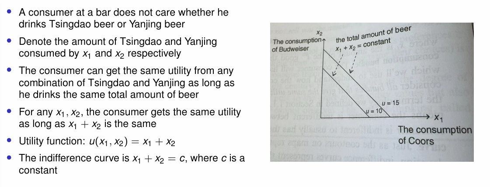
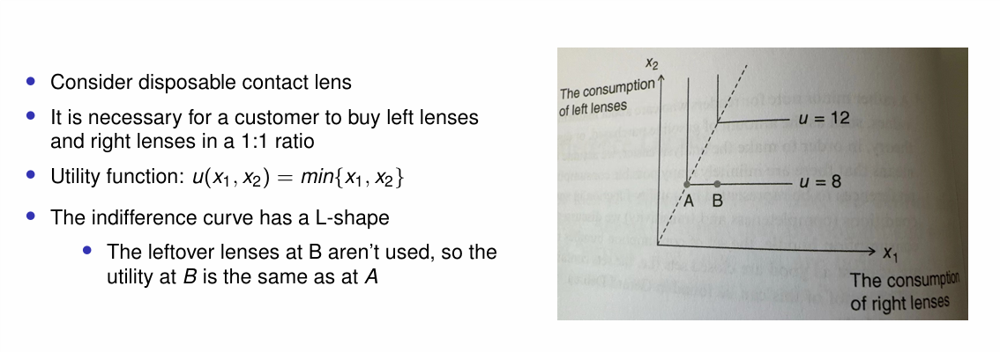
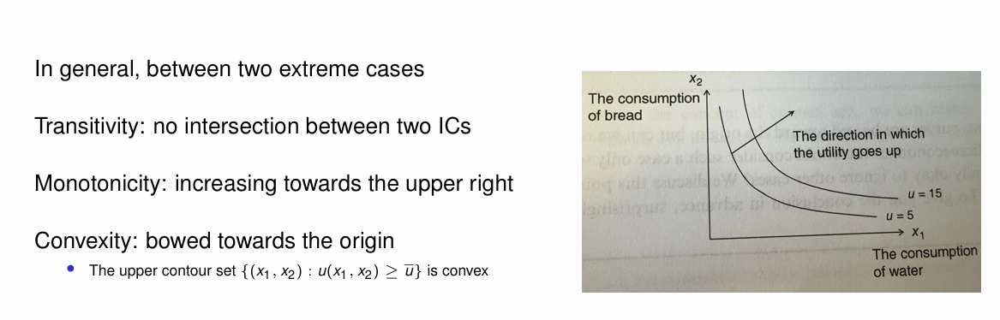
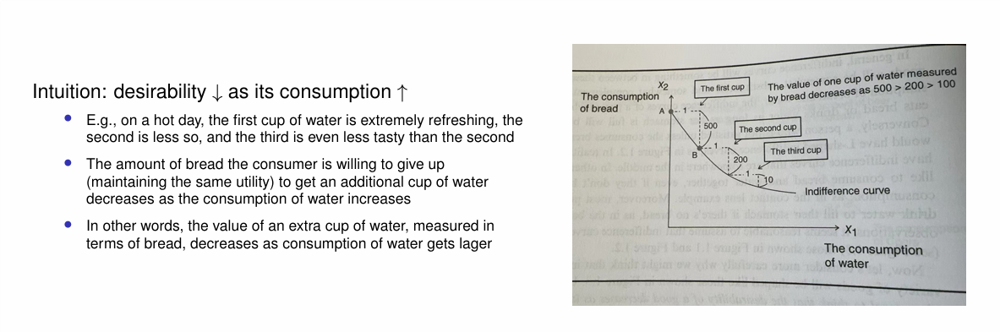
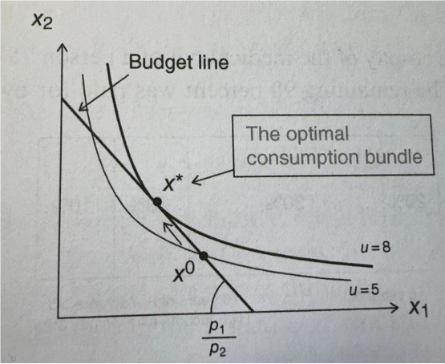
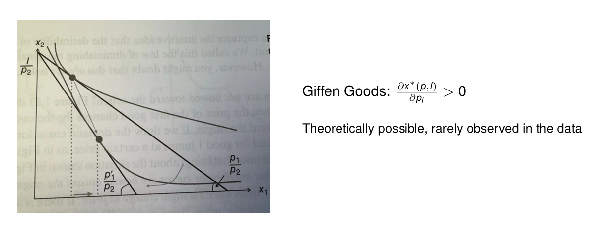
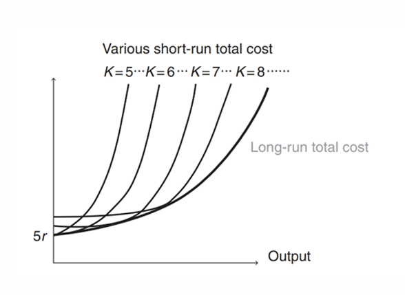
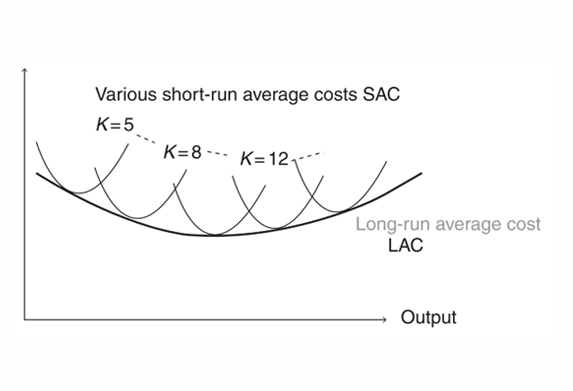
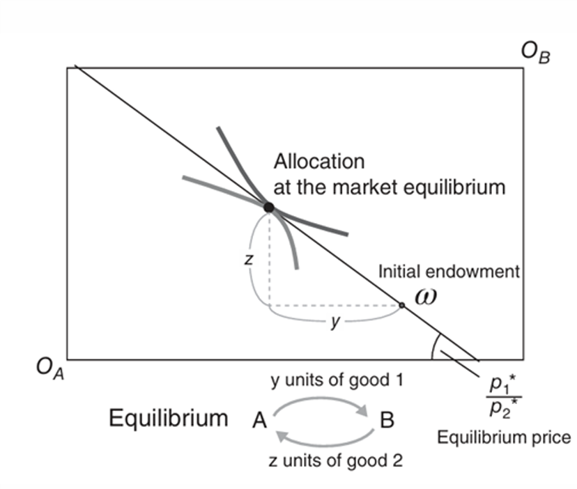

# 中级微观经济学 { #top }

**写在前面**

中微一点儿也不数学！

本笔记偏向语文（雾），写给具备高等数学基础知识的读者，因此不会赘述一些简单的数学知识。这包括：多元函数的偏导、隐函数定理、拉格朗日乘数法、全序集、Zorn 引理。同时本文仅作为笔者临考抱佛脚的复习，不会写过多的动机，之后有空也许会补，见谅。

**偏好(preferences)**表示一个人在两个选项之间的首选。

- 苏打水比啤酒更受欢迎(is preferred to)：苏打水 $\succ$ 啤酒
- 苏打水和啤酒一样好(is indifferent to)：苏打水 $\sim$ 啤酒
- 若两者同时满足，称苏打水不比啤酒差(is weakly preferred to)：苏打水$\succeq$啤酒

而后自然是在商品集合 $X$ 上定义一个人的偏好对应的全序集，由 Zorn 引理我们一定能得到这个人最喜欢的东西。

**效用函数(Utility function)** $u:X\rightarrow \mathbb{R}$ 将上述的偏好具象化，对于 $x,y\in X$，$x\succeq y$ 当且仅当 $u(x)\ge u(y)$。当然这样的 $u$ 有无穷多种，我们应当如何选取效用函数呢？

**理性行为(Rational behavior)**：在一系列负担得起的选择中实现效用最大化的行为。即无论使用哪个效用函数来表示 $\succeq$，最理想的选项是相同的。

此时我们就可以将理性行为表述为约束优化问题。将理性应用于消费者行为，我们的目标是推导出需求函数，以描述商品的消费将如何随着价格变化而变化。具体来说，固定总的效用函数 $u$ 的取值，考虑此时两种（多种）商品消费的多少，这条曲线被称为**无差异曲线(indifference curves)**下面我们考虑四种情形：

{ loading=lazy }

*图 1：完美替代(perfect substitutes)*

{ loading=lazy }

*图 2：完美补充(perfect complements)*

{ loading=lazy }

*图 3：一般情况*

{ loading=lazy }

*图 4：凸性*

**边际替代率(Marginal rate of substitution)**为无差异曲线的斜率。具体而言，消费者愿意放弃的第二种商品的最大数量，以便将第一种商品的消费量增加一个单位，并保持效用固定。记为 $MRS_{12}$。

**边际替代率递减定律**：弓形无差异曲线。

**预算限制(budget constraint)**就是总价格不超过预算（中微到底在干什么）：$\sum p_ix_i\le I$。所谓**最佳捆绑消费(the optimal consumption bundle)**下图可以看的很清楚。

{ loading=lazy }

*图 5：最佳捆绑消费*

定义商品 $i$ 的效用：

$$
MU_i:\frac{\partial u(x_1,x_2,\cdots,x_n)}{\partial x_i}
$$

由微积分里的知识我们有

$$
\Delta u\sim \sum \frac{\partial u}{\partial x_i}\Delta x_i
$$

回忆边际替代率的定义，结合 $\mathrm{d}u=\frac{\partial u}{\partial x_1}\mathrm{d}x_1+\frac{\partial u}{\partial x_2}\mathrm{d}x_2$，我们有

$$
MRS_{12}=-\frac{\mathrm{d}x_2}{\mathrm{d}x_1}\Big|_{\text{u is constant}}=\frac{\partial u/\partial x_1}{\partial u/\partial x_2}
$$

显然在最佳捆绑消费时 $MRS_{12}=\frac{p_1}{p_2}$，这可以写成

$$
\frac{\partial u/\partial x_1}{p_1}=\frac{\partial u/\partial x_2}{p_2}
$$

更一般的，我们有

$$
\frac{\partial u/\partial x_1}{p_1}=\cdots=\frac{\partial u/\partial x_N}{p_N}=\lambda
$$

其中 $\lambda$ 代表收入的边际效用，具体来说，假设消费者选择最优消费捆绑，收入增加 1 时的额外效用金额为 $\lambda$，这种效用的增加并不取决于额外收入的用途。

回忆拉格朗日乘数法

$$
\mathcal{L}(x_1,\cdots,x_N,\lambda)=u(x_1,\cdots,x_N)+\lambda(I-p_1x_1-\cdots-p_Nx_N)
$$

中的 $\lambda$ 恰为上文中定义的收入的边际效用，即

$$
\frac{\partial \mathcal{L}}{\partial I}\Big|_{x^*}=\lambda
$$

上式称为**包络定理(Envelope Theorem)**（哦哦牛批这还能取个名字的）。

对于给定的 $(p,I)$，效用函数在 $x^*(p,I)$ 处取最值：

$$
u(x_1^*(p,I),x_2^*(p,I),\cdots,x_N^*(p,I))=V(p,I)
$$

$x^*(p,I)$ 称为**需求函数(Demand function)**。我们有**罗尔恒等式(Roy's identity)**：

$$
x_i^*=-\frac{\partial V(p,I)/\partial p_i}{\partial V(p,I)/\partial I}
$$

**需求定律(Law of Demand)**（这不是废话吗）：对于几乎所有商品，对商品的需求都会随着价格的上涨而减少

$$
\frac{\partial x^*(p,I)}{\partial p_i}<0
$$

例外：

{ loading=lazy }

*图 6：吉芬商品*

**补偿需求函数** $\bar{x}$ 是支出最小化问题的解决方案：

$$
\min_x px=p_1x_1+\cdots+p_Nx_N \text{ s.t. } u(x)=u
$$

若 $\frac{\partial \bar{x}_i}{\partial p_j}>0$ 则称商品 $i$ 和商品 $j$ 是**替代品(substitutes)**，若 $\frac{\partial \bar{x}_i}{\partial p_j}<0$ 则称商品 $i$ 和商品 $j$ 是**互补品(substitutes)**。当 $N=2$ 时，若 $\frac{\partial \bar{x}_1}{\partial p_2}=\frac{\partial \bar{x}_2}{\partial p_1}=0$，则称商品 $i$ 和商品 $j$ 是**互补品(substitutes)**。

**Shephard's Lemma**：

$$
\frac{\partial I(p,u)}{\partial p_i}=\bar{x}_i(p,u)
$$

**替代效应(Substitution effects)**：价格上涨导致消费者转向类似商品，补偿需求功能提供了衡量“相似性”的工具。

**收入效应(Income effects)**：价格上涨“有效”减少了消费者的收入，它降低了购买所有商品的能力。

**Slutsky 分解(The Slutsky decomposition)**将替代效应和收入效应放在一起：

$$
\frac{x_i}{p_i}=\frac{\partial \bar{x}_i}{\partial p_i}-\frac{\partial x_i}{\partial I}x_i
$$

**价格弹性(Price elasticity)**：价格上涨 1 份时需求减少的份数

$$
\frac{-\Delta {x}_{i}/{x}_{i}}{\Delta {p}_{i}/{p}_{i}} =  - \frac{\Delta {x}_{i}}{\Delta {p}_{i}}\frac{ {p}_{i}}{ {x}_{i}}
$$

当  ${\Delta p} \rightarrow  0$ 时，价格弹性为

$$
{\varepsilon }_{i}^{D} =  - \frac{\mathrm{d}{x}_{i}/{x}_{i}}{\mathrm{d}{p}_{i}/{p}_{i}} =  - \frac{\mathrm{d}{x}_{i}}{\mathrm{d}{p}_{i}}\frac{ {p}_{i}}{ {x}_{i}}
$$

需求的交叉价格弹性：

$$
{\varepsilon }_{ij}^{D} =  - \frac{\mathrm{d}{x}_{i}/{x}_{i}}{\mathrm{d}{p}_{j}/{p}_{j}}
$$

考虑价格变动对收入的影响：

$$
\frac{\mathrm{d}px}{dp} = x + p\frac{\mathrm{d}x}{\mathrm{d}p} = x\left( {1 + \frac{p}{x}\frac{\mathrm{d}x}{\mathrm{d}p}}\right)  = x\left( {1 - {\varepsilon }^{D}}\right)
$$

- 收入随价格增加，若 ${\varepsilon }^{D} < 1$
- 收入不随价格变化，若 ${\varepsilon }^{D} =1$
- 收入随价格减少，若 ${\varepsilon }^{D} > 1$

在效用最大化下，补偿需求的价格导数是对称的：

$$
\frac{\partial \bar{x}_i}{\partial p_j}=\frac{\partial \bar{x}_j}{\partial p_i}
$$

**完全竞争假设(Perfect competition assumption)**： 如果单个生产者改变其生产，则由市场决定的价格不会改变，因为生产者众多。即在利润最大化问题

$$
\max_{L\ge 0}pf(L)-wL
$$

中 $p$ 和 $w$ 是常数

**成本函数(cost function)**：$C(y)$

**AC(Average cost)**：$\frac{C(y)}{y}$

**MC(Marginal cost)**：$C'(y)$

**AVC**：广义平均可变成本

Firm behavior 大概就是说一些生产行为需要一定的“启动资金”，抽象废话一堆。

考虑公司使用两个投入生产产出 $y$：劳动力 $L$ 和资本 $K$

- 劳动力：短期可调整投入
- 资本：长期可调整投入

长期生产函数：$y = f(L,K)$，短期生产函数可以写成 $y = f(L) = f(L,\bar{K})$

将输入翻 $t(>1)$ 倍：

- **恒定规模回报(CRS )**：$y(tL,tK)=ty(L,K)$，一些重复劳动，如农业生产 ， 纺织 ， 理发店。
- **上升规模回报**：$y(tL,tK)>ty(L,K)$，理论上不存在，往往表明有隐含成本。
- **下降规模回报**：$y(tL,tK)<ty(L,K)$，规模提升效率随之提升，如物流、电信、输电，这会导致**垄断**。

以劳动力和资本为投入的企业利润最大化问题：

$$
\pi(L,K;p,w,r)=\max_{L,K}pF(L,K)-(wL+rK)
$$

同上定义完全竞争假设：无论企业选择什么 $L$ 和 $K$，$p$、$w$、$r$ 都是固定不变的参数。

**租赁资本假设(Leased capital assumption)**

- 一旦购买了机械，就可以多次使用
- 购买价格不适合单期利润最大化
- 假设公司每期都以 $r$ 率租用资本

由一阶条件我们有

$$
p\frac{\partial F}{\partial L}=w,p\frac{\partial F}{\partial K}=r
$$

进而

$$
\frac{\partial F/\partial L}{\partial F/\partial K}=MRTS_{LK}=\frac{w}{r}
$$

于是我们可以通过比较 $MRTS_{LK}$ 与 $\frac{w}{r}$ 的大小来判断如何调整劳动力与资本以获得最高利润。而 $MRTS_{LK}=\frac{w}{r}$ 的 $F$ 当然是下最优化问题的解：

$$
\min_{L,K} wL+rK\text { s.t. }F(L,K)=y
$$

长期总成本(LTC)曲线为所有短期成本曲线的包络

{ loading=lazy }

*图 7：LTC 曲线*

长期平均成本(LAC)曲线为所有短期平均成本成本曲线的包络

{ loading=lazy }

*图 8：LAC 曲线*

考虑多个输入、输出的情形，对于生产计划 $y$，利润可以写成

$$
py=p_1y_1+\cdots+p_Ny_N
$$

这里 $y_k$ 的正负由它是输入还是输出决定。记号变为(抽象废话)

$$
\max_{y\in Y}py\text { s.t. }  y\in Y
$$

该问题最优解记为 $y^*(p)$。

**供给定律(Law of Supply)**： 供给曲线必然向上倾斜。如果一种产出的价格上涨，那么该产出的产量要么增加，要么保持不变。

**市场需求**是所有个体需求曲线的横向总和：

$$
D(P)=D^1(P)+\cdots+D^n(P)
$$

**市场供给**是所有单独供给曲线的水平总和：

$$
S(P)=S^1(P)+\cdots+S^n(P)
$$

**消费者剩余(CS)**：消费者从市场交易中获得的利益（以美元计）。

**个人需求**：个人可以购买多件商品，且对不同数量商品有对应的的支付意愿（WTP），如果 $WTP>p$，则购买之。此时 $CS=\text{所有交易的} (WTP-p) \text{总和}$。另一种解释：每个人最多只能购买一种商品，每个人的 WTP 是不同的，需求者按 WTP 从高到低的顺序排列，如果 $WTP>p$，则购买，此时 $CS=\text{所有参与交易的个人的}(WTP-p)\text{之和}$。**若购买量是连续的，则将求和改为积分即可。**

上段分析的漏洞在于**需求并不能衡量 WTP，且忽略了收入效应带来的效用变化**。

**准线性效用** CS 可准确衡量消费者从市场交易中获得的利益：

$$
V(Q,m)=U(Q)+m
$$

其中 $Q$ 代表消耗的可乐升数，$m$ 代表优化消费其他商品的剩余资金，$U(Q)$ 代表消费 $Q$ 升可乐的效用，$U(Q)'' < 0$，此时我们通常假设有足够的收入，以排除边界解。

在准线性效用条件下，收入效应为零。

准线性效用下的最优消费

$$
P =U'(Q)
$$

需求代表相关商品的边际效用 $U'(Q)$。$U'(Q)$衡量消费者对额外一升可乐的 WTP：

$$
WTP=-\frac{\mathrm{d}m}{\mathrm{d}Q}=\frac{\partial V/\partial Q}{\partial V/\partial m}=U'(Q)
$$

此时 WTP 体现为在效用固定的情况下，消费者愿意为多买一单位可乐而放弃的最大数量。如果当前消费水平下 $U'(Q)= 2$ 美元，那么如果消费者再喝一罐可乐，她的收入就会增加 2 美元。

局部均衡侧重于一个市场，但往往存在跨市场的溢出效应。一种商品的价格上涨不仅会影响其自身的消费，还会影响其替代品和互补品的市场。**一般均衡**将生产所有商品的所有企业和所有消费者整合到一个模型中，这里的商品既可以是其他企业的投入品，也可以是消费者的最终产品，消费者也可以是生产的劳动力投入者。

考虑如下模型：商品 $n = 1,2,\cdots,N$，价格 $p = (p_1,\cdots ,p_N)$，企业 $j = 1,2,\cdots ,J$，生产计划：$y^j = (y^j_1,y^j_2,\cdots ,y^j_N)$，这里如果 $n$ 是产出，则 $y^j_n > 0$，否则 $y^j_n < 0$ ，生产可能性集 $Y^j$：所有可行的生产计划。此时利润最大化问题转化为

$$
\max py^j \text{ s.t. } y^j\in Y^j
$$

公司 $j$ 的最优生产计划记作 $y^j(p)$。

现有消费者 $i = 1,2,\cdots ,I$，商品初始储量 $w^i = (w^i_1,\cdots,w^i_N)$，企业 $j$ 的利润分配给家庭 $i$ $\theta_{ij}$ 份， $\sum_i \theta_{ij} = 1$， 捆绑消费组合 $x^i = (x^i_1,\cdots,x^i_N)$，则预算约束为

$$
px^i=pw^i+\sum_j \theta_{ij}py^j(p)
$$

效用最大化问题转化为：

$$
\max_{x^i}u^i(x^i)\text{ s.t. }px^i=pw^i+\sum_j \theta_{ij}py^j(p)
$$

消费者 $i$ 的最佳捆绑消费组合记作 $x^i(p)$。

于是整个经济系统可以被描述为

$$
\left\{u^i,w^i,Y^j,\theta^{ij}\right\}_{i=1,j=1}^{I,J}
$$

**经济均衡**包括一组关于价格 $p$ 与资源分配 $x^i(p),y^j(p)$，使得：

- 给定价格 $p$，$x^i(p)$ 解决消费者 $i$ 的效用最大化问题。

- 给定价格 $p$，$y^j(p)$ 解决生产者 $j$ 的利润最大化问题。

- $p$ 平衡市场需求和市场供给

    $$
    \sum_i x^i_n(p)=\sum_j y^j_n(p)+\sum_i w^i_n \text{ for }n=1,2,\cdots,N
    $$

    或者

    $$
    x_n(p)=y_n(p)+w_n
    $$

那么这样的均衡一定存在吗？考虑**超额需求函数**

$$
z_n(p)=x_n(p)-y_n(p)-w_n(p)
$$

$z_n>0$ 表示供不应求，反之为供过于求。

**Walras's Law**：对所有价格 $p$ 与超额需求函数 $z_n(p)$，我们有 $pz_n(p)=0$。

当所有价格都是正数时（没有商品是“免费”的），该定律意味着：一个市场的需求过剩意味着另一个市场的供给过剩；如果 $N$ 个市场中的 $N -1$ 个处于均衡状态，那么剩下的市场也一定处于均衡状态。

由 Brouwer 不动点定理，当 $z_n(p)$ 关于 $p$ 连续时，经济均衡一定存在。具体证明不赘述。

**Pareto 改进**：不损害任何人，但至少使一人受益。

**Pareto 效率**：没有 Pareto 改进。

考虑两个消费者与两种商品组成的市场经济，可以遇见的，处于市场均衡状态时，两者的无差别曲线相切。

{ loading=lazy }

*图 9：市场均衡*

**福利经济学第一基本定理**：完全竞争市场均衡总是在满足如下条件下实现资源的 Pareto 效率配置。条件： 每个消费者都有一种商品，其消费可以连续变化，而且消费的增加会增加效用（局部非饱和）。

**福利经济学第二基本定理**： 任何具有 Pareto 效率的资源配置都可以通过完全竞争的市场均衡来实现，在某些条件下，通过使用一次总付税和一次总付补贴来重新分配收入，可以实现完全竞争的市场均衡。条件：在其他技术条件中，主要条件有每个消费者的无差异曲线都向原点弯曲，每个企业的生产可能性集都是凸的。

称分配 $a=(x^1,\cdots,x^I,y^1,\cdots,y^J)$ 是**可行的**，若对任意 $i,j$ 都有

$$
\sum_i x^i\le \sum_i w^i+\sum_j y^j \text{ 且 }y^j\in Y^j
$$

称从一种可行的分配 $a$ 转移到另一种分配 $\bar{a}$ 是一种**Pareto 改进**，如果 $u(\bar{x}^i)\ge u(x^i),\forall i$ 且 $u(\bar{x}^i)>u(x^i),\exists i$。

称一种分配 $a$ 是**Pareto 效率**的，若 $a$ 是可行的且没有 Pareto 改进。

**效率条件：**对任意 Pareto 效率，存在 $p_1,\cdots,p_k$ 满足：

- 对任意消费者 $i$ 与商品 $a,b$：

    $$
    MRS_{ab}^i=\frac{p_a}{p_b}
    $$

- 对将商品 $h$ 加工为 $k$ 的工厂 $j$ ：

    $$
    p_k\frac{\partial F^j}{\partial x_h}=p_h
    $$

这里 $p_1,\cdots,p_k$ 称为**影子价格**。可以推得如下结论：对生产商品 $a$ 的工厂 $\alpha$ 与生产商品 $b$ 的工厂 $\beta$，均使用同样的输入商品 $h$，有

$$
MRT_{ab}=\frac{\partial F^\alpha_b/\partial x_h}{\partial F^\beta_a/\partial x_n}=\frac{p_a}{p_b}=MRS_{ab}
$$

这里 $MRT_{ab}$ 称为**边际转化率**。

在完全竞争条件下，企业是“价格接受者”。实际上，大多数市场都处于不完全竞争状态，少数企业可以掌握定价（市场）权力。**垄断**是指市场上只有一家生产商，垄断企业可以通过改变其产出水平来影响市场价格，可以预测垄断者会做什么，只需优化即可。 **寡头垄断**描述的是企业数量较少的不完全竞争市场，优化不足以预测企业在寡头垄断中的行为。需要博弈论来预测会发生什么。总的来说，**市场结构决定商品供应**。

在完全竞争市场中，单个企业面临一条水平的需求曲线。如果单个企业将其价格提高到高于当时的市场水平，则需求降至零；当单个企业将其价格降低到现行市场水平以下时，需求扩大到无穷大。原因在于存在无数个相互竞争的生产者和无数个消费者。

而垄断企业面临一条向下倾斜的需求曲线，要生产更多的产品并在市场上销售，就必须降低价格。垄断者只能收取单一价格（我们假设为单一价格）。降低的价格适用于边际消费者和次边际消费者。垄断者可以通过选择产量 $Q$ 来决定市场价格 $P$。

当利润最大化时，$MR(Q)=MC(Q)$。在完全竞争市场中，$MR(Q)=P$，与 $Q$ 无关。而对于垄断者而言，

$$
MR(Q)=P+\dfrac{\partial P}{\partial Q}Q
$$

垄断者通过需求弹性定价

$$
\dfrac{P-MR}{P}=\dfrac{1}{\varepsilon}
$$

垄断市场与完全竞争市场相比产出较低，价格较高，且不平等： 生产者获得更多利润，而消费者剩余较少。固定成本巨大的行业更有可能是垄断行业，固定成本过高的市场被称为**自然垄断市场**，例如电力公司。建造水电站大坝或核反应堆的固定成本巨大。监管平衡了技术效率与市场支配力之间的权衡。一种解决方案是允许垄断，但实行价格监管。

**博弈论**：一种考虑如何预测他人的信念并进而预测其决定的理论。

**同时决策**：每个人同时做出决定，且做决定时不观察对手的决定。

**博弈**：玩家 $i=1,\cdots,N$ 为博弈的参与者，决策 $a_i\in A_i$ 根据游戏中迄今为止发生的情况制定的行动计划，回报 $g_i(a_1,\cdots,a_N)$。

**纳什均衡**是博弈中最常见、最基本的解法：对决策 $a=(a_1,\cdots,a_N)$，玩家 $i$ 对决策 $a^*=(a^*_1,\cdots,a^*_n)$ 的**单方面偏离**是

$$
(a_i,a^*_{-i})=(a^*_1,\cdots,a_i,\cdots,a^*_n)
$$

一个决策 $a^*$ 是纳什均衡的若对任意 $i$ 与 $a_i$，

$$
g(a^*)\ge g(a_i,a_{-i}^*)
$$

**最佳决策**：从信念到决策的映射，通过最优化问题得到：

$$
BR(a_{-i})=\mathrm{arg}\max_{a_i} g_i(a_i,a_{-i})
$$

纳什均衡有两个假设条件：

- 理性：给定信念的最佳反应
- 一致性：信念与实际行动一致

一个人效用函数的**曲率**体现了他对风险的看法。

**纳什均衡的存在性**：对于任何具有有限数量博弈者的博弈，每个博弈者都有有限数量的纯策略，则存在一个纳什均衡（可能是混合策略均衡）。

---

## PDF 原文 { #pdf }

[打开原文件](../../assets/intermediate-microeconomics.pdf){ .md-button target="_blank" rel="noopener" }
[下载 PDF](../../assets/intermediate-microeconomics.pdf){ .md-button download="intermediate-microeconomics.pdf" }

若下方预览无法显示，可直接打开原文件或下载后阅读。

    <embed src="../../assets/intermediate-microeconomics.pdf" type="application/pdf" width="100%" height="100%">

