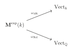
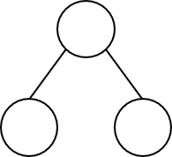
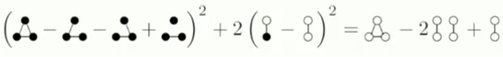

# ICBS 2024 课程报告 { #top }

## 1. The Langlands project { #s1 }

Andrew Wiles

7.15 08:30-09:30

## 2. Geometry and integers { #s2 }

Caucher Birkar

7.15 13:30-14:30

## 3. The chromatic number of random graphs { #s3 }

Annika Heckel

7.15 14:45-15:30

We define **Erdős–Rényi random graph** $G_{n,p}$ as a graph with $n$ vertices include each edge independently with probability $p$. We study properties of random graphs like well connected, diameter, size of the largest component, size of the largest clique ... It seems that a graph parameter can take make values in principle, but is very likely contained in a short interval. See the size of largest clique in $G_{n,\frac{1}{2}}$ is likely exactly $=\alpha(n)\approx 2\log_2n$.

Define the **Chromatic number** $\chi(G)$ as the smallest $r$ so that $G$ is $r$-partite. It's also means the smallest color numbers the vertices can choose so that for each edge of $G$, the end points have different color. It is well known that if $G$ is planer, then $\chi (G)\le 4$.

So what is the Chromatic number of $G_{n,p}$? We cares about upper and lower bounds, and how much does $\chi(G_n,p)$ vary?

[Bollobás'87]:

$$
\chi(G_{n,p})\sim \frac{n}{2\log_2 n}\quad whp.
$$

[H.'16]:

$$
\chi(G_{n,p})=\frac{n}{2\log_2 n-2\log_2\log_2 n-2}+o(\frac{n}{log^2n})\quad whp.
$$

Can we show that $\chi(G_{n,\frac{1}{2}})$ is **not** concentrated on 100 consecutive integers? Any non-trivial example of **non-concentrated**?

[H.'19]: $\chi(G_{n,\frac{1}{2}})$ is not concentrated whp in any sequence of intervals of length $n^{\frac{1}{4}-\epsilon}$. More formally, let $\epsilon>0$, and let $[s_n,t_n]$ be a sequence of intervals such that $\chi(G_{n,\frac{1}{2}})\in [s_n,t_n]$ whp. Then there are infinitely many values $n$ such that

$$
t_n-s_n\ge n^{\frac{1}{4}-\epsilon}.
$$

[H.,Riordan'21]: $\chi(G_{n,\frac{1}{2}})$ is not concentrated whp in any sequence of intervals of length $n^{\frac{1}{2}-\epsilon}$.

With a lot of calculation and using a new result by H.-Panagiotou 23:

[H.,Riordan'21; H.,Panagiotou'23]: $\chi(G_{n,\frac{1}{2}})$ is not concentrated whp in any sequence of intervals of length $C\dfrac{\sqrt{n}\log \log n}{\log^3 n}$.

The **independence number** $\alpha(G)$ is the size of the largest independent vertex set (= set without edges). For most $n$:

$$
\alpha(G_{n,\frac{1}{2}})=\lfloor \alpha_0\rfloor \quad whp.
$$

where

$$
\alpha_0=2\log_2 n-2\log_2\log_2 n+2\log_2(e/2)+1 .
$$

Since every color class is an independent set, so for any graph $G$ on $n$ vertices, $\chi(G)\ge \frac{n}{\alpha(G)}$. In fact whp, $\chi (G_{n,\frac{1}{2}})\approx \frac{n}{\alpha_0-3.89}\quad$(H.'16)

## 4. The Ricci Flow { #s4 }

Richard Hamilton

7.16 08:30-09:30

## 5. The vanishing of the genus two summand of the cosmological constant in the perturbative supersymmetric String Theory { #s5 }

David Kazhdan

7.16 13:30-14:30

## 6. Interlacing Families and Ramanujan Graphs { #s6 }

Nikhil Srivastava

7.15 14:45-15:30

First let $G$ be a $d$-regular graph on $n$ vertices, its $n\times n$ adjacency matrix $A$ has real eigenvalues

$$
-d\le \lambda_n(A)\le \cdots\le \lambda_2(A)\le \lambda_1(A)=d.
$$

It is well known that $G$ is connected iff $\lambda_2<d$ and $G$ is bipartite iff $\lambda_n=-d$. We define a graph is a **spectral expander** if for all nontrivial $\lambda_i$, $\left|\lambda_i\right|\ll d$. [Alon-Boppana'86]: Every connected $d$-regular graph satisfies

$$
\lambda_2(A)\ge 2\sqrt{d-1}-o_n(1).
$$

That means the infinite $d$-regular tree $T$ is the "best" spectral expander, and for this tree, its adjacency matrix's real eigenvalues

$$
\lambda(A_T)\in [-2\sqrt{d-1},2\sqrt{d-1}].
$$

So here is a rigorous definition: A $d-$regular graph is **Ramanujan graph** if for all nontrivial $i$:

$$
\lambda_i(A)\in [-2\sqrt{d-1},2\sqrt{d-1}].
$$

i.e., in this bipartite case this must hold for $i\neq1,n$.

Fix $d\ge 3$ and let $G$ be a rando $d$-regular graph on $n$ vertices.

[Friedman'08]: With high probability for all $i\neq 1$, $\left|\lambda_i(A)\right|\le 2\sqrt{d-1}+o_n(1).$

[Chen-Garza Vargas-Tropp-van Handel'24]: Improved $o_n(1)$ to $n^{-1/8}$.

[J.Huang-McKenzie-H.T. Yau'24]: Improved $o_n(1)$ to $n^{-2/3}$(optimal).

[Bordenave-Collins'19]: For $H$ a random $n$-cover of a fixed Ramanujan graph,$\left|\lambda_i(A_H)\right|\le 2\sqrt{d-1}+o_n(1)$.

The key object here is the expected characteristic polynomial of a random cover of a fixed d-regular graph, which turns out to be related both to the finite graph and to its universal cover. Given a Hermitian random matrix $R$, consider the univariate polynomial

$$
\mathbb{E}_\chi[R] := \mathbb{E} \det(zI-R)=\sum_k z^{n-k}(-1)^k \mathbb{E}e_k(R).
$$

And for certain R, $\mathbb{E}_\chi [R]$ is real-rooted and for each $i$:

$$
\mathbb{P}[\lambda_i(R)\le \lambda_i(\mathbb{E}_\chi [R])]>0.
$$

Fix $d\ge 3$ and let $G$ be a $d$-regular graph on $n$ vertices. A 2-cover $H$ of $G$ is a $d$-regular graph on $2n$ vertices obtained as follows:

- Create two copies $G_1$ and $G_2$ of $G$.
- For each edge $uv\in G$, place parallel edges $u_1v_1,u_2v_2$ or crossed edges $u_1v_2,u_2v_1$ in $G_1\cup G_2$.

Define $A_H$ is obtained by replacing every 1 entry of $A_G$ by a $2\times 2$ permutation, preserving symmetry. Then $\lambda(A_H)=\lambda(A_G)\cup \lambda(A_s)$ where $A_s$ is the **signing** of $A$ corresponding to the permutation.At last we can prove following theorems:

**Thm A.** Every $d$-regular adjacency matrix $A$ has a signing $A_s$ such that

$$
\lambda_1(A_s)\le 2\sqrt{d-1}.
$$

**Thm B.** With nonzero probability

$$
\lambda_2(A)\le 2\sqrt{d-1}.
$$

## 7. Real groups, symmetric varieties and Langlands duality { #s7 }

Tsao-Hsien Chen

7.17 08:30-09:30

## 8. Rationality problems { #s8 }

Yuri Tschinkel

7.17 09:45-10:45

## 9. New Frontiers in Structure vs Randomness with Applications to Combinatorics, Complexity, Algorithms. { #s9 }

Raghu Vardhan Reddy Meka

7.17 13:30-14:30

There is a question called **3-Term Arithmetic Progression**: How many numbers can we choose from $\{1,2,\cdots,N\}$ without three equally spaced numbers? We start with 1,2. Skip 3. Add 4,5. Skip 6,7,8,9 ... We pick $\approx N^{0.63}$ numbers!

[Erdos-Turan'36]: Subset $A$ of $\left\{ 1,2,\cdots,N\right\}$, $\left| A\right|=\delta N$. How small can $\delta$ be while guaranteeing a 3AP in $A$?

[Behrend'46]: $\delta>2^{-O(\sqrt{\log N})}$.

[Roth'53]: $\delta\approx 1/(\log \log N)$

[Heath-Brown, Szemeredi'87-90]: $\delta\approx 1/(\log N)^c$, $c$ small.

[Bourgain'99,08]: $\delta\approx 1/(\log N)^{1/2},1/(\log N)^{2/3}$.

[Sanders'11]: $\delta\approx (\log \log N)^6/(\log N)$.

[Blook Sisask'20]: $\delta\approx 1/(\log N)^{1+c}$ suffices.

[KM'23]: $\delta\approx 2^{-\Omega((\log N)^{0.09})}$ suffices.

## 10. Around the Alexandrov-Fenchel Inequality { #s10 }

Ramon Van Handel

7.17 14:45-15:30

## 11. Euler's constant and exponential motives { #s11 }

Javier Fresán

7.18 08:30-09:30

We know that Euler's constant

$$
C := \lim (1+\frac{1}{2}+\cdots +\frac{1}{n}-\log n)
$$

plays an important role in Analysis. This talk here is to give some properties of $C$, **and mainly to prove that $C$ can be express algebraically with the help of $\pi$ and $\log 2$.**

Appell's computation rely on the fact that $-C$ is equal to the derivative of the gamma function

$$
\Gamma (z)=\int_0^\infty e^{-x}x^{z-1}dx
$$

at z=1. He use the notation

$$
\begin{aligned}
\Gamma'(1) &=\lambda=-C \\
\Gamma'(1/2) &=\mu
\end{aligned}
$$

and prove the equality

$$
\lambda=\frac{\mu}{\sqrt{\pi }}+2\log 2
$$

After that he makes a mistake so the proof is not correct.

The $n$-th derivative of the gamma function at $z=1$ is equal to

$$
\Gamma^{(n)}(1)=\int_0^\infty (\log x)^ne^{-x}dx=P_n(\gamma)
$$

where $P_n\in \mathbb{Q}(\zeta(2),\cdots,\zeta(n))[T]$ is a polynomial of degree $n$ satisfying the recurrence relation $P_n'=-nP_{n-1}$. We also have

$$
\Gamma^{(n)}(1/2)=\sqrt{\pi }Q_n(\gamma+\log 4)
$$

where $Q_n$ is obtained by replacing $\zeta(k)$ with $(2^k-1)\zeta(k)$ in the coefficients of $P_n$.

One way to think of the theory of motives is as a

$$
\text{Galois theory for periods} \int_\sigma \omega
$$

or, more geometrically, for higher dimensional algebraic varieties. Exponential motives aim to be a Galois theory for integrals

$$
\int_\sigma e^{-f}\omega
$$

or algebraic varieties along with a regular function.

Let $k\subset \mathbb{C}$ is a subfield, $X$ is a smooth algebraic variety over $k$(e.g. $X$ affine), $f:X\rightarrow \mathbb{A}_k^1$ a regular function. We define:

**Twisted de Rham cohomology**

$$
\begin{aligned}
{\mathrm{H}}_{\mathrm{ {dR}}}^{n}\left( {X,f}\right)  = {\mathbb{H}}_{\mathrm{ {Zar}}}^{n}\left( {X,{\mathcal{O}}_{X} \rightarrow  {\Omega }_{X}^{1} \rightarrow  {\Omega }_{X}^{2} \rightarrow  \cdots }\right) \\
\omega  \mapsto  {d\omega } - {df} \land  \omega
\end{aligned}
$$

**Rapid decay homology**

$$
\begin{aligned}
{\mathrm{H}}_{n}^{\mathrm{ {Rd}}}\left( {X,f}\right)  = \mathop{\lim }\limits_{ {t \rightarrow   + \infty }}{\mathrm{H}}_{n}^{\mathrm{ {sing}}}\left( {X\left( \mathbb{C}\right) ,\{ \operatorname{Re}\left( f\right)  \geq  t\} ;\mathbb{Q}}\right) \\
\sigma  = {\left( {\sigma }_{t}\right) }_{t},\;\operatorname{Re}\left( {f\left( x\right) }\right)  \geq  t\text{ for }x \in  \partial {\sigma }_{t}
\end{aligned}
$$

There is an integration pairing

$$
\begin{aligned}
{\mathrm{H}}_{\mathrm{ {dR}}}^{n}\left( {X,f}\right)  \otimes  {\mathrm{H}}_{n}^{\mathrm{ {Rd}}}\left( {X,f}\right)  &\rightarrow  \mathbb{C}\\
\left\lbrack  \omega \right\rbrack   \otimes  \left\lbrack  \sigma \right\rbrack   &\mapsto  {\int }_{\sigma }{e}^{-f}\omega  = \mathop{\lim }\limits_{ {t \rightarrow   + \infty }}{\int }_{ {\sigma }_{t}}{e}^{-f}\omega
\end{aligned}
$$

which is perfect. When $k\subset \bar{\mathbb{Q}}$, the coefficients of this pairing are called

**exponential period**

Following ideas of Kontsevich, and Nori, in joint work with Peter Jossen,we built a $\mathbb{Q}$-linear neutral tannakian category ${\mathbf{M}}^{\exp }\left( k\right)$ of exponential motives over $k$, with fiber functors

{ loading=lazy }

This category contains objects ${\mathrm{H}}^{n}\left( {X,Y,f}\right)$ ,which are mapped by ${\omega }_{\mathrm{ {dR}}}$ and ${\omega }_{\mathrm{ {Rd}}}$ to twisted de Rham cohomology and rapid decay cohomology (=linear dual of rapid decay homology).

For each exponential motive $M$, there exists an algebraic group

$$
G_M\subset \mathrm{GL}(\omega_\mathrm{Rd}(M))
$$

and an equivalence of categories

$$
\langle M{\rangle }^{ \otimes  } \simeq  \mathbf{Rep}_{\mathbb{Q}}\left( {G}_{M}\right)
$$

Conjecture (extension of Grothendieck's period conjecture)

$$
\operatorname{trdeg}\mathbb{Q}\left( {\text{exponential periods of }M}\right)  = {\dim }_{\mathbb{Q}}{G}_{M}.
$$

However, an object $H^n(X,f)$ can be classical for non-zero $f$.

## 12. Quantum advantage in scientific computation? { #s12 }

Lin Lin

7.18 09:45-10:45

## 13. When are structures robust under randomness? { #s13 }

Huy Tuan Pham

7.18 14:45-15:30

## 14. Graph limits and homomorphism density inequalities { #s14 }

Fan Wei

7.19 08:30-09:30

We first define **Graph homomorphism density**.

$$
\mathrm{hom}(H,G)=\#\left\{\text{mapping from }V(H) \text{ to } V(G) \text{ that preserves edges}\right\}
$$

Homomorphism density:

$$
t(H,G)=\mathrm{hom}(H,G)/\left|V(G)\right|^{\left|V(H)\right|}
$$

This variable can encode power sums of eigenvalues of a graph $G$, number of $q$-colorings of $H$, number of stables sets of H, Eulerian graph or not, max cut ...

We have a few question to ask about large graphs:

- Property testing: design fast randomized algorithms to test whether a graph has a property or not. Graph connected? Graph triangle-free? Pattern containment?
- Parameter estimation: approximate the number of triangles, the maximum cut, average degree.
- Model the large network: Erdos-Renyi random graph model $G(n,p)$; Randomly growing graphs.
- Globally approximate a large network: a "scaled-down" description.
- Sampling (local information) implies global information?

So we define **Graph limits**. A **graphon** is a measureble symmetric function

$$
W:[0,1]^2\rightarrow [0,1]
$$

where $[0,1]$ is set of "vertices", $W(x,y)$ is edge weight between vertex $x$ and vertex $y$.

Distance on graphs to define convergence: **cut norm** $\parallel \cdot\text{ }  {\parallel }_{\square }$ .

$$
\parallel U{\parallel }_{\square } = \mathop{\sup }\limits_{ {S,T \subset  \left\lbrack  {0,1}\right\rbrack  }}\left| { {\int }_{S \times  T}U\left( {x,y}\right) {dxdy}}\right| .
$$

Under cut norm, $W=0.5$ is the limit of Erdos-Renyi graph $G(n,0.5)$.

Homomorphism density to graphons. $\Delta$ -density in $W$:

$$
t\left( {\Delta ,W}\right)  = {\int }_{ {\left\lbrack  0,1\right\rbrack  }^{3}}W\left( { {x}_{1},{x}_{2}}\right) W\left( { {x}_{1},{x}_{3}}\right) W\left( { {x}_{2},{x}_{3}}\right) d{\mu }^{3}.
$$

Similarly, we define:

$$
t\left( {H,W}\right)  = \int \mathop{\prod }\limits_{ {\left( {i,j}\right)  \in  E\left( H\right) }}W\left( { {x}_{i},{x}_{j}}\right) d{\mu }^{\left| V\left( H\right) \right| }.
$$

A **kernel** is a bounded measurable symmetric function $W : {\left\lbrack  0,1\right\rbrack  }^{2} \rightarrow  \mathbb{R}$. Kernels are "limit" of all weighted graphs (with arbitrary edge weights). Some graph parameters can only be written as density to kernels but not graphons. Many classical extremal combinatorics questions can only be written as density inequalities in kernels. (Ramsey multiplicity, local optimizer etc). The previous fundamental theorems also "extend" to kernels.

Now we have fundamental questions: Which inequalities between subgraph densities are valid? Is there a unified algorithm to prove them? What are the extremely constructions?

- $t(${ style="height: 1.4em; vertical-align: middle;" }$,W)=\int W(x,y)W(x,y')dydy'dx=\int (\int W(x,y)dy)^2dx\ge 0$

- $t(${ style="height: 1.4em; vertical-align: middle;" }$,W)\ge 2t(${ style="height: 1.4em; vertical-align: middle;" }$,W)^2-t(${ style="height: 1.4em; vertical-align: middle;" }$,W)$ since

    { loading=lazy }

    *图 1：Goodman [1959]*

Is there a systematic way to prove graph homomorphism polynomial inequalities? Actually, for graphon, we have:

[Lovasz, Szegedy'12] Every graph homomorphism inequalities into graphons can be expressed as an **infinite** sum of square.

[Hatami and Norine'11] It is undecidable whether a graph homomorphism polynomial inequality holds for all graphons $W$.

And for kernel:[Lovasz'00]: $t(H,W)\ge 0$ for all kernels $W$ iff H is a square.

## 15. Derived approach to highest weight categories { #s15 }

Alexey Bondal

7.19 09:45-10:45

## 16. From Coxeter-Conway friezes to cluster algebras { #s16 }

Bernhard Keller

7.19 11:00-12:00

## 17. A renormalisation group perspective on functional inequalities { #s17 }

Thierry Bodineau

7.19 14:45-15:30

## 18. Topology and Artificial Intelligence { #s18 }

Jie Wu

7.22 13:00-14:00

**How could mathematics and AI do for each other?**

AI for Mathematics: Help carrying out difficult calculations in math, such as computing homotopy groups, predict conjectures (say, structures of homotopy groups, patterns in spectral sequences) ...

Mathematics for AI:

- Scientific interpretation
- Improving computations— saving computing costs, or providing more meaningful supervision...
- Explore methods to get proper features of data and combine them with machine learning.
- Explore new learning models.
- Develop new mathematical theories motivated from AI.

Some fundamental problems:

- Big data brings the complexity of the world to the scientists
- The departure of AI from domain expert means that there are huge gaps	between domain science and the complex reality.
- It demands New Science for AI (actually complex real world).

In topological part, the authors were able to find a new relation between algebraic and hyperbolic invariants of a knot. To achieve this they trained a classifier (predicting the curvature) on a	large diverse dataset of knots and their various invariants. After training they isolate the three most relevant invariants and	confirmed that they are enough for predicting curvature with the same accuracy. Finally mathematicians were able to prove the conjectured	correspondence between these invariants.

The words "Topology for AI" here are given in a broader view in the sense	that it includes:

- the applications of topology combined with machine learning or deep	learning in data analytics
- topological deep learning
- mathematical research guided by potential applications to AI or data

This talk mainly present our research on topological foundations of	high-order interaction complex networks. Properly understanding on high-order interaction is the most challenging problem in complex network. There are limited mathematical tools, by comparing with pairwise interaction networks that have many math tools from graph theory.	A challenge to mathematics: traditional mathematical approaches do NOT even understand well for the 3-body problem. It demands new mathematical ideas/approaches for understanding high-order interactions.

## 19. Classification of simple separable amenable C\*-algebras { #s19 }

Zhuang Niu

7.23 09:15-10:15

## 20. Infinitary combinatorics and finitary arithmetic { #s20 }

Chi Tat Chong

7.23 10:30-11:30

## 21. On A Finitary Formal Meta-theory of Meta-mathematics { #s21 }

Qi Feng

7.23 13:00-14:00

## 22. Random walk on dynamical percolation: separating critical and supercritial regimes { #s22 }

Yuval Peres

7.24 09:15-10:15

## 23. Computational Quantum Mechanics in Phase Space — An Attempt to Break the Curse of Dimensionality { #s23 }

Sihong Shao

7.24 10:30-11:30

## 24. A Geometrical Interpretation of Universally Quantified Inequalities and Its Applications to Different Branches of Mathematics { #s24 }

Raymond W. Yeung

7.25 09:15-10:15

## 25. Analysis from a boldface recursion theory point of view. { #s25 }

Liang Yu

7.25 10：30-11：30

## 26. Reverse-mathematical reconsideration of lower-level Borel games { #s26 }

Kazuyuki Tanaka

7.25 13：00-14：00

## 27. Toward a density Corradi–Hajnal theorem for degenerate hypergraphs { #s27 }

Jianfeng Hou

7.25 14:15-15:15

## 28. The combinatorics of finite simple groups { #s28 }

Tao Feng

7.25 15:30-16:30

## 29. Rainbow perfect matchings in 3-partite 3-uniform hypergraphs { #s29 }

Hongliang Lu

7.26 08:00-09:00

## 30. Hypergraph bipartite Turan problems { #s30 }

Jie Ma

7.26 09:15-10:15

---

## PDF 原文 { #pdf }

[打开原文件](../../assets/icbs2024-report.pdf){ .md-button target="_blank" rel="noopener" }
[下载 PDF](../../assets/icbs2024-report.pdf){ .md-button download="icbs2024-report.pdf" }

若下方预览无法显示，可直接打开原文件或下载后阅读。

    <embed src="../../assets/icbs2024-report.pdf" type="application/pdf" width="100%" height="100%">

