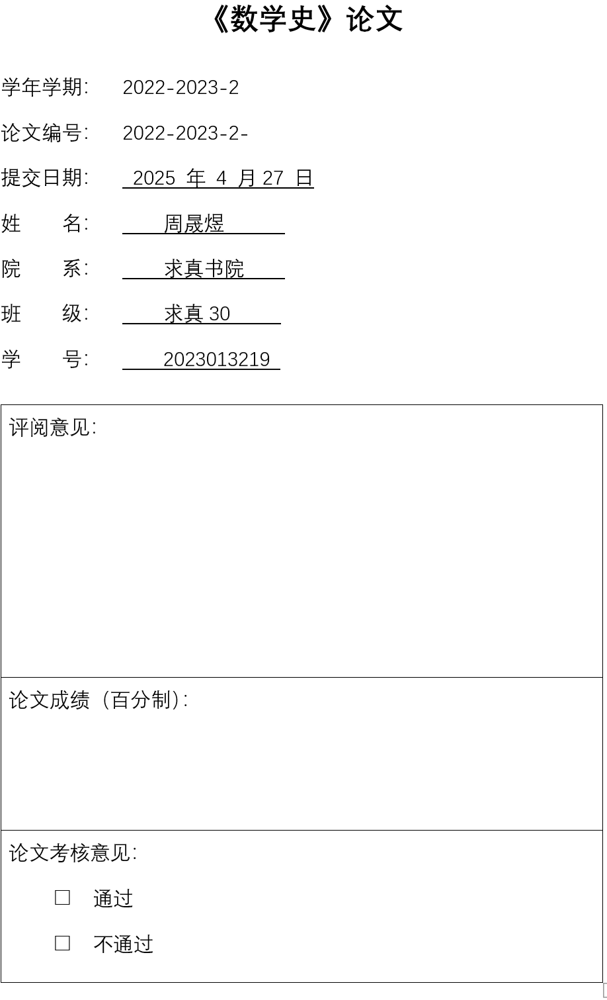
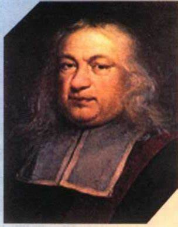
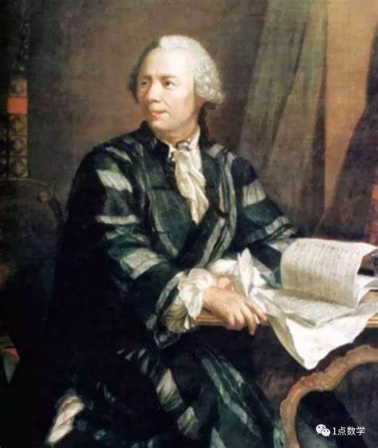
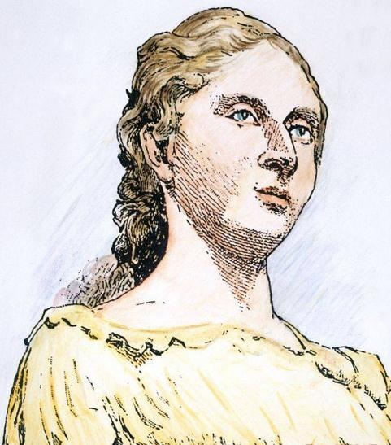
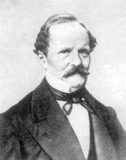
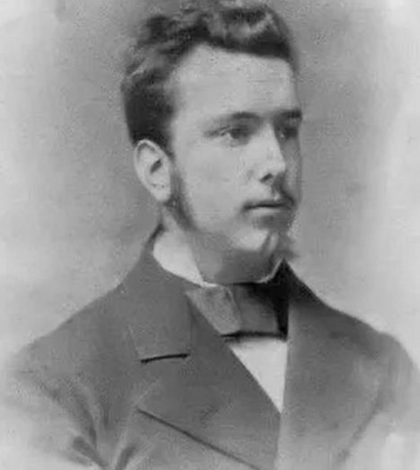
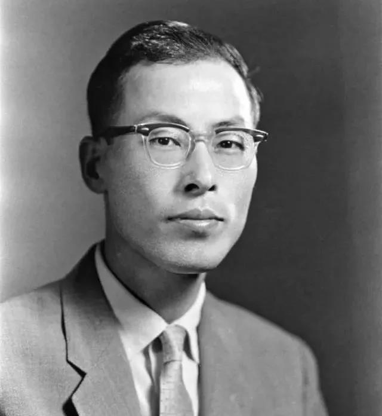

# 数学史论文（二）：费马大定理 { #top }

本文是[数学史论文](math-history.md)系列的第二篇。

{ loading=lazy }

## 1. 前言 { #s1 }

人类对自然数的认识曾经历了一个极其漫长的时间。随着自然数的出现，有两种性质截然不同的问题摆在人们面前。一类是数的应用即计算问题，也就是运用加减乘除运算得出结果，解决实际问题。另一类是数的理论问题，也就是研究数的性质及数与数之问的特殊关系。前者与实际问题紧密相关，受到古代多数民族的重视并获得了发展。但对后者的研究，却主要是古希腊人的贡献，他们脱离数量的个别性质去考查数的一般规律，由研究个别的抽象的数过渡到研究任何可能的数，从而产生出一个独立的、称为数论的分支。

在这门独特的数学分支中有着大量有趣又极难解决的问题。在上一次数学史论文中，我们已经介绍过丢番图及他在代数学方面的贡献。他在代数学发展上做出的贡献使他赢得了“代数学之父”的称号。除此外，丢番图在数论方面取得的突出成就也对后代产生了巨大影响。事实上，他划时代的《算术》一书虽包含了代数内容，具有代数学的特征，但更是一本数论著作。这书除了第一卷外，其余的问题几乎都是考虑未知数比方程数还多的问题，我们把这种问题叫不定方程。为了纪念丢番图，现在通常把这类方程叫丢番图方程，求解不定方程则被称为丢番图分析，而由求解不定方程发展起来的当代两大先进手段也被称为丢番图逼近和丢番图几何。

毕达哥拉斯及其学派埋下了西方数论的种子。随后欧几里得在《几何原本》中发展了它，再之后是天才的丢番图与他的巨著《算术》的问世。然而，其后西方数学包括数论陷人停滞不前的状态。一千多年后，当丢番图的六卷残存本出现在他身后知音费马的书桌上时，一切都改变了。

{ loading=lazy }

*图 1：费马*

费马对数论的兴趣正是由丢番图的名著激发起来的。1621	年，巴谢校订注释的《算术》希腊-拉丁文对照译本在法国出版。费马买了一本，并被其中的数论问题深深吸引住了。这本书成了他的课本，值得庆幸的是，这一拉丁版的每一页都留有宽大的书边空白，于是这书同时成了费马的笔记本。在研究丢番图的问题和解答时，他会受到激励去思考和解决一些其他相关的、更微妙的问题，然后他会草草在这些书边空白上以评注的方式写下自己的研究心得。

让现代人有些难以理解的是，费马的数学成果在其生前几乎都没有公开发表。事实上，他只是把自己的研究写在书的页边上，或者把自己的成果按照当时流行的风气，以书信的形式向一些有学问的朋友报告。原因在于，费马是被“发现新的数学奥秘”这类强烈的念头所驱使的。研究数学于他而言是一种消遣，纯粹是出于他对数学的爱好。当他自己能够创造新的未被他人触及的结果时，他会获得真正的愉悦与自我满足。因而公开发表和被人们承认对他而言没有多大意义。有意思的是，这位缄默的天才有时喜好捉弄人，他经常在信中向其他数学家发出挑战，要求他们证明自己发现的某些数学结果。

于是，当费马去世时，他的研究成果散落在旧纸堆里，或书页的空白处，或给朋友的书信中，面临着失传的危险。幸亏他的长子意识到父亲业余爱好所具有的重要意义，决心不让世界失去父亲的发现。他先是花了 5 年时间收集他父亲的注记和信件，检查他那本《算术》书的页边空白处草草写下的字迹。最后他将这些注记在《算术》的一种特殊版本中发表。1670年，他出版了《附有 P.de 费马的评注的丢番图的算术》，其中包括费马所做的 48 个评注。1679 年，他又整理出版了费马的第二卷著作，在这一卷中包括抛物形求面积法，极大极小及重心的论述，各类问题的解答，这些内容后来成为微积分的一部分。费马的研究成果终于在他去世后得以流传。这些研究成果极大地丰富了 17 世纪的数学宝库，直接推动了后来数学的发展。

在他的所有贡献中，数论方面的工作最能显示出他的才华并且对后人影响最大。在他之前，数论大体上是一些问题的汇集。是费马振兴了数论的研究，提出了为数可观的数论定理，并在数论中引入一般的方法和普遍的原理，从而把数论引上了近代的轨道，可以说，正是在他对数论的系统化后，数论才真正开始成为一门数学分支。费马也因奠定近代数论的基础，而被当之无愧地称之为“近代数论之父”。作为数论发展史上一个承前启后的人物、在高斯名著《算术研究》出版之前，数论的发展始终是跟费马的推动联系在一起的。如数学史家 E. T. 贝尔在《数学精英》中所评价的：费马是一个第一流的数学家，一个无可指责的诚实的人，一个历史上无与伦比的算术学家。

{ loading=lazy }

*图 2：欧拉*

几十年后，主要是在欧拉的努力下，费马的这些评注一个接一个地被解决了，除了一个例外。约在 1637 年，费马读到了《算术》第 2 卷第八命题“将一个平方数分为两个平方数”。灵感进发的他想到了一个更一般的问题。于是，他在这题目的旁边空白处用拉丁文写下了一段具有历史意义的文字：“将一个立方数分为两个立方数，一个四次幂分为两个四次幂，或者一般地将一个高于二次的幂分为两个同次的幂，这是不可能的。”用现代符号表示这段文字即不定方程 $x^n+y^n=z^n,(n>2)$ 没有正整数解，或一般地，没有 $xyz\neq0$ 的整数解。这就是费马问题，又叫费马猜想。中国较普遍的称为费马大定理，以与费马的另一结论费马小定理区分。而在国外更多地称为费马最后定理(Fermat's Last Theorem)，或简记为 FLT。之所以被称为“最后”定理，是因为它是需要被证明的费马评注中的最后一个。

一个可以叙述得如此简单和清晰以至于小学生就可理解的问题，后来却成了巍然屹立在数学家面前的一座珠穆朗玛峰。为这一问题增添了格外光彩的是，紧接上面一段评注文字之后费马写下的一句话：“关于此，我确信已发现一种奇妙的证法，可惜这里的空白太小，写不下。”

由于费马没有写下证明，而他的其它猜想对数学贡献良多，由此激发了许多数学家对这一猜想的兴趣。数学家们的有关工作丰富了数论的内容，涉及许多数学手段，推动了数论的发展。 德国人沃尔夫斯凯尔曾宣布以 10 万马克作为奖金奖给在他逝世后一百年内，第一个证明该定理的人，吸引了不少人尝试并递交他们的“证明”。

费马大定理被提出后，经历多人猜想辩证，历经三百多年的历史，最终在1995年，英国数学家安德鲁·怀尔斯宣布自己证明了费马大定理。

费马大定理与黎曼猜想已经成为广义相对论和量子力学融合的 $m$ 理论几何拓扑载体。

## 2. 小小的第一步 { #s2 }

首先，注意到若 $(x,y)=d>1$ 则 $d\mid z$，进而可以用 $x/d,y/d,z/d$ 代替原方程中的 $x,y,z$。$(x,z)>1$ 与 $(y,z)>1$ 同理，故不妨 $x,y,z$ 两两互素。

其次，$n>2$ 时，若 $n$ 是偶数，则要么是 $4$ 的倍数，要么是某个奇素数 $p$ 的倍数，于是我们可以只证明 $x^4+y^4=z^4$ 与 $x^p+y^p=z^p$ 没有正整数解即可。对于前者，我们先证一个引理：

!!! theorem "引理"
    不定方程 $2{x}^{2} + {y}^{2} = {z}^{2}$ 的互质正整数解 $x = {2ab}$ , $y = {a}^{2} - 2{b}^{2}$ , $z = {a}^{2} + 2{b}^{2}$ 。

??? proof "证明"
    $2{x}^{2} = {z}^{2} - {y}^{2} = \left( {z - y}\right) \left( {z + y}\right)$ ,当 $x$ 、 $y$ 、 $z$ 互质时, $y$ 、 $z$ 都是奇数,那么存在正整数 $a$ 、 $b$ ,使得 $x = {2ab}$ , $z + y = 2{a}^{2}$ , $z - y = 4{b}^{2}$ 。解得： $y = {a}^{2} - 2{b}^{2}$ , $z = {a}^{2} + 2{b}^{2}$ 。

    再看不定方程 ${x}^{4} + {y}^{4} = {z}^{4}$ 。我们只需考虑 $x$,$y$,$z$ 互质的情况，假设不定方程有正整数解，这时 $z$ 是奇数， $x$,$y$ 一个是奇数，一个是偶数。假设 $x$ 是偶数 ${2u}$ ， $y$ 是奇数，则有

    $$
    {16}{u}^{4} = {z}^{4} - {y}^{4} = \left( { {z}^{2} - {y}^{2}}\right) \left( { {z}^{2} + {y}^{2}}\right)
    $$

    必定存在正整数 $v$,$w$ ，使得 $u = {vw}$，${z}^{2} + {y}^{2} = 2{v}^{4}$ (1)，${z}^{2} - {y}^{2} = 8{w}^{4} = 2{\left( 2{w}^{2}\right) }^{2}$ (2)。

    (2)式由引理得：存在正整数 $a$,$b$ ，使 $y = {a}^{2} - 2{b}^{2}$ , $z = {a}^{2} + 2{b}^{2}$ 。代入(1)式，得 ${a}^{4} + 4{b}^{4} = {v}^{4}$ (3),其中 $a$,$v$ 是奇数。

    将(3)式写成 $4{b}^{4} = {v}^{4} - {a}^{4} = \left( { {v}^{2} + {a}^{2}}\right) \left( { {v}^{2} - {a}^{2}}\right)$ ，存在正整数 $c$,$d$ ，使得 $b = {cd}$， ${v}^{2} + {a}^{2} = 2{c}^{4}$ ($c$ 是奇数)(4)，${v}^{2} - {a}^{2} = 2{d}^{4} = 2{\left( {d}^{2}\right) }^{2}$ (5)。

    (5)式由引理得：存在正整数 $m$ , $n$，使 $v = {m}^{2} + 2{n}^{2}$ , $a = {m}^{2} - 2{n}^{2}$ 。代入(4)式，得：${m}^{4} + 4{n}^{4} = {c}^{4}$ (6)。

    对比(3)式和(6)式，$v > b$ ，而 $b = {cd}$ ,所以 $v > c$ 。假设 $v$ 是不定方程 ${x}^{4} + 4{y}^{4} =$ ${z}^{4}$ 中的 $z$ 的最小解，那么 $c$ 就是比 $v$ 更小的解，矛盾。所以 ${x}^{4} + 4{y}^{4} = {z}^{4}$ 没有正整数解，原假设不成立。

    综上所述，不定方程 ${x}^{4} + {y}^{4} = {z}^{4}$ 没有正整数解。

因此剩余的问题是证明当指数为奇素数时，费马大定理成立。后来历史表明，这是非常困难的。数学家要踏上的是一条漫长而艰难的征程。

在这一征程中，首先要对付的是指数为 3 的情形。就这一小步就花费了一百多年的时间。直到 1753 年 8 月 4 日，欧拉写信	给哥德巴赫，声称他已证明了这一点。但在信中没有写出证明的过程。1770 年，在《代数学入门》一书中欧拉详细叙述了其证	明，成为费马大定理素指数研究中最早公开发表的证明。其证明方法建立在无穷递降法的基础之上，但其关键之处用到了形如 $a+b\sqrt{-3}$的数，特别是这类数的唯一因子分解定理。

此处假定三者皆为两两互素，又由于立方不改变奇偶，因此必有其中两个为奇数而另一个为偶数，此处不妨设 $z$ 为偶数，于是 $x$ 与 $y$ 为奇数。

注意到 $x \neq  y$，否则 $x = y$ 会导致 $2{x}^{3} =  - {z}^{3}$ 继而 $x$ 为偶数，与题设为奇数矛盾。

令 $\left\{  \begin{matrix} {2u} = x + y \\  {2v} = x - y \end{matrix}\right.$ ,则 $\left\{  \begin{matrix} x = u + v \\  y = u - v \end{matrix}\right.$ ,并且 $u$ 与 $v$ 奇偶性相异且互素,于是有：

$$
- {z}^{3} = {\left( u + v\right) }^{3} + {\left( u - v\right) }^{3} = {2u}\left( { {u}^{2} + 3{v}^{2}}\right)
$$

由前面提到的 $u$ 与 $v$ 奇偶性相异可以得出因子 ${u}^{2} + 3{v}^{2}$ 为奇数，再由 $z$ 为偶数可以得出 $u$ 为偶数而 $v$ 为奇数，并且根据 $u$ 与 $v$ 互素得到两个因子 ${2u}$ 与 ${u}^{2} + 3{v}^{2}$ 的最大公因数只能是 1 或3 ，在下文分别称作「情况一」与「情况二」。

**情况一：** ${2u}$ 与 ${u}^{2} + 3{v}^{2}$ 互素，即 3 不能整除 $u$ 并且存在 $r$ 与 $s$ 满足 $\left\{  \begin{array}{l} {2u} = {r}^{3} \\  {u}^{2} + 3{v}^{2} = {s}^{3} \end{array}\right.$ ，即$s$ 为奇数,于是便存在 $s = {e}^{2} + 3{f}^{2}$ 满足 $\left\{  \begin{matrix} u = e\left( { {e}^{2} - 9{f}^{2}}\right) \\  v = {3f}\left( { {e}^{2} - {f}^{2}}\right)  \end{matrix}\right.$ ，再由 $u$ 与 $v$ 互素得到 $e$ 与 $f$互素，类似地 $u$ 与 $e$ 同为偶数而 $v$ 与 $f$ 同为奇数。

然而,由于如下等式：

$$
{r}^{3} = {2u} = {2e}\left( {e - {3f}}\right) \left( {e + {3f}}\right)
$$

因为 3 不能整除 $e$ (否则 3 也能整除 $u$ ,会对 $u$ 与 $v$ 互素相矛盾)，所以三个因子 ${2e}$ 、$e - {3f}$ 、 $e + {3f}$ 均为互素,于是可以得到更小的解：

$$
\left\{  {\begin{array}{l}  - {2e} = {k}^{3} \\  e - {3f} = {l}^{3} \\  e + {3f} = {m}^{3} \end{array} \Rightarrow  {k}^{3} + {l}^{3} + {m}^{3} = 0}\right.
$$

即根据「无穷递降法」得出此情况的矛盾。

**情况二：** ${2u}$ 与 ${u}^{2} + 3{v}^{2}$ 有最大公因数 3 ，此时令 $u = {3w}$ ,即 $u$ 与 $w$ 同样都能被 4 整除，类似地 $v$ 与 $w$ 也互素，即 $v$ 既不能被 3 也不能被 4 整除。

用 $u = {3w}$ 替换前面的等式得到：

$$
- {z}^{3} = {6w}\left( {9{w}^{2} + 3{v}^{2}}\right)  = {18w}\left( {3{w}^{2} + {v}^{2}}\right)
$$

由 $v$ 与 $w$ 互素可得出3不能整除 $v$ ，从而两个因子 ${18w}$ 与 $3{w}^{2} + {v}^{2}$ 互素，同样也存在 $r$ 与 $s$满足 $\left\{  \begin{matrix} {18w} = {r}^{3} \\  3{w}^{2} + {v}^{2} = {s}^{3} \end{matrix}\right.$ ,与**情况一**一样存在 $s = {e}^{2} + 3{f}^{2}$ 满足 $\left\{  \begin{matrix} u = e\left( { {e}^{2} - 9{f}^{2}}\right) \\  v = {3f}\left( { {e}^{2} - {f}^{2}}\right)  \end{matrix}\right.$，但此时 $e$ 与奇数而 $f$ 为偶数(因为 $v$ 为奇数)。

然而，又有如下等式：

$$
\begin{aligned}
{r}^{3} = {18w} &= {54f}\left( { {e}^{2} - {f}^{2}}\right)\\
&= {54f}\left( {e + f}\right) \left( {e - f}\right)\\
&= {3}^{3} \cdot  {2f}\left( {e + f}\right) \left( {e - f}\right)
\end{aligned}
$$

$\Rightarrow  {\left( \dfrac{r}{3}\right) }^{3} = {2f}\left( {e + f}\right) \left( {e - f}\right)$由于 ${3}^{3}$ 能整除 ${r}^{3}$ 因此3能整除 $r$ ,从而 ${\left( \dfrac{r}{3}\right) }^{3}$ 为整数，再由 $e$ 与 $f$ 互素得三个因子 ${2f}$ 、$e + f$ 、 $e - f$ 均为互素，同样得到更小的解：

$$
\left\{  {\begin{array}{l}  - {2f} = {k}^{3} \\  e + f = {l}^{3} \\  e - f = {m}^{3} \end{array} \Rightarrow  {k}^{3} + {l}^{3} + {m}^{3} = 0}\right.
$$

同样根据「无穷递降法」推出矛盾。

欧拉运气很好，因为在这一情形中唯一因子分解确实是成立的，但这仅仅是一种巧合。后来人们知道，$\mathbb{Z}[\sqrt{-n}]$ 中唯一因子分解定理并不总成立，比如 $\mathbb{Z}[\sqrt{-5}]$。这也意味着，欧拉对 $n=3$ 的证明方法，不能推广到证明其他素指数。

在欧拉之后，高斯又对指数为3的费马大定理给出一种严格证明。但令数学家们大感困窘的是，证明出指数为 3 的情形，这是自费马大定理提出之后 100 多年里，人们取得的自费马之后的唯一成就。进展之微真是令人丧气。终于，在 19 世纪初，随着一位女士登上数学舞台，数学家们得以稍稍摆脱了这一难堪的局面。这位在早期尝试解决费马大定理并取得小突破的女性叫苏菲·热尔曼。

## 3. 接力证明 { #s3 }

{ loading=lazy }

*图 3：苏菲·热尔曼*

在费马大定理的研究中，有一种途径是把问题分为两种情形来探讨。第一种情形是:对于素数力，当 $p$ 不能整除 $xyz$时，不定方程没有正整数解。第二种情形是:对于素数 $p$,$p$ 能整除 $xyz$ 时，不定方程没有正整数解。

针对第一种情形，热尔曼非常漂亮、灵巧地证明了:若对素数 $p$，$2p+1$ 也是素数，则费马大定理在第一种情形下成立。在与一些数学家通信中，她汇报了自己得到的这个一般性结论。热尔曼探讨的这类素数后被称为热尔曼素数。按照热尔曼的思想，勒让德推广了其结果：如果 $p$ 是素数使 $4p+1,8p+1,10p+1,14p+1,16p+1$之一也是素数，那么对于指数 $p$，费马大定理在第一种情形下成立。

这一推广后的结论实际上证明了对于所有素指数 $p<100$ 第一种情形成立。

沿着热尔曼开辟的这条途径，后来的数学家得到一些新的判据条件，从而大大提高了费马大定理第一种情形成立的素措数。然而、这条途径是有局限的，即它只证明了在第一种情形中，相应指数的费马大定理成立。而对更复杂的第二种情形下费马大定理的成立还必须另辟蹊径。

为了鼓励更多的人攻克费马大定理这座数学堡垒，也为了表示学术界对它的重视，1816 年法国巴黎科学院首次以费马大定理为题设置大奖，奖励由金质奖章和奖金组成。

听到消息后，高斯的朋友写信给数学之王：“亲爱的高斯，你应该为此忙碌一下。”两周后，高斯答复说，自己对作为一个孤立命题的费马问题没有多少兴趣。这或许是高斯未能采摘下费马的葡萄而酸溜溜的自白吧。人们推测，高斯放弃费马问题，而把研究重点转向其他问题的一方面原因或许是因为失败的苦涩：在他成功解决 $n=3$ 后，研究 $n=5$ 的情形时他没有成功。

虽然高斯放弃了这种诱惑，但更多其他的数学家却投入到这种智慧的挑战中，并取得了新的进展。

1825 年，勒让德完整地证明了指数为 5 的情形。同年，年仅20岁的狄里克雷(1805——1859)在一篇论文中也试图证明指数为 5 的情形。但其证明不完全，这一点被勒让德指出，后来狄里克雷完善了自己的证明，并于1828 年发表。

1832年，狄里克雷解决了指数为 14 的情形。

1839年，法国数学家拉梅(1795——1870)证明了指数为 7 的情形。他的证明使用了跟 7 本身结合得很紧密的巧妙工具，只是难以推广到 $n=11$ 的情形；于是，他又在 1847 年提出了“分圆整数”法来证明，但没有成功。

1844 年，库默尔提出了“理想数”概念，他证明了：对于所有小于 100 的素指数 $n$，费马大定理成立，此一研究告一阶段。但对一般情况，在猜想提出的头二百年内数学家们仍对费马大定理一筹莫展。

1847 年，巴黎科学院上演戏剧性一幕， 当时著名数学家拉梅和柯西先后宣布自己基本证明费马大定理，拉梅还声称证明引用了刘维尔复数系中的唯一因子分解定理，刘维尔则说这一定理源自欧拉和高斯的思想。大数学家都被扯入其中，似乎结论十分可靠。就在此时刘维尔宣读了德国数学家库默尔的来信，明确指出证明中的复数系的唯一因子分解定理并不普遍成立，于是拉梅和柯西的证明都是错的。

大约在 1850 年前后，高斯的学生、德国数学家库默尔看到唯一因子分解是否成立是欧拉、热尔曼创立的试图证明费马大定理的方法关键，于是他创立了一种“理想数环”理论，据说这一思想也受其老师高斯启发。学生库默尔运用独创的“理想素数”理论，一下子证明了 100 以内除 37、59、67以外的所有奇数费马大定理都成立，使证明问题取得了第一次重大突破。

库默尔之后近半个世纪，费马大定理证明都停滞不前，直到二十世纪前期大数学家勒贝格向巴黎科学院提交了一个费马大定理的证明论稿，由于勒贝格当时的权威声望，大家都以为这下问题解决了，但经过广泛传阅其证明稿件，人们遗憾地发现大数学家的分析证明还是错的。

## 4. 库默尔的证明 { #s4 }

{ loading=lazy }

*图 4：库默尔*

库默尔证明了费马大定理对正则素数成立，接下来我们给出具体的定义及证明。

!!! definition "定义（分式理想）"
    设 $K$ 为数域。称 $K$ 的子集合 $\mathfrak{a}$ 为 $\mathcal{O}_K$ 的**分式理想**，若满足以下等价条件之一：

    1. 存在 $\mathcal{O}_K$ 中的非零元 $c$，使得 $c\mathfrak{a}$ 为 $\mathcal{O}_K$ 的非零理想；
    2. $\mathfrak{a}$ 为 $K$ 的非零有限生成 $\mathcal{O}_K$ 子模。

    对 $K^\times$ 中元素 $\alpha$，记分式理想为 $(\alpha) = \alpha\mathcal{O}_K$。形如 $(\alpha)\ (\alpha \in K^\times)$ 的分式理想称为**主分式理想**。

!!! definition "定义（理想类群与单位群）"
    设 $K$ 为数域：

    1. $K$ 的**理想类群**是指 $\mathcal{O}_K$ 的所有分式理想在乘法下构成的群关于主分式理想子群的商群，记为 $\mathrm{Cl}(K)$ 或 $\mathrm{Cl}(\mathcal{O}_K)$；
    2. $K$ 的**单位群**是指 $\mathcal{O}_K$ 的所有可逆元构成的乘法群，记为 $\mathcal{O}_K^\times$。

!!! theorem "定理（理想类群的有限性）"
    数域的理想类群是有限群。

!!! definition "定义（类数）"
    称数域的理想类群的阶数为该数域的**类数**。从 Kummer 以来，费马大定理的证明被分为两种情形考察：

    - **第一种情形**：$x,y,z$ 均不被素数 $p$ 整除；
    - **第二种情形**：$x,y,z$ 中有一个被 $p$ 整除。

**第一种情形的证明:**设 $p$ 为不小于 5 的素数，并假设 $\mathbb{Q}(\zeta_p)$ 的类数不被 $p$ 除尽。取不被 $p$ 除尽的整数 $x, y, z \in \mathbb{Z}$，则它们不满足方程 $x^p + y^p = z^p$。

!!! theorem "引理（理想分解唯一性）"
    设 $K$ 为数域，$\mathfrak{a}_1, \cdots, \mathfrak{a}_r, \mathfrak{b}$ 为 $\mathcal{O}_K$ 的非零理想，$k$ 为自然数。若满足：

    - $\mathfrak{a}_1 \cdots \mathfrak{a}_r = \mathfrak{b}^k$
    - 当 $i \neq j$ 时 $\mathfrak{a}_i$ 与 $\mathfrak{a}_j$ 互素（即无共同素理想因子）

    则对每个 $i$，存在 $\mathcal{O}_K$ 的非零素理想 $\mathfrak{b}_i$ 使得 $\mathfrak{a}_i = \mathfrak{b}_i^k$。

??? proof "证明"
    通过分析 $\mathfrak{a}_1, \cdots, \mathfrak{a}_r, \mathfrak{b}$ 的素理想分解中各素理想的出现次数即可得证。

!!! theorem "引理（分圆域基本性质）"
    设 $p$ 为奇素数，$\zeta_p$ 为本原 $p$ 次单位根，记 $\mathbb{Q}(\zeta_p)$ 的整数环为 $A$，则：

    1. $A = \mathbb{Z}[\zeta_p]$
    2. $[\mathbb{Q}(\zeta_p) : \mathbb{Q}] = p - 1$（左端为域的扩张次数）
    3. $\mathbb{Q}(\zeta_p)$ 中的单位根仅有 $\pm \zeta_p^i\ (i=1,\dots,p-1)$
    4. $(1 - \zeta_p)$ 是 $A$ 的素理想，且 $(p) = (1 - \zeta_p)^{p-1}$
    5. 对 $i=1,\dots,p-1$，有 $(1 - \zeta_p^i) = (1 - \zeta_p)$

沿用引理 4.2的符号，设 $\zeta = \zeta_p$，$A = \mathbb{Z}[\zeta]$。假设 $(x,y,z)$ 为方程 $x^p + y^p = z^p$ 的整数解且 $p \mid xyz$，我们将导出矛盾。通过消去最大公约数，可假设 $(x,y,z)=1$。根据方程 $x^p + y^p = z^p$，$x,y,z$ 两两互素。将 $y$ 移项，在 $A$ 中分解得：

$$
x^p = \prod_{i=1}^{p-1} (z - \zeta^i y)
$$

利用类数条件，需证明存在可逆元 $u \in A^\times$ 和元素 $a \in A$ 使得：

$$
(z - \zeta^i y) = u a^p \quad (\forall 1 \leq i \leq p-1)
$$

!!! theorem "引理（理想互素性）"
    理想族 $\{(z - \zeta^i y)\}_{i=1}^{p-1}$ 两两互素。

??? proof "证明"
    假设存在素理想 $\mathfrak{p} \subset A$ 同时整除 $(z - \zeta^i y)$ 和 $(z - \zeta^j y)$（$i \neq j$），则：

    $$
    \zeta^i y \equiv \zeta^j y \mod \mathfrak{p} \implies \zeta^{i-j} \equiv 1 \mod \mathfrak{p}
    $$

    由引理 4.2，$(1 - \zeta) \subseteq \mathfrak{p}$，故 $\mathfrak{p} = (1 - \zeta)$。结合 $(x) \subseteq \mathfrak{p}$ 可得 $x \in \mathfrak{p} \cap \mathbb{Z} = (p)$，与 $p \nmid x$ 矛盾。

根据引理 4.1，每个理想 $(z - \zeta^i y)$ 均为某理想 $\mathfrak{b}_i$ 的 $p$ 次幂。因 $\mathrm{Cl}(A)$ 的阶不被 $p$ 整除，故 $\mathfrak{b}_i$ 必为主理想，即存在 $a_i \in A$ 使得：

$$
(z - \zeta^i y) = (a_i)^p \quad (1 \leq i \leq p-1)
$$

!!! theorem "引理（复共轭作用）"
    设 $\tau: \mathbb{Q}(\zeta) \to \mathbb{Q}(\zeta)$ 为复共轭自同构，定义：

    $$
    B = \{ \alpha \in A \mid \tau(\alpha) = \alpha \}, \quad \mathfrak{p} = (\zeta - 1)
    $$

    则 $A^\times =\mathfrak{p} \times B^\times$

!!! theorem "引理（模结构）"
    令 $\bar{A} = A/\mathfrak{p}A \cong \mathbb{F}_p$，$\bar{B} = \{ \bar{\alpha} \in \bar{A} \mid \tau(\bar{\alpha}) = \bar{\alpha} \}$，则：

    1. $\bar{A}$ 的 $\mathbb{F}_p$-基底为 $\{ \zeta^i \}_{i=1}^{p-1}$
    2. $\bar{B}$ 的 $\mathbb{F}_p$-基底为 $\{ \zeta^i + \zeta^{-i} \}_{i=1}^{(p-1)/2}$
    3. $\bar{A}^p = \mathbb{F}_p$ 且 $\bar{A}^p \subset \bar{B}$

假设引理 4.4,4.5 成立，则可通过以下步骤导出矛盾：

根据引理 4.4，存在 $\zeta \in \mathfrak{p} \cup \mathfrak{C}$ 使得 $u = \zeta$。由引理4(3) 知：

$$
\zeta^{-1}(z - \zeta) \equiv v a' \mod \mathfrak{p}A \in \bar{B}
$$

分三种情形讨论：

1. **情形 $\zeta = 1$**：

    $$
    z - 1 \in \bar{B} \implies z \equiv 1 \mod \mathfrak{p} \implies y \equiv 0 \mod p
    $$

    与 $p \nmid y$ 矛盾。

2. **情形 $\zeta = -1$**：

    $$
    z + 1 \in \bar{B} \implies z \equiv -1 \mod \mathfrak{p} \implies y \equiv 0 \mod p
    $$

    与 $p \nmid y$ 矛盾。

3. **一般情形**：

    $$
    \zeta^{-1}(z - \zeta) \in \bar{B} \implies \zeta^2 = 1 \implies y \equiv -z \mod p
    $$

    与 $y,z$ 互素矛盾。

**引理 4.5的证明：**

??? proof "证明"
    由分圆多项式 $1 + \zeta + \cdots + \zeta^{p-1} = 0$ 可知：

    - $\bar{A} = A/\mathfrak{p}A$ 的 $\mathbb{F}_p$-基底为 $\{\zeta^i\}_{i=1}^{p-1}$
    - 复共轭作用 $\tau(\zeta) = \zeta^{-1}$ 保持基底结构
    - $\bar{B}$ 的基底由对称元 $\zeta^i + \zeta^{-i}$ 生成

    对于 $\alpha = \sum a_i\zeta^i \in \bar{A}$，考虑Frobenius映射：

    $$
    \alpha^p = \sum a_i^p \zeta^{ip} = \sum a_i \zeta^i \in \mathbb{F}_p
    $$

    故 $\bar{A}^p = \mathbb{F}_p$，且 $\bar{A}^p \subset \bar{B}$。

**引理 4.4的证明：**

!!! theorem "引理（单位群结构同构）"
    设 $K = \mathbb{Q}(\zeta_p+\zeta_p^{-1})$，$\mathcal{B}$ 为 $K$ 的整数环，则存在自然同构：

    $$
    \mathbb{A} \cong \mu_p \times \mathcal{B}
    $$

    其中 $\mu_p$ 表示 $p$ 次单位根群。

??? proof "证明"
    **步骤1：构造群同态**

    定义群同态：

    $$
    f: \mathbb{A} \to \mathbb{A},\quad f(\alpha) = \alpha/\tau(\alpha)
    $$

    其中 $\tau$ 为复共轭自同构。其核为：

    $$
    \ker f = \{ \alpha \in \mathbb{A} \mid \tau(\alpha) = \alpha \} = \mathcal{B}
    $$

    **步骤2：分析正合列**

    得到短正合列：

    $$
    1 \to \mathcal{B} \hookrightarrow{\iota} \mathbb{A} \xrightarrow{f} \mu_p \to 1
    $$

    通过蛇引理可知 $\mathrm{coker}\, f$ 有限。

    **步骤3：计算单位群秩**

    应用Dirichlet单位定理：

    - 对 $\mathbb{Q}(\zeta_p)$：

        $$
        r_1 = 0,\quad r_2 = \frac{p-1}{2} \implies \mathrm{rank}(\mathbb{A}) = r_1 + r_2 - 1 = \frac{p-3}{2}
        $$

    - 对 $K = \mathbb{Q}(\zeta_p+\zeta_p^{-1})$：

        $$
        [\mathbb{Q}(\zeta_p):K] = 2 \implies \mathrm{rank}(\mathcal{B}) = \frac{p-3}{2}
        $$

    **步骤4：构造截面证明分裂**

    定义截面映射：

    $$
    s: \mu_p \hookrightarrow \mathbb{A},\quad \zeta_p^i \mapsto \zeta_p^i
    $$

    使得 $f \circ s = \mathrm{id}_{\mu_p}$。由此可得分裂同构：

    $$
    \mathbb{A} \cong \mathcal{B} \times \mu_p
    $$

    **步骤5：处理例外情况**

    假设存在 $\alpha \in \mathbb{A}$ 满足 $\tau(\alpha) = -\alpha$，则：

    $$
    \alpha \equiv -\alpha \mod (1-\zeta_p) \implies 2\alpha \equiv 0 \mod (1-\zeta_p)
    $$

    由于 $p \geq 5$ 且 $(2,p) = 1$，这与 $\alpha$ 的可逆性矛盾。

于是我们有如下 Kummer 判别法：

!!! theorem "定理（Kummer 判别法）"
    设 $p$ 为素数，则下列命题等价：

    - (i) $p$ 不除尽 $\mathbb{Q}(\zeta_p)$ 的类数
    - (ii) 对所有负奇数 $m$，当将黎曼$\zeta$函数值 $\zeta(m)$ 表示为既约分数时，其分子不被 $p$ 除尽
    - (iii) 对满足 $|m| \leq p - 4$ 的所有负奇数 $m$，当将 $\zeta(m)$ 表示为既约分数时，其分子不被 $p$ 除尽

## 5. 悬赏求证 { #s5 }

1908 年，哥廷根皇家科学协会公布沃尔夫斯凯尔奖：凡在2007年9月13日前解决费马大定理者将获得100000马克奖励。提供该奖者沃尔夫斯凯尔是德国实业家，年轻时曾为情所困决意在午夜自杀，但在临自杀前读到库默尔论述柯西和拉梅证明费马定理的错误让他情不自禁地计算到天明，设定自杀时间过了，他也放不下问题的证明，数学让他重生并后来成为大富豪。当他去世时，人们从他的遗嘱中看到了他挽救自己生命的罗马猜想的极简方式：他从自己的财产中拿出10万马克，交给哥廷根的皇家科学协会负责保管，用以奖励第一个证明罗马大定理的人，期限100年（1908—2007）。

{ loading=lazy }

*图 5：沃尔夫斯凯尔*

所有的数学杂志都刊登了这一新闻，消息迅速传遍欧洲，各地掀起了一股研究罗马大定理的热潮。有当事人曾说，在十万马克悬赏后，整个城市都沸腾起来，成千上万的教师、学生、商人、市民都被卷入其中。人们着了迷。论文像雪片似的飞到哥廷根大学。仅在1908到1911年间，就收到一千份以上所谓的证明。然而，毫无例外，所有应征者的方法和结论都是错误的。事实上，几乎所有的“解答”都是在非常初级的水平上（使用中学数学训练及可能是数论中某些未经整理的概念）写成的，但尽管如此，理解起来却非常复杂。

在1909年到1934年期间，哥廷根大学数学系的系主任顾负责审查这些稿件。为了对付这件苦差事，他想出一个巧妙的办法：

> 他印制了几百张卡片，上面印着：
>
> **亲爱的\_\_\_\_\_\_：**
>
> 谢谢您寄来的您关于罗马大定理的证明的手稿。
>
> 第一个错误是：
>
> \_\_\_\_\_\_页\_\_\_\_\_\_行。
>
> 这使得证明无效。
>
> ——E.M. 朗道教授

然后他把这些论文连同印好的卡片交给学生，要求学生填写空白处。

当时，德国有一名为《数学和物理文献实录》的数学期刊曾设立固定部门自愿对这方面论文进行鉴定。到1911年时，该部门审查了111篇论文，全部发现错误。迫于审稿的沉重负担，被迫宣布停止这方面的工作。

与热情的数学爱好者不同，尽管有宣传攻势和巨额奖金带来的刺激，专业数学家们却大多对此仍置之不理。因为他们非常清楚问题的难度，正如希尔伯特所认为的——“为了做这件事，至少需要3年时间去作深入细致的研究，而到头来，还可能会失败”。征服费马大定理在当时数学家看来差不多是必然会失败的事情，花费精力干这件事很可能是白白浪费时间。

费马大定理，这座横亘在数学家们面前的大山，仍然需要等待，等待新的智者与新的思想来做它的征服者。这一等又是几十年。20世纪80年代，代数几何领域出现的一个伟大定理意味着在费马大定理征程上出现了第二次重大突破。

## 6. 一个伟大的定理 { #s6 }

代数几何是解析几何的自然发展。在解析几何中，我们主要研究次数为一次、二次的代数曲线。到19世纪上半叶时，人们研究的对象扩展到三次或更高次的平面曲线，这就是代数几何的开端。

作为解析几何自然延续的代数几何学与解析几何有一个主要不同点：解析几何用次数来对曲线和曲面分类，而代数几何学则用一个称为“亏格”的不变量来对代数曲线进行分类。以亏格 $g$ 为标准，所有代数曲线可以分为三大类：

- 直线、圆、圆锥曲线（$g = 0$）；
- 椭圆曲线（$g = 1$）；
- 其他曲线（$g \geq 2$）。

那么，费马大定理是如何与代数几何联系在一起的呢？很简单，方程

$$
x^n + y^n = z^n \quad (n > 2)
$$

两端同除以 $z^n$，得：

$$
\left( \frac{x}{z} \right)^n + \left( \frac{y}{z} \right)^n = 1.
$$

令 $x' = \frac{x}{z}$, $y' = \frac{y}{z}$，则有方程：

$$
(x')^n + (y')^n = 1,
$$

这一方程定义的曲线称为**费马曲线**。

研究方程 $x^n + y^n = z^n$ 的整数解，等价于研究方程 $(x')^n + (y')^n = 1$ 的有理数解，即费马曲线上的有理点。因此，费马大定理可以表述为：当 $n > 2$ 时，平面上的费马曲线不存在坐标均为非零有理数的点。这一联系将数论问题转化为几何问题，形成了“算术代数几何”或“算术几何”这一交叉领域。

1922年，英国数学家莫德尔（1888-1972）提出著名猜想：亏格 $g>2$ 的代数曲线上只有有限多个有理点。1929年，西格尔证明了“有理点”在“整数点”情形下的结论，即亏格 $g>2$ 的代数曲线上确实只存在有限多个整数点。对于更为复杂的莫德尔猜想，数学界普遍认为短期内难以得到证明。1972年，在猜想提出整整50周年之际，著名数学家安德烈·韦伊评论道：“如果要打赌，我宁愿赌它正确而非错误，但这只是一厢情愿，因为目前没有任何支持或反驳它的证据。”因此当1983年该猜想被证明的消息传出时，整个数学界为之震动。

解决这一猜想的是时年29岁的德国数学家法尔廷斯（1954- ），此时距他获得博士学位仅过去5年。经过18个月的潜心研究，这位年轻学者不仅证明了这一世纪猜想，获得“一个伟大定理”的赞誉，还一并解决了数学领域另外两个重要猜想——沙法列维奇猜想和泰特猜想。法尔廷斯的证明大量运用了代数几何领域的最新成果。正如数学界评价所言：“从代数几何发展史来看，年轻的法尔廷斯堪称一位极富想象力的编织大师，他将代数几何中最漂亮的花朵编织在两个骨架上，这两个骨架被数学家称为高度理论与 $P$ 可除群理论。"其中高度理论源自费马的无穷下降法发展而来。

法尔廷斯的成就受到了高度评价，费马问题的解决被认为是 “本世纪数学的一个伟大时刻”。1983 年 7 月 19 日《纽约时报》报导时，称法尔廷斯 “解决了本世纪一个突出的数学问题”、“过去似乎是绝对解答不了的问题”。因这一划时代成就，法尔廷斯于 1986 年获菲尔兹奖，年仅 32 岁。

法尔廷斯的伟大定理也是费马大定理证明的一大进展。在代数几何中，有结论：$n$ 次光滑（即处处有切线）的曲线，其亏格 $g=(n-1)(n-2)/2$，$n$ 代表多项式的次数。所以，1、2 次的曲线亏格为 0；光滑 3 次曲线的亏格为 1；光滑 4 次以上曲线亏格 $g\ge 2$。考查由方程 $(x')^n +(y')^n=1$ 定义的费马曲线的亏格，可看到，当 $n\ge 4$ 时的费马曲线的亏格一定大于 1，因此利用法尔廷斯的伟大定理，得出费马曲线只有有限多个有理点。这等价于，如果方程 $x^n + y^n = z^n(n \ge 4)$ 有整数解，则至多有有限多个。这表明，费马大定理不成立的可能情形至多只有有限个。因此，法尔廷斯的结果被公认为是费马大定理在库默尔之后最重要的进展，并被看做是费马大定理的第二次重大突破。

法尔廷斯的突破，排除了费马问题无穷多解的可能性，下一步把这有限多个降到只有平凡解，就可得到费马大定理，然而这看似简单的一步其实是很难跨越的。事实上，在法尔廷斯的结果后，没有多少数学家乐观地认为费马大定理会在短时间内得到彻底解决，在他们看来登上这座数学王国的珠穆朗玛峰之巅还有相当的距离。

此外，法尔廷斯的伟大定理还彰显出亏格为 1 的椭圆曲线的独特性。

## 7. 椭圆曲线 { #s7 }

椭圆曲线属于代数和数论中的对象，它已是当前数学研究的热点之一。椭圆曲线在数论中常用的形式是：$y^{2}=x^{3}+ax^{2}+bx+c$。这一名称容易望文生义地与椭圆看做一回事。事实上，椭圆曲线不是椭圆，椭圆是圆锥曲线，也就是二次曲线，而椭圆曲线是三次曲线。前者亏格是 0，后者亏格是 1。两者性质截然不同，它们之间也只有极其遥远的亲缘关系：椭圆曲线可用椭圆函数来参数化，椭圆函数来源于椭圆积分，而椭圆积分则来自求椭圆弧长，通过这一串链条，椭圆曲线才与椭圆挂上钩。

法尔廷斯的结论使人们对亏格 $g\geqslant 2$ 的代数曲线有了深入的认识：这类曲线只有有限多个有理点。对亏格 $g=0$ 的曲线，人们也早已认识清楚：这类曲线上或者没有有理点，或者有无穷多有理点。于是，在法尔廷斯伟大定理得出后，算术代数几何中考虑的 “有理点” 问题只剩下椭圆曲线需要做深入探讨。

人们发现，看似简单的椭圆曲线事实上非常复杂。改变方程中的 $a,b,c$ 的值，会得到无穷多种方程，而每一种都有自己的特性。而其有理点数目问题也最为丰富。事实上，没有有理点、有有限多有理点、有无穷多有理点，这三种情形在椭圆曲线中都可能出现。人们也认识到，椭圆曲线上的有理点集有着极好的规律性：这些点构成一个阿贝尔群，并且这群由有限多元素生成。然而如何求得具体椭圆曲线的有理点或整数点呢？

三百多年前，费马曾向同时代数学家发出挑战：证明 26 是夹在一个平方数和一个立方数之间的唯一的正整数。这相当于说方程 $y^{2}=x^{3}-2$ 只有一组正整数解。证明这一点是极其困难的，费马挑战他的对手们，结果难倒了所有挑战者。在费马之后，经过许多数学家的努力，不同椭圆曲线的解的个数仍是摆在数学家面前的极为艰难的问题。

一种简化的办法是，在 “同余” 的意义上寻找解。“同余” 是高斯的伟大发明，通俗而言就是 “时钟算术”。比如，我们熟知的钟表可看作 12 格时钟算术，其中 9 + 5 = 2，即 9 点再过 5 个小时是 2 点，在这种时钟算术中，还可以扩展做乘法，比如 5 × 7 = 11。用同余式表示即：$9 + 5 \equiv 2 \pmod{12}$、$5 \times 7 \equiv 11 \pmod{12}$。在经过这一简化后，人们发现对给定的时钟算术求出椭圆方程的所有可能的解相对而言比较容易完成。如在 5 格时钟算术中可以列出椭圆方程 $x^{3} - x^{2} = y^{2} + y$ 的所有可能的解。这些解是（0，0）、（0，4）、（1，0）、（1，4）。注意，其中某些解在正规算术中是不正确的，但在 5 格时钟算术中却是对的。比如，（1，4）这个解，带入方程可得到 0 = 20，这似乎是错的，但在 5 格时钟算术中这一等式是正确的。于是我们得到，对这一给定的椭圆方程，它在 5 格时钟算术中解的个数是 4，数学家们说 $E_{5} = 4$。如果换成 7 格时钟算术呢？数学家们发现同一方程的解的个数是 9，即 $E_{7} = 9$。这样，数学家可以在各种不同的时钟算术中分别求出一个椭圆方程解的个数，并由此可得到关于此椭圆方程的一个 E - 序列。如对上面的方程，有序列：$E_{1} = 1$，$E_{2} = 4$，$E_{3} = 4$，$E_{4} = 8$，$E_{5} = 4$，$E_{6} = 16$，$E_{7} = 9$…，对数学家而言，这一序列浓缩了关于它所描述的椭圆方程的许多信息，相当于原椭圆方程的 DNA。

在对椭圆曲线的深入研究中，人们逐渐揭开了它的部分神秘面纱。与此同时，人们也深刻体会到这一曲线的极端重要性。在 20 世纪，人们发现它几乎无所不能，利用它可以得出许多重要成果，比如给出分解因子的有效方法等。对我们要介绍的主题而言，它的重要性体现在一位椭圆曲线方面的专家以这种曲线为工具最终证明了费马大定理。

## 8. 戏剧性的圆梦之旅 { #s8 }

费马神秘而富有魅力的边注为后世留下长达三个多世纪的充满惊险、悬疑、绝望和狂喜的数学谜。这段历史先后涉及最多产的数学大师欧拉、数学之王高斯、柯西、库默尔、法尔廷斯……终于，怀尔斯（1953—）出现了，他把这场戏剧推向高潮并戛然而止，留下一段耐人回味的传奇。

{ loading=lazy }

*图 6：怀尔斯*

许多年之后，面对台下的观众，怀尔斯将会想起坐在图书馆第一次遇到费马大定理的那一天。那时，怀尔斯还只是一个 10 岁的小男孩。在图书馆中，他正阅读 E·T·贝尔的《大问题》一书。书中描述了费马猜想这头数学怪兽的存在。这是一个他完全可以理解的问题，然而他看到无数著名的数学家在这个难题面前束手无策，费马本人的神秘旁注还有 10 万马克悬赏的故事进一步激发了他的幻想。“从我孩提时代第一次遇到费马大定理以后，它就一直是我最大的兴趣所在。”自那时起，怀尔斯就开始了证明费马大定理的探险。还是孩子的怀尔斯像许多人一样相信费马证明的存在，单纯地设想自己如果懂得的数学与费马一样多，那么他或许有机会找到费马那遗失的证明。于是，他从一个老师那里弄到一本数论方面的书，在掌握后他就开始充满热情地尝试使用费马可能用过的方法。多次尝试都以失败而告终后，他转向 18、19 世纪那些在费马的堡垒面前碰壁的数学家，他希望能从他们的错误中学到有用的的东西。他理解了这些人工作，但却不得不在同样的障碍面前止步。

在 1974 年、1977 年怀尔斯分别获牛津大学学士学位与剑桥大学博士学位。“进入剑桥时，我真正把费马大定理搁在一边了。这不是因为我忘了它，而是我认识到我们所掌握的用来攻克它的全部技术已经反复使用了 130 年。而这些技术似乎没有触及问题根本。”因为担心耗费太多时间而一无所获，他把童年的梦想深埋心底，暂时放下了对费马大定理的思索，在导师科茨的建议下，他开始研究起椭圆曲线理论——这个看似与证明费马大定理不相关的理论后来却成为他实现梦想的工具。

到 20 世纪 80 年代，怀尔斯在事业方面已取得了巨大成功。1982 年，他被任命为普林斯顿大学的教授。在数学界，这个安静而腼腆的人赢得了解题能手的声誉，并成为对代数数论做出巨大贡献的极少数优秀数学家之一。但在这些年中，他一直没有去触及曾萦绕于心的费马问题。深藏多年的童年梦想在等待着被重新唤醒的机会。不久后，改变他生命进程的时刻等到了。一座桥梁的出现将把他的童年梦想与他目前已有的专长联结在一起。事情要从几十年前说起。

1954 年 1 月的一天，一个叫志村的日本年轻人搞研究时遇到一个极其复杂的计算，经过查阅文献他发现，有篇论文对他要进行的计算会有帮助。于是他急忙到系资料室去借阅有这篇论文的杂志。不巧的是，他需要的这一期杂志被人借走了，从借书卡上志村得知借者是自己不太熟悉的一位叫谷山的校友。志村写信给谷山，客气地询问对方什么时候可以归还杂志，并解释自己为什么急需这本杂志。谷山的回信令志村惊奇，原来谷山也正在进行同一计算，并且在同一处卡住了。于是两人戏剧性地相识了，并从此开始了两人的合作。

{ loading=lazy }

*图 7：志村*

在合作中，他们共同探讨了让两人都非常着迷的模形式。模形式是数学中古怪和神奇的一部分，它的关键特点是具有非同寻常的对称性。研究中，人们发现每一种模形式都可由相同的一些基本要素构造出来。这些要素可以从 1 开始编号，一个特定的模形式可能包含 1 个 1 号要素，3 个 2 号要素，2 个 3 号要素等等。这些刻画了模形式是如何构造的信息可以概括成为所谓的模序列，或称 M - 序列，即要素及每一要素所需的数量组成的表，比如：$M_{1}=1,M_{2}=3,M_{3}=2,\cdots$ 。在数学家眼中，M - 序列是模形式的 DNA。在这一序列中每个要素的数量起着关键的作用。

灵感在某一天光顾了谷山。他注意到有一个模形式的 M - 序列与一个椭圆方程的 E - 序列对应的数完全相同。这是意外的巧合吗？谷山又仔细研究了另几个不同的模形式。他发现，在每一种情形中，M - 序列似乎都完美地对应着某个椭圆方程的 E - 序列。1955 年，在进一步的思考后，谷山提出猜测：每一个模形式都有一个椭圆方程与之相对应，两者可以通过它们各自的序列发生联系。然而，模形式与椭圆曲线属于数学世界中完全不同的区域，没有任何明显的理由表明两者之间会存在如此紧密的联系。为了使这一猜测更具说服力，谷山与志村合作，试图找到更多的证据来支持存在于模世界和椭圆世界之间的这种联系。

{ loading=lazy }

*图 8：谷山*

1958 年 11 月 17 日，年仅 31 岁的谷山 “因陷入对未来失去信心的心境之中” 而自杀身亡。谷山去世后，志村继续收集支持这一猜测的更多的证据。逐渐积累的证据使这一猜测逐渐被人们所承认，为表彰其提出者谷山和全力继续发展它的志村，它被称为谷山 - 志村猜想。这一使人震惊的神奇猜想断言：每个椭圆方程相伴着一个模形式，或者说有理数域上的所有椭圆曲线都是模的（即都可以模形式化）。如果这是正确的，那么将在两个完全不同的数学领域（模形式与椭圆曲线）之间搭起一座数学家们极其喜爱的数学之桥，从而把两者密切联系在一起。然而，没有数学家认为证明这座桥梁的存在是容易的。因此几十年过去后，获得一个对这一漂亮猜测的证明对数学家们而言仍是遥不可及的事情。由于太超前于时代，谷山-志村猜想事实上在很长时间中被忽视了。直到它与费马问题之间搭起一座桥后，事情才发生了转折。

1985 年，在一次演讲中，数学家弗莱指出，如果费马猜想不成立，即费马方程存在一组非零整数解 $a, b, c$，使得 $a^n + b^n = c^n$ 成立，那么用这组解可以构造出如下的椭圆曲线：$y^2 = x(x + a^n)(x - b^n)$，这类椭圆曲线现在已被称为弗莱曲线。弗莱指出，这一曲线是如此复杂与古怪，因此它不可能被模形式化。

如果它真的不能被模形式化，那么谷山-志村猜想就是错误的，因为后者断言所有的椭圆曲线都可以被模形式化。反过来考虑：如果谷山-志村猜想是正确的，那么弗莱曲线就不可能存在。而它的存在是由假定费马方程有解导出的，这说明假定是错的，也就是说费马方程无解。当然，这就是费马猜想。简言之，若谷山-志村猜想成立，则费马大定理也成立。不过，在真正建立谷山-志村猜想与费马大定理的这一联系之前，还有一条小的逻辑缝隙：弗莱只是认为其给出的曲线不是模的，对此数学家需要更严格的证明。1986 年 6 月，美国数学家里贝特运用一个非常巧妙的想法填补了这一缺失的环节，他证明了弗莱曲线确实不能模形式化。由此，由谷山-志村猜想通往费马大定理的通道被打开了，费马大定理与谷山-志村猜想联结在一起了。如果有人能证明每一个椭圆方程是模形式的，那么就可得出费马方程无解，于是费马大定理得证。于是，17 世纪最重要的问题与 20 世纪最有意义的问题结合在一起了。一个在历史上和感情上极为重要的问题与一个可能引起现代数学革命的猜想联结在一起了。

即便如此，也没有人试图费神去证明谷山-志村猜想。绝大多数数学家相信，通过证明谷山-志村猜想来证明费马大定理，只是把一个几百年来未获解决的难题转化为一个看起来完全无法接近的猜想，这一条道路并非坦途。正如怀尔斯在剑桥的导师科茨所评价的：“我自己对于这个存在于费马大定理与谷山-志村猜想之间的美妙链环能否实际产生有用的东西持悲观态度。”在他与其他众多数学家看来，“谷山-志村猜想不是容易证明的。虽然问题很美妙，但真正地证明它似乎是不可能的。我必须承认我认为在我有生之年大概是不可能看到它被证明的。”试图冒险的只有怀尔斯。

在一段时间里，费马猜想作为一个孤立的未解决难题与数学的主流似乎是无关的。然而，谷山-志村猜想与费马猜想联系的建立，表明费马猜想已成为数学中一个不能不管的问题的推论。怀尔斯是在一个朋友家饮茶时听到这个令他感到极大震动的消息的，他后来回忆道：“我记得那个时刻，那个改变我生命历程的时刻。”此后，怀尔斯放弃了所有与证明费马大定理无直接关系的工作，不再参加学术会议和报告会，开始了他秘密的数学冒险。他躲进他顶楼的书房，全身心投入到证明谷山-志村猜想中。

在顽强的探索中，他不断取得进展。对这种探索中的体验，他说：“设想你进入大厦的第一间房间，完全是一片漆黑，你在家具之间跌跌撞撞，但是你逐渐搞清楚了每一件家具所在的位置，这样经过了六七个月，你终于摸到了电灯开关，打开了灯，突然一切都清楚了，你才确切地知道你身在何处。于是你又找到隔壁的房子去，在黑暗中再摸索六七个月。每一个这样的突破，是黑暗中摸索几个月完成的。因此，这些突破都是摸索的。他被卡住时，他会沿着湖边散散步，并随时把笔纸带上，一旦有好主意会找个长椅坐下来打草稿。“问题整日整夜地在我脑海里”，如他所说：“真是日复一日地干，几乎想不起来哪一天起床想的是别的事。”

1993 年 5 月末的一个早上，怀尔斯的太太和孩子们都出去了。他坐在书桌前思考最后的步骤，不经意间看到了一篇论文，上面的一行字引起了他的注意。它提到了一个 19 世纪的数学结构，他顿时意识到这就是该用的。他不停地工作，忘记下楼吃饭，到下午三四点，在确信已经证明了费马大定理后他走下楼，告诉自己的太太：我解决了费马大定理。

自 1986 年那特别的时刻起，已经过去了整整 7 年。在历经 7 年隐士般孤寂的岁月后，他相信自己已经实现了梦想。这年 6 月，他的导师科茨正好在剑桥牛顿研究所主持一个系列讲座。他决定在自己的家乡，在自己曾经就读过的地方，对外透露他的秘密研究。

1993 年 6 月，怀尔斯以“模形式、椭圆曲线和伽罗瓦表示”为题作了三次系列演讲。6 月 23 日，是第三次也是最后一次演讲。这时，消息已经传开。剑桥数学界的每一个人都来听这最后一次演讲。气氛充满了激情，兴奋的听众意识到他们正在跟随怀尔斯的足迹走向费马大定理的证明，他们正在参与一个历史性的事件。

报告从上午 8 时整开始，怀尔斯站在牛顿研究所的演讲厅里，不断在黑板上飞快地写着，然后，努力克制住自己的喜悦，凝视着台下的听众。10 时 30 分，在报告结束时，他最后一次转向黑板，写上了费马大定理的结论，然后转向听众，平静地宣布：我想我就在这里结束。

相机闪耀拍下了这个历史性的时刻。会场上爆发出一阵持久的掌声。300 多年来第一次，费马的挑战被征服了。

虽然数学家们还不清楚证明的细节，但数学界普遍看好怀尔斯的证明。首先，他的证明途径被认为是可行的。为了证明费马大定理，他证明了部分谷山-志村猜想，即半稳定的椭圆曲线是模的，因为弗莱曲线恰是半稳定的椭圆曲线，因此这足以推出费马大定理。怀尔斯证明的整个结构看来也是十分可信的，可靠的。此外，怀尔斯本人早已在此之前证明了自己的实力。而且作为一个非常仔细，从不草率宣布结果的人，他在同行中具有很好的口碑。已有的声望加上同行的看好，使人们确信：费马大定理这个貌似简单，却曾使许多人求索而久攻不下的难题，终于土崩瓦解了。

消息很快轰动了全世界，怀尔斯成了全世界媒体的焦点。《纽约时报》在头版以《终于欢呼“我发现了”久远的数学之谜获解》为题报道费马大定理被证明的消息。其他各种大众传播媒介也都迅速地报道了这一“世纪性的科学成就”。一夜之间，怀尔斯成为世界上最知名、最著名的数学家。

宣传的热潮一浪高过一浪。《人物》杂志将他与戴安娜王妃、克林顿总统等一起列为“本年度 25 位最具魅力者”。甚至一家国际企业要请这位腼腆的数学家为其新系列男装做广告！

与此同时，认真核对这个证明的工作也在进行。按照科学的程序，先要求数学家将稿件投到一个有声望的刊物，然后由刊物编辑部组织专家进行审核。每一个新的数学成果必须经过仔细的检查才能被接受是正确的。怀尔斯将手稿投到《数学发明》，编辑部组织了 6 位审稿人，并将分成 6 章的 200 页手稿，交给 6 位审稿人每人负责其中的一章。怀尔斯在等待审稿人的意见中，焦急地度过了 1993 年的夏天。

8 月 23 日，负责第 3 章的普林斯顿大学教授凯兹发现了一处缺陷。在如此长的证明中，出现错误并不意外。关键的是，这处缺陷是否能弥补。第 3 章中出现的这一微妙的缺陷对怀尔斯而言究竟是瑕疵、裂缝、大深沟还是地狱？怀尔斯一开始很乐观，指望这是一处能很快解决的小麻烦，他希望能在数学界知道证明中有错误之前将这个错误改正过来。然而不久后他发现自己无法在短时间内完成修补。他重新回到与外界世界隔绝的状态，恢复了在顶楼研究的习惯，以填补这道裂缝。然而，随着时间的推移，问题似乎变得越来越棘手。1993 年 12 月 4 日，怀尔斯在电子邮件中不得不承认“在检验过程中发现了问题，大部分已经解决，但是有一个特别的问题我还没有解决”。

历史似乎正在重复自己。人们回想起数学家宫冈的失败。1988 年 3 月3，8 岁的有实力的日本数学家宫冈洋一沿另一方向曾给出费马大定理的一个证明。传闻尚未被证实，整个数学界已沸腾，世界许多媒体也都大肆宣扬，声称宫冈证明了费马大定理，消息很快传遍了世界各个角落。然而，在随后仔细检查宫冈的复杂证明时，人们发现了缺陷。更致命的是，并没有绕过困难的方法，补救工作宣布失败。从最初的声明算起两个月后，一致的意见是宫冈的证明是失败的。于是，倒在费马问题上的有名数学家的名单上又多了一位。不过，宫冈的关于费马大定理的证明尽管有漏洞，但他的证明的整体规模宏大、旁征博引，具有非凡的知识广度及娴熟的代数几何技巧。因此，虽然没有在费马猜想上取得成功，但是他的证明中许多独特的部分，具有其本身的存在价值，后来被别的数学家进一步发展，用于解决其他的问题。

看来，怀尔斯正在重蹈覆辙。他的证明也存在无法补全的缺口。他的有缺陷的证明在了解他的工作的那些数学家来说仍然是很有价值的。他新发展的一些数学技巧与技术，可以用来处理其他重要且困难的问题。只有一点，因为这一缺口的存在，怀尔斯的童年梦想仍然遥不可及。费马猜想仍然是横亘在怀尔斯面前的无法跨越的珠穆朗玛峰。

问题出在证明的关键一步上。为了解决这一关键环节，怀尔斯最初考虑使用伊娃沙娃理论，但 2 年的努力后，他走进了一条数学的死胡同。一年后，他发现了科利瓦金-弗莱切方法。他采用这种新技术并于 1993 年 5 月得到了自己的证明。但正是在使用后一方法的过程中，人们发出了一处隐藏很深的缺陷，一个隐藏在科利瓦金-弗莱切方法内部的漏洞。

为了越过障碍，在数学同行的建议下，怀尔斯邀请他以前的学生泰勒一起工作。然而任何修改科利瓦金-弗莱切方法的企图都失败了。因为一直拒绝公开手稿，怀尔斯不得不承受巨大的压力。1994 年 9 月，怀尔斯准备放弃自己看来无望的努力。泰勒建议再坚持一个月。就在截止日到来之前两周。9 月 19 日，一个星期一的早晨。“突然间，不可思议地，我发现了它……它美得难以形容，简单而优雅。我对着它发了 20 多分钟呆。然后我到系里转了一圈，又回到桌子旁边看看它是否还在那里——它确实还是在那里。”克服最后障碍的途径找到了，怀尔斯发现了解开的方法，补救工作宣布失败。从最初的声明算起两个月后，一致的意见是宫冈的证明是失败的。于是，倒在费马问题上的有名数学家的名单上又多了一位。不过，宫冈的关于费马大定理的证明尽管有漏洞，但他的证明的整体规模宏大、旁征博引，具有非凡的知识广度及娴熟的代数几何技巧。因此，虽然没有在费马猜想上取得成功，但是他的证明中许多独特的部分，具有其本身的存在价值，后来被别的数学家进一步发展，用于解决其他的问题。

看来，怀尔斯正在重蹈覆辙。他的证明也存在无法补全的缺口。他的有缺陷的证明在了解他的工作的那些数学家来说仍然是很有价值的。他新发展的一些数学技巧与技术，可以用来处理其他重要且困难的问题。只有一点，因为这一缺口的存在，怀尔斯的童年梦想仍然遥不可及。费马猜想仍然是横亘在怀尔斯面前的无法跨越的珠穆朗玛峰。

问题出在证明的关键一步上。为了解决这一关键环节，怀尔斯最初考虑使用伊娃沙娃理论，但 2 年的努力后，他走进了一条数学的死胡同。一年后，他发现了科利瓦金-弗莱切方法。他采用这种新技术并于 1993 年 5 月得到了自己的证明。但正是在使用后一方法的过程中，人们发出了一处隐藏很深的缺陷，一个隐藏在科利瓦金-弗莱切方法内部的漏洞。

为了越过障碍，在数学同行的建议下，怀尔斯邀请他以前的学生泰勒一起工作。然而任何修改科利瓦金-弗莱切方法的企图都失败了。因为一直拒绝公开手稿，怀尔斯不得不承受巨大的压力。1994 年 9 月，怀尔斯准备放弃自己看来无望的努力。泰勒建议再坚持一个月。就在截止日到来之前两周。9 月 19 日，一个星期一的早晨。“突然间，不可思议地，我发现了它……它美得难以形容，简单而优雅。我对着它发了 20 多分钟呆。然后我到系里转了一圈，又回到桌子旁边看看它是否还在那里——它确实还是在那里。”克服最后障碍的途径找到了，怀尔斯发现了解开结的戏剧性方法。他意识到，虽然科利瓦金-弗莱切方法不能完全行得通，但是只需要它就可以使原先尝试过但又放弃的伊娃沙娃理论奏效！他认识到科利瓦金-弗莱切方法中有足够的东西使他原先对这个问题的处理方法取得成功。所以，正确答案似乎在科利瓦金-弗莱切的废墟之中。单靠伊娃沙娃理论不足以解决问题，单靠科利瓦金-弗莱切方法也不够。它们结合在一起却可以完美地互相补足。这是怀尔斯永远不会忘记的充满灵感的瞬间，他激动得泪水夺眶而出。在回忆这一时刻时，他说：“我无法控制自己，我太兴奋了。这是我工作经历中最重要的时刻……”在经历了他数学生涯中充满了痛苦、羞辱和沮丧的 14 个月后，一个高明的见解使他的苦难走到了尽头。

## 9. 怀尔斯的证明思路 { #s9 }

设 $O$ 为局部域的整数环。当 $G_{\mathbb{Q}}$ 的表示 $\rho : G_{\mathbb{Q}} \rightarrow \text{GL}_2(O)$ 相伴于自守形式 $f$ 的表示时（即对应的 $G_{\mathbb{Q}}$ 模为同构时），则说 $\rho$ 是由自守形式得来的。此时，得知下面的定理成立。

设 $E$ 为定义在 $\mathbb{Q}$ 上的椭圆曲线，此时下面的两个论断等价：

(1) $E$ 为模曲线。

(2) 存在某个素数 $p$，使得由 Tate 模 $T_p(E)$ 产生的表示 $\rho_p$ 是从自守形式得来的。

这是谷山–志村–Weil 猜想换成 Galois 表示的说法。

由上述定理知，为了断言一条椭圆曲线为模的，只要对一个素数 $p$ 能断言 $\rho_p$ 是由自守形式得来的就可以了。为了证明上节末尾的定理，Wiles 主要使用了 $p = 3$。如此说是由于，当 $\rho_E[3]$ 为不可约时，因为按照 Langlands 和 Tunnell 所断言，$\rho_E[3]$ 是模表示，从而存在推断的基础。

Wiles 所证明的是下述定理。设 $p$ 为奇素数。

**定理(Wiles)** 设 $F$ 为特征 $p$ 的有限域，$\rho_0 : G_{\mathbb{Q}} \rightarrow \text{GL}_2(F)$ 为模表示，并设满足以下条件：

(1) 将 $\rho_0$ 限制在 $\text{Gal}(\overline{\mathbb{Q}} / \mathbb{Q}(\sqrt{(-1)^{\frac{p-1}{2}} p}))$ 上时为绝对不可约。

(2) $\det(\rho_0) = \omega$（$\omega$ 为 Teichmüller 特征）。

(3) 将 $\rho_0$ 限制在分解群上时的条件（我们对其在此略去。限制于在 $p$ 的分解群时的条件是特别重要的。$E$ 为半稳定椭圆曲线时，$\rho_E[p]$ 满足这个条件）。

设 $O$ 为局部域的整数环，$\pi$ 为其极大理想的生成元，而 $\rho : G_{\mathbb{Q}} \rightarrow \text{GL}_2(O)$ 为使 $\rho \mod \pi = \rho_0$ 成立的表示。进一步设 $\rho$ 还满足下面的 (i), (ii), (iii)。

(i) 设 $K_{\rho}$ 为对应于 $\rho$ 的核的域，则在 $K_{\rho} / \mathbb{Q}$ 上分歧的素数为有限个。

(ii) $\det(\rho) = \kappa$（$\kappa$：分圆特征）。

(iii) 将 $\rho$ 限制在分解群上时的条件（对其在此略去。当 $E$ 为半稳定椭圆曲线时，由 Tate 模产生的表示满足此条件）。

于是在此时，$\rho$ 是由自守形式得来的。

由于证明较为繁琐，故在此略去。

根据刚才所说的，成为不可约表示的

$$
G_{\mathbb{Q}} \rightarrow \text{GL}_2(F_3)
$$

是模表示这个事实是由 Langlands 和 Tunnell 证明的（1981 年）。在这个证明中，实质性地使用了 $\text{GL}_2(F_3)$ 为可解群的事实。因此对于 $\text{GL}_2(F_p)$（$p > 5$）不适合应用这个方法。

根据 Wiles 定理，首先知道了如下事实：

“设 $E$ 为半稳定椭圆曲线，并设由 3 等分点产生的表示 $\rho_{E[3]}$ 在 $\mathbb{Q}(\sqrt{-3})$ 的绝对 Galois 群 $\text{Gal}(\overline{\mathbb{Q}} / \mathbb{Q}(\sqrt{-3}))$ 上的限制也是绝对不可约的，那么在这个条件下，$E$ 为模椭圆曲线。”

Wiles 巧妙地借助于使用 5 等分点证明了也可以去掉上面那个不可约条件（关于其技术方面受篇幅所限无法具体讲述），于是最后成功地证明了所有的半稳定椭圆曲线为模曲线。

## 10. 结语 { #s10 }

1994 年 10 月 14 日，怀尔斯将修改后的 108 页论文《模曲线和费马大定理》送交当代最权威的数学杂志——普林斯顿的《数学年刊》，而一周之前，他和他的学生泰勒的合作论文《某些海克代数的环论性质》已经寄去审查。第一篇论文宣布了费马大定理的一个证明。它的关键的一步有赖于第二篇短些的合作论文。新的处理方法比原来的更简单和快捷，两篇论文总共有 130 页。在经过严格而彻底的核查后，1995 年 5 月，《数学年刊》用整期篇幅发表了他的论文。证明现在是可靠的了。怀尔斯再一次出现在《纽约时报》头版，文章标题是“数学家称经典之谜已解决”。

尘埃落定。一座坚硬无比的数学堡垒被攻克了。扮演“费马大定理终结者”角色的怀尔斯 8 年潜心努力终获完满回报。他也终于在成年时期圆了童年时代的梦想。他的成果被认为是“20 世纪最重大的数学成就”。

1998 年，国际数学家大会召开。会议一项重要内容是宣布菲尔兹奖得主名单。按照惯例这一奖项只授予不超过 40 岁的数学家，而当时怀尔斯已经 45 岁了。但为了表彰他的光辉成就，大会为他颁发了菲尔兹特别贡献奖，这是迄今为止唯一荣获此奖的 40 岁以上的数学家。当他上台领奖时，人们给予他的掌声比其他四位菲尔兹奖得主更为热烈、持久。

## 参考文献 { #references }

论文理论部分参考 《数论I：Fermat的梦想和类域论》 《 数论II：岩泽理论和自守形式》以及知乎，历史部分参考百度百科以及Wikipedia。

---

## PDF 原文 { #pdf }

[打开原文件](../../assets/math-history-2.pdf){ .md-button target="_blank" rel="noopener" }
[下载 PDF](../../assets/math-history-2.pdf){ .md-button download="math-history-2.pdf" }

若下方预览无法显示，可直接打开原文件或下载后阅读。

    <embed src="../../assets/math-history-2.pdf" type="application/pdf" width="100%" height="100%">

