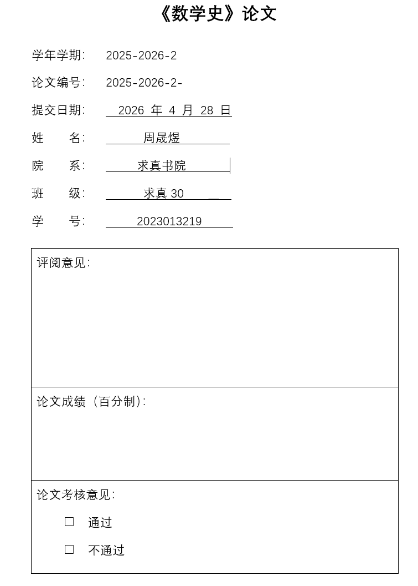
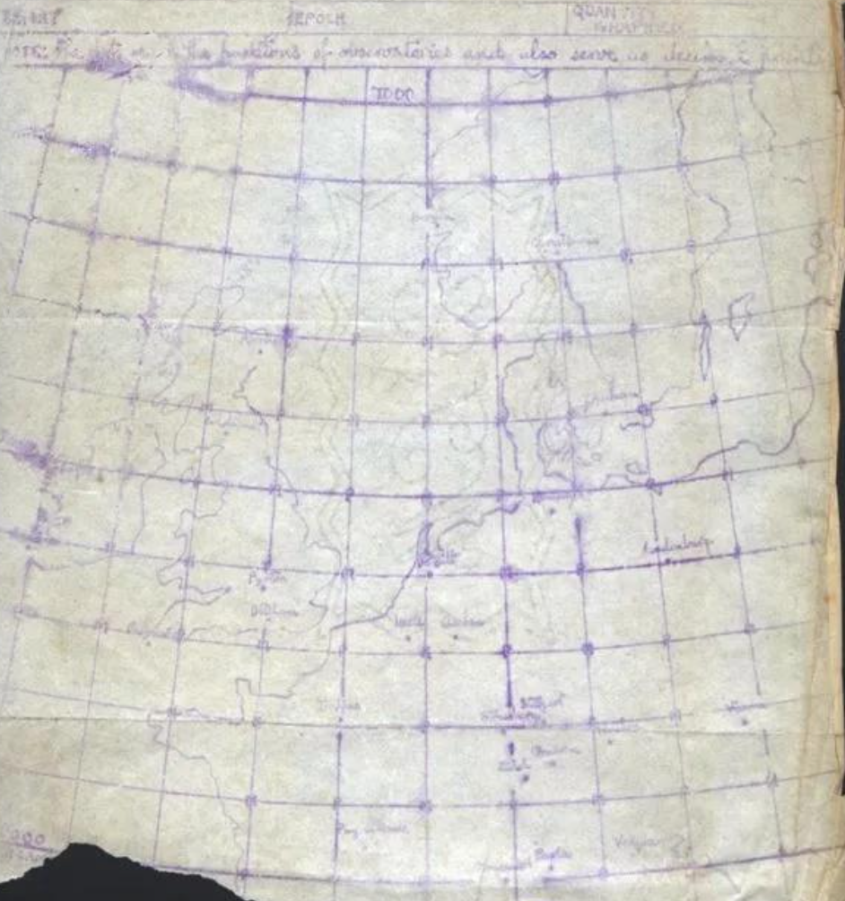
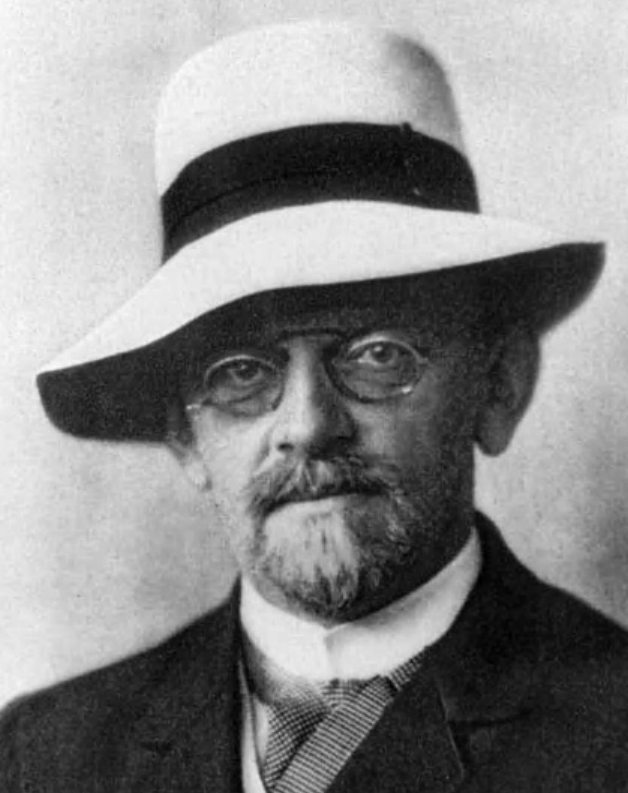
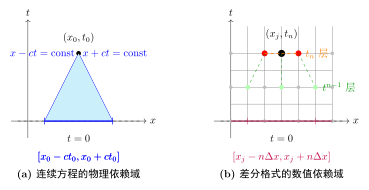
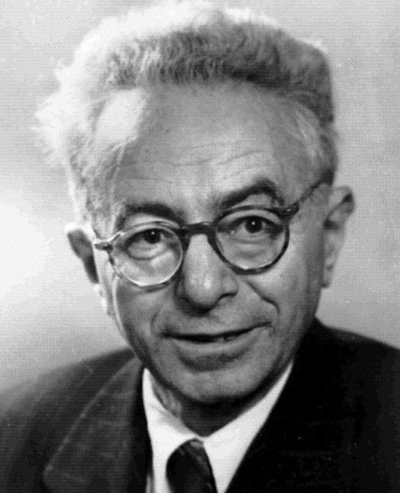
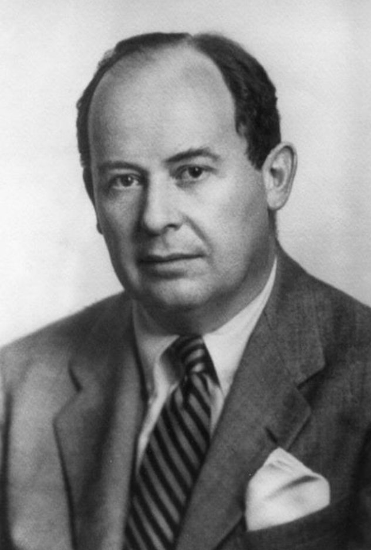
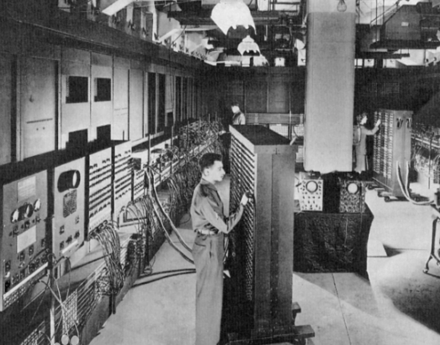
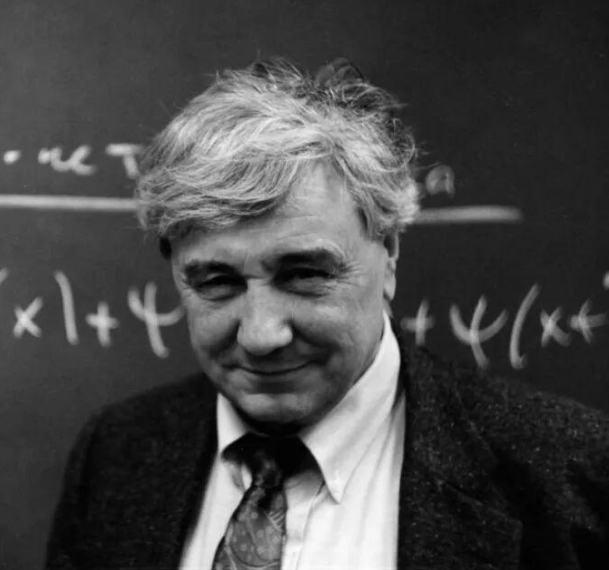

# 数学史论文（三）：从手算到超算——偏微分方程数值解的演变史 { #top }

本文是[数学史论文](math-history.md)系列的第三篇。

{ loading=lazy }

## 1. 序言 { #s1 }

偏微分方程（Partial Differential Equations, PDE）是人类文明描述自然规律最深刻、最精准的语言。从流体的奔涌到热量的扩散，从星系的演化到微观粒子的概率分布，宇宙中几乎所有关于时空演化的物理过程，最终都可以归化为一组组严密的偏微分方程。

然而，在真实世界的复杂性面前，传统的分离变量法、积分变换等分析工具显得捉襟见肘。无论是非线性的纳维-斯托克斯方程，还是具有复杂边界条件的工程问题，都让解析解成为了奢侈品。于是，数学家们开始了一场从连续到离散的伟大转变：他们试图将那些在理论上完美无瑕的连续模型，切割成一个个离散的网格点，在这些有限的点上构建近似解。

这一过程并非平坦的算术演进。在这篇跨越百年的学术回顾中，我们将先后造访多个历史的关键节点：我们将回到20世纪初的战壕，见证理查德森（L. F. Richardson）如何以悲壮的失败揭示数值不稳定性这一幽灵；我们将走进哥廷根的讲堂，看柯朗（Richard Courant）等人如何从纯数学的证明中意外推导出主宰计算世界的 CFL 条件；我们将见证曼哈顿计划中，冯·诺依曼（John von Neumann）如何将算法注入电子管的躯体，实现算力与逻辑的首次核聚变；我们还将看到，在冷战的铁幕下，东西方科学家如何独立地从结构力学与变分原理中孕育出有限元方法，特别是中国数学家冯康先生在那段封闭岁月中建立的独立功勋。

从早期的手工计算到现代的超级计算机，从经典的差分格式到前沿的物理信息神经网络（PINNs），偏微分方程数值解的历史证明了：数学的生命力不仅在于其抽象的逻辑完备性，更在于其在解决真实世界难题时所展现出的无穷张力。

## 2. 古典分析与离散化 { #s2 }

自17世纪末牛顿与莱布尼茨创立微积分以来，人类拥有了精确描述自然界连续介质运动的终极语言。在随后的两个世纪里，偏微分方程成为了理论物理与应用数学的绝对核心。欧拉推导出了理想流体的欧拉方程；傅里叶在研究热传导时写下了著名的热传导方程，并由此催生了傅里叶级数理论；纳维与斯托克斯则为粘性流体力学奠定了纳维-斯托克斯方程。

在偏微分方程的早期历史中，关于“什么是解”的争论直接揭示了连续分析的内在困境。1747 年，达朗贝尔（d'Alembert）通过研究弦的振动，首次推导出一维波动方程：

$$
\frac{\partial^2 u}{\partial t^2} = c^2 \frac{\partial^2 u}{\partial x^2}
$$

达朗贝尔给出了著名的通解形式 $u(x,t) = f(x+ct) + g(x-ct)$。然而，这场发现随即引发了达朗贝尔、欧拉与丹尼尔·伯努利（Daniel Bernoulli）之间长达数年的“弦振动方程之争”。争议的核心在于 $f$ 和 $g$ 的函数形式。达朗贝尔坚持认为，这些函数必须具有连续的二阶导数，即必须是“解析”的。而欧拉则从物理直觉出发，认为任何可以手工画出的“自由形状”都应被视为方程的合法解。伯努利则提出，解应当表示为无穷级数的三角函数叠加。

{ loading=lazy }

*图 1：达朗贝尔*

然而，随着物理学与工程学向纵深发展，这种基于纯粹解析表达式的方法逐渐失效。到了19世纪末至20世纪初，科学界开始面临大量非线性偏微分方程以及具有复杂几何边界条件的边值问题。例如，描述航空器超音速飞行的非线性空气动力学方程，或者在不规则区域内求解椭圆型泊松方程。对于这些问题，解析方法几乎完全失效。微积分的连续概念虽然在理论上完美无瑕，但在面对复杂的工程计算时，却成了一道无法逾越的屏障。既然无法求得空间和时间上处处连续的精确表达式，数学家们被迫退而求其次——如果连续流形无法被整体解析，我们是否可以将其“切碎”，在有限的离散点上寻求近似的数值解？

将连续问题离散化的思想，其哲学根基可以追溯到欧拉。在1768年出版的《积分学原理》中，欧拉在处理一阶常微分方程初值问题

$$
y' = f(t, y), y(t_0) = y_0
$$

时，提出了极其朴素的折线法。

欧拉意识到，导数本质上是函数在极小区间上的差商极限。如果放弃极限操作，取一个微小但有限的步长 $\Delta t = h$，那么导数就可以被向前差分所近似：

$$
y'(t_n) \approx \frac{y(t_{n+1}) - y(t_n)}{h}
$$

将其代入原方程，便得到了欧拉向前格式：

$$
y_{n+1} = y_n + h f(t_n, y_n)
$$

由泰勒展开式可以看出，欧拉法的局部截断误差为 $\mathcal{O}(h^2)$，因此它是一个一阶方法。虽然在现代数值分析的标准下，这个方法显得粗糙且效率低下，但在当时，它实现了一个根本性的飞跃：将求解未知的连续函数 $y(t)$ 的问题，转化为了求解一个有限的代数递推序列 $\{y_n\}$ 的问题。这种从连续到离散的转变，为后续更复杂的差分格式和数值方法奠定了基础。

{ loading=lazy }

*图 2：欧拉*

随后，基于泰勒展开式，有限差分法（Finite Difference Method, FDM）的理论框架开始逐渐成型。对于足够光滑的函数 $u(x)$，其泰勒展开为：

$$
\begin{aligned}
u(x+h) &= u(x) + h u'(x) + \frac{h^2}{2!} u''(x) + \frac{h^3}{3!} u'''(x) + \mathcal{O}(h^4) \\
u(x-h) &= u(x) - h u'(x) + \frac{h^2}{2!} u''(x) - \frac{h^3}{3!} u'''(x) + \mathcal{O}(h^4)
\end{aligned}
$$

通过上述两式相加与相减，可以轻易地构造出中心差分格式来逼近一阶导数和二阶导数：

$$
u'(x) \approx \frac{u(x+h) - u(x-h)}{2h}
$$

$$
u''(x) \approx \frac{u(x+h) - 2u(x) + u(x-h)}{h^2}
$$

这种将微分算子转化为网格点上函数值代数组合的技巧，为偏微分方程的离散化提供了最直接的武器。然而，早期的探索者们并没有意识到，这种单纯基于代数截断的替换，隐藏着巨大的数值风险。

在电子计算机诞生之前，将差分法大规模应用于高维偏微分方程系统的最著名先驱，是英国学者路易斯·弗莱·理查德森（Lewis Fry Richardson）。他的尝试不仅是人类计算史上的一次壮举，也以一场彻底的失败为现代数值分析敲响了警钟。

第一次世界大战期间，理查德森在法国前线的救护车队服役。在隆隆的炮火声中，他利用业余时间进行了一项极其疯狂的计算实验。他试图通过求解流体力学和热力学的偏微分方程组（即气象学中的原始方程组），对1910年5月20日的欧洲天气进行一次为期6小时的数值预报。

理查德森将欧洲地图划分为网格，在空间上收集了各网格点的气压、温度、风速等初始数据。由于当时没有任何计算设备，他完全依靠铅笔和纸张，逐个网格、逐个时间步长地进行手工差分迭代。在他的著作《通过数值过程进行天气预报》中，他幻想在一个巨大的圆形剧场里，64000名计算员分区域坐好，每个人负责计算一个网格点上的方程；剧场中央有一位指挥者用灯光协调不同区域的计算进度，从而实现比天气变化更快的“实时预测”。

理查德森的“预报工厂”并非空中楼阁，其思想内核可以追溯到法国大革命时期的普罗尼（Gaspard de Prony）。普罗尼受亚当·斯密《国富论》中分工理论的启发，曾组织过大规模的“人肉计算”工程，用于编制详尽的对数和三角函数表。普罗尼将计算者分为三个等级：第一等是顶级的数学家，负责制定计算方法；第二等是富有经验的计算监督者；第三等则是只懂基本四则运算的“操作员”。

{ loading=lazy }

*图 3：理查德森设想的数值网格划分*

然而，经过六周的艰苦纯手工计算，理查德森得到的预报结果却令人瞠目结舌。他计算出某区域在6小时内气压将发生高达 $145\text{ mb}$ 的剧烈变化。在真实的大气物理中，这种气压突变只有在最极端的强台风或爆炸中心才可能发生，完全背离了当天的实际天气情况。

理查德森的失败并非源于他的算术错误，而是由于当时数学界对“数值稳定性”（Numerical Stability）这一概念毫无认知。为了处理偏微分方程，理查德森凭借朴素的物理对称性直觉，在时间和空间上均采用了中心差分格式。

我们剥离复杂的连续大气方程，以最简单的一维热传导方程为例来对理查德森的方法进行检验。考虑方程：

$$
u_t = \alpha u_{xx}
$$

理查德森在时间和空间上对导数进行中心差分离散，得到如下格式：

$$
\frac{u_j^{n+1} - u_j^{n-1}}{2\Delta t} = \alpha \frac{u_{j+1}^n - 2u_j^n + u_{j-1}^n}{(\Delta x)^2}
$$

从泰勒展开的角度看，这似乎是一个极其优秀的格式，因为它的时间截断误差为 $\mathcal{O}(\Delta t^2)$，空间截断误差为 $\mathcal{O}(\Delta x^2)$，即它是相容的（Consistent）。

但如果在今天，使用冯·诺依曼稳定性分析法（Von Neumann Stability Analysis）对其进行审视，就会发现这是一个彻头彻尾的灾难。我们假设离散误差的傅里叶模态为

$$
u_j^n = G^n e^{\mathbf{i} k x_j}
$$

，其中 $G$ 为时间推进的放大因子，$\mathbf{i} = \sqrt{-1}$，并将网格比参数记为 $r = \frac{\alpha \Delta t}{(\Delta x)^2}$。将其代入理查德森格式：

$$
\frac{G - G^{-1}}{2\Delta t} = \alpha \frac{e^{\mathbf{i} k \Delta x} - 2 + e^{-\mathbf{i} k \Delta x}}{(\Delta x)^2}
$$

利用欧拉公式 $e^{\mathbf{i}\theta} + e^{-\mathbf{i}\theta} = 2\cos\theta$ 以及半角公式 $1 - \cos\theta = 2\sin^2(\frac{\theta}{2})$，等式右边可化简为：

$$
\alpha \frac{2\cos(k \Delta x) - 2}{(\Delta x)^2} = -\frac{4\alpha}{(\Delta x)^2} \sin^2\left(\frac{k \Delta x}{2}\right)
$$

于是方程变为：

$$
G - G^{-1} = -8r \sin^2\left(\frac{k \Delta x}{2}\right)
$$

整理得到关于放大因子 $G$ 的一元二次方程：

$$
G^2 + \left[ 8r \sin^2\left(\frac{k \Delta x}{2}\right) \right] G - 1 = 0
$$

根据韦达定理，该二次方程的两根之积 $G_1 G_2 = -1$。由于 $r > 0$ 且 $\sin^2(\cdot) \ge 0$，这是一个实系数二次方程，且常数项为负，因此它必定有两个实根。因为两根之积等于 $-1$，所以必然存在一个根的绝对值严格大于 1，即 $|G| > 1$。

这一结果是极其致命的：它在数学上严格证明了理查德森格式是**无条件不稳定**的（Unconditionally Unstable）。这意味着，无论初值多么平滑，无论网格划分得多细（$\Delta t, \Delta x \to 0$），哪怕是计算过程中产生的一个极小的舍入误差，都会在后续的时间步迭代 $n$ 中以 $|G|^n$ 的指数级别呈爆炸式放大。

一个在连续空间中稳定的算子，在离散空间中可能会因为网格的几何特性而产生虚假的能量增长。这意味着，当我们把 PDE 搬上计算平台时，我们实际上是在研究一套全新的、由有限个节点组成的代数动力系统。这种认识的转变具有里程碑意义，它推动了数值分析从单纯的“近似计算”转向了真正的“数值模拟”。它告诉我们，离散化不仅要保留方程的形式，更要保留物理过程的内在对称性与守恒律。单凭物理直觉和泰勒级数的截断精度，不足以构建有效的数值算法。离散后的代数系统拥有自己独立的谱特性和演化规律。这一惨痛的教训，为几年后哥廷根学派从纯数学角度发现 CFL 条件，提供了一个绝佳的历史反证。

## 3. 哥廷根学派与CFL条件 { #s3 }

理查德森的失败表明，在没有坚实理论基础的情况下，盲目地将连续方程离散化无异于在沙滩上建塔。然而，真正为偏微分方程离散化奠定严密数学基础的，并非来自应用数学家或气象学家，而是来自当时纯粹数学的世界中心——德国哥廷根大学。

在20世纪20年代，大卫·希尔伯特领导下的哥廷根学派正致力于物理学的公理化。在这个宏大的计划中，偏微分方程解的存在性与唯一性是核心难题之一。1928年，Richard Courant、Kurt Friedrichs和Hans Lewy在《数学年刊》上联合发表了一篇题为《论数学物理中的偏微分方程》的历史性论文。这就是后来在计算数学界无人不晓的“CFL论文”。

{ loading=lazy }

*图 4：大卫·希尔伯特*

在CFL论文出现之前，主流数学界习惯于使用级数展开（如傅里叶级数）来构造解。然而，级数法高度依赖于方程的线性特征和规则的定义域。柯朗学派引入的差分算子（Difference Operator）则展示了极强的普适性。考虑一维标量场 $u(x,t)$。在哥廷根的数学框架下，连续的微分算子 $\partial_x$ 被代之以离散的差商算子 $\Delta_x$。

柯朗等人发现，离散系统的稳定性与连续系统的能量守恒之间存在着某种深层的同构关系。他们在论文中首次引入了“离散能量法”，通过证明离散解的某种泛函范数在迭代过程中保持有界，从而确保了极限过程的收敛性。这种将偏微分方程问题转化为离散代数估计的策略，彻底改变了数学物理的研究范式。它告诉世人：要理解无穷，必须先精确地掌握有限。

历史的吊诡之处在于，这篇被公认为现代偏微分方程数值解开山之作的论文，其初衷根本不是为了发明一种实用的数值计算方法。柯朗等人的目的是利用有限差分作为一种纯数学的分析工具，通过构造一个离散的差分方程组，并证明当网格步长趋于零时，其离散解序列能够收敛到一个极限函数，从而反证原连续偏微分方程解析解的存在性。简而言之，他们将离散化作为证明存在性的跳板，却在无意中推开了现代计算数学的大门。

为了阐述他们的理论，柯朗等人深入研究了双曲型偏微分方程的典型代表——一维波动方程。该方程描述了波在介质中的传播：

$$
u_{tt} = c^2 u_{xx}
$$

其中，$u(x,t)$ 是波的位移，$c$ 是波在介质中传播的物理速度。

仿照前面提到的差分思想，我们在空间域划分步长为 $\Delta x$ 的网格，在时间域划分步长为 $\Delta t$ 的网格，并将坐标记为 $(x_j, t_n) = (j\Delta x, n\Delta t)$。使用中心差分算子替换连续导数，可得波动方程的显式差分格式：

$$
\frac{u_j^{n+1} - 2u_j^n + u_j^{n-1}}{(\Delta t)^2} = c^2 \frac{u_{j+1}^n - 2u_j^n + u_{j-1}^n}{(\Delta x)^2}
$$

整理后，我们可以得到求解下一个时间步 $u_j^{n+1}$ 的递推公式：

$$
u_j^{n+1} = 2u_j^n - u_j^{n-1} + \nu^2 \left( u_{j+1}^n - 2u_j^n + u_{j-1}^n \right)
$$

这里我们引入了一个无量纲参数 $\nu = c \frac{\Delta t}{\Delta x}$，在现代数值分析中，它被称为**Courant number**。

柯朗、弗里德里希斯和列维在这篇论文中最伟大的洞见，是他们敏锐地察觉到了连续方程与离散方程在“信息传播机制”上的根本差异。这种差异可以通过“依赖域”（Domain of Dependence）这一几何概念来进行严密的刻画。

首先考察**连续偏微分方程**的依赖域。根据达朗贝尔公式，一维波动方程的通解可以表示为两个分别向左和向右传播的行波的叠加。对于平面上的任意一点 $(x_0, t_0)$，其解的值完全由初始时刻 $t=0$ 时，区间 $[x_0 - c t_0, x_0 + c t_0]$ 内的初始条件决定。由两条特征线 $x - ct = \text{const}$ 和 $x + ct = \text{const}$ 构成的三角形区域，被称为该点的物理依赖域。

{ loading=lazy }

接下来考察**离散差分方程**的依赖域。根据先前的公式

$$
u_j^{n+1} = 2u_j^n - u_j^{n-1} + \nu^2 \left( u_{j+1}^n - 2u_j^n + u_{j-1}^n \right)
$$

网格点 $(x_j, t_n)$ 处的值 $u_j^n$，依赖于上一时间层的三个点

$$
(x_{j-1}, t_{n-1}), (x_j, t_{n-1}), (x_{j+1}, t_{n-1})
$$

而这三个点又依赖于更上一层的五个点。依此类推，一直回溯到初始时刻 $t=0$，数值解所依赖的初始空间区间范围是 $[x_j - n\Delta x, x_j + n\Delta x]$。

{ loading=lazy }

*图 5：柯朗*

CFL论文提出了一个论断：**为了使离散解能够收敛到真实的物理连续解，离散差分格式的数值依赖域，必须完全包含偏微分方程的物理依赖域。**

如果这一条件不满足，意味着真实波的传播速度超过了数值网格传递信息的速度，数值格式将无法“捕捉”到决定该点状态的所有物理信息。在数学上，这就要求在 $t_n = n\Delta t$ 时刻：

$$
n\Delta x \ge c t_n
$$

将 $t_n = n\Delta t$ 代入上式，消去步数 $n$，得到：

$$
n\Delta x \ge c(n\Delta t) \implies \frac{\Delta x}{\Delta t} \ge c
$$

稍微变形，便得到了著名的 **CFL 条件**（Courant-Friedrichs-Lewy condition）：

$$
c \frac{\Delta t}{\Delta x} \le 1 \quad \text{或者} \quad \nu \le 1
$$

上式表面上只是一个简单的不等式，但它在数学史上的地位却不可估量。它是人类历史上第一次明确地将物理参数（波速 $c$）与人为设定的数值离散参数（空间步长 $\Delta x$ 和时间步长 $\Delta t$）绑定在了一起。

CFL条件完美地解释了理查德森当年为何会失败：理查德森的中心差分格式虽然在形式上误差很小，但他没有意识到不同物理方程对应着截然不同的稳定域。CFL条件不仅是收敛性的必要条件，后来也被证明是许多显式差分格式的稳定性必要条件。它宣告了“任意选择时空步长”时代的终结，确立了数值分析的严密性。

除了对双曲型波动方程的透彻分析，CFL 论文的另一项卓越贡献是将依赖域的逻辑推广到了抛物型偏微分方程。以一维热传导方程为例：

$$
u_t = \alpha u_{xx}
$$

在连续物理世界中，热传导方程的特征传播速度在理论上是无限大的，这意味着任何局部的微小热扰动都会瞬间影响到整个空间域。换言之，热传导方程的时空物理依赖域是整个实数轴。

按照柯朗等人的几何包容性逻辑，如果对热传导方程采用显式差分格式进行离散，其数值传播速度也必须趋向于无穷大，才能覆盖物理依赖域。他们在论文中严格推导出，为了满足这一极其苛刻的稳定性要求，时间步长 $\Delta t$ 必须与空间步长 $\Delta x$ 的平方成正比缩减：

$$
\Delta t \le \frac{(\Delta x)^2}{2\alpha}
$$

这一条件被称为抛物型方程的稳定性判据。它揭示了一个残酷的计算现实：如果为了提高空间精度而将网格加密一倍（即 $\Delta x$ 减半），时间步长 $\Delta t$ 必须缩小到原来的四分之一。这种“平方级”的计算代价，暴露了显式格式在求解抛物型问题时的巨大效率瓶颈，也为后世数学家（如 Crank 和 Nicolson）探索无条件稳定的隐式格式（Implicit schemes）埋下了最重要的理论伏笔。CFL 论文由此确立了偏微分方程数值解的“类型学”——算法的设计必须考虑方程本身的分析性质（双曲、抛物、椭圆）。

此外，哥廷根学派的这段黄金岁月并未能长久延续。20世纪30年代的德国迅速被纳粹的阴云笼罩，由于政治与种族的迫害，柯朗等人被迫相继流亡美国。柯朗最终在纽约大学建立了著名的柯朗数学科学研究所（Courant Institute of Mathematical Sciences），将哥廷根的计算火种带到了新大陆。

更为有趣的是，1928年的柯朗并没有意识到他发明的规则将在二十年后大放异彩。在这篇论文发表后的十几年里，由于缺乏高速计算工具，这种繁琐的网格计算依然停留在理论探讨阶段。直到第二次世界大战爆发，曼哈顿计划中的核爆模拟以及宾夕法尼亚大学的弹道计算需求，与冯·诺依曼的电子计算机相遇，CFL条件才真正从纸面走向了算力爆炸的现实，迎来了偏微分方程数值解的黄金时代。

## 4. 数值算法的工程化 { #s4 }

1928年 CFL 论文的发表虽然在理论上指明了差分法的收敛与稳定条件，但在随后十几年里，由于缺乏足够强大的计算工具，偏微分方程的数值求解依然停留在纸面上的数学游戏。直到第二次世界大战的爆发，战争对复杂工程计算的无限渴求，彻底改变了这一现状。

{ loading=lazy }

*图 6：曼哈顿计划部分成员合照*

在二战期间，最顶尖的物理学家和数学家被聚集在 Los Alamos 国家实验室，参与制造人类历史上第一颗原子弹的“曼哈顿计划”。特别是对于“胖子”型钚弹，科学家们采用了内爆式设计。这要求通过外部常规炸药的精确起爆，产生强大的向心汇聚球面激波，将核心的钚球压缩至超临界状态。

模拟这一过程的核心，是求解极端高温高压下的非线性可压缩流体力学偏微分方程组。与以往的线性波动方程或热传导方程不同，这些非线性方程包含复杂的流体动力学演化，且在解的演化过程中必然会产生不连续的“激波”。对于这类问题，不仅解析解绝对不存在，甚至连经典的泰勒展开在激波处也会因为导数发散而彻底失效。当时，Richard Feynman 领导着一个由人类计算员组成的计算中心，使用机械式的 Marchant 计算器夜以继日地进行差分迭代，但计算速度和数值不稳定性依然是致命的瓶颈。

正是在 Los Alamos，约翰·冯·诺依曼作为顾问深度参与了内爆物理的数值模拟。冯·诺依曼不仅是电子计算机（ENIAC 以及后来的 EDVAC）的先驱，更敏锐地察觉到了差分格式在迭代过程中的误差累积机制。

理查德森的失败和柯朗等人的 CFL 条件已经揭示了稳定性的重要性，但 CFL 条件主要针对双曲型方程的特征线物理依赖域。面对更一般、更复杂的线性或线性化偏微分方程组，如何快速、普适地判断一个差分格式是否稳定？冯·诺依曼在二战期间（约 1944 年左右）提出并系统化了基于傅里叶级数的严格稳定性分析方法，即今天计算数学教科书中必教的“冯·诺依曼稳定性分析”（Von Neumann Stability Analysis）。

{ loading=lazy }

*图 7：冯·诺依曼*

冯·诺依曼的核心思想是：将离散网格上的数值解看作是精确解与数值误差的叠加。由于我们关心的是误差的演化，而差分方程（在局部线性化冻结系数后）是线性的，我们可以将误差展成空间上的傅里叶级数。

设一维网格上的离散误差函数在时刻 $t_n = n\Delta t$ 和位置 $x_j = j\Delta x$ 处的值为 $\epsilon_j^n$。将其分解为不同波数 $k$ 的傅里叶简谐波的叠加：

$$
\epsilon_j^n = \sum_{k} E_k^n e^{\mathbf{i} k x_j}
$$

其中 $\mathbf{i} = \sqrt{-1}$ ，$E_k^n$ 是波数为 $k$ 的模态在第 $n$ 个时间步的振幅。

由于线性算子的叠加原理，我们只需考察单一模态 $e^{\mathbf{i} k x_j}$ 随时间的演化。将单一模态代入任意给定的差分格式，必然可以提取出一个只与时间步长 $\Delta t$、空间步长 $\Delta x$ 以及波数 $k$ 有关的乘法因子 $G$，称之为放大因子：

$$
E_k^{n+1} = G(k, \Delta t, \Delta x) E_k^n
$$

冯·诺依曼提出，为了使数值计算在时间推进中不产生指数级的误差爆炸，对于所有可能的波数 $k$，放大因子必须满足如下的冯·诺依曼必要条件：

$$
|G(k, \Delta t, \Delta x)| \le 1 + \mathcal{O}(\Delta t)
$$

在实际应用中，通常直接采用更严格的 $|G| \le 1$。这一方法的提出，将复杂的偏微分方程稳定性问题，极为优雅地转化为了求解代数多项式根的分布问题，成为了数值分析史上的一个里程碑。

尽管冯·诺依曼基于傅里叶级数的稳定性分析在洛斯阿拉莫斯的工程实践中大获成功，但在纯粹数学家的眼中，它依然存在理论上的瑕疵。冯·诺依曼的方法严格来说只适用于具有周期性边界条件且常系数的线性偏微分方程。如何将这种启发式的代数工具，上升为指导所有偏微分方程离散化的普适性数学定理？

这一历史任务在20世纪50年代由彼得·拉克斯（Peter D. Lax）完成。拉克斯在泛函分析的框架下，深入考察了差分算子与微分算子之间的逼近关系，最终提出了现代计算数学中最著名的定理——**Lax 等价定理**：

$$
\text{相容性 (Consistency)} + \text{稳定性 (Stability)} \iff \text{收敛性 (Convergence)}
$$

在泛函分析的严格表述下，定理指出：对于一个适定的线性初值问题，如果所采用的有限差分格式是相容的（即当网格步长趋于零时，差分方程的局部截断误差趋于零），那么该差分格式收敛的**充分必要条件**是它是稳定的。

Lax 等价定理在偏微分方程数值解的历史上具有“宪法”般的地位。在它出现之前，数学家们要想证明一个差分格式能够收敛到真实的物理连续解，往往需要极其复杂的特定技巧，且通常只能得到充分条件。Lax 定理彻底解耦了数值分析的困难：它告诉未来的算法设计者，你不再需要直接去证明艰难的“收敛性”，你只需要做两件事——用泰勒展开证明格式是“相容”的，再用冯·诺依曼的方法证明它是“稳定”的。

在解决了线性稳定性后，曼哈顿计划中的科学家们面临着一个更棘手的非线性物理难题：激波的计算。在无粘可压缩流体动力学中，控制方程为非线性的欧拉方程组。在拉格朗日质量坐标 $(m, t)$ 下，一维绝热流动的动量方程和能量方程可写为：

$$
\begin{aligned}
\frac{\partial u}{\partial t} + \frac{\partial p}{\partial m} &= 0 \\
\frac{\partial E}{\partial t} + \frac{\partial (pu)}{\partial m} &= 0
\end{aligned}
$$

其中 $u$ 为速度，$p$ 为压力，$E$ 为总能量。

当流体被剧烈压缩时，由于声速随密度和温度的升高而增加，后方的扰动会追上前面的扰动，最终在有限时间内形成物理量发生阶跃式突变的面，即激波。在激波面上，函数的连续性被破坏，导数趋于无穷大。如果直接用标准的中心差分或迎风差分跨越激波进行计算，会在激波附近产生剧烈的数值振荡，这不仅会破坏解的物理意义，更会导致计算瞬间崩溃。

当时通常的做法是“激波拟合”：将激波视为移动的内部边界，在激波两侧分别求解连续方程，并在激波面上利用朗金-休戈尼奥跳跃条件进行匹配。但在高维复杂爆炸中，激波会发生相交、反射等极其复杂的变化，追踪激波面在算法逻辑上几乎是不可能完成的任务。

1950年，冯·诺依曼与罗伯特·里克特迈耶（Robert Richtmyer）在《应用物理学报》上发表了里程碑式的论文《计算流体动力学激波的数值方法》。他们提出了一个极其大胆且天才的构想：**人工粘性**（Artificial Viscosity）。

{ loading=lazy }

*图 8：罗伯特·里克特迈耶*

他们意识到，在真实的物理世界中，激波并不是真正的数学不连续面，而是存在一个极薄的过渡层。在这个薄层内，由于极高的速度梯度，流体的真实粘性效应和热传导效应不再能被忽略。粘性耗散将动能转化为热能，阻止了梯度的无限增大。受到这一物理机制的启发，冯·诺依曼和里克特迈耶决定在纯粹的欧拉无粘方程中，人为地加入一个非线性的“人工粘性压力”项 $q$。他们将动量方程修改为：

$$
\frac{\partial u}{\partial t} + \frac{\partial (p + q)}{\partial m} = 0
$$

他们构造的 $q$ 的具体形式为：

$$
q = \begin{cases}
c_0^2 \rho (\Delta x)^2 \left( \frac{\partial u}{\partial x} \right)^2, & \text{当 } \frac{\partial u}{\partial x} < 0 \text{ (即流体处于压缩状态)} \\
0, & \text{当 } \frac{\partial u}{\partial x} \ge 0 \text{ (即流体处于膨胀状态)}
\end{cases}
$$

其中 $c_0$ 是一个无量纲的常数（通常取 $1.5 \sim 2.0$），$\rho$ 是密度，$\Delta x$ 是空间网格步长。

从数学上看，$q$ 相当于在双曲型偏微分方程中引入了二阶导数的抛物型耗散项。它的绝妙之处在于：

- **局部性**：由于包含 $(\Delta x)^2$，在流场平滑区域，$\frac{\partial u}{\partial x}$ 有界，$q \sim \mathcal{O}(\Delta x^2)$，作为高阶小量不会破坏原格式的截断精度。
- **选择性耗散**：只有在流体被压缩（$\frac{\partial u}{\partial x} < 0$）且梯度极大（即即将形成激波）的地方，$q$ 才会显著增大，发挥强烈的粘滞作用，强行抹平数值振荡。
- **网格自适应的激波展宽**：通过这种机制，原本无限陡峭的数学激波，抹平并平滑地分布在 $3 \sim 4$ 个空间网格点上。

人工粘性法的发明，代表着科学家们终于可以不用预先知道激波的位置，只需在整个物理域内用统一的差分方程一直算下去，激波就会在流场中自然而然地浮现出来。这一思想直接孕育了现代计算流体力学（CFD）的基础框架。

二战结束与曼哈顿计划的解密，标志着偏微分方程数值解不再是少数顶级数学家的纸上谈兵，而是正式成为了一门改变世界的工程学科。冯·诺依曼等人发明的算法，恰好与他们同时期参与研发的电子计算机完美契合。

冯·诺依曼对偏微分方程数值解的贡献，不仅在于纸面上的算法推导，更在于他极力推动了这些算法在人类第一代电子管计算机上的物理实现。这种算力与算法的结合，不仅改变了核物理学，更在战后意外地完成了一场跨越三十年的历史回响。二战结束后，冯·诺依曼将普林斯顿高等研究院（IAS）的电子计算机项目（EDVAC的衍生型号）首先瞄准了气象预报领域。

1950年，冯·诺依曼与气象学家查尼（Jule Charney）、菲约尔托夫特（Ragnar Fjørtoft）合作，将描述大气动力学的正压涡度方程（Barotropic vorticity equation）离散化，并输入到世界上第一台通用电子计算机 ENIAC 中。这本质上是一个极其复杂的非线性偏微分方程的初值问题。这一次，研究团队吸取了理查德森的教训。他们不仅精心挑选了滤除高频声波和重力波的简化方程，更严格遵守了 CFL 条件与冯·诺依曼稳定性判据来选择空间网格与时间步长。

{ loading=lazy }

*图 9：ENIAC*

在 ENIAC 那由 18000 个真空管组成的庞大躯体中，打孔纸带以每秒数百次的速度进行着浮点运算。经过长达 33 个小时的不间断计算（这甚至比天气实际演变的时间还要长），ENIAC 成功输出了北美大陆上空 500 百帕高度场的 24 小时预报图。预测结果与实际天气云图高度吻合。

从理查德森六周手工苦算的荒谬结果，到冯·诺依曼在 ENIAC 上的巨大成功，人类花费了整整三十年时间。

## 5. 有限元法的诞生 { #s5 }

随着冯·诺依曼时代计算机的普及，有限差分法（FDM）在求解规则区域内的偏微分方程方面取得了巨大成功。然而，在面对实际工程问题时，差分法暴露出一个致命的弱点：它极度依赖于规则的正交网格。

当遇到边界形状极其复杂的几何体，如飞机的机翼后掠角、水坝的不规则截面、带有孔洞的机械零件时，使用规则的矩形网格去逼近曲折的边界会导致严重的阶梯效应，进而引发边界附近精度的急剧下降。虽然可以通过坐标变换或局部网格加密来缓解，但操作起来极其繁琐。工程界迫切需要一种能够灵活适应任意复杂几何边界的数值离散方法。

这种方法的突破并非首先来自应用数学界，而是来自航空结构工程领域。在20世纪50年代，波音公司等航空制造企业在设计后掠翼喷气式客机时，面临着极其复杂的机翼应力分析问题。工程师们（如 M.J. Turner, R.W. Clough, H.C. Martin 和 L.J. Topp，他们在1956年发表了开创性的论文）基于结构力学中的矩阵位移法，提出了一种非常直观的想法：将连续的机翼蒙皮视为由许多通过节点连接的有限大小的三角形或矩形“元”（Elements）拼接而成。这种方法最初被称为“直接刚度法”（Direct Stiffness Method），直到1960年，加州大学伯克利分校的 R.W. Clough 教授在一篇论文中首次提出了“有限元”（Finite Element）这个名词。

{ loading=lazy }

*图 10：R.W. Clough*

在工程界的视角里，有限元法最初仅仅是处理复杂桁架和板壳结构的力学组装技术，并没有建立起与偏微分方程严格的数学联系。与此同时，在纯数学中，解决不规则区域边界值问题的理论基石早已铺就，但一直缺乏有效的离散化手段。这块基石就是变分原理以及里兹-伽辽金方法（Ritz-Galerkin Method）。

对于椭圆型偏微分方程（例如描述静电场或稳态热传导的泊松方程 $-\nabla^2 u = f$），其边值问题的求解等价于寻找一个函数 $u$，使得某个能量泛函 $J(u)$ 达到极小值。里兹方法的核心思想是：在连续空间中选取一组全局的基函数（或称试探函数）$\{\phi_i(x)\}$，将未知函数展开为 $u(x) \approx \sum c_i \phi_i(x)$，代入泛函后，对系数 $c_i$ 求导并令其为零，从而将微分问题转化为求解代数方程组。

然而，传统的里兹方法在选取全局基函数时极为困难，特别是对于不规则区域，几乎不可能找到满足边界条件的解析多项式或三角函数族。

历史的线索再次指向了哥廷根学派的传人——理查德·柯朗。1943年，在研究扭转问题时，柯朗在《美国数学学会公报》上发表了一篇论文。为了克服里兹方法中试探函数构造的困难，柯朗提出了一种极具前瞻性的方法：将给定的二维不规则定义域剖分为大量互不重叠的三角形。

更关键的是，柯朗摒弃了全局基函数，转而构造了**分片线性连续**的局部基函数。在每个三角形单元上，基函数是一个平面；而在整个区域上，它们拼接成一个连续的“多面体帐篷”。由于这些基函数只在其所在的节点附近的几个三角形内非零，生成的最终刚度矩阵将是非常稀疏的，这极大地降低了计算的复杂度。

令人惋惜的是，柯朗在1943年的这一天才构想并没有引起当时数学界的广泛关注。一方面是因为当时尚无电子计算机能够处理哪怕是几十阶的线性方程组；另一方面，当时的工程界更习惯于物理直觉，尚未意识到矩阵力学与变分多项式的内在统一。

直到20世纪60年代初，工程界的“直接刚度法”和数学界的“里兹-伽辽金”方法才开始合流。西方的数学家（如 O.C. Zienkiewicz 和 J.T. Oden）开始严格证明有限元方法本质上就是以分片多项式为基函数的里兹-伽辽金方法，从而赋予了这种工程计算方法以偏微分方程数值解的合法身份。

然而，在计算数学的历史上，有一个常被西方教科书忽略，却在中国科学史上熠熠生辉的篇章——中国科学院数学家冯康的独立发现。

{ loading=lazy }

*图 11：冯康*

20世纪50年代末至60年代初，正值冷战高峰，中苏关系破裂，中国面临着严密的技术封锁。为了应对国家重大水利工程（如刘家峡大坝）的建设需求，工程师们必须精确计算复杂几何形状的大坝在受到水压和地震载荷时的内部应力。这些问题本质上是求解极其复杂的椭圆型偏微分方程边值问题。冯康临危受命，带领团队攻关这一难题。

在完全无法获取西方学术文献的封闭环境下，冯康从数学的本源出发。他深刻认识到传统的差分法在处理大坝复杂边界时的无力，同时他也洞察到了传统里兹方法在构造全局基函数时的死胡同。通过对物理能量守恒定律的深刻理解，冯康在1965年发表了具有历史意义的论文《基于变分原理的差分格式》。他将有限元方法的核心精髓精辟地总结为十六字方针：**分整为零、裁弯取直、以简驭繁、化难为易**。这不仅是工程计算的至理名言，更是深刻的数学哲学。

在这篇论文中，冯康独立创立了有限元法的数学理论框架。他详细论述了如何将连续区域划分为三角形网格，并利用分片插值多项式在网格上构造泛函的离散近似。

以求解区域 $\Omega$ 上的泊松方程 $-\Delta u = f$ 为例，对应的能量泛函为：

$$
J(u) = \frac{1}{2} \int_{\Omega} |\nabla u|^2 \mathrm{d}\Omega - \int_{\Omega} f u \mathrm{d}\Omega
$$

冯康的方法论指出，将区域 $\Omega$ 剖分为若干三角形单元 $e_k$，并在每个单元上假设未知函数 $u^h$ 为节点值的线性插值：

$$
u^h(x,y)|_{e_k} = \alpha_1 + \alpha_2 x + \alpha_3 y = \sum_{i=1}^3 N_i(x,y) u_i^k
$$

其中 $N_i(x,y)$ 为单元的形函数，$u_i^k$ 为节点上的未知位移。

将上述离散形式代入能量泛函，整个区域的积分转化为各个单元积分的求和。对泛函关于所有未知的节点值求驻值（即导数为零），最终推导出一个大型的线性代数方程组：

$$
\mathbf{K} \mathbf{U} = \mathbf{F}
$$

其中 $\mathbf{K}$ 就是刚度矩阵，$\mathbf{U}$ 是节点未知量向量，$\mathbf{F}$ 是载荷向量。

冯康不仅在理论上严格证明了该方法的收敛性（这在当时的西方工程界也是尚未完全解决的），而且将其成功应用于刘家峡大坝的实际计算中，取得了极高的精度。更为难能可贵的是，冯康将这一方法总结为一整套标准化的算法流程，为后来国产通用有限元软件的开发奠定了基础。

有限元方法的发展是一段多学科交融的辉煌历史。在 20 世纪 50 年代，美国的 Plantl 和 Coniant 等人在航空工程与机械工程领域进行了极具前瞻性的探索，试图用离散的元件去逼近复杂的连续结构。几乎在同一时期的苏联，基础数学领域的 Sobolev 等人则在泛函分析方向发力，在 Sobolev 空间理论上做出了奠基性工作，为有限元法提供了严密的数学土壤。

在有限元方法走向成熟的过程中，数学家们深刻地意识到，传统微积分在处理工程实际问题时存在一个致命的逻辑漏洞：经典偏微分方程的解要求函数具有极高的光滑性（例如二阶导数连续）。但在真实物理世界中，材料的交界面、集中载荷的施加点乃至含有内角的不规则边界，都会导致应力集中和导数发散。如果坚持寻找经典意义下的解析解，有限元法的数学大厦将不攻自破。

苏联数学家索伯列夫（Sergei Sobolev）在20世纪30年代创立的理论，在这个历史关头成为了计算数学的救命稻草。索伯列夫摒弃了导数必须通过极限来定义的经典观念，引入了基于分部积分的“弱导数”（Weak Derivative）概念。它允许函数在某些点或线上存在“折角”（即经典导数不存在），只要它在积分平均的意义下是平滑的即可。

{ loading=lazy }

*图 12：索伯列夫*

基于弱导数，索伯列夫构建了以其名字命名的 Sobolev 空间 $\mathbb{H}^m(\Omega)$，即函数本身及其高达 $m$ 阶的弱导数都属于平方可积空间 $L^2(\Omega)$ 的函数集合。Sobolev 空间的引入，使得偏微分方程的求解从寻找“处处光滑的经典解”降维到了寻找“能量有限的弱解”。有限元方法中使用的分片多项式（如线性三角网格），其导数在单元交界处是不连续的，在经典意义下连一阶导数都没有，但它们完美地属于 $\mathbb{H}^1(\Omega)$ 空间。可以说，没有 Sobolev 空间，有限元法就永远是一个缺乏合法身份的工程近似算术。

在确立了弱解的空间归属后，下一个核心的数学史问题是：我们如何保证这种在 Sobolev 空间中寻找的弱解不仅存在，而且唯一？

当偏微分方程被转化为变分问题后，求解过程等价于在无穷维的 Hilbert 空间 $\mathbb{V}$ 中寻找 $u$，使得双线性形式满足：

$$
a(u,v) = f(v), \quad \forall v \in \mathbb{V}
$$

20世纪50年代，数学家 Lax 和 Milgram 给出了这一抽象变分问题的终极裁判标准——Lax-Milgram 定理。该定理指出，只要双线性形式 $a(\cdot,\cdot)$ 满足连续性，并且满足至关重要的“椭圆性条件”：

$$
\exists \alpha >0, \quad a(v,v) \ge \alpha \|v\|_{\mathbb{V}}^2, \quad \forall v \in \mathbb{V}
$$

那么该变分问题就存在唯一的弱解。

椭圆性条件在物理上对应着系统能量的正定性（例如弹性体的应变能必须大于零）。Lax-Milgram 定理不仅为椭圆型偏微分方程的弱解提供了坚不可摧的存在唯一性证明，更为 Galerkin 有限元离散化提供了理论保障。因为只要原连续系统满足 Lax-Milgram 定理，其在任意有限维子空间中的离散投影也必然满足该定理，从而保证了离散方程组 $\mathbf{K}\mathbf{U}=\mathbf{F}$ 的刚度矩阵 $\mathbf{K}$ 永远是对称正定且可逆的。

有限元方法之所以能够在20世纪70年代后彻底击败其他数值方法，确立其在工程计算领域的统治地位，不仅在于其几何适应性，更在于它拥有一套堪称艺术品的先验误差分析理论。有限元误差分析的基石是法国数学家 Jean Céa 提出的 Céa 引理。该引理利用 Galerkin 正交性，用极其优雅的不等式证明了：有限元解 $u_h$ 与真实弱解 $u$ 之间的能量范数误差，被原函数在有限元空间中的最佳逼近误差所控制。

$$
\|u - u_h\|_{\mathbb{V}} \le C \inf_{v_h \in \mathbb{V}_h} \|u - v_h\|_{\mathbb{V}}
$$

法国数学家 Jean Céa 提出的著名引理表明，有限元解的误差可被多项式插值误差所控制。结合 Sobolev 空间的插值定理，数学家们严格证明了收敛性：使用 $k$ 次分段多项式时，误差为 $\mathcal{O}(h^k)$。后来，Aubin 和 Nitsche 的"对偶技巧"进一步优化了 $L^2$ 范数的误差估计，达到了 $\mathcal{O}(h^{k+1})$ 的收敛阶。

下一章中，我们将严谨地从头开始，依次阐述有限元方法的核心定义与理论基础，包括变分问题、Galerkin 近似、有限元空间的构造，以及收敛性与误差估计的严格证明。

## 6. 有限元理论基础 { #s6 }

在引入抽象变分理论之前，我们可以先考察三种看似不同但本质深刻联系的数学问题的等价性：

首先是有限维的线性系统：

- (L) 线性方程组问题：求解 $Ax=b$, 其中 $A\in\mathbb{R}^{n\times n}$。
- (M) 优化极值问题：求使得二次泛函 $\min J(x)=\frac{1}{2}\langle x,Ax\rangle-\langle b,x\rangle$ 达到最小的 $x$。
- (V) 变分正交问题：寻找 $x$，使得 $\langle Ax-b,y\rangle=0$, 对 $\forall y\in\mathbb{R}^{n}$ 成立。

如果矩阵 $A$ 是对称正定的，那么上述的 (L)、(M) 和 (V) 在数学上是完全等价的。

其次，将视角转向无限维的微分方程（例如一维 Poisson 方程边值问题）：

- (D) 微分方程（强形式）：

    $$
    \begin{cases}-u^{\prime\prime}(x)=f(x), \quad 0<x<1 \\ u(0)=u(1)=0.\end{cases}
    $$

- (M) 泛函极值问题（能量极小化）：

    $$
    \min~J(u)=\frac{1}{2}\langle u^{\prime},u^{\prime}\rangle-\langle f,u\rangle
    $$

    其试探函数空间为

    $$
    u\in V:=\{u|u(0)=u(1)=0, u \text{ 满足足够的光滑条件}\}
    $$

- (V) 变分问题（弱形式）：求 $u \in V$，使得 $\langle u^{\prime},v^{\prime}\rangle=\langle f,v\rangle$, 对 $\forall v\in V$ 成立。

通常来说，优化问题 (M) 蕴含了变分问题 (V)。而如果能量泛函 $J$ 满足正定性条件，那么 (V) 和 (M) 则是相互等价的。

这三种不同的问题表述，直接对应了现代计算数学中求解偏微分方程的三大流派：

从微分方程 (D) 的强形式出发发展出了有限差分法；

从优化问题 (M) 的能量极小化出发形成了经典 Ritz 方法；

从变分问题 (V) 的正交投影出发导出了 Galerkin 方法。

而现代的有限元方法（FEM），最终可以被看作是 (Bubnov-) Galerkin 方法与局部分段多项式空间（分片试探函数）的完美结合。

许多物理现象（如弹性力学、静电场）均可以通过极小化某种系统总能量来描述，这对应于极其广泛的抽象变分问题：求 $u\in \mathbb{U}$，使得

$$
J(u) = \min_{v\in \mathbb{U}} J(v)
$$

其中，$\mathbb{U}$ 是 Banach 空间 $\mathbb{V}$ 的一个非空闭子集，$J:\mathbb{U}\to \mathbb{R}$ 代表定义在 $\mathbb{U}$ 上的能量泛函。在许多线性的物理模型中，$\mathbb{V}$ 是一个 Hilbert 空间，$\mathbb{U}$ 是它的闭线性子空间，且泛函 $J$ 具有如下的二次型形式：

$$
J(v) = \frac{1}{2} a(v,v) - f(v)
$$

这里 $a(\cdot,\cdot): \mathbb{V}\times \mathbb{V}\to \mathbb{R}$ 是一个描述系统内部能量耗散或应变能的连续双线性形式，$f:\mathbb{V}\to \mathbb{R}$ 则是一个描述外部载荷或源项的连续线性泛函。

求解这类极值问题，不可避免地需要引入泛函空间中的微商概念。如果在无限维空间中存在线性映射 $A:\mathbb{X}\to \mathbb{Y}$，使得对任意 $\varepsilon >0$，存在 $\delta >0$，当增量 $z\in \mathbb{X}$ 且 $\|z\|\le \delta$ 时，满足

$$
\|F(x+z) - F(x) - Az\|_{\mathbb{Y}} \le \varepsilon \|z\|_{\mathbb{X}}
$$

则称算子 $F$ 在 $x\in \Omega$ 处是 **Fréchet 可微**的。此时，$A$ 被称为 $F$ 在 $x$ 处的 **Fréchet 微商**，记为 $F'(x)=A$ 或 $\mathrm{d}F(x)=A$。当 $F'(x)$ 为零映射时，$x$ 即为泛函 $F$ 的驻点，对应物理上的平衡态。

另一种较弱的微商定义是 **Gâteaux 微商**（方向导数）。如果极限

$$
\mathrm{D}F(x;z)=\lim_{t\to 0}\frac{F(x+tz)-F(x)}{t}
$$

存在，则称 $F$ 在点 $x$ 处沿方向 $z$ 的 **Gâteaux 微分**为 $\mathrm{D}F(x;z)$。若此微分关于方向 $z$ 呈线性关系，即存在线性映射 $A:\mathbb{X}\to \mathbb{Y}$ 满足 $\mathrm{D}F(x;z)=Az$，则 $A$ 便是 $F$ 在 $x$ 处的 Gâteaux 微商。

对于 Fréchet 可微的能量泛函 $F$，若其在状态 $x$ 处达到极小值，则根据 Euler-Lagrange 方程的弱形式，系统对任意虚位移 $z\in \mathbb{X}$ 所做的虚功为零，即 $F'(x)z=0$。例如，当泛函为 $J=\frac{1}{2}a(v,v)-f(v)$ 且 $a$ 具有对称性时，我们有

$$
\lim_{t\to 0}\frac{1}{t}(J(u+tv)-J(u)) = a(u,v) - f(v)
$$

若 $J$ 在解 $u$ 处取得极小值，那么 $u$ 必须满足变分方程 $a(u,v)-f(v)=0, \forall v\in \mathbb{U}$。这在数学上严格证明了从优化问题 (M) 到变分问题 (V) 的推导逻辑。反之，如果双线性形式 $J$ 满足正定性（即下文的椭圆性条件），则 (V) 也能反向推导出 (M)。

**Lax-Milgram 定理**陈述如下：设 $\mathbb{V}$ 为 Hilbert 空间，$a(\cdot,\cdot):\mathbb{V}\times \mathbb{V}\to \mathbb{R}$ 是连续双线性泛函，并满足 **椭圆性条件**：

$$
\exists \alpha >0, \quad a(v,v)\ge \alpha \|v\|^2, \forall v\in \mathbb{V}
$$

设 $f:\mathbb{V}\to \mathbb{R}$ 是连续的线性泛函，则抽象变分问题：求 $u\in \mathbb{V}$，使得

$$
a(u,v)=f(v), \forall v\in \mathbb{V}
$$

具有存在且唯一的解。

下面基于 Riesz 表示定理与 Banach 不动点定理给出该定理的一个严格证明。

??? proof "证明"
    由双线性型 $a(\cdot,\cdot)$ 的连续性，存在常数 $M>0$，使得

    $$
    |a(u,v)|\le M\|u\|\,\|v\|,\qquad \forall u,v\in\mathbb{V}.
    $$

    对任意固定的 $u\in\mathbb{V}$，映射 $v\mapsto a(u,v)$ 是 $\mathbb{V}$ 上连续线性泛函。由 Riesz 表示定理，存在唯一元素 $Au\in\mathbb{V}$，满足

    $$
    a(u,v)=(Au,v),\qquad \forall v\in\mathbb{V},
    $$

    其中 $(\cdot,\cdot)$ 表示 $\mathbb{V}$ 的内积。由此定义线性算子 $A:\mathbb{V}\to\mathbb{V}$。同理，对给定 $f\in\mathbb{V}'$，存在唯一 $\tau f\in\mathbb{V}$ 使得

    $$
    f(v)=(\tau f,v),\qquad \forall v\in\mathbb{V}.
    $$

    因此原问题$a(u,v)=f(v),\forall v\in\mathbb{V}$等价于算子方程

    $$
    Au=\tau f.
    $$

    再由椭圆性条件$a(w,w)\ge \alpha\|w\|^2,\forall w\in\mathbb{V},$及有界性可得

    $$
    \|Aw\|=\sup_{\|v\|=1}|(Aw,v)|=\sup_{\|v\|=1}|a(w,v)|\le M\|w\|.
    $$

    定义映射

    $$
    F(v)=v-\rho(Av-\tau f),\qquad v\in\mathbb{V},
    $$

    其中 $\rho>0$ 待定。任取 $u,v\in\mathbb{V}$，记 $w=u-v$，则

    $$
    \begin{aligned}
    \|F(u)-F(v)\|^2
    &=\|w-\rho Aw\|^2\\
    &=\|w\|^2-2\rho(Aw,w)+\rho^2\|Aw\|^2\\
    &=\|w\|^2-2\rho a(w,w)+\rho^2\|Aw\|^2\\
    &\le \bigl(1-2\rho\alpha+\rho^2M^2\bigr)\|w\|^2.
    \end{aligned}
    $$

    若取

    $$
    0<\rho<\frac{2\alpha}{M^2},
    $$

    则 $q^2:=1-2\rho\alpha+\rho^2M^2\in(0,1)$，从而

    $$
    \|F(u)-F(v)\|\le q\|u-v\|,
    $$

    即 $F$ 是压缩映射。

    由于 $\mathbb{V}$ 是 Hilbert 空间，故为完备度量空间。由 Banach 不动点定理，$F$ 存在唯一不动点 $u\in\mathbb{V}$，满足

    $$
    u=F(u)=u-\rho(Au-\tau f),
    $$

    即 $Au=\tau f$。这与变分方程等价，故解存在且唯一。证毕。

在研究 Poisson 方程等椭圆型边值问题时：

$$
\begin{cases}
-\Delta u=f ,&x\in \Omega\\
u=\bar{u}_0,&x\in \partial \Omega_0\\
\frac{\partial u}{\partial n}+bu=g,&x\in \partial \Omega_1
\end{cases}
$$

由于右端项 $f$ 可能是不连续的，或者是分布形式的载荷，经典意义下要求 $u$ 具有连续二阶导数的条件过于苛刻。因此，我们必须放宽导数的定义，引入 Sobolev 空间。

**弱导数**的定义摒弃了极限操作，转而依赖于分部积分：对于局部可积函数 $u\in \mathbb{L}_{\mathrm{loc}}^1(\Omega)$，若存在函数 $v_\alpha\in \mathbb{L}_{\mathrm{loc}}^1(\Omega)$，使得对所有具有紧支集的光滑试探函数 $\phi\in C_0^\infty(\Omega)$，都有积分等式：

$$
\int_{\Omega} \phi v_\alpha \mathrm{d}x = (-1)^{|\alpha|} \int_{\Omega} u \partial^\alpha \phi \mathrm{d}x
$$

成立，则称 $v_\alpha$ 为 $u$ 的一个 $\left|\alpha\right|$ 阶弱导数，记为 $\partial^\alpha u = v_\alpha$。

基于弱导数，我们定义了 **Sobolev 空间**。设 $m$ 为非负整数，$1\le p\le \infty$，空间 $\mathbb{W}^{m,p}(\Omega)$ 定义为：

$$
\mathbb{W}^{m,p}(\Omega)=\left\{u\in \mathbb{L}^p(\Omega): \partial^\alpha u \in \mathbb{L}^p(\Omega), \forall |\alpha|\le m\right\}
$$

其上赋予的范数为 $\|u\|_{m,p,\Omega} = \left( \sum_{|\alpha|\le m} \|\partial^\alpha u\|_{0,p,\Omega}^p \right)^{1/p}$。特别地，当 $p=2$ 时，对应的 Sobolev 空间 $\mathbb{H}^m(\Omega) = \mathbb{W}^{m,2}(\Omega)$ 具备内积结构，是一个 Hilbert 空间。而 $\mathbb{H}_0^m(\Omega)$ 则定义为紧支集光滑函数空间 $C_0^\infty(\Omega)$ 在 $\mathbb{H}^m(\Omega)$ 中的闭包，在物理上，它通常代表在边界上取值为零（即满足齐次 Dirichlet 边界条件）的函数空间。

考虑最基础的纯 Dirichlet 边值问题 (D1)：在区域 $\Omega$ 内 $-\Delta u=f$ ，且在边界 $\partial\Omega$ 上 $u=\bar{u}_{0}$。

两边同乘检验函数 $v$，在整个区域积分并利用 Green 公式进行分部积分。由于检验空间取为 $H_0^1(\Omega)$，边界积分项消失。

定义试探空间 $\mathbb{V}(\bar{u}_0;\Omega)=\{u\in H^1(\Omega) | u|_{\partial\Omega} = \bar{u}_0\}$。该 Dirichlet 问题的**弱解**被定义为：寻找 $u\in \mathbb{V}(\bar{u}_0;\Omega)$，使得

$$
a(u,v) := \int_{\Omega} \nabla u \cdot \nabla v \mathrm{d}x = \int_{\Omega} f v \mathrm{d}x, \quad \forall v\in H_0^1(\Omega)
$$

根据 Lax-Milgram 定理和 Poincaré 不等式，只要边界函数 $\bar{u}_0$ 能够足够光滑地延拓至整个 $H^1$ 空间，此弱解不仅存在，而且必定唯一。

相对地，对于 Neumann 问题 (D2)：在 $\Omega$ 内 $-\Delta u=f$ ，且在边界上法向导数 $\frac{\partial u}{\partial n}=g$。

此时检验函数在边界上不为零，Green 公式展开后的边界积分项被保留。Neumann 问题的**弱解**定义为：求 $u\in H^1(\Omega)$，使得

$$
a(u,v) = (f,v) + \int_{\partial \Omega} gv \mathrm{d}s, \quad \forall v\in H^1(\Omega)
$$

在确立了无限维空间中变分问题的适定性后，计算数学面临的核心挑战是如何将其转化为计算机可以处理的有限维代数系统。历史上，这一步由两种思想主导：Ritz 方法与 Galerkin 方法。

**Ritz 方法**直接继承了变分极值思想。它并不在整个无限维的 Hilbert 空间 $V$ 中寻找能量泛函 $J(v)$ 的极小值，而是选取一个有限维的子空间 $V_h \subset V$，在其中寻找近似解 $u_h$，使得：

$$
J(u_h) = \min_{v_h \in V_h} J(v_h)
$$

早期的物理学家和工程师在处理简单几何形状时，常选取全局的三角函数或多项式作为 $V_h$ 的基底。但正如前文所述，面对复杂的工程边界（如大坝、机翼），寻找满足边界条件的全局基函数几乎是一项不可能完成的任务。

**Galerkin 方法**（由苏联数学家 Boris Galerkin 提出）则基于更为广泛的正交投影思想。对于弱形式方程 $a(u,v) = f(v)$，Galerkin 方法要求在有限维子空间 $V_h$ 中寻找 $u_h$，使得残差在空间 $V_h$ 上正交：

$$
a(u_h, v_h) = f(v_h), \quad \forall v_h \in V_h
$$

当双线性形式 $a(\cdot,\cdot)$ 对称且正定时，Galerkin 方法与 Ritz 方法完全等价。

为了将 Galerkin 方程代数化，我们设有限维空间 $V_h$ 的基底为 $\{\varphi_1, \varphi_2, \dots, \varphi_{N_h}\}$。那么离散解可以唯一地表示为基函数的线性组合：

$$
u_h(x) = \sum_{j=1}^{N_h} U_j \varphi_j(x)
$$

其中 $\{U_j\}$ 是待求的节点自由度向量。将此展开式代入 Galerkin 方程，并依次取检验函数 $v_h = \varphi_i$（$i=1,\dots,N_h$），根据双线性形式的线性性质，可以得到一个 $N_h \times N_h$ 的线性代数方程组：

$$
\sum_{j=1}^{N_h} a(\varphi_j, \varphi_i) U_j = f(\varphi_i), \quad i=1,\dots,N_h
$$

这可以紧凑地写成矩阵形式 $\mathbf{K} \mathbf{U} = \mathbf{F}$。在结构力学中，矩阵 $\mathbf{K}$（其元素 $K_{ij} = a(\varphi_j, \varphi_i)$）被称为**刚度矩阵**，向量 $\mathbf{F}$（其元素 $F_i = f(\varphi_i)$）被称为**载荷向量**。

有限元方法之所以能够彻底超越传统的 Ritz 方法，其革命性的一步在于冯康和柯朗等人提出的“局部支撑基函数”概念。通过将定义域划分为不重叠的小单元，并在局部单元上构造低阶多项式，不仅极大地增强了对复杂边界的适应能力，更使得最终组装出的刚度矩阵 $\mathbf{K}$ 极其稀疏，从而使得在电子计算机上求解超大规模线性方程组成为可能。

在**一维 Lagrange 单元**中，我们将区间 $\Omega=(0,1)$ 剖分为 $0=x_0 < x_1 < \dots < x_N=1$。以线性元为例，最著名的基函数是 Hat functions $\varphi_i(x)$，它在节点 $x_i$ 处取值为 $1$，在相邻节点 $x_{i-1}$ 和 $x_{i+1}$ 处降为 $0$，在其他区域完全为零：

$$
\varphi_{i}(x)=\begin{cases}\frac{x-x_{i-1}}{h},&x_{i-1}\le x\le x_{i},\\ \frac{x_{i+1}-x}{h},&x_{i}\le x\le x_{i+1},\\ 0,&\text{otherwise}.\end{cases}
$$

由于每个基函数只与相邻的两个基函数在空间上有重叠，积分 $a(\varphi_j, \varphi_i)$ 仅当 $|i-j| \le 1$ 时非零。这就导致了一维泊松方程的刚度矩阵 $\mathbf{K}$ 成为一个典型的三对角矩阵 $\frac{1}{h}\text{tridiag}(-1, 2, -1)$。

对于**二维三角剖分**，区域 $\Omega$ 被剖分为互不重叠的三角形集合 $\mathcal{T}_h=\{T_e\}$。在每个三角形单元 $T_e$ 上，线性基函数的构造用了**重心坐标**$\lambda_1, \lambda_2, \lambda_3$ 的概念。重心坐标本身就构成了定义在三角形上的线性函数，且满足 $\lambda_i(A_j) = \delta_{ij}$ 以及 $\sum \lambda_i = 1$ 的优美性质。全局刚度矩阵的元素 $k_{ij}$ 可以转化为各个单元积分的累加：

$$
k_{ij} = \sum_{e} \int_{T_e} \nabla \varphi_j \cdot \nabla \varphi_i \mathrm{d}x
$$

只有当节点 $i$ 和 $j$ 共属于同一个三角形单元时，上述积分才非零。这使得实际工程中成百上千万自由度的刚度矩阵，每行只有极少数非零元素。

在编写有限元计算程序时，如果针对每一个任意形状的三角形都直接计算微积分，效率将极其低下。现代有限元软件的核心算法是将所有计算转移到一个标准的**参考单元**上进行。

设参考三角形 $T_{ref}$ 的顶点为 $(0,0), (1,0), (0,1)$。对任意物理单元 $T_e$，总是存在一个唯一的非退化仿射变换 $L_e: T_{ref} \to T_e$：

$$
x = L_e(\hat{x}) = A_e \hat{x} + a_e
$$

其中 $\hat{x}$ 为参考单元上的坐标，$A_e$ 为雅可比矩阵。利用多元微积分的换元法则，物理单元上的刚度矩阵积分 $K^e$ 可以完美地拉回到参考单元上：

$$
K^e = \int_{T_{ref}} (\nabla_{\hat{x}} \lambda^S) A_e^{-1} (A_e^{-1})^T (\nabla_{\hat{x}} \lambda^S)^T |\det A_e| \mathrm{d}\hat{x}
$$

算法的标准化流程由此确立：初始化全局矩阵为零 $\rightarrow$ 遍历每个单元映射到参考单元计算局部刚度 $\rightarrow$ 将局部矩阵按拓扑映射累加至全局大矩阵 $\rightarrow$ 施加边界条件求解。这正是商业有限元软件（如 ANSYS, Abaqus）底层的通用逻辑。

为了建立统一的数学理论，法国数学家 Ciarlet 给出了有限元的标准数学定义。一个有限元被严格定义为三元组 $(K, P_K, \Sigma_K)$：

- $K$：几何单元所在的闭区域（如单纯形、超立方体）。
- $P_K$：定义在 $K$ 上的局部试探函数空间（通常为有限维多项式空间，如 $\mathbb{P}_k$ 或 $\mathbb{Q}_k$）。
- $\Sigma_K$：定义在 $P_K$ 上的线性泛函集合，即自由度集合，它构成了 $P_K$ 的对偶基，用于唯一确定多项式的插值系数。

在此框架下，各种单元被严密地分类。

**Lagrange 单元**（单纯形）：如 $k=1$ 的 $\mathbb{P}_1$ 单元，自由度取在三角形顶点；$k=2$ 的 $\mathbb{P}_2$ 单元，不仅在顶点，还在各边中点设置自由度，以支持二次曲线的逼近。

**张量积型矩形单元**：如基于双线性展开的 $\mathbb{Q}_1$ 单元（函数空间包含 $1, x, y, xy$），以及高阶的双二次 $\mathbb{Q}_2$ 单元。

对于需要求解诸如弹性板壳弯曲等四阶偏微分方程，解不仅需要连续，还需要导数连续（即 $C^1$ 连续性）。为此，工程师和数学家们发明了结构极其复杂的 **Hermite 型有限元**，例如包含 21 个自由度（涉及函数值、一阶导数、二阶导数以及法向导数）的 Argyris 三角形单元，以及包含 16 个自由度的 Bogner-Fox-Schmidt 矩形单元。这些单元的发明，深刻体现了结构力学需求对计算数学发展的直接推动力。

有限元方法之所以在现代计算数学中具有统治地位，是因为它不仅仅是一个工程近似手段，更拥有牢不可破的误差分析理论。整个误差估计体系的基石，是著名的 **Céa 引理**。

假设 $u \in V$ 是无限维空间中变分问题的精确解，$u_h \in V_h$ 是有限维空间中的 Galerkin 有限元解。根据 Galerkin 正交性，精确解与有限元解的误差 $e = u - u_h$ 在能量意义下与试探空间正交：

$$
a(u - u_h, v_h) = 0, \quad \forall v_h \in V_h
$$

利用双线性泛函 $a(\cdot,\cdot)$ 的连续性（常数 $M$）和椭圆性（常数 $\alpha$），对于任意 $v_h \in V_h$，我们有：

$$
\begin{aligned}
\alpha \|u - u_h\|_V^2 &\le a(u - u_h, u - u_h) = a(u - u_h, u - v_h)\\
& \le M \|u - u_h\|_V \|u - v_h\|_V
\end{aligned}
$$

消去两边的一个 $\|u - u_h\|_V$，即可得到 Céa 引理的核心不等式：

$$
\|u - u_h\|_V \le \frac{M}{\alpha} \inf_{v_h \in V_h} \|u - v_h\|_V
$$

它将寻找偏微分方程有限元解与真实解之间的**微分方程误差**，转化为了在已知函数空间中用分段多项式去逼近真实函数的**纯粹插值误差**。

有了 Céa 引理，误差估计就只剩下了插值理论。根据 **Sobolev 空间插值定理**，假设真实解 $u \in H^{r+1}(\Omega)$，$\Pi_h u$ 是在网格尺度为 $h$ 的单元上构造的 $k$ 次分段多项式插值（$k \le r$）。只要网格剖分满足正则性条件，则插值误差满足：

$$
\|u - \Pi_h u\|_{H^m} \le C h^{r+1-m} |u|_{H^{r+1}}, \quad 0 \le m \le r
$$

结合 Céa 引理，在 $H^1$ 范数下取 $m=1$，我们立刻得到有限元方法的能量范数误差估计：

$$
\|u - u_h\|_{H^1} \le C h^k |u|_{H^{k+1}}
$$

这在数学上严格证明了该方法具有 $O(h)$ 的一阶收敛速度。

然而，仅有 $H^1$ 的误差估计是不完整的。如果我们关心的是函数值本身的误差（即 $L^2$ 范数），直接利用 Sobolev 嵌入和上述结果，只能得到 $\|u - u_h\|_{L^2} \le \|u - u_h\|_{H^1} = O(h^k)$，这显然浪费了多项式逼近的能力（理论上 $k$ 次多项式的 $L^2$ 插值误差应为 $O(h^{k+1})$）。

计算数学家 Aubin 和 Nitsche 构造了一个辅助的对偶算子边值问题：求 $\varphi \in V$，使得

$$
a(v, \varphi) = (e, v)_{L^2}, \quad \forall v \in V
$$

其中右端项即为我们要估计的误差 $e = u - u_h$。假设微分算子具有充分的椭圆正则性，即对偶问题的解满足先验估计 $\|\varphi\|_{H^2} \le C \|e\|_{L^2}$。在对偶问题中令 $v = e$，我们得到 $\|e\|_{L^2}^2 = a(e, \varphi)$。利用之前提到的 Galerkin 正交性 $a(e, \Pi_h \varphi) = 0$（其中 $\Pi_h \varphi$ 是 $\varphi$ 的有限元插值），可以巧妙地插入一项：

$$
\|e\|_{L^2}^2 = a(e, \varphi - \Pi_h \varphi)
$$

利用有界性和两个方向的 $H^1$ 插值误差估计，有：

$$
\begin{aligned}
\|e\|_{L^2}^2 &\le M \|e\|_{H^1} \|\varphi - \Pi_h \varphi\|_{H^1} \\
&\le M (C_1 h^k |u|_{H^{k+1}}) (C_2 h |\varphi|_{H^2}) \\
&\le C h^{k+1} |u|_{H^{k+1}} \|e\|_{L^2}
\end{aligned}
$$

两边消去一个 $\|e\|_{L^2}$，我们便得到了最优的 $L^2$ 范数误差界：

$$
\|u - u_h\|_{L^2} \le C h^{k+1} |u|_{H^{k+1}}
$$

循着同样的对偶逻辑，这种技巧甚至可以推广到更弱的**负范数估计**中。定义 $H^{-r}$ 范数 $\|u\|_{H^{-r}} := \sup_{0\ne v \in H^r} \frac{\langle u, v \rangle}{\|v\|_{H^r}}$，通过类似推导，可以证明 $\|u - u_h\|_{H^{-r}} = O(h^{k+r+1})$。

有限元方法的误差理论，通过插值空间与微分算子的深刻同构，达到了数值分析历史上未曾有过的高度，标志着偏微分方程离散化理论的全面成熟。

## 7. 现代算法 { #s7 }

进入 20 世纪 60 年代，随着阿波罗登月计划的推进以及超音速航空器的蓬勃发展，工程师们面临的不再是简单的线性波动方程，而是描述极端物理条件下的非线性双曲型守恒律方程组（如可压缩欧拉方程）。在这个时期，“如何捕捉激波”不仅是一个理论问题，更是一个关乎国家航天工程成败的工程挑战。

{ loading=lazy }

*图 13：Peter D. Lax*

尽管冯·诺依曼的人工粘性法在曼哈顿计划中大获成功，但它在处理高马赫数、强非线性的流场时，往往会在激波附近产生过度的涂抹，导致流场细节严重丢失。为了在不损失激波分辨率的前提下抑制数值振荡，计算数学家们开始从偏微分方程的截断误差分析中寻找出路。

1960 年，彼得·拉克斯（Peter D. Lax）和伯顿·文德洛夫（Burton Wendroff）提出了一种堪称计算流体力学里程碑的显式差分格式。与早期单纯对时间和空间分别进行差分替换不同，Lax-Wendroff 格式的核心思想是利用原微分方程的物理特性，在时间泰勒展开中实现“时空转换”。

考虑一维线性对流方程，形式为 $u_t + A u_x = 0$（其中 $A$ 为常数波速）。首先，将未知函数在时间 $t_n$ 处进行二阶泰勒展开：

$$
u(x, t+\Delta t) = u(x, t) + \Delta t u_t(x, t) + \frac{1}{2} (\Delta t)^2 u_{tt}(x, t) + \mathcal{O}(\Delta t^3)
$$

利用原偏微分方程，可以将时间导数完全转化为空间导数。由 $u_t = -A u_x$，进一步求导可得 $u_{tt} = (-A u_x)_t = -A(u_t)_x = -A(-A u_x)_x = A^2 u_{xx}$。将这些关系代回泰勒展开式中，得到：

$$
u(x, t+\Delta t) = u(x, t) - A \Delta t u_x(x, t) + \frac{1}{2} A^2 (\Delta t)^2 u_{xx}(x, t) + \mathcal{O}(\Delta t^3)
$$

在这个等效的连续方程中，Lax 和 Wendroff 在空间上采用标准的中心差分来离散一阶和二阶空间导数，从而得到了著名的 Lax-Wendroff 格式：

$$
u_j^{n+1} = u_j^n - \frac{A \Delta t}{2\Delta x} (u_{j+1}^n - u_{j-1}^n) + \frac{A^2 (\Delta t)^2}{2(\Delta x)^2} (u_{j+1}^n - 2u_j^n + u_{j-1}^n)
$$

几乎在 Lax 和 Wendroff 发表论文的同一时期，苏联数学家谢尔盖·戈杜诺夫（Sergei K. Godunov）于 1959 年提出了一种完全不同的数值方法，后来被命名为 Godunov 方法。为了破局，戈杜诺夫摒弃了“差分逼近导数”的思路，转而采用了有限体积法（Finite Volume Method）的思想，将数值解视为每个网格单元内的分段常数平均值。

{ loading=lazy }

*图 14：Godunov*

对于一维守恒律方程 $u_t + F(u)_x = 0$，戈杜诺夫方法的更新公式基于严格的积分守恒律：

$$
u_j^{n+1} = u_j^n - \frac{\Delta t}{\Delta x} \left( F_{j+1/2}^n - F_{j-1/2}^n \right)
$$

这里的核心难题是如何计算网格交界面 $x_{j+1/2}$ 处的数值通量 $F_{j+1/2}^n$。戈杜诺夫的天才之处在于，他引入了物理学中的黎曼问题。在每一个时间步的起点 $t_n$，由于解被假定为分段常数，那么在每个网格界面 $x_{j+1/2}$ 处，自然形成了一个具有左初值 $u_j^n$ 和右初值 $u_{j+1}^n$ 的局部激波管问题（即黎曼问题）。

戈杜诺夫提出，通过精确求解这个局部的黎曼问题，得到界面处的状态 $u^*(u_j^n, u_{j+1}^n)$，然后将其代入通量函数：

$$
F_{j+1/2}^n = F(u^*(u_j^n, u_{j+1}^n))
$$

Godunov 格式虽然在数学上只具有一阶精度，但它是人类计算史上第一个将偏微分方程的局部解析特征（特征线理论、激波、稀疏波）深刻嵌入到离散格式内部的数值方法。它遵循了流体信息的真实物理传播方向（迎风特性，Upwinding），彻底消除了非物理的数值振荡。基于 Godunov 方法的黎曼求解器框架，后来演化出了著名的 MUSCL 格式和 ENO/WENO 格式，至今仍是航空航天领域商业计算软件的绝对内核。

在提出 Godunov 格式的同一篇论文中，戈杜诺夫利用极其严密的代数分析，证明了**戈杜诺夫序障碍定理**（Godunov's Order Barrier Theorem）：**任何保持单调性（即不产生新的局部极值、不产生非物理振荡）的线性有限差分格式，其空间精度最多只能达到一阶。**这表明如果你想要像 Lax-Wendroff 格式那样获得二阶高精度，你就必须忍受激波附近的数值振荡。

1973年，Boris 和 Book 提出了通量校正传输（Flux-Corrected Transport, FCT）算法；随后在1979年，Bram van Leer 提出了大名鼎鼎的 MUSCL 格式，通过在网格内引入非线性的 Slope Limiter，成功在平滑区保持二阶精度，而在激波处自动降阶以保持单调。最终在1983年，Ami Harten 将这一类思想进行了极其优美的泛函抽象，提出了**TVD**的概念。Harten 严格证明了，只要离散格式保证解的总变差随时间非递增（即 $TV(u^{n+1}) \le TV(u^n)$），就绝对不可能产生伪振荡。

{ loading=lazy }

*图 15：Harten*

无论偏微分方程离散化的方法是有限差分、有限元还是有限体积，其最终归宿都是在每一个时间步求解一个庞大的线性代数方程组 $\mathbf{A} \mathbf{x} = \mathbf{b}$。到了 20 世纪 70 年代，随着有限元方法在三维结构分析中的普及，刚度矩阵的维数轻松突破了数万乃至数十万维。传统的直接法（如高斯消元法或 Cholesky 分解）在面对如此巨大的稀疏矩阵时，不仅计算时间呈 $\mathcal{O}(N^3)$ 爆炸式增长，而且在消元过程中会产生灾难性的“非零注入”（Fill-in），瞬间耗尽早期计算机极其昂贵的内存资源。

传统直接法在面对 PDE 离散矩阵时的根本困境为**条件数危机**。以最经典的三维泊松方程 $-\Delta u = f$ 为例。当我们使用步长为 $h$ 的有限差分或有限元进行离散时，所得到的刚度矩阵 $\mathbf{A}$ 的条件数 $\kappa(\mathbf{A})$（即矩阵最大特征值与最小特征值的比值）与网格步长的平方成反比：

$$
\kappa(\mathbf{A}) \approx \mathcal{O}\left(\frac{1}{h^2}\right)
$$

这意味着，当我们为了提高精度将三维网格的步长缩小至原来的十分之一时，未知数的总量 $N$ 会暴增至原来的 $1000$ 倍，而矩阵的条件数则会恶化 $100$ 倍。矩阵条件数的急剧恶化，导致代数方程组的性态变得极其病态（Ill-conditioned）。在这种情况下，直接法不仅在计算复杂度上不可接受，而且在浮点运算中会累积灾难性的舍入误差，最终输出毫无意义的随机噪声。

因此，计算数学家们开始寻求迭代法的救赎。迭代法的核心思想是：不直接求解 $\mathbf{A} \mathbf{x} = \mathbf{b}$，而是构造一个迭代过程 $\mathbf{x}_{k+1} = \mathbf{G} \mathbf{x}_k + \mathbf{c}$，使得当 $k \to \infty$ 时 $\mathbf{x}_k$ 收敛到 $\mathbf{A}^{-1} \mathbf{b}$。迭代法的计算复杂度通常为 $\mathcal{O}(N)$ 或 $\mathcal{O}(N \log N)$，并且能够充分利用矩阵的稀疏结构，从而在内存和计算时间上都具有巨大的优势。

第一项革命是共轭梯度法（Conjugate Gradient Method, CG），由 Magnus Hestenes 和 Eduard Stiefel 于 1952 年提出。最初它被视作一种直接法，但很快人们发现它作为迭代法的巨大潜力。

对于对称正定矩阵 $\mathbf{A}$，求解 $\mathbf{A} \mathbf{x} = \mathbf{b}$ 等价于求二次泛函 $\phi(\mathbf{x}) = \frac{1}{2} \mathbf{x}^T \mathbf{A} \mathbf{x} - \mathbf{x}^T \mathbf{b}$ 的极小值。

在第 $k$ 步迭代中，解 $\mathbf{x}_k$ 是在由初始残差生成的 Krylov 子空间：

$$
\mathcal{K}_k(\mathbf{A}, \mathbf{r}_0) = \text{span} \{ \mathbf{r}_0, \mathbf{A}\mathbf{r}_0, \mathbf{A}^2\mathbf{r}_0, \dots, \mathbf{A}^{k-1}\mathbf{r}_0 \}
$$

中寻找的最佳逼近。其迭代递推公式极其简洁，每步只需进行一次矩阵-向量乘法，并且仅需保存前两步的向量：

$$
\begin{aligned}
\alpha_k &= \frac{\mathbf{r}_k^T \mathbf{r}_k}{\mathbf{p}_k^T \mathbf{A} \mathbf{p}_k} \\
\mathbf{x}_{k+1} &= \mathbf{x}_k + \alpha_k \mathbf{p}_k \\
\mathbf{r}_{k+1} &= \mathbf{r}_k - \alpha_k \mathbf{A} \mathbf{p}_k \\
\beta_k &= \frac{\mathbf{r}_{k+1}^T \mathbf{r}_{k+1}}{\mathbf{r}_k^T \mathbf{r}_k} \\
\mathbf{p}_{k+1} &= \mathbf{r}_{k+1} + \beta_k \mathbf{p}_k
\end{aligned}
$$

结合不完全 Cholesky 分解等预条件技术，预条件共轭梯度法（PCG）成为了求解泊松方程等由椭圆型 PDE 产生的大型对称正定稀疏系统的绝对王者。而在 1980 年代，Yousef Saad 等人提出的 GMRES 方法，则将 Krylov 子空间的威力推广到了非对称矩阵（如对流扩散方程），彻底构筑了现代 PDE 求解器的底层算力基础。

如果说 CG 方法是在代数空间中寻找捷径，那么 20 世纪 70 年代由 Achi Brandt 等人系统化发展的多重网格法（Multigrid Method, MG）则是直接利用了几何空间的尺度特性，被称为“最优的数值求解器”。

多重网格法的直觉来源于对古典松弛迭代法（如 Gauss-Seidel）误差谱的深刻洞察。数学家们发现，在给定的网格上，松弛法能够极为迅速地平滑掉高频误差，但对于低频误差（长波误差）却束手无策，导致迭代在几次之后陷入“停滞”。

Brandt 的天才想法是：在细网格 $\Omega^h$ 上表现为长波的低频误差，如果将其映射到一个步长为 $2h$ 的粗网格 $\Omega^{2h}$ 上，它就相对地变成了“高频误差”！于是，多重网格法的 V-循环（V-cycle）算法应运而生：

1. **前平滑**：在细网格上迭代几次，消除高频误差。
2. **限制**：将细网格上的残差 $\mathbf{r}^h = \mathbf{b}^h - \mathbf{A}^h \mathbf{x}^h$ 投影到粗网格上，得到 $\mathbf{r}^{2h} = \mathbf{I}_h^{2h} \mathbf{r}^h$。
3. **粗网格求解**：在粗网格上求解残差方程 $\mathbf{A}^{2h} \mathbf{e}^{2h} = \mathbf{r}^{2h}$。
4. **插值**：将粗网格上求得的误差修正量插值回细网格，$\mathbf{e}^h = \mathbf{I}_{2h}^h \mathbf{e}^{2h}$，并更新解 $\mathbf{x}^h \leftarrow \mathbf{x}^h + \mathbf{e}^h$。
5. **后平滑**：在细网格上再进行几次迭代，消除插值带来的新的高频震荡。

多重网格法打破了所有传统求解器的理论极限：对于包含 $N$ 个未知数的泊松方程，多重网格法可以在 $\mathcal{O}(N)$ 的计算复杂度内求得给定精度的解。这意味着计算时间与未知数总量呈完美的线性关系，这在偏微分方程数值解的历史上是一项前无古人的成就。算力瓶颈的突破，标志着偏微分方程计算真正从实验室的黑板，全面走向了主导现代工业设计的超级计算机之中。

## 8. 结语 { #s8 }

回顾偏微分方程数值解在过去一百多年的发展历程，我们宛如在阅读一部人类算力与数学智慧协同进化的壮丽史诗。

这段历史始于理查德森在一战战壕中以“预报工厂”尝试天气计算的失败：仅凭物理直觉而缺乏稳定性分析，最终难逃无条件不稳定；随后 1928 年柯朗、弗里德里希斯与列维提出 CFL 条件，为离散格式与连续传播规律建立了首个系统桥梁；二战期间，冯·诺依曼在曼哈顿计划压力下将傅里叶稳定性分析、人工粘性与 ENIAC 计算能力结合，推动算法与算力真正协同；冷战时期，有限元在工程与数学两路并进中成熟，冯康等人的变分思想及 Céa 引理、Aubin-Nitsche 技巧奠定了严格误差理论，并与 Godunov 格式、多重网格等方法共同拓展了数值 PDE 的边界；至此，偏微分方程数值解已由学术理论成长为现代工业与科技体系的关键基础。近年来，以深度学习为代表的人工智能技术，为 PDE 的求解开辟了全新的非网格化道路。2019 年，Raissi 等人提出了**物理信息神经网络**（Physics-Informed Neural Networks, PINNs）。

站在今天回望，无论是经典网格方法的持续精进，还是 PINNs 等新范式的快速演化，其共同目标始终是更准确、更高效地刻画真实世界中的复杂规律。可以预见，未来偏微分方程数值解将继续在“模型—算法—算力”三者的协同中前行，并在科学发现与工程创新中发挥更加核心的作用。

## 参考文献 { #references }

1. Lax, P. D., &amp; Wendroff, B. (1960). Systems of conservation laws. *Communications on Pure and Applied Mathematics*, 13(2), 217-237.
2. Clough, R. W. (1960). The finite element method in plane stress analysis. In *Proceedings of the 2nd ASCE Conference on Electronic Computation*.
3. 冯康. (1965).基于变分原理的差分格式. *应用数学与计算数学*, 2(4), 238-262.
4. Ciarlet, P. G. (2002). *The Finite Element Method for Elliptic Problems*. SIAM.

---

## PDF 原文 { #pdf }

[打开原文件](../../assets/math-history-3.pdf){ .md-button target="_blank" rel="noopener" }
[下载 PDF](../../assets/math-history-3.pdf){ .md-button download="math-history-3.pdf" }

若下方预览无法显示，可直接打开原文件或下载后阅读。

    <embed src="../../assets/math-history-3.pdf" type="application/pdf" width="100%" height="100%">

