# 神话学引论随笔 { #top }

这学期选了一门神话学。前三讲讲了三件事：第一讲问什么是神话，第二讲看闻一多怎样研究神话，第三讲从神话走到社会，读王斯福的《帝国的隐喻》。三讲的落脚点各不相同，但有一个共同的意思：**神话从来不只是书里的故事**。它刻在砖石上，在庙会上唱出来，在庙里烧成纸钱，也由研究它的学者一遍遍重新写过。

这篇随笔按课件顺序整理三讲的要点，中间夹着我自己的一些想法，并补了一些查到的资料和图片。课件来自梁君健老师的课程，引文和观点出处尽量标明；图片来源列在文末。

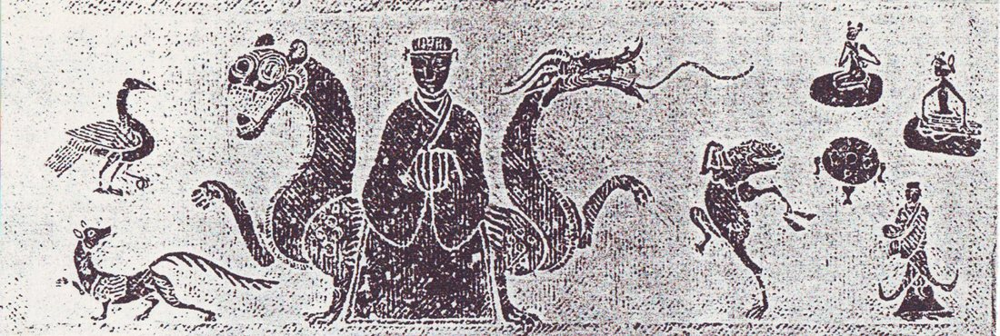{ loading=lazy }

---

## 1. 何为神话 { #s1 }

### 1.1 五种定义 { #s1-1 }

课件一开始列了五位学者的定义，放在一起看很有意思：

| 学者 | 定义 | 侧重点 |
|---|---|---|
| 史蒂斯·汤普森（Stith Thompson） | 神话所涉及的是神祇及其活动，是创世以及宇宙和世界的普遍属性。 | 题材：神与创世 |
| 杨利慧 | 神话是有关神祇、始祖、文化英雄或神圣动物及其活动的叙事，它解释宇宙、人类和文化的最初起源，以及现时世间秩序的最初奠定。 | 功能：解释起源、奠定秩序 |
| 茅盾 | 一种流行于上古民间的故事，所叙述者是超乎人类能力以上的神们的行事，虽然荒唐无稽，但古代人民互相传述，却信以为真。 | 时间与信念：上古、信以为真 |
| 袁珂 | 神话是非科学但却联系着科学的幻想的虚构……通过幻想的三棱镜反映现实。 | 认识论：幻想与现实 |
| 鲁迅 | 初民对超于人力以外的现象的自造解释。（《破恶声论》，1908） | 主体：初民的解释 |

汤普森是 AT 故事类型分类法里的那个 T，编过六卷本《民间文学母题索引》。他的定义最窄，只管神与宇宙。杨利慧的定义最像教科书，关键词是「叙事」和「最初」。茅盾和鲁迅都站在 20 世纪初进化论人类学的立场上：神话属于「上古」「初民」，是人类童年的东西。袁珂的「联系着科学的幻想」后面我们还会看到，它是为「广义神话」开路的。

### 1.2 Mythos 与「神话」 { #s1-2 }

希腊语 mythos 原意就是「话语、故事」。它和 logos 一开始并不是对立的，后来才被分成两种说话方式：

- **mythos**：讲故事，具体、有情节，用诗的形式，口传心授；
- **logos**：讲道理，抽象、理论化，用散文形式，以文字流传。

公元前 6 至前 5 世纪，希腊思想经历了所谓「从 mythos 到 logos」的转变（德国古典学家 Wilhelm Nestle 1940 年的书名就是 Vom Mythos zum Logos）：寓言、拟人和诗歌逐渐让位给逻辑、抽象概念、修辞术和哲学。这个叙述本身也是一种神话，因为柏拉图一边驱逐诗人，一边写了大量神话。

中文的「神话」一词则是 19 世纪末从日语「神話（shinwa）」借来的。在此之前，中文里对应的说法是「怪异」「虚妄之言」「神鬼之说」。一般认为，1903 年蒋观云在《新民丛报》发表的《神话历史养成之人物》第一次使用了这个词。他有一段很漂亮的比喻：

> 古往今来，英雄豪杰，其一言一行，一举一动，即铸成之植字，而留以为后世排列文字之用者也……而荟萃此植字者，于古为神话，于今为历史。神话、历史者，能造成一国之人才。

「植字」就是活字。神话和历史一样是排印一国精神的铅字，这种说法从一开始就把神话放在了民族建构的位置上。第二讲的闻一多会把这条线索推到极致。

### 1.3 神话的边界 { #s1-3 }

要界定神话，最常引用的是美国民俗学家威廉·巴斯科姆（William Bascom）在《民间文学的形式：散体叙事》（1965）中的三分法：

| 形式 | 时间 | 地点 | 主要角色 | 信实性 | 态度 | 功能 |
|---|---|---|---|---|---|---|
| 神话 | 遥远的过去 | 古时的或另外的世界 | 神祇、始祖、文化英雄、神圣动物 | 被认为是真实的 | 神圣的 | 解释与证明 |
| 传说 | 不久的过去 | 今天的世界 | 人类为主 | 有一定可信性 | 世俗或神圣 | 维系群体与地方的连续性 |
| 民间故事 | 任意时间 | 任意地点 | 人类或非人类 | 虚构 | 世俗的 | 娱乐、教育 |

这张表最有用的地方在于，「是不是神话」不只取决于内容，更取决于**讲述者和听众相不相信、在什么场合讲**。同一个故事，在祭坛上是神话，在饭桌上就可能是故事。

课上还拿寓言做了对照。《列子·汤问》里的鲲鹏「翼若垂天之云」，看起来很像神话，但它是假托殷汤和夏革的对话，用来说明「玩其所常见，习其所常闻」便不能认识无奇不有的世界。寓言有作者、有寓意，并且**明说是假托**。这正好落在巴斯科姆表格里神话的反面。

另一个相邻的范畴是「神怪」：从《山海经》《左传》，到魏晋志怪、唐传奇，再到《西游记》《聊斋志异》，这是一条很长的线索。有趣的是日本的「妖怪学」：井上圆了创立它的目的是用现代科学去解释妖怪，最终「消灭妖怪」。结果它反而成了妖怪文化最大的档案库。

### 1.4 狭义与广义 { #s1-4 }

茅盾持**狭义**神话观：在进化论框架下，神话是原始思维的产物，后世不再产生神话。袁珂则主张**广义**神话：古代神话、传说、仙话、怪异、带童话意味的民间传说、佛经故事、节日风物传说、少数民族神话，都可以纳入。界线是有的，只是不必截然划分。

课件引了马克思《〈政治经济学批判〉导言》里的名句：

> 任何神话都是用想象和借助想象以征服自然力，支配自然力，把自然力加以形象化；因而，随着这些自然力之实际上被支配，神话也就消失了。

不过反过来想，只要自然（以及社会）的发展仍然快于人的认识和支配能力，产生神话的土壤就没有消失。**新神话的产生是可能的**。这句话我很喜欢，它为第三讲以及后面「现代神话」的话题埋了伏笔。

---

## 2. 一个神话的四种存在形态：西王母 { #s2 }

第一讲最精彩的部分，是用**西王母**一个案例，走完李子贤划分的神话四种存在形态：

1. 文献神话（书面文本）；
2. 口头神话；
3. 活形态神话；
4. 以实物或虚拟物为象征符号的神话。

（叶舒宪另有一种按叙事主体与媒介的划分：汉文古籍的文本神话、汉族口传神话、少数民族文本神话、少数民族口传神话。两种划分可以交叉着看。）

### 2.1 文献：从「西母」到王母娘娘 { #s2-1 }

殷墟卜辞里已有「西母」，这是最早的相关文字。《尔雅·释地》说「觚竹、北户、西王母、日下谓之四荒」，这里的西王母还是地名或族名。到了《山海经》，她有了形象，但一点也不「娘娘」：

> 西王母其状如人，豹尾虎齿而善啸，蓬发戴胜，是司天之厉及五残。——《西山经》
>
> 有人戴胜、虎齿、豹尾、穴处，名曰西王母。——《大荒西经》

「戴胜」是头上的玉饰，后来成为辨认西王母图像最可靠的标志。「司天之厉及五残」则说明她掌管灾疫与刑杀，是一位令人畏惧的神。

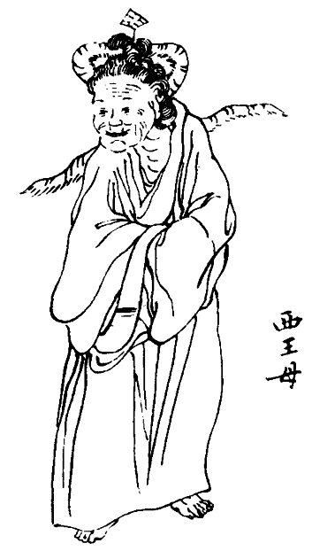{ loading=lazy }

西晋太康二年（281 年）从汲郡魏墓出土的竹简里有《穆天子传》，写周穆王驾八骏西行，到昆仑之丘会见西王母。两人对歌：

> 白云在天，山陵自出。道里悠远，山川间之。将子无死，尚能复来？——西王母
>
> 予归东土，和治诸夏。万民平均，吾顾见汝。比及三年，将复而野。——穆王

半人半兽的「司天之厉」在这里变成了能诗善对的西方部族女首领。汉代以后，西王母被神化，掌管不死之药，成为寿福之神。唐宋以后，她在道教经典、民间信仰和神魔小说里与玉皇大帝配对，成了家喻户晓的「王母娘娘」。

### 2.2 口头：泾川与天池 { #s2-2 }

甘肃泾川自称西王母故乡，当地传说直接借用了《穆天子传》的对歌，却改写成一段爱情：穆王与王母在瑶池相爱，约定三年后再来，结果一去不返，王母天天倚窗望着泾河川。王母宫所在的山叫「回中山」，据说是因为穆王临走时一再回头（见《中国民间故事集成·甘肃卷·泾川民间故事》，1991）。

新疆阜康天池流传的是另一个版本《西王母与水怪》（2010 年吴新锋采录自非遗传承人马克义）：王母开蟠桃会没请水怪，水怪搅翻天池；王母一簪子把它镇住，簪子落在石上长成一棵树，就是今天景区里的「定海神针」。

两个例子都说明，口头神话不是文献的退化版本。它会**附会地名、嫁接情节、改写情感**，把一个遥远的神拉到自家门口。

### 2.3 活形态：庙会与赤雪嘉姆 { #s2-3 }

泾川王母宫庙会据说始于北宋开宝元年（968 年），每年农历三月二十日、七月十八日举行。有开坛、请水、扬幡、拜忏、朝真礼斗、放焰口等一整套道场科仪，信众唱《王母宝卷》，艺人演《王母巡游》傩戏。近十年还有台湾道教信众专程来朝拜。在青海湖边，藏族民间把湖的化身「赤雪嘉姆」与西王母相认，这是昆仑神话、西王母信仰与藏地信仰交融的结果。

这里的神话不是被「讲述」的，而是被**做出来**的：日程表、仪式、唱词和朝圣路线本身就是叙事。

### 2.4 实物：画像砖与画像石 { #s2-4 }

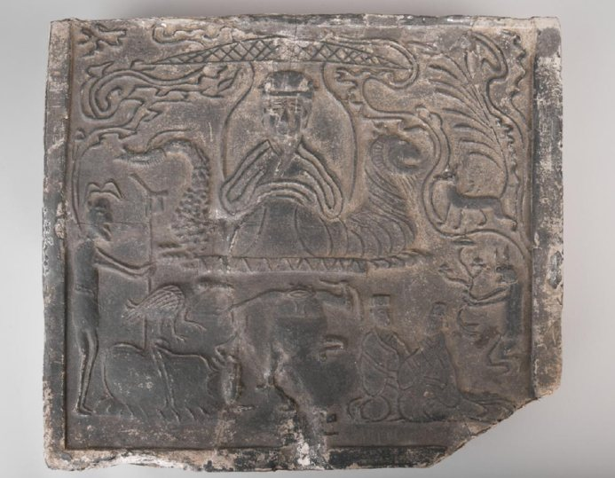{ loading=lazy }

汉代四川的画像砖、画像石里，西王母的图像已经相当程式化：**龙虎座、戴胜、三足乌、九尾狐、捣药玉兔、蟾蜍**，几乎形成一套「图像语法」。认得这套语法，就能在一块残砖上读出一整套关于不死与升仙的信仰。文首那张彭山崖墓石棺拓片也是同一套图像。

### 2.5 当代：景观与神话互塑 { #s2-5 }

课件最后引了吴新锋、刘蓓对天山天池景区的研究（2023）：

- **景观与神话互塑**：湖边一棵老榆树被讲成西王母的玉簪。神话借景观叙事，景观借神话传播。
- **节庆赋予神话新功能**：西王母庙会、瑶池蟠桃会成为地方旅游的文化资源。
- **讲述中的神话**：导游保留核心情节，又按自己的经历、游客和场所即兴添加；游客转述时又生成新的版本。

从甲骨上的两个字到景区导游的即兴发挥，三千多年里西王母一直在「被讲述」。我觉得第一讲真正想说明的是：**神话不是一个静止的文本，而是一条在不同媒介之间不断转写的河流**。研究神话，就是追踪这条河流。

---

## 3. 为什么研究神话：一部学术史 { #s3 }

### 3.1 研究神话的理由 { #s3-1 }

课件给了四个理由：神话作为社会事实与社会秩序；神话作为「文学原型的贮存库」；神话与 20 世纪现代艺术的产生；日常生活与面向未来的神话。

第三点我原来没想到。20 世纪的「原始主义」艺术，是西方人类学和殖民扩张的副产品，却反过来成了现代主义的发动机：毕加索在《亚威农少女》（1907）中把非洲面具嫁接到人脸上；杜尚把工业制成品《晾瓶架》当作「部落器物」展出，戏仿原始主义本身；高更则去塔希提寻找浪漫化的「原始」。1984 年纽约 MoMA 的展览 "Primitivism" in 20th Century Art: Affinity of the Tribal and the Modern 把这条线索摆上了台面，也因此饱受批评。

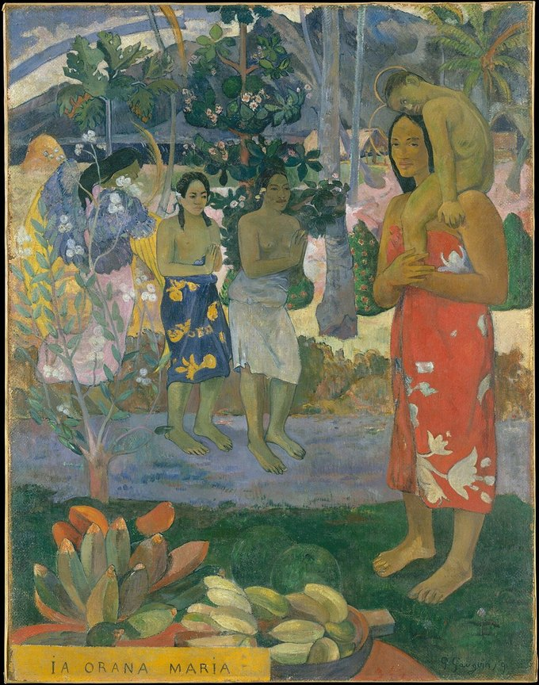{ loading=lazy }

当时的人类学进化论把神话看作原始社会的「遗留物」。艺术家则把这个遗留物翻过来，用作批判现代性的参照系。两种看法立场相反，前提却相同，都假定存在一个与「现代」对立的「原始」。

### 3.2 西方神话学简史 { #s3-2 }

课件把西方神话学分成三个阶段，我按时间线压缩如下：

- **古典时期**：柏拉图在《理想国》中审查诗人；亚里士多德在《诗学》中把 mythos（情节）定为悲剧的灵魂；普罗提诺把神话看作通向「太一」的象征。
- **中世纪到文艺复兴**：奥古斯丁斥异教神话为魔鬼的诱惑；但丁把基督教与古典神话融进一部史诗；薄伽丘《异教诸神谱系》第一次系统整理希腊罗马神话；斐奇诺用柏拉图主义阐释俄耳甫斯教。
- **启蒙到浪漫主义**：维柯《新科学》（1725）提出「诗性智慧」；赫尔德把民俗神话当作民族精神；格林兄弟中的雅各布写《德国神话》；马克斯·缪勒发展比较神话学与「语言疾病说」；泰勒《原始文化》提出万物有灵论；弗雷泽《金枝》建立神话—仪式学说。
- **20 世纪**：弗洛伊德（《图腾与禁忌》，1913）把神话看作被压抑冲动的象征性释放；荣格看作集体无意识的显现；弗莱发展出神话—原型批评；列维-斯特劳斯转向结构；罗兰·巴特的《神话学》（1957）则说神话是一种「去政治化的言说」，广告、新闻和明星照片都在把特定的历史与权力包装成「自然」；女性主义神话学（如金芭塔丝的「女神文明」）则试图打捞被父权叙事遮蔽的女神。

巴特那一条我觉得最值得记住。按他的定义，**神话不在过去，而在我们每天看的东西里**，这和 1.4 节「新神话可能产生」的判断正好接上。

### 3.3 中国神话学 { #s3-3 }

中国神话学是西学东渐的产物，最早提出「中国神话」问题的也是西方和日本学者。大致分期：

| 阶段 | 时间 | 代表 |
|---|---|---|
| 萌芽 | 1903 | 蒋观云《神话历史养成之人物》 |
| 奠基 | 1920 年代初—1937 | 文学家：鲁迅、周作人、茅盾，引入英国人类学派；历史学家：顾颉刚、杨宽的「古史辨」 |
| 拓展 | 1937—1940 年代末 | 芮逸夫、凌纯声、吴泽霖、楚图南、常任侠等的少数民族田野调查 |
| 曲折 | 1949—1977 | 丁山《中国古代宗教与神话考》（1960）等 |
| 复苏 | 1977—2000 | 中国神话学会成立；考据、考古与田野并重 |

奠基阶段有两条路。茅盾的《中国神话研究 ABC》（1929）在文化史里考察神话，提出中国神话的北、中、南三区格局，并系统比较东西方神话。顾颉刚则提出「层累地造成的中国古史」：尧、舜、禹这些「古帝王」很多是由神话一步步历史化而来的；杨宽进一步主张「神话演变分化说」，一个神在流传中「一化二、二化三，直到无数」。前者把神话当作文学，后者把古史还原为神话，方向相反，都极大地改变了人们读古书的方式。

课件最后有一段反思，我抄在这里：

- 走出东西方二元比较（不要拿希腊神话当尺子去量中国神话的「不发达」）；
- 尊重和理解每个神话故事自身的特征；
- 重视故事的存在形态，以及流传与表演的语境和主体；
- 充分调查和理解故事的地域性（locality）和历史性。

这四条其实就是第一讲西王母案例的方法论。

---

## 4. 人类学家：志异文本的现代作者 { #s4 }

第二讲的标题很妙。《聊斋志异》的作者叫「异史氏」。人类学家深入「异」地记录「异」俗，在某种意义上就是现代的志异作者。这一讲的主角是**闻一多**。

### 4.1 闻一多和他的时代 { #s4-1 }

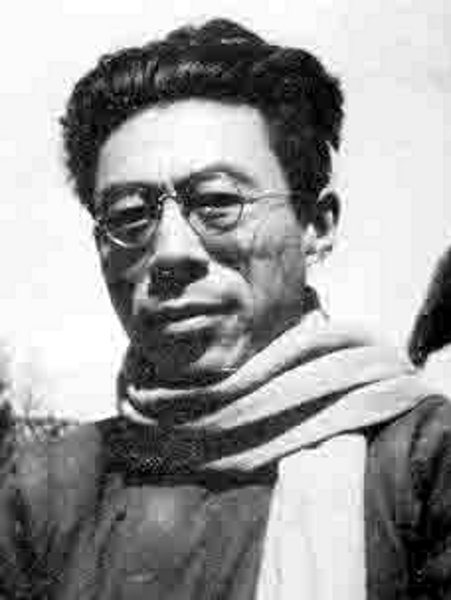{ loading=lazy }

我们通常知道的闻一多是诗人（《红烛》《死水》）和民主斗士（1946 年遇刺）。但他还有一个身份：神话学家。1936 年他在清华开设「中国古代神话研究」专题课。他自己说：

> 我们的历史课题甚至伸到历史以前，所以我研究了神话；我的文化课题超出了文化圈外，所以我又在研究以原始社会为对象的文化人类学。

几条背景值得注意：

- **美术训练**：1922—1925 年他先后在芝加哥艺术学院、科罗拉多大学和纽约艺术学生联盟学画。视觉分析的眼光后来变成了「以俗证古」的方法，从图像、纹饰、仪式切入古史。
- **「谎中求真」**：法国汉学家葛兰言（Marcel Granet）主张「伪中求真」，他的《中国古代舞蹈与传说》经李璜摘译，1933 年以《古中国的跳舞与神秘故事》出版。闻一多的「谎中求真」受其启发，但多了一层：他站在**西方**和**少数民族**两个「他者」之间，思考中华民族的自我形象。
- **译介热潮**：民国三十多年译出大量社会科学和人文著作。海顿的《南洋猎头民族考察记》、施密特的《比较宗教史》、马林诺夫斯基的《巫术科学宗教与神话》（李安宅译）、罗维的《初民社会》（吕叔湘译）、倍松的《图腾主义》（胡愈之译）等书，构成了闻一多那一代人的理论工具箱。

他的方法论可以用一句自述概括：

> 我是把古书放在古代人类的生活范畴里去研究；站在民俗学的立场，用历史神话去解释古籍。

《高禖郊社祖庙通考》的跋里还有一句更有力的话：

> 历史为人类活动之记录，神话则其活动动机之口供。由历史可以知其「然」，由神话更可以知其「所以然」也。

### 4.2 三千五百里：一次行走的田野 { #s4-2 }

1938 年，长沙临时大学西迁昆明，其中一路是步行的「湘黔滇旅行团」：250 多名学生，加上黄子坚、闻一多、曾昭抡、吴征镒等 11 位教师组成的辅导团，徒步约 3500 里，历时 68 天，横穿湘、黔、滇三省。旅行团的宗旨写得很好：「习民情，考查风土，采集标本，锻炼体魄，务使迁移之举本身即是教育。」

闻一多脚上磨满血泡也坚持不乘车，晚上和学生一样睡在老乡家的干草上。他和李继侗、冯友兰约定抗战不胜利不剃胡子，那把著名的胡子就是这时蓄起来的。一路上他画了上百幅铅笔速写。

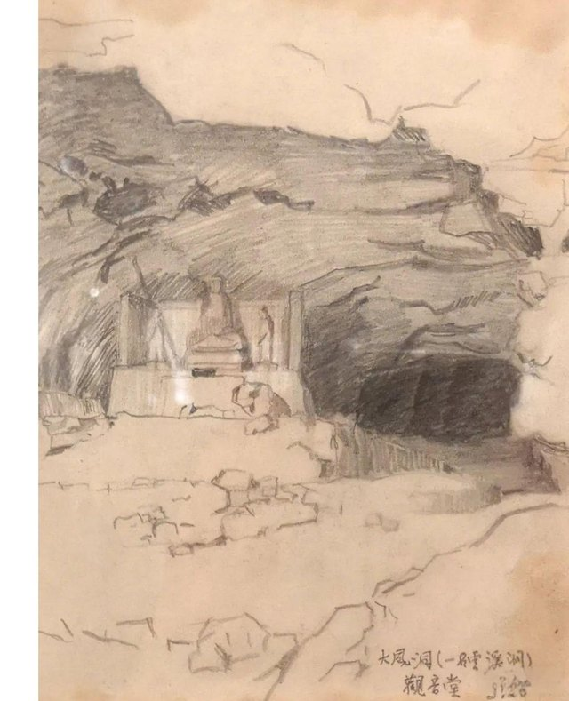{ loading=lazy }

学生刘兆吉一路采集了两千多首民谣。他每天早饭后揭下锅巴塞进茶缸，饿了就撕一块吃，晚上在油灯下整理当天的歌谣。到昆明后，他编成《西南采风录》，闻一多和朱自清都为它作序。另一位学生钱能欣写了《西南三千五百里》。

这段历史让我想到，**田野不一定要专门「去」，迁徙本身就可以是田野**。

### 4.3 伏羲考 { #s4-3 }

《伏羲考》并不是闻一多生前定稿的一本书。他 1940 年代初写了《从人首蛇身像谈到龙与图腾》《战争与洪水》《汉苗的种族关系》《伏羲与葫芦》等几篇文章。1946 年他遇刺后，朱自清主持遗著整理，把这几篇合编为《伏羲考》，收入 1948 年开明书店版《闻一多全集》。

它的论证可以拆成一条链：

**人首蛇身 → 双龙 → 龙蛇 → 图腾 → 龙族 → 葫芦 → 造人故事**

支撑这条链的是三类材料。

**文献**。《易·系辞》说包牺氏「仰则观象于天，俯则观法于地……始作八卦」；司马贞补《三皇本纪》则说伏羲「蛇身人首」，母亲华胥「履大人迹于雷泽」而生下他。《山海经·海内经》里有一位南方苗民之神「延维」：「人首蛇身，长如辕，左右有首」，闻一多认为它就是伏羲女娲。

**口述**。芮逸夫 1930 年代初随凌纯声在湘西做苗族调查，采集到四个洪水故事，1938 年发表《苗族的洪水故事与伏羲女娲的传说》。四个版本细节不同，骨架却一致：

| 情节 | 祥述故事 | 佐述故事 | 傩公傩母歌 | 傩神起源歌 |
|---|---|---|---|---|
| 洪水 | 雷公发洪水数十日 | 雷公发洪水七日七夜 | 玉皇上帝发洪水七日七夜 | 雷公发洪水七日七夜 |
| 避水 | 兄妹各入黄瓜 | 兄妹共入葫芦 | 兄妹共入葫芦 | 兄妹共入仙瓜 |
| 配偶 | 扔磨子 | 金鱼老道撮合 | 东山南山焚香，香烟结团 | 扔竹片、扔磨子 |
| 传人 | 生肉块，割弃变人 | 未详 | 生肉块，割出十二童男童女 | 生怪胎，割弃变人 |

概括起来就是：始祖擒雷公，雷公逃脱后发洪水报复，世人尽死，只剩兄妹二人；兄妹成婚，生下怪胎，剖开化为人类。芮逸夫还从语音上论证，鸦雀苗故事里的兄长名 Bu-i 意为「第一祖先」，与「伏羲」古音相通。他对母题演变有一段很精到的话：

> 最初只有一个简单的故事作中心的「母题」。后来经过众口的传说敷演……或因附会异词而曲全其解，或因语义失解而附会其说，或因记忆失真而弥缝其词。

**图像**。1938 年重庆沙坪坝出土东汉石棺，常任侠考证出前额刻的捧日人首蛇身像是伏羲，捧月像是女娲。闻一多评价说，考古家对这个问题的贡献，在于确定了图中另一人是女娲，由此证实了两人的夫妇关系。他进而判断，伏羲女娲传说最活跃的时期（西汉末至东汉末），正是人首蛇身神画像大量出现的时期。

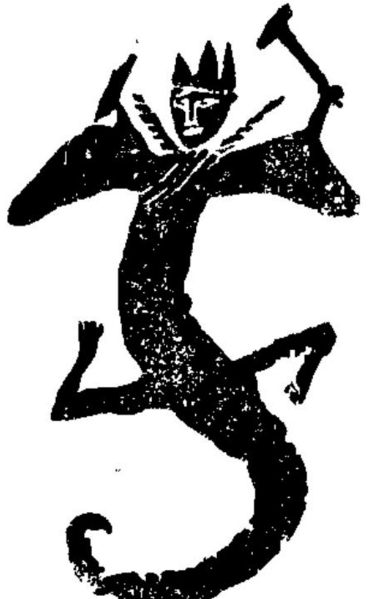{ loading=lazy }

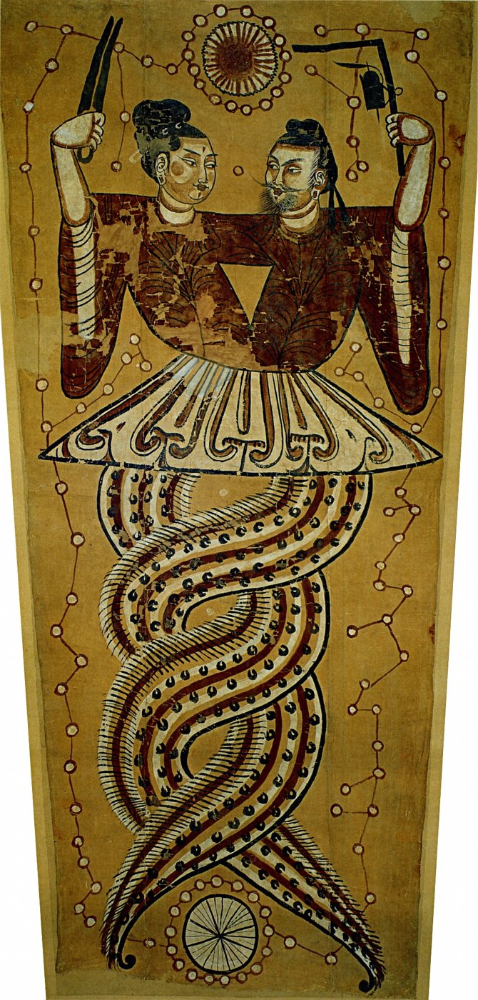{ loading=lazy }

把三类材料拼在一起，闻一多得到的不只是「伏羲女娲是兄妹配偶型洪水始祖」这个结论，还有一个更大的论断：

> 所谓龙，就是原始的龙（一种蛇）图腾兼并了许多旁的图腾后形成的一种综合式的虚构生物。

龙图腾族团起初在黄河上游，一部分北迁，一部分南迁为荆楚吴越诸蛮，今日的苗族是其后裔；留在原地的那部分「做了我国四千年文化的核心」。这是在抗战最艰难的时候，一位诗人用训诂、音韵、考古和田野材料给出的**民族同源叙事**。读到这里会明白，蒋观云说神话能「造成一国之人才」，并不只是修辞。

### 4.4 神话的三种解释 { #s4-4 }

这一讲的后半部分，把《伏羲考》放回西方理论的三条谱系里，正好对应它的三种论证。

**语言起源论。** 卢梭追问，是社会先于语言，还是语言先于社会；赫尔德的《论语言的起源》（1770 年写成，次年获柏林科学院奖）则认为，语言出自人自身的悟性。把这条思路用到神话上的是马克斯·缪勒的「语言疾病说」。恩底弥翁是厄利斯的牧人王子，月神塞勒涅（Selene）爱上了在山洞中沉睡的他，他从此永睡不醒、永不衰老。缪勒说：

> 如果人们都知道 enduma 意为日落，恩底弥翁的神话就永远不会产生。……人们说「塞勒涅亲吻着入睡的恩底弥翁」，而不是说「现在是晚上」。

也就是说，神话是词义遗忘之后留下的「误读」。闻一多论证伏羲（包戏、匏瓠）和女娲（苞娲、匏瓜）都是「葫芦」的音转，走的也是这条从语音出发的路。

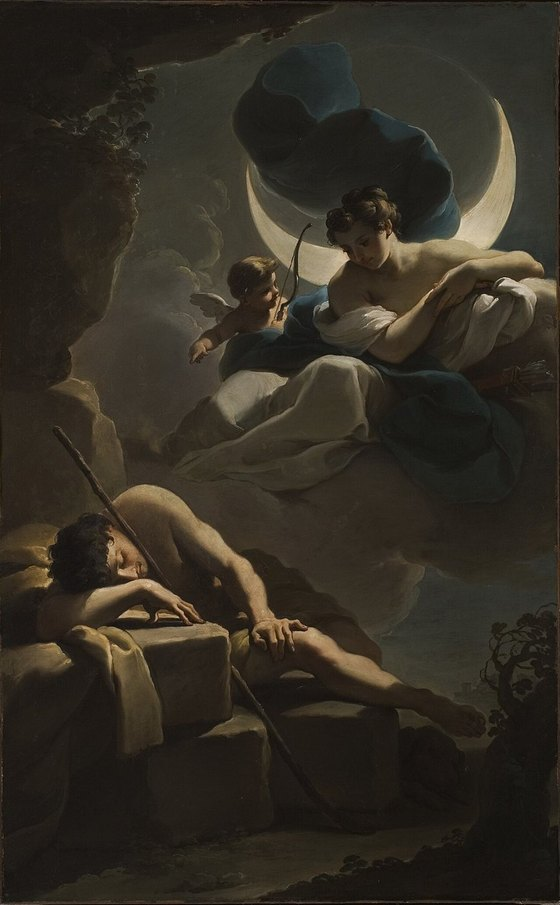{ loading=lazy }

**社会起源论。** 维柯认为各异教民族的历史都从神话开始，原始人是「崇高的诗人」，「把一切制度都想象为神」。涂尔干和莫斯在《原始分类》中进一步说，分类的框架来自社会，「两种形式的起源都是社会」。莫斯的《巫术的一般理论》说「大众舆论造就了巫师」，社会才是仪式戏剧中真正的行动者。对应到《伏羲考》，就是图腾团族、姓氏制度，以及洪水与战争所代表的社会冲突和秩序崩溃。

**心理起源论。** 弗洛伊德在《图腾与禁忌》中把禁忌比作强迫症：两者都没有可以归因的动机，都由内在的「需要」维持，都容易替换和传染，也都要求类似仪式的行为。图腾动物则是俄狄浦斯情结的转移对象。闻一多对「断发文身」的解释正用到这一层。许慎说文身是为了「尊荣」，闻一多认为这背后是图腾心理：

> 图腾既是祖宗又是神，还有什么比像祖宗、像神更值得骄傲？……「断其发，文其身」——人一像龙，人便是龙了。

这一讲的小结是三组对子：**东西融汇**（闻一多和他的时代）、**古今贯通**（伏羲考）、**文理渗透**（三种解释）。我自己的感受是，《伏羲考》的方法在今天看来有不少可以商榷之处，比如图腾说的普遍性、音转论证的弹性都值得推敲。但它示范了一种很难得的研究姿态：同时调动文献、口述、图像和理论，并且清楚地知道自己在为谁写作。

---

## 5. 帝国的隐喻：神、鬼、祖先与中国社会 { #s5 }

### 5.1 从文本到社会 { #s5-1 }

第三讲从两个志怪故事开场。

第一个出自干宝《搜神记》。东汉末年，广陵人蒋子文「嗜酒，好色，挑挞无度」，常说自己「骨清，死当为神」。他做秣陵尉时追贼到钟山下，伤额而死。到孙权时，他白马白羽出现在道上，要百姓为他立祠，「不尔，将有大咎」。接着就是瘟疫、钻耳的小虫、一日数十处的大火。最后孙吴朝廷封他为中都侯，加印绶、立庙堂，把钟山改名蒋山，「自是灾厉止息，百姓遂大事之」。

一个品行不端的小吏，靠**灵验加官封**获得了神格。这个故事的叙事结构是「兆—应」：降灾是兆，册封是应，背后是巫术式的因果关联。

第二个是吕洞宾题壁诗的流传史：

1. 北宋熙宁元年（1068），一位自称「回山人」的道人在湖州沈东老家饮酒，用石榴皮在壁上题诗，出门过桥后不知所往。有人说这是吕洞宾，因为「回」字两个口，正是「吕」。苏轼后来听沈东老之子讲起，作了和诗，还在给王巩（定国）的信里问：「回山人题壁诗，公曾见之否？」
2. 王巩的《闻见近录》记了另一首题壁诗：吕洞宾在岳州白鹤寺古松下休息，遇到树神，题诗「惟有千年老树精，分明知是神仙过」。
3. 到元代苗善时的道教圣传《纯阳帝君神化妙通纪》，树神成了「松之精」，诗句变成「惟有南山老树精」，又添上了救人、斩蟒、留下「稚松」和石墨遗迹等情节。

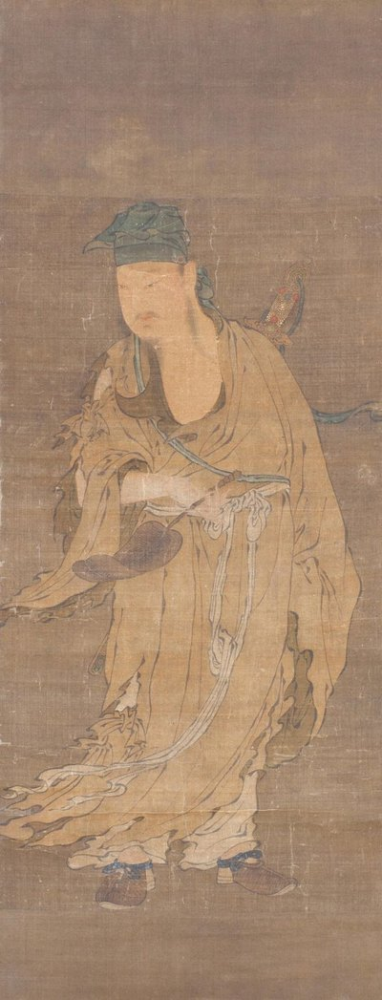{ loading=lazy }

这个例子很像顾颉刚说的「层累」，只是累积的不是古史，而是神性。更重要的是，苏轼的那封信说明，**文本的流传嵌在真实的社会关系里**。要理解神怪故事，就要从文本走到社会。

### 5.2 汉学人类学家的研究脉络 { #s5-2 }

王斯福（Stephan Feuchtwang）的《帝国的隐喻：中国民间宗教》（The Imperial Metaphor: Popular Religion in China，1992；赵旭东中译）有三位绕不开的前辈。

**莫里斯·弗里德曼（Maurice Freedman）：宗族。** 他从新加坡华人的家庭与婚姻研究起步，写出《中国东南的宗族组织》（1958）和《中国东南的宗族与社会》（1966），用华南宗族回应非洲研究中发展起来的继嗣理论，也开启了「在散乱的信仰之下寻找秩序」的中国民间宗教研究。他问过一个很好的问题：**祖先的灵魂去哪儿了？** 答案是三处：灵牌（家户与祠堂，体现亲属体系）、坟墓（死者与生者交换的场所）、地府（道德审判，一个官僚国家）。

**施坚雅（G. William Skinner）：市场。** 1949 年，康奈尔大学博士生施坚雅来到成都郊外的高店子做田野。后来他写出《中国农村的市场和社会结构》（1964—1965），提出了中国社会研究中最著名的几何模型：农民生活的基本单位不是自然村，而是**基层市场区域**；理想状态下，这些区域呈六边形铺满平原，若干基层市场又围绕一个中间市场组成更高一级的六边形，层层上推到区域中心。

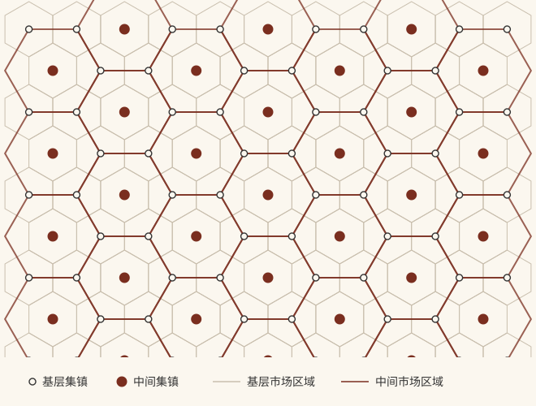{ loading=lazy }

课件里还对比了一张当代农产品市场结构图：中间层级消失了，村庄直接连接多个基层市场和全国性市场，金字塔变成了网络。施坚雅模型的价值，也许正在于它让这种变化变得可以测量。

**武雅士（Arthur P. Wolf）：宗教。** 他主编的《中国社会中的宗教与仪式》（1974）里有一篇名文《神、鬼和祖先》，开头是这样一段观察：

> 在台北盆地西南端的农村地区，保守的家庭每天早晨和晚上都会烧三炷香。一炷放在后门外的壁龛里，烧给游魂；一炷供奉灶神；另一炷放在直系祖先碑前的炉中。

三炷香对应三种超自然存在，也对应农民社会世界里的三类人：

| 超自然存在 | 祭品 | 对应的社会角色 | 关系 |
|---|---|---|---|
| 神 | 冥币、金纸（像缴税） | 官员 | 科层与权威 |
| 祖先 | 家常饭菜 | 亲属 | 继嗣与赡养 |
| 鬼 | 量多但随便（像打发乞丐） | 陌生人、流氓、乞丐 | 危险与施舍 |

土地公管着本地的鬼，灶神定期向上汇报一家人的言行，这几乎就是一套基层行政。课件里有一句话我印象很深：**中国的官僚制度在行政管理上也许是失败的，但在观念上是成功的，它依照自己的模型创造了一个宗教。**

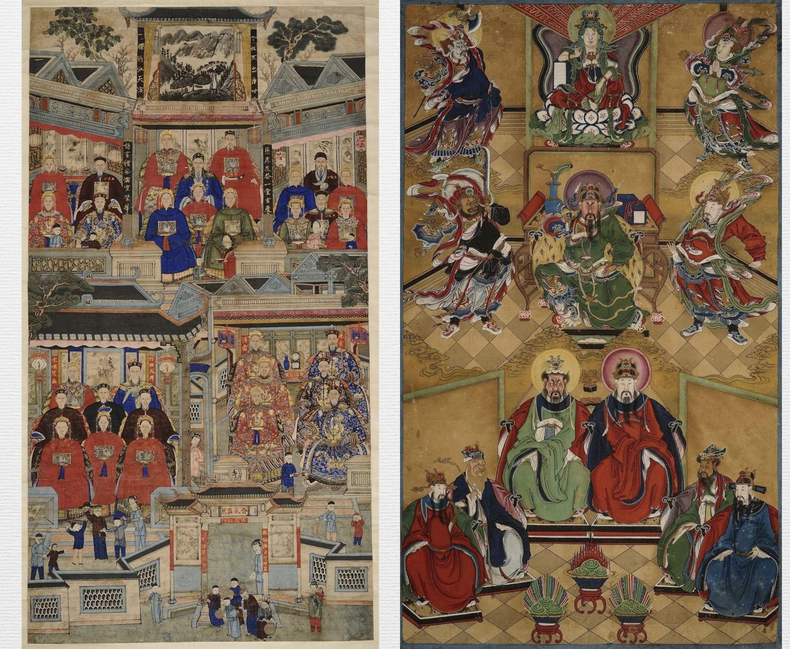{ loading=lazy }

三人合起来，正好是汉学人类学关心的三大块：**宗族与村落、市场、宗教**。方法上则都是社区研究加长期田野，目标是回答「社会何以可能」。

### 5.3 帝国的隐喻 { #s5-3 }

王斯福在台湾「山街」做田野，看到的祭祀结构与武雅士相近：神被「请进来」，烧金纸；祖先在家中，烧银纸；兵和鬼的祭品放在门槛上或门外。这种区分可以一直追溯到唐代。戴孚《广异记》里，一个在地府当差多年的小吏托人烧钱：

> 金钱者，是世间黄纸钱；银钱者，白纸钱耳。……世作钱于都市，其钱多为地府所收。

在市场上做的纸钱会被地府「截留」，所以要在家中密室里请人凿钱，到水边去烧。看灰被风吹的方向，还能知道钱有没有被别的鬼神收走。阴间不仅有官，还有财政、税收和贪污。

但王斯福和武雅士有一处关键的不同。武雅士的模型是**对应性投射**：神就是官，鬼就是乞丐。王斯福强调的是**隐喻**：

- 民间宗教对帝国行政、贸易与惩罚体系的模仿，不是一模一样的复制，而是**再创造**，有时甚至会发生意义的**逆转**；
- 它关心的是民间宗教如何把分散的个人联结在一起：香炉、分香、绕境巡行、炉主与丁钱，划出一层层重叠的社区边界，包括市场圈、婚姻圈、祭祀圈和信仰圈；
- 道士的醮仪是「仪式性的戏剧」，而不是实际的威权与制裁。

> 与一座家户的神龛相比，一座地方性庙宇就更像是围绕着一座香炉而有的社会性媒介的建构，这是一个把家户的神龛容纳进来的中心。（《帝国的隐喻》，第 157 页）

书中有两句话可以当结论：

> 中国宗教保持整体性的根本方面，在于宗教的产生源自于世俗社会，而信仰和仪式的隐喻和象征又服务于世俗社会。
>
> 恰恰是在对帝国的秩序加以复制的地方，会导致一种分裂。

后一句是这一讲最有意思的地方。地方庙宇模仿帝国的衙门，正因为是模仿，它就可以自立中心、自划边界，甚至自封神明。蒋子文的故事倒过来看，正是**国家不得不承认一个由民间「灵验」逼出来的神**。隐喻是沟通国家与民间的语言，也是两者讨价还价的场所。

课件小结列了四点：嵌入社会实践的文本；鬼神崇拜既是现象事实，也是文化事实；政治社会生活中神话式的运作方式；以及一个自我质疑：「神话与社会之间的关系，是否是一种循环论证？」用社会解释神话，又用神话证明社会，这个问题我还没有想清楚，先记在这里。

---

## 6. 小结：三讲之后 { #s6 }

回头看，三讲各有一个关键词：

- 第一讲是**形态**：神话存在于文献、口头、仪式和实物之间，并且不断在它们之间转写。西王母从甲骨上的「西母」一路走到天池景区导游口中。
- 第二讲是**作者**：神话学家也是神话的书写者。闻一多在民族危亡之际用伏羲和龙讲出了一个同源共祖的中国，这本身就是一次现代的「神话制作」。
- 第三讲是**结构**：神、鬼、祖先映照着官员、陌生人、亲属。民间宗教用帝国的语言组织社会，也在模仿中保留了偏离帝国的可能。

把这三个关键词连起来，我对「神话」的理解有了变化。它不是一个等待被考证真伪的「原始故事」，而是**一种社会用来讲述自身、安排秩序的方式**。蒋观云说的「植字」，闻一多说的「活动动机之口供」，王斯福说的「隐喻」，说的大概都是这件事。

接下来几讲会进入神话与仪式（顾颉刚的《妙峰山》）和民族志写作，期中还要交一篇田野报告。到那时也许可以亲自去庙会上看看：今天的人们是怎样一边烧着金纸，一边继续「制造」神话的。

---

## 参考与图片来源 { #refs }

**主要参考**

- 梁君健：《神话学》课程第一至三讲课件（2026 年秋）。
- 闻一多：《伏羲考》，田兆元导读，上海古籍出版社。
- 茅盾：《中国神话研究 ABC》，上海世界书局，1929。
- 王斯福：《帝国的隐喻：中国民间宗教》，赵旭东译，江苏人民出版社，2008。
- 芮逸夫：《苗族的洪水故事与伏羲女娲的传说》，《人类学集刊》第一卷第一期，1938。
- Arthur P. Wolf, "Gods, Ghosts, and Ancestors," in Religion and Ritual in Chinese Society, Stanford University Press, 1974.
- G. William Skinner, "Marketing and Social Structure in Rural China," Journal of Asian Studies, 1964–1965.
- William Bascom, "The Forms of Folklore: Prose Narratives," Journal of American Folklore, 1965.
- 吴新锋、刘蓓：《西王母神话在旅游语境中的转化——以天山天池景区为例》，《徐州工程学院学报（社会科学版）》，2023 年第 3 期。

**图片来源**

- 西王母龙虎座图拓片：[Wikimedia Commons](https://commons.wikimedia.org/wiki/File:Queen_Mother_of_the_West_-_Rubbing_%28%E8%A5%BF%E7%8E%8B%E6%AF%8D%E9%BE%8D%E8%99%8E%E5%BA%A7%E5%9C%96%29.png)，公有领域。
- 《山海经》西王母插图：[Wikimedia Commons](https://commons.wikimedia.org/wiki/File:Shan_Hai_Jing_-_Xi_Wangmu.jpg)，公有领域。
- 东汉西王母画像砖（四川大学博物馆藏）、沙坪坝石棺画像摹本、闻一多速写《大风洞观音堂》、李氏祖先群像与关公众神图：截取自课程课件，仅作学习笔记引用。
- 高更《Ia Orana Maria》：[Wikimedia Commons / The Met](https://commons.wikimedia.org/wiki/File:Ia_Orana_Maria_%28Hail_Mary%29_MET_DT1025.jpg)，CC0。
- 闻一多像：[Wikimedia Commons](https://commons.wikimedia.org/wiki/File:Wen_Yiduo.jpg)，公有领域。
- 阿斯塔那《伏羲女娲图》：[Wikimedia Commons](https://commons.wikimedia.org/wiki/File:Anonymous-Fuxi_and_N%C3%BCwa.jpg)，公有领域。
- 甘多尔菲《塞勒涅与恩底弥翁》：[Wikimedia Commons](https://commons.wikimedia.org/wiki/File:Selene_and_Endymion_by_Ubaldo_Gandolfi.jpg)，公有领域。
- 明代《吕洞宾像》（费城艺术博物馆藏）：[Wikimedia Commons](https://commons.wikimedia.org/wiki/File:The_Daoist_Immortal_L%C3%BC_Dongbin.jpg)，公有领域。
- 施坚雅市场模型示意图：本文自绘。
