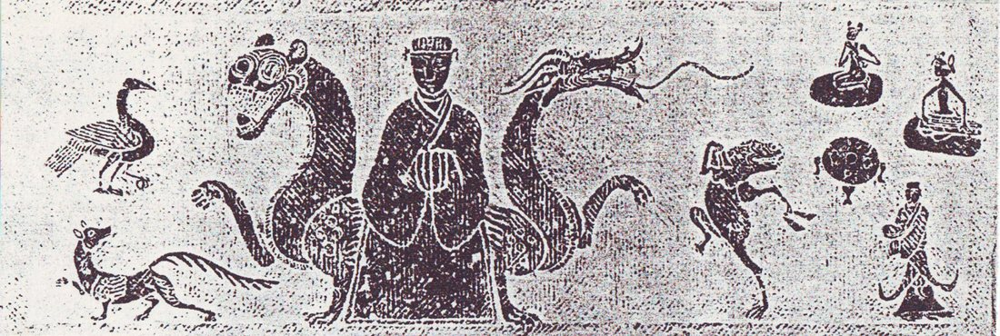
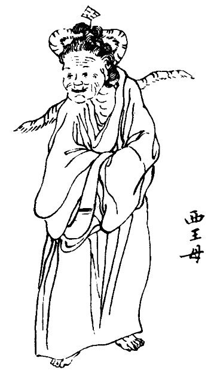
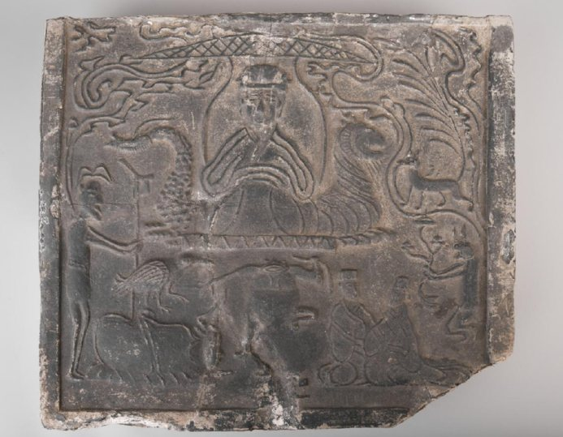
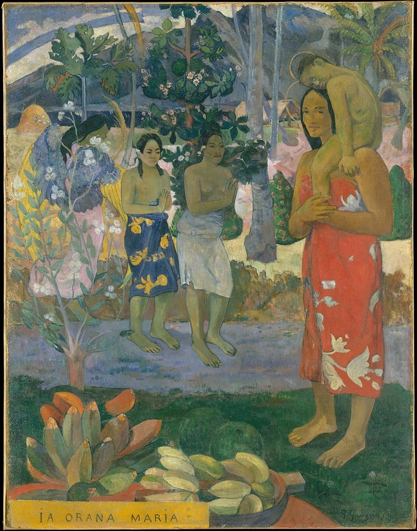

# 第一讲：神话学引论 { #top }

本文是[神话学引论随笔](../mythology-intro.md)系列的第一篇，对应 2026 年 9 月 15 日的课。

第一讲是全课的引论，分三步走：先问什么是神话，它和传说、故事、寓言的边界在哪里；再用西王母一个案例，走完神话的四种存在形态；最后回顾西方和中国神话学各自的学术史。课件来自梁君健老师的课程，引文和观点出处尽量标明，图片来源列在文末。

{ loading=lazy }

---

## 1. 何为神话 { #s1 }

### 1.1 五种定义 { #s1-1 }

课件一开始列了五位学者的定义，放在一起看很有意思：

| 学者 | 定义 | 侧重点 |
|---|---|---|
| 史蒂斯·汤普森（Stith Thompson） | 神话所涉及的是神祇及其活动，是创世以及宇宙和世界的普遍属性。 | 题材：神与创世 |
| 杨利慧 | 神话是有关神祇、始祖、文化英雄或神圣动物及其活动的叙事，它解释宇宙、人类和文化的最初起源，以及现时世间秩序的最初奠定。 | 功能：解释起源、奠定秩序 |
| 茅盾 | 一种流行于上古民间的故事，所叙述者是超乎人类能力以上的神们的行事，虽然荒唐无稽，但古代人民互相传述，却信以为真。 | 时间与信念：上古、信以为真 |
| 袁珂 | 神话是非科学但却联系着科学的幻想的虚构……通过幻想的三棱镜反映现实。 | 认识论：幻想与现实 |
| 鲁迅 | 初民对超于人力以外的现象的自造解释。（《破恶声论》，1908） | 主体：初民的解释 |

汤普森是 AT 故事类型分类法里的那个 T，编过六卷本《民间文学母题索引》。他的定义最窄，只管神与宇宙。杨利慧的定义最像教科书，关键词是「叙事」和「最初」。茅盾和鲁迅都站在 20 世纪初进化论人类学的立场上：神话属于「上古」「初民」，是人类童年的东西。袁珂的「联系着科学的幻想」后面我们还会看到，它是为「广义神话」开路的。

### 1.2 Mythos 与「神话」 { #s1-2 }

希腊语 mythos 原意就是「话语、故事」。它和 logos 一开始并不是对立的，后来才被分成两种说话方式：

- **mythos**：讲故事，具体、有情节，用诗的形式，口传心授；
- **logos**：讲道理，抽象、理论化，用散文形式，以文字流传。

公元前 6 至前 5 世纪，希腊思想经历了所谓「从 mythos 到 logos」的转变（德国古典学家 Wilhelm Nestle 1940 年的书名就是 Vom Mythos zum Logos）：寓言、拟人和诗歌逐渐让位给逻辑、抽象概念、修辞术和哲学。这个叙述本身也是一种神话，因为柏拉图一边驱逐诗人，一边写了大量神话。

中文的「神话」一词则是 19 世纪末从日语「神話（shinwa）」借来的。在此之前，中文里对应的说法是「怪异」「虚妄之言」「神鬼之说」。一般认为，1903 年蒋观云在《新民丛报》发表的《神话历史养成之人物》第一次使用了这个词。他有一段很漂亮的比喻：

> 古往今来，英雄豪杰，其一言一行，一举一动，即铸成之植字，而留以为后世排列文字之用者也……而荟萃此植字者，于古为神话，于今为历史。神话、历史者，能造成一国之人才。

「植字」就是活字。神话和历史一样是排印一国精神的铅字，这种说法从一开始就把神话放在了民族建构的位置上。第二讲的闻一多会把这条线索推到极致。

### 1.3 神话的边界 { #s1-3 }

要界定神话，最常引用的是美国民俗学家威廉·巴斯科姆（William Bascom）在《民间文学的形式：散体叙事》（1965）中的三分法：

| 形式 | 时间 | 地点 | 主要角色 | 信实性 | 态度 | 功能 |
|---|---|---|---|---|---|---|
| 神话 | 遥远的过去 | 古时的或另外的世界 | 神祇、始祖、文化英雄、神圣动物 | 被认为是真实的 | 神圣的 | 解释与证明 |
| 传说 | 不久的过去 | 今天的世界 | 人类为主 | 有一定可信性 | 世俗或神圣 | 维系群体与地方的连续性 |
| 民间故事 | 任意时间 | 任意地点 | 人类或非人类 | 虚构 | 世俗的 | 娱乐、教育 |

这张表最有用的地方在于，「是不是神话」不只取决于内容，更取决于**讲述者和听众相不相信、在什么场合讲**。同一个故事，在祭坛上是神话，在饭桌上就可能是故事。

课上还拿寓言做了对照。《列子·汤问》里的鲲鹏「翼若垂天之云」，看起来很像神话，但它是假托殷汤和夏革的对话，用来说明「玩其所常见，习其所常闻」便不能认识无奇不有的世界。寓言有作者、有寓意，并且**明说是假托**。这正好落在巴斯科姆表格里神话的反面。

另一个相邻的范畴是「神怪」：从《山海经》《左传》，到魏晋志怪、唐传奇，再到《西游记》《聊斋志异》，这是一条很长的线索。有趣的是日本的「妖怪学」：井上圆了创立它的目的是用现代科学去解释妖怪，最终「消灭妖怪」。结果它反而成了妖怪文化最大的档案库。

### 1.4 狭义与广义 { #s1-4 }

茅盾持**狭义**神话观：在进化论框架下，神话是原始思维的产物，后世不再产生神话。袁珂则主张**广义**神话：古代神话、传说、仙话、怪异、带童话意味的民间传说、佛经故事、节日风物传说、少数民族神话，都可以纳入。界线是有的，只是不必截然划分。

课件引了马克思《〈政治经济学批判〉导言》里的名句：

> 任何神话都是用想象和借助想象以征服自然力，支配自然力，把自然力加以形象化；因而，随着这些自然力之实际上被支配，神话也就消失了。

不过反过来想，只要自然（以及社会）的发展仍然快于人的认识和支配能力，产生神话的土壤就没有消失。**新神话的产生是可能的**。这句话我很喜欢，它为第三、四讲以及后面「现代神话」的话题埋了伏笔。

---

## 2. 一个神话的四种存在形态：西王母 { #s2 }

第一讲最精彩的部分，是用**西王母**一个案例，走完李子贤划分的神话四种存在形态：

1. 文献神话（书面文本）；
2. 口头神话；
3. 活形态神话；
4. 以实物或虚拟物为象征符号的神话。

（叶舒宪另有一种按叙事主体与媒介的划分：汉文古籍的文本神话、汉族口传神话、少数民族文本神话、少数民族口传神话。两种划分可以交叉着看。）

### 2.1 文献：从「西母」到王母娘娘 { #s2-1 }

殷墟卜辞里已有「西母」，这是最早的相关文字。《尔雅·释地》说「觚竹、北户、西王母、日下谓之四荒」，这里的西王母还是地名或族名。到了《山海经》，她有了形象，但一点也不「娘娘」：

> 西王母其状如人，豹尾虎齿而善啸，蓬发戴胜，是司天之厉及五残。——《西山经》
>
> 有人戴胜、虎齿、豹尾、穴处，名曰西王母。——《大荒西经》

「戴胜」是头上的玉饰，后来成为辨认西王母图像最可靠的标志。「司天之厉及五残」则说明她掌管灾疫与刑杀，是一位令人畏惧的神。

{ loading=lazy }

西晋太康二年（281 年）从汲郡魏墓出土的竹简里有《穆天子传》，写周穆王驾八骏西行，到昆仑之丘会见西王母。两人对歌：

!!! note ""

    此句另见西荒档案。 ——望川

> 白云在天，山陵自出。道里悠远，山川间之。将子无死，尚能复来？——西王母
>
> 予归东土，和治诸夏。万民平均，吾顾见汝。比及三年，将复而野。——穆王

半人半兽的「司天之厉」在这里变成了能诗善对的西方部族女首领。汉代以后，西王母被神化，掌管不死之药，成为寿福之神。唐宋以后，她在道教经典、民间信仰和神魔小说里与玉皇大帝配对，成了家喻户晓的「王母娘娘」。

### 2.2 口头：泾川与天池 { #s2-2 }

甘肃泾川自称西王母故乡，当地传说直接借用了《穆天子传》的对歌，却改写成一段爱情：穆王与王母在瑶池相爱，约定三年后再来，结果一去不返，王母天天倚窗望着泾河川。王母宫所在的山叫「回中山」，据说是因为穆王临走时一再回头（见《中国民间故事集成·甘肃卷·泾川民间故事》，1991）。

新疆阜康天池流传的是另一个版本《西王母与水怪》（2010 年吴新锋采录自非遗传承人马克义）：王母开蟠桃会没请水怪，水怪搅翻天池；王母一簪子把它镇住，簪子落在石上长成一棵树，就是今天景区里的「定海神针」。

两个例子都说明，口头神话不是文献的退化版本。它会**附会地名、嫁接情节、改写情感**，把一个遥远的神拉到自家门口。

### 2.3 活形态：庙会与赤雪嘉姆 { #s2-3 }

泾川王母宫庙会据说始于北宋开宝元年（968 年），每年农历三月二十日、七月十八日举行。有开坛、请水、扬幡、拜忏、朝真礼斗、放焰口等一整套道场科仪，信众唱《王母宝卷》，艺人演《王母巡游》傩戏。近十年还有台湾道教信众专程来朝拜。在青海湖边，藏族民间把湖的化身「赤雪嘉姆」与西王母相认，这是昆仑神话、西王母信仰与藏地信仰交融的结果。

这里的神话不是被「讲述」的，而是被**做出来**的：日程表、仪式、唱词和朝圣路线本身就是叙事。

### 2.4 实物：画像砖与画像石 { #s2-4 }

{ loading=lazy }

汉代四川的画像砖、画像石里，西王母的图像已经相当程式化：**龙虎座、戴胜、三足乌、九尾狐、捣药玉兔、蟾蜍**，几乎形成一套「图像语法」。认得这套语法，就能在一块残砖上读出一整套关于不死与升仙的信仰。文首那张彭山崖墓石棺拓片也是同一套图像。

### 2.5 当代：景观与神话互塑 { #s2-5 }

课件最后引了吴新锋、刘蓓对天山天池景区的研究（2023）：

- **景观与神话互塑**：湖边一棵老榆树被讲成西王母的玉簪。神话借景观叙事，景观借神话传播。
- **节庆赋予神话新功能**：西王母庙会、瑶池蟠桃会成为地方旅游的文化资源。
- **讲述中的神话**：导游保留核心情节，又按自己的经历、游客和场所即兴添加；游客转述时又生成新的版本。

从甲骨上的两个字到景区导游的即兴发挥，三千多年里西王母一直在「被讲述」。我觉得第一讲真正想说明的是：**神话不是一个静止的文本，而是一条在不同媒介之间不断转写的河流**。研究神话，就是追踪这条河流。

---

## 3. 为什么研究神话：一部学术史 { #s3 }

### 3.1 研究神话的理由 { #s3-1 }

课件给了四个理由：神话作为社会事实与社会秩序；神话作为「文学原型的贮存库」；神话与 20 世纪现代艺术的产生；日常生活与面向未来的神话。

第三点我原来没想到。20 世纪的「原始主义」艺术，是西方人类学和殖民扩张的副产品，却反过来成了现代主义的发动机：毕加索在《亚威农少女》（1907）中把非洲面具嫁接到人脸上；杜尚把工业制成品《晾瓶架》当作「部落器物」展出，戏仿原始主义本身；高更则去塔希提寻找浪漫化的「原始」。1984 年纽约 MoMA 的展览 "Primitivism" in 20th Century Art: Affinity of the Tribal and the Modern 把这条线索摆上了台面，也因此饱受批评。

{ loading=lazy }

当时的人类学进化论把神话看作原始社会的「遗留物」。艺术家则把这个遗留物翻过来，用作批判现代性的参照系。两种看法立场相反，前提却相同，都假定存在一个与「现代」对立的「原始」。

### 3.2 西方神话学简史 { #s3-2 }

课件把西方神话学分成三个阶段，我按时间线压缩如下：

- **古典时期**：柏拉图在《理想国》中审查诗人；亚里士多德在《诗学》中把 mythos（情节）定为悲剧的灵魂；普罗提诺把神话看作通向「太一」的象征。
- **中世纪到文艺复兴**：奥古斯丁斥异教神话为魔鬼的诱惑；但丁把基督教与古典神话融进一部史诗；薄伽丘《异教诸神谱系》第一次系统整理希腊罗马神话；斐奇诺用柏拉图主义阐释俄耳甫斯教。
- **启蒙到浪漫主义**：维柯《新科学》（1725）提出「诗性智慧」；赫尔德把民俗神话当作民族精神；格林兄弟中的雅各布写《德国神话》；马克斯·缪勒发展比较神话学与「语言疾病说」；泰勒《原始文化》提出万物有灵论；弗雷泽《金枝》建立神话—仪式学说。
- **20 世纪**：弗洛伊德（《图腾与禁忌》，1913）把神话看作被压抑冲动的象征性释放；荣格看作集体无意识的显现；弗莱发展出神话—原型批评；列维-斯特劳斯转向结构；罗兰·巴特的《神话学》（1957）则说神话是一种「去政治化的言说」，广告、新闻和明星照片都在把特定的历史与权力包装成「自然」；女性主义神话学（如金芭塔丝的「女神文明」）则试图打捞被父权叙事遮蔽的女神。

巴特那一条我觉得最值得记住。按他的定义，**神话不在过去，而在我们每天看的东西里**，这和 1.4 节「新神话可能产生」的判断正好接上。

### 3.3 中国神话学 { #s3-3 }

中国神话学是西学东渐的产物，最早提出「中国神话」问题的也是西方和日本学者。大致分期：

| 阶段 | 时间 | 代表 |
|---|---|---|
| 萌芽 | 1903 | 蒋观云《神话历史养成之人物》 |
| 奠基 | 1920 年代初—1937 | 文学家：鲁迅、周作人、茅盾，引入英国人类学派；历史学家：顾颉刚、杨宽的「古史辨」 |
| 拓展 | 1937—1940 年代末 | 芮逸夫、凌纯声、吴泽霖、楚图南、常任侠等的少数民族田野调查 |
| 曲折 | 1949—1977 | 丁山《中国古代宗教与神话考》（1960）等 |
| 复苏 | 1977—2000 | 中国神话学会成立；考据、考古与田野并重 |

奠基阶段有两条路。茅盾的《中国神话研究 ABC》（1929）在文化史里考察神话，提出中国神话的北、中、南三区格局，并系统比较东西方神话。顾颉刚则提出「层累地造成的中国古史」：尧、舜、禹这些「古帝王」很多是由神话一步步历史化而来的；杨宽进一步主张「神话演变分化说」，一个神在流传中「一化二、二化三，直到无数」。前者把神话当作文学，后者把古史还原为神话，方向相反，都极大地改变了人们读古书的方式。

课件最后有一段反思，我抄在这里：

- 走出东西方二元比较（不要拿希腊神话当尺子去量中国神话的「不发达」）；
- 尊重和理解每个神话故事自身的特征；
- 重视故事的存在形态，以及流传与表演的语境和主体；
- 充分调查和理解故事的地域性（locality）和历史性。

这四条其实就是第一讲西王母案例的方法论。

---

## 参考与图片来源 { #refs }

**主要参考**

- 梁君健：《神话学》课程第一讲课件（2026 年秋）。
- 茅盾：《中国神话研究 ABC》，上海世界书局，1929。
- William Bascom, "The Forms of Folklore: Prose Narratives," Journal of American Folklore, 1965.
- 吴新锋、刘蓓：《西王母神话在旅游语境中的转化——以天山天池景区为例》，《徐州工程学院学报（社会科学版）》，2023 年第 3 期。

**图片来源**

- 西王母龙虎座图拓片：[Wikimedia Commons](https://commons.wikimedia.org/wiki/File:Queen_Mother_of_the_West_-_Rubbing_%28%E8%A5%BF%E7%8E%8B%E6%AF%8D%E9%BE%8D%E8%99%8E%E5%BA%A7%E5%9C%96%29.png)，公有领域。
- 《山海经》西王母插图：[Wikimedia Commons](https://commons.wikimedia.org/wiki/File:Shan_Hai_Jing_-_Xi_Wangmu.jpg)，公有领域。
- 东汉西王母画像砖（四川大学博物馆藏）：截取自课程课件，仅作学习笔记引用。
- 高更《Ia Orana Maria》：[Wikimedia Commons / The Met](https://commons.wikimedia.org/wiki/File:Ia_Orana_Maria_%28Hail_Mary%29_MET_DT1025.jpg)，CC0。
