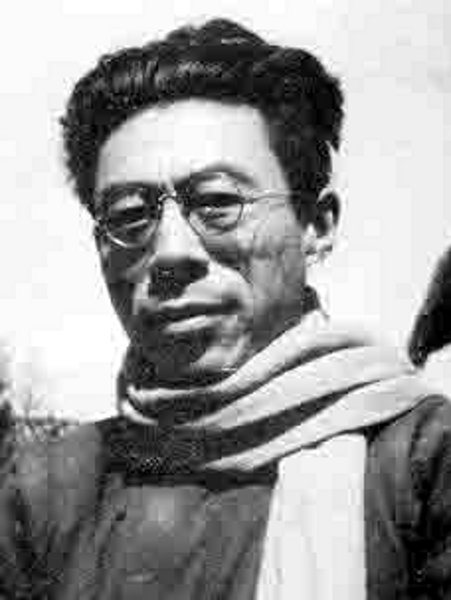
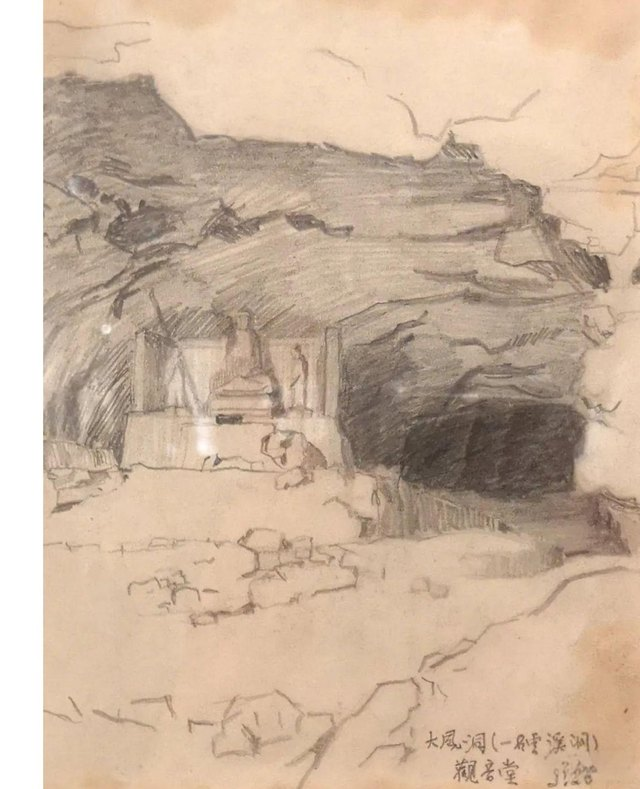
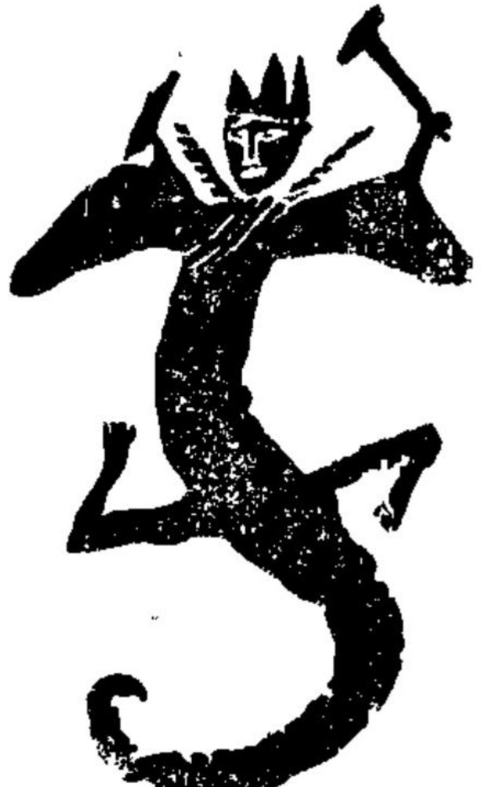
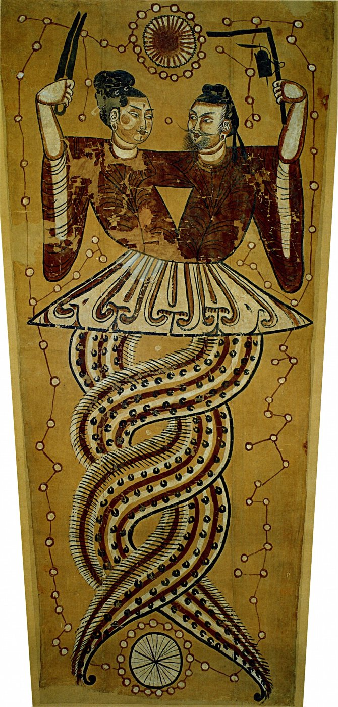
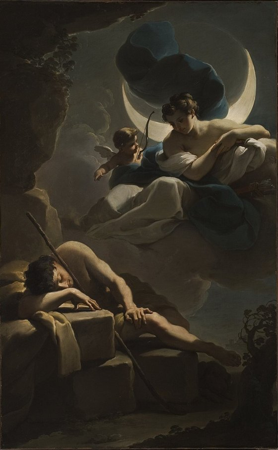

# 第二讲：人类学家，志异文本的现代作者 { #top }

本文是[神话学引论随笔](../mythology-intro.md)系列的第二篇，对应 2026 年 9 月 22 日的课。

这一讲的标题很妙。《聊斋志异》的作者叫「异史氏」。人类学家深入「异」地记录「异」俗，在某种意义上就是现代的志异作者。这一讲的主角是**闻一多**。

## 1. 闻一多和他的时代 { #s1 }

{ loading=lazy }

我们通常知道的闻一多是诗人（《红烛》《死水》）和民主斗士（1946 年遇刺）。但他还有一个身份：神话学家。1936 年他在清华开设「中国古代神话研究」专题课。他自己说：

> 我们的历史课题甚至伸到历史以前，所以我研究了神话；我的文化课题超出了文化圈外，所以我又在研究以原始社会为对象的文化人类学。

几条背景值得注意：

- **美术训练**：1922—1925 年他先后在芝加哥艺术学院、科罗拉多大学和纽约艺术学生联盟学画。视觉分析的眼光后来变成了「以俗证古」的方法，从图像、纹饰、仪式切入古史。
- **「谎中求真」**：法国汉学家葛兰言（Marcel Granet）主张「伪中求真」，他的《中国古代舞蹈与传说》经李璜摘译，1933 年以《古中国的跳舞与神秘故事》出版。闻一多的「谎中求真」受其启发，但多了一层：他站在**西方**和**少数民族**两个「他者」之间，思考中华民族的自我形象。
- **译介热潮**：民国三十多年译出大量社会科学和人文著作。海顿的《南洋猎头民族考察记》、施密特的《比较宗教史》、马林诺夫斯基的《巫术科学宗教与神话》（李安宅译）、罗维的《初民社会》（吕叔湘译）、倍松的《图腾主义》（胡愈之译）等书，构成了闻一多那一代人的理论工具箱。

他的方法论可以用一句自述概括：

> 我是把古书放在古代人类的生活范畴里去研究；站在民俗学的立场，用历史神话去解释古籍。

《高禖郊社祖庙通考》的跋里还有一句更有力的话：

> 历史为人类活动之记录，神话则其活动动机之口供。由历史可以知其「然」，由神话更可以知其「所以然」也。

## 2. 三千五百里：一次行走的田野 { #s2 }

1938 年，长沙临时大学西迁昆明，其中一路是步行的「湘黔滇旅行团」：250 多名学生，加上黄子坚、闻一多、曾昭抡、吴征镒等 11 位教师组成的辅导团，徒步约 3500 里，历时 68 天，横穿湘、黔、滇三省。旅行团的宗旨写得很好：「习民情，考查风土，采集标本，锻炼体魄，务使迁移之举本身即是教育。」

闻一多脚上磨满血泡也坚持不乘车，晚上和学生一样睡在老乡家的干草上。他和李继侗、冯友兰约定抗战不胜利不剃胡子，那把著名的胡子就是这时蓄起来的。一路上他画了上百幅铅笔速写。

{ loading=lazy }

学生刘兆吉一路采集了两千多首民谣。他每天早饭后揭下锅巴塞进茶缸，饿了就撕一块吃，晚上在油灯下整理当天的歌谣。到昆明后，他编成《西南采风录》，闻一多和朱自清都为它作序。另一位学生钱能欣写了《西南三千五百里》。

这段历史让我想到，**田野不一定要专门「去」，迁徙本身就可以是田野**。

## 3. 伏羲考 { #s3 }

《伏羲考》并不是闻一多生前定稿的一本书。他 1940 年代初写了《从人首蛇身像谈到龙与图腾》《战争与洪水》《汉苗的种族关系》《伏羲与葫芦》等几篇文章。1946 年他遇刺后，朱自清主持遗著整理，把这几篇合编为《伏羲考》，收入 1948 年开明书店版《闻一多全集》。

它的论证可以拆成一条链：

**人首蛇身 → 双龙 → 龙蛇 → 图腾 → 龙族 → 葫芦 → 造人故事**

支撑这条链的是三类材料。

**文献**。《易·系辞》说包牺氏「仰则观象于天，俯则观法于地……始作八卦」；司马贞补《三皇本纪》则说伏羲「蛇身人首」，母亲华胥「履大人迹于雷泽」而生下他。《山海经·海内经》里有一位南方苗民之神「延维」：「人首蛇身，长如辕，左右有首」，闻一多认为它就是伏羲女娲。

**口述**。芮逸夫 1930 年代初随凌纯声在湘西做苗族调查，采集到四个洪水故事，1938 年发表《苗族的洪水故事与伏羲女娲的传说》。四个版本细节不同，骨架却一致：

| 情节 | 祥述故事 | 佐述故事 | 傩公傩母歌 | 傩神起源歌 |
|---|---|---|---|---|
| 洪水 | 雷公发洪水数十日 | 雷公发洪水七日七夜 | 玉皇上帝发洪水七日七夜 | 雷公发洪水七日七夜 |
| 避水 | 兄妹各入黄瓜 | 兄妹共入葫芦 | 兄妹共入葫芦 | 兄妹共入仙瓜 |
| 配偶 | 扔磨子 | 金鱼老道撮合 | 东山南山焚香，香烟结团 | 扔竹片、扔磨子 |
| 传人 | 生肉块，割弃变人 | 未详 | 生肉块，割出十二童男童女 | 生怪胎，割弃变人 |

概括起来就是：始祖擒雷公，雷公逃脱后发洪水报复，世人尽死，只剩兄妹二人；兄妹成婚，生下怪胎，剖开化为人类。芮逸夫还从语音上论证，鸦雀苗故事里的兄长名 Bu-i 意为「第一祖先」，与「伏羲」古音相通。他对母题演变有一段很精到的话：

> 最初只有一个简单的故事作中心的「母题」。后来经过众口的传说敷演……或因附会异词而曲全其解，或因语义失解而附会其说，或因记忆失真而弥缝其词。

**图像**。1938 年重庆沙坪坝出土东汉石棺，常任侠考证出前额刻的捧日人首蛇身像是伏羲，捧月像是女娲。闻一多评价说，考古家对这个问题的贡献，在于确定了图中另一人是女娲，由此证实了两人的夫妇关系。他进而判断，伏羲女娲传说最活跃的时期（西汉末至东汉末），正是人首蛇身神画像大量出现的时期。

{ loading=lazy }

{ loading=lazy }

把三类材料拼在一起，闻一多得到的不只是「伏羲女娲是兄妹配偶型洪水始祖」这个结论，还有一个更大的论断：

> 所谓龙，就是原始的龙（一种蛇）图腾兼并了许多旁的图腾后形成的一种综合式的虚构生物。

龙图腾族团起初在黄河上游，一部分北迁，一部分南迁为荆楚吴越诸蛮，今日的苗族是其后裔；留在原地的那部分「做了我国四千年文化的核心」。这是在抗战最艰难的时候，一位诗人用训诂、音韵、考古和田野材料给出的**民族同源叙事**。读到这里会明白，蒋观云说神话能「造成一国之人才」，并不只是修辞。

## 4. 神话的三种解释 { #s4 }

这一讲的后半部分，把《伏羲考》放回西方理论的三条谱系里，正好对应它的三种论证。

**语言起源论。** 卢梭追问，是社会先于语言，还是语言先于社会；赫尔德的《论语言的起源》（1770 年写成，次年获柏林科学院奖）则认为，语言出自人自身的悟性。把这条思路用到神话上的是马克斯·缪勒的「语言疾病说」。恩底弥翁是厄利斯的牧人王子，月神塞勒涅（Selene）爱上了在山洞中沉睡的他，他从此永睡不醒、永不衰老。缪勒说：

> 如果人们都知道 enduma 意为日落，恩底弥翁的神话就永远不会产生。……人们说「塞勒涅亲吻着入睡的恩底弥翁」，而不是说「现在是晚上」。

也就是说，神话是词义遗忘之后留下的「误读」。闻一多论证伏羲（包戏、匏瓠）和女娲（苞娲、匏瓜）都是「葫芦」的音转，走的也是这条从语音出发的路。

{ loading=lazy }

**社会起源论。** 维柯认为各异教民族的历史都从神话开始，原始人是「崇高的诗人」，「把一切制度都想象为神」。涂尔干和莫斯在《原始分类》中进一步说，分类的框架来自社会，「两种形式的起源都是社会」。莫斯的《巫术的一般理论》说「大众舆论造就了巫师」，社会才是仪式戏剧中真正的行动者。对应到《伏羲考》，就是图腾团族、姓氏制度，以及洪水与战争所代表的社会冲突和秩序崩溃。

**心理起源论。** 弗洛伊德在《图腾与禁忌》中把禁忌比作强迫症：两者都没有可以归因的动机，都由内在的「需要」维持，都容易替换和传染，也都要求类似仪式的行为。图腾动物则是俄狄浦斯情结的转移对象。闻一多对「断发文身」的解释正用到这一层。许慎说文身是为了「尊荣」，闻一多认为这背后是图腾心理：

> 图腾既是祖宗又是神，还有什么比像祖宗、像神更值得骄傲？……「断其发，文其身」——人一像龙，人便是龙了。

这一讲的小结是三组对子：**东西融汇**（闻一多和他的时代）、**古今贯通**（伏羲考）、**文理渗透**（三种解释）。我自己的感受是，《伏羲考》的方法在今天看来有不少可以商榷之处，比如图腾说的普遍性、音转论证的弹性都值得推敲。但它示范了一种很难得的研究姿态：同时调动文献、口述、图像和理论，并且清楚地知道自己在为谁写作。

---

## 参考与图片来源 { #refs }

**主要参考**

- 梁君健：《神话学》课程第二讲课件（2026 年秋）。
- 闻一多：《伏羲考》，田兆元导读，上海古籍出版社。
- 芮逸夫：《苗族的洪水故事与伏羲女娲的传说》，《人类学集刊》第一卷第一期，1938。

**图片来源**

- 闻一多像：[Wikimedia Commons](https://commons.wikimedia.org/wiki/File:Wen_Yiduo.jpg)，公有领域。
- 闻一多速写《大风洞观音堂》、沙坪坝石棺画像摹本：截取自课程课件，仅作学习笔记引用。
- 阿斯塔那《伏羲女娲图》：[Wikimedia Commons](https://commons.wikimedia.org/wiki/File:Anonymous-Fuxi_and_N%C3%BCwa.jpg)，公有领域。
- 甘多尔菲《塞勒涅与恩底弥翁》：[Wikimedia Commons](https://commons.wikimedia.org/wiki/File:Selene_and_Endymion_by_Ubaldo_Gandolfi.jpg)，公有领域。
