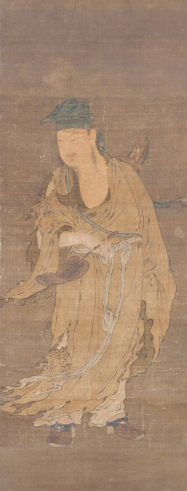
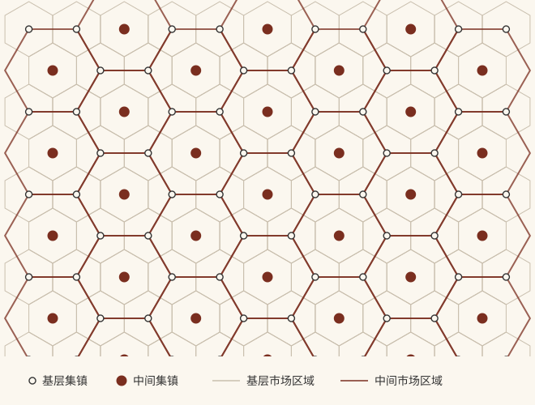
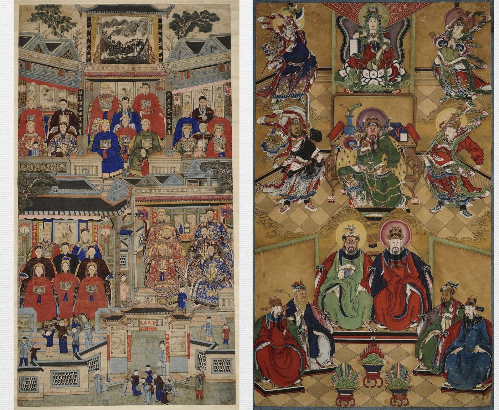

# 第三讲：帝国的隐喻 { #top }

本文是[神话学引论随笔](../mythology-intro.md)系列的第三篇，对应 2026 年 9 月 29 日的课。

这一讲从神话走到社会，主要读王斯福的《帝国的隐喻：中国民间宗教》，看神、鬼、祖先怎样映照中国社会。

## 1. 从文本到社会 { #s1 }

课从两个志怪故事开场。

第一个出自干宝《搜神记》。东汉末年，广陵人蒋子文「嗜酒，好色，挑挞无度」，常说自己「骨清，死当为神」。他做秣陵尉时追贼到钟山下，伤额而死。到孙权时，他白马白羽出现在道上，要百姓为他立祠，「不尔，将有大咎」。接着就是瘟疫、钻耳的小虫、一日数十处的大火。最后孙吴朝廷封他为中都侯，加印绶、立庙堂，把钟山改名蒋山，「自是灾厉止息，百姓遂大事之」。

一个品行不端的小吏，靠**灵验加官封**获得了神格。这个故事的叙事结构是「兆—应」：降灾是兆，册封是应，背后是巫术式的因果关联。

第二个是吕洞宾题壁诗的流传史：

1. 北宋熙宁元年（1068），一位自称「回山人」的道人在湖州沈东老家饮酒，用石榴皮在壁上题诗，出门过桥后不知所往。有人说这是吕洞宾，因为「回」字两个口，正是「吕」。苏轼后来听沈东老之子讲起，作了和诗，还在给王巩（定国）的信里问：「回山人题壁诗，公曾见之否？」
2. 王巩的《闻见近录》记了另一首题壁诗：吕洞宾在岳州白鹤寺古松下休息，遇到树神，题诗「惟有千年老树精，分明知是神仙过」。
3. 到元代苗善时的道教圣传《纯阳帝君神化妙通纪》，树神成了「松之精」，诗句变成「惟有南山老树精」，又添上了救人、斩蟒、留下「稚松」和石墨遗迹等情节。

{ loading=lazy }

这个例子很像顾颉刚说的「层累」，只是累积的不是古史，而是神性。更重要的是，苏轼的那封信说明，**文本的流传嵌在真实的社会关系里**。要理解神怪故事，就要从文本走到社会。

## 2. 汉学人类学家的研究脉络 { #s2 }

王斯福（Stephan Feuchtwang）的《帝国的隐喻：中国民间宗教》（The Imperial Metaphor: Popular Religion in China，1992；赵旭东中译）有三位绕不开的前辈。

**莫里斯·弗里德曼（Maurice Freedman）：宗族。** 他从新加坡华人的家庭与婚姻研究起步，写出《中国东南的宗族组织》（1958）和《中国东南的宗族与社会》（1966），用华南宗族回应非洲研究中发展起来的继嗣理论，也开启了「在散乱的信仰之下寻找秩序」的中国民间宗教研究。他问过一个很好的问题：**祖先的灵魂去哪儿了？** 答案是三处：灵牌（家户与祠堂，体现亲属体系）、坟墓（死者与生者交换的场所）、地府（道德审判，一个官僚国家）。

**施坚雅（G. William Skinner）：市场。** 1949 年，康奈尔大学博士生施坚雅来到成都郊外的高店子做田野。后来他写出《中国农村的市场和社会结构》（1964—1965），提出了中国社会研究中最著名的几何模型：农民生活的基本单位不是自然村，而是**基层市场区域**；理想状态下，这些区域呈六边形铺满平原，若干基层市场又围绕一个中间市场组成更高一级的六边形，层层上推到区域中心。

{ loading=lazy }

课件里还对比了一张当代农产品市场结构图：中间层级消失了，村庄直接连接多个基层市场和全国性市场，金字塔变成了网络。施坚雅模型的价值，也许正在于它让这种变化变得可以测量。

**武雅士（Arthur P. Wolf）：宗教。** 他主编的《中国社会中的宗教与仪式》（1974）里有一篇名文《神、鬼和祖先》，开头是这样一段观察：

> 在台北盆地西南端的农村地区，保守的家庭每天早晨和晚上都会烧三炷香。一炷放在后门外的壁龛里，烧给游魂；一炷供奉灶神；另一炷放在直系祖先碑前的炉中。

三炷香对应三种超自然存在，也对应农民社会世界里的三类人：

| 超自然存在 | 祭品 | 对应的社会角色 | 关系 |
|---|---|---|---|
| 神 | 冥币、金纸（像缴税） | 官员 | 科层与权威 |
| 祖先 | 家常饭菜 | 亲属 | 继嗣与赡养 |
| 鬼 | 量多但随便（像打发乞丐） | 陌生人、流氓、乞丐 | 危险与施舍 |

土地公管着本地的鬼，灶神定期向上汇报一家人的言行，这几乎就是一套基层行政。课件里有一句话我印象很深：**中国的官僚制度在行政管理上也许是失败的，但在观念上是成功的，它依照自己的模型创造了一个宗教。**

{ loading=lazy }

三人合起来，正好是汉学人类学关心的三大块：**宗族与村落、市场、宗教**。方法上则都是社区研究加长期田野，目标是回答「社会何以可能」。

## 3. 帝国的隐喻 { #s3 }

王斯福在台湾「山街」做田野，看到的祭祀结构与武雅士相近：神被「请进来」，烧金纸；祖先在家中，烧银纸；兵和鬼的祭品放在门槛上或门外。这种区分可以一直追溯到唐代。戴孚《广异记》里，一个在地府当差多年的小吏托人烧钱：

> 金钱者，是世间黄纸钱；银钱者，白纸钱耳。……世作钱于都市，其钱多为地府所收。

在市场上做的纸钱会被地府「截留」，所以要在家中密室里请人凿钱，到水边去烧。看灰被风吹的方向，还能知道钱有没有被别的鬼神收走。阴间不仅有官，还有财政、税收和贪污。

但王斯福和武雅士有一处关键的不同。武雅士的模型是**对应性投射**：神就是官，鬼就是乞丐。王斯福强调的是**隐喻**：

- 民间宗教对帝国行政、贸易与惩罚体系的模仿，不是一模一样的复制，而是**再创造**，有时甚至会发生意义的**逆转**；
- 它关心的是民间宗教如何把分散的个人联结在一起：香炉、分香、绕境巡行、炉主与丁钱，划出一层层重叠的社区边界，包括市场圈、婚姻圈、祭祀圈和信仰圈；
- 道士的醮仪是「仪式性的戏剧」，而不是实际的威权与制裁。

> 与一座家户的神龛相比，一座地方性庙宇就更像是围绕着一座香炉而有的社会性媒介的建构，这是一个把家户的神龛容纳进来的中心。（《帝国的隐喻》，第 157 页）

书中有两句话可以当结论：

> 中国宗教保持整体性的根本方面，在于宗教的产生源自于世俗社会，而信仰和仪式的隐喻和象征又服务于世俗社会。
>
> 恰恰是在对帝国的秩序加以复制的地方，会导致一种分裂。

后一句是这一讲最有意思的地方。地方庙宇模仿帝国的衙门，正因为是模仿，它就可以自立中心、自划边界，甚至自封神明。蒋子文的故事倒过来看，正是**国家不得不承认一个由民间「灵验」逼出来的神**。隐喻是沟通国家与民间的语言，也是两者讨价还价的场所。

课件小结列了四点：嵌入社会实践的文本；鬼神崇拜既是现象事实，也是文化事实；政治社会生活中神话式的运作方式；以及一个自我质疑：「神话与社会之间的关系，是否是一种循环论证？」用社会解释神话，又用神话证明社会，这个问题我还没有想清楚，先记在这里。

---

## 参考与图片来源 { #refs }

**主要参考**

- 梁君健：《神话学》课程第三讲课件（2026 年秋）。
- 王斯福：《帝国的隐喻：中国民间宗教》，赵旭东译，江苏人民出版社，2008。
- Arthur P. Wolf, "Gods, Ghosts, and Ancestors," in Religion and Ritual in Chinese Society, Stanford University Press, 1974.
- G. William Skinner, "Marketing and Social Structure in Rural China," Journal of Asian Studies, 1964–1965.

**图片来源**

- 明代《吕洞宾像》（费城艺术博物馆藏）：[Wikimedia Commons](https://commons.wikimedia.org/wiki/File:The_Daoist_Immortal_L%C3%BC_Dongbin.jpg)，公有领域。
- 施坚雅市场模型示意图：本文自绘。
- 李氏祖先群像与关公众神图：截取自课程课件，仅作学习笔记引用。
