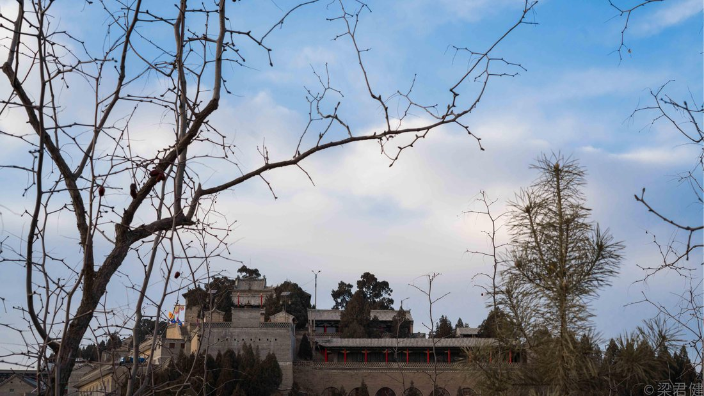
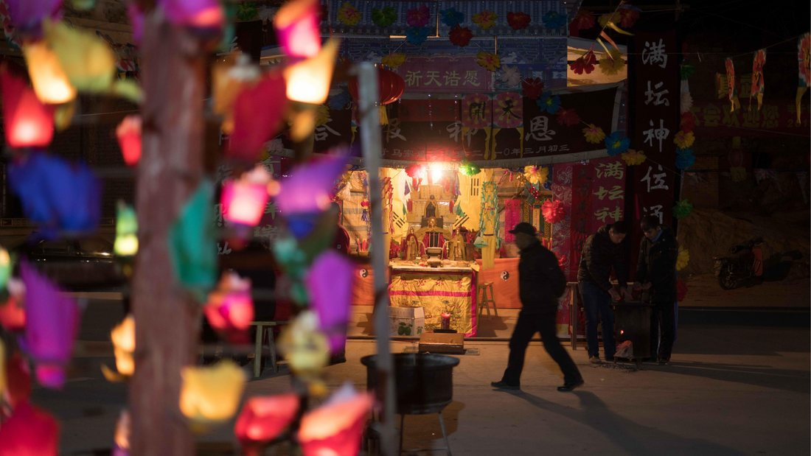
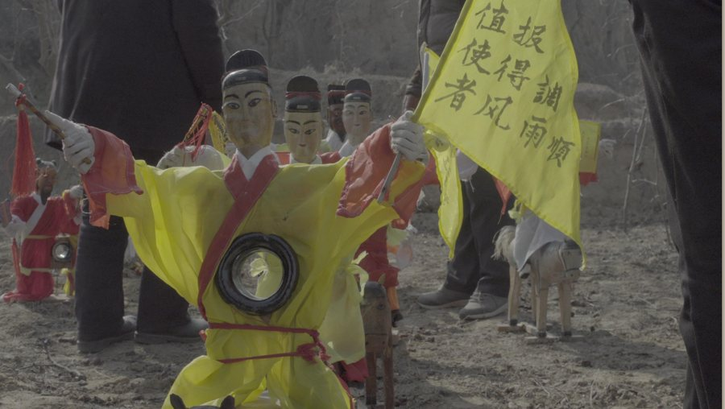

# 第四讲：神话与仪式，白云山的四月八 { #top }

本文是[神话学引论随笔](../mythology-intro.md)系列的第四篇，对应 2026 年 10 月 13 日的课。

## 1. 从「说」到「做」 { #s1 }

这一讲从一件青铜器讲起：商代后期的**猛虎食人卣**，一头蹲踞的猛虎抱着一个人，人头就在虎口下面。和它相关的是饕餮神话：「有首无身，食人未咽，害及其身」。饕餮是有超凡能力的神兽，也代表信仰这种神兽的族群。

课件的判断是，这类神话和艺术是**仪式的反映**：以猛兽为族神的血祭（比如廪君的祭祀），用兽皮裹尸送死（《云南志略》说「以豹皮裹尸而焚」），以及和成年礼相对应的「死亡—复活」仪式。前三讲以**说**为主，读文本、读图像；从这一讲开始转向**做**，看神话怎样在身体、器物和时间安排里被实践出来。

这一讲的副标题是「西北道教民俗的视觉民族志」，田野点是陕西榆林**佳县白云山**。

## 2. 黄河边的白云观 { #s2 }

{ loading=lazy }

白云山在黄河西岸的黄土峁上，对岸就是山西。山上的白云观号称西北最大的道观。它的「合法性」有两层，课件称之为「日出东方的传说」和「国家非遗的加冕」：

- **1947 年毛泽东到访**。《毛泽东年谱》记载，他 10 月 21 日来到白云山脚下的南河底村，第二天正逢重阳节，上山看庙会，参观白云观，说「这些东西，都是历史文化遗产，要好好保存，不要把它毁坏了」，还为佳县群众剧团题词「与时并进」。这件事在当地被反复讲述，本身已经成了一个地方传说。
- **2008 年列入国家级非遗**。「白云山道教音乐」入选第二批国家级非物质文化遗产名录（传统音乐类，Ⅱ-139）。据介绍，明万历三十六年（1608），北京白云观道士王真寿、张真仪等持陕西布政司的帖子到白云山总理教务，把北京白云观的道教音乐带到了陕北，所以有「白云神韵，圣境仙乐」的说法。

一个是革命叙事，一个是国家文化遗产体系，都在为一座道观和它的庙会背书。这让我想到第三讲的蒋子文：神的地位从来离不开「官封」，只是今天封赐的形式换了。

## 3. 上与迎：两种宗教的二元结构 { #s3 }

白云山最大的庙会在农历四月，从初一到初八，日程如下：

| 日期 | 仪式 | 主导者 |
|---|---|---|
| 初一（晚 8:00） | 薰坛 | 道士（「上」） |
| 初二（早 4:30） | 起经 | 道士（「上」） |
| 初三（早 5:00） | 上表 | 道士（「上」） |
| 初四（晚 8:00） | 醮纸 | 道士（「上」） |
| 初五（早 4:00） | 迎香纸 | 信众与香会（「迎」） |
| 初六（上午 10:30） | 迎钱粮 | 信众与香会（「迎」） |
| 初七（中午 12:00） | 迎供 | 信众与香会（「迎」） |
| 初八（晚 8:00） | 观灯 | 信众与香会（「迎」） |

前四天是道士主导的**打醮**，属于「制度宗教」；后四天是信众和香会主导的「迎」，属于「民俗宗教」。课件把这称为一种**动态的二元结构**：两者共享同一个时间表和同一座山，却由不同的人组织、按不同的逻辑运行。

打醮的完整科仪很长：薰坛、起经、出幡、吊大塔、开光、行香、摆灯、上表、上供、拜忏、放赦、扬幡、转九曲、施食、送圣。课件把它和南方正一派的各种醮仪并列：祈安清醮、平安醮、太平醮、拦街福、清醮会、做平安、清街醮，名目各异，功能都是驱除灾疫、祈求平安和丰收。这里还有「阳事」与「阴事」的区分：一边是给神上表祈福，一边是给孤魂野鬼施食，正好对应第三讲武雅士说的神与鬼。

{ loading=lazy }

{ loading=lazy }

我觉得「值使者」这张图最能说明第三讲讲的「帝国的隐喻」：上表就是向天庭递公文，纸扎使者就是驿卒，纸马是驿马。整套醮仪是一场模仿官府文书流转的戏剧。

## 4. 道人、信众与社会 { #s4 }

课件接下来从三个角度展开庙会。

**道人。** 这里的「道人」不只是道士，还包括写幡的、做纸扎的、给庙会做饭的厨师，以及给庙里画壁画的画师。他们都是让仪式「做」得出来的人。课件特别讲到画师：从揉皱白纸上的铅笔线稿，到满墙的众神朝会和踏风火轮的哪吒，神的形象是一笔一笔画出来的。另一个话题是**梦中遇仙**，引的是研究陶弘景的《即神即心：真人之诰与陶弘景的信仰世界》。上清派经典里，女神下凡向修道者传授经文，比如「蓬莱都水监」的故事。课件的关键词是「从个体体验到群体行动」：一个人的梦，可以变成一群人的信仰实践。

**信众。** 研究信众用的是第五讲还会细讲的「三轮访谈」：先开放地聊受访者过去的经历，再就研究问题追问细节，最后请对方反思自己行为的意义。

**社会。** 这是我觉得最有意思的部分。白云山庙会由「五大会」组织，课件的概括是：个体信众的宗教体验，加上香会组织的朝山活动。香会从陕北各县，以及山西、内蒙古、宁夏赶来，有的还在山上设了会馆（我在课件照片里看到了「山西会馆」）。信众里有渡黄河过来的山西老乡，也有穿蒙古袍、拿着经幡的蒙古族信众，甚至有喇嘛诵经、摔跤娱神。

后四天是庙会的「正日子」。初五「迎香纸」，晚上要唱**神戏**：戏首先是唱给神看的，人只是陪着看。课件里有一张后台的照片，演员在灯下勾好了脸，正在整理戏服。初六「迎钱粮」那天要**抽签**：

- 先公开账目，宣布修缮工程开启；
- 头三签是**人口、夏粮和秋粮**；
- 然后榆林的所有区县，以及山西、内蒙古、宁夏，各抽一签。

一座山上的一个签筒，替一个跨越四省区的区域预测来年的人口和收成。初七「迎供」，供桌上一排排不锈钢托盘摆满面点、菜肴和水果，插着写有「正」「大供」之类的小黄纸签。这些钱粮和供品的来处也看得见：村里墙上贴着红纸、黄纸的布施名单，谁出了三十元、谁出了一百元，一笔一笔写得清楚。

课件管这一部分叫「**庙会的地理学**」。庙会可以分三个层级：村落内部的庙会、跨村落联盟的庙会，以及区域性庙会。泰山香社的朝山日期是个很好的对照：山东省以外的香社在三月二十八（碧霞元君诞辰）上山，本地居民在六月初六（课件注为纪念宋真宗封禅泰山；这一天也是真宗定下的「天贶节」），蓬莱等地则在四月初八（菩萨诞辰）。不同来路的人各有各的日子，一座山的日历上叠着好几张地图。白云山的五大会也是这样一张地图。这和第三讲施坚雅的市场区域、王斯福的「祭祀圈」是同一回事：庙会划出了一个社会的边界，而这个边界和行政区划并不重合。

## 5. 妙峰山：中国民俗学的起点 { #s5 }

课件先简单回顾了**道教庙会**的源流：它起源于南北朝至隋唐之间；到了唐代，宗教仪式和民众参与结合在一起；从此庙会一直有宗教和民俗两个维度，而主要的动力是信众。泰山香社的活动可以分成三类：集体进香仪式、个人祈愿仪式和日常活动仪式。白云山「上」与「迎」的分工，放在这条长线上看并不奇怪。

接着，课件把白云山放进了一条学术史的线索里，起点是北京西郊的**妙峰山**。

顾颉刚真正留意妙峰山，是和朋友吴缉熙游三家店、渡浑河那一次。那天恰逢四月初八，沿路小庙（就是四年前驴夫告诉他的那些茶棚）「击着磬，唱着喝茶喝粥的歌」，庙内外歇满了进香的人，每来一个就到神座前磕一个头。他想跟着上山，可是没带过夜的东西，只得回家。回家以后，街上贴的香会「会贴」一张张映入眼帘。又忍了一年，他「这个好奇心再也不能制止」，请北京大学研究所国学门主任沈兼士批准派人调查。1925 年 4 月 30 日（阴历四月初八）至 5 月 2 日，顾颉刚、孙伏园、容庚、容肇祖、庄严组成的调查团，对妙峰山香会做了三天调查。文章在《京报》副刊连出六次「妙峰山进香专号」，1928 年，29 篇调查文章结集为《妙峰山》出版。这通常被看作中国民俗学田野调查的起点。

后来顾颉刚为奉宽的《妙峰山琐记》作序，觉得香会这种风俗因为生计艰难、民智开通，快要消失了，呼吁大家注意「这垂尽的余焰」：

> 本书的读者们，你们若不继续着奉宽先生的脚步而前进，你们真是辱没了这时代的使命了！

一百年后看，余焰并没有熄灭。之后的研究一路延续下来：

- 1929 年 5 月 17 日至 19 日，燕京、北大、清华、中山四校组成「一八妙峰山进香调查团」做了第二次大规模调查；
- 1941 年，李慰祖调查北京郊区的「**四大门**」信仰（狐狸、黄鼠狼、刺猬、蛇），找到了民众和香头到妙峰山朝顶进香的深层原因。他没有把这些当「迷信」打发掉，而是追问动物如何被**社会性地神圣化**，以及信仰怎样参与治病、调解和维持秩序；
- 再往后，课件以「绵延不绝：华北的朝顶网络与香会组织」为题列了一组研究：吴效群《妙峰山：北京民间社会的历史变迁》，孙庆忠编《妙峰山：香会组织的传承与处境》，岳永逸《灵验·磕头·传说：民众信仰的阴面与阳面》，鞠熙《游观入道：作为自我修行的女性朝山——以明清碧霞元君信仰为例》，杨念群《北京地区「四大门」信仰与「地方感觉」——兼论京郊「巫」与「医」的近代角色之争》，以及韩书瑞（Susan Naquin）的 Gods of Mount Tai: Familiarity and the Material Culture of North China, 1000–2000。

鞠熙的研究让我印象很深。她发现 19 世纪以后，北京的城墙角楼和城门楼上各住着有名有姓的狐仙：东北角楼是「红姑娘」，西南角楼是「大仙爷」，宣武门是「胡四太爷」，正阳门是「天狐」，东南角楼是「狐总管」。角楼是撑天的山岳，城楼标示空间的界限，于是北京内城成了一个小宇宙：

> 19 世纪至 20 世纪初的北京城不是仅有人类建筑与文化的城市，更是万物共生共享、山水皆有其灵的神话世界。——鞠熙：《狐仙故事与北京城的宇宙论意义》

岳永逸对庙会的定义可以作为这一节的结论：庙会是「以信众为行动主体的」、与天地日月、神佛仙道、鬼怪「沟通、交际的仪式性活动的展演空间」。在这里，僧道这些职业宗教人士的引领作用往往会被信众的自主行为冲淡，「更多的沦为一种装饰性符号」。白云山「上」与「迎」的二元结构，在妙峰山的学术传统里早有回声。

## 6. 什么是道教，什么是神话 { #s6 }

课件的小结只有五个词：信众、艺人、社会、什么是道教、什么是神话。最后一页引了美国新批评派诗人兰色姆（John Crowe Ransom）的一段话：

> 艺术赋予自然以某种形式，在人和自然客体之间建立审美距离，使人将自然客体作为审美对象进行关照，获得审美愉悦，节制物欲；艺术与宗教仪式一样倚重人为的形式，以便将自然的人变成审美的人，将本能的经验变成审美的经验。——兰色姆：《一首几乎匿名的诗》

我的理解是：在白云山，神话不是被「讲」出来的，而是被「做」出来的。表文、纸扎、壁画、签筒、日程表，都是「人为的形式」，它们把一个区域里的人在一年中的某几天组织起来。如果只读道教经典，看不到这些；如果只看热闹，也看不到这些形式背后的秩序。

---

## 参考与图片来源 { #refs }

**主要参考**

- 梁君健：《神话学》课程第四讲课件（2026 年秋）。
- 顾颉刚编：《妙峰山》，国立中山大学语言历史学研究所，1928；奉宽：《妙峰山琐记》，顾颉刚序。
- 李慰祖：《四大门》，北京大学出版社，2011（据 1941 年燕京大学学士论文整理）。
- 岳永逸：《精神性存在的让渡：旧京的庙会与庙市》；《灵验·磕头·传说：民众信仰的阴面与阳面》。
- 鞠熙：《狐仙故事与北京城的宇宙论意义》；《游观入道：作为自我修行的女性朝山——以明清碧霞元君信仰为例》。
- 吴效群：《妙峰山：北京民间社会的历史变迁》；孙庆忠编：《妙峰山：香会组织的传承与处境》。
- 杨念群：《北京地区「四大门」信仰与「地方感觉」——兼论京郊「巫」与「医」的近代角色之争》。
- Susan Naquin, Gods of Mount Tai: Familiarity and the Material Culture of North China, 1000–2000.

**图片来源**

- 白云观远景、白云山夜间神坛、纸扎「值使者」：梁君健摄，截取自第四讲课件，仅作学习笔记引用。
