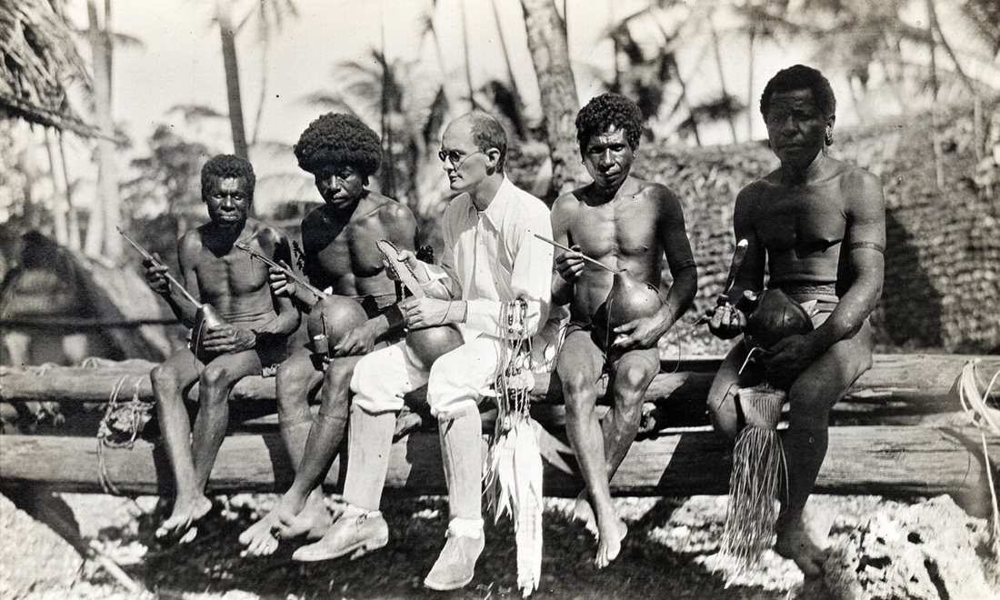

# 第五讲：民族志与田野中的写作 { #top }

本文是[神话学引论随笔](../mythology-intro.md)系列的第五篇，对应 2026 年 10 月 20 日的课。

这一讲换了一个方向：前四讲是研究别人的神话，这一讲讨论研究者自己，也就是我们怎样去田野、怎样记录、怎样写。

## 1. 走出摇椅 { #s1 }

19 世纪的人类学有一种奇特的劳动分工。像弗雷泽这样的「摇椅人类学家」在书斋里写《金枝》，材料来自传教士、殖民官员和旅行者寄回的报告。采集者像是「手工制品商人」，书斋学者则默认这些材料是**中性**的。英国科学促进会 1874 年首版的《人类学笔记和问卷》（Notes and Queries on Anthropology），就是教业余采集者怎么提问、怎么记录的手册。

但材料真的中性吗？澳大利亚的生物学家斯宾塞（Walter Baldwin Spencer）在给弗雷泽的信里写道：

> 根据我的经验，德国人或者莫拉维亚传教士也许是最为杰出的个体，他们愿意去学习部落的语言。但是，他们从来没有真正地理解当地人，而当地人也从来没有把自己完全开放（opens himself）给德国传教士。在澳大利亚，唯一能够提供关于当地人信仰的可信传教士是耶稣会士，但不幸的是他们极少写作。——斯宾塞致弗雷泽，1903 年 7 月 24 日

一个月后，他在另一封信里说得更直白：

> Siebert 当然是一个好人，并且完成了很不错的工作，但他是一名德国人，而据我所知，中部的原住民讨厌并蔑视德国人，这让我坚信，他并没有能够抵达事物的最深层。在澳大利亚，只有罗马天主教的牧师才能够真正地了解当地人。他们的宗教形式和庆典对于这些黑人伙计们很有吸引力，也许这让原住民想起了他们自己的黄金时代的神话……——斯宾塞致弗雷泽，1903 年 8 月 27 日

谁去问，决定了当地人愿不愿意说。斯宾塞的判断里有明显的偏见（「讨厌德国人」是他「据我所知」的说法），但他注意到的问题是真实的：材料是在一段具体的关系里产生的。按他的猜测，天主教牧师能被接纳，是因为他们的仪式和庆典唤起了原住民自己的神话。如果真是这样，打开对方的不是语言，而是仪式，这又回到了第四讲的「做」。

斯宾塞和另一位「跨界生物学家」海登（Alfred Cort Haddon，1898 年领导剑桥托雷斯海峡探险）一起，迈出了走出摇椅的第一步。斯宾塞强调深度访谈和「进入土著人的头脑中」，海登强调田野工作的沉浸性：patient sympathy 和 intensive work。

1901—1902 年，斯宾塞和电报站站长吉伦（Francis Gillen）深入澳大利亚中部。在 Barrow Creek 电报站的第 33 号营地，他们花了整整一周对一位叫 Tungula 的原住民做第一轮访谈，又用四天整理笔记。斯宾塞的日记里有个细节很动人：

> 我们通常要花费一两个小时来搞清楚一个细小的问题，而原住民也很不习惯像这样被不断地询问和质疑，常常会感到疲惫。我们的黑人伙伴十分杰出，他叫吉姆，承担翻译的角色。另外，他还是一位艺术家，十分喜欢在纸上绘画。因此，我们给了他一沓纸和一支铅笔，当 Tungula 回答我们提出的问题的时候，吉姆就在纸上通过绘画进行记录。

斯宾塞自己说，这种访谈是「把他置于证人席上」：核实方位和色彩的分类，追问祖先的传说，查证临时出现的拔牙仪式的细节。双方都被这种高强度的智力劳动折磨得够呛。精确是有代价的。

中国这边也有类似的自觉。顾颉刚在《妙峰山琐记》序里反省自己当年的调查：

> 我们从前去调查，见了材料就抄，自以为已很细密。但一方碑，一张会贴，文字太多时，我们只有摘要写下……今观此书所录材料，几十字的固然不缺，几百字的也不加刊删；一件东西的行格，尺寸，地位，记得一丝不苟。……这才是正式的调查！

## 2. 入场与访谈 { #s2 }

方法部分讲得很实用，我按「入场—角色—访谈」整理一下。

**入场。** 出发之前，要了解当地的权力结构、人员关系和行为规范，学会用对方听得懂的话介绍自己的项目。要找到并接触「守门员」（gatekeeper），也就是能决定你能不能进门的人，比如村干部、单位负责人、族长。介绍信和批文是一把**双刃剑**：它能帮你打开大门，也可能让对方把你当成「上面来的人」，只说场面话。进去之后靠的是「关系、交流、礼貌、合作」这几样朴素的东西。课件里有一张照片：村委会的屋子里，墙上贴满计划生育宣传栏，十来个人沿墙坐成一圈开座谈会。这是一种入场方式；不过我猜，在这样的场合里大家说的多半还是场面话。

**角色。** 研究者以什么身份面对研究对象，取决于研究范式：

| 范式 | 研究者角色 | 目标 |
|---|---|---|
| 建构主义 | 学习者 | 了解对象的所作所为和所思所想 |
| 批判理论 | 鼓动者 | 揭露不公现象，唤醒意识 |
| 后实证主义 | 研究者 | 逐步接近「客观真理」 |

**访谈。** 课件先问「访谈有什么用」，答案有五条：了解多元个体的所思所想，尤其是价值观念和情感感受；了解他们的生活经历、耳闻目睹的事件，以及他们对这些事件的解释；了解问题的敏感程度；帮助研究者与被研究者建立人际关系；以及**使受访者感到更加有力量**。最后一条我原来没想到：被认真倾听本身就是一种回馈。

和观察相比，访谈能进入受访者的内心；和问卷相比，受访者能用自己的语言和概念表达；和实物分析相比，它灵活、即时，还能解释意义。访谈分三轮：

1. 第一次，聊受访者过去的经历，**绝对开放**；
2. 第二次，就研究的问题询问，着重了解细节；
3. 第三次，请受访者对自己行为的意义进行反省和解释，重点在认知和情感层面探索他的反应，在他的行为、思想和情绪之间建立联系。

访谈中的三种技巧：

- **追问**：深挖事情发生的根源和发展的过程；细节随时追问，重大问题先记下、放到后期再问；不要在开始阶段频繁追问；注意对方有意无意抛出的「语言标记」。
- **倾听**：不轻易打断，容忍沉默，体察没有说出来的意思。对方不仅是一个「信息提供者」，而是**一个活生生的人**。
- **回应**：认可，重复、重组和总结，适度的自我暴露，鼓励对方。

「容忍沉默」这一条我特别有感触。日常聊天里，冷场总想赶紧填上；但在访谈里，沉默往往是对方在组织一段更重要的话。

## 3. 研究日记：一份故宫的田野笔记 { #s3 }

记录包括录音、笔录速记、非言语行为、事后第一时间的回忆，以及时间、地点、人物姓名。按类型可以分为访谈记录、观察记录和研究日记。

课件给的范例是老师自己 2020 年 8 月 5 日的研究日记。当时他在拍纪录片《我在故宫六百年》，记的是故宫长春宫的彩画拓谱：彩画匠师先量尺寸，把两张高丽纸接起来，用双面胶固定在构件顶部，喷水、用小锤子砸实，等水半干时用小锤沾墨把凸起的纹样拓下来；再用透明塑料纸描下平面的纹样。下午文保科技部的老师来取样，测颜料成分。

课件把这篇日记分成三层，用不同颜色标出来：

| 段落 | 内容 | 功能 |
|---|---|---|
| 第 1–2 段 | 上午拓谱的流程，下午取样，师姐妹之间的互动 | **事件记录** |
| 第 3 段 | 拍摄效果不好的原因：这是专门准备的场合，不是日常工作；不同诉求的人凑在一起，现场有些失控；真正干活的人大多不是故宫员工，纪录片怎样呈现技艺会有新的困难 | **反思判断** |
| 第 4 段 | 路过的雨花阁和正在修理的中正殿；长春宫有烫样和维修档案，能不能「通过烫样来讲一个宫殿的故事」 | **线索计划** |

这个结构很好用。事件记录回答「发生了什么」，反思判断回答「这意味着什么、哪里不对」，线索计划回答「下一步去哪里」。我平时写的学习笔记基本只有第一层。

课件里还有一张照片让我印象很深：一只手捏着装颜料样品的自封袋，袋子上手写着「长春宫 / 西北角游廊 / 东数第一间 / 内侧东缝 / 彩画」。精确到方位、开间和部位，这正是顾颉刚说的「一件东西的行格，尺寸，地位，记得一丝不苟」。

## 4. 民族志写作：向马林诺夫斯基学 { #s4 }

{ loading=lazy }

写作部分的范本是马林诺夫斯基的《西太平洋上的航海者》（1922），写新几内亚东边特罗布里恩群岛的「库拉」（Kula）交换圈。弗雷泽为它写的序里说，如果抛开行动者的思维去描述一系列行为，就无法真正理解社会人；马林诺夫斯基的研究「将人看作一个圆形而非平面」。

课件把民族志写作拆成四个要素，每个都配了书里的一段：

**描写：细节与血肉。** 第一次见到特罗布里恩人时，马林诺夫斯基写他们浅色的皮肤、结实而笨重的体形和某种柔弱的气质；面孔宽阔肥胖，鼻子塌陷，眼睛下垂，「看起来多一分古怪有趣，少一分凶狠野蛮」；头发不像纯巴布亚人那么卷，而是像大拖把一样散开。他们举止羞怯，却不乏友善，常常面露笑容，和巴布亚人的愁眉不展、迈卢人或阿罗马人的退缩怀疑都不一样。最后一句很妙：「与其说是桀骜不驯的野蛮人，不如说是自鸣得意的资产阶级。」（今天读这段，也能读出其中殖民时代凝视的味道。）

**叙事：过程与行动。** 锡纳卡塔的船队沿着堡礁向南航行。如果没有一早出发（「拖拉是土著人生活的特色」），他们就要在小沙洲上过夜：在白沙滩上、露兜树下生火，煮甘薯和捡来的海鸟蛋，围着篝火聊库拉。「他们现在暂时栖身于一个狭窄的沙洲上，远离家乡，面前是一条长路，而他们把命运寄托在这颤巍巍的独木舟身上。」

**规则：抽象与结构。** 库卢图拉是卢瓦斯斯加氏族的一个分支，在远航中拥有一切优先权：造船的每个阶段它先完成，第二天别人才能跟进；下水时它前一天下，第二天才轮到酋长和平民的船；航行时谁也不能超过它，到了沙洲或中间站它先停泊、先上岸扎营；到了戈亚最远的目的地，它的人最先上岸、最先接受「异邦人」的礼物，还要把收到的槟榔在船头敲碎，这是一种礼仪。但回程时，它又回到本来较低的地位。优先权只在库拉远航这个仪式性的时空里有效。

**自我：田野感受与反思。** 在最后一章「库拉的意义」里，马林诺夫斯基先说「孤立的事实，无论怎样新奇动人，对科学都没有价值」，科学和猎奇的区别在于把事实整合进一个系统；然后写下了他自己的动机：

> 研究土著人最令我感兴趣的，是他对事物的看法、他的世界观、他所呼吸的生命气息和他生活在其中的现实。每一个文化都给它的成员某种确定的世界观、某种确定的对生命的热情。漫步人类历史，游历世界各地，最令我入迷的是能够从不同的、为某文化所独有的角度体谅生命和世界，并由此激励我深入探究其他文化，理解其他类型的生活。

这一讲的小结有两句：「对人的关怀和探究」，以及「写作在研究中的角色」。后一句我的理解是，写作不是田野结束以后才开始的誊抄，从研究日记的第一行起，它就在决定我们看见什么、追问什么。期中作业是一篇 3000 字左右的民族志非虚构写作，步骤是田野调查或文献调查、研究日记、民族志文本，要素是对研究对象的描述、对田野过程的叙述，以及分析和反思。看来上面那四个要素和三层日记都得用上了。

回头看第二讲的标题「人类学家：志异文本的现代作者」，这一讲正好把它补全了：民族志是一种写作，写作就有笔法、有立场，也有作者自己。马林诺夫斯基写出了一个「圆形」的特罗布里恩，但那也是他的特罗布里恩。

接下来几讲是神话与历史、认知与想象、神话与图像。期中还要交一篇民族志，也许可以真的去一趟庙会：看看今天的人们是怎样一边烧着金纸，一边继续「制造」神话的。

---

## 参考与图片来源 { #refs }

**主要参考**

- 梁君健：《神话学》课程第五讲课件（2026 年秋）。
- 斯宾塞（Walter Baldwin Spencer）致弗雷泽书信，1903 年 7 月 24 日、8 月 27 日（据第五讲课件引文）。
- 奉宽：《妙峰山琐记》，顾颉刚序。
- 马林诺夫斯基：《西太平洋上的航海者》（Argonauts of the Western Pacific, 1922），弗雷泽序。

**图片来源**

- 马林诺夫斯基在特罗布里恩群岛（1918）：[Wikimedia Commons](https://commons.wikimedia.org/wiki/File:Wmalinowski_trobriand_isles_1918.jpg)，公有领域。
