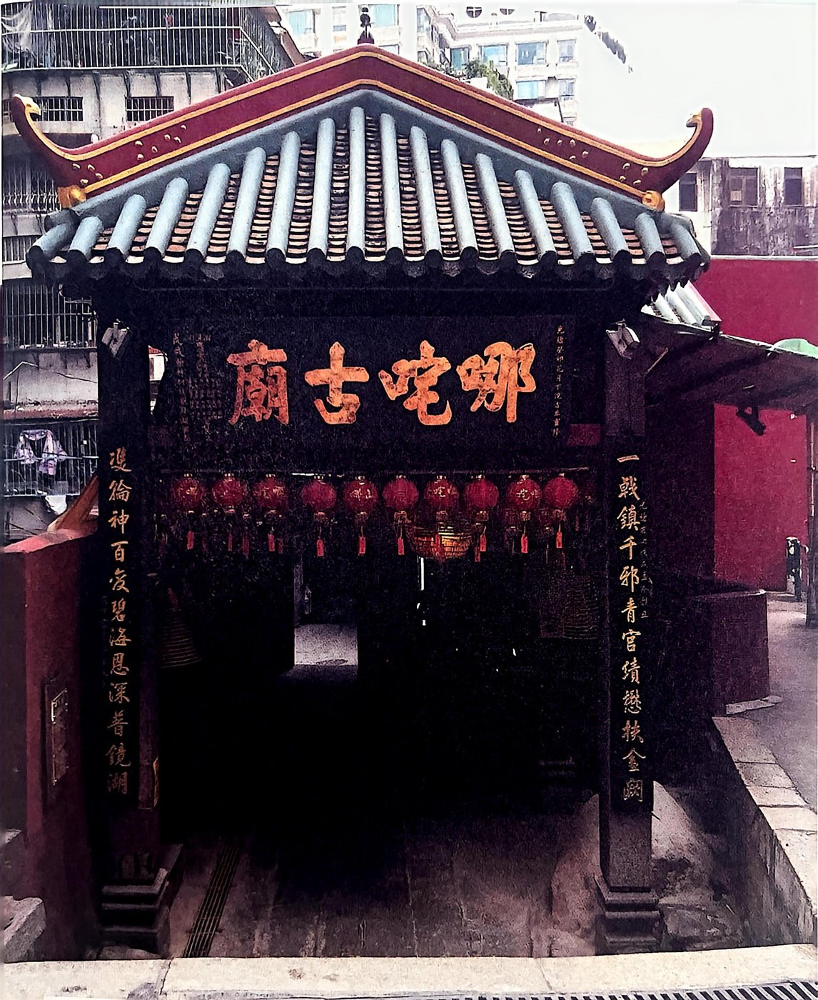
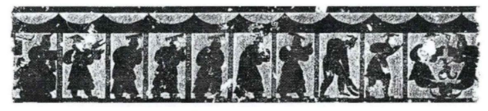
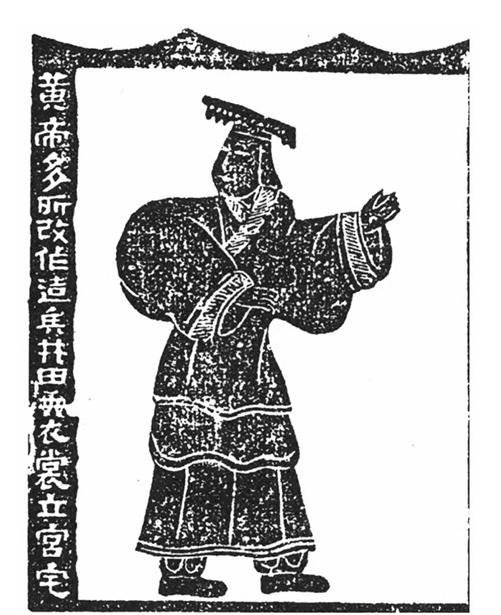
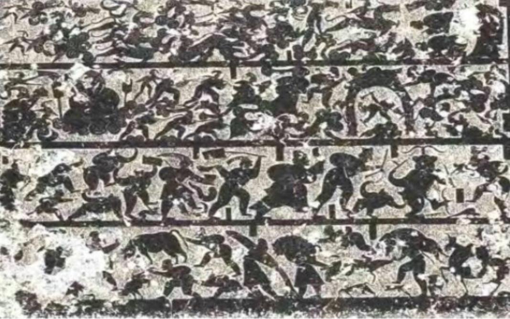

# 第六讲：神话与历史 { #top }

本文是[神话学引论随笔](../mythology-intro.md)系列的第六篇，对应 2026 年 11 月 10 日的课。

关于神话和历史的关系，课件开头列了三种立场：

1. 神话和传说就是历史；
2. 神话传说中包含着历史事实，历史记载中也包含着神话传说；
3. 神话传说并非历史，或者完全与历史无关。

这一讲没有直接选边，而是用三个案例去试：中国的**水神**、《**封神**》，以及英国的**亚瑟王**。最后读《史记·五帝本纪》，看中国最早的一篇「正史」怎样处理传说。

---

## 1. 中国的水神：一个神怎样换了好几个名字 { #s1 }

### 1.1 黄芝岗 { #s1-1 }

黄芝岗（1895—1971），原名黄德修，湖南长沙人，1916 年毕业于长沙县立师范学校。他后来以戏曲史家和民俗学家知名，在中国戏曲研究院工作过，早年当过《湖南通俗报》《湖南民报》的编辑。他的另一面是革命者：中国共产党早期党员，和李立三、毛泽东、刘少奇同在湖南小组，从事工人运动；参加过中国自由运动大同盟、左翼戏剧家联盟、左翼作家联盟和田汉的「南国社」；抗战期间在复旦大学和南京国立戏剧专科学校任教，在《抗战文艺》上发表《论民族形式》《再论民族形式》。

他研究戏曲，是从神话传说、宗教仪式和民俗传统往上追，田野调查和文献考证并用。著作除了《中国的水神》（1934），还有《论山魈的传说和祀典》《大禹与李冰治水的关系》《论两广人的舞狮》《广西民歌和性爱的探讨》《论神话剧与迷信戏》。从这串题目就能看出，他关心的不是神话的「原貌」，而是神话怎样落到地方、落到戏台上。

### 1.2 方法：传说迁移 { #s1-2 }

《中国的水神》的方法，课件概括为「**传说迁移**」分析法：先举传说例证，再比较归纳，最后得出结论。它用来互证的材料有六种：

- **神迹**：真迹和遗迹，比如传说中锁龙的铁链；
- **碑文**：庙碑上的记载；
- **传说**：民间口头流传的故事；
- **时剧**：当时舞台上演的戏；
- **史料**：正史、方志、笔记；
- **童话**：讲给孩子听的故事。

他还做**地理的考察**：在四川、江西、湖南长沙、黄河流域、安徽等地，把一个民间叙事诞生和流传的范围确定到某一府县甚至某一条山川；把同类神迹在各地的纪念物列出来，比如「许真君斩蛟」一个传说，在江西、安徽、湖北、湖南就留下了 34 种神迹；最后讨论地理环境怎样催生叙事。

茅盾评这本书时，概括了研究中国神话的两条路：

> 其一，从秦汉以前的旧籍中搜剔中国神话的「原形」，重要材料就不能不是《山海经》《楚辞》《淮南子》等等；其二，从秦汉以后的书籍乃至现在的民间文学中考究中国神话的演变——各地的传说如何增修了中国原始神话，又如何因此增修而使中国原始神话不但失其原形而且日益凋落，又各地的传说如何互相影响，产生了庞杂而类似的许多「传说的集团」。

茅盾自己的《中国神话研究 ABC》走的主要是第一条路，黄芝岗走的是第二条。

### 1.3 杨四将军、二郎神与李冰 { #s1-3 }

案例从长沙开始。长沙民间流传杨四将军斩「无义龙」的故事。黄芝岗把它和其他几个水神故事并排放：

| 出处 | 主人公 | 情节 |
|---|---|---|
| 长沙民间口头传说 | 杨四将军 | 斩无义龙 |
| 四川灌县神话 | 灌口二郎神 | 入水斩蛟，赴敌时变像 |
| 《西游记》 | 二郎神 | 收降孙悟空 |
| 元剧《唐三藏西天取经》 | 二郎神 | 收降猪精 |
| 《封神演义》 | 杨戬 | 三昧火眼 |

故事相同，主人公不同。几个故事还共享一组细节：铁链锁龙、神像相似、诞辰都在六月六日。黄芝岗的解释是：

> 水神传说的纷歧庞杂是「不同的神的力量所起的争持，不相同的力量是因为不相同的时代地点，有它们相同的水灾和治水的人物」。

于是他回到书本里追二郎神的来源，追出了一条时间线：

- **秦**：蜀守李冰，一个真实的历史人物，治水能人；
- **唐**：李冰被神道化，史官也神其说；
- **宋**：神的威力被李冰的儿子「二郎」夺去，二郎神的传说多过李冰；嘉州的赵昱、襄阳的邓遐又各自顶替了李冰的位置。

二郎神的成因有两条：第一是入水斩蛟，替地方平定水患；第二是地方的太守，或者太守的儿子。茅盾借鲁迅的话总结这一过程：

> 「历史人」的李冰成为神祇以后，又有「历史人」赵昱和邓遐之成神，便是「随时可生新神」，而后出的赵、邓二神的灵异又和在先的李冰的灵异相仿佛，便是「旧神有转换而无演进」。虽然，「演进」固甚少，而增饰（在传说的主要骨干上加添了枝叶）却是「与时俱进」。

「随时可生新神，旧神有转换而无演进」出自鲁迅《中国小说史略》第二篇《神话与传说》。鲁迅的原意是：中国古代天神、地祇、人鬼虽然名义上有分别，但人鬼也能成为神祇，人神淆杂，原始信仰就一直蜕不干净，于是不断产生新神，旧神则只是换个名字。读到这里我想起[第三讲](chapter-03.md#s1)的蒋子文，那也是一个「历史人」靠灵验成了神。

### 1.4 许真君、杨磨与峡江的滩 { #s1-4 }

传说不只在时间里换主人，也在空间里搬家。

江西的许真君（许逊）据说做过四川旌阳县令，因为百姓爱戴而被神化。他最有名的故事是斩孽蛟，明代《铁树记》、清代《神仙宗鉴》里，他和孽蛟「慎郎」斗法。黄芝岗发现，许真君镇蛟和李冰化龙、与龙相斗的故事明显相通；而安徽涂山在汉代属九江郡，县令李阳冰的迁任也把故事带了过去。地理划分和人的迁移，让江西、四川、安徽的神话沟通起来：

> 不但四川神话移来江西，江西神话也有时移来四川。许真君神话也会是李冰神话的产生。——《中国的水神》页六五

长沙的杨将军和许真君比，「像小巫见了大巫，但又像真君神迹的翻印本似的」（页七四）。那么杨将军为什么姓杨？黄芝岗在杜光庭《水记》（《舆地纪胜》引）里找到一个杨姓的治水者：

> 杨磨亦有神术，能伏龙虎，亦于大皂江侧决水拥田，与龙为誓。今有杨磨江。或语讹为羊麻江。

他推断，二郎神姓杨、杨将军庙名「紫云」，都是杨磨传说在川中的歧异演变，长沙的杨将军传说也是从四川二郎神传说脱胎而来（页八三至八四）。证据之一是庙的分布：巴县的紫云庙、巫山县的杨四将军庙、灌县的紫云宫、彭水县的紫云宫，都在灌县下游和峡江一带。为什么偏偏在这里？因为夔巫峡江滩险，滩神「无义」，行船的人需要一位能斩无义龙的将军。

课件把水神神话的特点归纳为三条：

1. 水神传说纷歧庞杂，是不同时代、不同地点、相同水灾与治水人物的力量相争的结果；
2. 不但四川神话移来江西，江西神话也会移来四川，长江一带的水神传说有相当的沟通痕迹；
3. 杨将军（或二郎神）的威灵和神话，是因为夔巫峡江的滩险才产生的。

结论是：水神的原型多是历史上的治水官员或地方豪强；李冰治水的功绩被神化成二郎神斩蛟；这种「**人神互渗**」的本质，是地方社会借神话建构文化认同。

这一节让我意识到，第三条其实最有意思。前两条讲的是文本之间的关系，第三条讲的是文本和地形之间的关系：一段险滩可以「生产」一个神。

---

## 2. 封神：被重写的商周之际 { #s2 }

### 2.1 胜利者的叙事 { #s2-1 }

第二个案例借用了李硕《翦商》的视角：封神传说是周人政治叙事的终极形态。周人通过政治叙事重塑了商周交替的真相，手法可以概括为三个词：暴力合法化、宗教伦理化、历史神话化。

- **天命观工具化**：周人把商人的「帝」信仰改造成「天命靡常」「惟德是辅」的政治哲学，强调纣王失德，把武力夺权包装成「替天行道」；
- **人祭传统污名化**：商朝普遍存在的人祭制度，被简化成纣王个人的暴虐发明；
- **女性符号化**：商代女性地位较高，周人却把妲己定义为亡国妖妇。

### 2.2 从平话到演义 { #s2-2 }

封神故事在宋元有话本《武王伐纣平话》。同一时期还流传着玄天上帝收魔的故事：

> 元始天尊因见下界恶气弥塞，乃命玉皇上帝降诏玄天上帝下降凡间；玄天上帝遂与六天魔王战于洞阴之野，制服六天魔王，锁鬼众于酆都大洞，从此国泰民安，宇宙清肃；大功告成、返回天庭后，玄天上帝被封为职掌北方天界的尊神。——《元始天尊说北方真武妙经》

降世、斩妖、受封，这正是《封神演义》的叙事骨架。到明代，《封神演义》把民间叙事诗、神话、传说、平话、轶闻以及佛经故事熔成了一部小说。

### 2.3 历史要素的神话转译 { #s2-3 }

公元前 11 世纪的商周革命，在小说里被转译成了另一套东西：牧野之战变成「姜子牙冰冻岐山」「哪吒莲花化身」这样的斗法；历史事件的因果关系，变成神话体系里的善恶对抗。

**纣王**的形象最能说明顾颉刚的「层累」：西周文献里纣的罪名主要是酗酒；春秋战国加上了「比干剖心」「炮烙之刑」等具体罪状；到《封神演义》，他成了「宠妲己、害忠良」的标准暴君。政治上的失败被简化成道德堕落的因果报应。这个过程古人自己也看到了，《论语·子张》记子贡的话：「纣之不善，不如是之甚也。是以君子恶居下流，天下之恶皆归焉。」

**姜子牙**走的是另一条路，可以叫「政治家神圣化」。他的原型吕尚辅佐武王灭商，以谋略著称，后世为他立庙祭祀；民间贴「姜太公在此，诸神退位」驱避鬼神；小说则把他的军事谋略转化为奇门遁甲、呼风唤雨的法术斗争。纣王被一层层抹黑，姜子牙被一层层抬高，两个方向的层累用的是同一套机制。

### 2.4 哪吒：从文本到实践 { #s2-4 }

{ loading=lazy }

哪吒这一段把话题从文本拉回到[第四讲](chapter-04.md)的「做」。哪吒信仰在华南和港澳台落地生根：台湾有 370 多座哪吒庙；澳门大三巴旁有哪吒庙；香港长洲太平清醮的巡游里也有哪吒的形象。

课件引了杨斌《全球史的九炷香：哪吒、龙涎香与坦博拉》。19 世纪末华南瘟疫流行，疾病被认为是恶鬼与病魔作祟，于是降魔除妖的哪吒被请来辟瘟除病，一些哪吒庙正是在瘟疫中建起来的。小说里的哪吒是一个闹海的少年，到了庙里，他的职能变成了防疫。这和第一讲西王母从「司天之厉及五残」变成寿福之神，方向正好相反，道理却一样：神的职能由供奉他的人眼下需要什么来决定。

---

## 3. 亚瑟王：一位国王的层累 { #s3 }

### 3.1 历史原型 { #s3-1 }

亚瑟王传说根源于 5、6 世纪凯尔特人的一支不列颠人抵抗盎格鲁-撒克逊人入侵的战争。不列颠人被迫退到威尔士、康沃尔等西部和北部山区。亚瑟的原型，大概是一位领导抵抗运动、打过不少胜仗的将领。

### 3.2 文本的层累 { #s3-2 }

| 文本 | 时间 | 亚瑟的样子 |
|---|---|---|
| 南尼厄斯（Nennius）《不列颠人史》 | 9 世纪 | 取得十二次战役胜利的军事领袖 |
| 威尔士故事汇编《马比诺吉昂》 | 约 11 世纪 | 一方领主 |
| 蒙茅斯的杰弗里《不列颠诸王史》（拉丁文） | 12 世纪上半叶 | 第一部详细讲述亚瑟出生、继位、武功、征服和死亡的著作，塑造为典型的封建领主 |
| 瓦斯（Wace）法语《布鲁特传奇》（Roman de Brut） | 1155 | 首次引入圆桌；宫廷文化 |
| 拉亚蒙（Layamon）中古英语头韵体诗《布鲁特》 | 12 世纪末 | 宫廷色彩减少，更接近民间传统；亚瑟被英格兰化、本土化 |
| 克雷蒂安·德·特罗亚的亚瑟王传奇 | 12 世纪后期 | 骑士精神与宫廷爱情结合，兰斯洛特、帕西法尔成为主角，亚瑟退为配角 |
| 法语散文「正典系列」 | 13 世纪 | 寻找圣杯、兰斯洛特与王后格温娜维尔的爱情、亚瑟之死 |
| 丁尼生《国王叙事诗》 | 维多利亚时期 | 道德化的民族史诗 |

「正典系列」包括《兰斯洛特》（Lancelot）、《寻找圣杯》（Queste del Saint Graal）、《亚瑟王之死》（La Mort le Roi Artu）、《圣杯史》（L'Estoire del Saint Graal）和散文《梅林》（Prose Merlin）。

这张表和第三讲吕洞宾题壁诗的流传史很像：每一个新版本都在旧骨架上添枝加叶，而且添什么取决于写给谁看。写给诺曼宫廷，就加圆桌和宫廷礼仪；写给英格兰本地人，就减掉宫廷气；写给骑士阶层，就让骑士当主角。

### 3.3 亚瑟王作为政治符号 { #s3-3 }

形象的演变可以压成一条线：军事领袖 → 领导封臣和骑士作战的中世纪君主，即「不列颠之王」 → 英国的民族英雄 → 诺曼统治者自诩的先祖和效法对象。

最后一步最有讽刺意味。亚瑟原本是抵抗外来入侵者的不列颠人，后来却被另一批外来征服者认作祖先。爱德华一世把继承亚瑟作为自己统治的历史根据，到格拉斯顿堡拜谒「亚瑟王的坟墓」。这座坟是格拉斯顿堡修道院的修士在 1191 年宣布「发现」的。一旦被当作真实的历史，亚瑟的故事就会继续被创作和发展。

传说里的亚瑟并没有死：他受了致命伤，被送到阿瓦隆岛疗养；有一天不列颠遭受侵略，这位休息中的国王会像基督一样重返人间，保护他的国家和人民。一个承诺「会回来」的国王，对任何想继承他的人都很有用。

课件列了几本讨论亚瑟王传说背后真实历史的书，放在文末参考里。

---

## 4. 《五帝本纪》阅读与讨论 { #s4 }

### 4.1 历史的神话化与神话的历史化 { #s4-1 }

讨论之前先区分两个方向相反的过程。

**历史的神话化**：真实的历史人物、事件或制度被赋予神性、添加超自然元素，逐步转化为神话叙事；帝王治水、英雄征伐这样的世俗经验被神格化、符号化，成为承载集体信仰的文化符号。李冰变成二郎神，吕尚变成姜太公，都属于这一类。

**神话的历史化**：原始神话被剥离神性、赋予历史属性。它发生在神话从口耳相传转为文字流传的过程中：古代史家挑选、修改神话，文学家则处理那些无法历史化的材料。

20 世纪中国神话学的主流，是茅盾从西方引入的「神话的历史化」：中国神话之所以零散，是因为被史家改造成了古史，研究者的任务就是把历史还原为神话。常金仓（2000）对此提出了质疑：

> 西方神话是以自然神为核心的，中国神话的重心却在英雄崇拜上，根本不存在所谓「神话历史化」。

他认为基于亲族团体形成的中国自然神话先天不足，不能拿西方神话体系去套。按这个思路，中国古史传说的主要形成途径恰恰是反过来的「历史的神话化」。这也呼应了[第一讲](chapter-01.md#s3-3)课件的那条反思：不要拿希腊神话当尺子去量中国神话。

### 4.2 作为神话的五帝本纪 { #s4-2 }

徐旭生把五帝时代称为「传说时代」，认为当时存在华夏、东夷、苗蛮三大集团。在他看来，历史人物经过神化而有了神性，事迹经过夸张而变得非凡，这是中国神话形成的主要途径。

《五帝本纪》说黄帝「教熊罴貔貅貙虎，以与炎帝战于阪泉之野」。山东嘉祥武梁祠西壁第二层的画像，从右到左依次是伏羲与女娲、祝诵（祝融）、神农、黄帝、颛顼、帝喾、帝尧、帝舜、夏禹、夏桀，正好是一部刻在石头上的古史谱系。

{ loading=lazy }

{ loading=lazy }

### 4.3 熊：四重证据 { #s4-3 }

「熊罴貔貅貙虎」到底是什么？课件用叶舒宪提倡的「四重证据法」（传世文献、出土文字、口传与民俗、考古实物与图像）来解：

- **文献**：前四种都是熊类。罴是棕熊，貔、貅是白熊，雄的叫貔，雌的叫貅；黄帝本人号称有熊氏；
- **民俗**：鄂伦春、鄂温克、赫哲等北方狩猎民族都有神熊祖先的图腾叙事；
- **考古**：辽宁建平牛河梁女神庙出土了真熊的骨骼和泥塑熊的残件；
- **图像**：徐州邳州一座汉代祠堂的画像石上，西王母身边的侍者里有一位熊首人身。

这样读，「教熊罴貔貅貙虎」就不一定是驯兽作战，更可能是以熊等猛兽为图腾的各个族团。这和[第二讲](chapter-02.md#s3)闻一多从龙推出图腾族团兼并是同一类论证，问题也一样：图腾说解释力很强，但弹性也很大。

### 4.4 战国人怎样造古史 { #s4-4 }

《五帝本纪》的材料很大一部分来自战国。课件引了几段原文，放在一起看很有意思。

驺衍造古史的方法是从今往古推：

> 先序今以上至黄帝，学者所共术，大并世盛衰，因载其禨祥度制，推而远之，至天地未生，窈冥不可考而原也。先列中国名山大川，通谷禽兽，水土所殖，物类所珍，因而推之，及海外人之所不能睹。称引天地剖判以来，五德转移，治各有宜，而符应若兹。——《史记·孟子荀卿列传》

韩非讲的是社会进步的阶段：

> 上古之世，人民少而禽兽众，人民不胜禽兽虫蛇。有圣人作，构木为巢，以避群害，而民悦之，使王天下，号曰有巢氏。民食果蓏蜯蛤，腥臊恶臭而伤害腹胃，民多疾病。有圣人作，钻燧取火，以化腥臊，而民悦之，使王天下，号之曰燧人氏。——《韩非子·五蠹》

课件说，这种建立一套历史时空体系的努力，和卢梭的《论人类不平等的起源》很像：都是从当下的社会出发，推想出一个「起源」，再给起源之后的每一步起名字。徐旭生据此区分了两类古帝王：

> 我们可以推断神农与有巢、燧人为同类，是战国时的思想家从社会进步的阶段而想出来的指示时代的名词。至于伏羲、女娲却同太皞、蚩尤为一类，是另一集团的传说中的英雄，他们的真实人格也许可以存在，也许并不存在。——徐旭生：《中国古史的传说时代》

顾颉刚走得更远：

> 自春秋末期以后，诸子奋兴，人性发达，于是把神话中的古神古人都「人化」了……所以我们对于古史，应当依了那时人的想象和祭祀的史为史，考出一部那时的宗教史，而不要希望考出那时以前的政治史，因为宗教是本有的事实，是真的，政治是后出的附会，是假的。——顾颉刚：《答刘胡两先生书》

具体到黄帝：春秋时神仙家和论道之人把他涂饰成神仙，《汉书·艺文志》里著录了大量托名黄帝的书，如《黄帝内经》《黄帝阴阳》《黄帝长柳占梦》《黄帝五家历》；战国时儒家又把他推崇为古代帝王。结果出现了两个五帝系统：春秋战国时以黄帝为首，对应《五帝本纪》和《大戴礼记·五帝德》；秦以后以伏羲、神农为首，黄帝居中，对应《淮南子》《庄子》《战国策》。

### 4.5 司马迁的纠结 { #s4-5 }

司马迁一方面承认黄帝，一方面又不相信与黄帝相关的许多记载。《五帝本纪》的「太史公曰」里有一句：「百家言黄帝，其文不雅驯，荐绅先生难言之。」他的办法是以黄帝为界，划开传说时代和历史时代，黄帝以前的一概不写。课件引的评价是：

> 我们只要看唐司马贞忍不住替他补作《三皇本纪》，就可知道他在方士和阴阳家极活动的空气之中排斥许多古帝王是怎样的有眼光与有勇气了。

[第二讲](chapter-02.md#s3)闻一多引的伏羲「蛇身人首」，正是出自司马贞补的这篇《三皇本纪》。司马迁删掉的东西，八百多年后又被补了回来。

司马迁把黄帝从仙境拉回人间，靠的是给他一个人格。李凭注意到《五帝本纪》开头那句赞语：「生而神灵，弱而能言，幼而徇齐，长而敦敏，成而聪明。」

> 「生」「弱」「幼」「长」「成」五字正好是人生的五个必经阶段；在这五字之后，连用了「神灵」「能言」「徇齐」「敦敏」「聪明」五词，这五词除「神灵」以外都是用于形容个体的性格与智商的。所以，看似虚誉的文字其实不虚，恰恰具有使黄帝人格化的意义。——李凭：《黄帝历史形象的塑造》

### 4.6 黄帝与蚩尤：一场战争的三种写法 { #s4-6 }

黄帝蚩尤之战在不同文本里很不一样：

- 《山海经·大荒北经》：「蚩尤作兵伐黄帝，黄帝乃令应龙攻之冀州之野。」这是神话，双方调动的是应龙、风伯雨师；
- 《黄帝四经·十大经·正乱》：「黄帝身遇之蚩尤，因而擒之，剥其皮革以为干侯，使人射之。」这是政治寓言，胜利者把失败者的皮做成箭靶；
- 《庄子·盗跖》：「黄帝不能致德，与蚩尤战于涿鹿之野，流血百里。」这是批判，黄帝成了失德者。

{ loading=lazy }

同一场战争，被神话、法家和道家各写一遍，立场不同，事件却被保留了下来。课件引了黑格尔论史诗的一段话，大意是：史诗必须以一件动作的过程为对象，而这件动作要让人认识到它与一个民族、一个时代的整个世界密切相关，一个民族精神的全部世界观由此对象化为具体的事迹。黄帝蚩尤之战就是这样一件「意义深远的事迹」。在当代，它仍然作为历史模型和理想帝王的神话被讲述。

### 4.7 政治神话化 { #s4-7 }

最后一个概念是**政治神话化**：神话怎样被中央政权收编为国家意识形态，地方信仰怎样被纳入官方叙事、强化中央对地方的控制。神话因此成了「当代史」的产物。课件举了两个例子：

- **封禅**：《史记·封禅书》说上古有七十二家封禅，这是战国时期造出来的说法；到司马迁写书时，真正举行过封禅的只有秦始皇和汉武帝；
- **五帝世系**：把各族团的祖先排进一个父子相承的谱系，反映的是战国以来国家统一、民族融合的期望。

而在另一套文本里，黄帝从来没有被完全拉回人间。刘向《列仙传》：

> 黄帝者，号曰轩辕。能劾百神，朝而使之。……《仙书》云：黄帝采首山之铜，铸鼎于荆山之下。鼎成，有龙垂胡髯下，迎帝，乃升天。群臣百僚悉持龙髯，从帝而升，攀帝弓。及龙髯拔而弓坠，群臣不得从，仰望帝而悲号。故后世以其处为鼎湖，名其弓为乌号焉。

正史里的黄帝葬在桥山，仙传里的黄帝乘龙升天，两个黄帝并行了两千年。

---

## 5. 小结：神话与历史怎样交缠 { #s5 }

课件的总结有三句：神话与历史的关系，本质上是人类认知世界的两种模式的对话；神话并非纯粹虚构，而是「集体记忆的选择性重构」；研究要超越文本分析，关注神话在具体历史情境中的展演、叙述、传播与重构。

最后回到顾颉刚的「层累地造成的古史观」：

- 时代愈后，传说的古史期愈长；
- 时代愈后，传说中的中心人物愈放愈大；
- 我们不能知道某一件事的真确状况，但可以知道某一件事在传说中的最早状况；
- 「我对于古史的主要观点，不在它的真相而在它的变化。」

最后一句可以当整讲的题眼。水神、封神、亚瑟王，三个案例追的都是变化而不是真相。课件由此归纳了神话作为「活态文化事件」的几个特点：神话通过叙述构建共同体，比如亚瑟王传说定义了不列颠文化；每次讲述既是对既有叙事的重构，也把新的文化元素注入传统；神话是意识形态工具；口头传统里的神话不是固定文本，而是通过即兴创作不断适应社会变迁，具有「创造性变异」的特征。

至于历史和神话谁排斥谁，课件给了两种看法：

- **历史排斥神话**：这是现代学科的偏见、进化史观的产物。科学和理性主宰下的历史强调实证，把神话视为某种雏形，当作特定民族的「史前史」；
- **历史与神话交缠**：后现代史学家认为，客观的历史书写也必须借助或迎合某种潜在的神话模式。神话与历史同源，人类早期的集体记忆始终和神话缠在一起；现代民族国家的话语建构里，神话又是重要资源，构成了立体、多面、多层次的「神话历史」。海登·怀特说得最彻底：历史与神话都是叙事策略，区别只在于前者披上了「真实」的外衣。

我的感受是，这一讲把第一讲蒋观云那句话又翻了出来：「荟萃此植字者，于古为神话，于今为历史。」一百多年前，他把神话和历史看作同一副铅字在不同时代的排版。读完二郎神、纣王、亚瑟和黄帝，我觉得这个比喻比当时想的更准确：铅字确实是同一副，只是每个时代都会按自己的需要重新排一次。

---

## 参考与图片来源 { #refs }

**主要参考**

- 梁君健：《神话学》课程第六讲课件（2026 年秋）。
- 黄芝岗：《中国的水神》，1934；吉林人民出版社，2022。
- 鲁迅：《中国小说史略》，第二篇《神话与传说》。
- 李硕：《翦商：殷周之变与华夏新生》，广西师范大学出版社，2022。
- 杨斌：《全球史的九炷香：哪吒、龙涎香与坦博拉》，中信出版集团。
- 常金仓（2000）关于「神话历史化」的讨论，据第六讲课件引文。
- 徐旭生：《中国古史的传说时代》。
- 顾颉刚：《答刘胡两先生书》，收入《古史辨》第一册。
- 李凭：《黄帝历史形象的塑造》。
- 黑格尔：《美学》第三卷下册。
- 亚瑟王传说与历史：King Arthur and the Myth of History；King Arthur in Antiquity；N. J. Higham, King Arthur: Myth-Making and History；Laurie A. Finke and Martin B. Shichtman, King Arthur and the Myth of History；Rodney Castleden, King Arthur: The Truth Behind the Legend。

**图片来源**

- 澳门哪吒古庙、武梁祠西壁古帝王画像、武梁祠黄帝画像、武梁祠后石室画像：截取自第六讲课件，仅作学习笔记引用。
