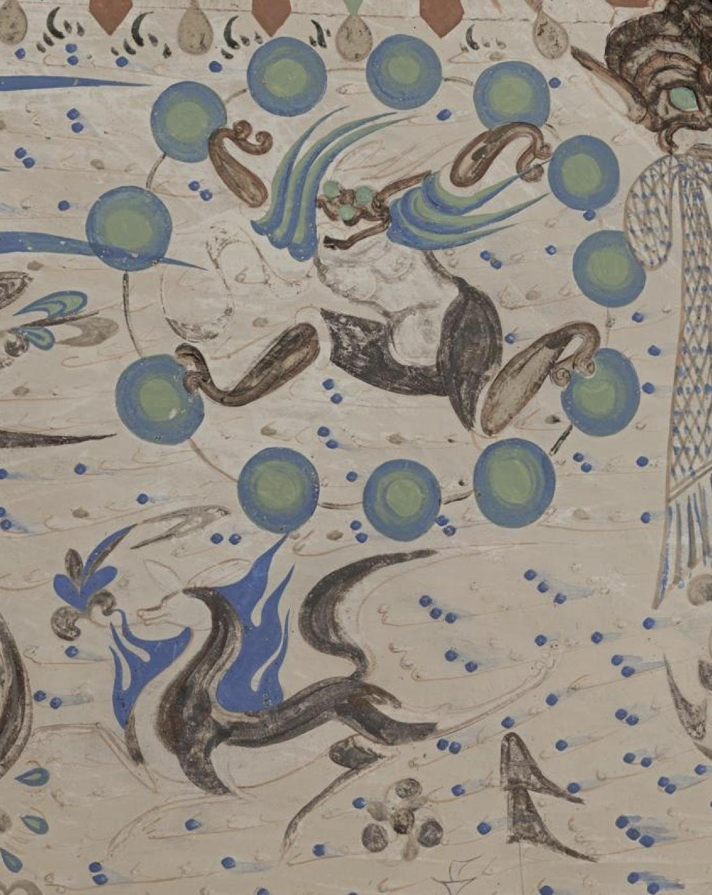

# 第七讲：认知与想象 { #top }

本文是[神话学引论随笔](../mythology-intro.md)系列的第七篇，对应 2026 年 11 月 17 日的课。

这一讲的副标题是「语言人类学视角下的神话」，分三部分：先回顾第二讲讲过的神话「语言起源论」，再讨论语言与认知，最后讨论神话思维中的语言与想象。最后一页留了一个问题：如果语言可以由人工智能生成，神话会怎样？

---

## 1. 回顾：神话起源于语言 { #s1 }

### 1.1 缪勒与恩底弥翁 { #s1-1 }

[第二讲](chapter-02.md#s4)讲过马克斯·缪勒的「语言疾病说」。这次课件补了他的语言发展四阶段：**词的形成期、方言期、神话期、民族语言期**。神话期夹在方言期和民族语言期之间，也就是说，神话是语言发展到某个阶段必然出现的产物。

恩底弥翁的故事再讲一遍：他是宙斯和卡吕刻的儿子、厄利斯的国王，一天晚上在山洞里沉睡，被月亮女神塞勒涅看见并爱上了他。宙斯答应满足他一个愿望，他选择永睡不醒，从此不老不死。缪勒的解读是一张对照表：塞勒涅是月亮，宙斯是白昼明亮的天空，恩底弥翁是日落。月亮「爱上」沉睡的日落，原本只是「入夜了」的诗意说法。

### 1.2 伏羲考与杜梅齐尔 { #s1-2 }

闻一多的《伏羲考》也属于这条路：训诂、音韵、考据并用，大量引用语音材料，论证伏羲（包戏、匏瓠）和女娲（苞娲、匏瓜）都是「葫芦」的音变。

法国学者乔治·杜梅齐尔（Georges Dumézil）则走出了另一条路。他抛弃了词源学的联想，改用一种带社会学色彩的历史方法，比较印欧各民族相似的社会—宗教现象，提出「社会三重功能论」：祭司与君权、武士、生产者三种结构性分工，在印欧神话的神谱里反复出现。课件对这条思路的概括是：人类童年时代的神话虽然粗糙、朴素，却不是材料的任意堆砌，而是一个有思想、有体系、产生于某种共同意识的完整系统。语言产生于社会实践，也反映社会现实。

### 1.3 那么，语言起源于什么？ { #s1-3 }

如果神话起源于语言，下一个问题自然是：语言起源于什么？

**卢梭**认为，语言最初的建立者无法区分属性和种类，所以最早的词语必然都是专有名词。他接着提出一个两难：一个已经建成的社会对于语言的发明，和已经发明了的语言对于社会的建立，哪个更为必要？

**赫尔德**在《论语言的起源》里回应卢梭。他把问题分成语言的社会起源论和认知起源论两种，自己站在后者：人有思考能力，能准确观察和区分事物的所有特性并加以确认，语言来自人本身的悟性和自然的启发。

> 语言源出于人类心灵，证明语言是通过人的感官和知觉形成的！有无数的事实证明，在所有的民族、国度和环境里，语言都萌芽于理性之中并随着理性的成长而成熟起来！——赫尔德：《论语言的起源》

**缪勒**代表了 19 世纪语言学家的共识：没有语言的人类是不存在的，即使是「未开化人」的语言也有十分完善的语法，词汇里有让任何诗人都羡慕的丰富名词。在语言的最底层，蕴含着后来被称作万物有灵论、拟人说、神人同形同性论的真正萌芽。缪勒认为这种萌芽是语言和思维的必然性，而不是后来那种自由的、诗情画意的观念。

### 1.4 风与飞廉 { #s1-4 }

{ loading=lazy }

「风吹草低见牛羊」，一句再平常不过的诗。课件用它说明缪勒的意思：「吹」是动词，动词在语法上需要一个施动者，于是「风」这个名词就被人格化了。人格化的风，在中国叫**飞廉**：

- 《离骚》：「后飞廉使奔属。」
- 应劭：「飞廉，神禽，能致风气也。」
- 晋灼：「身似鹿，头如雀，有角而蛇尾，文如豹。」

「风吹」是自然语言、诗的语言；「空气流动」是科学语言。神话就长在前一种说法里。这个对照在这一讲最后还会出现。

---

## 2. 语言与认知 { #s2 }

### 2.1 现实—认知—语言 { #s2-1 }

课件引王寅（2025）的说法：人对世界的认识始于五官感觉，在头脑中形成初步的、个别的、简单的感觉反应；在此基础上形成知觉，即心智对事物的综合认识；进而形成意象图式，于是可以言说不在场的事物或事件。这个过程中发展出范畴、概念和意义，再用语言形式固定下来，就完成了一个「现实—认知—语言」的过程。语言是三者互动的产物。

### 2.2 从具体到抽象 { #s2-2 }

列维-布留尔在《原始思维》里举过两个著名的例子：

- 拉普人（萨米人）的语言用 41 个词指称不同形式的雪，26 个动词表示上冻或解冻，却没有「冰」「雪」这样的类概念；
- 澳大利亚土著语言对每一种树、鱼、鸟都有专门的名称，却缺乏「树」「鱼」「鸟」这样的抽象属名。

他由此认为，语言和思维的发展一般都经历了从具体到逐步抽象化、概括化的过程。

这个结论我觉得要打个折扣。「某民族有几十个词表示雪」后来成了语言学里被反复检讨的说法：词的数量和怎么切分「词」有很大关系，英语滑雪者对雪的分类也不少。列维-布留尔的「原始思维」说本身也被后来的人类学大量批评过。课件放这两个例子，更有用的意思大概是：分类的粗细取决于一个群体在什么事情上需要精细，而不一定是智力高低。

### 2.3 球与物自体 { #s2-3 }

课件接着做了一个小实验：怎样认识一个球体？

- **生理知觉的有限性**：球的每个面都是圆形，但我们实际上只能看到一个面；
- **认知主体的开放性**：大脑会根据记忆、经验和想象做「认知缝合」，把零散的感官信息综合成一个完整的、抽象的概念：球体。

下一页放了两张图：一个球，和一个正面看是球、侧面却拖着一个圆锥的怪东西。从正面看，两者没有区别。这就引到康德：

> 物自体究竟是什么，我无从知晓，也无需知晓，因为事物从未以非现象的形式呈现在我面前。

我们永远无法认识「物自体」，也就是康德说的「本体」，只能接触到「现象」，即事物在我们特定思维方式下呈现出的样子。课件的落点是：**语言的功能，是超越现象，去想象、思考、认识和表达本体。**看不见的那半个球，是靠语言里的「球」字补上的。

### 2.4 符号与分类：四神 { #s2-4 }

列维-斯特劳斯认为，人需要借助一系列符号，把自己对自身、自然、宇宙、生命、死亡、时间、空间的认知和思考表达出来并相互沟通；没有符号系统就没有沟通，也就没有文化，于是事物有了范畴。早期的范畴多建立在自然现象和动植物上：太阳、月亮、河流、树木、狮、虎、羊、马、牛、鸟，在不同群体中意义各异，但没有一个群体不给它们赋予象征意义。

> 图腾崇拜是一种符码，它的角色不在于仅仅表达某种类型的事实，而在于以一种概念工具的方式来实现把一种现象中的抽象的关系用另外一种现象中的经验性的、具体的关系翻译出来。

中国古代的**四神**是一个现成的例子。《礼记·礼运》里，它们指鳞物、介物、羽物、毛物四类动物；后来扩大到指称四方天、四方地、四种季节和四种色彩，青龙、白虎、朱雀、玄武成了一套关于宇宙秩序的符号。课件把这个过程概括为「具象物体符号 → 具象事物符号 → 抽象事物符号」，并用《易·系辞》的「远取诸物，近取诸身」来解释：把太阳的运行和人类生命的循环当作宇宙秩序的核心。四神是思想的符号和宇宙观的术语，而不是现实生活中的动物。

这里又接回了[第二讲](chapter-02.md#s4)提过的涂尔干和莫斯《原始分类》：分类的根源是社会的，而不是先天的、抽象的逻辑分类；决定事物分类方式的差异性和相似性，在更大程度上是情感的，而不是理智的。

### 2.5 对语言的崇拜 { #s2-5 }

《淮南子·本经训》：「昔者仓颉作书，而天雨粟，鬼夜哭。」文字一旦被造出来，就同时是两样东西：一套关于事物分类的概念，代表人对世界的认知和掌握；以及宇宙万物的象征，成为人膜拜的对象。主宰和崇拜交织在一起。

课件配的另一段材料出自《汉武帝内传》，西王母降临汉宫之后：

> 歌毕，因告武帝仙官从者姓名，及冠带执佩物名，所以得知而纪焉。

西王母临走前把随从仙官的名字、衣冠佩物的名称一一告诉汉武帝，「所以得知而纪焉」。知道了名字，才能记下来、传下去。从[第一讲](chapter-01.md#s2-1)读到这里，西王母又多了一种存在形态：她是一份名单的来源。

### 2.6 语言作为交往共识 { #s2-6 }

人的认知结构有稳定性，不同主体之间存在一致的认知结构，所以人与人能就同一个客观对象形成基本一致的认知，这是交往的前提。事实通过文字表述和语言活动变为「真理」。

法国古典学家让-皮埃尔·韦尔南用「语义空间」形容这种被结构化、秩序化了的精神空间。希腊人从儿童时代起，就伴随语言学习熟悉了神话的结构；后来书写代替口语，诗歌让神话故事有了更固定、更有形式特征的文本。诗歌是「代替社会记忆、知识保存和交流工具的真正机构」：「正是在诗歌中，并且通过诗歌，各种重要特点得到表述和确定，同时具有了易于记忆的言语形式。」

### 2.7 月亮与月球 { #s2-7 }

语义空间最好的例子是「月」。课件引孟修祥对中国文学中月亮原型意象的归纳：

| 意象 | 例证 | 解释 |
|---|---|---|
| 不死与再生 | 闻一多《天问疏证》：「月之盈亏，有生魄死魄之称，此言月之有生死。」 | 圆缺循环代表死后再生，与绵延不朽的生命观相契合 |
| 重土与回归 | 李白「举头望明月，低头思故乡」；苏轼「人有悲欢离合，月有阴晴圆缺」 | 农耕民族以客居为离、回乡为圆，家族团圆的观念在月的圆缺里得到认同 |
| 高洁与光明 | 张孝祥「应念岭海经年，孤光自照，肝肺皆冰雪」 | 月如一面镜子，人从中观照自我的高洁 |
| 温柔的女性 | 李白「湖月照我影，送我至剡溪」 | 农耕文化崇拜大地与月亮，月象征温柔贞静的女性 |

然后是《流浪地球 2》。电影里，月球为了人类的生存被摧毁。课件引了一段影评：当月亮作为永恒的意象被毁灭，未来的人类又该怎样表达我们曾经附着在月亮上的那些情感？对新人类来说，那个球状物体只剩下一个冷冰冰的天文学名称「月球」，那个一开口便带温柔和诗意的「月亮」，他们忘记了。

「今人不见古时月，今月曾经照古人。」李白写这两句的时候，默认的是月亮永远在那里。月亮和月球是同一个天体，属于两个语义空间。这和「风吹」与「空气流动」的对照是同一回事。

---

## 3. 神话思维：语言与想象 { #s3 }

### 3.1 想象力征服自然 { #s3-1 }

[第一讲](chapter-01.md#s1-4)引过马克思的话：「任何神话都是用想象和借助想象以征服自然力，支配自然力，把自然力加以形象化。」课件这次把它讲得更具体：没有科学的时代，面对洪水、地震、雷电和莫名其妙的死亡，人几乎每天都在恐惧中挣扎。人有一项独特的能力，就是想象力。暴雨可怕，就想象有雨神；洪水可怕，就想象有龙王；地震可怕，就想象有山神。即便知道是虚构的，也能在一定程度上缓解恐惧。

霍克海默和阿多诺在《启蒙辩证法》里把这个意思推到了另一头：启蒙的根本目的是「摆脱恐惧，树立自主」，而神话通过解释世界、赋予事件意义，对古人来说就相当于灯或光，照亮或驱散某些恐怖。所以**神话本身就是启蒙**。悖论在于，启蒙在驱逐神话的同时，也可能因过度理性化而陷入新的统治逻辑，把自然变成可算计的客体，启蒙又退化成神话。

鲁迅的说法更朴素：天地变化多端，万物难以恒常，人力解释不了这个玄妙的世界，太古初民就把「神思」加以「人化」，创造了神话。

### 3.2 什么是想象 { #s3-2 }

课件梳理了几种关于想象的看法：

- **亚里士多德**区分了两类想象：一类只是认知的反射和再生产，主要是记忆；另一类是生产性的，是自主生成的景象；
- **康德**：想象是把不在场的东西带入思维的能力，它让知识得以综合，把不同的形式和现象综合起来。认知缝合那半个看不见的球，靠的就是这种能力；
- **作为否定动作的想象**：想象一个东西，同时就意味着它不在眼前。萨特在《想象心理学》（L'Imaginaire）里发挥过这层意思；
- **保罗·利科**：想象不仅是心理学现象，它在语言中也起关键作用。在隐喻里，想象以一种创造性的力量，在隐喻物和被隐喻物之间发现相似性。借由想象，我们理解语言的表面意义并解读其深层意义；想象有发现、解释、再创造世界的功能。课件举的例子正是前面讲过的两个：风与飞廉，四神与四方五行。

### 3.3 巴特：神话是二级符号系统 { #s3-3 }

[第一讲](chapter-01.md#s3-2)提过罗兰·巴特的《神话学》。这次讲的是它的符号学骨架。索绪尔说，一个符号由能指和所指构成；巴特说，神话把一个已经有意义的符号整个拿过来，当作新的能指，指向意识形态层面的所指。

课件用的例子是玫瑰。在第一层，一束玫瑰（能指）和激情（所指）结合成一个符号；按巴特的框架，这个「激情的玫瑰」还可以整个充当第二层的能指，指向更大的意识形态，比如什么样的关系才算爱情、爱情应该怎样被消费。巴特书里更有名的例子是《巴黎竞赛报》的封面：一个穿法军制服的黑人士兵向国旗敬礼，第一层意思就是「一个士兵在敬礼」，第二层意思是「法兰西是一个伟大的帝国，她的所有子民都忠诚地为她服务」。神话的厉害之处在于，它让第二层意思看起来和第一层一样自然。

### 3.4 语言、思维与记忆 { #s3-4 }

维特根斯坦说：「语言的边界即世界的边界。」卡西尔说：「语言是人类精神的基本工具之一，通过它我们从单纯感性的世界进入直觉和观念的世界。」没有语言，思维和事件都无法被人认识；语言的本质是把感知世界客观化，赋予意义以稳定的形式，主观世界由此变成客观世界，构成人类经验中的知觉世界。

心理学家伊丽莎白·洛夫特斯的撞车实验，把这个哲学命题变成了数据。两组人观看同一段撞车录像，然后被问不同的问题：

- 第一组：「那辆车**撞毁**另一辆车时，你估计车速有多快？」
- 第二组：「当**碰撞**发生时，你估计车速是多少？」

第一组估计的平均车速比第二组高出约 10 公里/小时。一周后，两组人被问：有没有看到碎玻璃？第一组有 32% 的人说看到了，第二组是 14%。录像里根本没有碎玻璃。

一个动词就改写了记忆。课件的结论是：人对事件的认知记忆是一种主观想象，「事件」同样是被建构的，极易出现偏差，包括记忆错误、个人情感和图式的干扰。读到这里我想到第六讲：如果一个动词就能让人「看见」不存在的碎玻璃，那么几百年的转述让纣王多出炮烙之刑、让二郎神多出一个姓，也就不奇怪了。

### 3.5 利科：神话怎样构造体验 { #s3-5 }

利科在《恶的象征》里分析亚当神话，概括了神话的三种作用：

1. **用具体的故事表达普遍性**：亚当代表普遍的人类，所以圣保罗会说我们「因」亚当而有罪；发生在某一时期的事件成为体验的原型，人性以类型的方式被概括；
2. **塑造体验的方向**：讲述过错起源与终结的神话，给体验以一种倾向和内在牵引力，让体验脱离当下，贯穿在一个从沉沦到拯救的历史进程里；
3. **探索人性之谜**：亚当神话讲的是人从清白到有罪的转变，但它不是历史说明。它揭示的是人预设的善良、幸福的本体状态，与当下体验到的异化状态之间的断裂。神话因此带有本体论视角，探究人的本质存在与历史存在之间若即若离的关系。

### 3.6 列维-斯特劳斯：神话是「元语言」 { #s3-6 }

列维-斯特劳斯从结构语言学出发：神话讲述时沿着不可逆的时间轴展开，所以它是**言语**；但神话又是超时间的，能同时说明过去、现在和将来，它由不同元素组织成一个共时性的结构系统，所以它又是**语言**。神话的实质不在文体、叙事方式或句法，而在故事本身。它「超结构地」使用语言形式，形成一种「元语言」。于是「国王」不只是国王，「牧羊女」也不只是牧羊女，它们是构造对立系统的手段：阳／阴（自然方面），尊贵／低贱（文化方面）。

方法是三步：分解神话，找出「神话素」；把神话素归入「关系束」；解读关系束之间的关系。他的经典案例是《神话的结构研究》（1955）里的俄狄浦斯神话。把卡德摩斯、俄狄浦斯和俄狄浦斯儿女的故事拆成神话素，横着按时间读，竖着按关系分成四列：

| 过分看重血缘 | 过分轻视血缘 | 否定人由土地而生 | 坚持人由土地而生 |
|---|---|---|---|
| 卡德摩斯寻找被宙斯掳走的妹妹欧罗巴 | | | |
| | | 卡德摩斯杀死毒龙 | |
| | 龙牙武士（斯巴达人）自相残杀 | | |
| | | | 拉布达科斯（拉伊俄斯之父）＝「跛足」(?) |
| | 俄狄浦斯杀死父亲拉伊俄斯 | | 拉伊俄斯（俄狄浦斯之父）＝「左脚有病」(?) |
| | | 俄狄浦斯杀死斯芬克斯 | |
| | | | 俄狄浦斯＝「肿脚」(?) |
| 俄狄浦斯娶母亲伊俄卡斯忒 | | | |
| | 厄忒俄克勒斯杀死兄弟波吕尼刻斯 | | |
| 安提戈涅不顾禁令安葬兄长波吕尼刻斯 | | | |

四列各有一个共同点：

- **第一列**：有血缘关系的亲属之间过于亲密。卡德摩斯寻找欧罗巴的情节暗示二人超出了兄妹关系；安提戈涅埋葬兄长，也带着恋人的痕迹；
- **第二列**：同样的关系，性质相反，血缘关系过于疏远：自相残杀、弑父、兄弟相杀；
- **第三列**：龙和斯芬克斯都是不让人生存的怪物。龙是地下之神，只有把它杀死，人类才能从大地中诞生。这一列否定人由土地而生；
- **第四列**：在许多神话里，由土地而生的人刚从地下出来时，不是不会走路，就是步履蹒跚。普埃布洛神话里最先冒出地面的穆因乌和地下之神舒梅科利都是瘸子，克瓦基乌特神话里的人从地下怪物肚里回到地面时也「一瘸一拐」。所以名字里带「脚」的这一列，坚持人由土地而生。

于是有了那个著名的公式：

**高估血缘 ∶ 低估血缘 ＝ 试图摆脱大地出身 ∶ 终究无法摆脱大地出身**

一边是「人生于大地」的宇宙论信念，一边是人实际上由男女所生的经验。两组原本无法衔接的关系，通过「两组矛盾各自都与自身相矛盾」得到沟通，矛盾由此被置换，并得到一种公共的表述。弗洛伊德把俄狄浦斯神话读成个体欲望和家庭罗曼史，这是起源论；列维-斯特劳斯把它读成集体心灵调解宇宙论矛盾的语言，这是结构论。

课件还贴了《神话的结构研究》里的一段原文。我试着译出来：

> 然而这些层次并不完全相同。既然神话的目的是提供一个能克服矛盾的逻辑模型（如果矛盾是真实的，这就是不可能完成的任务），那么理论上就会生成无限多的层次，每一层都和其他层略有不同。于是神话螺旋式地生长，直到催生它的那股智识冲动耗尽为止。它的生长是连续的，结构却是不连续的。如果真是这样，我们应当认为，神话在言语的领域里，非常接近晶体在物质领域里的存在方式。

这段话可以拿来解释第六讲的二郎神：李冰、赵昱、邓遐、杨磨、杨四将军，每一层都和前一层略有不同，因为背后那个矛盾（人治不了水，又必须治水）从来没有被真正解决。

---

## 4. 结语：神话语言与 AI 时代 { #s4 }

课件的结语是：神话的价值不在经验真实性，而在情感真实性和社会功能性。人们相信神话，是因为它回应了内心深处对意义、秩序和超越的渴望。知识不只限于自然法则下的理性和物质世界，还有经验型的知识、修辞型的知识、隐喻的知识、社会的知识，以及道德和审美上的知识（阿布都哈德，2024）。

然后是那个问题：人工智能生成的语言呢？课件列了几条判断：

- 知识本身与经验感知的关系趋于「隔绝」；
- 经验作为知识唯一来源的渠道被打破，部分被数据替代；
- 认知社会化的情境由此丧失。

哈耶克说过：「仅仅」研究大脑的物理结构，永远无法解释心智现象，因为任何一个特定的心智事件，都是而且仅仅是由其他相关的心智事件来定义的。列维-斯特劳斯的「语言—心智—世界」模型也给心智以第一性：心智借助世界创造语言系统，语言系统建立已「铭刻」在心智结构中的世界形象，心智再以这种结构去重构和复现世界的经验对象。

最后一页把胡塞尔和「单向度的人」放在一起。严格说，「单向度的人」是马尔库塞的书名；胡塞尔在《欧洲科学的危机与超越论的现象学》里讲的是科学世界对生活世界的遮蔽。两者的意思可以连起来：文字对感知有抽象、挤压和更改，西方近代危机的根源在于科学世界遮蔽了生活世界，出路是回归生活世界，**从「空气流动」回到「暖风吹拂」**，回到统一、完整、有机的感知经验中去，回到「整体的人」。只有整体的人才能感知到生活世界。

这句话让整讲首尾相接：开头是「风吹草低见牛羊」和飞廉，结尾是「暖风吹拂」。我的理解是，这一讲并不是在为神话的「不科学」辩护，而是在说：「风吹」和「空气流动」是两种都必要的语言，一个只剩下后一种语言的世界，会像《流浪地球 2》里没有月亮的天空。大语言模型能生成无穷多句「风吹」，它生成的东西算不算神话，大概要看有没有人真的被那阵风吹过。

---

## 参考与图片来源 { #refs }

**主要参考**

- 梁君健：《神话学》课程第七讲课件（2026 年秋）。
- 赫尔德：《论语言的起源》。
- 列维-布留尔：《原始思维》。
- 涂尔干、莫斯：《原始分类》。
- 王寅（2025）关于「现实—认知—语言」的论述，据课件引文。
- 孟修祥关于中国文学中月亮原型意象的论述，据课件引文。
- 韦尔南（Jean-Pierre Vernant）关于希腊神话「语义空间」的论述，据课件引文。
- 霍克海默、阿多诺：《启蒙辩证法》。
- 保罗·利科：《恶的象征》；《活的隐喻》。
- 罗兰·巴特：《神话学》（Mythologies, 1957）。
- Elizabeth F. Loftus and John C. Palmer, "Reconstruction of Automobile Destruction: An Example of the Interaction Between Language and Memory," Journal of Verbal Learning and Verbal Behavior, 1974.
- Claude Lévi-Strauss, "The Structural Study of Myth," Journal of American Folklore, 1955.
- 胡塞尔：《欧洲科学的危机与超越论的现象学》；马尔库塞：《单向度的人》。

**图片来源**

- 莫高窟第 285 窟窟顶西坡壁画局部：截取自第七讲课件，仅作学习笔记引用。
