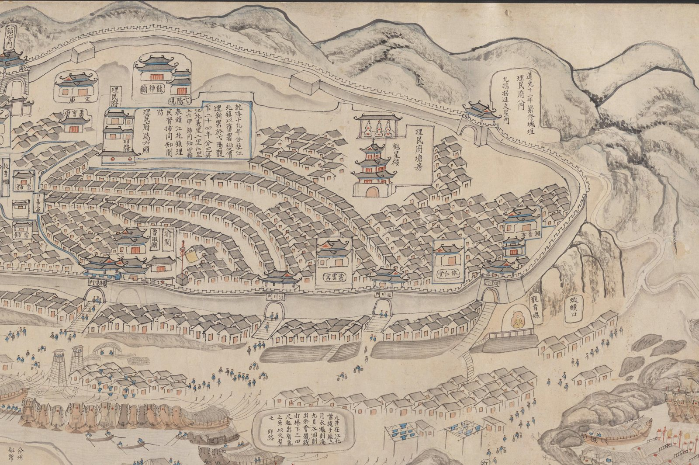
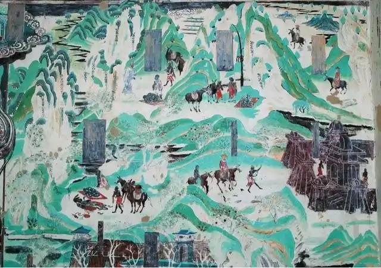
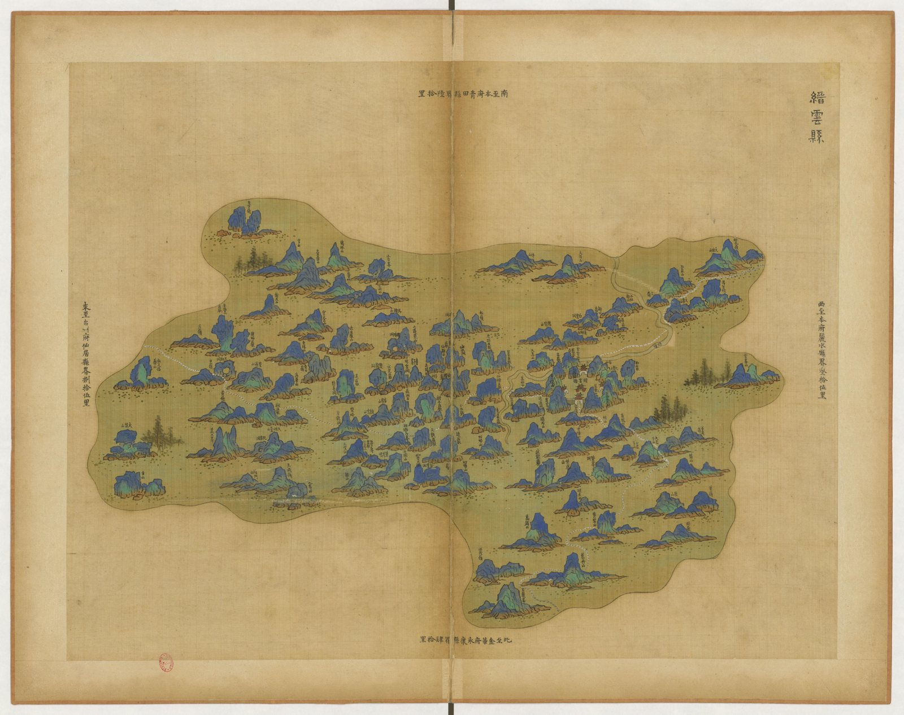
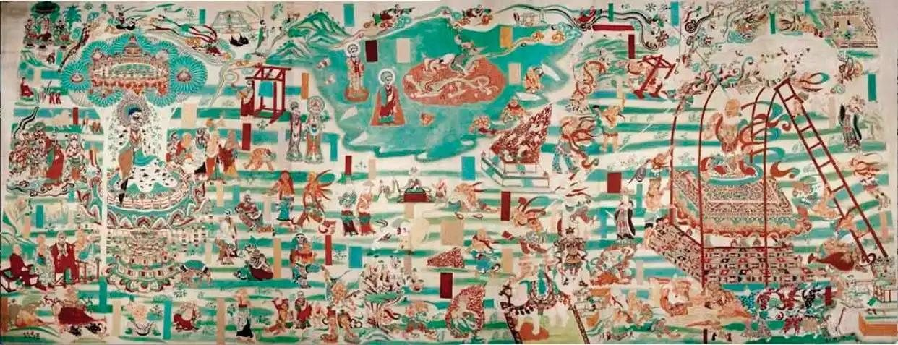
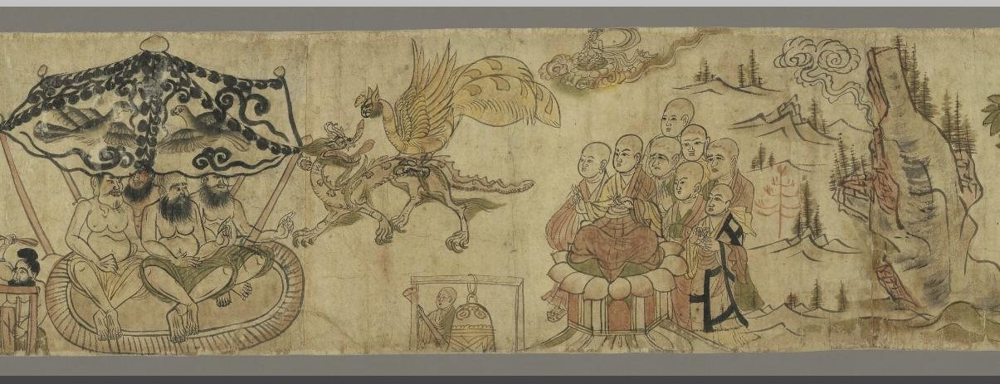
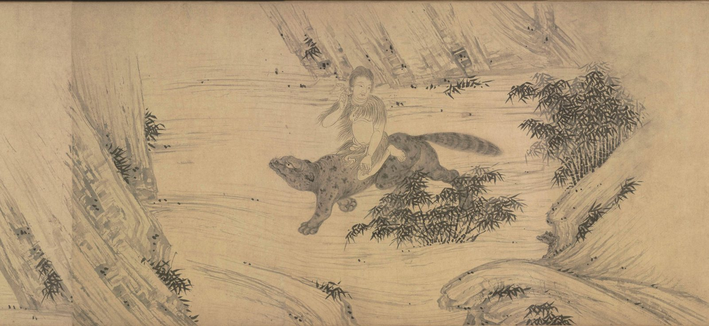
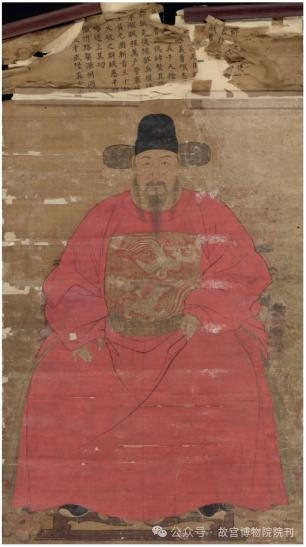
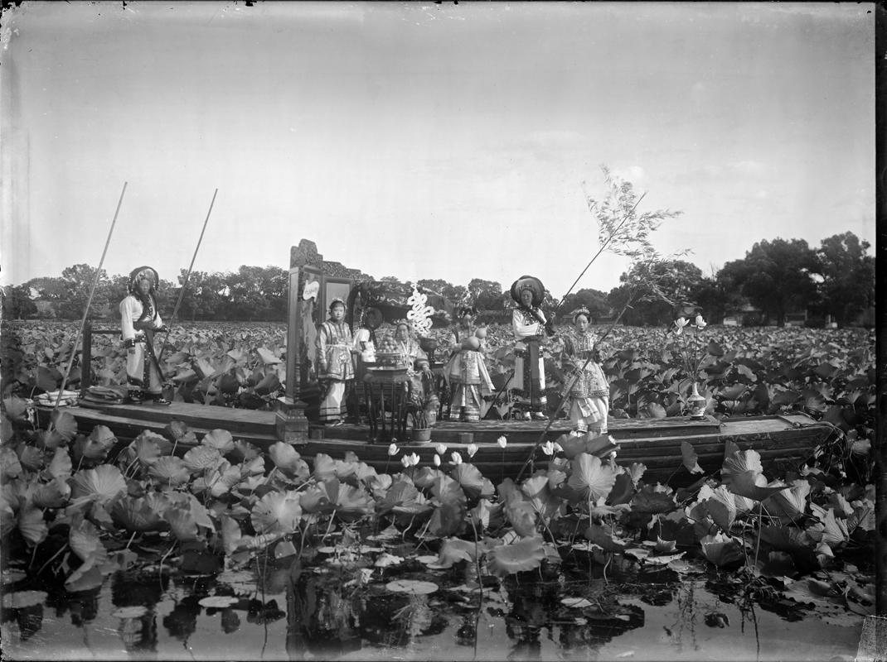

# 第八讲：神话与图像 { #top }

本文是[神话学引论随笔](../mythology-intro.md)系列的第八篇，对应 2026 年 11 月 24 日的课。

[第一讲](chapter-01.md#s2-4)读西王母画像砖时，我们已经把图像当成神话的一种存在形态。这一讲把图像本身当作对象，分**舆图、壁画、肖像**三块，追问同一个问题：图像是怎样被建构出来的，它又怎样反过来建构了人们对世界、对神、对祖先的认识。

课件先给了一个图像建构的层级：线条 → 形状 → 图形与图式 → 形象（名物之间的指涉关系） → 图画（不同内容之间的关系） → 幅面与壁面 → 整体单位。越往后，图像就越不是「画了什么」，而是「这些东西怎样被组织在一起」。

---

## 1. 舆图：眼见为实，还是程式 { #s1 }

### 1.1 从中土世界到桃花源 { #s1-1 }

课件的第一张地图是托尔金的中土世界，接着是《桃花源记》：「林尽水源，便得一山，山有小口，仿佛若有光……土地平旷，屋舍俨然。」随后放了一幅青绿山水地图的局部，山峦之间嵌着城池和道路。三样东西放在一起，意思是：地图从来不只是测量的结果。虚构的世界可以有一张精确的地图，真实的县城也可以画得像桃花源。

{ loading=lazy }

《渝城图》据估计是 1860—1886 年间民间绘制的重庆地图。它用的是古代城池图常见的办法：平面图和建筑立面图结合，城墙和城门画成正面的样子，府学、文庙、魁星楼都立在纸上。地方志里的城门图也是这样，康熙元年、乾隆三年、光绪六年三版《清远县志》画同一座南门，样式大同小异。课件还放了朝鲜的《送朝天客归国诗章图》（约 1451—1600，韩国国立博物馆藏），以及一张网上流传的「任何中国城市的地图」漫画：老城门、人民广场、新火车站、新市中心、高层公寓和工地。后者笑的正是程式：每座城都被画成同一个样子。

### 1.2 写实与程式 { #s1-2 }

由此引出这一讲的第一对概念：

- **写实**：眼见为实；
- **程式**：一种强化秩序条理的形式表现手法。它经过改造加工，提炼概括出物象的典型特征，然后集中、简化、固定，把形制定型化。

课件说两者是一枚硬币的两面，共同决定了图像的演变。城门为什么总画成正面？因为画工要让看图的人一眼认出「这是城门」，正面比俯视更像城门。程式不是写实的失败，而是另一种准确：它对准的是认知，而不是视网膜。

### 1.3 写实与写意 { #s1-3 }

{ loading=lazy }

第二对概念是写实与**写意**。龚贤（1618—1689）有一段话：

> 古有图而无画。图者，肖其物，貌其人，写其事。画则不必然，用良毫、珍墨，施于古楮之上。其物则云山、烟树、危石、冷泉、板桥、野屋。人可有可无。若命题写事则俗甚。

「图」要像，要有事；「画」不必像，人都可有可无。课件的解释是：山水画超越了通过祭祀礼仪和神仙信仰达成的天人关系，把山水放进人性内在的生动气韵之中，给社会文化的神圣性赋予了新的意涵；被神圣化的山林又反过来滋润文人创作，所谓「俊得江山助」。山岳从封禅和祭祀的对象，变成了文人修养的对象，这是[第四讲](chapter-04.md#s5)泰山、妙峰山之外的另一条神圣化路线。

课件还放了两幅「写事」的图做对照：明代的《平番得胜图》（局部，课件注明用 AI 做过清晰化处理），以及东京大学所藏《倭寇图卷》局部。山水是背景，战事是主题，这正是龚贤说的「图」。

### 1.4 从自然图像到政治图像 { #s1-4 }

舆图在中国是大一统观念的具体载体，它不断强化人们对空间和疆域的认知。

康熙二十四年至二十八年，为编《大清一统志》，朝廷谕令各省呈送舆图，中国第一历史档案馆藏有《天下舆图总摺》档案。康熙的要求很具体：

> 勿得照依旧图，必亲历地方，将城池山之方向河道源流及水陆道里远近逐一考证明白，详加绘画进呈御览可也。

《广东舆图》的韩序则说出了舆图对皇帝的意义：「居重驭轻，视远若近，纳八荒于尺幅，置万里于目前。」清内务府造办处舆图房绘制或贮存的舆图，今天第一历史档案馆还存有 1943 件，分天文、舆地、江海、河道、武功、巡幸、名胜、瑞应、效贡、盐务、寺庙、山陵、风水等 13 大类。「瑞应」和「风水」与「河道」「盐务」并列，本身就说明这些图既是行政工具，也是天命的证明。

王正华论清代宫廷画时有一段话，课件引来做这一节的结论：

> 这些绘画表现了清朝统治下的土地和人民，这些城市图像既是真实的，也是象征性的。所谓的清朝疆域并不一定是一个经验性的既定事实，而需要不断地定性、编纂和认可，才能令帝王承担起天命的角色。

{ loading=lazy }

《浙江全图》是一个很好的例子：省图、府图、县图全用青绿山水的笔法，缙云县几乎被画成一幅山水画。光绪十二年《太谷县志》的县境图则是木刻线描，山是一排三角，城是一个方框。两者都是「舆图」，一个是进呈御览的彩绘本，一个是印在地方志里给地方官和读书人用的。

### 1.5 舆图由谁绘制 { #s1-5 }

历代都有专门的制图机构：

- 《唐六典·兵部》：「凡地图委州府三年一造，与版籍皆上省。」
- 《宋会要·职官》：「诏诸路转运各上所部山川形势，地里远近、朝廷屯戍军马、支移租赋之数，召翰林画工为图，纳枢密院，以备检阅。」
- 《明会典·兵部》：郎中、员外郎、主事之职，「掌天下地图」。
- 《大清会典·兵部职方清吏司》：「掌天下舆图，以周知险要。」

地图归兵部，宋代还要交给枢密院，地图首先是军事机密。画图的人则是翰林画工，于是军事情报用的是画家的笔。

### 1.6 长城：图像怎样孕育神话 { #s1-6 }

这一节的标题是「图像谱系与符号系统」：图像孕育神话，是中华文明的文化基因；它凝聚了对自然、社会、历史的共同感知与审美理想；长城、黄河、长江这些地理符号不只是物质存在，更是民族意志与精神的象征。

课件用一串地图和照片串起了长城的图像史：

1. 《大元混一统志》的北京分界图，长城画成一道带垛口的粗线；
2. 元朱思本撰、明罗洪先增补的《广舆图》（万历七年，1579），用计里画方的网格，长城是一条涂黑的带子；
3. 一幅彩绘全国图里，长城成了蜿蜒的红线，旁边是黄色的黄河；
4. 明杨时宁等编《宣大山西三镇图说》（万历三十一年，1603）里的山海关和边堡，青绿山水之间有烽墩、蒙古包、骆驼和放牧的人；
5. 一张老照片，长城的台阶上坐着几个孩子；
6. 民国画报《我国空军战绩》，飞机飞过长城；
7. 八路军战士在古长城上架机枪（沙飞摄，抗战时期）；
8. 当代摄影里杂草丛生的野长城；
9. 1949 年第一套人民币的贰佰圆券，以及 1980 年的长城币。

从军事防线到宫廷舆图上的疆界，再到抗战照片里的民族象征，最后印在钱上，长城的意义是一层层图像叠出来的。这和[第六讲](chapter-06.md#s5)顾颉刚的层累是同一种机制，只是累积的媒介换成了图像。

---

## 2. 壁画：经变与图教 { #s2 }

### 2.1 经变、变文、变相 { #s2-1 }

{ loading=lazy }

壁画部分从莫高窟第 254 窟北魏的《降魔成道图》讲起，然后提出三个相关的词：**经变、变文、变相**。把佛经故事画成图叫经变或变相，配合讲唱的文本叫变文。这套「以图说教」的传统，课件称为「图教」，而且不限于佛教：

- 「老子八十一化图」出自《老子化胡经》；
- 「善财童子五十三参」图出自《华严经》；
- 孔子「圣迹图」系统依据《论语》《孔子家语》等想象和创造。

### 2.2 《降魔变》：图、文、经三种讲法 { #s2-2 }

案例是舍利弗与外道劳度叉斗法的故事。第 196 窟的《降魔变》有清楚的**视觉逻辑**：国王位于中心，正面端坐在画面中轴线上；两侧是两组相对的人物和乐器，劳度叉与金鼓在右，舍利弗与金钟在左。

它也有惊人的**细节写实**：劳度叉座上的华盖被风吹得摇摇欲坠，追随者挣扎着加固，有人爬梯子去修，有人用锤子往地上打桩，想拉住歪斜的顶棚；另一些外道在强风中只能以手覆面，放弃抵抗。

{ loading=lazy }

敦煌还出了一卷《降魔变图卷》，现藏法国国家图书馆，画卷上配有抄写的唱词。卷首的高耸山体和几组低矮的三角形山形，可以看作对莫高窟第 103 窟《法华经·化城喻品》山石母题的模仿。「金翅伏毒龙」一段的唱词是：

> 是日六师渐冒惨，忿恨罔知无控。虽然打强且祗敌，终竟悬知自倾倒。又更化出毒龙身，口吐烟云怀操暴。雷鸣电吼雾昏天，礔砾声扬似火爆。场中恐怯并惊嗟，两两相看齐道好。舍利既见毒龙到，便见奇毛金翅鸟。头尾慑锉不将难，下嘴其时先啅脑。血流遍地已成泥，瞬息之间食啜了。

而这个故事的经文出处，《贤愚经》卷十《须达起精舍品》，写得极其简省：

> 复作一龙身。有十头。于虚空中。雨种种宝。雷电振地。惊动大众。众人咸言。此亦劳度差作。时舍利弗。便化作一金翅鸟王。擘裂啖之。众人皆言。舍利弗胜。劳度差不如。

同一个回合，经文几十个字，变文把它扩成十六句有声有色的唱词，画卷又补上了表情、动作和看客。三种媒介讲的是同一件事，各自做到了另外两种做不到的部分。

### 2.3 图文关系与图像意识 { #s2-3 }

课件由此归纳：

- 图文有共同的指涉。「图」与「史」是同一历史对象的不同表达方式，「诗」与「画」则指向同一山水意境或个体心境；
- 二者又有显著的不同，并且因为媒材差异而相互激发；
- **图像意识**，是指用图像来认知、思考和想象的人类活动。

明代山西繁峙公主寺的水陆壁画是一个例子。南墙一角画着老虎扑人、大树压人，榜题写「兽咬虫伤树折岩存众」。它对应的是水陆法会《召请十类孤魂文》的第七类：「河井刀索，赴火投崖，墙崩屋倒，树折岩摧，兽咬虫伤横死孤魂众。」经文是一张分类清单，壁画把每一类都变成一个看得见的横死场面。这十类孤魂，和[第三讲](chapter-03.md#s2)武雅士说的「鬼」、[第四讲](chapter-04.md#s3)白云山醮仪里的「施食」，面对的是同一群对象。

课件还放了一页清代苗族图册（「红苗在铜仁府」一条），上半部分是常规的山水树木，下半部分演示男人相斗、女人劝解的场面，憨态可掬。文字是民族志式的条目，图画则把条目演成了一个小场景。

### 2.4 先图后传：《天问》与楚国壁画 { #s2-4 }

再往前追，图和文谁先谁后？饶宗颐认为，从传和图的关系看，传往往是有图而后作的：先有图，后有传，再由传生出颂和赞。他还认为，《天问》的时空错乱并非错简所致，而是以楚国壁画时空自由措置的审美方式为诗。

这个说法的依据，是东汉王逸《楚辞章句》里《天问》的解题：

> 屈原放逐，忧心愁悴，彷徨山泽，经历陵陆，嗟号昊旻，仰天叹息。见楚有先王之庙及公卿祠堂，图画天地山川神灵，琦玮谲诡，及古贤圣怪物行事。周流罢倦，休息其下，仰见图画，因书其壁，呵而问之，以泄愤懑，抒泻愁思。楚人哀惜屈原，因共论述，故其文义不次序云尔。

如果王逸说得对，《天问》就是一首「看图提问」的诗：壁画上的神话场面不按时间排列，诗里的问题也就跳来跳去。

{ loading=lazy }

后来的画家又把楚辞画回了图。南宋佚名的《九歌图》、元代张渥的《九歌图》（克利夫兰艺术博物馆藏）都画了骑豹的山鬼。图生文，文又生图。

汉代宫殿也有这样的壁画。王延寿《鲁灵光殿赋》描写殿内的画：

> 图画天地，品类群生。杂物奇怪，山神海灵。写载其状，托之丹青。千变万化，事各缪形。随色象类，曲得其情。上纪开辟，遂古之初。五龙比翼，人皇九头。伏羲鳞身，女娲蛇躯。……恶以诫世，善以示后。

「伏羲鳞身，女娲蛇躯」，正是[第二讲](chapter-02.md#s3)闻一多追了一整篇《伏羲考》的那个形象。

### 2.5 武梁祠与「原境」 { #s2-5 }

山东嘉祥武氏祠的东汉画像里，有一层层的天界：云气缭绕，神人乘车驾龙；下层才是人间的车马和楼阁。[第六讲](chapter-06.md#s4)读《五帝本纪》时看过武梁祠的古帝王像，这次课件介绍了巫鸿研究武梁祠的三个步骤：

- **图像志研究**（iconography）：了解画面的主题；
- **原境化研究**（contextualization）：把石刻还原到建筑布局中；
- **图像学解释**（iconology）：把画面内容及其表达方式，与汉代艺术的一般性象征系统结合起来。

第二步最关键。拓片把画像从祠堂里剥离出来，变成一张张独立的「作品」；放回原来的墙面、屋顶和山墙，天界在上、人间在下、古帝王排成一列，它们才重新成为一个完整的宇宙图式。

课件还有一个例子说明图像怎样指导实践：明代内官监太监赵谅（1480—1559）墓出土的彩绘描金杉木漆棺，左右帮分绘送葬与回灵的浩大场面，棺画用了「棺上棺」「画中画」的双重结构，暗示实际葬礼需要参照图像进行。

### 2.6 壁画上的中国史：岩山寺 { #s2-6 }

最后一个问题：图生文、文生图之外，宗教壁画的内容还能从哪里来？

答案是画家自己的经历。山西繁峙岩山寺的金代壁画，出自宫廷画师王逵之手。按课件的叙述，他 28 岁时被俘北上，年近六旬才离开燕京，在 1158—1167 年间绘成岩山寺的壁画。壁画画的是佛传故事，但傅熹年分析壁画里的建筑后发现，画中的迦毗罗卫城是按照北宋汴京城画的，鸱尾、斗拱、勾栏等构件和北宋《营造法式》的记载高度吻合。课件把这叫作「汴梁与燕京的重影」：一个被俘北上的画师，在佛陀的故乡里画下了自己的故都。

---

## 3. 肖像：从粉本到照相 { #s3 }

### 3.1 神圣图像 { #s3-1 }

肖像部分先讲神圣图像的几层意思：「观象制器」是赋予青铜器等礼器神圣性的主要方式；绘画的最高境界，是透过表象把握无形的道，也就是神韵；形象 → 偶像崇拜 → 神灵的人格化；以及祖先与先贤的图像。

清代上官周《晚笑堂竹庄画传》序里说：

> 夫颂古人诗，读古人书，想其人而不得见，诚千古之恨事也。苟颂古人诗，读古人书，披其图而如见其人，岂非千古之快事乎？……人非图则无由见，图非画则不能传。

### 3.2 祖宗容像 { #s3-2 }

{ loading=lazy }

明代祖宗容像的制作流程大致是：

1. 职业画工通过观看遗容、听亲属描述、参考生前肖像等方式，用精确的面部轮廓勾勒和多层敷染，画出令出资人满意的像主正面容貌；
2. 根据像主身份和出资人的要求，从容像底稿「粉本」里挑选各种身份的冠带服饰，合成后装裱；
3. 子孙请乡贤名人题写像赞，裱在上方的诗塘里，表彰像主遗德；
4. 每逢年节，合族集会于祠堂，把祖宗容像取出展挂。

课件举了三个例子：

- **江宏宗**：明初洪武年间官拜真定府同知，正五品。像中他戴乌纱帽，胸背是一对织金白鹇，符合五品文官的规格；按制度他应穿青袍，却穿了四品以上才能穿的红袍。这种服色越级在明代祖宗容像里并不少见，一方面明朝对服色的管制向来松散，另一方面容像在私密场所祭祀使用，服饰会按后裔的要求套用不同的粉本；
- **彭泽**：像主因父丧守制离任不久所画，画工对这位知府的样貌应有所依据。像中他四十多岁，仪表方正，但服制近似宋人，应是画工套用了宋代官员容像的粉本。像赞写于弘治壬戌（1502）：「前日之爱民者，公也；今日之思公者，民也」；
- **佚名许姓夫妇像**：女性穿的是六、七品命妇冠服，男子有冠而无服；右下圈椅上供着「高祖妣汪氏太孺人神位」，大概是她去世时没留下容像，只好用牌位代替。许翁生前钟爱黄山，后人特意让画工补了云海奇松的山景。

脸是写实的，衣冠是程式的，背景是写意的。一幅祖宗像里，[1.2](#s1-2) 和 [1.3](#s1-3) 节的三种手法同时出现。它也是[第三讲](chapter-03.md#s2)「祖先」一栏的视觉形态：那里的李氏祖先群像同样穿着官服、按品级排列。

### 3.3 粉本 { #s3-3 }

「粉本」是把画稿转移到画壁或画绢上的中间载体。唐玄宗派吴道子去画嘉陵江山水，回来问他画稿，他说「臣无粉本，并记在心」。这是一个例外，所以才被记了下来。段成式《寺塔记》里有一条：

> 三阶院西廊下，范长寿画西方变及十六对观宝池，池尤妙绝。谛视之，觉水入浮壁。院门上白画树石，颇似阎立德。予携立德行天祠粉本，验之无异。

段成式拿着阎立德的粉本去比对壁画，发现一模一样。大英博物馆藏有一件 10 世纪的说法图粉本，线条上扎满了小孔：把它铺在墙上用粉末拍打，小孔就在墙上留下轮廓。民间画工把这道工序叫「扎谱子」。

粉本让程式可以复制。《降魔变》能在不同的窟里反复出现，江宏宗能穿上不合品级的红袍，彭泽能穿上宋人的衣服，靠的都是粉本。

### 3.4 照相术来了 { #s3-4 }

19 世纪，照相机进入中国，光学原理也被译成了中文，课件放了一页「论镜光成影之理」的成影镜图式。可照相馆很快发现，中国顾客有自己的要求。19 世纪晚期，香港摄影师阿洪说：

> 你们外国人不喜欢正襟危坐直视相机，而我们中国人的喜好很不同，他们必须正面对着相机，向远方的朋友展示自己有两只眼睛和耳朵，脸上不要有阴影，因为脸上本来就没有阴影，阴影不是鼻子，不是任何五官，所以阴影不应该在脸上出现。你看，相机是有缺陷的，它不能做到那个境界，对我们的艺术原则没有认知。

这段话可以直接拿来解释祖宗容像：正面、无阴影、五官齐全，这是容像的程式。照相机反而被认为「有缺陷」。1861 年接手广州照相馆的弥尔顿·米勒（Milton Miller，1830—1899）拍的那批正襟危坐的中国人像，也是这个样子。

### 3.5 慈禧扮观音 { #s3-5 }

{ loading=lazy }

照相术改变了传统肖像吗？课件用慈禧回答。清内务府档案里记着 1903 年 7 月慈禧的一道口谕：

> 海里照相，乘平船，不要篷。四格格扮善财，穿莲花衣，着下屋绷。莲英扮韦陀，想着带韦陀盔、行头。三姑娘、五姑娘扮撑船仙女，带渔家罩，穿素白蛇衣服，想着带行头，红绿亦可，船上要桨两个，着花园预备带竹叶之竹竿十数根，着三顺预备，于初八日要齐。

这是一份完整的分镜脚本：角色、服装、道具、布景、时间都定好了。照片里的慈禧是观音，身边是善财、韦陀和撑船仙女。照相机拍下的是真实的人，构图却是一幅观音变相。

课件接着介绍了法国军官拉里贝（Firmin Laribe）的中国影集。他 1900—1910 年在华担任法国公使馆的安保工作，留下四册 400 多张自己拍摄和收集的照片，其中有慈禧回銮时在正阳门内的仪式，以及好几张慈禧的宫廷照。关于慈禧和摄影，课件还列了几条：内务府专门设了《圣容账》记录慈禧的摄影；她的照片多用于外交场合的交换或馈赠；而她在颐和园扮观音的八寸照片在市面上售价一元，六寸的两种合售一元。

最后一条最有意思。神圣图像一旦可以冲印和售卖，就从祠堂和宫殿走进了市场。

### 3.6 维多利亚女王 { #s3-6 }

作为对照，课件放了一张维多利亚女王的照片：1887 年为庆祝她登基 50 周年，由伦敦 Bassano 摄影室发行的橱柜照（cabinet card），这是 1880 年前后流行的照片格式。维多利亚不仅拍了各种各样的名片照，还是最早的名片照大收藏家。课件特意注了一句：两次鸦片战争都发生在她在位期间。

同一个时代，东西方两位女性统治者都在用照片经营自己的形象，一个扮观音，一个庆登基，照片都在市面上流通。

---

## 4. 小结 { #s4 }

课件的小结是三组词：

- **舆图—壁画—肖像**：三种图像，分别对应空间、信仰和人；
- **写实—程式—写意**：三种手法，在同一幅图里往往同时存在；
- **图教—神圣性—图像意识**：图像用来教化，图像本身带有神圣性，人用图像来认知、思考和想象。

图像谱系的意义，则是追踪视觉形象的生成、传播与演变，借此看到一个民族共有的思想史和精神史，在图像志、神话学、地图学、博物馆学和文化地理学的交叉处做研究。

我自己的感受是，这一讲把[第七讲](chapter-07.md#s1-4)的话题从语言换成了图像。语言里「风吹」需要一个飞廉；图像里城门需要一个正面，祖宗需要一张没有阴影的脸，皇帝需要一张把八荒纳于尺幅的舆图。程式和隐喻一样，不是对真实的背离，而是让真实可以被看见、被记住的形式。神话就藏在这些形式里：长城在舆图上越画越粗，慈禧在照片里成了观音，被俘北上的画师在佛陀的故乡里画下了汴京。

---

## 参考与图片来源 { #refs }

**主要参考**

- 梁君健：《神话学》课程第八讲课件（2026 年秋）。
- 龚贤论「图」与「画」，据课件引文。
- 王正华关于清代宫廷画的论述，据课件引文。
- 《唐六典》《宋会要》《明会典》《大清会典》相关条目，据课件引文。
- 《贤愚经》卷十《须达起精舍品》；敦煌《降魔变图卷》及唱词（法国国家图书馆藏）。
- 饶宗颐关于传、图与《天问》的论述，据课件引文。
- 王逸：《楚辞章句·天问》解题；王延寿：《鲁灵光殿赋》。
- 巫鸿：《武梁祠：中国古代画像艺术的思想性》。
- 傅熹年：《山西省繁峙县岩山寺南殿金代壁画中所绘建筑的初步分析》。
- 段成式：《寺塔记》；上官周：《晚笑堂竹庄画传》序。
- 明代祖宗容像（江宏宗、彭泽、许姓夫妇像）的说明，据课件所引故宫博物院院刊材料。
- 清内务府档案，慈禧口谕，1903 年 7 月。

**图片来源**

- 渝城图、莫高窟第 217 窟《化城喻品》、《浙江全图》缙云县图、莫高窟第 196 窟《降魔变》、《降魔变图卷》局部、南宋《九歌图》局部、《江宏宗朝服像》、慈禧扮观音照片：截取自第八讲课件，仅作学习笔记引用。
